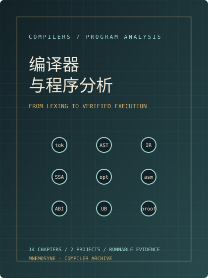

# 编译器与程序分析

<div class="chapter-index">
<div><span class="ci-label">这本书在讲什么</span><p>一段文本怎样变成可执行代码？为什么同一段 C 在 <code>-O0</code> 与 <code>-O2</code> 下行为不同？SSA 到底解决了什么？寄存器分配器为什么会把一个变量赶到栈上？UB 为什么能让编译器删掉你的空指针检查？一个 agent 生成的补丁，怎样在合并前被证明「至少没更坏」？</p></div>
<div><span class="ci-label">读完你会</span><p>独立实现一个可运行的迷你 C 编译器；读得懂 token/AST/CFG/SSA/优化 pass 与 ABI 代码生成；能用数据流、sanitizer、fuzzing、差分测试和轻量形式化方法找出编译器与程序的错误；能给 agent 生成的代码设计静态规则、编译门禁与沙箱执行边界。</p></div>
</div>

<figure class="book-cover">

<figcaption>图 0.1 本书的四条主线。读图：源码在左，IR 在中间反复变形，机器码在右，验证从下往上贯穿每一层；项目一实现前三段，项目二实现最下一段。</figcaption>
</figure>

编译器是少数「每个抽象都能落到可执行证据」的工程领域。你说词法分析器正确，就要给出 token 流与错误位置；你说优化安全，就要给出数据流方程、边界条件与反例；你说生成的代码遵循 ABI，就要给出栈指针变化与 objdump；你说 agent 的补丁可接受，就要给出编译、测试、沙箱与策略证据。

这门课不把编译器讲成「龙书目录」，也不把程序分析讲成「术语表」。它围绕一条可运行的路径组织：

```text
源码 → token → AST → 带类型的 AST → TAC/CFG → SSA
     → 数据流/优化 → 寄存器分配 → 目标代码 → 可执行与验证
```

每一段都配一个能跑的实验或项目代码；每一个「正确」都给出可复核的证据；每一个结论都标出边界。

## 这本书怎么读

| 篇 | 章 | 回答的问题 | 产出 |
|:--|:--|:--|:--|
| 前端与 IR | 1–4 | 编译器由哪些阶段组成？语法与作用域怎么落地？SSA 为什么是优化的共同语言？ | token/AST/CFG/SSA 可视化 |
| 优化与后端 | 5–8 | 数据流怎样求不动点？内联与循环优化何时安全？寄存器与指令怎么选？ABI 怎样变成代码？ | 数据流求解器、优化 pass、代码生成 |
| 正确性与执行 | 9–12 | UB 怎样被利用与检测？如何用 fuzz/差分/属性测试找错？怎样做轻量证明？JIT 与沙箱的边界在哪？ | sanitizer/静态分析、fuzz 循环、验证器、沙箱 runner |
| 项目 | 13–14 | 能不能把上面的东西连成两个真项目？ | 迷你 C 编译器 + agent 代码验证器 |

## 两个项目

- **[项目一：迷你 C/表达式编译器](part4/ch13.md)**。Python 实现前端、TAC/CFG、SSA、常量传播/死代码、x86-64 SysV 代码生成与 IR 解释器；测试把编译执行结果与 AST 解释器对比，并用 `objdump` 检查调用点栈对齐。
- **[项目二：agent 代码验证器](part4/ch14.md)**。把 agent 生成的 Python/C/Rust 片段先做策略检查、静态检查、编译门禁，再在受限子进程中运行差分测试；输出带证据的 `accept/reject/quarantine` 裁决。它明确不把 `RLIMIT` 当安全边界。

## 边界

本书**不重写** x86-64/ARM64/RISC-V 汇编、ABI、调用约定、ELF、链接与重定位的基础。那些内容在《Linux 系统与内核》第 1.14–1.16 章。你在这里看到汇编，只用于回答「编译器生成了什么、为什么、如何验证」；看到 ABI，只用于回答「代码生成器怎样满足合同」。

本书也**不把 C/C++/Rust 语法再写一遍**。语言特性只在编译器需要建模时出现：作用域、类型、生命周期、内联、可见性与 UB。

## 先修与工具

需要：一门系统语言的基本语法（C 或 Rust 之一）、命令行、Makefile 或 shell、能读最简单的汇编。无需先修编译原理，但需要愿意写代码与跑实验。

所有章节的实验都在 `experiments/chNN/`；两个项目在 `projects/`。环境与版本见 [实验环境](env.md)。

> **开始之前**：先做 [入学诊断](preface.md) 的 8 道题。能答对 5 道，说明你具备最低先修；答不出也没关系，错题会告诉你该先补哪一块。
