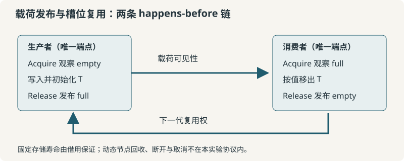

# 7 并发、原子与内存序：从同步证明到缓存行竞争 {#sec-cpp-rust.2.7}

<div class="chapter-index">
<p><span class="ci-label">本章回答</span>：如何证明一次跨线程交接合法；为什么削弱内存序不一定带来加速；共享写入、伪共享与批量聚合各自改变了什么。</p>
<p><span class="ci-label">读完你会</span>：对单槽 SPSC 写出双向 happens-before 证明；复现两个可编译 benchmark；核对三种目标的原子指令；区分聚合吞吐、线程延迟与采样剖析证据。</p>
</div>

一个四线程计数器把 Relaxed 改成 SeqCst 后，运行时间几乎不变。
如果预设“弱内存序一定更快”，很容易把这个结果当作测量失败。
但同一个程序把共享计数器拆为独立、隔离的计数器后，吞吐发生明显变化。
这时需要检验的不是语言排名，而是写入位置、所有权转移与编译器指令选择。

本章保留这样的反直觉结果，不把没有测出的差异补成漂亮数字。
所有性能表来自 `bench/results/local/` 的原始批次记录。
本机是 macOS / Apple M5 Pro，Linux 与 x86-64 只有交叉生成的代码证据。
因此正文不提供伪造的 Linux `perf` 缓存缺失率，也不把交叉生成称为目标机运行。

并发正确性和性能必须沿两条证据链分别推进。
第一条从访问冲突、同步关系推到合法的载荷读取。
第二条从数据布局、原子指令推到完整工作量下的墙钟时间。
没有第一条，第二条可能只是在测 UB；没有第二条，第一条也不能推出吞吐收益。

## 7.1 先画访问图，再选择同步机制 {#sec-cpp-rust.2.7.1}

### 交接的最小单位

本章的载荷是 `[u64; 8]`，共 64 字节。
它在两个线程之间交替转移，而不是被两个线程同时修改。
生产者完成写入后发布 `full=true`。
消费者取得载荷后发布 `full=false`。
后一个方向与前一个方向同样需要同步。

<pre class="layout">
                  一个可复用的槽位
         +----------------------------------+
         | full: AtomicBool                 |
         | payload: UnsafeCell&lt;MaybeUninit&lt;T&gt;&gt; |
         +----------------------------------+
                |                    |
       false: 生产者可写       true: 消费者可读并移出
                |                    |
     write T -- Release(true) -- Acquire(true) -- read T
                ^                                   |
                |                                   v
     下一次写 -- Acquire(false) -- Release(false) -- 读完成

     所有权：producer -> slot -> consumer -> 调用者
     复用权：producer &lt;- empty publication &lt;- consumer
</pre>

读图：`full` 不只是通知位。
它是载荷访问权的交接点。
看到 `false` 的生产者可以开始下一轮写入。
看到 `true` 的消费者才可以把一个已初始化的 `T` 移出。

图中两个箭头分别解决发布与回收复用。
只证明写后可读，还不足以证明下一轮写不会覆盖上一轮读取。
容量为一使代际关系容易检查，但不提供多生产者仲裁。



### 数据竞争与业务竞态分开

Rust 原子文档按访问定义冲突。
访问内存区域重叠，且至少一个访问是写入，才涉及冲突。
冲突访问若至少一个非原子，且没有 happens-before 排序，就可能构成数据竞争。
数据竞争属于 UB，不是“偶尔读旧值”的温和错误。

两个 `AtomicU64` 的合法 Relaxed 操作可以产生业务不一致。
这种结果不自动等于数据竞争。
把所有字段换成原子也不会自动得到跨字段事务。

例如，库存与已售量由两个独立原子表示。
分别读取两个值时，可能观察到不同更新阶段。
即便所有操作都采用 SeqCst，也没有把两次读取合成一个事务。
需要一致快照时，应先定义线性化点，再选锁、版本或单所有者消息处理。

::: def 定义 7.1 · 同步证明的三个层次 {#def-cpp-rust.2.7.1}
第一层是对象的合法生命周期：载荷存在、已初始化、未被提前销毁。
第二层是访问互斥与可见性：谁能写，谁能读，哪条边建立同步。
第三层是业务不变量：多个字段是否必须一起改变。
原子类型主要提供第二层的构件，不会自动完成其余证明。
:::

### 本章采用的原子语义来源

当前标准库原子文档采用 C++20 原子规则的对应解释，不包含 consume 内存序。
Rust 使用 access-based 描述，不能机械复制 C++ 的 atomic object 边界。
本地《Rust 参考手册》PDF 第 334 页还保留着较早的“内存模型未完全明确”说明。
因此该 PDF 用来记录历史范围，不作为覆盖当前所有原子细节的唯一依据。

本章区分三种证据。
语言与库语义来自文档。
具体指令来自 rustc 生成的文件。
吞吐来自本机 benchmark。
三者互相约束，但不能互相替代。

### 性能问题的四个候选

同一个共享写热点可以来自四个方向。
其一是计算本身：每轮做了多少算术或校验。
其二是可见性约束：是否需要跨变量发布。
其三是所有权争用：多少核心写同一个位置。
其四是调度：线程是否被抢占，是否需要阻塞唤醒。

不要只改第二项，然后把其他三项的变化都归因于内存序。
后面的实验会分别控制写入位置与聚合频率。

## 7.2 内存序约束的是哪条边 {#sec-cpp-rust.2.7.2}

### Relaxed 没有去掉原子性

对同一个原子位置的修改仍有修改顺序。
Relaxed 不允许把一次合法原子递增拆成相互覆盖的普通读与普通写。
它不为其他内存位置自动建立发布关系。

“没有跨变量同步”和“随便读任何值”不是一回事。
解释 Relaxed 结果时，仍必须遵守原子一致性与程序其他同步边。
`join`、锁与屏障也可能建立顺序，不能忽略。

本章计数实验在所有工作线程到达完成屏障后才校验总和。
因此读取总和时不需要依靠每次递增发布其他载荷。
把递增改为 Relaxed 没有削弱这个总和检查的目标。

### Release 与 Acquire 必须匹配观察

生产者先写载荷，再执行 Release store。
消费者的 Acquire load 必须观察到对应发布，才建立所需同步。
不是“两个线程分别出现了一个 Release 和 Acquire”就足够。
不是所有后来的时间点都天然属于 happens-before。

用事件名称表示最小证明：

```text
W: producer 写入 payload
S: producer full.store(true, Release)
L: consumer full.load(Acquire) 观察到 S 的值
R: consumer 读取 payload

W sequenced-before S
S synchronizes-with L
L sequenced-before R
所以 W happens-before R
```

这个证明不依赖线程恰好运行在哪一个核心。
不依赖缓存行已经被“手动刷新”。
也不要求生产者等候消费者读完才返回发布操作。

### 反向复用边

消费者读取结束后写回空状态。
生产者必须在下一次写入之前观察到该空状态。
对应证明如下。

```text
R: consumer 完成 assume_init_read
E: consumer full.store(false, Release)
A: producer full.load(Acquire) 观察到 E
N: producer 写下一代 payload

R sequenced-before E
E synchronizes-with A
A sequenced-before N
所以 R happens-before N
```

如果只给 `true` 发布加同步，却把复用方向当成普通标志轮询，证明是不完整的。
在队列扩容、环形缓冲区和对象池中，复用方向通常更容易被遗漏。

### 合法操作与内存序

| 操作类别 | 可用的本章顺序 | 同步含义 | 常见误用 |
|:--|:--|:--|:--|
| load | Relaxed / Acquire / SeqCst | 读取并可能获取发布 | 对 load 使用 Release |
| store | Relaxed / Release / SeqCst | 写入并可能发布先前访问 | 对 store 使用 Acquire |
| RMW | 五种 Ordering | 读侧与写侧组合 | 误以为 Acquire 也发布写侧 |
| CAS 失败分支 | Relaxed / Acquire / SeqCst | 只有读取，没有成功写入 | 失败序使用 Release / AcqRel |

Rust API 对不适用的顺序有约束。
固定顺序错误通常能被 lint 发现；动态顺序仍须查对应方法契约。
不要把 C++ 的所有限制逐字搬到当前 Rust API 上。

### RMW 的两半

`fetch_add` 同时包含读取旧值和写入新值。
Acquire 主要约束其读取一侧，写入一侧并不因此获得 Release 发布语义。
Release 对应写入一侧，读侧并不自动成为 Acquire。
AcqRel 才同时表达两者。

SeqCst 还为相关 SeqCst 操作加入顺序一致性的全序约束。
它不是把整台机器的所有普通访问都强制排成一条全序。
其他 Relaxed 操作仍需单独分析。

### fence 不是万能补丁

在程序中随意加一条 `fence(SeqCst)`，无法补出不存在的交接协议。
fence 同步也需要与相应原子操作建立匹配关系。
`compiler_fence` 不能作为跨核心普通内存通信的通用硬件屏障。

在驱动中还可能涉及设备内存属性与设备屏障。
本章所有实验都操作普通进程内存，不证明 MMIO 协议。
`volatile` 与原子同步是不同问题，不能混用术语。

## 7.3 类型、布局与载荷访问权 {#sec-cpp-rust.2.7.3}

### 类型表：区分线程转移和共享

| 类型 | 所有权可否跨线程 | 共享引用可否跨线程 | 本章用途 |
|:--|:--|:--|:--|
| `u64` | 可以 | 可以 | 按值载荷 |
| `AtomicU64` | 可以 | 可以 | 并发计数 |
| `Cell<u64>` | 可以 | 不可以 | 将端点标记为 !Sync |
| `RefCell<u64>` | 可以 | 不可以 | 运行时借用，不提供线程同步 |
| `Rc<u64>` | 不可以 | 不可以 | 单线程引用计数反例 |
| `Arc<u64>` | 可以 | 可以 | 共享只读所有权 |
| `UnsafeCell<T>` | 取决于 T | 不自动具备 Sync | 内部可变载荷容器 |

`Send` 讨论的是所有权转移。
`Sync` 讨论的是共享引用的转移。
`Arc<T>` 不会把任意 `T` 自动变成线程安全对象。
`Arc<RefCell<T>>` 不是多线程内部可变性的通用替代品。

### 为什么这里需要 UnsafeCell

槽位通过共享引用供两个端点访问。
载荷写入必须合法地发生在内部可变区域。
`UnsafeCell` 撤销的是共享不可变性方面的相应保证，不会自动提供互斥。
`MaybeUninit<T>` 表示槽位为空时还没有一个可读取的有效 `T`。

两者解决的问题不同。
前者关乎别名与变异。
后者关乎初始化与析构。
同步协议仍由 `full` 和端点唯一性保证。

核心定义来自 `bench/src/slot.rs`，不是母本代码。

```rust
pub struct Slot<T> {
    full: AtomicBool,
    value: UnsafeCell<MaybeUninit<T>>,
}
```

这一片段省略 import；完整可编译文件随实验仓库提供。
对公开 API 的安全性，应检查完整文件，不是只检查这两个字段。

### 端点为什么不是 Clone

`split` 需要 `&mut Slot<T>`。
它在同一次借用中只返回一个 Producer 和一个 Consumer。
每次发送和接收又需要 `&mut self`。
端点不实现 Clone。
它们携带 `PhantomData<Cell<()>>`，阻止共享端点被安全地同时调用。

这些类型约束为算法移除了多生产者与多消费者竞争。
如果擅自为端点增加 Clone，算法就需要重新证明。
不能只增加一个计数器，然后沿用原来的 Sync 说明。

### Sync 的完整责任

代码包含一处 `unsafe impl<T: Send> Sync for Slot<T>`。
该声明不是“让编译器闭嘴”的手段。
其理由包含以下条件：

1. 端点唯一，不存在两个并发生产者。
2. 不存在两个并发消费者。
3. 消费者只在 full 状态读取已初始化的 T。
4. 生产者只在 empty 状态写入。
5. 两个方向均有 Release/Acquire 交接。
6. T 作为值跨线程转移，因而要求 Send。
7. 载荷不被多个线程同时按共享引用访问，不要求 T: Sync。
8. Slot 销毁时排除了所有存活端点。

写 safety 注释时，至少要覆盖这些条件。
编译器不会替 unsafe impl 逐条验证。
后续修改私有方法也可能破坏它。

### 布局不是协议本身

本机 `AtomicU64` 的尺寸与对齐均为 8 字节。
实验隔离包装 `Padded` 的尺寸与对齐均为 128 字节。
这是运行时打印与 repr 属性共同给出的证据。

本机 `sysctl hw.cachelinesize` 报告 128。
因此实验用 128 字节隔离，不再假定所有 x86 与 ARM 缓存行统一为 64。
其他机器必须重新核对目标缓存拓扑。
单凭一个语言属性，不能获知整个 SoC 的共享层级。

`[AtomicU64]` 连续紧凑排列。
四个元素共 32 字节，但其起始地址不保证恰好对齐缓存行。
这会影响相邻计数器处于同一行还是跨行。
后面相邻模式的较大方差，需要保留这个解释候选。

## 7.4 从 Rust 原子到 LLVM IR 与目标指令 {#sec-cpp-rust.2.7.4}

### 保存探针而不是手写结论

探针在 `bench/probes/atomics.rs`。
每个导出函数仅做一次原子操作。
使用 extern C 只是稳定汇编中的符号与参数边界，不构成可发布 FFI 库。
探针接受的引用仍要求合法对齐、有效生命周期。

例如两个返回类型相同的读取：

```rust
#[no_mangle]
pub extern "C" fn load_relaxed(a: &AtomicU64) -> u64 {
    a.load(Ordering::Relaxed)
}

#[no_mangle]
pub extern "C" fn load_acquire(a: &AtomicU64) -> u64 {
    a.load(Ordering::Acquire)
}
```

完整文件还包括 SeqCst load、三种 store 与三种递增探针。
输出旧值与不输出旧值的递增必须分别检查。
使用结果与否可能影响指令选择。

### 本机生成命令

在 `cpp-rust/` 下运行：

```bash
rustc --edition=2021 --crate-type=lib \
  -C opt-level=3 --emit=asm,llvm-ir \
  bench/probes/atomics.rs \
  --out-dir bench/results/local
```

该命令不运行目标程序，只生成目标代码与 IR。
本机 target 来自 `rustc -Vv`。
不要从文件扩展名判断运行平台。

### 交叉生成命令

本轮已安装 x86-64 Linux 标准库目标。
因此可以不链接、不启动虚拟机地生成其汇编。

```bash
rustc --edition=2021 --crate-type=lib \
  --target x86_64-unknown-linux-gnu \
  -C opt-level=3 --emit=asm,llvm-ir \
  bench/probes/atomics.rs \
  --out-dir bench/results/x86_64-linux
```

AArch64 Android 目标也只做同样的代码生成。
它不是 Linux 服务器运行数据。
使用它是为了对照不同 target feature 默认值下的指令选择。

```bash
rustc --edition=2021 --crate-type=lib \
  --target aarch64-linux-android \
  -C opt-level=3 --emit=asm,llvm-ir \
  bench/probes/atomics.rs \
  --out-dir bench/results/aarch64-android
```

### ABI / 代码生成对照表

| 探针 | x86-64 Linux 生成结果 | 本机 Apple AArch64 生成结果 | 能推出什么 |
|:--|:--|:--|:--|
| Relaxed load | `movq` | `ldr` | 普通原子读取映射 |
| Acquire load | `movq` | `ldapr` | 本机并非固定生成 ldar |
| SeqCst load | `movq` | `ldar` | 相同源码可能选择不同 load 类别 |
| Relaxed store | `movq` | `str` | 不包含 Release 发布承诺 |
| Release store | `movq` | `stlr` | x86 映射不需额外 fence 指令 |
| SeqCst store | `xchgq` | `stlr` | 不能说 ARM 必然额外插入 dmb |
| 丢弃旧值的 Relaxed add | `lock addq` | `ldadd` | RMW 仍然有原子性成本 |
| 返回旧值的 Relaxed add | `lock xaddq` | `ldadd` | 返回值使用改变了 x86 指令 |
| SeqCst add | `lock addq` | `ldaddal` | 本机顺序差异体现在指令变体 |

这张表描述固定编译器版本的实际产物。
它不是语言规范保证，也不是未来版本的固定机器码。
本机编译器为 rustc 1.99.0 / LLVM 23.1.1。
在线标准库页面抓取版本为 1.99.1，语义出处与代码生成版本分别记录。

### 不同操作生成同一指令并不矛盾

在 x86-64 上，Relaxed、Acquire 与 SeqCst load 在探针中都是 mov。
编译器对周围操作的合法变换约束仍可能不同。
汇编相同不能用于倒推源程序的同步语义相同。

同理，Relaxed RMW 仍然可能使用 lock 前缀。
原子性需要的缓存一致性流量并未因 Relaxed 消失。
不能把“最弱 Ordering”翻译为“最廉价普通寄存器指令”。

### LL/SC 与 LSE 的边界

AArch64 既可能用独占加载/条件存储循环，也可能用 LSE 原子指令。
目标 CPU 特性、编译器 lowering 与 outline atomic 策略都会影响选择。
只写一段 `ldaxr/stlxr` 汇编而不附 target，会掩盖这个分歧。

条件存储可能失败并重试。
成功与失败成本取决于竞争、监控粒度和系统干扰。
本章不把一次无竞争延迟当作所有 CAS 循环的固定耗时。

### 原子语义不是缓存协议全貌

缓存行独占取得、互连延迟与缓存层级影响实际时间。
但不应从一条 lock 指令直接推导“锁死整个内存总线”。
正常对齐缓存内存上的原子 RMW 与跨行、特殊内存类型不是同一工况。
在没有硬件计数器证据时，本章只提出争用假设，不报告 MESI 状态迁移次数。

## 7.5 Benchmark A：共享、相邻、隔离与批量计数 {#sec-cpp-rust.2.7.5}

### 待检验假设

A1：削弱 Ordering 是否足以解决共享计数器竞争。
A2：拆为每线程计数器但不隔离布局，是否保留明显成本。
A3：隔离布局后，各线程是否能减少写入争用。
A4：把每次全局更新改成末尾聚合，能消除多少共享 RMW。

A4 改变了可观测性语义。
运行过程中外部观察者不再能读到逐次实时总进度。
因此它不是完全相同接口下的免费替换。

### 可编译代码位置

源文件为 `bench/src/bin/atomic_contention.rs`。
统计函数在 `bench/src/lib.rs`。
Cargo.toml 不依赖任何第三方 crate。
离线构建可避开下载与版本浮动。

```bash
cargo build --offline --release --manifest-path bench/Cargo.toml
bench/target/release/atomic-contention 1 500000 21
bench/target/release/atomic-contention 4 500000 21
```

三个参数分别是线程数、每线程操作数、保留样本数。
每个模式还会先执行一个未计入统计的预热批次。
预热不是对热稳态的数学保证，只是明确的实验步骤。

### 五种模式的工作量

```text
Shared-Relaxed:
    N 个线程，各做 I 次 shared.fetch_add(1, Relaxed)

Shared-SeqCst:
    同一共享位置，各做 I 次 shared.fetch_add(1, SeqCst)

Adjacent-Relaxed:
    第 j 个线程只修改连续数组的第 j 个原子元素

Padded-Relaxed:
    第 j 个线程只修改对齐至 128 字节的第 j 个包装元素

Batched-Relaxed:
    每线程做 I 次本地累加，最后一次全局 fetch_add(local)
```

总校验值均为 N × I。
Shared 与 Batched 的全局原子操作次数不同。
Adjacent 与 Padded 的主要区别是布局。
Shared 与 Shared-SeqCst 的主要区别是内存序。

不要拿其中任意两行，解释成“只变了一个变量”。
对照组的意义来自上述拆分。

### 计时区间

线程创建发生在计时之前。
工作线程先等 ready barrier，再等 start barrier。
主线程在 ready barrier 返回后开始计时。
计时覆盖 start barrier、全部循环和 done barrier。

```text
主线程: spawn workers -> ready.wait -> start clock -> start.wait -> done.wait -> stop
worker:                  ready.wait ---------------> start.wait -> work -> done.wait
```

这里没有把任务提交完成误当作所有任务完成。
线程 join 发生在 scope 退出阶段，不纳入主要工作计时。
线程确实完成工作由 done barrier 保证。
计时仍包含两个同步边界的开销，所以参数 I 不宜太小。

### 本机环境

| 字段 | 本轮记录 |
|:--|:--|
| CPU 标识 | Apple M5 Pro |
| 主机目标 | aarch64-apple-darwin |
| OS | Darwin 27，完整 uname 见环境文件 |
| 可见逻辑 CPU 数 | 18 |
| 内存 | 25769803776 字节 |
| 缓存行报告 | 128 字节 |
| Rust / LLVM | 1.99.0 / 23.1.1 |
| release profile | opt-level=3，codegen-units=1，lto=false，debug=1 |
| 额外 RUSTFLAGS | 空 |
| 亲和性与频率隔离 | 未设置 |

没有设置亲和性，意味着不能声称线程固定在四个相同物理核心。
没有控制温度，也不宣称两个小于 1% 的差异具有因果显著性。
为了降低固定执行顺序偏差，每批轮换模式顺序。
轮换不能消除所有热漂移。

### 单线程结果

每行 21 个批次，每批 500000 次操作。
单位是纳秒 / 聚合操作。

| 模式 | mean | 样本标准差 | 批次 p50 | 批次 p99 |
|:--|--:|--:|--:|--:|
| Shared Relaxed | 1.703 | 0.117 | 1.669 | 1.959 |
| Shared SeqCst | 1.692 | 0.109 | 1.670 | 1.950 |
| Adjacent Relaxed | 1.691 | 0.109 | 1.667 | 1.943 |
| Padded Relaxed | 1.697 | 0.103 | 1.669 | 1.889 |
| Batched Relaxed | 0.275 | 0.018 | 0.274 | 0.312 |

一个线程下没有并发写入者。
因此隔离与相邻模式均没有要消除的跨线程伪共享。
Shared 与 Padded 数值接近，符合这个对照目的。
它们不必精确相等，因为地址、分支路径和运行顺序仍有区别。

### 四线程结果

每批总工作量为 2000000 次逻辑递增。
单位仍是纳秒 / 聚合操作，而不是某个线程一次请求的响应时间。

| 模式 | mean | 样本标准差 | 批次 p50 | 批次 p99 |
|:--|--:|--:|--:|--:|
| Shared Relaxed | 5.980 | 0.069 | 5.968 | 6.118 |
| Shared SeqCst | 5.952 | 0.069 | 5.948 | 6.111 |
| Adjacent Relaxed | 5.253 | 1.408 | 5.854 | 6.077 |
| Padded Relaxed | 0.418 | 0.002 | 0.417 | 0.424 |
| Batched Relaxed | 0.070 | 0.002 | 0.070 | 0.075 |

### 如何解释与不能解释

本次测量没有支持“SeqCst 固定比 Relaxed 慢若干倍”。
两种共享计数模式均受到同一位置写竞争影响。
实际平均值的小差异不值得据此排名。

Padded 相对 Adjacent 的变化很大。
该现象支持进一步检查相邻写入布局，但尚不等于完成硬件因果归因。
Adjacent 的标准差明显较大。
保留原始批次有助于分析分配地址与线程位置等候选因素。

Batched 的聚合 ns/op 可小于单核一个指令延迟。
这并不表示处理器在物理上用更短周期执行一条指令。
分母包含四个线程合计完成的操作数。
并行吞吐的倒数与单次依赖链延迟是两种指标。

本地累加循环包含 black_box 输入，避免被直接折成一次常量赋值。
它也引入了一定优化约束。
该约束不被说成“绝对零成本”，只作为固定测量夹具保留。
最终判断应核对真实应用内层循环，而不只复制本微基准比例。

## 7.6 Benchmark B：单槽交接与阻塞通道 {#sec-cpp-rust.2.7.6}

### 两个实现的相同与不同

两者均为一个生产者、一个消费者、容量一、64 字节载荷。
每条消息包含递增序号，在消费者处逐条校验八个元素。
一次计时覆盖整批消息从启动屏障到最后一条接收完成。

单槽实现采用忙等。
`sync_channel(1)` 采用标准库定义的有界阻塞接口。
二者在断开检测、CPU 占用和调度策略方面并不等价。
因此不能从时间比值推导“标准库算法设计错误”。

### 复现命令

```bash
cargo run --offline --release \
  --manifest-path bench/Cargo.toml \
  --bin handoff -- 5000 21
```

第一参数控制消息数，第二参数控制批次数。
每个实现先预热一批。
随后交替改变两者的执行顺序。
每一条消息的完整序列校验都在计时区间内。

### 生产者核心实现

以下节选与测试过的源文件保持一致。
完整类型声明和 Drop 实现在 `bench/src/slot.rs`。

```rust
pub fn try_send(&mut self, value: T) -> Result<(), T> {
    if self.slot.full.load(Ordering::Acquire) {
        return Err(value);
    }
    unsafe {
        (*self.slot.value.get()).write(value);
    }
    self.slot.full.store(true, Ordering::Release);
    Ok(())
}
```

unsafe 块的依据是空状态交接与生产者唯一性。
写入之后不调用可能 panic 的用户回调。
发布 true 之前，消费者不会移出载荷。
失败时把 value 原样返还给调用者，不丢弃消息。

### 消费者核心实现

```rust
pub fn try_recv(&mut self) -> Option<T> {
    if !self.slot.full.load(Ordering::Acquire) {
        return None;
    }
    let value = unsafe {
        (*self.slot.value.get()).assume_init_read()
    };
    self.slot.full.store(false, Ordering::Release);
    Some(value)
}
```

`assume_init_read` 把 T 按值移出。
不是把借用返回给用户再允许生产者立刻覆盖。
状态在移出完成后才设置为空。
若想返回 `&T`，接口和同步证明都必须变化。

### 非 Copy 载荷为什么重要

仅用 u64 测试可能掩盖重复析构问题。
单元测试还用 String 在两线程之间传递 2000 条消息。
另有 Tracked 对象记录析构次数。
未接收消息在 Slot 销毁时恰好析构一次。
已接收消息由接收者拥有，不在 Slot 中再次析构。

这些测试不等于穷尽并发交错。
但它们覆盖了初始化、移出与销毁这几个独立的所有权状态。
不能只断言总和正确，就认定泛型 T 的生命周期也正确。

### 载荷状态表

| 槽位阶段 | value 中是否存在有效 T | 可访问方 | 退出后的处理 |
|:--|:--|:--|:--|
| 初始 empty | 不存在 | 生产者可以写 | 不析构载荷 |
| 已写尚未发布 | 存在，但未交接 | 仅生产者 | 当前方法不会在发布前调用用户代码 |
| full 已发布 | 存在 | 消费者可以移出 | 未接收则由 Slot Drop 销毁 |
| 消费者已移出 | 不再属于槽位 | 接收者拥有返回值 | Slot 不得再次 drop |
| 再次 empty | 未初始化槽位 | 生产者取得复用权 | 开始下一代 |

### 测量结果

| 实现 | mean ns/message | 样本标准差 | 批次 p50 | 批次 p99 |
|:--|--:|--:|--:|--:|
| 单槽忙等 | 112.239 | 4.588 | 110.408 | 127.900 |
| sync_channel(1) | 3070.823 | 313.740 | 3103.542 | 3608.550 |

这是 21 批、每批 5000 条消息的批均值分布。
两个批次 p99 都不是单条消息的 p99。
在 21 个样本下，nearest-rank p99 实际取最大批均值。
它对观察极端批次有帮助，但不是稳定尾延迟估计。

单槽实现持续轮询，保持两个线程活跃。
阻塞通道可能支付调度与通知开销，也提供更多接口保证。
本章没有采集能耗，不报告“更省电”的结论。
若业务消息到达稀疏，忙等可能显著浪费核心资源。

### 它没有提供什么

这不是生产级通道。
没有断开通知。
没有超时。
没有取消。
没有多生产者。
没有多消费者。
没有严格公平保证。
不声称 wait-free。
也不把 try 操作返回迅速直接等同为整个通信协议 lock-free。

任一端提前结束时，调用者自己的重试循环可能永远等候。
本章测试使用固定消息数和正常结束协议。
需要完整生命周期时，优先使用成熟通道，再对特定瓶颈进行针对性改造。

## 7.7 回退案例、profiler 与证据强度 {#sec-cpp-rust.2.7.7}

### 案例一：隔离变量却仍共享缓存行

从 Shared 改成 Adjacent，源代码看上去已经没有同一变量的争用。
每个线程只修改自己的数组元素。
但物理写入粒度可能仍然共享。

四线程 Adjacent 均值是 5.253 ns/聚合操作。
Padded 均值为 0.418。
单线程对照却没有类似改善。
这使“跨线程写入位置”成为需要优先检查的因素。

不要把两个数组元素一定在同一缓存行写成语言级定理。
连续数组只保证元素按固定步长连续排列。
还需要知道分配起点、缓存行大小与元素偏移。
本实验给出了足够的重跑入口，但没有把地址随机性隐藏起来。

工程上的修复候选有三种。
独立对齐隔离。
线程私有统计再聚合。
将需要共享的指标改成批量消息。
三种候选改变的语义和空间成本不同。

### 案例二：Release 发布了错误的阶段

完整可执行示例在 `bench/examples/publication.rs`。
示例不运行非原子数据竞争。
所有共享字段都是原子类型。
屏障强制安排一个错误结果可见的调度。

```text
producer:
    ready.store(true, Release)
    等待 consumer 已读取
    payload.store(42, Relaxed)

consumer:
    等待 ready 已发布
    assert ready.load(Acquire)
    value = payload.load(Relaxed)
    告知 producer 已读取
```

运行命令：

```bash
cargo run --offline --release \
  --manifest-path bench/Cargo.toml \
  --example publication
```

本轮输出：

```text
ready=true payload=0: wrong program order, not a hardware-reordering test
```

这个结果是程序顺序错误，不是测到 CPU 违反内存序。
Release 不会发布尚未执行的未来写入。
消费者 Acquire 正确，也救不了生产者把发布放错位置。

修复是把 payload 准备完成放在 Release 之前。
若载荷不是原子类型，还要检查是否有相应互斥和生命周期保证。
不要把该示例改成普通引用数据竞争，再把某次输出叫作“合法预期结果”。

### 本机 profiler：sample 不是 perf

本轮另开一个较长工作负载进行剖析。
剖析期间的吞吐不混入前面的无 profiler 批次。
完整报告在 `bench/results/profile/sample.txt`。

```bash
bench/target/release/atomic-contention 4 10000000 2 \
  > bench/results/profile/workload.txt &
pid=$!
sample "$pid" 1 -file bench/results/profile/sample.txt
wait "$pid"
```

该次 sample 每毫秒抓取线程栈。
报告中主线程有 826 次观察落在等待路径。
顶部折叠统计中，工作线程闭包关联栈为 3281，`__psynch_cvwait` 为 847。
这些是报告的栈观察计数，不是缓存失效计数。

### 为什么主线程等待不是锁瓶颈证明

主线程的职责就是等工作线程完成。
它在 barrier/条件等待中被采样很正常。
看到它的宽栈，不能直接宣布原子算法被 Mutex 串行化。

先按线程角色分组。
再确认工作线程正在运行哪段循环。
若需要更细源码归因，可提高调试信息并检查内联符号映射。
不能把符号名称中出现 backtrace 当作程序不断回溯。
这里可能是编译器对线程入口封装的符号保留方式。

### Linux 上的后续采集命令

下列命令是可复现方法，不是已采集数据。
事件是否可用取决于 CPU 和 perf 权限。

```bash
perf stat -r 7 \
  -e cycles,instructions,context-switches,cpu-migrations \
  bench/target/release/atomic-contention 4 500000 21
```

这会统计整个进程，包括预热、建线程和输出。
它的事件总量不能直接除以单个模式的操作数。
要定位模式差异，需要增加按模式单独运行或更细计数区间。
也可以先用较长单模式工具重现热点，再做采样。

若采集 cache-misses，应说明具体事件含义。
通用事件不必等于 HITM，也不直接等于“缓存行反弹次数”。
跨架构同名事件的可比性更需要核查。
本章不填入任何未运行的 PMU 数字。

### 测量夹具的回归风险

把 I 减为 1，可能主要测到 Barrier。
把校验删掉，可能隐藏丢消息。
把计时终点放在入队完成，可能测不到消费者。
把所有模式并行运行，可能测到基准之间的互相干扰。

因此 `tools/run_benchmarks.sh` 按顺序执行不同程序。
每个程序内部的并发才是待测负载。
报告同时保存源码 SHA-256。
修改代码后不能沿用旧日志当成新版本结果。

## 7.8 从原子交接到异步调度的边界 {#sec-cpp-rust.2.7.8}

### 线程让权与任务让权不同

`spin_loop` 是处理器提示，不保证 OS 调度另一个线程。
`yield_now` 让权建议也不保证给某个指定线程运行机会。
阻塞等待允许 OS 停放线程，但带来唤醒调度成本。

异步执行器中的 yield 通常只把任务重新入就绪队列。
它未必执行任何 OS 上下文切换。
因此不能拿本章 handoff 时间直接估计 Tokio 任务切换时间。

下一章把 Future、poll、Waker 与 OS thread 明确拆开。
原子协议的相关性在于：就绪队列也要证明“先准备任务状态，再通知”。
不过 Future 的任务数据布局和队列回收需要单独分析。

### 从 full 到 notified

本章 full 表示一个有效载荷已经存在。
执行器的 notified 则通常表示“至少有一次需要重新检查”。
重复通知可以合并。
通知并不等于一个新结果。

因此 Waker 不应该被理解为“每调用一次就消费一条消息”。
唤醒后必须再 poll，poll 仍可能 Pending。
把通知次数当作完成任务数，会破坏背压与取消协议。

### 从进程内引用到多进程映射

本章所有地址都属于单一进程。
Arc 的引用计数和裸地址不能直接作为跨进程协议。
另一个进程的虚拟基址可能不同。
同一数值地址不证明指向同一物理页。

多进程共享内存需要独立定义以下内容：

1. 映射由谁创建与销毁。
2. 索引使用偏移还是进程内绝对指针。
3. 原子宽度与对齐是否在双方兼容。
4. 使用的同步机制是否明确支持进程间共享。
5. 任一进程异常退出后的恢复策略。
6. 残留 full 状态怎样判定有效代际。
7. 多版本结构体布局怎样协商。
8. 无效消息与长度溢出如何拒绝。

`Send + Sync` 不包含这些跨进程保证。
后续多进程章节不应只是把线程 benchmark 改成 `fork`。
尤其在多线程进程中 fork 后，继承的锁与分配器状态需要非常谨慎处理。

### 无锁与内存回收

本章槽位固定存在，直到两个端点全部结束。
因此没有动态节点被另一个线程提前 free 的情况。
把它推广成链表队列时，新的难点是节点寿命而非只多几个 CAS。

ABA 问题不能由更强的 Ordering 自动解决。
指针数值重新相等，不意味着它指代同一代对象。
Hazard Pointer、epoch 与 RCU 处理的是寿命和回收协议。
它们不是 SeqCst 的替代拼写。

### 三份课程材料怎样落到本章

Stanford CS110L的Multithreading Practice讲义先展示每链接创建线程，随后遇到文件描述符与线程资源上限，再改为固定线程池。
这对应本书的并发度预算：更多并发任务不自动等于更高吞吐，也可能先耗尽资源。
讲义中的旧依赖版本和下载耗时不作为本书性能数据。

MIT 6.S081 2020 Lecture 10从共享分配链表的丢更新解释锁，再建议先使用粗粒度锁并测量，确认受限后再拆分数据与锁。
本章先减少共享写，再考虑更细同步，采用的是同一类证据顺序，不移植其RISC-V内核汇编当作本机结果。

rCore第八章互斥锁节区分忙等、yield与阻塞，并明确讨论单核环境中等待条件无法变化时忙等没有意义。
这说明单槽忙等实验需要保持两端可运行，不能直接推广到单核教学内核。
其中教学软件锁的compiler_fence示例也不能直接作为多核普通Rust内存同步模板。

### 性能选择的决策顺序

先确认能否减少共享写。
再确认能否分片或批量化。
然后选择阻塞、忙等或混合等待。
最后才在已有正确性证明下削弱内存序。

这个顺序避免为了省一条潜在屏障，先付出跨核心争用的主要成本。
它也避免把安全边界换成“在本机刚好没失败”。

### 交接测试矩阵与未覆盖项

测试不能只按函数名排列。
应按载荷状态与线程交错排列。
本轮的单槽测试覆盖以下四种路径。

| 路径 | 起始状态 | 触发动作 | 检查的不变量 |
|:--|:--|:--|:--|
| 空读 | empty | try_recv | 不读取未初始化T |
| 满写 | full | 第二次try_send | 把未发送value还给调用者 |
| 正常移出 | full | try_recv后销毁Slot | 不重复析构 |
| 遗留消息 | full | 端点结束后销毁Slot | 未读T析构一次 |

跨线程String测试再覆盖多代循环。
它可以暴露明显的重复、乱序或丢失。
但它没有强制每一种硬件执行次序。
它也没有验证线程异常退出后的进度。

生产者与消费者停止协议是接口功能，不是一个测试超时参数。
在外部给程序加timeout，最多防止CI永久挂起。
它不会把算法变成支持取消的通道。

### 进度保证的反例推演

假设生产者成功发布一条消息后被暂停。
消费者仍可移出消息并返回。
这说明该路径不必等待生产者再次获得调度。

再假设消费者在读取前永久停止。
生产者第一次try_send成功。
第二次try_send会立即返回Err。
如果调用者无休止地重试，整个应用仍然可能无法前进。

所以“单次try调用不阻塞”和“应用不会停滞”不能互相替代。
讨论lock-free时还须明确系统中的操作集合、重试结构与调度前提。
讨论wait-free时还须给出每次操作步数上界。
本章没有为完整通信循环提供这些全称证明。

### 为什么没有给槽位强加缓存隔离

Slot里full与载荷由两个线程交替访问。
这与每线程独立计数器的伪共享模式不同。
把二者拆到不同缓存行，可能减少某种干扰，也可能增加交接访问量。
应保持算法不变，另开布局对照实验。
不能因为Padded计数更快，就推导所有结构体都该每字段占一行。

## 7.9 母本对应与逐节证据 {#sec-cpp-rust.2.7.9}

页码均为本机 PDF 的一基物理页，不混用印刷页号。
课程网页使用 URL 与实际标题，不编造“第几周”。
抽页文件保存在仓库的 `.work/cpp-rust-sources/`，不把母本全文放入成书。
完整母本元数据与目录索引见 `sources/inventory.json`。

| 来源 | 已核读节 | 页 / 定位 | 状态 | 本书落点 | 证据 |
|:--|:--|:--|:--|:--|:--|
| Effective Rust | 第17条：数据竞争、Mutex 包装、共享生命周期 | PDF146–155 | 已核读并精选 | 7.1、7.3、7.6 | 单槽端点约束、非 Copy 测试 |
| Effective Rust | 第17条：死锁、锁缩小后的状态不一致 | PDF156–160 | 已核读并精选 | 7.1、7.8 | 业务不变量与访问安全分层 |
| Rust 程序设计语言 | 16.1 线程完成与 join | PDF383–384 | 已核读并精选 | 7.5 | 完成屏障而非只计入队 |
| Rust 程序设计语言 | 16.3 共享状态 | PDF396–401 | 已核读并精选 | 7.3、7.6 | T 的唯一移出与析构测试 |
| Rust 程序设计语言 | 16.4 Sync 与 Send | PDF403–404 | 已核读并精选 | 7.3 | T:Send 和端点 !Sync |
| Rust 参考手册 | 内存模型历史说明 | PDF334 | 已核读，历史边界 | 7.1 | 不将旧手册当作完整现行原子规范 |
| 标准库 atomic 文档 | Memory model / Portability | 在线1.99.1页面 | 已核读 | 7.1、7.2 | 原子访问语义与混合宽度约束 |
| Stanford CS110L | Multithreading Practice：线程资源限制与固定线程池 | 2022 lecture-13 | 已核读讲义 | 7.8 | 并发度与资源预算，不引用讲义旧耗时 |
| MIT 6.S081 | Lecture10: Locking | 2020 l-lockv2.txt | 已核读讲义 | 7.1、7.8 | 不变量、粗锁起步、测量后拆分 |
| 清华 rCore v3 | 第八章互斥锁：评价指标、忙等/yield/阻塞 | 2lock.html指定节 | 已核读所列节 | 7.8 | 单核与多核等待条件的边界 |

在线链接：

- [Rust atomic](https://doc.rust-lang.org/std/sync/atomic/)。
- [Stanford CS110L讲义](https://web.stanford.edu/class/cs110l/lecture-notes/lecture-13-2022/)。
- [MIT 6.S081 Lecture10](https://pdos.csail.mit.edu/6.S081/2020/lec/l-lockv2.txt)。
- [rCore互斥锁](https://rcore-os.cn/rCore-Tutorial-Book-v3/chapter8/2lock.html)。

本章映射不等于全书覆盖完成。
尚未核读的母本条目保持未审状态。
成书门禁必须单独检查这些缺口。

## 7.10 本章陷阱 {#sec-cpp-rust.2.7.10}

::: errata 本章陷阱
1. **Relaxed 等于无原子成本**。现象：共享计数仍慢；原因：原子 RMW 仍需仲裁；修复：同时检查共享写次数与真实指令，不只改 Ordering。
2. **Acquire 可以读取未来写入**。现象：ready 为真却读到零；原因：生产者先发布后准备；修复：让载荷准备 sequenced-before Release，运行 publication 反例。
3. **只证明发布，不证明复用**。现象：第二轮覆盖前轮；原因：缺少消费者到生产者的回收同步；修复：写出 empty 的反向 happens-before 链。
4. **缓存行恒定64字节**。现象：隔离设计仍互相影响；原因：忽略目标属性；修复：记录本机128字节报告，换平台重新核查。
5. **聚合 ns/op 就是单请求延迟**。现象：得到小于单周期的数字；原因：多线程合计分母；修复：报告吞吐倒数，不宣称单次访问延迟。
6. **21批的p99代表生产尾延迟**。现象：拿最大批均值作SLA；原因：样本对象不同；修复：保留 batch 前缀，另做逐请求直方图。
7. **更强Ordering解决ABA**。现象：CAS成功但对象代际错误；原因：地址复用不是顺序问题；修复：单独设计标记、保护与回收协议。
8. **Sync声明可以代替互斥实现**。现象：安全接口内部出现并发覆写；原因：unsafe impl没有维护不变量；修复：审查端点唯一性与每一处UnsafeCell访问。
9. **sample宽栈等于CPU热点占比**。现象：把等待主线程判为瓶颈；原因：采样包含停放线程；修复：按线程角色解释，不将栈计数伪装成PMU百分比。
10. **x86生成同一条mov说明内存序可互换**。现象：移植或优化后失效；原因：忽略编译器约束；修复：先遵守语言同步契约，再解释目标lowering。
11. **忙等通道在任何到达率都更优**。现象：低负载占满核心；原因：只测饱和吞吐；修复：加入空闲期、CPU时间和能耗评估。
12. **原子字段保证跨字段事务**。现象：读到不一致快照；原因：多个操作没有统一线性化点；修复：定义业务不变量后选单锁、版本协议或所有者线程。
:::

## 7.11 出口检查：能否复现并解释差异 {#sec-cpp-rust.2.7.11}

| 检查项 | 达标证据 | 未达标时返回 |
|:--|:--|:--|
| 发布正确性 | 解释 true 方向每一条同步边 | 7.2 |
| 复用正确性 | 解释 false 方向为何也需要交接 | 7.2、7.6 |
| 载荷所有权 | String 传递和析构次数测试通过 | slot.rs 测试 |
| 指令选择 | 在保存的 .s 中找到 mov/ldapr/ldadd | 7.4 |
| benchmark工作量 | 说清 N、I、分母、屏障区间 | 7.5 |
| 方差解释 | 不丢弃 Adjacent 较大的标准差 | 原始 atomic-4.txt |
| profiler边界 | 能区分栈采样与缓存事件计数 | 7.7 |
| 适用范围 | 能解释单槽缺少断开协议的后果 | 7.6 |

::: method 即时自测 {#method-cpp-rust.2.7.1}
问题一：为什么本次 Shared-SeqCst 没有比 Shared-Relaxed 明显更慢？
先检查两者都是同一共享位置的 RMW。
再看本机分别生成 ldadd 与 ldaddal。
两者的总时间仍可能由竞争和测量条件主导。
当前数据不能分离出内存序单独的因果成本。

问题二：为什么 Padded 的0.418 ns/op不能称为单条原子操作延迟？
因为计时为墙钟时间，分母为四线程总操作数。
该数是聚合吞吐的倒数。
用四线程合计速度解释单线程依赖链，会错误地混合指标。

问题三：把 Slot 的 false store 改成 Relaxed，其他地方不动，测试可能仍全过吗？
可能。
有限压力测试未见失败不是证明。
缺失的正是消费者完成读取到生产者下一次写入的反向同步边。
应先恢复证明，再决定是否存在其他充分同步可以允许该修改。
:::

复现本章的最低命令组合：

```bash
cargo test --offline --manifest-path bench/Cargo.toml
cargo clippy --offline --manifest-path bench/Cargo.toml --all-targets -- -D warnings
bash tools/run_benchmarks.sh bench/results/reproduction
```

不要覆盖仓库保存的 local 结果，使用新的输出目录。
你的数据不需要与书中纳秒数完全相同。
你需要能够解释硬件、线程布局、调度与操作分母的区别。
如果只能得到相似数字，不能指出同步链和汇编差别，出口检查仍未通过。
