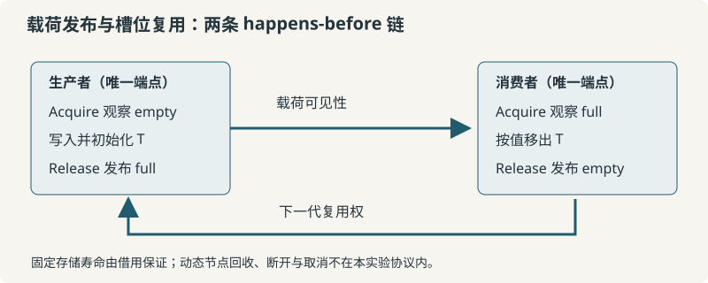

# 7 并发、原子与内存序：从同步证明到缓存行竞争 {#sec-cpp-rust.2.7}

<div class="chapter-index">
<p><span class="ci-label">本章回答</span>：如何证明一次跨线程交接合法；为什么削弱内存序（哪次写什么时候能被别的线程看见的规则）不一定带来加速；共享写入、伪共享（各写各的变量，却因为挨得太近互相拖住）与批量聚合各自改变了什么。</p>
<p><span class="ci-label">读完你会</span>：对单槽 SPSC 写出双向 happens-before（谁先被谁看见的顺序关系）证明；复现两个可编译 benchmark；核对三种目标的原子指令；区分聚合吞吐、线程延迟与采样剖析证据。</p>
</div>

::: note 新手入口

**需要先会**：用过 `Arc`、`Mutex` 更好；没写过也能读。**这一章的一个直觉**：「原子操作管的是顺序，不只是互斥」。

**先读这两节**：[7.1](#sec-cpp-rust.2.7.1) 与 [7.3](#sec-cpp-rust.2.7.3)；**第一遍可跳过**：7.6、7.7 的实验。

**主线位置**：④ 守得住为主导——数据竞争的后果是偶发错值，平时测不出来，上线才炸；其次 ①，把内存序（多线程之间「谁的写在什么时候对谁可见」的约定）放松之后，「算完了」这件事本身也需要证据。详见[主干线与终极目标](../mainline.md)。

**卡住时**：先看[第 0 章 · 零基础起步](../onboarding.md)里六个词的最小解释，再去[先修工具箱](../prerequisite.md)取对应那一格。

:::


一个四线程计数器把 Relaxed 改成 SeqCst 后，运行时间几乎不变。
如果预设「弱内存序一定更快」，很容易把这个结果当作测量失败。
但同一个程序把共享计数器拆为独立、隔离的计数器后，吞吐发生明显变化。
这时需要检验的不是语言排名，而是写入位置、所有权转移与编译器指令选择。

本章保留这样的反直觉结果，不把没有测出的差异补成漂亮数字。
所有性能表来自 `bench/results/local/` 的原始批次记录。
本机是 macOS / Apple M5 Pro，Linux 与 x86-64 只有交叉生成的代码证据。
因此正文不提供伪造的 Linux `perf` 缓存缺失率，也不把交叉生成称为目标机运行。

并发正确性和性能必须沿两条证据链分别推进。
第一条从访问冲突、同步关系推到合法的载荷读取。
第二条从数据布局、原子指令推到完整工作量下的墙钟时间。
没有第一条，第二条可能只是在测 UB；没有第二条，第一条也不能推出吞吐收益。

### 本章路线

| 节 | 回答的问题 |
|:--|:--|
| [7.1](#sec-cpp-rust.2.7.1) | 拿到一个跨线程交接点，先要证明什么才谈得上选同步机制？数据竞争和业务竞态怎么分开？ |
| [7.2](#sec-cpp-rust.2.7.2) | Relaxed 到底去掉了什么、没去掉什么？Release/Acquire 要谁观察到谁，那条边才算建立？ |
| [7.3](#sec-cpp-rust.2.7.3) | 载荷要跨线程该用哪种类型？为什么这里绕不开 `UnsafeCell`，`unsafe impl Sync` 又替作者签下了什么承诺？ |
| [7.4](#sec-cpp-rust.2.7.4) | Rust 原子在三种目标上各自生成什么指令？为什么不同操作生成同一条指令并不矛盾？ |
| [7.5](#sec-cpp-rust.2.7.5) | 共享、相邻、隔离、批量计数四种模式各改动了争用、布局还是语义？哪些句子有数据支持？ |
| [7.6](#sec-cpp-rust.2.7.6) | 单槽忙等与阻塞通道的 3070/112 各拿什么换来？非 Copy 载荷为什么重要？ |
| [7.7](#sec-cpp-rust.2.7.7) | 变量隔离了为什么还会回退？profiler 的栈观察计数能证明瓶颈在哪吗？ |
| [7.8](#sec-cpp-rust.2.7.8) | 线程让权与任务让权有什么不同？`try_send` 算不算 lock-free？ |
| 7.9–7.11 | 出处、常见错误索引、本章小结与章末件 |

正文之后有五页章末件：[全章总结](ch07_summary.md)、[闭卷回忆卡](ch07_recall.md)、[习题集](ch07_exercises.md)、[综合自测卷](ch07_exam.md)、[学习目标自检表](ch07_checklist.md)。

一条主线：**先证明这份代码守得住——交接合法、发布时机正确，偶发错值才无机可乘；再确认「算完了」这件事在产物和计时里真的发生。**每一节都回到这条线上。

### 建议反复做的三道母题

| 母题 | 一题串起什么 | 做完应能复述 |
|:--|:--|:--|
| [例 7.2.1](#ex-7.2.1) 这两个操作同步上了吗 | 内存序配对、happens-before 边、载荷读取权 | 「没观察到发布就别碰载荷；观察到就必须看到发布前的写」 |
| [例 7.5.1](#ex-7.5.1) 哪些句子有数据支持 | 写竞争、布局隔离、单变量对照 | 「差距大不等于能归因，先找只差一个变量的那一对」 |
| [例 7.7.1](#ex-7.7.1) 反例证明的到底是哪一层 | 发布时机、证据层次、误判硬件 | 「边上还没携带该发布的写，是程序顺序的 bug，不是 CPU 乱序」 |

做题节奏：**先预测 → 合上解答算一遍 → 展开核对 → 说出机制。**


## 7.1 先画访问图，再选择同步机制 {#sec-cpp-rust.2.7.1}

本节回答一个问题：**拿到一个跨线程交接点，先要证明什么，才谈得上选择同步机制？**顺序与直觉相反：先画访问图，再分层次立证明，最后才轮到锁、原子与内存序。

::: preview 先抓住一件事

`full` 标志是载荷访问权的交接点，不是「通知位」。同步证明的目标是「谁能合法地碰这块内存」，不是「两个线程各自调用了一个带标签的操作」。数据竞争是未定义行为，业务竞态是设计缺陷——两种错误没有同一种修法（[@def-7.1.1]、[@def-7.1.3]）。
:::

### 7.1.1 交接的最小单位

本章的载荷是 `[u64; 8]`，共 64 字节。
它在两个线程之间交替转移，而不是被两个线程同时修改。
生产者完成写入后发布 `full=true`。
消费者取得载荷后发布 `full=false`。
后一个方向与前一个方向同样需要同步。

<figure aria-labelledby="c7-fig-slot-caption">
<svg role="img" font-size="12.5" width="900" height="342" viewBox="0 0 900 342" xmlns="http://www.w3.org/2000/svg" aria-labelledby="c7-fig-slot-title c7-fig-slot-desc" aria-describedby="c7-fig-slot-caption">
<title id="c7-fig-slot-title">一个可复用槽位的发布与回收环</title>
<desc id="c7-fig-slot-desc">上方是槽位，包含 full: AtomicBool 与 payload: UnsafeCell&lt;MaybeUninit&lt;T&gt;&gt; 两个字段。槽位下方两支说明状态：full 为 false 时生产者可写，full 为 true 时消费者可读并把 T 移出。中部是首尾相接的一环：上排从左到右依次为 write T、Release(true)、Acquire(true)、read T，右侧向下接到下排的读完成；下排从右到左依次为读完成、Release(false)、Acquire(false)、下一次写，左侧再向上回到 write T。左两列是生产者一侧的动作，着蓝色；右两列是消费者一侧的动作，着金色。底部两行：所有权从 producer 经 slot、consumer 到调用者；复用权由 empty publication 从 consumer 回到 producer。</desc>
<defs><marker id="c7-a1" markerHeight="8" markerWidth="8" orient="auto" refX="6.5" refY="2.6"><path d="M0,0 L6.5,2.6 L0,5.2 Z" fill="var(--muted)"></path></marker></defs>
<text fill="var(--muted)" x="450" y="20" text-anchor="middle">一个可复用的槽位</text>
<rect x="290" y="30" width="320" height="62" rx="10" fill="color-mix(in srgb, var(--fig-purple) 12%, transparent)" stroke="var(--fig-purple)" stroke-width="1.6"></rect>
<g text-anchor="middle" fill="var(--fig-neutral)">
  <text x="450" y="54">full: AtomicBool</text>
  <text x="450" y="76">payload: UnsafeCell&lt;MaybeUninit&lt;T&gt;&gt;</text>
</g>
<g fill="none" stroke="var(--muted)" stroke-width="1.4" marker-end="url(#c7-a1)">
  <path d="M350,92 L350,106"></path>
  <path d="M550,92 L550,106"></path>
</g>
<g text-anchor="middle">
  <text fill="var(--fig-blue)" x="350" y="122">false：生产者可写</text>
  <text fill="var(--fig-gold)" x="550" y="122">true：消费者可读并移出</text>
</g>
<g text-anchor="middle">
  <rect x="150" y="146" width="130" height="32" rx="8" fill="color-mix(in srgb, var(--fig-blue) 12%, transparent)" stroke="var(--fig-blue)"></rect>
  <text fill="var(--fig-blue)" x="215" y="167">write T</text>
  <rect x="310" y="146" width="130" height="32" rx="8" fill="color-mix(in srgb, var(--fig-blue) 12%, transparent)" stroke="var(--fig-blue)"></rect>
  <text fill="var(--fig-blue)" x="375" y="167">Release(true)</text>
  <rect x="470" y="146" width="130" height="32" rx="8" fill="color-mix(in srgb, var(--fig-gold) 12%, transparent)" stroke="var(--fig-gold)"></rect>
  <text fill="var(--fig-gold)" x="535" y="167">Acquire(true)</text>
  <rect x="630" y="146" width="130" height="32" rx="8" fill="color-mix(in srgb, var(--fig-gold) 12%, transparent)" stroke="var(--fig-gold)"></rect>
  <text fill="var(--fig-gold)" x="695" y="167">read T</text>
  <rect x="150" y="244" width="130" height="32" rx="8" fill="color-mix(in srgb, var(--fig-blue) 12%, transparent)" stroke="var(--fig-blue)"></rect>
  <text fill="var(--fig-blue)" x="215" y="265">下一次写</text>
  <rect x="310" y="244" width="130" height="32" rx="8" fill="color-mix(in srgb, var(--fig-blue) 12%, transparent)" stroke="var(--fig-blue)"></rect>
  <text fill="var(--fig-blue)" x="375" y="265">Acquire(false)</text>
  <rect x="470" y="244" width="130" height="32" rx="8" fill="color-mix(in srgb, var(--fig-gold) 12%, transparent)" stroke="var(--fig-gold)"></rect>
  <text fill="var(--fig-gold)" x="535" y="265">Release(false)</text>
  <rect x="630" y="244" width="130" height="32" rx="8" fill="color-mix(in srgb, var(--fig-gold) 12%, transparent)" stroke="var(--fig-gold)"></rect>
  <text fill="var(--fig-gold)" x="695" y="265">读完成</text>
</g>
<g fill="none" stroke="var(--muted)" stroke-width="1.4" marker-end="url(#c7-a1)">
  <path d="M280,162 L310,162"></path>
  <path d="M440,162 L470,162"></path>
  <path d="M600,162 L630,162"></path>
  <path d="M695,178 L695,244"></path>
  <path d="M630,260 L600,260"></path>
  <path d="M470,260 L440,260"></path>
  <path d="M310,260 L280,260"></path>
  <path d="M215,244 L215,178"></path>
</g>
<g text-anchor="middle">
  <text fill="var(--fig-neutral)" x="450" y="306">所有权：producer → slot → consumer → 调用者</text>
  <text fill="var(--muted)" x="450" y="326">复用权：producer ← empty publication ← consumer</text>
</g>
</svg>
<figcaption id="c7-fig-slot-caption">图 7-1 · 槽位只有一个：full 决定载荷访问权归谁，两条箭头分别完成发布与回收复用</figcaption>
</figure>

读图：`full` 不只是通知位。
它是载荷访问权的交接点。
看到 `false` 的生产者可以开始下一轮写入。
看到 `true` 的消费者才可以把一个已初始化的 `T` 移出。

图中两个箭头分别解决发布与回收复用。
只证明写后可读，还不足以证明下一轮写不会覆盖上一轮读取。
容量为一使代际关系容易检查，但不提供多生产者仲裁。



### 7.1.2 数据竞争与业务竞态分开

Rust 原子文档按访问定义冲突。
访问内存区域重叠，且至少一个访问是写入，才涉及冲突。
冲突访问若至少一个非原子，且没有 happens-before（并发操作之间「谁的效果先对谁可见」的那条先后关系）排序，就可能构成数据竞争。
数据竞争属于 UB，不是「偶尔读旧值」的温和错误。

::: def 定义 7.1.1 · 冲突访问与数据竞争 conflicting access, data race {#def-7.1.1}

两个访问**冲突**，当且仅当它们访问重叠的内存区域、且至少一个是写入。冲突访问里至少有一个不是原子操作、又没有 happens-before 关系排序时，才构成**数据竞争**。UB（未定义行为，undefined behavior）意味着语言标准不再对程序结果作任何承诺——它不是「偶尔读到旧值」这种可以靠重试或加打印来观察的温和错误。
:::

按[@def-7.1.1]，把字段全换成原子只消灭了「非原子」这一个条件，不自动产生任何排序。两个 `AtomicU64` 的合法 Relaxed 操作可以产生业务不一致。
这种结果不自动等于数据竞争。
把所有字段换成原子也不会自动得到跨字段事务。

例如，库存与已售量由两个独立原子表示。
分别读取两个值时，可能观察到不同更新阶段。
即便所有操作都采用 SeqCst，也没有把两次读取合成一个事务。
需要一致快照时，应先定义线性化点（每个操作对外显现生效的那一瞬间），再选锁、版本或单所有者消息处理。

::: def 定义 7.1.2 · 并发缺陷的三分类 three classes of concurrency defect {#def-7.1.2}

rCore 教程把并发缺陷分成三类，本书沿用这套命名，因为它按**症状**分类而不是按工具分类：**互斥缺陷**（违反原子性——共享变量没被合理保护，典型是「读—判断—写」三步中间被人插队）；**同步缺陷**（顺序错了——该等的没等、不该醒的醒了，唤醒丢失属于这一类）；**死锁缺陷**（谁也不肯先放手）。三类的修法互不相通：第一类补锁或补原子操作，第二类补可观察的状态与条件，第三类要改资源获取的顺序。
:::

::: def 定义 7.1.3 · 同步证明的三个层次 synchronization proof, three levels {#def-7.1.3}

第一层是对象的合法生命周期：载荷存在、已初始化、未被提前销毁。
第二层是访问互斥与可见性：谁能写，谁能读，哪条边建立同步。
第三层是业务不变量：多个字段是否必须一起改变。
原子类型主要提供第二层的构件，不会自动完成其余证明。
:::

判错层次的症状很典型：库存快照不一致是[@def-7.1.3]第三层缺线性化点，不是第二层的原子性失效；反过来，用普通 `u64` 在两个线程间轮询才是第一、二层同时失守。先说清自己在补哪一层，再选工具。

### 7.1.3 本章采用的原子语义来源

当前标准库原子文档采用 C++20 原子规则的对应解释，不包含 consume 内存序。
Rust 使用 access-based 描述，不能机械复制 C++ 的 atomic object 边界。
本地《Rust 参考手册》PDF 第 334 页的内存模型一节还保留着较早的表述，原话是「还没有明确的内存模型。许多学者和行业专业人士正在研究各种提案，但就目前而言，这在该语言中仍是一个未明确定义的地方」（该页给出的 commit 是 `2d3085f1`，日期 2020-11-2）。
因此该 PDF 用来记录历史范围，不作为覆盖当前所有原子细节的唯一依据。

本章区分三种证据。
语言与库语义来自文档。
具体指令来自 rustc 生成的文件。
吞吐来自本机 benchmark。
三者互相约束，但不能互相替代。

::: ex 例 7.1.1 · 这句话该拿哪种证据来验 {#ex-7.1.1}

三句话：① 「Acquire load 在本机编译成 `ldapr`」；② 「对 `store` 使用 Acquire 不适用」；③ 「四线程共享计数约 6 ns/聚合操作」。各需要哪种证据？哪种推断顺序是错的？

::: sol 解答

① 靠 rustc 保存下来的 `.s` 代码生成产物（7.4），绑定编译器版本；② 靠语言与库文档的方法契约（[@def-7.1.3] 第二层的规则本身）；③ 靠本机 benchmark 的原始批次（7.5）。三类证据不能互替：用 ③ 的耗时推断 ② 的语义，或从 ① 的汇编相同倒推源码同步相同，都是证据类型错配。
:::

:::

### 7.1.4 性能问题的四个候选

同一个共享写热点可以来自四个方向。
其一是计算本身：每轮做了多少算术或校验。
其二是可见性约束：是否需要跨变量发布。
其三是所有权争用：多少核心写同一个位置。
其四是调度：线程是否被抢占，是否需要阻塞唤醒。

不要只改第二项，然后把其他三项的变化都归因于内存序。
后面的实验会分别控制写入位置与聚合频率。

::: think 思考 · 一次共享写变慢，先动哪个候选 {#think-7.1.1}

某个统计计数器在四线程下变慢。同事的第一反应是把 `SeqCst` 改成 `Relaxed`。按本节的四个候选，这个动作有什么隐患？

::: sol 解答

它在四项里同时只动「可见性约束」一项，却准备解释全部差异；争用（多少核心写同一位置）与计算本身（每轮还做没做别的）都没被拆开。[@def-7.1.1] 还提醒另一半问题：原 `SeqCst` 版本本来就是原子的，改 Relaxed 不会消除 RMW 的仲裁成本。正确顺序是先按[@def-7.1.3]确认是否真的需要跨变量发布，再用 7.5 的拆分实验分别控制变量。
:::

:::

::: method 判定流程 · 从访问图到 Ordering

**第 1 步**：画出谁读谁写、载荷在哪些状态间转移，标记每个冲突访问（[@def-7.1.1]）。<br>
**第 2 步**：确定业务不变量落在三层证明的哪一层，缺线性化点先补协议（[@def-7.1.3]）。<br>
**第 3 步**：能减少共享写就先减少（拆分、批量、单所有者），再比较锁与无锁结构。<br>
**第 4 步**：正确性证明完成之后，才在最后一步削弱内存序——它是四个候选里最靠后的一个，不是第一个。
:::

### 7.1.5 小结与常见错误

**小结。**① 冲突访问与数据竞争有明确的成立条件，「读到旧值」不等于 UB（[@def-7.1.1]）；② 原子类型主要买第二层构件，生命周期与业务不变量要单独证明（[@def-7.1.3]）；③ 语言语义、代码生成、计时是三种证据，只能互相约束不能互替（[@ex-7.1.1]）；④ 共享写热点有计算、可见性、争用、调度四个候选，先拆候选再谈归因。下一节 [7.2 内存序约束的是哪条边](#sec-cpp-rust.2.7.2) 把「哪条边建立同步」写成可检查的证明。

::: errata 常见错误清单（7.1 节）

E-a **把数据竞争说成「偶尔读旧值」。**它是 UB，后果不由实验样本决定（[@def-7.1.1]）。

E-b **以为字段全部原子化就得到一致快照。**多次读取没有统一线性化点，仍不是事务（[@def-7.1.3]）。

E-c **拿旧版参考手册的历史说明当现行原子规范。**语义出处要核对当前文档与版本。

E-d **只改内存序一项，把其余三个候选的变化都归因于它。**变量没有拆开（见本节的思考框）。

E-e **把「看到标志位变了」当成拿到访问权。**标志的含义是交接，不是提醒（[@def-7.1.1]）。

E-f **用业务竞态的观察结果指控硬件乱序。**那是协议缺口，不是 CPU 违约（[@ex-7.1.1]）。

:::

::: method 即时自测 · 7.1

先合上正文作答，再展开核对。

**第 1 题 · 记忆**　说出数据竞争成立需要同时满足的条件。

::: sol 第 1 题答案
访问区域重叠、至少一个是写入（冲突访问）；冲突双方至少一个非原子；两者之间没有 happens-before 排序。三条同时成立才是数据竞争，缺任何一条都退回普通竞争或业务竞态。对应[@def-7.1.1]。
:::

**第 2 题 · 辨析**　「两个库存字段都是 `AtomicU64`，所以读取结果一定一致。」错在哪一层？

::: sol 第 2 题答案
错在第三层。字段级原子性属于[@def-7.1.3]的第二层构件；两次独立读取分属不同更新阶段，没有统一线性化点就没有一致快照。修法是先定义业务不变量，再选锁、版本或单所有者。
:::

**第 3 题 · 应用**　同事说「这段汇编和 Relaxed 版一模一样，说明我加的 Acquire 没起作用」。给出你的第一反应。

::: sol 第 3 题答案
先拒绝这个推断方向：汇编相同不能倒推源码同步语义相同（[@ex-7.1.1] 的错配之一）。目标指令选择受平台约束影响，`ldapr` 与 `ldr` 的差异在别的架构也可能不出现。要检验同步是否成立，应回到[@def-7.1.1]的条件写出边，再设计能看到非法交错的测试。
:::

**第 4 题 · 迁移**　把一个「每请求写共享统计」的接口改造成「线程本地累加＋末尾聚合」，按本节框架说明它动了哪几个候选、改变了什么可观测语义。

::: sol 第 4 题答案
主要动第三项（所有权争用：多少核心写同一位置），同时减少第二项的跨变量发布次数；可观测语义变差——外部观察者不再能读到逐次实时总进度，这是 7.5 里 Batched 模式「不是免费替换」的原因（[@def-7.1.3] 第三层的业务约束）。
:::

:::

## 7.2 内存序约束的是哪条边 {#sec-cpp-rust.2.7.2}

本节回答一个问题：**把一个操作改成 Acquire 或 Release，究竟为哪条边建立了顺序？**内存序不是贴在变量上的「安全标签」，它约束的是具体两个操作之间能不能连出 synchronizes-with 边；边没连上，换了多贵的序也一样裸奔。

::: preview 先抓住一件事

Weak 与 strong 的差别不是「快慢档」，而是「这条边建不建」。Relaxed 保留了原子位置的修改顺序（[@def-7.2.1]），只是不为其他内存位置自动建立发布；Acquire/Release 要成立，还必须满足「观察到对应发布」这个前提（[@def-7.2.2]）。
:::

### 7.2.1 Relaxed 没有去掉原子性

对同一个原子位置的修改仍有修改顺序。
Relaxed 不允许把一次合法原子递增拆成相互覆盖的普通读与普通写。
它不为其他内存位置自动建立发布关系。

::: def 定义 7.2.1 · 修改顺序与原子性 modification order {#def-7.2.1}

对同一个原子位置的所有写入构成一条**修改顺序**（modification order）：每次原子读要么读到某个完整写入，要么读到另一个完整写入，不会读到「半条」递增。Relaxed 放弃的是**跨位置的排序承诺**，不是这条位置内的完整性。所以「没有跨变量同步」和「随便读任何值」不是一回事。
:::

解释 Relaxed 结果时，仍必须遵守原子一致性与程序其他同步边。
`join`、锁与屏障也可能建立顺序，不能忽略。

本章计数实验在所有工作线程到达完成屏障后才校验总和。
因此读取总和时不需要依靠每次递增发布其他载荷。
把递增改为 Relaxed 没有削弱这个总和检查的目标。

### 7.2.2 Release 与 Acquire 必须匹配观察

生产者先写载荷，再执行 Release store。
消费者的 Acquire load 必须观察到对应发布，才建立所需同步。
不是「两个线程分别出现了一个 Release 和 Acquire」就足够。
不是所有后来的时间点都天然属于 happens-before。

用事件名称表示最小证明：

```text
W: producer 写入 payload
S: producer full.store(true, Release)
L: consumer full.load(Acquire) 观察到 S 的值
R: consumer 读取 payload

W sequenced-before S
S synchronizes-with L
L sequenced-before R
所以 W happens-before R
```

这个证明不依赖线程恰好运行在哪一个核心。
不依赖缓存行（CPU 和内存之间整块搬运数据的单位）已经被「手动刷新」。
也不要求生产者等候消费者读完才返回发布操作。

::: def 定义 7.2.2 · synchronizes-with 边 synchronizes-with edge {#def-7.2.2}

一个 Release store 与一个 Acquire load 构成 **synchronizes-with** 对，当且仅当该 Acquire load **观察到**（reads-from）了这个 Release store 写入的值。成立时，Release 之前的所有写入对 Acquire 之后的读取可见。两个条件缺一不可：光有「一边一个」不算，「后来的时间点」也不算——观察关系必须是具体的值来源关系。
:::

::: ex 例 7.2.1 · 这两个操作同步上了吗 {#ex-7.2.1}

场景：生产者先后写 `x=1`、再 `f.store(true, Release)`；消费者一开始就在循环里 `f.load(Acquire)`。某次迭代它读到了 `false`，于是 `assert_eq!(x, 1)` 可能失败吗？下一轮它读到 `true` 后再读 `x` 呢？

::: sol 解答

第一次读 `false` 时没有观察到那次 Release store，[@def-7.2.2] 的边没有建立，`x` 的读取不受这条链保护——但消费者此时也不该去碰载荷，读到 `false` 只说明「还没发布」。第二轮读到 `true` 即观察到发布，`x=1` 经 sequenced-before + synchronizes-with 传递到本侧，此后读 `x` 必须看到 1（或更新的合法值）。这对应 7.1 图的「看到 true 才可移出」的形式化版本。
:::

:::

### 7.2.3 反向复用边

消费者读取结束后写回空状态。
生产者必须在下一次写入之前观察到该空状态。
对应证明如下。

```text
R: consumer 完成 assume_init_read
E: consumer full.store(false, Release)
A: producer full.load(Acquire) 观察到 E
N: producer 写下一代 payload

R sequenced-before E
E synchronizes-with A
A sequenced-before N
所以 R happens-before N
```

如果只给 `true` 发布加同步，却把复用方向当成普通标志轮询，证明是不完整的。
在队列扩容、环形缓冲区和对象池中，复用方向通常更容易被遗漏。

::: think 思考 · 「生产者反正看到了 false」错在哪 {#think-7.2.1}

评审意见说：把 `full.store(false, Release)` 改成 `full.store(false, Relaxed)` 没有影响——生产者下一次写入前总会先 load 到 `false`。这条论证缺了哪个环节？

::: sol 解答

它只论证了「生产者知道槽位空了」，没有论证「消费者的读完对生产者可见」。Relaxed store 不释放之前的 `assume_init_read`：按[@def-7.2.2]，生产者的 Acquire load 观察不到发布边，`R happens-before N` 就断链，下一代写入可能落在上一轮读取完成之前。有限压力测试可能一直全过，但缺的是这条反向边——先恢复证明，再谈是否还有别的同步足以豁免。

:::

:::

### 7.2.4 合法操作与内存序

| 操作类别 | 可用的本章顺序 | 同步含义 | 常见误用 |
|:--|:--|:--|:--|
| load | Relaxed / Acquire / SeqCst | 读取并可能获取发布 | 对 load 使用 Release |
| store | Relaxed / Release / SeqCst | 写入并可能发布先前访问 | 对 store 使用 Acquire |
| RMW | 五种 Ordering | 读侧与写侧组合 | 误以为 Acquire 也发布写侧 |
| CAS 失败分支 | Relaxed / Acquire / SeqCst | 只有读取，没有成功写入 | 失败序使用 Release / AcqRel |

Rust API 对不适用的顺序有约束。
固定顺序错误通常能被 lint 发现；动态顺序仍须查对应方法契约。
不要把 C++ 的所有限制逐字搬到当前 Rust API 上。

### 7.2.5 RMW 的两半

`fetch_add` 同时包含读取旧值和写入新值。
Acquire 主要约束其读取一侧，写入一侧并不因此获得 Release 发布语义。
Release 对应写入一侧，读侧并不自动成为 Acquire。
AcqRel 才同时表达两者。

::: def 定义 7.2.3 · RMW 的读侧与写侧 RMW acquire/release halves {#def-7.2.3}

一次读改写（RMW）原子操作有**两半**：读侧（旧值被谁看到、能否释放本侧之前的访问）与写侧（新值发布什么、对方 Acquire 后才能读什么）。Acquire 只管读侧，Release 只管写侧，AcqRel 两者都要。漏写一半的典型后果：用 `Release` 递增去「发布」某个载荷，但递增自身的旧值读取没有获取语义，读到的前一状态不受保护。
:::

SeqCst 还为相关 SeqCst 操作加入顺序一致性的全序约束。
它不是把整台机器的所有普通访问都强制排成一条全序。
其他 Relaxed 操作仍需单独分析。

### 7.2.6 fence 不是万能补丁

在程序中随意加一条 `fence(SeqCst)`，无法补出不存在的交接协议。
fence 同步也需要与相应原子操作建立匹配关系。
`compiler_fence` 不能作为跨核心普通内存通信的通用硬件屏障。

在驱动中还可能涉及设备内存属性与设备屏障。
本章所有实验都操作普通进程内存，不证明 MMIO 协议。
`volatile` 与原子同步是不同问题，不能混用术语。

::: method 判定流程 · 给一次原子操作选序

**第 1 步**：确认操作类别（load / store / RMW / CAS 失败分支），排除表格里不适用的一侧。<br>
**第 2 步**：问这条操作要不要和对端某个具体操作连[@def-7.2.2]的边；不需要（如纯统计递增）Relaxed 就够。<br>
**第 3 步**：RMW 分别问读侧与写侧各要什么（[@def-7.2.3]），别把一个标签当整体档位。<br>
**第 4 步**：只有确实需要与其他 SeqCst 操作合成全序时才付 SeqCst；它不给普通访问排序，也补不出缺失的交接协议。
:::

### 7.2.7 小结与常见错误

**小结。**① Relaxed 保留原子位置的修改顺序，放弃的只是跨位置排序（[@def-7.2.1]）；② Release/Acquire 必须满足「观察到对应发布」才连出 synchronizes-with 边（[@def-7.2.2]、[@ex-7.2.1]）；③ 复用方向的反向边与发布方向同等必要，本节的思考框给出了它的失守方式；④ RMW 要按读侧、写侧两半分别选序（[@def-7.2.3]）；⑤ SeqCst 的全序只覆盖 SeqCst 操作，fence 补不出不存在的协议。下一节 [7.3 类型、布局与载荷访问权](#sec-cpp-rust.2.7.3) 把「谁有资格写」落到类型与 unsafe impl 上。

::: errata 常见错误清单（7.2 节）

E-a **把 Relaxed 理解为「值可以乱来」。**它仍守[@def-7.2.1]的修改顺序。

E-b **以为两边各出现一个 Release 和 Acquire 就算同步。**缺「观察到」这个前提（[@def-7.2.2]）。

E-c **Acquire 用在 store、Release 用在 load。**操作类别不匹配（7.2.4 表）。

E-d **只证明发布边，不证明复用边。**第二轮写入可能覆盖未完成的读取（见本节的思考框）。

E-e **把 RMW 上的 Acquire 当成也发布写侧。**两半要分开（[@def-7.2.3]）。

E-f **顺序不确定时随手加 fence。**补不出不存在的交接协议（7.2.6）。

E-g **把 SeqCst 当成给全部普通访问排序。**它只对相关 SeqCst 操作建全序。

:::

::: method 即时自测 · 7.2

先合上正文作答，再展开核对。

**第 1 题 · 记忆**　写出正向发布链四步的顺序关系。

::: sol 第 1 题答案
`W` 写载荷，sequenced-before `S`（Release store）；`S` 与消费者观察到它的 `L`（Acquire load）构成 synchronizes-with；`L` sequenced-before `R` 读载荷；传递得到 `W happens-before R`。对应[@def-7.2.2]与 7.2.2 的事件表。
:::

**第 2 题 · 辨析**　「把递增从 SeqCst 改成 Relaxed 之后程序还是对的，说明原来的 SeqCst 是多余的。」对吗？

::: sol 第 2 题答案
不对。本实验里正确性不依赖每次递增发布其他载荷（完成屏障已经提供了汇总边），所以削弱不破坏**这个**目标；但「没坏」不等于「多余」——SeqCst 是否必要取决于是否存在需要全序的其他观察者，那是另一个问题。结论只能缩小到当前协议（[@def-7.2.1]）。
:::

**第 3 题 · 应用**　把 Slot 的 `false` store 改成 Relaxed，其他不动，测试可能仍全过吗？

::: sol 第 3 题答案
可能。有限压力测试未见失败不是证明：缺失的正是消费者完成读取到生产者下一次写入的反向同步边（见本节思考框）。应先恢复[@def-7.2.2]意义下的证明，再决定是否存在其他充分同步可以豁免这次修改。
:::

**第 4 题 · 迁移**　一个 `fetch_or(flag, Acquire)` 想「发布本线程此前写好的位掩码说明」，怎么改，为什么？

::: sol 第 4 题答案
按[@def-7.2.3]拆开两半：发布靠的是写侧，Acquire 只保护读侧，应改为 `Release`（只要写侧发布）或 `AcqRel`（既获取对端又发布本侧）。再核对对端确实以 Acquire 观察到这次写入，边才成立（[@def-7.2.2]）。
:::

:::

## 7.3 类型、布局与载荷访问权 {#sec-cpp-rust.2.7.3}

本节回答一个问题：**「谁能写、谁能读」怎样被钉进类型系统与内存布局？**7.2 在事件层面画边；这一节看编译器能在编译期替你拦住哪些非法访问、拦不住的部分落进哪份 safety 义务。

::: preview 先抓住一件事

`Send` 与 `Sync` 讨论的是两件不同的事：所有权转移与共享引用转移（[@def-7.3.1]）。`unsafe impl Sync` 不产生任何保证，它只是一份你对 [@def-7.3.1] 之外那套运行条件签下的承诺书；而缓存行大小这类布局数字是本机证据，不是跨平台常量。
:::

### 7.3.1 类型表：区分线程转移和共享

| 类型 | 所有权可否跨线程 | 共享引用可否跨线程 | 本章用途 |
|:--|:--|:--|:--|
| `u64` | 可以 | 可以 | 按值载荷 |
| `AtomicU64` | 可以 | 可以 | 并发计数 |
| `Cell<u64>` | 可以 | 不可以 | 将端点标记为 !Sync |
| `RefCell<u64>` | 可以 | 不可以 | 运行时借用，不提供线程同步 |
| `Rc<u64>` | 不可以 | 不可以 | 单线程引用计数反例 |
| `Arc<u64>` | 可以 | 可以 | 共享只读所有权 |
| `UnsafeCell<T>` | 取决于 T | 不自动具备 Sync | 内部可变载荷容器 |

`Send` 讨论的是所有权转移。
`Sync` 讨论的是共享引用的转移。
`Arc<T>` 不会把任意 `T` 自动变成线程安全对象。
`Arc<RefCell<T>>` 不是多线程内部可变性的通用替代品。

::: def 定义 7.3.1 · Send 与 Sync {#def-7.3.1}

`T: Send` 表示**值的所有权**可以安全转移到另一个线程；`T: Sync` 表示**共享引用** `&T` 可以转移到另一个线程，其强度恰好是「多个线程同时只读 `T` 是安全的」。两者独立：`Rc<u64>` 两者都不满足；`Cell<u64>` 可转移但共享引用不可跨线程。自动推导规则只覆盖普通组合；一旦手写 `unsafe impl`，编译器就停止核对，义务全部转给作者（[@def-7.3.4]）。
:::

### 7.3.2 为什么这里需要 UnsafeCell

槽位通过共享引用供两个端点访问。
载荷写入必须合法地发生在内部可变区域。
`UnsafeCell` 撤销的是共享不可变性方面的相应保证，不会自动提供互斥。
`MaybeUninit<T>` 表示槽位为空时还没有一个可读取的有效 `T`。

两者解决的问题不同。
前者关乎别名与变异。
后者关乎初始化与析构。
同步协议仍由 `full` 和端点唯一性保证。

::: def 定义 7.3.2 · 内部可变与未初始化槽 UnsafeCell, MaybeUninit {#def-7.3.2}

`UnsafeCell` 是标准库唯一合法的内部可变原语：它**撤销的是「共享引用指向不变数据」这一编译期保证**，不提供任何互斥——互斥由外部协议（`full` 状态机与端点唯一性）负责。`MaybeUninit<T>` 则描述「这块内存此刻可能还没有一个有效的 `T`」，把初始化与析构义务显式化。一个管别名与变异，一个管生命周期，不能互相代劳。
:::

核心定义来自 `bench/src/slot.rs`，不是母本代码。

```rust
pub struct Slot<T> {
    full: AtomicBool,
    value: UnsafeCell<MaybeUninit<T>>,
}
```

这一片段省略 import；完整可编译文件随实验仓库提供。
对公开 API 的安全性，应检查完整文件，不是只检查这两个字段。

### 7.3.3 端点为什么不是 Clone

`split` 需要 `&mut Slot<T>`。
它在同一次借用中只返回一个 Producer 和一个 Consumer。
每次发送和接收又需要 `&mut self`。
端点不实现 Clone。
它们携带 `PhantomData<Cell<()>>`，阻止共享端点被安全地同时调用。

这些类型约束为算法移除了多生产者与多消费者仲裁。
如果擅自为端点增加 Clone，算法就需要重新证明。
不能只增加一个计数器，然后沿用原来的 Sync 说明。

::: ex 例 7.3.1 · 给端点加上 Clone 会发生什么 {#ex-7.3.1}

有人为了方便共享，给 Producer 派生了 `Clone`，各副本内共享 `Arc` 引用计数做仲裁，`Slot` 的类型声明其余不动。请指出至少两处需要重新完成的证明。

::: sol 解答

第一，7.1.1 的「端点唯一」前提失效：`try_send` 里「load 到 false 再写载荷」不再是排他的两步，两个生产者都可能读到 `false` 并先后写入——需要把标志改成真正的仲裁（如 CAS 领取），并重写[@def-7.2.2]意义下的每条边。第二，[@def-7.3.4] 的条件 1 被破坏，整个 `unsafe impl Sync` 连同 safety 注释作废；引用计数只解决计数一致，不自动给出槽位状态机的一致性。第三，失败分支（`Err(value)` 返还）的语义也要按多生产者重新定义。
:::

:::

### 7.3.4 Sync 的完整责任

代码包含一处 `unsafe impl<T: Send> Sync for Slot<T>`。
该声明不是「让编译器闭嘴」的手段。
其理由由下面这份义务清单构成：

::: def 定义 7.3.4 · unsafe impl Sync 的安全义务 safety obligation {#def-7.3.4}

手写 `Sync` 实现时，作者对**所有调用方**承诺以下条件恒成立：

1. 端点唯一，不存在两个并发生产者。
2. 不存在两个并发消费者。
3. 消费者只在 full 状态读取已初始化的 T。
4. 生产者只在 empty 状态写入。
5. 两个方向均有 Release/Acquire 交接。
6. T 作为值跨线程转移，因而要求 Send。
7. 载荷不被多个线程同时按共享引用访问，不要求 T: Sync。
8. Slot 销毁时排除了所有存活端点。

任何一条被后续修改破坏，这段 `unsafe impl` 就整体失效；编译器不会重新核对其中任何一条。
:::

写 safety 注释时，至少要覆盖这些条件。
编译器不会替 unsafe impl 逐条验证。
后续修改私有方法也可能破坏它。

::: think 思考 · 条件 5 丢了会先撞上谁 {#think-7.3.1}

[@def-7.3.4] 的八条里删掉第 5 条（双向交接），其余不动。最先失守的是类型检查、单测，还是运行期正确性本身？

::: sol 解答

运行期正确性本身，而且它往往最后才「显式」失守：类型系统不看协议内容（`unsafe impl` 已经绕过了 [@def-7.3.1] 的推导），单元测试在宽松调度下大概率照过。失守发生在反向边断裂处——生产者的下一代写入与消费者上一轮读取不再满足 happens-before，属于[@def-7.1.1]意义上的数据竞争。safety 注释因此是可执行前提，不只是文档礼貌。

:::

:::

### 7.3.5 布局不是协议本身

本机 `AtomicU64` 的尺寸与对齐均为 8 字节。
实验隔离包装 `Padded` 的尺寸与对齐均为 128 字节。
这是运行时打印与 repr 属性共同给出的证据。

本机 `sysctl hw.cachelinesize` 报告 128。
因此实验用 128 字节隔离，不再假定所有 x86 与 ARM 缓存行统一为 64。
其他机器必须重新核对目标缓存拓扑。
单凭一个语言属性，不能获知整个 SoC 的共享层级。

`[AtomicU64]` 连续紧凑排列。
四个元素共 32 字节，但其起始地址不保证恰好对齐缓存行。
这会影响相邻计数器处于同一行还是跨行。
后面相邻模式的较大方差，需要保留这个解释候选。

::: method 判定流程 · 这段 unsafe impl 能不能签

**先问转移**：调用方拿到的是所有权还是共享引用？分别对应 `Send` 与 `Sync`，别用一条糊过去（[@def-7.3.1]）。<br>
**再列状态机**：把「哪个状态下谁可以读写」写成表（7.6 的载荷状态表是模板），逐格核对实现是否拦得住。<br>
**核对交接**：两个方向的同步边都要能指出来（[@def-7.2.2]）。<br>
**最后写义务清单**：像[@def-7.3.4]那样逐条编号进 safety 注释；写不出完整清单，就说明还不该签这个 `unsafe impl`，退回用锁或成熟通道。
:::

### 7.3.6 小结与常见错误

**小结。**① `Send`/`Sync` 分别管所有权转移与共享引用转移，不能互换（[@def-7.3.1]）；② `UnsafeCell` 撤销共享不变性保证、`MaybeUninit` 管初始化义务，两者不互相代劳（[@def-7.3.2]）；③ 端点唯一性是算法前提而非风格偏好，破坏它等于重写证明（[@ex-7.3.1]）；④ `unsafe impl Sync` 是一份逐条可核对的义务清单（[@def-7.3.4]）；⑤ 尺寸、对齐与缓存行是本机运行时证据，换平台必须重测。下一节 [7.4 从 Rust 原子到 LLVM IR 与目标指令](#sec-cpp-rust.2.7.4) 把语义问题交给代码生成证据核对。

::: errata 常见错误清单（7.3 节）

E-a **把 `Arc<T>` 当线程安全包装器。**`T` 不满足条件时 `Arc<T>` 照样不 `Sync`（[@def-7.3.1]）。

E-b **以为 `UnsafeCell` 自带互斥。**它只撤销共享不变性保证（[@def-7.3.2]）。

E-c **给端点加 Clone 后沿用旧 Sync 说明。**义务清单整体作废（[@ex-7.3.1]）。

E-d **把 `unsafe impl` 当「让编译器闭嘴」的手段。**编译器停止核对，不代表义务消失（[@def-7.3.4]）。

E-e **只按语言属性推断 SoC 共享层级。**单凭 size/align 得不到缓存拓扑（7.3.5）。

E-f **拿 `Rc` 换 `Arc` 就宣称可跨线程。**还须逐条核对状态机与交接（[@def-7.3.1]）。

E-g **假定缓存行恒为 64 字节。**本机 `sysctl` 报告 128，隔离设计按 128 字节做。

:::

::: method 即时自测 · 7.3

先合上正文作答，再展开核对。

**第 1 题 · 记忆**　`Cell<u64>`、`RefCell<u64>`、`Rc<u64>` 各不满足 `Send`/`Sync` 的哪一侧？

::: sol 第 1 题答案
`Cell<u64>`：可 `Send`，不可 `Sync`（共享引用跨线程后两处 `set` 无仲裁）。`RefCell<u64>`：同样 `Send` 但 `!Sync`，借用计数本身会被并发写坏。`Rc<u64>`：`!Send` 也 `!Sync`，引用计数非原子。判断依据就是[@def-7.3.1]的两问：转移的是值还是 `&`。
:::

**第 2 题 · 辨析**　「`Slot` 里 `full` 是原子的，所以两个生产者同时写载荷也最多丢一次更新。」错在哪？

::: sol 第 2 题答案
错在把第二层构件当成全部证明（[@def-7.1.3]）。原子标志不仲裁「谁有写入资格」：两个生产者都可能在读 `false` 后各写一次 `UnsafeCell` 载荷，载荷写入本身是非原子的重叠写，直接落回[@def-7.1.1]的数据竞争。端点唯一性（[@def-7.3.4] 条件 1）才是拦这件事的。
:::

**第 3 题 · 应用**　要在另一台 x86 服务器复用 `Padded`（128 字节隔离）设计，第一步做什么？

::: sol 第 3 题答案
先查目标机缓存行与共享层级（如 `sysctl`/`cpuid`/拓扑工具），再决定隔离粒度：7.3.5 已说明紧凑数组的起始地址不保证行对齐。照搬 128 可能过度浪费，照搬 64 假设可能隔离失效。尺寸与对齐证据必须来自目标平台，不能从别的机器移植。
:::

**第 4 题 · 迁移**　评审一个带 `unsafe impl Sync` 的环形缓冲：safety 注释只写了「索引是原子的，所以没问题」。按本节流程给结论。

::: sol 第 4 题答案
不合格。按判定流程它缺整份义务清单：没有状态机（哪些槽位可读可写）、没有双向交接证明（[@def-7.2.2]）、没有说明复用与析构边界（对照[@def-7.3.4] 的 8 条）。「索引原子」只覆盖[@def-7.3.1]之外的一小部分。要求补清单，逐条对到代码位置后再谈合入。
:::

:::

## 7.4 从 Rust 原子到 LLVM IR 与目标指令 {#sec-cpp-rust.2.7.4}

本节回答一个问题：**原子的语言语义，哪些部分能在编译器真实产物里核对，哪些永远核对不了？**代码生成证据能证明「这个版本的 rustc 在这个 target 上发出了什么指令」，不能证明「语言保证了什么」，也不能证明「目标机上跑了多快」。

::: preview 先抓住一件事
本章对「SeqCst 到底贵在哪」的全部物质证据，来自三条只生成、不运行的 `rustc` 命令和一张对照表。读它的关键是[@def-7.4.1]：汇编相同推不出源码同步语义相同，汇编不同也推不出运行期差异大小。
:::

### 7.4.1 保存探针而不是手写结论

探针（只为观察产物变成什么样而留下的小程序）在 `bench/probes/atomics.rs`。
每个导出函数仅做一次原子操作。
使用 extern C 只是稳定汇编中的符号与参数边界，不构成可发布 FFI 库。
探针接受的引用仍要求合法对齐、有效生命周期。

例如两个返回类型相同的读取：

```rust
#[no_mangle]
pub extern "C" fn load_relaxed(a: &AtomicU64) -> u64 {
    a.load(Ordering::Relaxed)
}

#[no_mangle]
pub extern "C" fn load_acquire(a: &AtomicU64) -> u64 {
    a.load(Ordering::Acquire)
}
```

完整文件还包括 SeqCst load、三种 store 与三种递增探针。
输出旧值与不输出旧值的递增必须分别检查。
使用结果与否可能影响指令选择。

### 7.4.2 本机生成命令

在 `cpp-rust/` 下运行：

```bash
rustc --edition=2021 --crate-type=lib \
  -C opt-level=3 --emit=asm,llvm-ir \
  bench/probes/atomics.rs \
  --out-dir bench/results/local
```

该命令不运行目标程序，只生成目标代码与 IR。
本机 target 来自 `rustc -Vv`。
不要从文件扩展名判断运行平台。

### 7.4.3 交叉生成命令

本机已安装 x86-64 Linux 标准库目标。
因此可以不链接、不启动虚拟机地生成其汇编。

```bash
rustc --edition=2021 --crate-type=lib \
  --target x86_64-unknown-linux-gnu \
  -C opt-level=3 --emit=asm,llvm-ir \
  bench/probes/atomics.rs \
  --out-dir bench/results/x86_64-linux
```

AArch64 Android 目标也只做同样的代码生成。
它不是 Linux 服务器运行数据。
使用它是为了对照不同 target feature 默认值下的指令选择。

```bash
rustc --edition=2021 --crate-type=lib \
  --target aarch64-linux-android \
  -C opt-level=3 --emit=asm,llvm-ir \
  bench/probes/atomics.rs \
  --out-dir bench/results/aarch64-android
```

三类命令都**不链接、不运行**：它们交付的是产物，不是任何一次执行的时间。

### 7.4.4 ABI / 代码生成对照表

| 探针 | x86-64 Linux 生成结果 | 本机 Apple AArch64 生成结果 | 能推出什么 |
|:--|:--|:--|:--|
| Relaxed load | `movq` | `ldr` | 普通原子读取映射 |
| Acquire load | `movq` | `ldapr` | 本机并非固定生成 ldar |
| SeqCst load | `movq` | `ldar` | 相同源码可能选择不同 load 类别 |
| Relaxed store | `movq` | `str` | 不包含 Release 发布承诺 |
| Release store | `movq` | `stlr` | x86 映射不需额外 fence 指令 |
| SeqCst store | `xchgq` | `stlr` | 不能说 ARM 必然额外插入 dmb |
| 丢弃旧值的 Relaxed add | `lock addq` | `ldadd` | RMW 仍然有原子性成本 |
| 返回旧值的 Relaxed add | `lock xaddq` | `ldadd` | 返回值使用改变了 x86 指令 |
| SeqCst add | `lock addq` | `ldaddal` | 本机顺序差异体现在指令变体 |

这张表描述固定编译器版本的实际产物。
它不是语言规范保证，也不是未来版本的固定机器码。
本机编译器为 rustc 1.99.0 / LLVM 23.1.1。
台账登记的原子文档 URL 是无版本号的滚动入口（`sources/web.json` 的 `https://doc.rust-lang.org/std/sync/atomic/`），抓取当时页面自报的版本没有留档，所以本节不再写具体版本号；语义出处与代码生成版本仍分开记录，后者有本机的 `rustc -vV` 为证。

::: ex 例 7.4.1 · 这张表能支持哪句话 {#ex-7.4.1}

对照表里 x86-64 的三种 load 都是 `movq`，而本机 AArch64 分别是 `ldr`、`ldapr`、`ldar`。以下三句话哪些能被这张表直接支持，哪些不能？① 「x86-64 上 Acquire load 不需要专门指令」；② 「x86-64 上三种 load 的源码语义可以互换」；③ 「换 rustc 版本后 `ldapr` 一定还在」。

::: sol 解答

表能支持的只有①的弱化版：该版本编译器在探针里为 x86 三种 load 都选出 `movq`，与 TSO 强序平台无需额外指令的解释相容。②不能——汇编相同不等于源程序的同步语义相同（下节展开，见[@def-7.4.1]），换源码语境编译器的合法变换范围不同。③也不能——这是固定编译器版本的产物观察，不是语言或编译器的承诺；这份表只对记录时的那个编译器版本成立，新版本必须重新生成。
:::

:::

### 7.4.5 不同操作生成同一指令并不矛盾

在 x86-64 上，Relaxed、Acquire 与 SeqCst load 在探针中都是 mov。
编译器对周围操作的合法变换约束仍可能不同。
汇编相同不能用于倒推源程序的同步语义相同。

同理，Relaxed RMW 仍然可能使用 lock 前缀。
原子性需要的缓存一致性流量并未因 Relaxed 消失。
不能把「最弱 Ordering」翻译为「最廉价普通寄存器指令」（寄存器是 CPU 内部最快取用的小存储格）。

::: def 定义 7.4.1 · 代码生成证据与语义承诺 lowering evidence vs semantic guarantee {#def-7.4.1}

**代码生成证据**回答「这个编译器版本、这个 target、这份源码，发出了什么指令」；**语义承诺**回答「任何符合标准的实现都必须给出什么顺序」。前者是单点观察，绑定 rustc/LLVM 版本与 target feature；后者跨平台成立，但不指定任何具体指令。两者之间的桥只能靠测试与协议搭建：同一段 `mov` 可能来自 Acquire 也可能来自 Relaxed，指令本身不再携带源码的排序义务（对照[@ex-7.4.1]）。
:::

### 7.4.6 LL/SC 与 LSE 的边界

AArch64 既可能用独占加载/条件存储循环，也可能用 LSE 原子指令。
目标 CPU 特性、编译器 lowering 与 outline atomic 策略都会影响选择。
只写一段 `ldaxr/stlxr` 汇编而不附 target，会掩盖这个分歧。

条件存储可能失败并重试。
成功与失败成本取决于竞争、监控粒度和系统干扰。
本章不把一次无竞争延迟当作所有 CAS 循环的固定耗时。

::: def 定义 7.4.2 · LL/SC 与 LSE {#def-7.4.2}

AArch64 原子操作有两条 lowering 路线：**LL/SC**（load-linked/store-conditional，如 `ldaxr`/`stlxr` 对）靠「独占监视 + 条件存储失败重试」实现 RMW；**LSE**（Large System Extensions，如 `ldadd` 系）直接发出单条原子指令。选哪条由 CPU 特性、编译器 lowering 与 outline atomic 策略共同决定，同源码在不同 target 下可以分岔。LL/SC 的成本不是常数：重试次数取决于竞争与干扰，本节没有采集其分布，只能给机制不给数字。
:::

### 7.4.7 原子语义不是缓存协议全貌

缓存行独占取得、互连延迟与缓存层级影响实际时间。
但不应从一条 lock 指令直接推导「锁死整个内存总线」。
正常对齐缓存内存上的原子 RMW 与跨行、特殊内存类型不是同一工况。
在没有硬件计数器证据时，本章只提出争用假设，不报告 MESI 状态迁移次数。

::: think 思考 · 「本机是 ARM，所以照抄 ARM 那列」行不行 {#think-7.4.1}

一位读者在 x86 Linux 服务器上复现 7.5 的实验，想直接引用对照表里「本机 Apple AArch64」一列来解释他的 `perf` 结果。按本节框架，这个动作混淆了什么？

::: sol 解答

它同时跨了三条边界：列本身来自另一个 target 的固定版本产物（[@def-7.4.1]）；「能推出什么」列描述的是指令选择，而 `perf` 读的是运行期事件；他的机器上三种 load 同为 `movq`，源码语义差别不会体现在单条指令上，得靠周围变换约束分析。应当对照 x86 列重新生成自己的产物，再分别解释，不能拿另一架构的列当「常识」移植。

:::

:::

::: method 判定流程 · 引用代码生成证据前问四个问题

**问版本**：这段指令来自哪个 rustc/LLVM、哪个 target？（对照 7.4.2–7.4.3 的命令与存放产物的目录）<br>
**问来源**：它是本机产物、交叉产物，还是网页抄录？交叉产物不叫目标机运行数据。<br>
**问跨度**：结论是「指令形态」还是「运行期成本」？后者需要计时或 PMU，本节没有采集的就是缺的这类。<br>
**问方向**：是用产物解释源码，还是用产物倒推语义？倒推一律拒绝（[@def-7.4.1]）。
:::

### 7.4.8 小结与常见错误

**小结。**① 探针加三条 `rustc` 命令保存产物，不运行也不链接（7.4.2–7.4.3）；② 对照表只描述固定版本的实际产物，不是语言承诺（[@ex-7.4.1]、[@def-7.4.1]）；③ x86 上不同序同一条 `mov` 不矛盾，Relaxed RMW 也照常用 lock 前缀（[@def-7.4.1]）；④ ARM 的 LL/SC 与 LSE 选择随 target 变化，重试成本没有采集（[@def-7.4.2]）；⑤ 原子指令不告诉你缓存协议全貌，缺硬件计数器就只提假设。下一节 [7.5 Benchmark A](#sec-cpp-rust.2.7.5) 用完整工作量下的墙钟时间来检验这些机制假设。

::: errata 常见错误清单（7.4 节）

E-a **把最弱 Ordering 当最廉价指令。**Relaxed RMW 仍有 lock 前缀或 LSE 成本（[@def-7.4.1]）。

E-b **用汇编相同倒推源码语义相同。**同一 `movq` 可能来自三种序（[@ex-7.4.1]）。

E-c **把生成产物当跨版本承诺。**表绑定 rustc 1.99.0 / LLVM 23.1.1（[@def-7.4.1]）。

E-d **贴一段 `ldaxr/stlxr` 循环不写 target。**掩盖了 LL/SC 与 LSE 的分歧（[@def-7.4.2]）。

E-e **从一条 lock 指令推出「锁死整个内存总线」。**超出产物能支持的范围（7.4.7）。

E-f **把交叉生成的 `.s` 称为目标机运行数据。**生成与执行是两种证据（判定流程第二问）。

:::

::: method 即时自测 · 7.4

先合上正文作答，再展开核对。

**第 1 题 · 记忆**　三条生成命令的共同点是什么？各自交付什么？

::: sol 第 1 题答案
共同点：`--emit=asm,llvm-ir`，不链接、不运行；本机命令交付 `bench/results/local/` 产物，x86 与 AArch64 交叉命令各自交付对应目录，用于对照不同 target 的指令选择。本机 target 来自 `rustc -Vv`，不从扩展名猜平台。
:::

**第 2 题 · 辨析**　「SeqCst store 在本机也是 `stlr`，和 Release store 一样，所以这里 SeqCst 没有额外成本。」对吗？

::: sol 第 2 题答案
指令形态观察对，结论走偏了。SeqCst 的额外约束在顺序一致全序里，作用于其他 SeqCst 操作的排序，可能体现为周围变换受限而不是这条指令换脸；探针里「丢弃旧值的 Relaxed add」与 SeqCst add 分别生成 `ldadd` 与 `ldaddal` 就说明变体差异存在。是否转化为时间成本要靠计时，本节没有采集单指令对拍数据（[@def-7.4.1]）。
:::

**第 3 题 · 应用**　同事说他的 CAS 循环在 ARM 服务器上「理论上」比 x86 的 `lock cmpxchg` 慢。你引用本节哪两处说明「不能这么说」？

::: sol 第 3 题答案
一是[@def-7.4.2]：LL/SC 还是 LSE 取决于 target feature 与 lowering，先要确认他的产物形态；二是重试成本取决于竞争、监控粒度与干扰，本章没有采集其分布，「理论上更慢」既没有产物依据也没有计时依据。
:::

**第 4 题 · 迁移**　把 7.4 的方法移植到别的章节实验（如向量化（一条 CPU 指令同时处理多个数）探针），最小证据包应该有哪些文件？

::: sol 第 4 题答案
至少四件：探针源码本身、三条命令加 `rustc -Vv` 的版本记录、按 target 分目录保存的 `.s`/`.ll` 产物、以及一张「观察到的指令 → 支持的判断 → 不支持的判断」三列对照表。缺版本记录，产物就退化成网页抄录（判定流程第一问）。
:::

:::

## 7.5 Benchmark A：共享、相邻、隔离与批量计数 {#sec-cpp-rust.2.7.5}

本节回答一个问题：**要拆出「共享写变慢」的真实原因，对照组必须怎样分组？**五套模式各动一个候选，结果里最反直觉的一条——SeqCst 与 Relaxed 几乎同速——恰恰是设计要检验的假设之一。

::: preview 先抓住一件事

「改成 SeqCst 没变慢」不是测量失败，而是 A1 假设（削弱序能解决竞争）被否定的证据。读这张表前先立好两条纪律：任意两行之间「只变了一个变量」要先核对（[@def-7.5.1]）；单位是聚合吞吐的倒数，不是单条指令延迟（[@def-7.5.2]）。
:::

### 7.5.1 待检验假设

A1：削弱 Ordering 是否足以解决共享计数器竞争。
A2：拆为每线程计数器但不隔离布局，是否保留明显成本。
A3：隔离布局后，各线程是否能减少写入争用。
A4：把每次全局更新改成末尾聚合，能消除多少共享 RMW。

A4 改变了可观测性语义。
运行过程中外部观察者不再能读到逐次实时总进度。
因此它不是完全相同接口下的免费替换。

### 7.5.2 可编译代码位置

源文件为 `bench/src/bin/atomic_contention.rs`。
统计函数在 `bench/src/lib.rs`。
Cargo.toml 不依赖任何第三方 crate。
离线构建可避开下载与版本浮动。

```bash
cargo build --offline --release --manifest-path bench/Cargo.toml
bench/target/release/atomic-contention 1 500000 21
bench/target/release/atomic-contention 4 500000 21
```

三个参数分别是线程数、每线程操作数、保留样本数。
每个模式还会先执行一个未计入统计的预热批次。
预热不是对热稳态的数学保证，只是明确的实验步骤。

### 7.5.3 五种模式的工作量

```text
Shared-Relaxed:
    N 个线程，各做 I 次 shared.fetch_add(1, Relaxed)

Shared-SeqCst:
    同一共享位置，各做 I 次 shared.fetch_add(1, SeqCst)

Adjacent-Relaxed:
    第 j 个线程只修改连续数组的第 j 个原子元素

Padded-Relaxed:
    第 j 个线程只修改对齐至 128 字节的第 j 个包装元素

Batched-Relaxed:
    每线程做 I 次本地累加，最后一次全局 fetch_add(local)
```

总校验值均为 N × I。
Shared 与 Batched 的全局原子操作次数不同。
Adjacent 与 Padded 的主要区别是布局。
Shared 与 Shared-SeqCst 的主要区别是内存序。

不要拿其中任意两行，解释成「只变了一个变量」。
对照组的意义来自上述拆分。

::: def 定义 7.5.1 · 单变量对照组 controlled comparison {#def-7.5.1}

一组比较只有当两行的差异能唯一落在一个实验因素上时，才允许把差异归因给那个因素。本节里：Shared ↔ Shared-SeqCst 只差内存序；Adjacent ↔ Padded 只差布局；Shared ↔ Batched **同时**差全局 RMW 次数与可观测语义——所以最后一对不构成单变量对照，其差值只能支持「聚合减少了共享写」这一机制假设，不能写成「Batched 比 Shared 快 X 倍」的免费结论。
:::

### 7.5.4 计时区间

线程创建发生在计时之前。
工作线程先等 ready barrier，再等 start barrier。
主线程在 ready barrier 返回后开始计时。
计时覆盖 start barrier、全部循环和 done barrier。

```text
主线程: spawn workers -> ready.wait -> start clock -> start.wait -> done.wait -> stop
worker:                  ready.wait ---------------> start.wait -> work -> done.wait
```

这里没有把任务提交完成误当作所有任务完成。
线程 join 发生在 scope 退出阶段，不纳入主要工作计时。
线程确实完成工作由 done barrier 保证。
计时仍包含两个同步边界的开销，所以参数 I 不宜太小。

### 7.5.5 本机环境

| 字段 | 本轮记录 |
|:--|:--|
| CPU 标识 | Apple M5 Pro |
| 主机目标 | aarch64-apple-darwin |
| OS | Darwin 27，完整 uname 见环境文件 |
| 可见逻辑 CPU 数 | 18 |
| 内存 | 25769803776 字节 |
| 缓存行报告 | 128 字节 |
| Rust / LLVM | 1.99.0 / 23.1.1 |
| release profile | opt-level=3，codegen-units=1，lto=false，debug=1 |
| 额外 RUSTFLAGS | 空 |
| 亲和性与频率隔离 | 未设置 |

没有设置亲和性，意味着不能声称线程固定在四个相同物理核心。
没有控制温度，也不宣称两个小于 1% 的差异具有因果显著性。
为了降低固定执行顺序偏差，每批轮换模式顺序。
轮换不能消除所有热漂移。

### 7.5.6 单线程结果

每行 21 个批次，每批 500000 次操作。
单位是纳秒 / 聚合操作。

| 模式 | mean | 样本标准差 | 批次 p50 | 批次 p99 |
|:--|--:|--:|--:|--:|
| Shared Relaxed | 1.703 | 0.117 | 1.669 | 1.959 |
| Shared SeqCst | 1.692 | 0.109 | 1.670 | 1.950 |
| Adjacent Relaxed | 1.691 | 0.109 | 1.667 | 1.943 |
| Padded Relaxed | 1.697 | 0.103 | 1.669 | 1.889 |
| Batched Relaxed | 0.275 | 0.018 | 0.274 | 0.312 |

一个线程下没有并发写入者。
因此隔离与相邻模式均没有要消除的跨线程伪共享（不同线程改的是不同变量，却挤在同一条缓存行上互相踢）。
Shared 与 Padded 数值接近，符合这个对照目的。
它们不必精确相等，因为地址、分支路径和运行顺序仍有区别。

### 7.5.7 四线程结果

每批总工作量为 2000000 次逻辑递增。
单位仍是纳秒 / 聚合操作，而不是某个线程一次请求的响应时间。

::: def 定义 7.5.2 · 聚合吞吐倒数 aggregated throughput inverse {#def-7.5.2}

表中的 ns/聚合操作 = 批次墙钟时间 ÷（线程数 × 每线程操作数）。它回答「系统整体每完成一次逻辑操作摊到多少时间」，是吞吐的倒数；它不是任何单条指令、任何单次原子访问的延迟。多线程下这个数可以小于单核一条指令的周期——分母合并了并行完成的操作。批次级 p50/p99 的统计口径与第 1 章相同（[@def-1.5.2]）：21 个批均值的 nearest-rank p99 就是最大值，不是请求级尾延迟（[@def-1.2.2]）。
:::

| 模式 | mean | 样本标准差 | 批次 p50 | 批次 p99 |
|:--|--:|--:|--:|--:|
| Shared Relaxed | 5.980 | 0.069 | 5.968 | 6.118 |
| Shared SeqCst | 5.952 | 0.069 | 5.948 | 6.111 |
| Adjacent Relaxed | 5.253 | 1.408 | 5.854 | 6.077 |
| Padded Relaxed | 0.418 | 0.002 | 0.417 | 0.424 |
| Batched Relaxed | 0.070 | 0.002 | 0.070 | 0.075 |

::: ex 例 7.5.1 · 哪些句子有数据支持 {#ex-7.5.1}

基于上表判断三句话：① 「SeqCst 比 Relaxed 慢约 0.028 ns，这就是全序的成本」；② 「Padded 显著低于 Shared，支持争用来自写入位置」；③ 「Batched 快 85 倍，聚合是万能优化」。

::: sol 解答

① 不支持：两种共享模式都受同一位置写竞争主导，5.980 与 5.952 之差远小于可做因果归因的条件，本实验没有分离内存序单独成本的对照组（[@def-7.5.1]）。② 支持到「机制假设」层级：Shared↔Padded 同时差布局与共享性，严格说不是单变量；真正单变量的一对是 Adjacent↔Padded（1.408 的标准差与 0.002 的反差是要保留的线索，见 7.7）。③ 不支持：Batched 改变了可观测语义，且 0.070 是[@def-7.5.2]的聚合倒数，不能当「一条指令 0.07 ns」。
:::

:::

### 7.5.8 如何解释与不能解释

本次测量没有支持「SeqCst 固定比 Relaxed 慢若干倍」。
两种共享计数模式均受到同一位置写竞争影响。
实际平均值的小差异不值得据此排名。

Padded 相对 Adjacent 的变化很大。
该现象支持进一步检查相邻写入布局，但尚不等于完成硬件因果归因。
Adjacent 的标准差明显较大。
保留原始批次有助于分析分配地址与线程位置等候选因素。

Batched 的聚合 ns/op 可小于单核一个指令延迟。
这并不表示处理器在物理上用更短周期执行一条指令。
分母包含四个线程合计完成的操作数。
并行吞吐的倒数与单次依赖链延迟是两种指标。

本地累加循环包含 black_box 输入，避免被直接折成一次常量赋值。
它也引入了一定优化约束。
该约束不被说成「绝对零成本」，只作为固定测量夹具保留。
最终判断应核对真实应用内层循环，而不只复制本微基准比例。

::: think 思考 · 为什么单线程表里 Padded 不比 Shared 快 {#think-7.5.1}

单线程下 Padded 与 Shared 的均值差在 0.5% 以内（1.697 对 1.703）。若有人据此说「隔离无收益」，他漏掉了什么设计意图？

::: sol 解答

他读错了对照组的目的。单线程没有并发写入者，本来就没有要消除的跨线程伪共享——这张表的作用是**证明夹具本身不引入收益**，为四线程表里 0.418 对 5.980 的落差提供基线。收益只在存在共享写竞争时显现；「无收益」恰恰是单线程对照组应得的结果（[@def-7.5.1]）。

:::

:::

::: method 判定流程 · 共享写变慢的归因顺序

**第一步**：核对是不是同一位置——Shared 两行先排除「序」单独作恶（[@ex-7.5.1]）。<br>
**第二步**：比较 Adjacent 与 Padded，检查布局是否让「已拆分」的写入物理上仍同行。<br>
**第三步**：能批量就批量，但先把可观测语义的代价写进契约（A4 的限制）。<br>
**第四步**：最后才轮到削弱内存序，且必须回到 7.2 证明没有需要那条边的观察者。<br>
**停止条件**：均值差远小于未控因素（亲和性、温度、线程位置）时，报告「当前数据不能分离该因素」，不排名。
:::

### 7.5.9 小结与常见错误

**小结。**① 五模式各动一个候选，任意两行先查是否单变量对照（[@def-7.5.1]）；② 本次数据不支持「SeqCst 固定慢若干倍」的排名，两共享模式都被同一位置竞争主导（[@ex-7.5.1]）；③ 单位是聚合吞吐倒数，0.070 与 0.418 都不是单请求延迟（[@def-7.5.2]）；④ Adjacent 的大标准差是保留的研究对象，不是要清洗的噪声；⑤ 单线程对照证明夹具无自带收益（[@think-7.5.1] 的读法）。下一节 [7.6 Benchmark B](#sec-cpp-rust.2.7.6) 把同一套纪律用在交接路径上。

::: errata 常见错误清单（7.5 节）

E-a **把聚合 ns/op 当单请求延迟。**分母合并了四线程工作量（[@def-7.5.2]）。

E-b **拿 5.980 对 5.952 给内存序排名。**差异被共同竞争主导（[@ex-7.5.1]）。

E-c **删掉 Adjacent 的大标准差再比较均值。**方差本身是线索（7.7 案例一）。

E-d **把 Batched 当免费替换。**它牺牲了运行中可读的实时总进度（A4）。

E-e **未设 I 的下界就换小参数重跑。**计时含两个屏障，I 过小会主要测 Barrier（7.5.4）。

E-f **把预热批次说成热稳态保证。**它只是明确的实验步骤（环境表：亲和性与频率隔离未设置）。

:::

::: method 即时自测 · 7.5

先合上正文作答，再展开核对。

**第 1 题 · 记忆**　五个模式各改变哪个实验因素？哪一对不是单变量对照？

::: sol 第 1 题答案
Shared↔Shared-SeqCst 只改序；Adjacent↔Padded 只改布局（行对齐）；Batched 改全局 RMW 次数并附带可观测语义变化。Shared↔Batched 同时差两个因素，不是单变量对照（[@def-7.5.1]）。
:::

**第 2 题 · 辨析**　「Padded 的 0.418 ns/op 说明原子操作只要不同行就只花 0.4 纳秒。」错在哪？

::: sol 第 2 题答案
两处错：0.418 是四线程合计的吞吐倒数，不是单次访问延迟（[@def-7.5.2]）；且 Padded 里仍是真原子递增，`ldadd` 的仲裁成本仍在，只是不再跨行共享。行对齐消除的是伪共享放大，不是原子性本身。
:::

**第 3 题 · 应用**　主管要求「把 SeqCst 换成 Relaxed 来提速」。引用本节数据给出一句话答复与依据。

::: sol 第 3 题答案
「本次数据里两种序的共享计数均值差不足以构成提速依据（5.952 对 5.980，都被同一位置竞争主导），真正量级的收益来自拆分写入位置或聚合（0.418 / 0.070）。」依据是[@ex-7.5.1] 与判定流程的归因顺序——先动争用与批量，序放最后。
:::

**第 4 题 · 迁移**　把这套对照设计搬到「多线程日志器刷盘竞争」，仿照 A1–A4 写出你的第一个假设与最小对照。

::: sol 第 4 题答案
示例：A1 竞争来自共享文件描述符/缓冲还是刷盘计算本身？对照：共享缓冲加锁 ↔ 线程私有缓冲 + 末尾合并，保持总写入量与可观测语义一致（日志顺序契约要单列成 A4 式代价）。先固定每线程字节数与批次数，避免把[@def-7.5.2]的分母改掉再排名。
:::

:::

## 7.6 Benchmark B：单槽交接与阻塞通道 {#sec-cpp-rust.2.7.6}

本节回答一个问题：**两个不等价的实现之间测出 27 倍差距，数据允许你说哪几句话？**单槽忙等赢在饱和批吞吐；它同时输掉了断开处理、空闲成本与接口保证——这些不在计时里，但在决策里。

::: preview 先抓住一件事

先立接口差异再读时间比值：两者在断开检测、CPU 占用与调度策略上不等价，所以 112.239 对 3070.823 不能写成「标准库算法慢 27 倍」。批次 p99 也只是 21 个批均值里的最大值（[@def-1.5.2]），不是任何一条消息的尾延迟。
:::

### 7.6.1 两个实现的相同与不同

两者均为一个生产者、一个消费者、容量一、64 字节载荷。
每条消息包含递增序号，在消费者处逐条校验八个元素。
一次计时覆盖整批消息从启动屏障到最后一条接收完成。

单槽实现采用忙等。
`sync_channel(1)` 采用标准库定义的有界阻塞接口。
二者在断开检测、CPU 占用和调度策略方面并不等价。
因此不能从时间比值推导「标准库算法设计错误」。

### 7.6.2 复现命令

```bash
cargo run --offline --release \
  --manifest-path bench/Cargo.toml \
  --bin handoff -- 5000 21
```

第一参数控制消息数，第二参数控制批次数。
每个实现先预热一批。
随后交替改变两者的执行顺序。
每一条消息的完整序列校验都在计时区间内。

### 7.6.3 生产者核心实现

以下节选与测试过的源文件保持一致。
完整类型声明和 Drop 实现在 `bench/src/slot.rs`。

```rust
pub fn try_send(&mut self, value: T) -> Result<(), T> {
    if self.slot.full.load(Ordering::Acquire) {
        return Err(value);
    }
    unsafe {
        (*self.slot.value.get()).write(value);
    }
    self.slot.full.store(true, Ordering::Release);
    Ok(())
}
```

unsafe 块的依据是空状态交接与生产者唯一性。
写入之后不调用可能 panic 的用户回调。
发布 true 之前，消费者不会移出载荷。
失败时把 value 原样返还给调用者，不丢弃消息。

这四句是[@def-7.3.4]义务清单在本方法上的投影：`load(Acquire)` 若观察到 `false`，上一轮消费者的 `Release(false)` 已经完成释放，本轮写入拿到的是一条已建立[@def-7.2.2]边的复用权。

### 7.6.4 消费者核心实现

```rust
pub fn try_recv(&mut self) -> Option<T> {
    if !self.slot.full.load(Ordering::Acquire) {
        return None;
    }
    let value = unsafe {
        (*self.slot.value.get()).assume_init_read()
    };
    self.slot.full.store(false, Ordering::Release);
    Some(value)
}
```

`assume_init_read` 把 T 按值移出。
不是把借用返回给用户再允许生产者立刻覆盖。
状态在移出完成后才设置为空。
若想返回 `&T`，接口和同步证明都必须变化。

### 7.6.5 非 Copy 载荷为什么重要

仅用 u64 测试可能掩盖重复析构问题。
单元测试还用 String 在两线程之间传递 2000 条消息。
另有 Tracked 对象记录析构次数。
未接收消息在 Slot 销毁时恰好析构一次。
已接收消息由接收者拥有，不在 Slot 中再次析构。

这些测试不等于穷尽并发交错。
但它们覆盖了初始化、移出与销毁这几个独立的所有权状态。
不能只断言总和正确，就认定泛型 T 的生命周期也正确。

### 7.6.6 载荷状态表

::: def 定义 7.6.1 · 槽位状态机 slot state machine {#def-7.6.1}

单槽协议把载荷生命周期穷举成有限状态：empty（无有效 T，生产者可写）、written-unpublished（有 T 但只有生产者可见）、full（已发布，消费者可移出）、moved-out（T 归接收者，槽位回到未初始化）。每个状态唯一确定「可访问方」与「退出动作」；协议的全部正确性，就是证明实现永远不会停在表外的状态。这张表也是[@def-7.3.4]义务清单与 7.8 测试矩阵的共同底稿。
:::

| 槽位阶段 | value 中是否存在有效 T | 可访问方 | 退出后的处理 |
|:--|:--|:--|:--|
| 初始 empty | 不存在 | 生产者可以写 | 不析构载荷 |
| 已写尚未发布 | 存在，但未交接 | 仅生产者 | 当前方法不会在发布前调用用户代码 |
| full 已发布 | 存在 | 消费者可以移出 | 未接收则由 Slot Drop 销毁 |
| 消费者已移出 | 不再属于槽位 | 接收者拥有返回值 | Slot 不得再次 drop |
| 再次 empty | 未初始化槽位 | 生产者取得复用权 | 开始下一代 |

### 7.6.7 测量结果

| 实现 | mean ns/message | 样本标准差 | 批次 p50 | 批次 p99 |
|:--|--:|--:|--:|--:|
| 单槽忙等 | 112.239 | 4.588 | 110.408 | 127.900 |
| sync_channel(1) | 3070.823 | 313.740 | 3103.542 | 3608.550 |

这是 21 批、每批 5000 条消息的批均值分布。
两个批次 p99 都不是单条消息的 p99。
在 21 个样本下，nearest-rank p99 实际取最大批均值。
它对观察极端批次有帮助，但不是稳定尾延迟估计。

::: ex 例 7.6.1 · 3070 / 112 能写成什么结论 {#ex-7.6.1}

把上面的比值约 27 倍写成「忙等交接比标准库通道快 27 倍」。这句话缺了哪些限定？

::: sol 解答

至少四项。① 条件：这是两端持续满载、消息间隔为零的饱和场景；到达稀疏时忙等方在空转烧核（[@def-7.5.2] 同理，分母是完成的消息数而非墙钟占比）。② 对象：112 ns 覆盖一整条 Release/Acquire 双向交接加校验，不只是「一次传递」。③ 接口：sync_channel 提供断开检测与阻塞语义，单槽全没有（下节清单）。④ 尾延迟：批次 p99 3608.550 是 21 个批均值的最大者（[@def-1.5.2]），不能当单条消息 p99 用。合格的句子是：「在本夹具的饱和负载下，单槽忙等的批均耗时约为阻塞通道的 1/27；换到达率或换接口需求，数字不迁移。」
:::

:::

单槽实现持续轮询，保持两个线程活跃。
阻塞通道可能支付调度与通知开销，也提供更多接口保证。
本章没有采集能耗，不报告「更省电」的结论。
若业务消息到达稀疏，忙等可能显著浪费核心资源。

### 7.6.8 它没有提供什么

这不是生产级通道。
没有断开通知。
没有超时。
没有取消。
没有多生产者。
没有多消费者。
没有严格公平保证。
不声称 wait-free。
也不把 try 操作返回迅速直接等同为整个通信协议 lock-free。

任一端提前结束时，调用者自己的重试循环可能永远等候。
本章测试使用固定消息数和正常结束协议。
需要完整生命周期时，优先使用成熟通道，再对特定瓶颈进行针对性改造。

::: think 思考 · 把 112 ns 的协议直接放进生产服务 {#think-7.6.1}

你的服务平均每秒只有 3 条消息，消息间隔经常超过一毫秒。有人提议照搬本章单槽实现「反正它快 27 倍」。按[@def-7.6.1]与上面的缺失清单，最先出问题的会是哪一项？

::: sol 解答

换的是运行模型，不是正确性：两端必须同时活跃，忙等方在空档期持续轮询烧满一个核；生产环境更常见的是消费者先停、生产者重试——本协议 try_send 立即返回 Err，调用者若无停止协议就会自旋到永远（「单次 try 不阻塞」不等于「应用不停滞」，见 7.8）。断开检测缺失则让对端 panic 变成静默挂起。27 倍的前提（饱和负载）在这里不成立。

:::

:::

### 7.6.9 小结与常见错误

**小结。**① 时间比值只能在接口等价性成立时解释为算法差异，本对照不满足（[@ex-7.6.1]）；② 槽位状态机是协议正确性的底稿，测试与义务清单都从它派生（[@def-7.6.1]）；③ 非 Copy 载荷测试覆盖的是所有权状态转移，不是硬件交错（7.6.5）；④ 批次 p99 与请求 p99 是两个对象（[@def-1.5.2]）；⑤ 忙等收益绑定饱和到达率，空闲成本与生命周期保证没有进计时表（[@think-7.6.1]）。下一节 [7.7 回退案例、profiler 与证据强度](#sec-cpp-rust.2.7.7) 处理「拿到差异之后怎么归因」。

::: errata 常见错误清单（7.6 节）

E-a **从时间比值推出「标准库设计错误」。**两边接口不等价（[@ex-7.6.1]）。

E-b **拿 21 批的 p99 当单条消息尾延迟。**nearest-rank 在这里就是最大批均值（[@def-1.5.2]）。

E-c **把忙等推广到稀疏到达负载。**空档期在烧核，且本章没有采集能耗（[@think-7.6.1]）。

E-d **认为 u64 测试通过就证明生命周期正确。**重复析构要靠非 Copy 载荷暴露（7.6.5）。

E-e **把 try 操作返回迅速说成协议 lock-free。**完整通信循环还依赖调用者重试结构（7.8 反例推演）。

E-f **忽略缺失项直接移植。**断开、超时、取消、多端都不是计时里的量（7.6.8）。

:::

::: method 即时自测 · 7.6

先合上正文作答，再展开核对。

**第 1 题 · 记忆**　默写载荷状态机的四个状态与各自的「可访问方」。

::: sol 第 1 题答案
empty：生产者可写；written-unpublished：仅生产者；full（已发布）：消费者可移出；moved-out：接收者拥有返回值，Slot 不得再 drop。外加「再次 empty」开始下一代。对应[@def-7.6.1]与 7.6.6 表。
:::

**第 2 题 · 辨析**　「把 try_recv 改成返回 `&T` 只是少一次拷贝。」为什么不是？

::: sol 第 2 题答案
返回借用意味着载荷仍住在槽位里，而生产者一旦看到 `false` 就取回复用权，会在引用存活期间覆写内存——[@def-7.1.1]的冲突访问回来了。原文说得直接：接口和同步证明都必须变化；要借用语义，需要代际标记或把复用推后到显式 release 调用。
:::

**第 3 题 · 应用**　消息到达从「背靠背」改成「每秒 3 条」，预测 112/3070 两个数的走向并说明哪个几乎必然变差。

::: sol 第 3 题答案
单槽的 112 ns 名义值可能更稳甚至更低（交接更少排队），但墙钟意义上它持续占用一个核做无用轮询——CPU 时间与能耗必然变差；阻塞通道的调度成本在稀疏到达下占比升高但换来空闲。这对应[@ex-7.6.1] 限定条件失效的方向：分母还是消息数，分子背后的运行模型已经换了。
:::

**第 4 题 · 迁移**　用[@def-7.6.1]方法为「容量 2 的双槽 SPSC」画出状态机，指出新增的证明义务。

::: sol 第 4 题答案
每槽独立四状态，另加索引推进协议：头尾索引的发布/获取边（两条[@def-7.2.2]链）与「满判定」的线性化点。新增义务：证明消费者与生产者不会同时进入同一槽的 written-unpublished；代际（圈数）需可区分，否则复用权判断会像经典环形缓冲 bug 一样把「上一圈的 empty」读成「这一圈的 empty」。
:::

:::

## 7.7 回退案例、profiler 与证据强度 {#sec-cpp-rust.2.7.7}

本节回答一个问题：**拿到一个已测出的差异，归因链条可以推进到哪一步才停下来？**两个回退案例各演示一种「差值有了、结论未到」的处境，profiler 部分给出采样证据的硬边界。

::: preview 先抓住一件事
「Adjacent 均值更低但标准差巨大」支持的是检查布局的**方向**，不是缓存行的**定理**；publication 反例里消费者读到 0，错在程序顺序而不是硬件。读 profiler 报告前记住[@def-7.7.1]：栈观察计数与硬件事件计数是两种对象，谁也不能替谁报数。
:::

### 7.7.1 案例一：隔离变量却仍共享缓存行

从 Shared 改成 Adjacent，源代码看上去已经没有同一变量的争用。
每个线程只修改自己的数组元素。
但物理写入粒度可能仍然共享。

四线程 Adjacent 均值是 5.253 ns/聚合操作。
Padded 均值为 0.418。
单线程对照却没有类似改善。
这使「跨线程写入位置」成为需要优先检查的因素。

不要把两个数组元素一定在同一缓存行写成语言级定理。
连续数组只保证元素按固定步长连续排列。
还需要知道分配起点、缓存行大小与元素偏移。
本实验给出了足够的重跑入口，但没有把地址随机性隐藏起来。

工程上的修复候选有三种。
独立对齐隔离。
线程私有统计再聚合。
将需要共享的指标改成批量消息。
三种候选改变的语义和空间成本不同。

### 7.7.2 案例二：Release 发布了错误的阶段

完整可执行示例在 `bench/examples/publication.rs`。
示例不运行非原子数据竞争。
所有共享字段都是原子类型。
两道屏障强制安排一个错误结果可见的调度。

```text
producer:
    ready.store(true, Release)
    published.wait()
    observed.wait()
    payload.store(42, Relaxed)

consumer:
    published.wait()
    assert ready.load(Acquire)
    value = payload.load(Relaxed)
    assert value == 0
    observed.wait()
```

`published` 与 `observed` 是两道 `Barrier::new(2)`，各等一件事：`published` 等生产者的 Release 发布完成，保证消费者的 Acquire 读排在它之后；`observed` 等消费者读完并断言，保证生产者的 `payload.store(42)` 排在读取之后。真正让这次交错必然读到 0 的是 `published`——原来那句「等待 consumer 已读取」只覆盖了 `observed`，照它重搭调度会漏掉第一个会合点。两处 `assert_eq`（`value == 0` 与末尾 `payload == 42`）保证示例不会静默跑成正确结果。

运行命令：

```bash
cargo run --offline --release \
  --manifest-path bench/Cargo.toml \
  --example publication
```

实际输出：

```text
ready=true payload=0: wrong program order, not a hardware-reordering test
```

这个结果是程序顺序错误，不是测到 CPU 违反内存序。
Release 不会发布尚未执行的未来写入。
消费者 Acquire 正确，也救不了生产者把发布放错位置。

修复是把 payload 准备完成放在 Release 之前。
若载荷不是原子类型，还要检查是否有相应互斥和生命周期保证。
不要把该示例改成普通引用数据竞争，再把某次输出叫作「合法预期结果」。

::: ex 例 7.7.1 · 反例证明的到底是哪一层 {#ex-7.7.1}

有人读了输出 `ready=true payload=0` 之后说：「这个示例证明了 Acquire/Release 不可靠。」对照[@def-7.2.2]与[@def-7.1.3]，指出这句话错在哪一层，以及示例真正演示的是哪一层的失守。

::: sol 解答

「不可靠」指控的是第二层的同步构件本身；但示例里 synchronizes-with 边其实成立了——消费者确实观察到了那次 Release store。问题在于边上该携带的载荷还没写：`payload.store(42)` 排在 Release **之后**，不在它的发布范围内，边建立时它还不存在。按[@def-7.1.3]这是第一、二层的拼接错误（发布时机），修复只需要调整顺序，不需要更换任何同步原语。把输出说成「硬件乱序」，等于把程序顺序 bug 判给 CPU。
:::

:::

### 7.7.3 本机 profiler：sample 不是 perf

另外开一段较长的工作负载进行剖析。
剖析期间的吞吐不混入前面的无 profiler 批次。
完整报告在 `bench/results/profile/sample.txt`。

```bash
bench/target/release/atomic-contention 4 10000000 2 \
  > bench/results/profile/workload.txt &
pid=$!
sample "$pid" 1 -file bench/results/profile/sample.txt
wait "$pid"
```

该次 sample 每毫秒抓取线程栈。
报告中主线程有 826 次观察落在等待路径。
顶部折叠统计中，工作线程闭包关联栈为 3281，`__psynch_cvwait` 为 847。
这些是报告的栈观察计数，不是缓存失效计数。

::: def 定义 7.7.1 · 栈观察计数与事件计数 stack samples vs hardware counters {#def-7.7.1}

**栈观察计数**：采样器按固定周期抓取线程栈，某函数出现的次数。它受线程角色（等待方也会被采）、内联（把被调函数的身体搬进调用处）与符号保留方式、采样窗口是否混入预热的影响；**硬件事件计数**（如 PMU 的缓存缺失、指令退休数）由 CPU 计数单元给出，需要权限、事件可用性与计数区间设计。两者单位不同：前者是「观察次数」，后者是「事件次数」。把 826 次等待观察读成「主线程 826 纳秒在锁上」或「锁占 CPU 的百分比」，是把前者的数冒充后者的对象。
:::

### 7.7.4 为什么主线程等待不是锁瓶颈证明

主线程的职责就是等工作线程完成。
它在 barrier/条件等待中被采样很正常。
看到它的宽栈，不能直接宣布原子算法被 Mutex 串行化。

先按线程角色分组。
再确认工作线程正在运行哪段循环。
若需要更细源码归因，可提高调试信息并检查内联符号映射。
不能把符号名称中出现 backtrace 当作程序不断回溯。
这里可能是编译器对线程入口封装的符号保留方式。

### 7.7.5 Linux 上的后续采集命令

下列命令是可复现方法，不是已采集数据。
事件是否可用取决于 CPU 和 perf 权限。

```bash
perf stat -r 7 \
  -e cycles,instructions,context-switches,cpu-migrations \
  bench/target/release/atomic-contention 4 500000 21
```

这会统计整个进程，包括预热、建线程和输出。
它的事件总量不能直接除以单个模式的操作数。
要找出模式上的差异，需要增加按模式单独运行或更细计数区间。
也可以先用较长单模式工具重现热点，再做采样。

若采集 cache-misses，应说明具体事件含义。
通用事件不必等于 HITM，也不直接等于「缓存行反弹次数」。
跨架构同名事件的可比性更需要核查。
本章不填入任何未运行的 PMU 数字。

### 7.7.6 测量夹具的回归风险

把 I 减为 1，可能主要测到 Barrier。
把校验删掉，可能隐藏丢消息。
把计时终点放在入队完成，可能测不到消费者。
把所有模式并行运行，可能测到基准之间的互相干扰。

因此 `tools/run_benchmarks.sh` 按顺序执行不同程序。
每个程序内部的并发才是待测负载。
报告同时保存源码 SHA-256。
修改代码后不能沿用旧日志当成新版本结果。

::: think 思考 · Adjacent 的 1.408 标准差该删还是该留 {#think-7.7.1}

Adjacent 均值 5.253 比两个 Shared 低，标准差 1.408 却比所有模式大一个量级。有人建议「去掉离群批次再比较」。对照[@ex-7.5.1]与[@def-7.7.1]，给出你的处理。

::: sol 解答

保留并解释。均值与分位数背离（5.253 对 p50 5.854）说明分布可能双峰：分配地址是否行对齐，是 7.3.5 留下的候选解释；离群批是区分两种落点的观测对象。删掉它们等于删研究对象，也毁掉了[@def-7.5.1]要求的「同一实验因素不同水平」的对照完整性。正确动作是在原始批次上标注分配条件、重跑分层，而不是清洗数字后排名。

:::

:::

::: method 判定流程 · 一次归因可以推进到哪句

**只有方向**（如 Adjacent 均值更低但方差巨大）：写「支持进一步检查 X」，不开因果句。<br>
**有单变量对照**（Adjacent↔Padded）：可写「该差异来自布局」，但仍不写机制层（MESI、总线）——没有 PMU 证据就停在[@def-7.4.1]的产物层。<br>
**有栈观察**：只用于确认「工作在运行、等待在等待」，不换算成占比（[@def-7.7.1]）。<br>
**要机制数字**：按 7.7.5 在目标机采集事件，事件名、计数区间、逐模式拆分缺一项都不能除。
:::

### 7.7.7 小结与常见错误

**小结。**① 「源代码层面已拆分」不等于「物理写入已拆分」，布局候选要靠重跑与地址核对（7.7.1）；② 发布边可以完全成立、程序顺序仍然错——先看载荷准备是否 sequenced-before Release（[@ex-7.7.1]）；③ 栈观察计数、硬件事件计数、计时墙钟是三种对象，各答各的问题（[@def-7.7.1]）；④ 大标准差是线索不是污垢（[@think-7.7.1]）；⑤ 夹具改动（I、校验点、并行跑法）任何一项都能制造假结论。下一节 [7.8 从原子交接到异步调度的边界](#sec-cpp-rust.2.7.8) 把本章协议与后续章节的执行器、多进程接口划清界限。

::: errata 常见错误清单（7.7 节）

E-a **把「两个数组元素同一行」当语言定理。**连续只保证步长，不保证起始对齐（7.7.1）。

E-b **把 publication 反例读成硬件违约。**Release 没发布不存在的未来写入（[@ex-7.7.1]）。

E-c **把 sample 的栈计数当 CPU 占比或缓存缺失数。**对象不同（[@def-7.7.1]）。

E-d **看到主线程宽栈就宣布 Mutex 瓶颈。**它在 barrier 等待是职责（7.7.4）。

E-e **用 perf 进程总量除以单模式操作数。**计数区间覆盖预热、建线程与输出（7.7.5）。

E-f **删掉大方差批次再排名。**离群批是研究对象（[@think-7.7.1]）。

E-g **改夹具后沿用旧日志。**SHA-256 指纹绑定旧代码（7.7.6）。

:::

::: method 即时自测 · 7.7

先合上正文作答，再展开核对。

**第 1 题 · 记忆**　说出三种证据对象各自能回答、不能回答的一句话。

::: sol 第 1 题答案
计时：差异存在且多大（在本夹具内）；不能答机制。栈采样：什么在运行、什么在等待；不能答占比与事件数。PMU 事件：事件计数与归因线索；需要权限、区间设计与目标机，本章没有采集。对应[@def-7.7.1]与 7.7.5。
:::

**第 2 题 · 辨析**　「Adjacent 均值低于 Shared，证明伪共享解释成立。」卡在哪一步？

::: sol 第 2 题答案
卡在单变量判定：Adjacent 与 Shared 差的是写入位置，但 Adjacent 内部的方差说明「是否同行」在不同批次可能不同，均值低不足以固定机制；需要 Padded↔Adjacent 的布局对照（[@def-7.5.1]）加上[@think-7.7.1]的分层重跑，才谈得上「支持伪共享假设」。
:::

**第 3 题 · 应用**　你的修复版把 payload 准备挪到 Release 之前，但把载荷换回非原子的普通 `u64`。还要检查什么？

::: sol 第 3 题答案
回到[@def-7.1.1]：写入与读取是否重叠、由哪条边排序。顺序修正恢复了第二层的可见性，但普通 `u64` 若还存在未排序的并发访问就是数据竞争；需要确认消费者只在 Acquire 成功后的区间读、生产者只在 empty 边之后写（[@def-7.6.1]状态机），否则只是把竞争藏进了更窄的窗口。
:::

**第 4 题 · 迁移**　把 7.7.5 的 perf 采集计划改成「定位四线程 Shared 模式的争用来源」，写出最小事件清单与两个必须同时交代的限定。

::: sol 第 4 题答案
示例清单：cache-misses（或行对齐的 HITM 类事件，若平台支持）、cycles、context-switches、cpu-migrations。限定一：逐模式单独运行或按计数区间拆分，不用进程总量除[@def-7.5.2]的分母；限定二：事件名跨架构不可比，报告要写平台与 perf 版本。缺任一，数字落回[@def-7.7.1]的「观察计数」一侧。
:::

:::

## 7.8 从原子交接到异步调度的边界 {#sec-cpp-rust.2.7.8}

本节回答一个问题：**本章协议的结论边界在哪里——什么仍然带走，什么必须移交后续章节？**线程让权与任务让权、进程内引用与多进程映射、固定槽位与动态回收，是三组最容易越界的接缝。

::: preview 先抓住一件事

同一批原子技术站在三种边界上会回答不同问题：执行器的 notified 不是消息而是「该重新检查」的合并信号（[@def-7.8.1]）；「单次 try 不阻塞」与「应用不会停滞」之间有[@def-7.8.2]的层级差；跨进程不存在免费继承的 `Send + Sync`。
:::

### 7.8.1 线程让权与任务让权不同

`spin_loop` 是处理器提示，不保证 OS 调度另一个线程。
`yield_now` 让权建议也不保证给某个指定线程运行机会。
阻塞等待允许 OS 停放线程，但带来唤醒调度成本。

异步执行器中的 yield 通常只把任务重新入就绪队列。
它未必执行任何 OS 上下文切换。
因此不能拿本章 handoff 时间直接估计 Tokio 任务切换时间。

下一章把 Future、poll、Waker 与 OS thread 明确拆开。
原子协议的相关性在于：就绪队列也要证明「先准备任务状态，再通知」。
不过 Future 的任务数据布局和队列回收需要单独分析。

### 7.8.2 从 full 到 notified

本章 full 表示一个有效载荷已经存在。
执行器的 notified 则通常表示「至少有一次需要重新检查」。
重复通知可以合并。
通知并不等于一个新结果。

::: def 定义 7.8.1 · 载荷标志与合并通知 payload flag vs coalesced notification {#def-7.8.1}

`full` 是**一对一交接**的状态：每个值恰好经历 empty→full→empty（[@def-7.6.1]），读到 `true` 就消费一次可用载荷。Waker 的 notified 是**可合并信号**：多次 notify 可以塌缩为一次唤醒，唤醒后必须重新 poll 验证条件，仍可能 Pending。把前者语义套到后者（「通知一次=消费一条」）会破坏背压（下游一慢，就把上游也压慢）与取消协议；把后者套到前者则会给槽位凭空加出一条不存在的合并路径。
:::

因此 Waker 不应该被理解为「每调用一次就消费一条消息」。
唤醒后必须再 poll，poll 仍可能 Pending。
把通知次数当作完成任务数，会破坏背压与取消协议。

### 7.8.3 从进程内引用到多进程映射

本章所有地址都属于单一进程。
Arc 的引用计数和裸地址不能直接作为跨进程协议。
另一个进程的虚拟基址可能不同。
同一数值地址不证明指向同一物理页。

多进程共享内存需要独立定义以下内容：

1. 映射由谁创建与销毁。
2. 索引使用偏移还是进程内绝对指针。
3. 原子宽度与对齐是否在双方兼容。
4. 使用的同步机制是否明确支持进程间共享。
5. 任一进程异常退出后的恢复策略。
6. 残留 full 状态怎样判定有效代际。
7. 多版本结构体布局怎样协商。
8. 无效消息与长度溢出如何拒绝。

`Send + Sync` 不包含这些跨进程保证。
后续多进程章节不应只是把线程 benchmark 改成 `fork`。
尤其在多线程进程中 fork 后，继承的锁与分配器（按需划分和回收内存的那个库）状态需要非常谨慎处理。

### 7.8.4 无锁与内存回收

本章槽位固定存在，直到两个端点全部结束。
因此没有动态节点被另一个线程提前 free 的情况。
把它推广成链表队列时，新的难点是节点寿命而非只多几个 CAS。

::: def 定义 7.8.2 · 进度保证的层级 progress guarantees {#def-7.8.2}

**lock-free**：冲突操作中至少一个线程能在有限步内推进，不依赖持锁者被调度；**wait-free**：每个操作自身有有限步数上界，无论竞争如何。两层都只对「被定义出来的操作集合」成立，且都不豁免 ABA——指针数值重新相等不代表同一代对象，Hazard Pointer、epoch（按「代」统计谁还在用，确认没人用才回收）、RCU（读侧几乎不加锁，等所有旧读者退出再回收）处理的是[@def-7.1.3]第一层的寿命与回收，不是 SeqCst 的另一种拼写。
:::

ABA 问题不能由更强的 Ordering 自动解决。
指针数值重新相等，不意味着它指代同一代对象。
Hazard Pointer、epoch 与 RCU 处理的是寿命和回收协议。
它们不是 SeqCst 的替代拼写。

::: ex 例 7.8.1 · 这个 try_send 算不算 lock-free {#ex-7.8.1}

有人根据「try_send 与 try_recv 都不阻塞」宣称整个单槽通信是 lock-free 的。按[@def-7.8.2]检查这句话的三处可疑。

::: sol 解答

① 操作集合没划定：单个 try 调用有限步返回成立，但「发送一条消息」若包含调用者对 `Err` 的外层重试循环，循环没有步数上界——它依赖对端何时清空槽位。② 停滞反例（7.8.8）：消费者永久停止后，生产者每次 try_send 都「正确地」立即返回 Err，应用整体不再前进。③ 全称证明缺失：本章明确没有为完整通信循环给出进度证明。合规句子是：「单次 try 操作在非阻塞意义上有限步返回；整协议进度依赖调用者结构，本章未证。」
:::

:::

### 7.8.5 三份课程材料怎样落到本章

Stanford CS110L的Multithreading Practice讲义先展示每链接创建线程，随后遇到文件描述符与线程资源上限，再改为固定线程池。
这对应本书的并发度预算：更多并发任务不自动等于更高吞吐，也可能先耗尽资源。
讲义中的旧依赖版本和下载耗时不作为本书性能数据。

MIT 6.S081 2020 Lecture 10从共享分配链表的丢更新解释锁，再建议先使用粗粒度锁并测量，确认受限后再拆分数据与锁。
本章先减少共享写，再考虑更细同步，采用的是同一类证据顺序，不移植其RISC-V内核汇编当作本机结果。

rCore第八章互斥锁节区分忙等、yield与阻塞，并明确讨论单核环境中等待条件无法变化时忙等没有意义。
这说明单槽忙等实验需要保持两端可运行，不能直接推广到单核教学内核。
其中教学软件锁的compiler_fence示例也不能直接作为多核普通Rust内存同步模板。

### 7.8.6 性能选择的决策顺序

先确认能否减少共享写。
再确认能否分片或批量化。
然后选择阻塞、忙等或混合等待。
最后才在已有正确性证明下削弱内存序。

这个顺序避免为了省一条潜在屏障，先付出跨核心争用的主要成本。
它也避免把安全边界换成「在本机刚好没失败」。

### 7.8.7 交接测试矩阵与未覆盖项

测试不能只按函数名排列。
应按载荷状态与线程交错排列。
单槽测试覆盖以下四种路径。

| 路径 | 起始状态 | 触发动作 | 检查的不变量 |
|:--|:--|:--|:--|
| 空读 | empty | try_recv | 不读取未初始化T |
| 满写 | full | 第二次try_send | 把未发送value还给调用者 |
| 正常移出 | full | try_recv后销毁Slot | 不重复析构 |
| 遗留消息 | full | 端点结束后销毁Slot | 未读T析构一次 |

跨线程String测试再覆盖多代循环。
它可以暴露明显的重复、乱序或丢失。
但它没有强制每一种硬件执行次序。
它也没有验证线程异常退出后的进度。

生产者与消费者停止协议是接口功能，不是一个测试超时参数。
在外部给程序加timeout，最多防止CI永久挂起。
它不会把算法变成支持取消的通道。

### 7.8.8 进度保证的反例推演

假设生产者成功发布一条消息后被暂停。
消费者仍可移出消息并返回。
这说明该路径不必等待生产者再次获得调度。

再假设消费者在读取前永久停止。
生产者第一次try_send成功。
第二次try_send会立即返回Err。
如果调用者无休止地重试，整个应用仍然可能无法前进。

所以「单次try调用不阻塞」和「应用不会停滞」不能互相替代。
讨论lock-free时还须明确系统中的操作集合、重试结构与调度前提。
讨论wait-free时还须给出每次操作步数上界。
本章没有为完整通信循环提供这些全称证明。

### 7.8.9 为什么没有给槽位强加缓存隔离

Slot里full与载荷由两个线程交替访问。
这与每线程独立计数器的伪共享模式不同。
把二者拆到不同缓存行，可能减少某种干扰，也可能增加交接访问量。
应保持算法不变，另开布局对照实验。
不能因为Padded计数更快，就推导所有结构体都该每字段占一行。

::: think 思考 · 「把线程 benchmark 改成 fork」会先撞上什么 {#think-7.8.1}

某团队想在共享内存消息库上复用本章实验：把 `std::thread` 换成 `fork`，`Arc` 换成裸偏移。按[@def-7.3.1]与 7.8.3 的清单，最先失效的是哪条假设？

::: sol 解答

最先失效的是「地址空间同一」假设：两个进程的虚拟基址可以不同，同一数值地址不保证同一物理页；`Arc` 的计数写进映射也只在各自页里各数各的。其次才是协议层：残留 full 状态的代际判定、异常退出的恢复，都不在[@def-7.6.1]状态机里。多线程进程 fork 后继承的锁与分配器状态，则可能让「进程内已证安全」的代码整体作废。`Send + Sync` 不承诺这些中的任何一项。

:::

:::

::: method 判定流程 · 结论跨章节移交检查

**换等待模型**（线程→执行器）：让权语义与[@def-7.8.1]的通知语义先对齐，再谈复用协议。<br>
**换地址空间**（线程→进程）：7.8.3 的八项逐条回答，缺一不启动实现。<br>
**换生命周期**（固定槽→动态节点）：先补回收协议与 ABA 防御，再写 CAS（[@def-7.8.2]）。<br>
**换硬件**：缓存行与竞争数字全部重测——本机的 128 字节与全部 ns 数都不迁移。
:::

### 7.8.10 小结与常见错误

**小结。**① 处理器提示、线程让权、任务重排是三种「让出」，时间与对象都不同（7.8.1）；② 载荷标志与合并通知不能互换语义（[@def-7.8.1]）；③ 跨进程需要八项独立协议，`Send + Sync` 不继承（[@think-7.8.1]）；④ 进度保证要对操作集合全称证明，单点 try 不阻塞不构成 lock-free 声明（[@def-7.8.2]、[@ex-7.8.1]）；⑤ 决策顺序先减共享写、后削内存序（7.8.6）。以下进入本章的出处交代。

::: errata 常见错误清单（7.8 节）

E-a **用 handoff 时间估计 Tokio 任务切换。**一次 poll 重排不等于一次 OS 切换（7.8.1）。

E-b **把 Waker 通知当消息消费。**通知可合并，唤醒后仍要验证（[@def-7.8.1]）。

E-c **更强 Ordering 治 ABA。**那是[@def-7.8.2]的寿命问题，不是排序问题。

E-d **fork 后沿用进程内锁证明。**继承状态可能整体失效（[@think-7.8.1]）。

E-e **拿 try 不阻塞宣布 lock-free。**操作集合与重试结构没有全称证明（[@ex-7.8.1]）。

E-f **把 Padded 结论推广为每字段一行。**交替访问的槽位与独立计数器的工况不同（7.8.9）。

:::

::: method 即时自测 · 7.8

先合上正文作答，再展开核对。

**第 1 题 · 记忆**　复述性能选择的四步决策顺序，并说明为什么内存序排最后。

::: sol 第 1 题答案
减少共享写 → 分片或批量化 → 选择等待模型（阻塞/忙等/混合）→ 最后在已有正确性证明下削弱内存序。内存序排最后，是因为 7.5 显示削弱序未解决同位置竞争，而前三步各有对照数据支持；顺序颠倒就是「为省一条潜在屏障先付出跨核争用的主要成本」。
:::

**第 2 题 · 辨析**　「我们的队列是 wait-free 的，因为每个 try 都有限步返回。」按[@def-7.8.2]评这句话。

::: sol 第 2 题答案
方向对了一半：以单次 try 为操作集合，「有限步」确实是 wait-free 形态的陈述（比 lock-free 更强）。但①要证明的是每个操作自己的上界，与竞争无关；②这句话没有排除内部隐藏重试或分配阻塞；③把它当成「应用不会停滞」仍然越界（[@ex-7.8.1]）。先划集合、再给步数上界，才是完整句子。
:::

**第 3 题 · 应用**　执行器里一个 Waker 被 notify 两次后 poll 一次就拿到两个结果，这可能吗？与本章协议差在哪？

::: sol 第 3 题答案
可能且合法——[@def-7.8.1]：两次通知可合并成一次重新检查，poll 拿到的结果数量由就绪队列真实内容决定，不由通知次数决定。本章的 `full` 恰相反：一次观察恰好消费一个载荷（[@def-7.6.1]），不存在合并。混用的 bug 形态分别是「以为丢了一次唤醒」和「以为多了一次消息」。
:::

**第 4 题 · 迁移**　把本章单槽协议嵌入多进程共享内存，从 7.8.3 的八项里指出与[@def-7.6.1]状态机直接冲突的两项并说明。

::: sol 第 4 题答案
「任一进程异常退出后的恢复」与「残留 full 状态怎样判定有效代际」：状态机假设两端终将推进且槽位存在到端点结束；进程可以被杀死而不走完任何交接，映射里留下的 full 可能是上一代进程的残骸——没有代际/序列号与存活检测，empty→full→empty 的「恰好一次」前提直接失效。
:::

:::

## 7.9 延伸阅读与来源 {#sec-cpp-rust.2.7.9}

本章的方法与材料来自三组来源，可以顺着它们继续读：

- **语言与库语义**：Rust 标准库 `std::sync::atomic` 文档（Memory model 与 Portability 节，抓取版本 1.99.1）给出访问冲突、修改顺序与混合宽度约束的现行定义，是[@def-7.1.1]与[@def-7.2.2]的出处。Effective Rust 第 17 条讨论数据竞争、Mutex 包装与共享生命周期，是 7.3 端点约束与 safety 注释风格的近邻材料。《Rust 程序设计语言》16.1/16.3/16.4 覆盖 join 完成语义、共享状态与 `Send`/`Sync`；《Rust 参考手册》（S10）本地 PDF 第 334 页那条「还没有明确的内存模型」的历史记录只用来说明规范的演化范围，不用于裁决现行语义，登记见 `sources/reviews/S10.md#review-s10-u0095`。
- **课程讲义**：Stanford CS110L《Multithreading Practice》（Winter 2022, lecture 13）演示从每链接线程到固定线程池的资源约束；MIT 6.S081 2020 Lecture 10（Locking）给出「粗粒度锁起步、测量后再拆分」的证据顺序；清华 rCore Tutorial v3 第八章区分忙等、yield 与阻塞，并指出单核下忙等的失效条件。三者都只提供方法，其 RISC-V 内核或旧版工具链的数字不进入本书结论（对照 7.8.5 的落点说明）。
- **动手材料**：本章全部数字与指令观察来自 `bench/` 目录内的自研实验——`bench/src/slot.rs`、`bench/src/bin/atomic_contention.rs`、`bench/probes/atomics.rs` 与 `bench/results/` 原始批次，可按 7.5.2、7.6.2 与 7.11 的命令逐条复现。

在线入口：

- [Rust std::sync::atomic 文档](https://doc.rust-lang.org/std/sync/atomic/)。
- [Stanford CS110L 讲义](https://web.stanford.edu/class/cs110l/lecture-notes/lecture-13-2022/)。
- [MIT 6.S081 Lecture 10: Locking](https://pdos.csail.mit.edu/6.S081/2020/lec/l-lockv2.txt)。
- [rCore 教程第八章·互斥锁](https://rcore-os.cn/rCore-Tutorial-Book-v3/chapter8/2lock.html)。

各来源的页范围（PDF 为一基物理页，不混用印刷页号）、课程网页定位、文件指纹与覆盖状态，统一留在[附录：来源覆盖](../appendix/coverage.md)的逐行台账里。

## 7.10 常见错误索引 {#sec-cpp-rust.2.7.10}

这一节是全章的常见错误索引，不是逐节清单的副本：每一节的 `::: errata 常见错误清单（7.M 节）` 已经就地列出该节的具体错误。下面的表把八份清单（共 51 条）的共同误判按节收拢，表后的四条才是只有整章读完才看得见的错误。

| 节 | 清单 | 这些错误共同把什么搞错了 | 出错后先查 |
|:--|:--|:--|:--|
| [7.1](#sec-cpp-rust.2.7.1) | E-a … E-f | 把「有原子字段」当成「有同步证明」 | 冲突访问的三条件各自成立吗 |
| [7.2](#sec-cpp-rust.2.7.2) | E-a … E-g | 把内存序当成贴在变量上的档位 | Release 与 Acquire 之间「观察到」了吗 |
| [7.3](#sec-cpp-rust.2.7.3) | E-a … E-g | 把类型标记当成协议本身 | `unsafe impl` 的义务清单能不能逐条指到代码 |
| [7.4](#sec-cpp-rust.2.7.4) | E-a … E-f | 把指令选择与运行成本混谈 | 证据来自哪个 rustc/target 的产物 |
| [7.5](#sec-cpp-rust.2.7.5) | E-a … E-f | 把聚合吞吐倒数读成单请求延迟 | 对照两行各自动了几个因素 |
| [7.6](#sec-cpp-rust.2.7.6) | E-a … E-f | 把不等价接口的时间比值当成排名 | 缺失清单（断开/超时/取消）在不在决策里 |
| [7.7](#sec-cpp-rust.2.7.7) | E-a … E-g | 把采样观察与事件计数混成一格 | 栈计数属于哪种证据对象 |
| [7.8](#sec-cpp-rust.2.7.8) | E-a … E-f | 把章节内协议外推到来历不明的边界 | 换边界后八项/寿命/通知语义重证了吗 |

1. **拿本章的纳秒数换机器用。** 全部计时绑定 Apple M5 Pro、18 逻辑 CPU、128 字节缓存行与未设亲和性的环境（7.5.5）。换平台只能复现方法与假设，不能移植数字。先把硬件、线程布局与操作分母对齐，再谈两边的数字是否可比。

2. **把三层证明压成一层。** 字段原子（第二层）既救不了生命周期（第一层），也救不了跨字段快照（第三层）——先问缺哪一层，再选工具（[@def-7.1.3]）。两个原子字段各自合法，仍然可能被读到不同更新阶段。跨字段一致性要另写协议，不能指望类型标记顺带解决。

3. **用「没测出来」代替「不需要证明」。** 有限压力测试、绿灯 CI 与本机未复现，都不构成[@def-7.2.2]边的存在性。缺证明的修改（如复用边改 Relaxed）要先补证明再合入。测试通过只说明这次交错没有撞上，不说明那条边不存在。

4. **把方法当结论搬走。** 本章可带走的是访问图→状态机→单变量对照→证据分层的顺序；「Relaxed 不比 SeqCst 快」「忙等快 27 倍」只是本夹具下的观察。换竞争程度、到达率或编译器版本都必须重测。把顺序留下、把数字留在原地，才是正确的搬法。

## 7.11 本章小结与章末件 {#sec-cpp-rust.2.7.11}

::: note 本章小结

- 冲突访问要同时满足区域重叠、至少一个写、缺少 happens-before 排序，才构成数据竞争（[@def-7.1.1]）。
- 原子类型主要提供第二层构件，生命周期与业务不变量仍要单独证明（[@def-7.1.3]）。
- Relaxed 放弃的是跨位置排序；Release/Acquire 要靠「观察到」才连出同步边（[@def-7.2.1]、[@def-7.2.2]）。
- RMW 的读侧与写侧要分别选序，SeqCst 的全序只覆盖 SeqCst 操作（[@def-7.2.3]）。
- 0.418 与 0.070 ns/op 都是聚合吞吐倒数，不能读成单条原子操作延迟（[@def-7.5.2]、[@ex-7.5.1]）。
- 接口不等价时，时间比值不能解释为算法差异；批次 p99 也不是请求尾延迟（[@ex-7.6.1]、[@def-1.5.2]）。
- 决策顺序是先减共享写、再削内存序，跨进程还要另立协议（[@def-7.8.1]、[@def-7.8.2]）。

:::

### 本章速查

| 问题 | 一句话答案 | 详细位置 |
|:--|:--|:--|
| 什么算数据竞争？ | 重叠访问、至少一个写，且没有 happens-before 排序的非原子访问 | [@def-7.1.1] |
| 把字段都换成原子够了吗？ | 只补第二层；生命周期与跨字段快照要另证 | [@def-7.1.3] |
| Relaxed 放弃了什么？ | 跨位置的排序承诺，不是位置内的修改顺序 | [@def-7.2.1] |
| Release/Acquire 何时成立？ | Acquire 读到那次 Release 写入的值时 | [@def-7.2.2] |
| RMW 怎么选序？ | 读侧与写侧分开看，AcqRel 两半都要 | [@def-7.2.3] |
| `Send`/`Sync` 能代替协议吗？ | 不能；它们只管所有权与共享引用的转移资格 | [@def-7.3.1] |
| 0.418 ns/op 是什么？ | 四线程聚合吞吐的倒数，不是单次原子延迟 | [@def-7.5.2] |
| 单槽与通道能直接比速度吗？ | 不能；接口缺失清单不同，比值不是排名 | [@ex-7.6.1] |
| 栈采样能给出占比吗？ | 只能说明路径出现过，不能当 CPU 占比 | [@def-7.7.1] |
| 什么时候算 lock-free？ | 对操作集合全称证明有界步进度，单点 try 不够 | [@def-7.8.2]、[@ex-7.8.1] |

### 出口检查

| 检查项 | 达标证据 | 未达标时返回 |
|:--|:--|:--|
| 发布正确性 | 解释 true 方向每一条同步边 | 7.2 |
| 复用正确性 | 解释 false 方向为何也需要交接 | 7.2、7.6 |
| 载荷所有权 | String 传递和析构次数测试通过 | slot.rs 测试 |
| 指令选择 | 在保存的 .s 中找到 mov/ldapr/ldadd | 7.4 |
| benchmark工作量 | 说清 N、I、分母、屏障区间 | 7.5 |
| 方差解释 | 不丢弃 Adjacent 较大的标准差 | 原始 atomic-4.txt |
| profiler边界 | 能区分栈采样与缓存事件计数 | 7.7 |
| 适用范围 | 能解释单槽缺少断开协议的后果 | 7.6 |

::: method 即时自测 {#method-cpp-rust.2.7.1}
问题一：为什么本次 Shared-SeqCst 没有比 Shared-Relaxed 明显更慢？
先检查两者都是同一共享位置的 RMW。
再看本机分别生成 ldadd 与 ldaddal。
两者的总时间仍可能由竞争和测量条件主导。
当前数据不能分离出内存序单独的因果成本。

问题二：为什么 Padded 的0.418 ns/op不能称为单条原子操作延迟？
因为计时为墙钟时间，分母为四线程总操作数。
该数是聚合吞吐的倒数。
用四线程合计速度解释单线程依赖链，会错误地混合指标。

问题三：把 Slot 的 false store 改成 Relaxed，其他地方不动，测试可能仍全过吗？
可能。
有限压力测试未见失败不是证明。
缺失的是消费者完成读取到生产者下一次写入的反向同步边。
应先恢复证明，再决定是否存在其他充分同步可以允许该修改。
:::

复现本章的最低命令组合：

```bash
cargo test --offline --manifest-path bench/Cargo.toml
cargo clippy --offline --manifest-path bench/Cargo.toml --all-targets -- -D warnings
bash tools/run_benchmarks.sh bench/results/reproduction
```

不要覆盖仓库保存的 local 结果，使用新的输出目录；你的数据不需要与书中纳秒数完全相同。你需要能够解释硬件、线程布局、调度与操作分母的区别。如果只能得到相似数字，却不能指出同步链和汇编差别，出口检查仍未通过。

### 章末件

正文到此结束，练习与复习在下面五页：总结替你收拢结论，回忆卡检验能否提取，习题集检验会不会做，自测卷验限时完成度，自检表指出哪一条还没达标。

| 页 | 什么时候用 |
|:--|:--|
| [全章总结](ch07_summary.md) | 合上正文核对各节结论 |
| [闭卷回忆卡](ch07_recall.md) | 当天 / 1 / 3 / 7 天做主动提取 |
| [习题集](ch07_exercises.md) | A 概念 / B 推理 / C 实操，全部附解答 |
| [综合自测卷](ch07_exam.md) | 闭卷限时、100 分、70 分及格 |
| [学习目标自检表](ch07_checklist.md) | K/S/A 逐条打勾，未达标按依据回看 |
