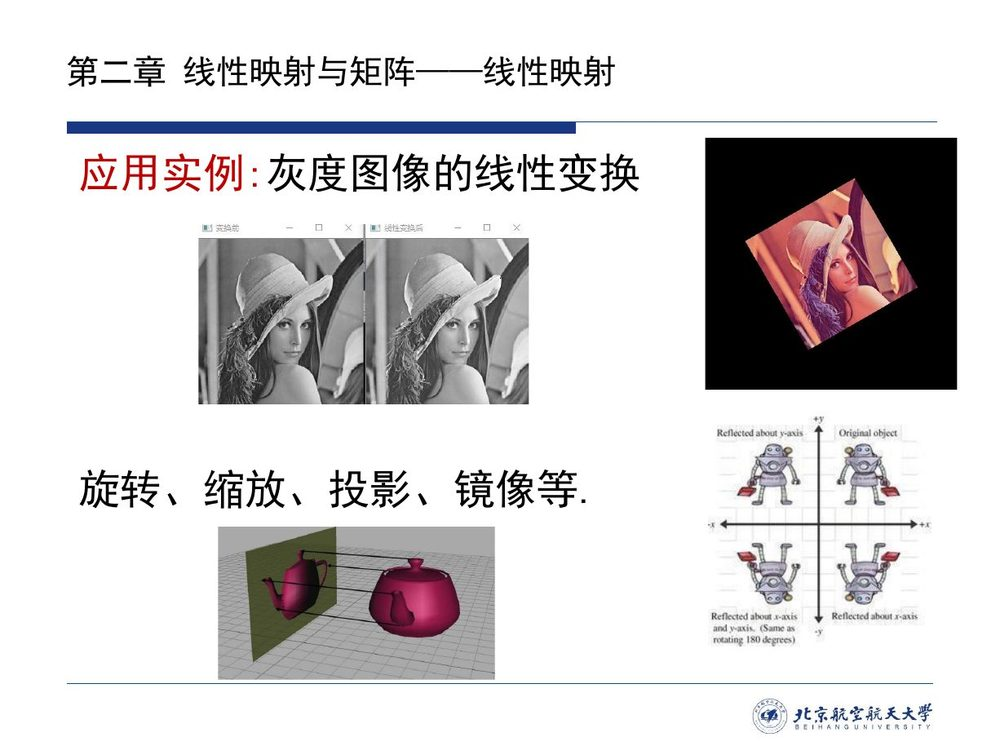

# 2.2 线性映射

第二章的知识「相比第一章来说**会更加抽象**一些，同学们上课和课后一定要多花时间复习……学习的时候先接受它，然后再求理解」（00:24:58）。2.1 节备好了映射的语言，抽象的起点就是本节：给映射加上与线性运算相容的要求——**可加性 + 齐次性 = 线性映射**（[@def-2.2.1]）。定义之后清点十二个例子（从零变换到微分、积分、投影、坐标与转置），再从例子里提炼三条核心性质（保持线性组合 [@thm-2.2.1]、$T(\boldsymbol{\theta})=\boldsymbol{\theta}'$ 与像的相关性 [@cor-2.2.1]）与**单射判据**（[@thm-2.2.2]）及其推论。最后把「所有线性映射」装进一个线性空间 $L(V,W)$（[@thm-2.2.3]），并以零空间 / 值域与**亏加秩定理**（[@thm-2.2.5]）收束本讲。

动手<strong class="widget-title">线性映射把网格变成了什么</strong>

调整矩阵 $A$ 的四个元素。左边是原像平面上的单位网格，右边是它被 $A$ 作用后的样子。注意：**原点始终不动**、**直线仍是直线**、**平行线仍平行**——这三条正是「线性」在图形上的样子。

{{#include ../assets/figures/matrix-kernel.md}}

## 2.2.1 定义与两条注记

课件用一整页的**应用实例**开场（本编补录）：灰度图像的旋转、缩放、投影、镜像，都是把像素坐标做线性变换——「线性映射不是抽象游戏，图像处理里每一步都在用」。

图像处理里的这些操作有一个共同点：它们只用到坐标的线性运算。把这个共同点抽成一般的要求，就是本节的第一个定义。

::: def 定义 2.2.1 · 线性映射（线性变换）{#def-2.2.1}

设 $V$ 和 $W$ 是数域 $F$ 上的线性空间，如果映射 $T:V\to W$ 满足下述性质：

1. **可加性**：$\forall x,y\in V$，$T(x+y)=T(x)+T(y)$；
2. **齐次性**：$\forall\lambda\in F$，$T(\lambda x)=\lambda T(x)$；

则称 $T$ 为 $V$ 到 $W$ 的一个**线性映射**。特别地，当 $V=W$ 时，映射 $T$ 为 $V$ 到自身的线性映射，称 $T$ 为 $V$ 上的**线性变换（或线性算子）**。
:::

上面两条要求还可以合并成一条等价形式，实际判定时几乎都直接用它（课件给出）：

$$T(ax+by)=aT(x)+bT(y),\qquad \forall x,y\in V,\ \forall a,b\in F .$$

::: think 两条注记（00:27:03–00:29:31，老师逐条讲）

1. **$V$ 与 $W$ 必须是同一数域 $F$ 上的线性空间**——否则数乘 $\lambda x$ 与 $\lambda T(x)$ 里的 $\lambda$ 无所依归；
2. **两套运算不要混**：「$x+y$、$\lambda x$ 用的是 **$V$ 中**的加法与数乘；$T(x)+T(y)$、$\lambda T(x)$ 用的是 **$W$ 中**的加法与数乘——左右两端的运算可能不一样。」（定义里的「$=$」两侧各有一个「$+$」，你要看清它们分别属于哪个空间。）
:::

::: preview 「保持线性运算」

上一章说线性空间 = 集合 + 加法 + 数乘。线性映射要做的事就一句话：**把 $V$ 里的线性运算原样搬到 $W$ 里再算，结果一样**。即「先算后映 = 先映后算」。所以线性映射 = 两个线性空间之间的「结构同态」。
:::

## 2.2.2 十二个例子：从零变换到转置

定义只有两行，判断力却要靠例子来养。下面按由简到繁的顺序清点十二个例子：前几个几乎不用动笔，越往后越接近考试里真正要判的形态。

**（1）三个基本变换**（例 2.2.1，$T:V\to V$）：

$$T(x)=\boldsymbol{\theta}\ (\text{零变换});\qquad T(x)=x\ (\text{恒等变换});\qquad T(x)=-x\ (\text{负变换})$$

**（2）平面上的三种几何变换**（例 2.2.2，$T:\mathbb R^2\to\mathbb R^2$）：

$$T(x)=\begin{bmatrix}k_1&0\\0&k_2\end{bmatrix}x\ (\text{伸缩},\ k_1,k_2>0);\qquad
T(x)=\begin{bmatrix}x_1\\-x_2\end{bmatrix}\ (\text{反射});\qquad
T(x)=\begin{bmatrix}\cos\varphi&-\sin\varphi\\ \sin\varphi&\cos\varphi\end{bmatrix}x\ (\text{旋转})$$

::: think 平移为什么不是线性变换（老师借 推论 2.2.1 专门辨析，00:57:04–00:58:30）

$T(x)=\begin{bmatrix}x_1+a\\x_2+b\end{bmatrix}$（$a,b$ 不全为 $0$）**不是**线性映射：它把原点搬到 $(a,b)$，而线性映射**必须保持原点不动**（$T(\boldsymbol{\theta})=\boldsymbol{\theta}'$，[@cor-2.2.1]（1））。所以「解析几何中常见的平移变换一般不是线性变换」；绕**原点**旋转才是。
:::

几何之外，微积分里最常用的两个算子也是线性的。

**（3）微分变换**（例 2.2.3）：在多项式空间 $P_n(x)$ 上定义

$$T(p(x))=\frac{\mathrm dp(x)}{\mathrm dx},\qquad \forall p(x)\in P_n(x).$$

老师特别提醒（00:33:50–00:34:15）：同一个微分变换既可以看作 $P_n\to P_n$ 的线性变换（三次项被求导「吃掉」、降为空多项式），也可以写成 $P_n\to P_{n-1}$ 的线性映射——**「会出现一个降维」**，考试时「千万千万注意题目到底怎么写的」。

**（4）积分变换**（例 2.2.4）：在 $C[a,b]$ 空间上定义

$$T(f(x))=\int_a^x f(t)\,\mathrm dt,\qquad \forall f(x)\in C[a,b].$$

下一个例子把第一章的内积结构直接变成一个线性变换。

**（5）正交投影变换**（例 2.2.5）：设 $V$ 是**内积空间**、$W$ 是 $V$ 的子空间，定义 $T(x)=\operatorname{Proj}_W x$（$\forall x\in V$），则 $T$ 是 $V$ 上的线性变换。这里 $V$ 必须带内积——投影要沿正交补落下，离开内积就无从谈起（对照第一章 [1.6](../ch01/sec16.md) 勘误 E11）。若 $\alpha_1,\cdots,\alpha_n$ 是 $W$ 的标准正交基，第一章 [1.6](../ch01/sec16.md) 的投影公式可以照搬：

$$T(x)=\operatorname{Proj}_W x=(x,\alpha_1)\alpha_1+\cdots+(x,\alpha_n)\alpha_n .$$

::: think 「$V\to V$ 才叫变换」（00:36:06–00:36:44）

「明明 $V$ 和 $W$ 不是同一个空间，为什么还能叫**变换**？——因为 $W\subset V$，投影的像既属于 $W$ 又属于 $V$，所以它仍可看作 $V$ 到自身的映射。」（定义 2.2.1 的「$V=W$」是形式条件，投影满足它的方式是「值域落在 $V$ 内」。）
:::

接着的两个例子换一批原料——第一章的「基」与矩阵运算。

**（6）两组基给出的变换**（例 2.2.6）：设 $V$ 是数域 $F$ 上的线性空间，$\varepsilon_1,\cdots,\varepsilon_n$ 和 $\eta_1,\cdots,\eta_n$ 是 $V$ 的**两组基**，定义映射 $T:V\to V$ 为

$$T(x)=[\eta_1,\cdots,\eta_n]\,[x_1,\cdots,x_n]^{\mathrm T},\qquad \forall x\in V,$$

式中 $[x_1,\cdots,x_n]^{\mathrm T}$ 是向量 $x$ 在基 $\varepsilon_1,\cdots,\varepsilon_n$ 下的坐标。则 $T$ 是 $V$ 上的线性变换。

::: preview 这个例子的几何图像

$T$ 把 $x$ **在旧基 $\varepsilon$ 下的坐标数组**当作**新基 $\eta$ 下的坐标**，重新组装出一个向量 $T(x)$。它线性（组装动作对坐标是线性的），并且在基 $\eta$ 下 $T(x)$ 的坐标**恰好是** $x$ 在基 $\varepsilon$ 下的坐标——这正是板书 43:59 记录的 $T(x)=[\eta_1\cdots\eta_n]\begin{bmatrix}x_1\\\vdots\\x_n\end{bmatrix}$ 与 45:09 的「坐标不能直接搬用」（在两处坐标列间打叉）所讲的要点：**同一个坐标数组配不同基，得到的是不同向量**。
:::

**（7）转置与矩阵左乘**（课件思考题与课堂补充）。$\forall A\in\mathbb R^{m\times n}$，定义 $T(A)=A^{\mathrm T}$（$T:\mathbb R^{m\times n}\to\mathbb R^{n\times m}$），则 $T$ 是线性映射——判定套路（00:45:56–00:48:19）：「**先证它是映射**（定义域、值域对不对），**再验证可加性与齐次性**」：

$$(A+B)^{\mathrm T}=A^{\mathrm T}+B^{\mathrm T},\qquad (kA)^{\mathrm T}=kA^{\mathrm T}.$$

同理 $T(X)=AXB$（$A,B$ 为常矩阵）也是线性映射。

**（8）例题（去年考题，例 2.2.7，00:53:38「这道题去年考试考过」）**：

::: ex 例 2.2.7（课件原文）· 由基定义的线性变换 {#ex-book-2.2.7}

设 $\alpha_1,\alpha_2,\alpha_3$ 是线性空间 $V$ 的一组基，定义映射 $T$ 为

$$T(k_1\alpha_1+k_2\alpha_2+k_3\alpha_3)=(k_1+k_2+k_3)\alpha_1+(k_2+k_3)\alpha_2+k_3\alpha_3,\qquad k_1,k_2,k_3\in F .$$

(1) 证明映射 $T$ 是 $V\to V$ 的线性变换；(2) 若 $\beta_0=2\alpha_1+\alpha_2+3\alpha_3$，求 $T(\beta_0)$。

::: sol 解答

**(1)** 分两步——**先证 $T$ 是（良定义的）映射**：$V$ 中任一向量在基下的坐标 $(k_1,k_2,k_3)$ 唯一，像 $(k_1+k_2+k_3)\alpha_1+(k_2+k_3)\alpha_2+k_3\alpha_3\in V$ 也唯一（由基的表示唯一性），故 $T:V\to V$。
**再证线性**：取 $x=\sum x_i\alpha_i$、$y=\sum y_i\alpha_i$、$\lambda\in F$。由坐标的唯一性，

$$x+y=\sum(x_i+y_i)\alpha_i,\qquad \lambda x=\sum(\lambda x_i)\alpha_i,$$

于是

$$T(x+y)=\big[(x_1+y_1)+(x_2+y_2)+(x_3+y_3)\big]\alpha_1+\big[(x_2+y_2)+(x_3+y_3)\big]\alpha_2+(x_3+y_3)\alpha_3=T(x)+T(y),$$

$$T(\lambda x)=(\lambda x_1+\lambda x_2+\lambda x_3)\alpha_1+(\lambda x_2+\lambda x_3)\alpha_2+\lambda x_3\alpha_3=\lambda T(x).$$

故 $T$ 是 $V$ 上的线性变换。
**(2)** 代入 $k_1=2,k_2=1,k_3=3$：

$$T(\beta_0)=(2+1+3)\alpha_1+(1+3)\alpha_2+3\alpha_3=6\alpha_1+4\alpha_2+3\alpha_3 .$$
:::
:::

::: note 例 2.2.3 / 2.2.4 的验证套路

以后遇到「微分变换 / 积分变换」，直接称呼、不再逐一验证（00:34:15 老师语）。要验证也不难：这两条要求落到微分与积分上，都只是微积分里的基本运算律。
:::

## 2.2.3 三条核心性质与单射判据

定义里的两条只保证 $T$ 对两项之和、对单个标量的数乘不变；真正动笔算时，面对的却是任意多项的线性组合。所以第一件事，是把这两条推广到 $p$ 项。

::: thm 定理 2.2.1 · 保持线性组合 {#thm-2.2.1}

设 $T$ 是数域 $F$ 上线性空间 $V$ 到 $W$ 的线性映射，若 $\alpha_1,\cdots,\alpha_p$ 是 $V$ 的一组向量，$k_1,\cdots,k_p\in F$，则

$$T(k_1\alpha_1+\cdots+k_p\alpha_p)=k_1T(\alpha_1)+\cdots+k_pT(\alpha_p).$$
:::

::: proof 证明（对 $p$ 归纳）

$p=1$ 即齐次性。设对 $p-1$ 成立，则对 $p$：

$$T(k_1\alpha_1+\cdots+k_p\alpha_p)=T\big[(k_1\alpha_1+\cdots+k_{p-1}\alpha_{p-1})+k_p\alpha_p\big]\overset{\text{可加}}{=}T(k_1\alpha_1+\cdots+k_{p-1}\alpha_{p-1})+T(k_p\alpha_p)$$

$$\overset{\text{归纳}}{=}(k_1T(\alpha_1)+\cdots+k_{p-1}T(\alpha_{p-1}))+k_pT(\alpha_p).\qquad\blacksquare$$
:::

老师强调（00:53:05–00:53:15）：「**不管 $\alpha_1,\cdots,\alpha_p$ 是线性无关还是线性相关**，上式均成立。」不要求 $\alpha$ 组无关，这正是后面两个性质证明的引擎。老师还口述了一个推论：线性映射由它在**一组基**上的作用完全确定；因为任何向量都是基的线性组合，用 [@thm-2.2.1] 一算即得。

::: cor 推论 2.2.1 · 四条常用性质 {#cor-2.2.1}

设 $T$ 是线性空间 $V$ 到 $W$ 的线性映射，则

1. $T(\boldsymbol{\theta})=\boldsymbol{\theta}'$，$\boldsymbol{\theta}\in V$，$\boldsymbol{\theta}'\in W$（**零元映到零元**）；
2. $T(-x)=-T(x)$，$\forall x\in V$；

同一个推论还补上两条：

3. 若 $\alpha_1,\cdots,\alpha_p$ 是 $V$ 中一组**线性相关**向量，则 $T(\alpha_1),\cdots,T(\alpha_p)$ 是 $W$ 中一组**线性相关**向量；
4. 若 $T(\alpha_1),\cdots,T(\alpha_p)$ 是 $W$ 的一组线性**无关**向量，则 $\alpha_1,\cdots,\alpha_p$ 是 $V$ 中一组线性无关向量。
:::

::: proof 证明

(1) $T(\boldsymbol{\theta})=T(0\cdot\boldsymbol{\theta})=0\cdot T(\boldsymbol{\theta})=\boldsymbol{\theta}'$。(2) $T(-x)=T((-1)x)=(-1)T(x)=-T(x)$。
(3) 由相关（[@def-1.3.1]）存在**不全为零**的 $k_1,\cdots,k_p$ 使 $k_1\alpha_1+\cdots+k_p\alpha_p=\boldsymbol{\theta}$。作用 $T$ 并用 [@thm-2.2.1]、性质 (1)：

$$k_1T(\alpha_1)+\cdots+k_pT(\alpha_p)=T(\boldsymbol{\theta})=\boldsymbol{\theta}'$$

——系数 $k_i$ 仍不全为零，故像组线性相关。
(4) 是 (3) 的**逆否命题**（课件把两者并列写出，考试常考「哪个方向成立」）。∎
:::

::: think 注 1：线性映射必须保持原点不动（00:57:04）

「它把零元素映射到（新空间的）零元素上；但**没有说非零元素不能映到零元素**——有可能把一些非零元素也映到零元素。」这个「非零也能映成零」的现象，正是后面零空间 $N(T)$ 与单射判据的伏笔。
:::

::: think 逆命题不真（00:58:44–01:03:20）

性质 (3) 说的是「**相关组的像仍相关**」；反过来「像相关 ⟹ 原像组相关」**不成立**——零映射把任何组（包括无关组）都映成零组。这引出下一问：「什么条件下**线性无关组的像也线性无关**？」
:::

::: thm 定理 2.2.2 · 单射判据（当且仅当）{#thm-2.2.2}

设 $T$ 是数域 $F$ 上 $n$ 维线性空间 $V$ 到 $m$ 维线性空间 $W$ 的线性映射，**当且仅当** $T$ 是单射时，$V$ 中线性无关向量组的像是 $W$ 中线性无关向量组。

**注 1**：线性映射不一定将一组基映射为像空间的一组基。
**注 2**：$\alpha_1,\cdots,\alpha_p$ 是 $V$ 中线性无关向量，$p<n$，像 $T(\alpha_1),\cdots,T(\alpha_p)$ 线性无关，**不一定**说明 $T$ 是单射。
:::

::: proof 证明（两个方向，01:04:17–01:11:01）

**（⟸ 无关组的像无关，用反证）**：设 $T$ 单射，$\alpha_1,\cdots,\alpha_n$ 是 $V$ 的一组线性无关向量。若 $k_1T(\alpha_1)+\cdots+k_nT(\alpha_n)=\boldsymbol{\theta}'$，由 [@thm-2.2.1] 与 [@cor-2.2.1]（1），

$$T(k_1\alpha_1+\cdots+k_n\alpha_n)=\boldsymbol{\theta}'=T(\boldsymbol{\theta}).$$

$T$ 单射 ⟹ $k_1\alpha_1+\cdots+k_n\alpha_n=\boldsymbol{\theta}$；$\alpha$ 组无关 ⟹ 所有 $k_i=0$。故像组无关。

**（⟹ 保无关 ⟹ 单射）**：设 $T$ 把无关组映成无关组。若 $T$ 不单，则存在 $x\neq y$ 使 $T(x)=T(y)$。取 $V$ 的一组基 $\alpha_1,\cdots,\alpha_n$ 及 $x=\sum x_i\alpha_i$、$y=\sum y_i\alpha_i$，则

$$\boldsymbol{\theta}'=T(x)-T(y)=T(x-y)=(x_1-y_1)T(\alpha_1)+\cdots+(x_n-y_n)T(\alpha_n),$$

而 $x-y\neq\boldsymbol{\theta}$ ⟹ 系数 $x_i-y_i$ 不全为零。于是像组 $T(\alpha_1),\cdots,T(\alpha_n)$ 线性相关，与假设矛盾。故 $T$ 单射。∎
:::

判据证完。老师把这段论证压缩成一句（01:10:55）：「**如果有线性无关（组的像线性无关）这个性质，那这个 $T$ 就是单射**，必要性证完。」

::: cor 推论 2.2.2 · 维数相同 + 单射 ⟹ 双射 {#cor-2.2.2}

设线性空间 $V$ 和 $W$ 的**维数相同**，且 $T$ 是 $V$ 到 $W$ 的线性映射，则当且仅当 $T$ 是单射时，$V$ 中一组**基**的像是 $W$ 中一组**基**，此时映射 $T$ 是**双射**。
:::

::: think 维数陷阱（01:11:17–01:14:23，老师郑重提醒）

要点分两层，别混在一起：

1. **单射判据（[@thm-2.2.2]）本身不需要任何维数假设**——它说的是「$T$ 单射 $\iff$ 任一无关组的像仍无关」。$\dim W<\dim V$ 时两边**同时为假**（此时不存在单射），等价依然成立。
2. **推论 2.2.2 则必须先设 $\dim V=\dim W$**：$\dim W<\dim V$ 时根本不存在单射，「单射 ⟹ 双射」无从谈起。这个前提正是把「单射 + 无关像」升级为「**基的像也是基**」（从而双射）的关键补丁。

**做题时先看题目给没给同维条件，不要默认。**
:::

## 2.2.4 线性映射空间 $L(V,W)$

定义、例子、性质与判据都有了，接下来换个角度「数」线性映射：把 $V\to W$ 的线性映射全体收集起来，会得到什么？

::: def 定义 2.2.2 / 2.2.3 · 线性映射的加法与数乘 {#def-2.2.2}

设 $T_1,T_2\in L(V,W)$（$L(V,W)$ 表示线性空间 $V$ 到 $W$ 的**所有线性映射的集合**）。

- **加法**：$(T_1+T_2)(x)=T_1(x)+T_2(x)$，$\forall x\in V$（等号右端的「$+$」是 $W$ 的加法）；
- **数乘**：$(\lambda T)(x)=\lambda\cdot T(x)$，$\forall x\in V,\ \lambda\in F$（右端的「$\cdot$」是 $W$ 的数乘）。
:::

两套运算有了，$L(V,W)$ 是否就此成为线性空间？下一个定理给出答案。

::: thm 定理 2.2.3 · 线性映射空间 {#thm-2.2.3}

集合 $L(V,W)$ 对 [@def-2.2.2]（加法）与 [@def-2.2.2]（数乘）构成数域 $F$ 上的**线性空间**，称为**线性映射空间**（$V\to W$ 全体）；特别地，$L(V)$ 称为**线性变换空间**。
:::

::: proof 证明（验证八条公理的思路）

加法与数乘都「逐点借用 $W$ 的运算」，所以 $W$ 的公理逐条传递：零向量是零映射（$x\mapsto\boldsymbol{\theta}'$）、$T$ 的负是 $-T$（[$x\mapsto-T(x)$]）、结合律 / 交换律 / 分配律都在每个 $x$ 上验证。唯一要单独检查的是**封闭性**：$T_1+T_2$ 与 $\lambda T$ 仍是**线性映射**——因为它们逐点线性（这也是必须先验证的部分）。∎
:::

空间有了，下一个问题自然是它有多大——课件思考题问的正是 $\dim L(V,W)$（课堂 01:14:23–01:23:02 展开）。

::: ex 例 2.2.A（课堂展开）· $\mathbb R^2\to\mathbb R^3$ 的线性映射就是 $3\times2$ 矩阵 {#ex-2.2.A}

「从 $\mathbb R^2$ 空间到 $\mathbb R^3$ 空间做一个映射……最简单的办法就是把它乘以一个矩阵 $A$，$A$ 是 $3\times2$ 的矩阵，乘上 $\mathbb R^2$ 的列向量就变成了 $\mathbb R^3$ 的列向量」（01:15:19–01:16:10）：

$$\begin{bmatrix}x_1\\ x_2\end{bmatrix}\xrightarrow{\ T\ }\begin{bmatrix}y_1\\ y_2\\ y_3\end{bmatrix},\qquad
A^{3\times2}\begin{bmatrix}x_1\\ x_2\end{bmatrix}=\begin{bmatrix}y_1\\ y_2\\ y_3\end{bmatrix}.$$

老师给出一句通俗概括（01:17:54）：「**线性映射是什么？线性映射其实就是一个矩阵。线性映射空间是什么？其实就是一个矩阵空间**」——「当然只是通俗地理解，严格说：取定基之后」。因此

$$\dim L(\mathbb R^2,\mathbb R^3)=3\times2=6,$$

与矩阵空间 $\mathbb R^{3\times2}$ 的维数（自然基 $E_{11},E_{12},E_{21},E_{22},E_{31},E_{32}$ 共 $6$ 个，板书 86:09；下标第一位数是行、第二位是列，故第二位只到 $2$）一致。一般地 $\dim L(V,W)=\dim V\cdot\dim W$。
:::

::: ex 例 2.2.B（课堂展开）· $T(X)=AXB$ 的自由度 {#ex-2.2.B}

把 $2\times2$ 矩阵映到 $3\times3$ 矩阵空间：「是不是这边乘 $A$（$3\times2$）、后面乘 $B$（$2\times3$）」——$T(X)=AXB$；写出这个映射需要 $A$ 的 $6$ 个数与 $B$ 的 $6$ 个数，「共 $12$ 个参数」。

**这里有一处容易踩的混淆：**$12$ 是「描述这个映射所需的数据量」，**不是**这族映射的维数。$\lambda\neq0$ 时 $(\lambda A,\lambda^{-1}B)$ 与 $(A,B)$ 给出**同一个** $T(X)=AXB$，即参数化有一维冗余；再除掉退化的 $(A,B)$，这族映射实为 $11$ 维。这正是本节反复强调的「同一个映射可以有多组数据描述」——与「$L(V,W)$ 的维数是 $\dim V\cdot\dim W$」并不冲突，后者数的是同构于矩阵空间的那个线性空间的维数。紧接着老师又提醒（01:19:32）：「涉及多项式、函数呢？线性空间里不只有矩阵——所以**只能通俗地理解**（$L(V,W)$ 与矩阵空间同构，但不必是同一件事）。」
:::

## 2.2.5 零空间、值域与亏加秩定理

到此为止都是从外部看线性映射：定义它、清点它、把全体装进 $L(V,W)$。要认识单独一个映射 $T$，得看它内部的两件事：把哪些向量压成零、能取到哪些像——答案就是下面这一对子空间。

::: thm 定理 2.2.4 · 值空间（像空间）与核空间（零空间）{#thm-2.2.4}

设 $T\in L(V,W)$，定义

$$N(T)=\{x\in V\mid T(x)=\boldsymbol{\theta}'\},\qquad R(T)=\{y\in W\mid \exists\,x\in V,\ y=T(x)\}=T(V).$$

（量词要看清：$R(T)$ 里的 $x$ 是**存在**的，不是「对一切 $x$ 都成立」——$y$ 只需被**某一个** $x$ 映到。另按本编约定 $\boldsymbol{\theta}\in V$、$\boldsymbol{\theta}'\in W$ 分属两个空间，故 $N(T)$ 中写 $\boldsymbol{\theta}'$。）

则 $N(T)$ 是 $V$ 的**子空间**、$R(T)$ 是 $W$ 的**子空间**。称 $N(T)$ 是线性映射 $T$ 的**核空间**（或**零空间**），$R(T)$ 是线性映射 $T$ 的**像空间**（或**值空间**）；并称 $\dim N(T)$ 为 $T$ 的**零度**（或**亏**），$\dim R(T)$ 为 $T$ 的**秩**。
:::

::: proof 子空间性的证明（课堂口述要点，[1.2](../ch01/sec12.md) 判定定理的直接应用）

先看 $N(T)\subset V$：$\boldsymbol{\theta}\in N(T)$（因 $T(\boldsymbol{\theta})=\boldsymbol{\theta}'$）；任取 $x,y\in N(T)$、$\lambda,\mu\in F$，则 $T(\lambda x+\mu y)=\lambda T(x)+\mu T(y)=\boldsymbol{\theta}'$，故 $\lambda x+\mu y\in N(T)$——对线性组合封闭。同理 $R(T)\subset W$ 且对线性组合封闭（任取像 $T(x),T(y)$，$T(\lambda x+\mu y)=\lambda T(x)+\mu T(y)$ 仍是像）。∎
:::

::: think 命名由来（01:25:49–01:26:26）

「$N(T)$ 既然是 $V$ 的子空间，它的维数我们把它叫做**零度**；$R(T)$ 的维数称为（映射的）**秩**——它和**矩阵的秩**是非常相似的。」（提问：矩阵 $A$ 的秩是什么？——是它的值空间的维数。）这句类比下一节就兑现：取定基之后 $\dim N(T)=\dim N(A)$、$\dim R(T)=\operatorname{rank}A$ 逐条成立（[定理 2.3.6](sec23.md#thm-2.3.6)），「矩阵的秩」与「映射的秩」自此是同一件事的两种说法。
:::

::: thm 定理 2.2.5 · 亏加秩定理（维数公式）{#thm-2.2.5}

设 $T\in L(V,W)$，则

$$\dim N(T)+\dim R(T)=\dim V,$$

即线性映射 $T$ 的亏加秩等于其定义域 $V$ 空间的维数。
:::

::: proof 证明（基扩充——课堂上证到一半下课，此处按老师的路线补完）

记 $\dim V=n$。

**第一步（取 $V$ 的基）**：设 $\varepsilon_1,\cdots,\varepsilon_n$ 为 $V$ 的基。

**第二步（取 $N(T)$ 的基并扩充）**：设 $\dim N(T)=m\le n$，取 $N(T)$ 的基 $h_1,\cdots,h_m$。由[基扩充定理](../ch01/sec13.md)（板书 90:18 的图解正对应此步）扩充为 $V$ 的基

$$h_1,\cdots,h_m,\ h_{m+1},\cdots,h_n .$$

**第三步（$R(T)$ 由后 $n-m$ 个像张成）**：$V$ 中任一向量 $\beta=k_1h_1+\cdots+k_nh_n$，作用 $T$：

$$T(\beta)=k_1T(h_1)+\cdots+k_mT(h_m)+k_{m+1}T(h_{m+1})+\cdots+k_nT(h_n)=k_{m+1}T(h_{m+1})+\cdots+k_nT(h_n),$$

（用了 $h_1,\cdots,h_m\in N(T)$ 故前 $m$ 项为零）——因此

$$R(T)=\operatorname{span}\{T(h_{m+1}),\cdots,T(h_n)\}.$$

**第四步（后 $n-m$ 个像线性无关——课堂停在这里，下面补完）**：若

$$c_{m+1}T(h_{m+1})+\cdots+c_nT(h_n)=\boldsymbol{\theta}',$$

由线性得 $T(c_{m+1}h_{m+1}+\cdots+c_nh_n)=\boldsymbol{\theta}'$，即 $c_{m+1}h_{m+1}+\cdots+c_nh_n\in N(T)$。于是它可由 $N(T)$ 的基表出：存在 $c_1,\cdots,c_m$ 使

$$c_{m+1}h_{m+1}+\cdots+c_nh_n=c_1h_1+\cdots+c_mh_m,$$

即 $c_1h_1+\cdots+c_mh_m-c_{m+1}h_{m+1}-\cdots-c_nh_n=\boldsymbol{\theta}$。因 $h_1,\cdots,h_n$ 是 $V$ 的基（线性无关），全部系数为零，特别地 $c_{m+1}=\cdots=c_n=0$。故 $T(h_{m+1}),\cdots,T(h_n)$ 线性无关、构成 $R(T)$ 的基：

$$\dim R(T)=n-m=\dim V-\dim N(T).\qquad\blacksquare$$
:::

::: preview 定理在说什么

「$V$ 的 $n$ 个自由度被分成两份：$m$ 个被 $T$ 压成零（$N(T)$），剩下的 $n-m$ 个原样传给 $R(T)$。」维数守恒：**死的部分 + 活的部分 = 全部**。它是判断「单射 / 满射 / 同构」的定量工具（$T$ 单射 $\iff\dim N(T)=0$；$T$ 满射 $\iff\dim R(T)=\dim W$），下一节还会以矩阵形式重述一遍（[定理 2.3.6](sec23.md#thm-2.3.6)），此后的秩理论与特征值讨论都建立在它上面。
:::

## 2.2 小结与常见错误

- **一条主线**：定义（两条件）→ 例子（几何 / 微分 / 积分 / 投影 / 两组基 / 矩阵诱导）→ 性质（保持组合、$T(\boldsymbol{\theta})=\boldsymbol{\theta}'$、相关→相关）→ 单射判据（当且仅当，含两条注）→ 推论（维数相同 + 单射 ⟹ 双射）→ $L(V,W)$（线性空间、维数 = $\dim V\cdot\dim W$）→ $N(T)$、$R(T)$、零度与秩 → 亏加秩定理。
- **一个记号提醒**：$\dim L(V,W)$ 中的 $L$ 是「linear」；课件的花体 $\mathcal L(V,W)$ 与本编写法同义。

::: think 常见错误清单 · 自查三条

1. 验证线性时**只验一条**——可加性与齐次性缺一不可。两个方向都有反例：$T(x,y)=\begin{cases}x^2/y,&y\neq0\\0,&y=0\end{cases}$（$\mathbb R^2\to\mathbb R$）满足**齐次性**（$T(tx,ty)=t\,T(x,y)$），却不可加（$T(1,2)+T(1,1)=\frac32\neq\frac43=T(2,3)$）；反过来 $T(x)=\|x\|$ 连**齐次性**也不满足（$\|-x\|=\|x\|\neq-\|x\|$，只要 $x\neq\boldsymbol{\theta}$）；
2. 单射判据的两个方向记混——「保无关 ⟹ 单射」需要**定义域整个基**上的无关性（注 2 的反例：$p<n$ 时只验部分向量不够）；
3. 用「维数相同 + 单射」得双射时忘了**同维数**前提（[维数陷阱](sec22.md#cor-2.2.2)）。
:::

::: ex 即时自测（不看上文，3 分钟）{#ex-2.2.quiz}

1. 写出线性映射定义的两条，并写出合并形式。
2. $T(x)=\|x\|$（$\mathbb R^n\to\mathbb R$）是线性映射吗？为什么？
3. $T:\mathbb R^2\to\mathbb R^2$，$T(x)=[x_1,-x_2]^{\mathrm T}$：求 $N(T)$、$R(T)$、零度与秩，并验证亏加秩定理。
4. 平移 $T(x)=x+a$（$a\neq0$）为什么不是线性变换？

::: sol 参考要点

1. 可加性 + 齐次性；$T(ax+by)=aT(x)+bT(y)$。
2. 不是。**齐次性**先不成立：取 $x\neq\boldsymbol{\theta}$，$T(-x)=\|-x\|=\|x\|\neq-\|x\|=-T(x)$。可加性也不成立（$\|x+y\|\le\|x\|+\|y\|$ 一般严格不等）。
3. $N(T)=\{\boldsymbol{\theta}\}$（零度 $0$）；$R(T)=\mathbb R^2$（秩 $2$）；$0+2=2=\dim\mathbb R^2$。
4. $T(\boldsymbol{\theta})=a\neq\boldsymbol{\theta}$，违反 [@cor-2.2.1]（1）（线性映射必须保持原点不动）。
:::
:::
