# 2.3 矩阵与同构

2.2 结尾留下两个悬而未决的问题：线性映射空间 $L(V,W)$ 的**维数**是多少？抽象的线性映射能不能**算**？本节一并回答，而这两个问题的答案出自同一个动作——取定基。基一旦固定，**线性映射与矩阵就一一对应**（[@thm-2.3.1]），而且这个对应还保持线性运算（[@thm-2.3.2]）——于是 $L(V,W)$ 与矩阵空间同构，「在哪个空间里算」不再重要。同构顺带补上了 2.2 里只有几何直觉的「两个空间长得一样」：**同构 ⟺ 维数相等**（[@thm-2.3.3]）。有了这套语言，最后两节把它落到实处——坐标公式 $\beta=A\alpha$（[@thm-2.3.4]）说明矩阵怎么算像，换基公式 $B=P^{-1}AQ$ 与相似（[@thm-2.3.5]、[@cor-2.3.4]）说明同一个映射为什么会有不同的矩阵，而「矩阵的秩 / 零空间」与「映射的秩 / 零空间」的同一性（[@thm-2.3.6]）则把先修知识里的秩接回 2.2 的映射图像。

<aside class="lesson-brief" aria-label="2.3 学习简报">

PREREQUISITE<strong>你需要先会</strong>
基、坐标与过渡矩阵（[@def-1.3.4]、[@def-1.3.5]、[@prop-1.3.1]）；线性映射、$L(V,W)$、单射判据与亏加秩定理（[@def-2.2.1]、[@thm-2.2.3]、[@thm-2.2.2]、[@thm-2.2.5]）。

TARGET<strong>本节要建立</strong>
矩阵的定义（[@def-2.3.1]：矩阵的列就是基像的坐标）；存在唯一性 [@thm-2.3.1]；同构映射与 $L(V,W)\cong F^{m\times n}$（[@def-2.3.2]、[@thm-2.3.2]）；同构的判别与维数（[@prop-2.3.1]、[@thm-2.3.3]）；坐标公式 $\beta=A\alpha$；换基公式 $B=P^{-1}AQ$、相抵与相似；[@thm-2.3.6] 把矩阵的秩接回映射的秩。

CHECKPOINT<strong>学完的标准</strong>
给定映射与两对基能逐列写出矩阵；能复述「$A$ 的第 $j$ 列 $=$ $T(\varepsilon_j)$ 的坐标」并倒推映射；能说清同构为什么必须要求双射、而不能只要求「元素一样多」；能用 $B=P^{-1}AQ$ 判断两个矩阵是否是同一个映射在不同基下的样子；能解释为什么可以放心把 $\operatorname{rank}A$ 当作映射的秩。

</aside>

::: note 素材与说明（与 2.1、2.2 两节的差别）

本页依据课程第二章课件 **2.3 矩阵与同构**（25 页，现存 `_sources/matrix/`）整理，并与 2.1、2.2 课件（同一批次入库）交叉核对。**本节的 2.3 尚无对应录播**，故本页不引用课堂口述与时间戳：课件给出的定义、定理、命题、推论、例题与思考题**照录并保留原编号**；课件省略的证明、未给答案的例题，由本编补出并逐处标注「本编补」。相关编号与表述问题见[勘误与补注](errata.md#errata-2.5)。
:::

## 2.3.1 矩阵：把线性映射写成数表

上一章用「坐标」把一个向量换成 $n$ 个数；现在把同一套办法用在映射上——用「坐标」把一个**映射**换成一堆数。这件事能办成，靠的是 2.2 里已经证明的一条结论：线性映射由它在一组基上的作用完全确定。于是做法只有一句话：**看基向量被映到哪里**。

::: def 定义 2.3.1 · 线性映射的矩阵 {#def-2.3.1}

设 $V$ 和 $W$ 是数域 $F$ 上的线性空间，$\varepsilon_1,\cdots,\varepsilon_n$ 和 $\eta_1,\cdots,\eta_m$ 分别是 $V$ 和 $W$ 的基，且 $T\in L(V,W)$。若

$$T(\varepsilon_1)=a_{11}\eta_1+a_{21}\eta_2+\cdots+a_{m1}\eta_m$$
$$T(\varepsilon_2)=a_{12}\eta_1+a_{22}\eta_2+\cdots+a_{m2}\eta_m$$
$$\cdots\cdots\cdots$$
$$T(\varepsilon_n)=a_{1n}\eta_1+a_{2n}\eta_2+\cdots+a_{mn}\eta_m$$

即

$$T(\varepsilon_1,\cdots,\varepsilon_n)\triangleq\big[T(\varepsilon_1),\cdots,T(\varepsilon_n)\big]=(\eta_1,\cdots,\eta_m)A,$$

则 $A=(a_{ij})\in F^{m\times n}$ 称为 $T$ 在 $V$ 的基 $\varepsilon_1,\cdots,\varepsilon_n$ 和 $W$ 的基 $\eta_1,\cdots,\eta_m$ 下的**矩阵**。

若 $V=W$（此时 $\eta_i$ 就是 $\varepsilon_i$），则有

$$T(\varepsilon_1,\cdots,\varepsilon_n)\triangleq\big[T(\varepsilon_1),\cdots,T(\varepsilon_n)\big]=(\varepsilon_1,\cdots,\varepsilon_n)A,\qquad A=(a_{ij})\in F^{n\times n},$$

矩阵 $A$ 称为**线性变换** $T$ 在 $V$ 的基 $\varepsilon_1,\cdots,\varepsilon_n$ 下的矩阵。
:::

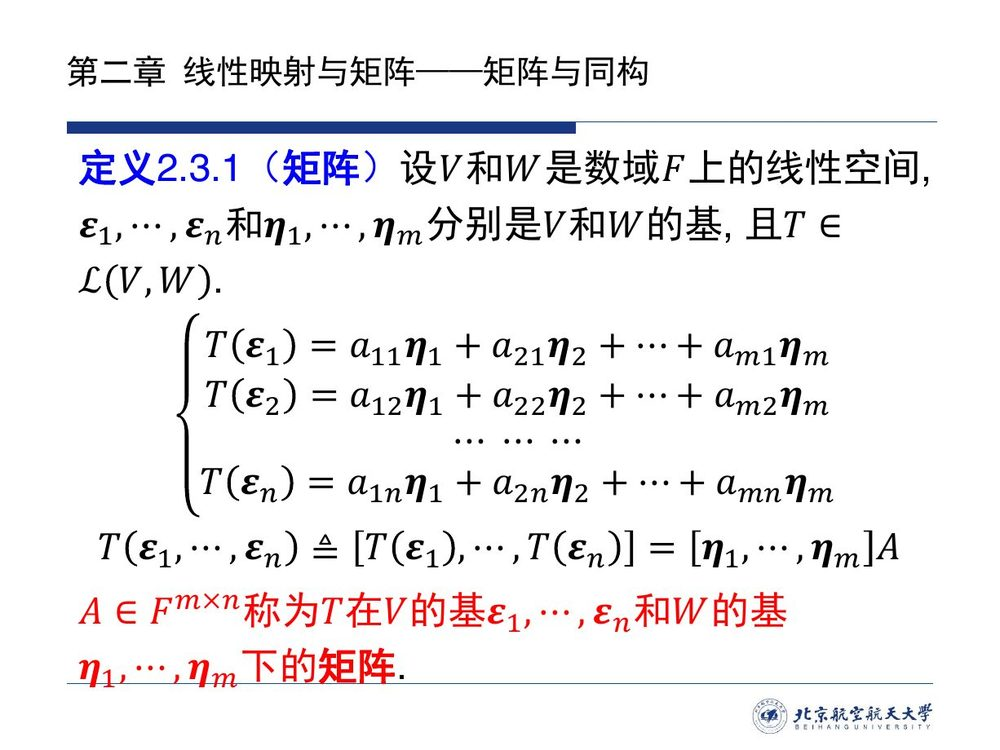

把定义反过来念，就是下面这条读法：写矩阵时它是一道工序，读矩阵时它是还原公式。

::: method 读法（本编提炼）· 一切矩阵计算的引擎

**$A$ 的第 $j$ 列 $=$ $T(\varepsilon_j)$ 在基 $\eta$ 下的坐标列。**

- **写矩阵**（由 $T$ 到 $A$）：逐列问「$\varepsilon_j$ 被映到哪里？这个像在 $\eta$ 下怎么表示？」，把答案的系数抄成第 $j$ 列；
- **读矩阵**（由 $A$ 到 $T$）：逐列还原 $T(\varepsilon_j)=\sum_i a_{ij}\eta_i$；再由 [@thm-2.2.1]，$T$ 在任何 $x$ 上的作用都确定了。

**形状检查**：$A$ 是 $m\times n$——**行数 $=$ 到达空间 $W$ 的维数，列数 $=$ 出发空间 $V$ 的维数**（「横着读像、竖着数向量」）。写反形状是本节最常见的错误。
:::

::: ex 例 2.3.1（课件原文）· 平面旋转的矩阵 {#ex-2.3.1}

定义平面旋转变换 $T:\mathbb R^2\to\mathbb R^2$ 满足

$$T(x)=\begin{bmatrix}\cos\varphi&-\sin\varphi\\ \sin\varphi&\cos\varphi\end{bmatrix}x,\qquad \forall x\in\mathbb R^2 .$$

取定 $\mathbb R^2$ 中的标准基 $e_1,e_2$，求 $T$ 在 $e_1,e_2$ 下的矩阵。

::: sol 解答

按读法逐列算：

$$T(e_1)=\begin{bmatrix}\cos\varphi\\ \sin\varphi\end{bmatrix}=\cos\varphi\,e_1+\sin\varphi\,e_2,\qquad
T(e_2)=\begin{bmatrix}-\sin\varphi\\ \cos\varphi\end{bmatrix}=-\sin\varphi\,e_1+\cos\varphi\,e_2 .$$

于是

$$T(e_1,e_2)=(e_1,e_2)\begin{bmatrix}\cos\varphi&-\sin\varphi\\ \sin\varphi&\cos\varphi\end{bmatrix},$$

矩阵**恰是定义 $T$ 时用的那个矩阵**。

**这次重合是标准基的特权**：只有取标准基时，$T$ 的矩阵才与定义式中的矩阵重合——因为 $e_j$ 的坐标本身就是单位向量，$T(e_j)$ 的坐标可以直接读出来。换一组基矩阵就会变（[2.3.4](sec23.md#sec-2.3.4)），变成什么样子则由 [@thm-2.3.5] 给出。
:::
:::

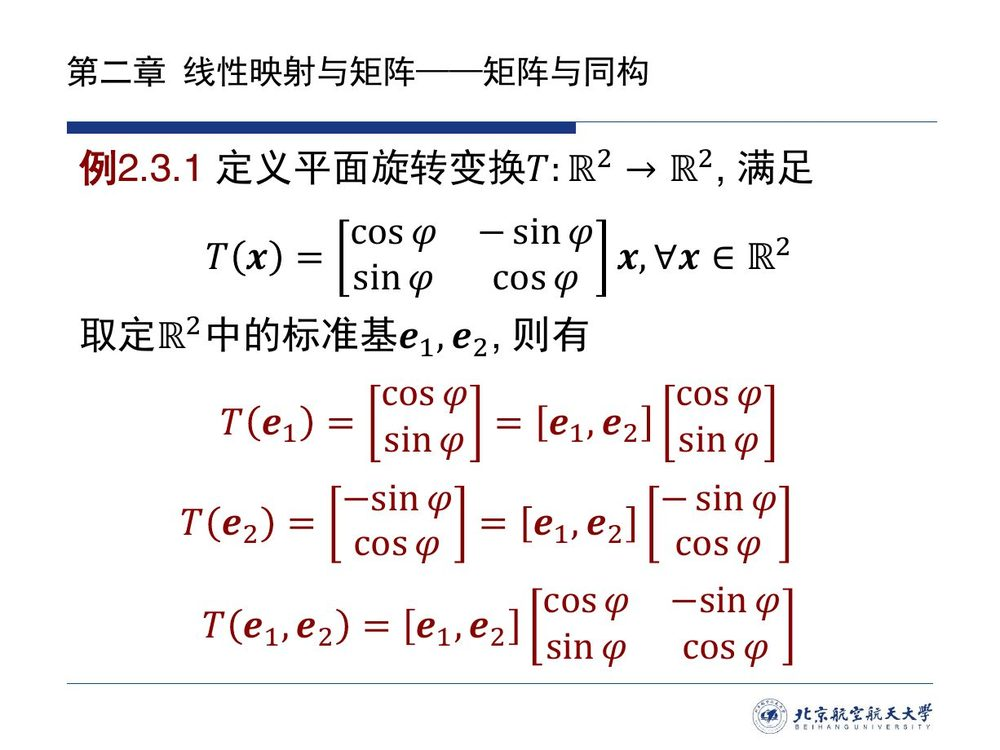

旋转的例子过于规整：标准基下的坐标就是分量，矩阵几乎可以照抄。换一个「基不再是坐标轴」的空间，读法才真正出力。

::: ex 例 2.3.2（课件原文）· 微分变换的矩阵 {#ex-2.3.2}

在多项式空间 $P_n(x)$ 中定义微分变换 $T:P_n\to P_n$：

$$T(p(x))=\frac{\mathrm dp(x)}{\mathrm dx},\qquad \forall p(x)\in P_n(x).$$

取定 $P_n(x)$ 的一组基 $1,x,x^2,\cdots,x^n$，求 $T$ 的矩阵。

::: sol 解答

基向量逐个求导：$T(1)=0$，$T(x)=1$，$T(x^2)=2x$，$\cdots$，$T(x^n)=nx^{n-1}$。按读法把它们写成 $1,x,x^2,\cdots,x^n$ 的坐标列：

$$T(1)=[1,x,\cdots,x^n]\begin{bmatrix}0\\0\\ \vdots\\0\end{bmatrix},\quad
T(x)=[1,x,\cdots,x^n]\begin{bmatrix}1\\0\\ \vdots\\0\end{bmatrix},\quad
T(x^2)=[1,x,\cdots,x^n]\begin{bmatrix}0\\2\\ \vdots\\0\end{bmatrix},\ \cdots$$

拼起来（$(n+1)\times(n+1)$ 矩阵，第 $k+1$ 列是 $T(x^k)=kx^{k-1}$ 的坐标，只有第 $k$ 个位置是 $k$）：

$$A=\begin{bmatrix}0&1&0&\cdots&0\\ 0&0&2&\cdots&0\\ \vdots&\vdots&\vdots&\ddots&\vdots\\ 0&0&0&\cdots&n\\ 0&0&0&\cdots&0\end{bmatrix}.$$

**本编注**：$A$ 满足 $A^{n+1}=O$——「求导 $n+1$ 次必为零」在矩阵上的样子：每乘一次就把系数**上移一格**，信息被一格一格推出去。这类矩阵（幂零矩阵，特征值全为 $0$）是后面讨论特征值与若尔当形的标准样板。

**提醒**（与 [2.2.2](sec22.md#sec-2.2.2) 的例 2.2.3 呼应）：如果把 $T$ 看成 $P_n\to P_{n-1}$ 的映射，到达空间换了，基也换了（少一个 $x^n$），矩阵形状随之变成 $n\times(n+1)$——**矩阵依赖于「映射 + 两对基」三件事，缺一不可**。
:::
:::

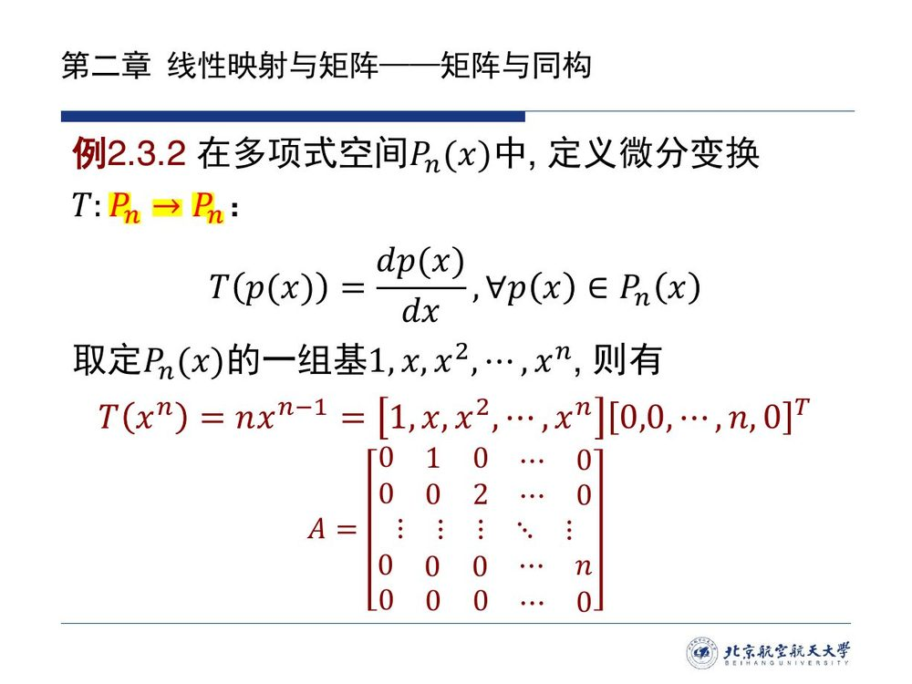

::: ex 例 2.3.3（课件原文）· 两组基给出的变换在 $\varepsilon$ 下的矩阵 {#ex-2.3.3}

设 $V$ 是数域 $F$ 上的线性空间，$\varepsilon_1,\cdots,\varepsilon_n$ 和 $\eta_1,\cdots,\eta_n$ 是 $V$ 的两组基，定义线性变换 $T:V\to V$ 为

$$T(x)=(\eta_1,\cdots,\eta_n)(x_1,\cdots,x_n)^{\mathrm T},\qquad \forall x\in V,$$

式中 $(x_1,\cdots,x_n)^{\mathrm T}$ 是 $x$ 在基 $\varepsilon_1,\cdots,\varepsilon_n$ 下的坐标。求 $T$ 在基 $\varepsilon_1,\cdots,\varepsilon_n$ 下的矩阵。

（这正是 [2.2.2](sec22.md#sec-2.2.2) 的例 2.2.6；那里只验证了 $T$ 线性，本页补出它的矩阵。）

::: sol 解答（课件未给答案，本编补）

按读法逐列算。取 $x=\varepsilon_j$：$\varepsilon_j$ 在 $\varepsilon$ 下的坐标是单位列 $e_j$，故

$$T(\varepsilon_j)=(\eta_1,\cdots,\eta_n)e_j=\eta_j .$$

于是 $T(\varepsilon_1,\cdots,\varepsilon_n)=(\eta_1,\cdots,\eta_n)$。设 $P$ 是由 $\varepsilon_1,\cdots,\varepsilon_n$ 到 $\eta_1,\cdots,\eta_n$ 的过渡矩阵（[@def-1.3.5]），即 $(\eta_1,\cdots,\eta_n)=(\varepsilon_1,\cdots,\varepsilon_n)P$，代入得

$$T(\varepsilon_1,\cdots,\varepsilon_n)=(\varepsilon_1,\cdots,\varepsilon_n)P\ \Longrightarrow\ A=P .$$

**结论**：$T$ 在基 $\varepsilon$ 下的矩阵**就是由 $\varepsilon$ 到 $\eta$ 的过渡矩阵**。

**两点收获**：① 这个映射的几何意义就是「换尺子」：把 $x$ 的 $\varepsilon$ 坐标原样读成 $\eta$ 坐标，得到的却是另一个向量（[2.2](sec22.md#sec-2.2.2) 里「坐标不能直接搬用」的正式化）；② 过渡矩阵必可逆（[@prop-1.3.1]（1）），故 $T$ 可逆，是 $V$ 上的一一变换。
:::
:::

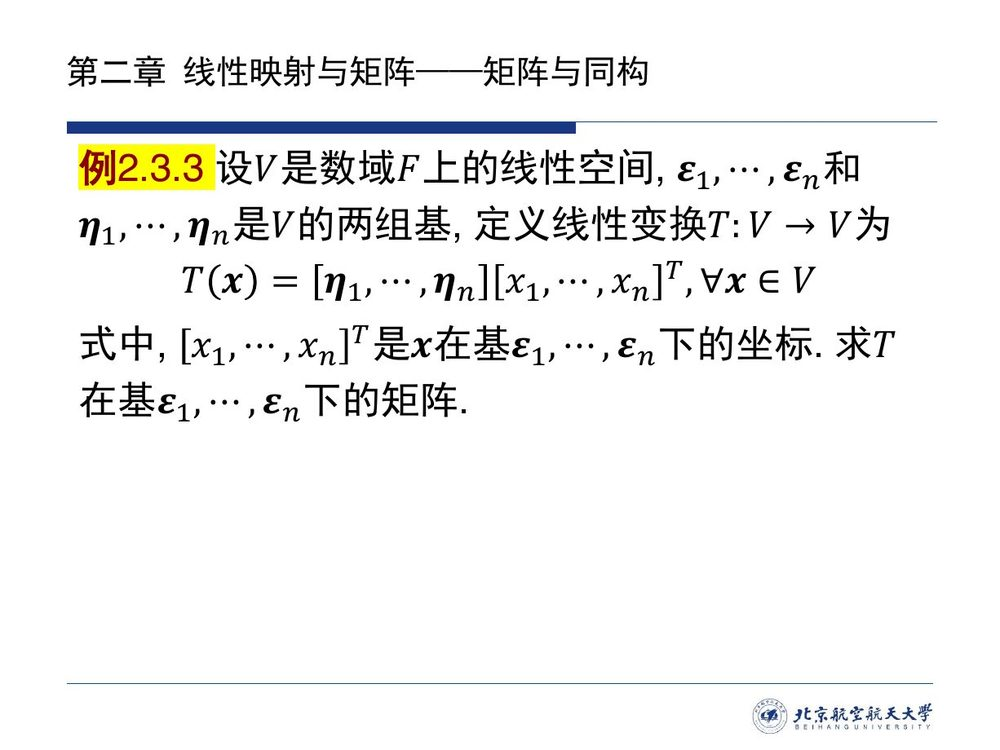

前面三个例子做的都是同一件事：把一个给定的映射翻译成矩阵。真正重要的是反过来——**随便给一个矩阵，都恰好对应一个线性映射**。下面这条定理把它写成命题，而本节其余结论全都建立在它之上。

::: thm 定理 2.3.1 · 存在唯一性 {#thm-2.3.1}

设 $V$ 和 $W$ 是数域 $F$ 上的线性空间，取定 $\varepsilon_1,\cdots,\varepsilon_n$ 和 $\eta_1,\cdots,\eta_m$ 分别是 $V$ 和 $W$ 的一组基。任取 $A=(a_{ij})\in F^{m\times n}$，则有且仅有一个线性映射 $T\in L(V,W)$ 使其在 $V$ 的基 $\varepsilon_1,\cdots,\varepsilon_n$ 和 $W$ 的基 $\eta_1,\cdots,\eta_m$ 下的矩阵恰为 $A$。
:::

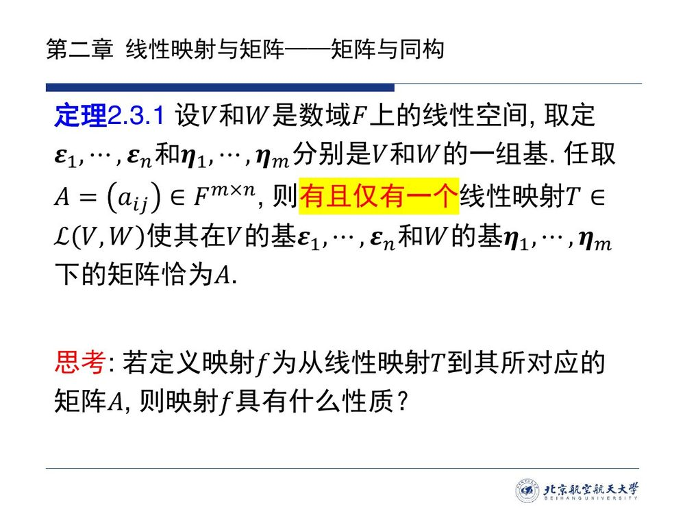

::: proof 证明（课件只列了构造线索，此处补全两半）

**存在性（构造）**：对任意 $x\in V$，它在基 $\varepsilon$ 下的坐标 $\alpha=(x_1,\cdots,x_n)^{\mathrm T}$ 由 $x=(\varepsilon_1,\cdots,\varepsilon_n)\alpha$ **唯一**确定（[@thm-1.3.2]）。定义

$$T(x)\triangleq(\eta_1,\cdots,\eta_m)A\alpha .$$

- **良定义、取值于 $W$**：$\alpha$ 唯一，故 $T(x)$ 唯一；右端是 $\eta$ 的线性组合，属于 $W$；
- **线性**：坐标对 $x$ 是线性的（$x+y$ 的坐标是 $\alpha_x+\alpha_y$，$\lambda x$ 的坐标是 $\lambda\alpha_x$），于是

$$T(x+y)=(\eta)A(\alpha_x+\alpha_y)=(\eta)A\alpha_x+(\eta)A\alpha_y=T(x)+T(y),\qquad T(\lambda x)=(\eta)A(\lambda\alpha_x)=\lambda T(x);$$

- **矩阵恰为 $A$**：取 $x=\varepsilon_j$，其坐标为 $e_j$，则 $T(\varepsilon_j)=(\eta)Ae_j=a_{1j}\eta_1+\cdots+a_{mj}\eta_m$——按 [@def-2.3.1] 逐列对照，$T$ 的矩阵正是 $A$。

**唯一性**：设 $T_1,T_2$ 都以 $A$ 为矩阵，则对每个基向量 $\varepsilon_j$，

$$T_1(\varepsilon_j)=\sum_i a_{ij}\eta_i=T_2(\varepsilon_j).$$

任一 $x\in V$ 都是 $\varepsilon_1,\cdots,\varepsilon_n$ 的线性组合，由 [@thm-2.2.1]（线性映射保持线性组合）得 $T_1(x)=T_2(x)$——线性映射由它在一组基上的作用**完全确定**。故 $T_1=T_2$。∎
:::

::: think 课件思考题（第 11 页）· $f:T\mapsto A$ 有什么性质？

「若定义映射 $f$ 为从线性映射 $T$ 到其所对应的矩阵 $A$，则映射 $f$ 具有什么性质？」——现在答案齐了：由 [@thm-2.3.1]，$f$ 是**双射**（存在性 $=$ 满射、唯一性 $=$ 单射）；下一小节还会补上「$f$ 保持线性运算」，于是 $f$ 是**同构映射**（[@thm-2.3.2]）。这正是「线性映射就是矩阵」这句话的严格含义。
:::

## 2.3.2 同构：两个线性空间「形状相同」

定理 2.3.1 给出的双射 $f$ 只保证两边的元素一一对上，还不足以说两边「是一回事」——「一回事」意味着运算也能互相替代，这需要比双射更强的要求。数学里最强的「相同」由此出场：「同构」不是元素相同，而是**结构相同**：元素之间可以一一对上，且对上之后运算也一一对上。有了它，$f$ 才能升级为「$L(V,W)$ 与矩阵空间是一回事」。

::: def 定义 2.3.2 · 同构映射 {#def-2.3.2}

设 $V$ 和 $W$ 是数域 $F$ 上的线性空间，若存在**双射** $f:V\to W$ 满足

1. $f(x+y)=f(x)+f(y)$；
2. $f(\lambda x)=\lambda f(x)$，

式中 $x,y$ 是 $V$ 中任意向量、$\lambda$ 是数域 $F$ 的任意数，则称 $f$ 是 $V$ 到 $W$ 的**同构映射**，并称线性空间 $V$ 与 $W$ **同构**。
:::

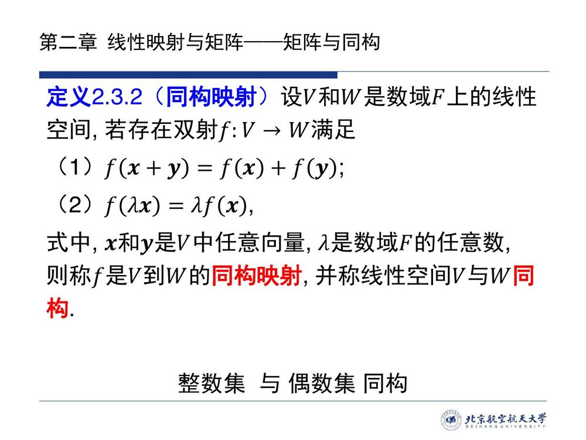

::: note 课件注记「整数集与偶数集同构」辨析（本编补注）

课件在定义旁标了这句注记，而它说的是**集合**层面的事：整数与偶数之间有双射（$n\leftrightarrow 2n$），这属于 [2.1.1](sec21.md#sec-2.1.1) 的**等势**（[@def-2.1.A]），并不是线性空间的同构。两种关系的差距就在那两条**保运算**条件上，所以：

> **同构 = 双射 + 保持线性运算。**

（条件里写的是「双射」而不是「等势」：等势只保证**存在某个**双射，不保证手头这个映射就是双射——这正是下面「不能靠元素个数判别」的原因。）

所以判别两个线性空间是否同构，**不能靠「元素个数」**（无限维空间彼此都等势），只能靠维数——见 [@thm-2.3.3]。
:::

::: thm 定理 2.3.2 · 线性映射空间与矩阵空间同构 {#thm-2.3.2}

设 $V$ 和 $W$ 是数域 $F$ 上的线性空间，它们维数分别为 $n$ 和 $m$，则线性映射空间 $L(V,W)$ 和矩阵空间 $F^{m\times n}$ 同构。
:::

::: proof 证明（把思考题的 $f$ 补成同构映射）

取定 $V$ 的基 $\varepsilon_1,\cdots,\varepsilon_n$ 与 $W$ 的基 $\eta_1,\cdots,\eta_m$，定义

$$f:L(V,W)\longrightarrow F^{m\times n},\qquad f(T)=A\ \text{（}T\ \text{在该对基下的矩阵）}.$$

**$f$ 是双射**：这正是 [@thm-2.3.1]——任给 $A$ 存在 $T$（满射），且这样的 $T$ 唯一（单射）。

**$f$ 保持运算**：设 $f(T_1)=A_1=(a^{(1)}_{ij})$、$f(T_2)=A_2=(a^{(2)}_{ij})$，则对每个 $j$，

$$(T_1+T_2)(\varepsilon_j)=T_1(\varepsilon_j)+T_2(\varepsilon_j)=\sum_i\big(a^{(1)}_{ij}+a^{(2)}_{ij}\big)\eta_i
\quad\Longrightarrow\quad f(T_1+T_2)=A_1+A_2;$$

同理 $(\lambda T_1)(\varepsilon_j)=\lambda\sum_i a^{(1)}_{ij}\eta_i$ 给出 $f(\lambda T_1)=\lambda A_1$。

双射且保持两种运算，故 $f$ 是同构映射（[@def-2.3.2]），即 $L(V,W)\cong F^{m\times n}$。∎
:::

同构映射首先是线性映射，[2.2.3](sec22.md#sec-2.2.3) 的那些性质它全部继承；而「双射」这多出来的一条，又把其中大半升级成了双向。这些性质后面反复要用，先集中列出。

::: prop 命题 2.3.1 · 同构映射的性质 {#prop-2.3.1}

设 $V$ 和 $W$ 是数域 $F$ 上的线性空间，$T:V\to W$ 是同构映射，则

1. $T(\boldsymbol{\theta})=\boldsymbol{\theta}'$，$\boldsymbol{\theta}\in V$，$\boldsymbol{\theta}'\in W$；
2. $T(-x)=-T(x)$，$\forall x\in V$；
3. $T\big(\sum_i\alpha_ix_i\big)=\sum_i\alpha_iT(x_i)$，$\forall\alpha_i\in F$ 和 $x_i\in V$；
4. $V$ 的向量组 $x_1,\cdots,x_r$ 线性相关**当且仅当**其像 $T(x_1),\cdots,T(x_r)$ 线性相关；
5. 若 $\varepsilon_1,\cdots,\varepsilon_n$ 是 $V$ 的一组基，则 $T(\varepsilon_1),\cdots,T(\varepsilon_n)$ 是 $W$ 的一组基，且 $\dim V=\dim W$；
6. $T$ 的逆映射 $T^{-1}:W\to V$ 存在且是同构映射。
:::

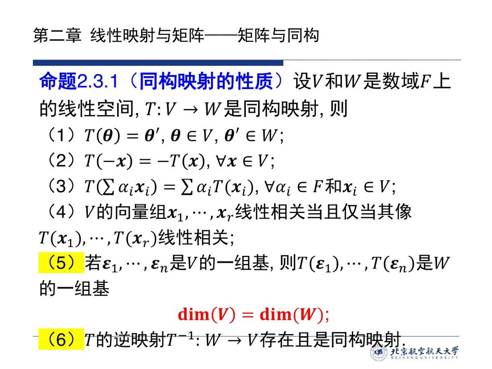

::: proof 证明（逐条，其中一半是 2.2 的现成结论）

(1)(2)(3) 是 [@cor-2.2.1] 与 [@thm-2.2.1] 的直接内容——同构映射首先是线性映射。

**(4)** 「$\Longrightarrow$」是 [@cor-2.2.1]（3）（相关组的像相关），**不需要**任何额外前提。「$\Longleftarrow$」才是同构的功劳：像组相关，就是给出了一组**不全为零**的系数 $k_1,\cdots,k_r$ 使 $k_1T(x_1)+\cdots+k_rT(x_r)=\boldsymbol{\theta}'$；由 (3) 与 (1) 得 $T(k_1x_1+\cdots+k_rx_r)=T(\boldsymbol{\theta})$；$T$ **单射**，故 $k_1x_1+\cdots+k_rx_r=\boldsymbol{\theta}$——系数不全为零而组合为零，即**原像组线性相关**。（落点必须回到**原像组**：像组相关只是出发点，不是结论。）**对比**：[2.2.3](sec22.md#sec-2.2.3) 的单射判据（[@thm-2.2.2]）只说「单射 $\iff$ 无关组的像无关」，这里因为 $T$ 是双射，**两个方向同时成立**。

**(5)** 先看无关：若 $\sum_i k_iT(\varepsilon_i)=\boldsymbol{\theta}'$，由 (3)(1) 得 $T(\sum_ik_i\varepsilon_i)=T(\boldsymbol{\theta})$，单射给出 $\sum_ik_i\varepsilon_i=\boldsymbol{\theta}$，$\varepsilon$ 组无关故 $k_i$ 全为 $0$。再看张成：$\forall y\in W$，$T$ 满射给出 $y=T(x)$，而 $x=\sum_ik_i\varepsilon_i$，故 $y=\sum_ik_iT(\varepsilon_i)$。于是 $T(\varepsilon_1),\cdots,T(\varepsilon_n)$ 是 $W$ 的基；基的个数不变（[@thm-1.3.3]）给出 $\dim V=\dim W$。

**(6)** 双射必有逆映射（[2.1](sec21.md#sec-2.1.1)：可逆 $\iff$ 双射，[@thm-2.1.2]）。验证 $T^{-1}$ 线性：对任意 $y_1,y_2\in W$，写 $y_i=T(x_i)$（$i=1,2$），则

$$T^{-1}(y_1+y_2)=T^{-1}\big(T(x_1)+T(x_2)\big)=T^{-1}\big(T(x_1+x_2)\big)=x_1+x_2=T^{-1}(y_1)+T^{-1}(y_2),$$

同理 $T^{-1}(\lambda y)=\lambda T^{-1}(y)$。故 $T^{-1}$ 是同构映射。∎
:::

性质 (5) 实际上说的是「同构不改变维数」。那么反过来问：同一数域上、维数相等的两个有限维空间，是否一定同构？这是同构判别中最实用的一问。

::: thm 定理 2.3.3 · 同构的判别 {#thm-2.3.3}

**同一数域 $F$ 上**的两个**有限维**线性空间同构**当且仅当**它们的维数相等。
:::

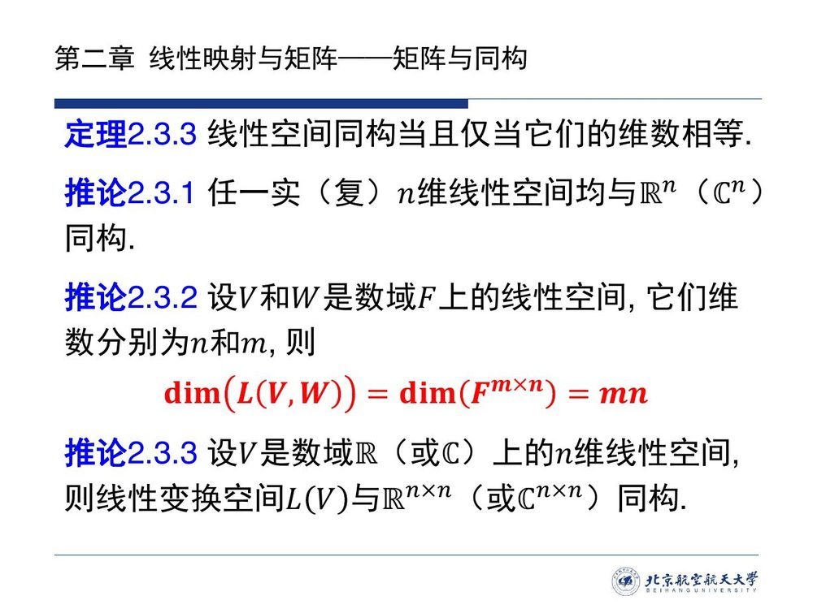

::: proof 证明（课件未给，本编补全）

**必要性（同构 $\Longrightarrow$ 维数相等）**：就是 [@prop-2.3.1]（5）——同构把基映成基。

**充分性（维数相等 $\Longrightarrow$ 同构）**：设 $\dim V=\dim W=n$。取 $V$ 的基 $\varepsilon_1,\cdots,\varepsilon_n$ 与 $W$ 的基 $\eta_1,\cdots,\eta_n$，定义

$$T(x)=(\eta_1,\cdots,\eta_n)\alpha,\qquad\text{其中}\ x=(\varepsilon_1,\cdots,\varepsilon_n)\alpha .$$

由 [@thm-2.3.1]，$T\in L(V,W)$ 且其矩阵为单位矩阵 $I_n$。**$T$ 是单射**：若 $T(x)=\boldsymbol{\theta}'$，即 $(\eta_1,\cdots,\eta_n)\alpha=\boldsymbol{\theta}'$，由 $\eta$ 组线性无关得 $\alpha=0$，即 $x=\boldsymbol{\theta}$。**维数相同 $+$ 单射 $\Longrightarrow$ 双射**（[@cor-2.2.2]），故 $T$ 是同构映射。∎

**证明的要点**：两个空间维数相同，就可以「配对着取基」，再用同一组坐标把向量搬过去——因为维数相等，坐标的个数一样，这套搬运不会缺项也不会重复。

::: note 两个前提都不能丢（本编补注）

① **「同一数域」**：$\mathbb R$ 上的 $1$ 维空间与 $\mathbb C$ 上的 $1$ 维空间维数都写作 $1$，但它们之间不存在线性同构——「线性」本身就要求两边共用同一个数域 $F$。② **「有限维」**：无限维时「维数相等」指的是 Hamel 基的势相等，此时维数相同**仍然**同构（这是集合论层面的事实），但本课程的证明（配对着取基、用 [@cor-2.2.2] 的有限维双射判据）只覆盖有限维；第一章 [@def-1.3.6] 的注 3 已声明本课程只讨论有限维。

:::
:::

在「同一数域、有限维」这两个前提之下，判据只有一句话：维数相等就同构。它一落地，三个结论立刻到手——一个给每个 $n$ 维空间配上具体模型，一个把线性映射空间的维数一并算清，还有一个是它在方阵上的特例。

::: cor 推论 2.3.1 · 万有模型 $\mathbb R^n$ / $\mathbb C^n$ {#cor-2.3.1}

任一实（复）$n$ 维线性空间均与 $\mathbb R^n$（$\mathbb C^n$）同构。
:::

::: cor 推论 2.3.2 · $L(V,W)$ 的维数 {#cor-2.3.2}

设 $V$ 和 $W$ 是数域 $F$ 上的线性空间，它们维数分别为 $n$ 和 $m$，则

$$\dim L(V,W)=\dim F^{m\times n}=mn .$$
:::

::: cor 推论 2.3.3 · 线性变换空间 {#cor-2.3.3}

设 $V$ 是数域 $\mathbb R$（或 $\mathbb C$）上的 $n$ 维线性空间，则线性变换空间 $L(V)$ 与 $\mathbb R^{n\times n}$（或 $\mathbb C^{n\times n}$）同构。
:::

::: proof 三个推论的证明（各一句）

[@cor-2.3.1]：取 $W=\mathbb R^n$（$F=\mathbb R$ 时），维数同为 $n$，由 [@thm-2.3.3] 即得；同一个 $V$ 也可以配不同的基，得到不同的同构映射，但「同构」这件事只取决于维数。

[@cor-2.3.2]：同构的空间维数相等（[@thm-2.3.3]），而矩阵空间 $F^{m\times n}$ 的维数是 $mn$（自然基 $E_{ij}$，见 [@ex-2.2.A]）。

[@cor-2.3.3]：$L(V)=L(V,V)$ 中 $m=n$，代 [@cor-2.3.2]。
:::

::: preview 2.2 的悬案就此了结

[2.2.4](sec22.md#sec-2.2.4) 的思考题「线性空间 $L(V,W)$ 的维数是多少？」当时只能「通俗地理解」为矩阵空间；[@cor-2.3.2] 给了正式答案 $\dim L(V,W)=\dim V\cdot\dim W$，而 [@thm-2.3.2] 说明「$L(V,W)$ 与矩阵空间同构」——**同构的空间可以放心互相替代**，这正是取定基之后抽象问题化为计算问题的依据。
:::

## 2.3.3 坐标计算：$\beta=A\alpha$

矩阵写出来是要用的，而它最核心的用途只有一条——把「映射一个向量」翻译成「乘一个矩阵」。这条翻译规则就是下面的坐标公式。

::: thm 定理 2.3.4 · 坐标公式 {#thm-2.3.4}

设映射 $T$ 是 $n$ 维线性空间 $V$ 到 $m$ 维线性空间 $W$ 的线性映射，$T$ 在 $V$ 的基 $\varepsilon_1,\cdots,\varepsilon_n$ 和 $W$ 的基 $\eta_1,\cdots,\eta_m$ 下的矩阵为 $A$。对任意向量 $x\in V$，则有

$$\beta=A\alpha,$$

式中 $\beta\in F^m$ 是像 $T(x)$ 在 $W$ 的基 $\eta_1,\cdots,\eta_m$ 下的坐标，$\alpha\in F^n$ 是原像 $x$ 在 $V$ 的基 $\varepsilon_1,\cdots,\varepsilon_n$ 下的坐标。
:::

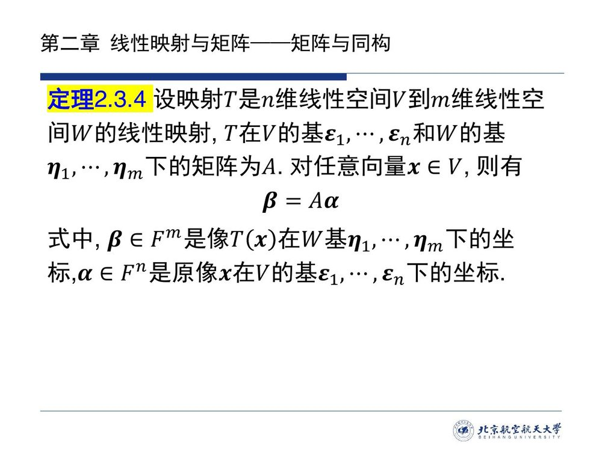

::: proof 证明（三行，全靠读法）

写 $x=(\varepsilon_1,\cdots,\varepsilon_n)\alpha$。由 [@thm-2.2.1]（保持线性组合），

$$T(x)=T\big((\varepsilon_1,\cdots,\varepsilon_n)\alpha\big)=\big(T(\varepsilon_1),\cdots,T(\varepsilon_n)\big)\alpha
\overset{\text{定义 2.3.1}}{=}(\eta_1,\cdots,\eta_m)A\alpha .$$

另一方面 $T(x)=(\eta_1,\cdots,\eta_m)\beta$。两式对照，由 $\eta$ 组线性无关（基的表示唯一，[@thm-1.3.2]）得

$$\beta=A\alpha .\qquad\blacksquare$$
:::

这条式子只有一行，却是「抽象 $=$ 具体」的枢纽：**向量只有坐标、映射只有矩阵之后，等式 $\beta=A\alpha$ 才是可算的**。下面的可交换图把这件事画得最清楚。

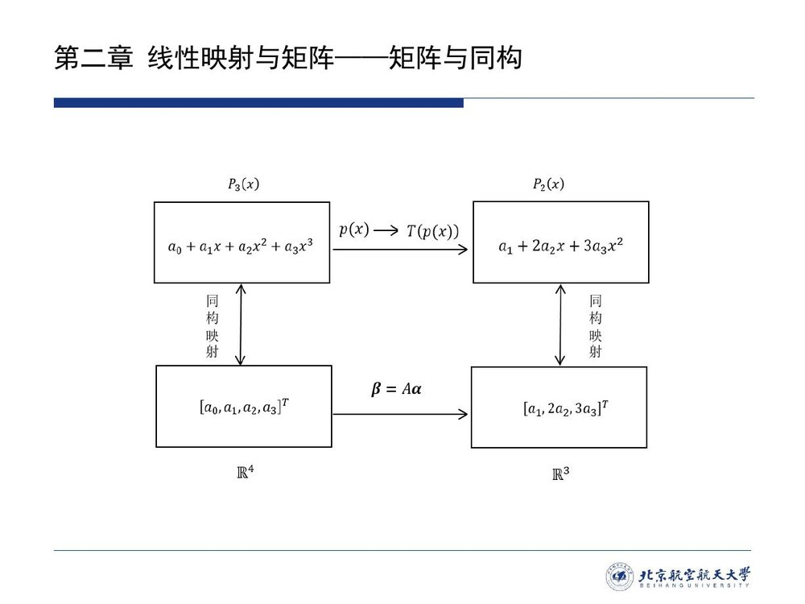

::: method 怎么读这张可交换图（本编补）

上层的 $P_3(x)\to P_2(x)$ 是**抽象层**：微分变换 $T:p(x)\mapsto p'(x)$，看不见坐标；下层的 $\mathbb R^4\to\mathbb R^3$ 是**坐标层**：$\alpha\mapsto A\alpha$；左右两侧的竖箭头是**取坐标**，它们本身就是同构映射（[@cor-2.3.1]：$P_3(x)\cong\mathbb R^4$、$P_2(x)\cong\mathbb R^3$）。

图是**可交换**的：**先微分再取坐标 $=$ 先取坐标再乘 $A$**。具体地，$p=a_0+a_1x+a_2x^2+a_3x^3$ 的坐标是 $\alpha=(a_0,a_1,a_2,a_3)^{\mathrm T}$，$T(p)=a_1+2a_2x+3a_3x^2$ 的坐标是 $\beta=(a_1,2a_2,3a_3)^{\mathrm T}$，而

$$A=\begin{bmatrix}0&1&0&0\\ 0&0&2&0\\ 0&0&0&3\end{bmatrix},\qquad A\alpha=\begin{bmatrix}a_1\\ 2a_2\\ 3a_3\end{bmatrix}=\beta\ \checkmark$$

——$A$ 的**后三列**正是 $T(x),T(x^2),T(x^3)$ 在基 $1,x,x^2$ 下的坐标（第 $1$ 列对应 $T(1)=0$，故 $A$ 共 $4$ 列）。**「抽象映射 $\to$ 矩阵」，就是把竖箭头立起来、把横箭头拉平的产物。**
:::

::: ex 例 2.3.A（新增）· 从定义写矩阵，再用 $\beta=A\alpha$ 算像 {#ex-2.3.A}

设 $T:\mathbb R^3\to\mathbb R^2$，$T(x)=\begin{bmatrix}x_1+x_2\\ x_2-x_3\end{bmatrix}$（$x=(x_1,x_2,x_3)^{\mathrm T}$）。取两个空间的标准基，求 $T$ 的矩阵，并用 $\beta=A\alpha$ 算 $T(1,2,3)^{\mathrm T}$。

::: sol 解答

**写矩阵**：标准基下 $T(e_j)$ 的分量就是坐标，逐列读出：

$$T(e_1)=\begin{bmatrix}1\\0\end{bmatrix},\qquad T(e_2)=\begin{bmatrix}1\\1\end{bmatrix},\qquad T(e_3)=\begin{bmatrix}0\\-1\end{bmatrix}
\ \Longrightarrow\ A=\begin{bmatrix}1&1&0\\ 0&1&-1\end{bmatrix}\in\mathbb R^{2\times3}.$$

**用公式**：$x=(1,2,3)^{\mathrm T}$ 的坐标就是自身，

$$\beta=A\alpha=\begin{bmatrix}1&1&0\\ 0&1&-1\end{bmatrix}\begin{bmatrix}1\\2\\3\end{bmatrix}=\begin{bmatrix}3\\-1\end{bmatrix},$$

即 $T(1,2,3)^{\mathrm T}=(3,-1)^{\mathrm T}$。直接代入也得到 $x_1+x_2=3$、$x_2-x_3=-1$ ✓。

**意义**：矩阵 $A$ 的每一列都是「输入一个基向量、输出一个结果」；六个数就记下了全部信息，任意输入的输出都可以由 $A\alpha$ 拼出来——这正是 [@thm-2.2.1]「线性映射由基上的作用决定」的计算版。
:::
:::

## 2.3.4 换基：同一个映射的不同矩阵

例 2.3.1 末尾已经提醒过：矩阵依赖于所取的基，换一组基就会变。那么**变成什么样**？回答这个问题的公式是本节第二个核心公式，也是「相似矩阵」这一大类概念的出处。

::: thm 定理 2.3.5 · 换基公式 {#thm-2.3.5}

设 $V$ 和 $W$ 是数域 $F$ 上的 $n$ 维和 $m$ 维线性空间，$\varepsilon_1,\cdots,\varepsilon_n$ 和 $\varepsilon'_1,\cdots,\varepsilon'_n$ 是 $V$ 的两组基，由 $\varepsilon_1,\cdots,\varepsilon_n$ 到 $\varepsilon'_1,\cdots,\varepsilon'_n$ 的过渡矩阵为 $Q$；$\eta_1,\cdots,\eta_m$ 和 $\eta'_1,\cdots,\eta'_m$ 是 $W$ 的两组基，由 $\eta_1,\cdots,\eta_m$ 到 $\eta'_1,\cdots,\eta'_m$ 的过渡矩阵为 $P$；设线性映射 $T\in L(V,W)$ 在 $V$ 的基 $\varepsilon$ 和 $W$ 的基 $\eta$ 下的矩阵为 $A$，$T$ 在 $V$ 的基 $\varepsilon'$ 和 $W$ 的基 $\eta'$ 下的矩阵为 $B$，则

$$B=P^{-1}AQ .$$
:::

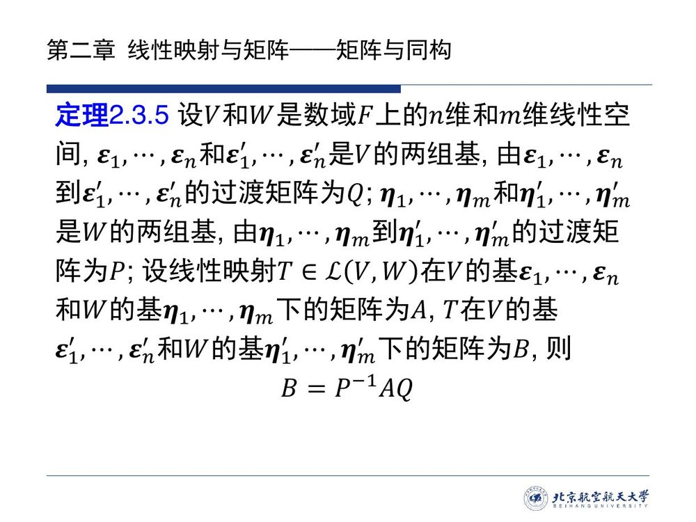

::: proof 证明（用过渡矩阵的定义两边夹）

两组新基与旧基的关系（[@def-1.3.5]）是

$$(\varepsilon'_1,\cdots,\varepsilon'_n)=(\varepsilon_1,\cdots,\varepsilon_n)Q,\qquad(\eta'_1,\cdots,\eta'_m)=(\eta_1,\cdots,\eta_m)P .$$

于是

$$T(\varepsilon'_1,\cdots,\varepsilon'_n)=T\big((\varepsilon_1,\cdots,\varepsilon_n)Q\big)=\big(T(\varepsilon_1),\cdots,T(\varepsilon_n)\big)Q
\overset{\text{定义 2.3.1}}{=}(\eta_1,\cdots,\eta_m)AQ .$$

再把 $(\eta_1,\cdots,\eta_m)=(\eta'_1,\cdots,\eta'_m)P^{-1}$（过渡矩阵可逆，[@prop-1.3.1]（2））代入：

$$T(\varepsilon'_1,\cdots,\varepsilon'_n)=(\eta'_1,\cdots,\eta'_m)\,P^{-1}AQ .$$

而按定义 $T(\varepsilon'_1,\cdots,\varepsilon'_n)=(\eta'_1,\cdots,\eta'_m)B$；由表示唯一性，$B=P^{-1}AQ$。∎

**记忆**：**$P$ 管到达端、$Q$ 管出发端，谁被换掉谁乘在这个位置上**；两者的区别正是「左乘 / 右乘」的区别，而 $P$ 取逆是因为 $B$ 要写在新基 $\eta'$ 下（旧基用新基表示要取逆）。
:::

::: note 注 1 · 相抵（等价）与推论 2.3.4

若矩阵 $A\in F^{m\times n}$ 经过有限次初等变换变成矩阵 $B$，则称矩阵 $A$ 与 $B$ **相抵**（或**等价**），记为 $A\cong B$。符号相同不等于意思相同：这里的 $\cong$ 说的是矩阵相抵，与线性空间的同构 $V\cong W$ 是**同名不同义**的两种关系（靠等号两侧是「矩阵」还是「空间」区分；详见[符号表](../preface-notation.md)）。[@thm-2.3.5] 表明：**线性映射在不同基下的矩阵是相抵的**。

**本编补注**：两条基同时换（$P,Q$ 都可逆）时 $B=P^{-1}AQ$ 恰是「相抵」的一般形式——所以相抵是矩阵层面的「同一个线性映射」。相抵的标准形只由秩决定，将在讨论矩阵的秩时给出。
:::

::: cor 推论 2.3.4 · 相似与线性变换 {#cor-2.3.4}

设 $V$ 是数域 $F$ 上的 $n$ 维线性空间，$\varepsilon_1,\cdots,\varepsilon_n$ 和 $\varepsilon'_1,\cdots,\varepsilon'_n$ 是 $V$ 的两组基，由 $\varepsilon$ 到 $\varepsilon'$ 的过渡矩阵为 $P$，线性变换 $T\in L(V)$ 在基 $\varepsilon$ 和基 $\varepsilon'$ 下的矩阵分别为 $A$ 和 $B$，则

$$B=P^{-1}AP .$$
:::

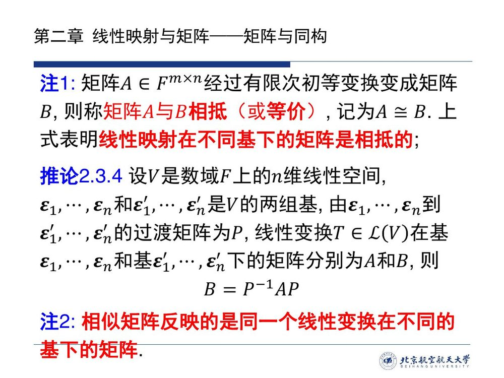

::: note 注 2 · 相似矩阵的几何含义

$B=P^{-1}AP$ 中出现的两个矩阵 $A,B$ 称为**相似**。课件对这一对的解释只有一句：**相似矩阵反映的是同一个线性变换在不同基下的矩阵。**

**本编补**：这就是本节的「题眼」——它把「相似」从一个代数记号（$B=P^{-1}AP$，$P$ 可逆）变成了几何事实。既然不同的基给出不同的矩阵，接下来的追求就很自然：**挑一组好基，让矩阵尽量简单**。最简单能到什么程度，能不能对角？这正是后面特征值理论的出发点——下面的例子就是雏形。
:::

::: ex 例 2.3.B（新增）· 选一组基，把矩阵变简单 {#ex-2.3.B}

设 $T:\mathbb R^2\to\mathbb R^2$ 在标准基 $e_1,e_2$ 下的矩阵为 $A=\begin{bmatrix}1&1\\ 0&2\end{bmatrix}$。取新基 $\varepsilon'_1=(1,0)^{\mathrm T}$、$\varepsilon'_2=(1,1)^{\mathrm T}$，求 $T$ 在 $\varepsilon'$ 下的矩阵。

::: sol 解答

**第一步（过渡矩阵）**：$(\varepsilon'_1,\varepsilon'_2)=(e_1,e_2)\begin{bmatrix}1&1\\ 0&1\end{bmatrix}$，故 $P=\begin{bmatrix}1&1\\ 0&1\end{bmatrix}$，$P^{-1}=\begin{bmatrix}1&-1\\ 0&1\end{bmatrix}$。

**第二步（用公式）**：[@cor-2.3.4] 给出

$$B=P^{-1}AP=\begin{bmatrix}1&-1\\ 0&1\end{bmatrix}\begin{bmatrix}1&1\\ 0&2\end{bmatrix}\begin{bmatrix}1&1\\ 0&1\end{bmatrix}
=\begin{bmatrix}1&2\\ 0&2\end{bmatrix}\begin{bmatrix}1&1\\ 0&1\end{bmatrix}=\begin{bmatrix}1&0\\ 0&2\end{bmatrix}.$$

**第三步（为什么**本该**这样）**：直接按读法验证——$T(\varepsilon'_1)=T(1,0)^{\mathrm T}=(1,0)^{\mathrm T}=1\cdot\varepsilon'_1+0\cdot\varepsilon'_2$，$T(\varepsilon'_2)=T(1,1)^{\mathrm T}=(2,2)^{\mathrm T}=0\cdot\varepsilon'_1+2\cdot\varepsilon'_2$，故矩阵为 $\operatorname{diag}(1,2)$ ✓。

**观察**：$\varepsilon'_1,\varepsilon'_2$ 正是被 $T$ 拉伸 $1$ 倍与 $2$ 倍的**方向**（即后面要讲的**特征向量**）。选到它们，矩阵就从 $\begin{bmatrix}1&1\\ 0&2\end{bmatrix}$ 变成对角阵——**这就是「相似对角化」的全部动机**：同一个变换，换一组「顺着它的方向」的基，矩阵就最简单。
:::
:::

## 2.3.5 矩阵与映射：同一件事的两面

到这里，本节的三件工具——矩阵、坐标公式与同构——已经齐备。最后把它们合起来收尾：2.2 定义的零空间与值域，在矩阵的字典里是什么样子？答案是它们的**维数完全一致**（两个子空间之间由「取坐标」的同构映射一一对应），于是「矩阵的秩」这个先修概念终于有了映射层面的解释。

::: thm 定理 2.3.6 · 矩阵的零空间、列空间与秩 {#thm-2.3.6}

设 $V$ 和 $W$ 是数域 $F$ 上的 $n$ 维和 $m$ 维线性空间，若 $T\in L(V,W)$ 在 $V$ 的基 $\varepsilon_1,\cdots,\varepsilon_n$ 和 $W$ 的基 $\eta_1,\cdots,\eta_m$ 下的矩阵为 $A$，则

1. $\dim N(T)=\dim N(A)$；
2. $\dim R(T)=\dim R(A)=\operatorname{rank}A$；
3. $\dim N(A)+\dim R(A)=n$（亏加秩）。
:::

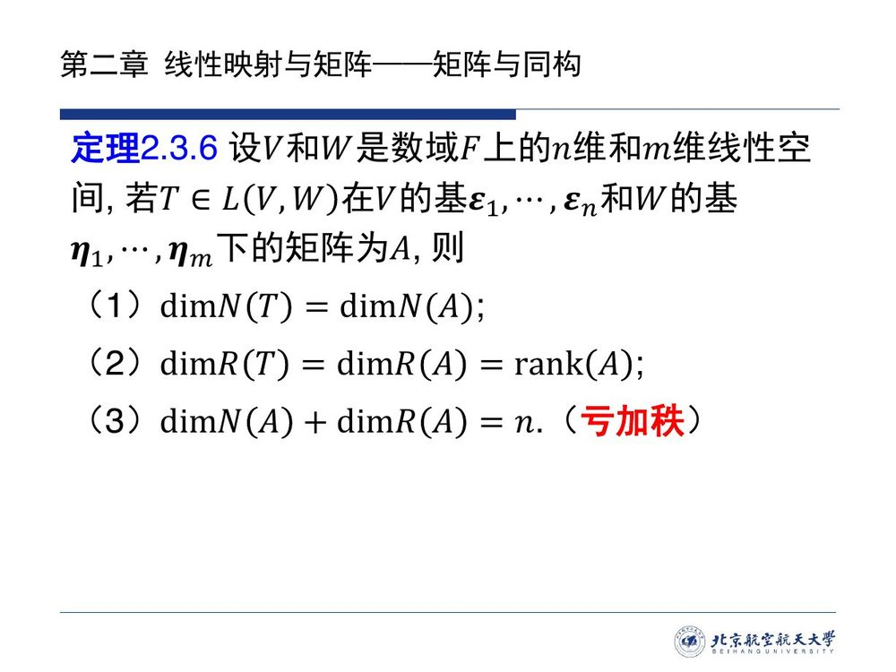

::: proof 证明（(1)(2) 的完整论证——课件只给了 (2) 的思路且有笔误，本编补全）

**(1) 零空间：用「取坐标」造同构。** 对任意 $x=(\varepsilon_1,\cdots,\varepsilon_n)k\in N(T)$（即 $T(x)=\boldsymbol{\theta}'$），

$$T(x)=(\eta_1,\cdots,\eta_m)Ak=\boldsymbol{\theta}'\iff Ak=0 .$$

（「$\Longleftarrow$」由零系数组合直接得到；「$\Longrightarrow$」则靠 $\eta$ 组线性无关。）于是定义

$$f:N(T)\longrightarrow N(A),\qquad f(x)=k .$$

- **良定义、双射**：$x$ 的坐标 $k$ 唯一，且 $Ak=0\iff x\in N(T)$，故 $f$ 是一一对应（其逆是 $k\mapsto(\varepsilon)k$）；
- **线性**：坐标对加法与数乘是线性的（$x+y$ 的坐标是 $k_1+k_2$，$\lambda x$ 的坐标是 $\lambda k$）。

故 $f$ 是同构映射，$N(T)\cong N(A)$，由 [@thm-2.3.3] 得 $\dim N(T)=\dim N(A)$。

**(2) 列空间与秩：像的坐标恰是 $A$ 的列。** $V$ 中任一 $x=(\varepsilon)k$ 的像是

$$T(x)=(\eta_1,\cdots,\eta_m)Ak,$$

即：**$T(x)$ 在 $\eta$ 下的坐标恰是 $Ak$——而 $Ak$ 是 $A$ 的列的线性组合**。于是同样的坐标映射 $g:R(T)\to R(A)$（$y\mapsto$ 它在 $\eta$ 下的坐标）是同构（双射同理，线性同 (1)），故 $\dim R(T)=\dim R(A)$。又按 [1.2](../ch01/sec12.md#sec-1.2.7) 的 [@def-1.2.3] 与 [@ex-1.2.7]，$R(A)=\operatorname{span}(A\ \text{的列})$，其维数就是列向量组的秩，而矩阵的秩 $=$ 列秩（先修知识），故 $\dim R(A)=\operatorname{rank}A$。

**(3)** 把 (1)(2) 代入 [@thm-2.2.5]（$\dim N(T)+\dim R(T)=\dim V=n$）即得。∎
:::

::: errata 课件证明的一处笔误（本编勘误）

课件对 (2) 的证明写的是：「假设 $T(\varepsilon_1),\cdots,T(\varepsilon_r)$ 为 $R(T)$ 的一组基，易得 $A_1,\cdots,A_r$ 线性无关，且 $A_i$（$i=r+1,\cdots,n$）可由 $A_1,\cdots,A_r$ 线性表出。」这里 $A_i$ 未加说明——**它指矩阵 $A$ 的第 $i$ 列**（$A$ 的第 $i$ 列的转置即 $T(\varepsilon_i)$ 的坐标），漏了这句就无从对照。另外「易得」两句话本身也需要论证：正是因为「取坐标」是同构映射，(2) 才能从像的无关性直接平移到坐标列的无关性——详见上方本编补全的证明。
:::

::: ex 例 2.3.C（新增 · 承接例 2.3.A）· 在具体例子上核对定理 2.3.6 {#ex-2.3.C}

继续 [@ex-2.3.A]：$T(x)=\begin{bmatrix}x_1+x_2\\ x_2-x_3\end{bmatrix}$，$A=\begin{bmatrix}1&1&0\\ 0&1&-1\end{bmatrix}$。求 $N(T)$、$R(T)$、$N(A)$、$R(A)$，并核对三条结论。

::: sol 解答

**映射侧**：$N(T)$：令 $x_1+x_2=0$、$x_2-x_3=0$，得 $x_2=x_3$、$x_1=-x_3$，取 $x_3=1$：

$$N(T)=\operatorname{span}\{( -1,1,1)^{\mathrm T}\},\qquad \dim N(T)=1 .$$

$R(T)$：像的分量形如 $(x_1+x_2,\ x_2-x_3)^{\mathrm T}$，两分量可独立取值（先任取第二分量，再调 $x_1$），故 $R(T)=\mathbb R^2$，$\dim R(T)=2$。

**矩阵侧**：$N(A)$：解 $A k=0$，即 $k_1+k_2=0$、$k_2-k_3=0$，同上一组方程，得 $N(A)=\operatorname{span}\{(-1,1,1)^{\mathrm T}\}$，$\dim N(A)=1$ ✓ 与 (1) 一致——这**不是巧合**：$N(T)$ 与 $N(A)$ 里的列向量长得一样，是因为 [@thm-2.3.6]（1） 的证明中那个同构映射把坐标当向量看。
$R(A)=\operatorname{span}\{(1,0)^{\mathrm T},(1,1)^{\mathrm T},(0,-1)^{\mathrm T}\}$，前两列无关故秩为 $2$，$\dim R(A)=2$ ✓ 与 (2) 一致。

**核对 (3)**：$\dim N(A)+\dim R(A)=1+2=3=n$ ✓；代入 [@thm-2.2.5]：$1+2=3=\dim\mathbb R^3$ ✓。
:::
:::

本节最后一个例子换个场景：同构不只能判别两个空间是否一样大，还能直接量出一个解空间的维数——办法就是把它同维数已知的空间对上。

::: ex 例 2.3.5（课件原文）· 差分方程解空间的维数 {#ex-2.3.5}

考查齐次线性差分方程

$$u_{k+n}+a_{n-1}u_{k+n-1}+\cdots+a_1u_{k+1}+a_0u_k=0,\qquad k=0,\pm1,\pm2,\cdots .$$

求方程的解空间的维数。

::: sol 解答（课件给出路线，此处补全细节）

**第一步（化成一阶递推）**：令状态向量

$$x_k=\begin{bmatrix}u_k\\ u_{k+1}\\ \vdots\\ u_{k+n-1}\end{bmatrix}\in\mathbb R^n,\qquad
A=\begin{bmatrix}0&1&0&\cdots&0\\ 0&0&1&\cdots&0\\ \vdots&\vdots&\vdots&\ddots&\vdots\\ 0&0&0&\cdots&1\\ -a_0&-a_1&-a_2&\cdots&-a_{n-1}\end{bmatrix}\in\mathbb R^{n\times n},$$

则方程等价于

$$x_{k+1}=Ax_k,\qquad k=0,\pm1,\pm2,\cdots .\tag{2.3.4}$$

**认出 $A$**：$A$ 正是 [2.1.2](sec21.md#sec-2.1.2) 的 [@def-2.1.11]**友矩阵**——「把多项式的系数打包成矩阵」在这里派上用场：差分方程的特征多项式 $\lambda^n+a_{n-1}\lambda^{n-1}+\cdots+a_0$ 的友矩阵就是 $A$。2.1 里说它是「预备知识」，此处第一次真正使用。

**第二步（初始值决定一切）**：由 (2.3.4)，$x_k=A^kx_0$（$k\ge0$）——正方向唯一确定。反方向同样唯一：只要 $a_0\neq0$，$A$ 可逆，$x_k=A^{k}x_0$ 对 $k<0$ 也成立（$A^{-1}$ 存在）。故**给定 $x_0$，序列 $\{u_k\}$ 唯一确定**。

**第三步（用同构量维数）**：记方程的全体解为 $\tilde S$。由于方程是线性的，$\tilde S$ 是序列空间中的子空间；定义

$$T:\tilde S\longrightarrow\mathbb R^n,\qquad T(\{u_k\})=x_0 .$$

- **线性**：若 $\{u_k\},\{v_k\}$ 是解，则 $\{u_k+v_k\}$ 也是解（方程两边同乘后相加），且其初始状态为 $x_0^u+x_0^v$；数乘同理；
- **双射**：由第二步，解由 $x_0$ 唯一确定（单射），而任给 $x_0\in\mathbb R^n$ 都能反解出解序列（满射）。

于是 $T$ 是同构映射，$\dim\tilde S=\dim\mathbb R^n=n$，即解空间 $\tilde S$ 是它所在的序列空间 $S$ 的一个 $n$ 维线性子空间。**结论：$n$ 阶齐次线性差分方程的解空间是 $n$ 维的**——与 $n$ 阶常系数线性微分方程解空间维数为 $n$ 的说法完全平行。
:::
:::

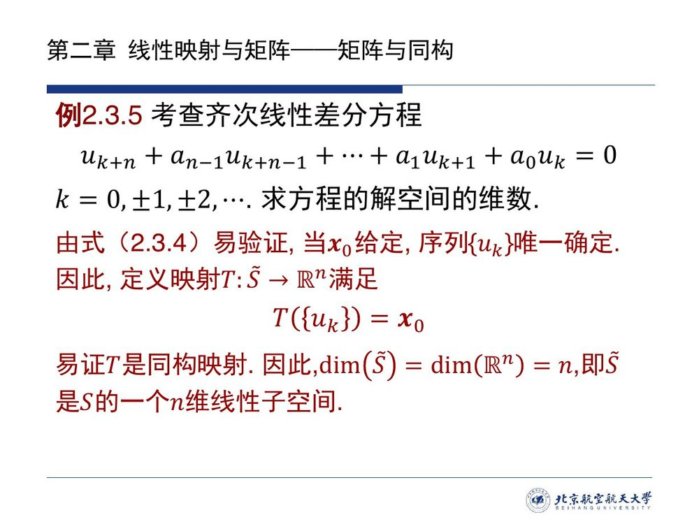

::: errata 课件的一处前提（本编补注）

课件写 $k=0,\pm1,\pm2,\cdots$，并断言「当 $x_0$ 给定，序列 $\{u_k\}$ 唯一确定」。**这默认了 $a_0\neq0$**：若 $a_0=0$，$A$ 奇异，反方向（$k<0$）无法由 $x_0$ 唯一还原（例如 $n=1$、$a_0=0$ 时 $u_k$（$k\le0$）可以任意）。因此引用本定理时应写「设 $a_0\neq0$」；只讨论正方向（$k\ge0$）的解时则无此要求。
:::

## 2.3 小结与常见错误

- **一条主线**：**取定基 $\Rightarrow$ 映射变矩阵**（[@def-2.3.1]：$A$ 的列 $=$ 基像的坐标）$\Rightarrow$ 这个对应是**双射**（[@thm-2.3.1]）且**保持运算**（[@thm-2.3.2]：$L(V,W)\cong F^{m\times n}$）$\Rightarrow$ 用它算像（[@thm-2.3.4]：$\beta=A\alpha$）、看它在换基下怎么变（[@thm-2.3.5]：$B=P^{-1}AQ$；同空间即相似 $B=P^{-1}AP$，[@cor-2.3.4]）$\Rightarrow$ 把 2.2 的零空间与值域一并搬过来（[@thm-2.3.6]：零度与秩都相等）——从定义一路走到应用，每一步都只是上一步的直接推论。另一根并列的线索是**同构**：它要求「双射 $+$ 保运算」，等价于维数相等（[@thm-2.3.3]），于是 $\mathbb R^n$ / $\mathbb C^n$ 成为所有 $n$ 维空间的共同模型（[@cor-2.3.1]）。
- **两个视角**：**同一件事的两种说法**——「线性映射」与「矩阵」不是两个对象，而是同一个对象的抽象版与坐标版；「相似」与「同一个线性变换的两组基」也不是两件事。凡是「矩阵的性质」，都该问一句「它在映射层面是什么」。

::: think 常见错误清单 · 自查四条

1. **形状与列的含义写错**：$A$ 是 $m\times n$（行数 $=$ 值空间维数），第 $j$ 列是 $T(\varepsilon_j)$ 的坐标而不是 $T$ 的第 $j$ 个分量——写矩阵前先固定「基的顺序」；
2. **把矩阵当成映射的固有属性**：矩阵依赖「映射 $+$ 出发基 $+$ 到达基」三者，缺一不可；换了基必须用 [@thm-2.3.5] 重算，不能照抄；
3. **混淆相抵与相似**：$B=P^{-1}AQ$（相抵，允许两边用不同的基，甚至对应不同的映射）与 $B=P^{-1}AP$（相似，同一个线性变换、**同一个空间的两组基**）不是一回事；相似必相抵，相抵未必相似（同阶方阵才谈相似）；
4. **把「同构」降级成「等势」**：同构要求**双射且保持线性运算**，判别依据是**维数相等**，不是「元素一样多」。
:::

::: ex 即时自测（不看上文，4 分钟）{#ex-2.3.quiz}

1. 说出「写矩阵」的读法：$A$ 的第 $j$ 列是什么？$A$ 的形状由什么决定？
2. $T:\mathbb R^2\to\mathbb R^2$，$T(x)=[x_1+2x_2,\ 3x_2]^{\mathrm T}$，在标准基下矩阵是什么？若改取基 $\varepsilon'_1=(1,0)^{\mathrm T}$、$\varepsilon'_2=(1,1)^{\mathrm T}$，矩阵变成什么？
3. 「$\dim V=\dim W$」与「$V\cong W$」是什么关系？为什么 $L(V,W)\cong F^{m\times n}$ 能推出 $\dim L(V,W)=mn$？
4. 用一个例子说明 $\dim N(T)=\dim N(A)$ 与 $\operatorname{rank}A=\dim R(T)$。

::: sol 参考要点

1. 第 $j$ 列是 $T(\varepsilon_j)$ 在到达基下的坐标列；$A$ 是 $m\times n$，行数 $=$ 到达空间维数、列数 $=$ 出发空间维数。
2. 标准基下 $A=\begin{bmatrix}1&2\\ 0&3\end{bmatrix}$（直接读分量）。新基下用 [@cor-2.3.4]：$P=\begin{bmatrix}1&1\\ 0&1\end{bmatrix}$，

$$B=P^{-1}AP=\begin{bmatrix}1&-1\\ 0&1\end{bmatrix}\begin{bmatrix}1&2\\ 0&3\end{bmatrix}\begin{bmatrix}1&1\\ 0&1\end{bmatrix}=\begin{bmatrix}1&1\\ 0&3\end{bmatrix}\begin{bmatrix}1&1\\ 0&1\end{bmatrix}=\begin{bmatrix}1&0\\ 0&3\end{bmatrix}.$$
**验算**：$T(\varepsilon'_1)=T(1,0)^{\mathrm T}=(1,0)^{\mathrm T}=\varepsilon'_1$、$T(\varepsilon'_2)=T(1,1)^{\mathrm T}=(3,3)^{\mathrm T}=3\varepsilon'_2$——两列分别读出 $(1,0)^{\mathrm T}$、$(0,3)^{\mathrm T}$ ✓。**要点**：$\varepsilon'_1,\varepsilon'_2$ 恰是被 $T$ 拉伸 $1$ 倍、$3$ 倍的方向，选到它们矩阵就变成对角阵。

3. 同构 $\Longrightarrow$ 维数相等；维数相等 $\Longrightarrow$ 同构（[@thm-2.3.3]），所以两者等价（同一数域上）。同构的空间维数相同，而 $\dim F^{m\times n}=mn$（自然基 $E_{ij}$），故 $\dim L(V,W)=mn$。
4. 取 [@ex-2.3.A] 的 $T$：$N(T)=\operatorname{span}\{(-1,1,1)^{\mathrm T}\}$、$N(A)=\operatorname{span}\{(-1,1,1)^{\mathrm T}\}$，维数均为 $1$；$R(T)=\mathbb R^2$、$R(A)=\operatorname{span}\{(1,0)^{\mathrm T},(1,1)^{\mathrm T}\}$，维数与 $\operatorname{rank}A$ 均为 $2$。
:::
:::
