# 3.1 相抵分解

前两章把矩阵从「数表」讲成了「线性映射的坐标版」：取定基，映射与矩阵一一对应（[2.3](../ch02/sec23.md)），而且同一个映射换一组基就换一个矩阵（$B=P^{-1}AQ$，[@thm-2.3.5]）。于是「矩阵有多少种样子」这个问题变成了「同一个映射能变成多少种样子」——本章换一个方向问：**能不能把矩阵拆开**，拆成几个结构简单、一看就懂的矩阵的乘积或和？这就是**矩阵分解**。

分解要从最简单的一种开始。任给一个矩阵，无论它多大多怪，总有一件事一定能做到：用可逆矩阵从两边夹它，把它压成一个「前面一块单位矩阵、其余全零」的标准形——**相抵标准形** $\Gamma$。这条结论写下来只有一行（[@lem-3.1.1]），却把「秩」这个数彻底说清了：任何矩阵都相抵于且只相抵于由秩决定的标准形（[@note-3.1-rank]）。本节随后把这条分解用到两个地方，都是考试与后续章节反复出现的老朋友：**解线性方程组**（[@ex-3.1.1]：相抵标准形把「有解没解、有几个自由度」变成看几个分量是否为零）与**长方阵的单侧逆**（[@thm-3.1.1]：行满秩就有右逆、列满秩就有左逆）。最后给出本节最重要的一条秩等式 $\operatorname{rank}(A)=\operatorname{rank}(A^{\mathrm H}A)$（[@prop-3.1.1]），它给出的右逆公式 $A^{\mathrm H}(AA^{\mathrm H})^{-1}$ 是「最小二乘」等一大类应用的起点。

<aside class="lesson-brief" aria-label="3.1 学习简报">

PREREQUISITE<strong>你需要先会</strong>
基、坐标与过渡矩阵（[@def-1.3.5]、[@prop-1.3.1]）；基扩充定理（[@cor-1.3.1]）；内积与正定性（[@def-1.4.1]）；线性映射、单射判据与亏加秩定理（[@thm-2.2.2]、[@thm-2.2.5]）；矩阵的读法与换基公式 $B=P^{-1}AQ$、矩阵的秩（[@def-2.3.1]、[@thm-2.3.5]、[@thm-2.3.6]）。

TARGET<strong>本节要建立</strong>
相抵分解式 $A=P^{-1}\Gamma Q$ 与相抵标准形（[@lem-3.1.1]）及其不唯一性；用相抵标准形解方程组的结构（可解判据 $+$ 自由度数）；相抵变换与分块矩阵求 $P$、$Q$ 的方法；右逆 / 左逆的存在判别（[@thm-3.1.1]）与两条充分性证明路线；秩等式 $\operatorname{rank}(A)=\operatorname{rank}(A^{\mathrm H}A)$（[@prop-3.1.1]）与两个单侧逆公式 $A^{\mathrm H}(AA^{\mathrm H})^{-1}$、$(A^{\mathrm H}A)^{-1}A^{\mathrm H}$。

CHECKPOINT<strong>学完的标准</strong>
给定矩阵能用分块矩阵法求出 $P^{-1}$、$Q$ 并回代验证；能说出「相抵分解不唯一、相抵标准形唯一」各自的含义；能把 $A\boldsymbol{x}=\boldsymbol{b}$ 化成 $\Gamma\boldsymbol{y}=P^{-1}\boldsymbol{b}$ 并读出可解判据与自由度个数；能背写 [@thm-3.1.1] 并构造 $A^{\mathrm H}(AA^{\mathrm H})^{-1}$；能复述 [@prop-3.1.1] 的证明用了正定性在哪一步。

</aside>

::: note 素材与说明（本节无录播）

本页依据课程第三章课件 **3.1 相抵分解**（15 页）整理。**本节无对应录播**，故不引用课堂口述与时间戳：课件给出的引理、定理、命题、注记与例题**照录并保留原编号**（引理 3.1.1、例 3.1.1、定理 3.1.1、注 1、命题 3.1.1）；课件省略的证明、只写一半的推导、未给出答案的练习，由本编补出并逐处标注「本编补」。编号与表述问题见[勘误与补注](errata.md)。
:::

## 3.1.1 相抵标准形：任何矩阵都能压成同一副模样

先交代「分解」这件事本身。课件开篇只用了三句话和一个类比的引子：把矩阵分解为**较为简单或具有某种特性的若干矩阵的乘积或和**，就像 $36=4\times9=2^2\times3^2$——同一个数换几种乘法写法，每种写法都能显出它的部分性质；分解的意义在于**清晰地反映出原矩阵的某些特征，提供有效的理论分析或数值计算依据**。

那么任给一个矩阵，能进行何种分解？最朴素、对**任何**矩阵都可行的答案是：从左右两边乘可逆矩阵，把它化成只有一个参数（秩）的标准形。这就是**矩阵相抵**。

::: lem 引理 3.1.1 · 相抵分解式与相抵标准形 {#lem-3.1.1}

设 $A\in F^{m\times n}$ 的秩为 $r$，则存在两个可逆矩阵 $P\in F^{m\times m}$ 和 $Q\in F^{n\times n}$ 使得

$$A=P^{-1}\Gamma Q,\qquad \Gamma=\begin{bmatrix}I_r&0\\0&0\end{bmatrix}_{m\times n}.$$

上式称为 $A$ 的**相抵分解式**，式中 $\Gamma$ 称为 $A$ 的**相抵标准形**。
:::

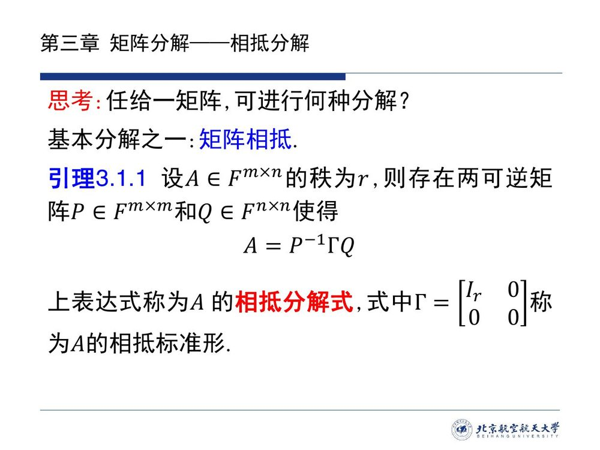

课件把这条结论列为引理、只述不证——它正是 [2.3](../ch02/sec23.md) 留下的一句承诺（「相抵的标准形只由秩决定，将在讨论矩阵的秩时给出」，见 [2.3.4](../ch02/sec23.md#sec-2.3.4) 的注 1）。本编用「选基 $+$ 换基公式」把证明补出；你会看到它把前三章各一件工具串在了一起。

::: proof 证明（课件未给，本编补：选一组好基，再用换基公式）

**把 $A$ 读成映射**。取 $F^n$ 与 $F^m$ 的标准基，设线性映射 $T:F^n\to F^m$ 在这两组标准基下的矩阵为 $A$。（$A$ 本来就是某个映射的矩阵，[2.3](../ch02/sec23.md) 的 [@def-2.3.1] 读法。）

**选出发端的基**。由亏加秩定理（[@thm-2.2.5]），$\dim N(T)=n-r$，取 $N(T)$ 的一组基 $\xi_1,\cdots,\xi_{n-r}$，并用基扩充定理（[@cor-1.3.1]）扩充为 $F^n$ 的一组基

$$\xi_1,\cdots,\xi_{n-r},\ \xi_{n-r+1},\cdots,\xi_n .$$

**像的后 $r$ 个基向量独立**。记 $f_i=T(\xi_{n-r+i})$（$i=1,\cdots,r$）。若 $\sum_{i=1}^r k_if_i=\boldsymbol{0}$，即 $T\big(\sum_ik_i\xi_{n-r+i}\big)=\boldsymbol{0}$，则 $\sum_ik_i\xi_{n-r+i}\in N(T)=\operatorname{span}\{\xi_1,\cdots,\xi_{n-r}\}$；而这两个向量组同属一组基，由表示唯一性（[@thm-1.3.2]）得全部系数为零。故 $f_1,\cdots,f_r$ 线性无关；又任一 $T(x)$ 只是 $\xi_{n-r+1},\cdots,\xi_n$ 的像的组合（$\xi_1,\cdots,\xi_{n-r}$ 被映成零），故 $f_1,\cdots,f_r$ 张成 $R(T)$——它们是 $R(T)$ 的一组基，个数 $r=\dim R(T)$。

**选到达端的基**。把 $f_1,\cdots,f_r$ 扩充为 $F^m$ 的一组基

$$\eta_1=f_1,\ \cdots,\ \eta_r=f_r,\ \eta_{r+1},\cdots,\eta_m .$$

**读出矩阵**。在基 $\xi_1,\cdots,\xi_n$ 与 $\eta_1,\cdots,\eta_m$ 下，映射 $T$ 的矩阵恰为 $\Gamma$：

$$T(\xi_1)=\cdots=T(\xi_{n-r})=\boldsymbol{0},\qquad T(\xi_{n-r+i})=\eta_i\quad (i=1,\cdots,r),$$

前 $n-r$ 列全零、后 $r$ 列依次是 $e_1,\cdots,e_r$，按 [@def-2.3.1] 逐列对照正是 $\Gamma$。

**用换基公式收尾**。设由标准基到 $\xi$ 的过渡矩阵为 $S$、由标准基到 $\eta$ 的过渡矩阵为 $R$。换基公式（[@thm-2.3.5]）说的是：旧基下矩阵 $A$ 与新基下矩阵 $\Gamma$ 满足 $\Gamma=R^{-1}AS$，即

$$A=R\,\Gamma\,S^{-1}.$$

取 $P=R^{-1}\in F^{m\times m}$、$Q=S^{-1}\in F^{n\times n}$（过渡矩阵可逆，[@prop-1.3.1]），两者都可逆，得 $A=P^{-1}\Gamma Q$。∎

**证明的要点**：$\Gamma$ 之所以可能出现，是因为「秩」把坐标的 $n$ 个自由度分成了两半——**$n-r$ 个被映射压死（进零空间）、$r$ 个原样传下去（映成值域的基）**。把这两半分别选成出发端与到达端的基，映射就只剩下「前 $n-r$ 列归零、后 $r$ 列照抄」这一副骨架。
:::

::: note 本编补注 · 「相抵」这个名字与它刚兑现的承诺 {#note-3.1-rank}

**相抵（等价）** 的定义在 [2.3.4](../ch02/sec23.md#sec-2.3.4) 的注 1：$A$ 经有限次初等变换变成 $B$，即存在可逆 $P,Q$ 使 $B=P^{-1}AQ$，记 $A\cong B$（矩阵相抵，与空间的同构 $V\cong W$ 同名不同义）。相抵是等价关系，而 [@lem-3.1.1] 把每一类都选出了一个代表元 $\Gamma$，所以：

> **两个同型矩阵相抵 $\iff$ 它们的秩相等。**（本编补：$\Longrightarrow$ 用初等变换不改变秩；$\Longleftarrow$ 设秩同为 $r$，由 [@lem-3.1.1] 两者都相抵于同一个 $\Gamma$，再用传递性。）

这正是课件那句「相抵分解适于任何矩阵，常解决矩阵**秩相关**的命题」的准确含义：**关于秩的命题都可以先化到 $\Gamma$ 上验证，再搬回来**。后续几节会反复使用这一套路（例如 [3.2](sec32.md) 把满秩分解的第一种构造直接搭在相抵分解上）。

两个容易混的同名概念再区分一次：**相抵**允许左右用各自独立的两组基（$P,Q$ 无关），**相似**（$B=P^{-1}AP$，[@cor-2.3.4]）只允许同一空间换一组基、两侧用同一个 $P$——相似必相抵，相抵未必相似（只有同阶方阵才谈相似）。
:::

::: note 分解唯一性问题（课件原文）{#note-3.1-nonunique}

课件紧接着问：分解式唯一吗？答案是不唯一。设 $\Gamma=\begin{bmatrix}I_r&0\\0&0\end{bmatrix}$，对任意适当阶数的矩阵 $*$，有

$$A=P^{-1}\Gamma Q=P^{-1}\begin{bmatrix}I_r&*\\0&I\end{bmatrix}\Gamma\begin{bmatrix}I_r&0\\*&I\end{bmatrix}Q .$$

**为什么**（本编补上这一步的验算）：夹在中间的乘法之所以能把 $\Gamma$ 换出来，是因为

$$\begin{bmatrix}I_r&*\\0&I\end{bmatrix}\Gamma=\Gamma=\Gamma\begin{bmatrix}I_r&0\\*&I\end{bmatrix}$$

（直接按分块乘法核对：$\Gamma$ 的后 $n-r$ 列全零、后 $m-r$ 行全零，$*$ 乘上去也归零）。而 $\begin{bmatrix}I_r&*\\0&I\end{bmatrix}$ 与 $\begin{bmatrix}I_r&0\\*&I\end{bmatrix}$ 都是可逆矩阵（对角块为单位阵的三角块，行列式为 $1$），乘到 $P^{-1}$、$Q$ 上仍是可逆矩阵。**因此矩阵 $A$ 的相抵分解是不唯一的**——$\Gamma$ 两边的可逆矩阵可以有无穷多种取法。

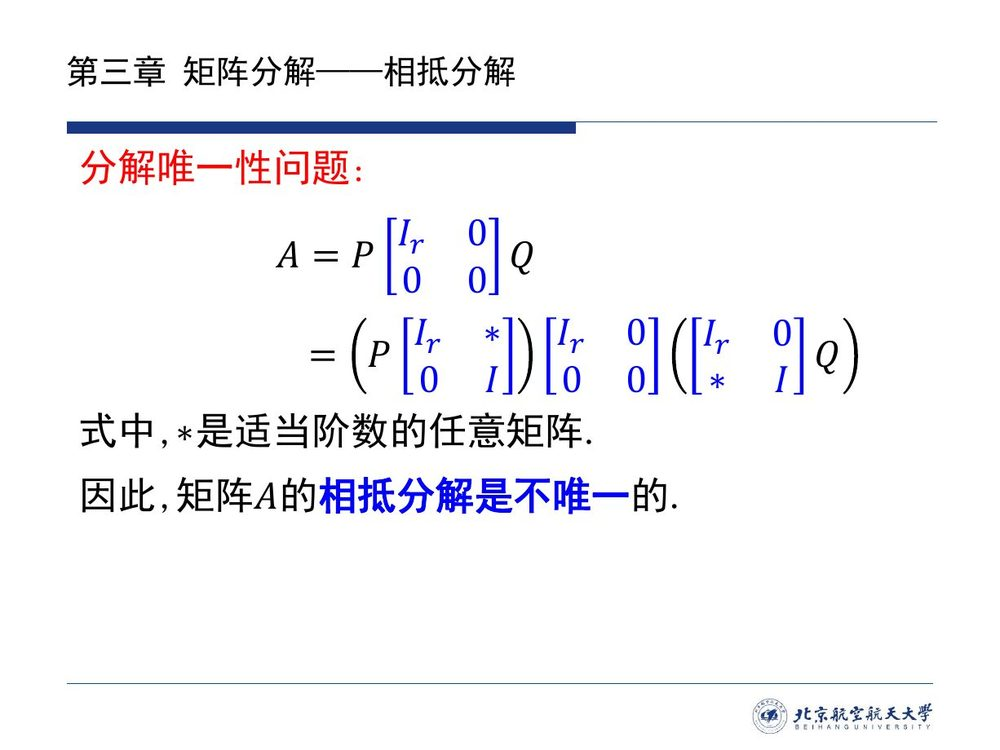

**不唯一的是「分解式」，唯一的是「标准形」**：无论怎么写分解式，中间那个 $\Gamma$ 只由 $r$ 决定（因为秩在相抵下不变，$\operatorname{rank}\Gamma=\operatorname{rank}A=r$）。这一对「式不唯一、标准形唯一」后面还会以同样的面貌出现（[3.2](sec32.md) 的满秩分解不唯一，但相差一个可逆矩阵 $D$）。
:::

## 3.1.2 应用：用相抵标准形解线性方程组

课件给相抵分解配的第一个应用，是它最经典的用武之地——解方程组 $A\boldsymbol{x}=\boldsymbol{b}$。道理是：**相抵变换是「换基」，换基不改变方程的解集**（它只是用可逆矩阵 $P$、$Q$ 把等号两边同时翻译一遍）。翻译之后，方程组的系数矩阵变成 $\Gamma$，于是「有解没解」「有几个自由参数」都变成数分量的问题。

::: ex 例 3.1.1（课件原文）· 考查线性方程组 $A\boldsymbol{x}=\boldsymbol{b}$ 的求解问题 {#ex-3.1.1}

设 $A\in\mathbb R^{m\times n}$、$\boldsymbol{b}\in\mathbb R^m$ 已知，$\boldsymbol{x}\in\mathbb R^n$ 是未知向量。将矩阵 $A$ 作相抵分解，讨论方程组的解。
:::

::: sol 解答（课件给出前两步，本编补完解的结构与可解性判据）

**第一步（换元）**：把 $A=P^{-1}\Gamma Q$ 代入，得

$$P^{-1}\Gamma Q\boldsymbol{x}=\boldsymbol{b}.$$

两边左乘 $P$（可逆）：

$$\Gamma\,(Q\boldsymbol{x})=P\boldsymbol{b}.$$

**令 $\boldsymbol{y}=Q\boldsymbol{x}$**（这是一次可逆的未知量替换：$Q$ 可逆，$\boldsymbol{y}\leftrightarrow\boldsymbol{x}$ 是一一对应），上式改写为

$$\Gamma\boldsymbol{y}=P\boldsymbol{b},\qquad \Gamma=\begin{bmatrix}I_r&0\\0&0\end{bmatrix}_{m\times n}.$$

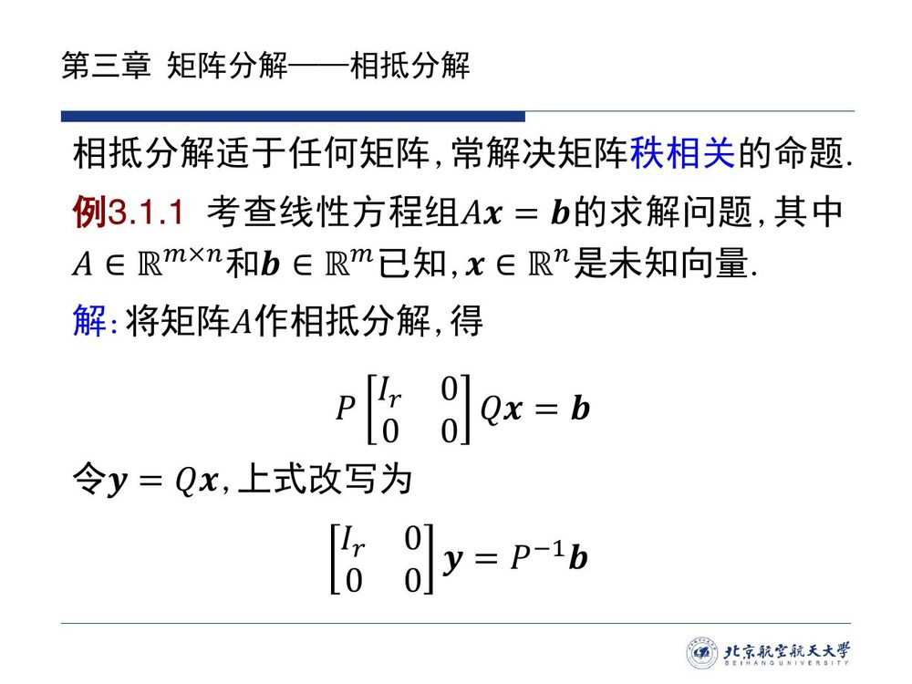

**第二步（读出全部信息）**：把 $P\boldsymbol{b}$ 按前 $r$ 个、后 $m-r$ 个分量分块，写成 $P\boldsymbol{b}=\begin{bmatrix}\boldsymbol{c}\\ \boldsymbol{d}\end{bmatrix}$，$\boldsymbol{c}\in F^r$、$\boldsymbol{d}\in F^{m-r}$；把 $\boldsymbol{y}$ 按前 $r$ 个、后 $n-r$ 个分量分块为 $\boldsymbol{y}=\begin{bmatrix}\boldsymbol{y}_1\\ \boldsymbol{y}_2\end{bmatrix}$。方程 $\Gamma\boldsymbol{y}=P\boldsymbol{b}$ 逐分量读出来是

$$\boldsymbol{y}_1=\boldsymbol{c}\quad(\text{前 } r \text{ 个方程}),\qquad \boldsymbol{0}=\boldsymbol{d}\quad(\text{后 } m-r \text{ 个方程}).$$

于是结论有三条（本编补全）：

1. **可解判据**：方程组有解 $\iff \boldsymbol{d}=\boldsymbol{0}$，即 $P\boldsymbol{b}$ 的**后 $m-r$ 个分量全为零**。这是「$\operatorname{rank}(A|\boldsymbol{b})=\operatorname{rank}A$」的坐标版：那个条件说的正是 $\boldsymbol{b}$ 落进 $A$ 的列空间，而这里的 $\boldsymbol{d}=\boldsymbol{0}$ 就是它的显式算法形式。
2. **有解时的通解**：$\boldsymbol{y}_1$ 被唯一确定（$=\boldsymbol{c}$），$\boldsymbol{y}_2\in F^{n-r}$ **任意**；再乘回 $\boldsymbol{x}=Q^{-1}\boldsymbol{y}$ 得

$$\boldsymbol{x}=Q^{-1}\begin{bmatrix}\boldsymbol{c}\\ \boldsymbol{y}_2\end{bmatrix},\qquad \boldsymbol{y}_2\ \text{任取},$$

即解集是 $F^n$ 中一个 $n-r$ 维的仿射子空间——**自由参数的个数恰是 $n-r$**，与亏加秩定理（齐次解空间维数 $=n-r$）完全一致。
3. **无解时的信息**：$\boldsymbol{d}\neq\boldsymbol{0}$ 时，越界的分量就是「方程之间的矛盾」，$m-r$ 个多余方程里只要有矛盾，整个方程组就无解。

**两处记号提醒**：① 解出 $\boldsymbol{y}$ 之后必须**乘回 $Q^{-1}$** 才是原未知量 $\boldsymbol{x}$（与 [2.4](../ch02/sec24.md) 求特征向量时「坐标要乘回基」是同一个陷阱）；② $P$ 与 $Q$ 的角色不对称：$P$ 管等号左边的行（它把 $A$ 的行压到标准位置），$Q$ 管未知量的换元。∎
:::

剩下一个绕不开的实际问题：$P$、$Q$ 怎么求？课件给出的答案是一张分块矩阵——把两个可逆矩阵「挂」在 $A$ 的两侧，与 $A$ 同时接受变换，$A$ 化到 $\Gamma$ 时它们也自动积好了。本编把它的记号与 [@lem-3.1.1] 统一（课件原页的记号见紧随的勘误框）。

::: method 相抵变换求 $P$ 与 $Q^{-1}$（本编整理，记号与引理 3.1.1 统一）{#method-3.1-augmented}

构造分块矩阵（$*$ 是任意合适阶数的块，只作占位）

$$M=\begin{bmatrix}A&I_m\\ I_n&*\end{bmatrix}.$$

**操作规则**：只对**前 $m$ 行**做行变换、只对**前 $n$ 列**做列变换，直到左上块变成 $\Gamma$。此时 $M$ 自动变成

$$M\ \rightsquigarrow\ \begin{bmatrix}\Gamma&P\\ Q^{-1}&*\end{bmatrix}.$$

**为什么**（一行验算）：把所做的行变换总积记为 $E$、列变换总积记为 $F$，则整套操作就是左乘 $\begin{bmatrix}E&0\\0&I\end{bmatrix}$、右乘 $\begin{bmatrix}F&0\\0&I\end{bmatrix}$：

$$\begin{bmatrix}E&0\\0&I\end{bmatrix}\begin{bmatrix}A&I_m\\ I_n&*\end{bmatrix}\begin{bmatrix}F&0\\0&I\end{bmatrix}
=\begin{bmatrix}EAF&E\\ F&*\end{bmatrix}.$$

左上块 $EAF=\Gamma$ 说明 $A=E^{-1}\Gamma F^{-1}$；与 $A=P^{-1}\Gamma Q$ 对照，**右上块 $E$ 就是 $P$、左下块 $F$ 就是 $Q^{-1}$**（等价地：$P=E$、$Q=F^{-1}$，而 $P^{-1}=E^{-1}$）。

**记忆**：$A$ 左边的行变换记录在**右上**，右边的列变换记录在**左下**——「变换乘在哪侧，就积在哪个对角块的对面」。算完务必回代验算 $EAF=\Gamma$（比验 $P^{-1}\Gamma Q$ 更省事，也不容易弄错栏目）。
:::

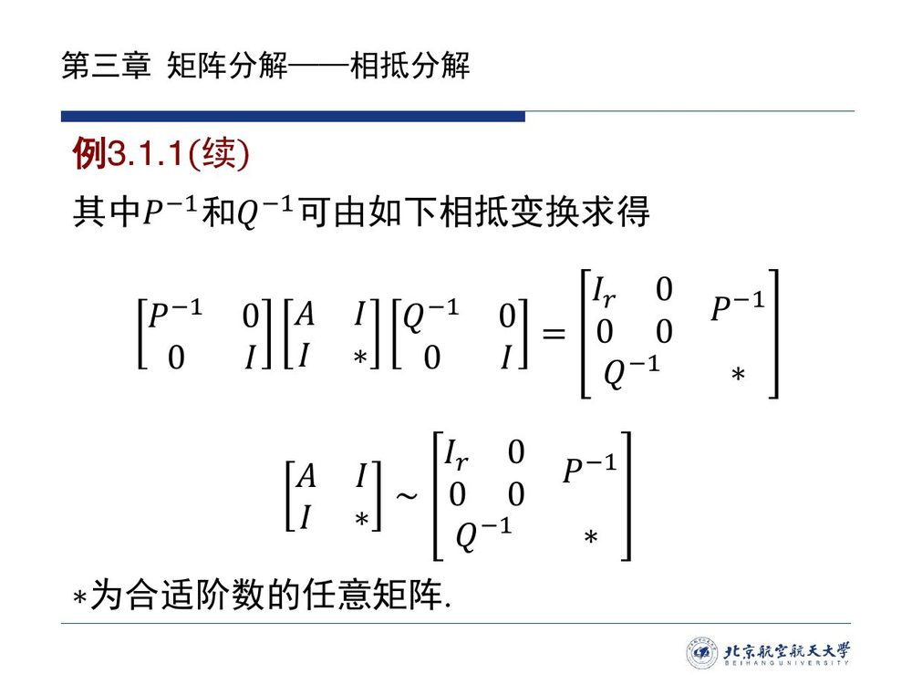

::: errata 课件第 7 页的记号与引理 3.1.1 不同调（本编勘误 · E3.1）

课件第 7 页的分解式写作 $A=P^{-1}\Gamma Q$（引理 3.1.1），但紧接着的分块矩阵一页把读出的两块标成 $P^{-1}$ 与 $Q^{-1}$：按该页自己的式子 $\begin{bmatrix}P^{-1}&0\\0&I\end{bmatrix}\begin{bmatrix}A&I\\ I&*\end{bmatrix}\begin{bmatrix}Q^{-1}&0\\0&I\end{bmatrix}=\begin{bmatrix}I_r&0&P^{-1}\\ 0&0&\\ Q^{-1}&&*\end{bmatrix}$ 展开，得到的是 $P^{-1}AQ^{-1}=\Gamma$，即 $A=P\Gamma Q$——与引理的 $A=P^{-1}\Gamma Q$ 差一个位置。两处只要取同一组字母就对不上。

**本编处理**：正文的 [@method-3.1-augmented] 已改成自洽写法（读出的两块是真 $P=E$ 与 $Q^{-1}=F$，且 $EAF=\Gamma$ 可直接验算）；引用本方法时请以正文为准。这类「不同页对同一字母取不同角色」的记号循环在 3.1 内还有一处（右逆充分性证明法 1 的 $A=P[I_m,0]Q$ 与引理的 $A=P^{-1}\Gamma Q$，本编正文已按引理记号统一），在 [3.2](sec32.md) 也出现过（同样按引理记号调顺），不影响结论，只影响抄写。
:::

下面把整套流程在一个非平凡例子上走完。例题的每一步都做过回代验算，你可以照着复现。

::: ex 例 3.1.A（新增）· 相抵分解全流程：一个秩 $2$ 的三阶方阵 {#ex-3.1.A}

求 $A=\begin{bmatrix}1&2&3\\ 2&5&7\\ 3&7&10\end{bmatrix}$ 的相抵分解式。

::: sol 解答

**先定秩**：第三行 $=$ 第一行 $+$ 第二行，且前两行不成比例，故 $r=2$。

**挂上分块矩阵**（右下块只占位，记作 $0$）：

$$M=\begin{bmatrix}1&2&3&1&0&0\\ 2&5&7&0&1&0\\ 3&7&10&0&0&1\\ 1&0&0&&&&\\ 0&1&0&&&&\\ 0&0&1&&&&\end{bmatrix}.$$

**行变换（只动前 3 行）**：$r_3\leftarrow r_3-r_1-r_2$（第三行清零），$r_2\leftarrow r_2-2r_1$：

$$\begin{bmatrix}1&2&3&1&0&0\\ 0&1&1&-2&1&0\\ 0&0&0&-1&-1&1\\ 1&0&0&&&\\ 0&1&0&&&\\ 0&0&1&&&\end{bmatrix}.$$

**列变换（只动前 3 列）**：$c_2\leftarrow c_2-2c_1$，$c_3\leftarrow c_3-3c_1$，再 $c_3\leftarrow c_3-c_2$：

$$M\ \rightsquigarrow\
\begin{bmatrix}1&0&0&1&0&0\\ 0&1&0&-2&1&0\\ 0&0&0&-1&-1&1\\ 1&-2&-1&&&\\ 0&1&-1&&&\\ 0&0&1&&&\end{bmatrix}.$$

**读出结果**（按 [@method-3.1-augmented]：左上块 $=\Gamma$、右上块 $=E=P$、左下块 $=F=Q^{-1}$）：

$$\Gamma=\begin{bmatrix}1&0&0\\ 0&1&0\\ 0&0&0\end{bmatrix},\qquad
E=P=\begin{bmatrix}1&0&0\\ -2&1&0\\ -1&-1&1\end{bmatrix},\qquad
F=Q^{-1}=\begin{bmatrix}1&-2&-1\\ 0&1&-1\\ 0&0&1\end{bmatrix}.$$

**回代验算**（用 $EAF=\Gamma$ 最省事）：

$$EAF=\begin{bmatrix}1&0&0\\ -2&1&0\\ -1&-1&1\end{bmatrix}\begin{bmatrix}1&2&3\\ 2&5&7\\ 3&7&10\end{bmatrix}\begin{bmatrix}1&-2&-1\\ 0&1&-1\\ 0&0&1\end{bmatrix}
=\begin{bmatrix}1&2&3\\ 0&1&1\\ 0&0&0\end{bmatrix}\begin{bmatrix}1&-2&-1\\ 0&1&-1\\ 0&0&1\end{bmatrix}=\begin{bmatrix}1&0&0\\ 0&1&0\\ 0&0&0\end{bmatrix}=\Gamma\ \checkmark$$

**把分解式写成 $A=P^{-1}\Gamma Q$**：$P$ 已在手上（右上块），只需把左下块求逆得 $Q=F^{-1}$，

$$P=\begin{bmatrix}1&0&0\\ -2&1&0\\ -1&-1&1\end{bmatrix},\qquad P^{-1}=\begin{bmatrix}1&0&0\\ 2&1&0\\ 3&1&1\end{bmatrix},\qquad
Q=F^{-1}=\begin{bmatrix}1&2&3\\ 0&1&1\\ 0&0&1\end{bmatrix},$$

于是 $A=P^{-1}\Gamma Q$ 即所求的相抵分解式。**顺手取出的两块又给出了 $A$ 的「骨架」**：$P^{-1}$ 的**前 $r$ 列** $\begin{bmatrix}1&0\\2&1\\3&1\end{bmatrix}$ 是 $R(A)$ 的一组基，$Q$ 的**前 $r$ 行** $\begin{bmatrix}1&2&3\\0&1&1\end{bmatrix}$ 是各列在这组基下的坐标——两者相乘恰好还原 $A$。这不是巧合，[3.2](sec32.md) 的满秩分解（方法 1）正建立在它上面。
:::
:::

::: ex 例 3.1.B（新增 · 承接例 3.1.A）· 用相抵标准形解方程组 {#ex-3.1.B}

设 $A$ 同 [@ex-3.1.A]。(a) 解方程组 $A\boldsymbol{x}=\boldsymbol{b}_1$，$\boldsymbol{b}_1=(1,2,3)^{\mathrm T}$；(b) 判断 $A\boldsymbol{x}=\boldsymbol{b}_2$（$\boldsymbol{b}_2=(1,2,4)^{\mathrm T}$）是否有解。

::: sol 解答

用 [@ex-3.1.A] 的 $P$、$\Gamma$、$Q$：方程 $\Gamma\boldsymbol{y}=P\boldsymbol{b}$，$\boldsymbol{x}=Q^{-1}\boldsymbol{y}$。

**(a)** $P\boldsymbol{b}_1=\begin{bmatrix}1&0&0\\ -2&1&0\\ -1&-1&1\end{bmatrix}\begin{bmatrix}1\\2\\3\end{bmatrix}=\begin{bmatrix}1\\0\\0\end{bmatrix}$。后 $m-r=1$ 个分量为 $0$ ✓ 有解。由 $\Gamma\boldsymbol{y}=P\boldsymbol{b}_1$ 读得 $y_1=1$、$y_2=0$、$y_3$ 任意，记 $y_3=t$：

$$\boldsymbol{x}=Q^{-1}\boldsymbol{y}=\begin{bmatrix}1&-2&-1\\ 0&1&-1\\ 0&0&1\end{bmatrix}\begin{bmatrix}1\\0\\t\end{bmatrix}=\begin{bmatrix}1-t\\ -t\\ t\end{bmatrix}=\begin{bmatrix}1\\0\\0\end{bmatrix}+t\begin{bmatrix}-1\\-1\\1\end{bmatrix}.$$

**验算**：$A(1,0,0)^{\mathrm T}=(1,2,3)^{\mathrm T}=\boldsymbol{b}_1$ ✓（原方程组的一个特解）；$A(-1,-1,1)^{\mathrm T}=\boldsymbol{0}$ ✓（齐次解）。通解 $=$ 特解 $+$ 齐次通解，自由参数个数 $1=n-r$ ✓。

**(b)** $P\boldsymbol{b}_2=\begin{bmatrix}1\\0\\1\end{bmatrix}$，**后 $1$ 个分量 $=1\neq0$**，故**无解**。对照经典判据：$\operatorname{rank}(A|\boldsymbol{b}_2)=3>2=\operatorname{rank}A$ ✓（第三个方程 $=$ 前两个之和，而右端 $4\neq1+2=3$，矛盾）。

**要点**：相抵标准形把「解方程组」化成了「看 $P\boldsymbol{b}$ 的后 $m-r$ 个分量是否为零」——**可解性是一个分量计数问题，自由度数是一个维数计数问题**。∎
:::
:::

::: think 相抵分解与高斯消元是什么关系？（本编）

高斯消元（行变换）把 $A$ 化成行阶梯形，用于判断解与求解；相抵分解则允许**同时使用行变换与列变换**（等价于左右各乘可逆矩阵），于是能把 $A$ 压得更彻底——一路压到只由秩决定的标准形 $\Gamma$。两者的关系可以这样说：

- **行变换**（左乘 $P$）在不改变未知量的前提下化简方程，是「求解」的工具；
- **列变换**（右乘 $Q$）等价于对未知量换元（$\boldsymbol{x}=Q^{-1}\boldsymbol{y}$），是「换坐标」的工具；
- 行阶梯形只把 $A$ 化到「阶梯」为止（保留了解的信息），相抵标准形则把列方向的冗余也清掉（牺牲了直接可解性，换来了唯一的代表元）。

用哪个取决于目的：**要解方程，行变换就够；要研究「秩」本身、或要构造后续的分解，标准形更方便**。
:::

## 3.1.3 左逆与右逆：长方阵的单侧逆

第二个应用从一个看似天真的问题开始：**什么样的矩阵乘积能为单位阵？** 换成等式就是问 $AB=I$ 能对哪些 $A$ 成立——若是**方阵**，$AB=I$ 已经足够推出 $B=A^{-1}$、两者都可逆；但若 $A$ 是长方阵，结论完全不同。

::: think 问题 1 与问题 2（课件原文）

**问题 1**：何种矩阵乘积为单位阵？初看几乎要脱口而出「乘积为单位阵的两矩阵必可逆」——**错**。反例：

$$AA^{\mathrm H}=[1\ \ 0]\begin{bmatrix}1\\0\end{bmatrix}=1 .$$

这里 $A=[1\ \ 0]$ **不是可逆矩阵**（连方阵都不是），却与 $A^{\mathrm H}$ 乘出了单位阵（$1\times1$ 的单位阵）。

**小结（修正后的正确说法）**：若两**方阵**乘积为单位阵，则这两矩阵必可逆。前提「方阵」一个字都不能少。

**问题 2**：何种**长方阵**乘积为单位阵？——这就是下文定理 3.1.1 回答的问题。
:::

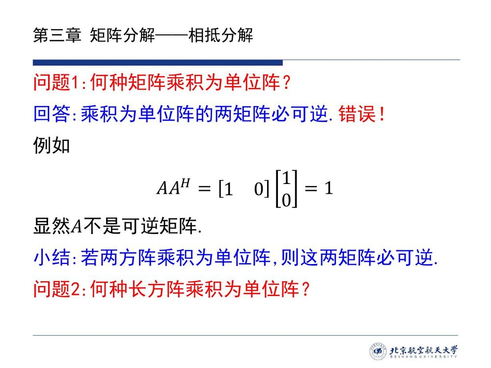

::: thm 定理 3.1.1 · 右逆与左逆 {#thm-3.1.1}

设矩阵 $A\in\mathbb C^{m\times n}_r$（$r>0$），则

- $A$ 有**右逆**（即存在矩阵 $B$ 使得 $AB=I$）的**充分必要条件**是 $A$ 为**行满秩**矩阵（$r=m$）；
- $A$ 有**左逆**（即存在矩阵 $B$ 使得 $BA=I$）的**充分必要条件**是 $A$ 为**列满秩**矩阵（$r=n$）。
:::

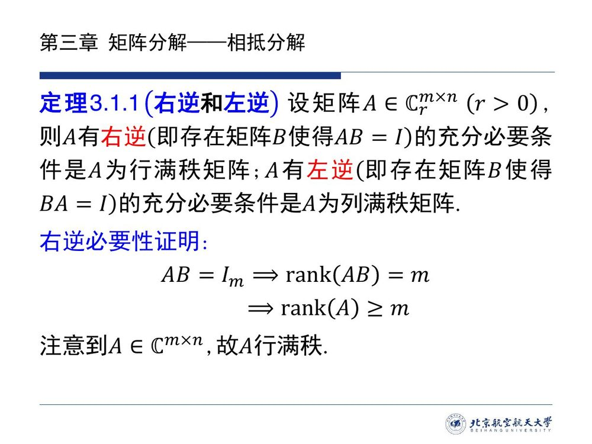

**记号说明**（本编）：$\mathbb C^{m\times n}_r$ 表示全体「$m\times n$、秩恰为 $r$」的复矩阵；$AB=I$ 中的 $I$ 按上下文分别是 $I_m$（右逆）、$I_n$（左逆）。下面先证必要性（课件给出右逆情形），再给出两条独立的充分性路线。

::: proof 必要性（课件证右逆，左逆对称，本编补）

**右逆**：设 $AB=I_m$。由 [@thm-2.3.6]（矩阵的秩 $=$ 映射的秩）与秩的基本不等式 $\operatorname{rank}(AB)\le\operatorname{rank}A$（乘积的秩不超过任一因子的秩，本编注：$R(AB)\subseteq R(A)$），得

$$\operatorname{rank}(AB)=m\ \Longrightarrow\ m\le\operatorname{rank}A\le\min\{m,n\},$$

故 $\operatorname{rank}A=m$，即 $A$ 行满秩。

**左逆**（本编补：对 $A^{\mathrm H}$ 用右逆结论）：设 $BA=I_n$，两边取共轭转置得 $A^{\mathrm H}B^{\mathrm H}=I_n$，即 $A^{\mathrm H}$ 有右逆。刚刚证过的右逆情形给出 $\operatorname{rank}(A^{\mathrm H})=n$，而共轭转置不改变秩（[@prop-3.1.1] 的链条），故 $\operatorname{rank}A=n$，即 $A$ 列满秩。∎

**一条推论**（本编）：$AB=I$ 的等式还说明 $A$ **不能比 $B$ 更「宽」**：$A$ 行满秩要求 $m\le n$，$A$ 列满秩要求 $n\le m$——单侧逆只在长方阵的「长边」方向上存在。
:::

::: proof 充分性 · 法 1（相抵分解；课件原文，记号与引理 3.1.1 调顺）

设 $A$ 行满秩，即 $r=m$。此时相抵标准形是横长条 $\Gamma=[I_m,\ 0]$（$m\times n$），[@lem-3.1.1] 给出

$$A=P^{-1}\,[I_m,\ 0]\,Q .$$

$\Gamma$ 的右侧还有一根竖条可以「配平」——注意 $[I_m,\ 0]\begin{bmatrix}I_m\\0\end{bmatrix}=I_m$。于是**定义一个候选的右逆**：

$$B=Q^{-1}\begin{bmatrix}I_m\\ 0\end{bmatrix}P .$$

代入验算：

$$AB=P^{-1}[I_m,\ 0]\,Q\cdot Q^{-1}\begin{bmatrix}I_m\\ 0\end{bmatrix}P=P^{-1}\,[I_m,\ 0]\begin{bmatrix}I_m\\ 0\end{bmatrix}\,P=P^{-1}I_mP=I_m .$$

故 $B$ 是 $A$ 的右逆，充分性得证。∎

**方法的要点**：相抵标准形把「求右逆」变成了「求 $\Gamma$ 的右逆」——而 $\Gamma=[I_m,0]$ 的右逆就摆在眼前：$\begin{bmatrix}I_m\\0\end{bmatrix}$。两端的可逆矩阵只需原样搬运过去。**法 1 只用相抵分解（加、乘、求逆），所以对任意数域 $F$ 都成立**，不依赖内积。
:::

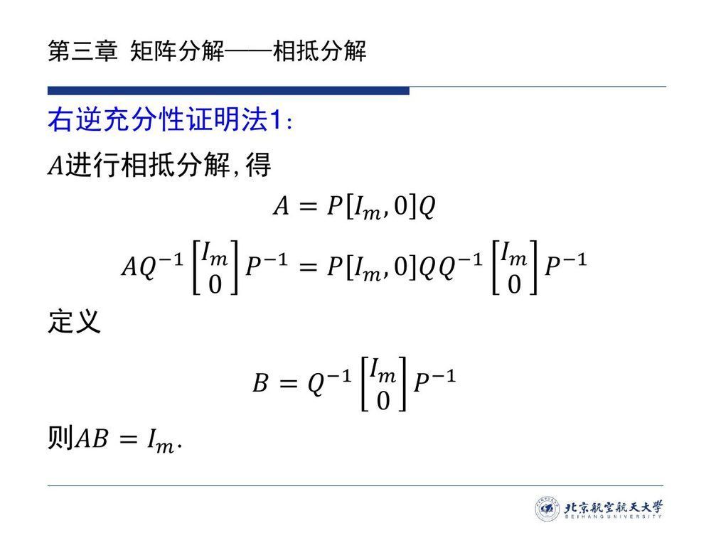

::: note 注 1 · 矩阵 $A$ 右（左）逆存在性小结（课件原文）

- 当 $A$ 为**可逆矩阵**时，其右（左）逆**唯一存在**，即为 $A$ 的逆矩阵；
- 当 $A$ 为**行（列）满秩矩阵（非可逆阵）**时，其右（左）逆**存在且不唯一**；
- 当 $A$ 为**其他情况**（既不方阵满秩、也不相应满秩）时，其右（左）逆**不存在**。
:::

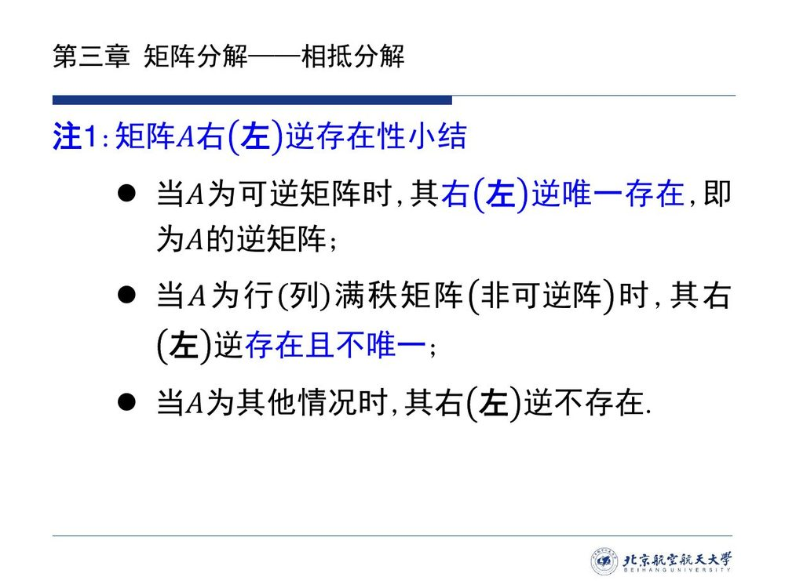

::: note 本编补注 · 左逆 / 右逆在映射语言里是什么？

把 $A$ 读成映射 $T:F^n\to F^m$，$\boldsymbol{x}\mapsto A\boldsymbol{x}$（[@thm-2.3.4] 的坐标公式），则：

- $BA=I_n$ 说明 $B$ 能把 $T$ 的输出**还原**：若 $T(\boldsymbol{x}_1)=T(\boldsymbol{x}_2)$，两边作用 $B$ 得 $\boldsymbol{x}_1=\boldsymbol{x}_2$——这正是**单射**，而 [@thm-2.2.2] 说单射 $\iff$ 列满秩。**左逆 $=$ 单射的「反向还原器」**；
- $AB=I_m$ 说明 $B$ 能为每个输出**定一个原像**：任给 $\boldsymbol{y}$，取 $\boldsymbol{x}=B\boldsymbol{y}$ 便有 $T(\boldsymbol{x})=\boldsymbol{y}$——这正是**满射**。**右逆 $=$ 满射的「选原像器」**（每个 $\boldsymbol{y}$ 选一个原像，选法即 $B$，所以不唯一）。

于是 [@thm-3.1.1] 的三条与 [2.2](../ch02/sec22.md) 的判据一一对应，只差一层翻译。**这也解释了「不唯一」**：单射的原像本来只有一个，所以右逆未必唯一（给值域外的每个点随便选原像）；而列满秩时 $A$ 作为映射单射，其左逆把像上的每个点送回唯一原像——不同之处在于**左逆在像之外可以任意取值**，所以同样不唯一（见 [@ex-3.1.C]）。

**对照记忆**：方阵情形两者合一（可逆），这是注 1 第一句；长方阵只能要一半，这是注 1 第二句。
:::

::: ex 例 3.1.C（新增）· 求全部右逆、全部左逆 {#ex-3.1.C}

(a) $A=[1\ \ 0]\in\mathbb C^{1\times2}$，求它的**所有**右逆；(b) $A=\begin{bmatrix}1\\0\end{bmatrix}\in\mathbb C^{2\times1}$，求它的**所有**左逆；(c) $A=\begin{bmatrix}1&0\\0&1\\0&0\end{bmatrix}$，写出一个左逆，并说明左逆有无穷多个。

::: sol 解答

**(a)** $A$ 行满秩（$1\times2$，秩 $1=m$），右逆存在。设 $B=\begin{bmatrix}b_1\\ b_2\end{bmatrix}$，则

$$AB=[1\ \ 0]\begin{bmatrix}b_1\\ b_2\end{bmatrix}=b_1\ \Longrightarrow\ AB=1\iff b_1=1 .$$

故**全部右逆**为 $B=\begin{bmatrix}1\\ t\end{bmatrix}$（$t\in\mathbb C$ 任意）——**无穷多个，确实不唯一**（也印证注 1）。

**(b)** $A$ 列满秩（$2\times1$，秩 $1=n$），左逆存在。设 $B=[b_1\ \ b_2]$，则

$$BA=[b_1\ \ b_2]\begin{bmatrix}1\\0\end{bmatrix}=b_1\ \Longrightarrow\ BA=1\iff b_1=1 .$$

全部左逆为 $B=[1\ \ t]$（$t$ 任意）。

**(c)** 与 (b) 同理：设 $B=\begin{bmatrix}b_{11}&b_{12}&b_{13}\\ b_{21}&b_{22}&b_{23}\end{bmatrix}$，则 $BA=\begin{bmatrix}b_{11}&b_{12}\\ b_{21}&b_{22}\end{bmatrix}$（第 3 列乘零消失）。故 $BA=I_2\iff$ 前两列为 $I_2$ 的两列，第三列 $(b_{13},b_{23})^{\mathrm T}$ **任意**。例如

$$B_0=\begin{bmatrix}1&0&0\\ 0&1&0\end{bmatrix},\qquad \text{以及}\ \begin{bmatrix}1&0&7\\ 0&1&-5\end{bmatrix},\ \cdots$$

——**左逆把「多余的一列」留给自由参数**。几何上：$A$ 把 $\mathbb C^2$ 嵌入 $\mathbb C^3$（列向量张成 $xy$ 平面），左逆只需把平面上的点送回去，平面外的分量怎么定都不影响 $BA=I$。

**(a)(b)(c) 的共同点**：三个例子都验证了注 1 的第二句——**满秩非方阵的单侧逆有无穷多个**，多出来的自由度来自「方阵之外的维数」：$A$ 是 $m\times n$ 满秩时，差 $|n-m|$ 个方向本就属于选法的自由。∎
:::
:::

## 3.1.4 两个秩的等式：$\operatorname{rank}(A)=\operatorname{rank}(A^{\mathrm H}A)$

法 1 用相抵分解造右逆，好处是不挑数域，代价是要先算相抵分解。还有一条更短的路线：直接写出一个**公式**当作右逆——比如 $A^{\mathrm H}(AA^{\mathrm H})^{-1}$——只需验证 $AA^{\mathrm H}$ 可逆。而「可逆」是一个秩问题，于是问题归结为下面这条秩等式。课件把它列为命题，并用方程组给出证明，它是本节最重要的结论。

::: prop 命题 3.1.1 · 秩的等式 {#prop-3.1.1}

$$\operatorname{rank}(A)=\operatorname{rank}(AA^{\mathrm H}),\qquad \operatorname{rank}(A^{\mathrm H})=\operatorname{rank}(A^{\mathrm H}A),$$

从而（$A$ 与 $A^{\mathrm H}$ 的秩相等，故四个量相等）

$$\operatorname{rank}(A)=\operatorname{rank}(A^{\mathrm H}A)=\operatorname{rank}(AA^{\mathrm H})=\operatorname{rank}(A^{\mathrm H}).$$

这是一个与矩阵秩相关的重要结论。
:::

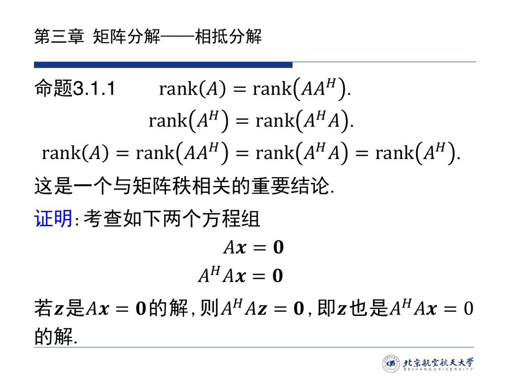
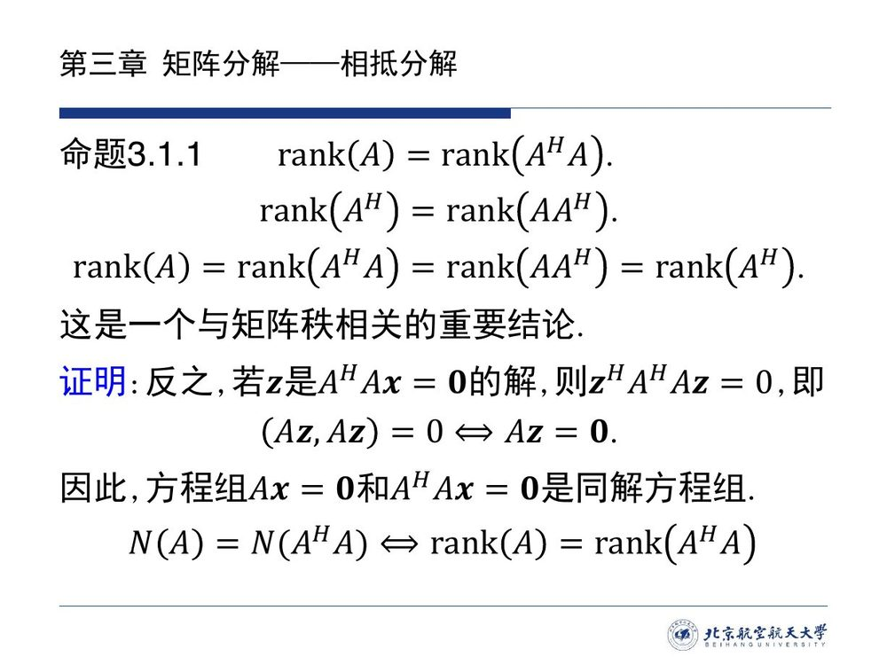

::: proof 证明（课件两半，本编整理为「同解 $\Longrightarrow$ 同秩」三步）

**第一步（证明 $N(A)=N(A^{\mathrm H}A)$）**：考查两个齐次方程组

$$A\boldsymbol{x}=\boldsymbol{0},\qquad A^{\mathrm H}A\boldsymbol{x}=\boldsymbol{0}.$$

- **$N(A)\subseteq N(A^{\mathrm H}A)$**：若 $\boldsymbol{z}$ 满足 $A\boldsymbol{z}=\boldsymbol{0}$，两边左乘 $A^{\mathrm H}$ 得 $A^{\mathrm H}A\boldsymbol{z}=\boldsymbol{0}$ ✓（这一步只用乘法，不需要任何内积）。
- **$N(A^{\mathrm H}A)\subseteq N(A)$**：若 $\boldsymbol{z}$ 满足 $A^{\mathrm H}A\boldsymbol{z}=\boldsymbol{0}$，两边左乘 $\boldsymbol{z}^{\mathrm H}$ 得 $\boldsymbol{z}^{\mathrm H}A^{\mathrm H}A\boldsymbol{z}=0$，即

$$(A\boldsymbol{z},\,A\boldsymbol{z})=0 .$$

由内积的**正定性**（[@def-1.4.1]（4）：$(\boldsymbol{u},\boldsymbol{u})=0\iff\boldsymbol{u}=\boldsymbol{0}$）得 $A\boldsymbol{z}=\boldsymbol{0}$ ✓。

故两个方程组**同解**：$N(A)=N(A^{\mathrm H}A)$。

**第二步（同解 $\Longrightarrow$ 同秩）**：两个矩阵同型（都是 $n$ 列），用亏加秩定理（[@thm-2.2.5]）

$$\operatorname{rank}(A)=n-\dim N(A)=n-\dim N(A^{\mathrm H}A)=\operatorname{rank}(A^{\mathrm H}A).$$

**第三步（得到四个量相等）**：对 $A^{\mathrm H}$ 重做第一步与第二步（$A^{\mathrm H}$ 是 $n\times m$ 矩阵，其零空间在 $\mathbb C^m$ 中）：

$$\operatorname{rank}(A^{\mathrm H})=\operatorname{rank}\big((A^{\mathrm H})^{\mathrm H}A^{\mathrm H}\big)=\operatorname{rank}(AA^{\mathrm H}).$$

又转置（共轭转置）不改变秩：$\operatorname{rank}(A)=\operatorname{rank}(A^{\mathrm H})$。串起来即得命题的四项等式链。∎

**证明的要点**：关键一步是**正定性**——$(A\boldsymbol{z},A\boldsymbol{z})=0$ 只有正定内积才允许推出 $A\boldsymbol{z}=\boldsymbol{0}$（若换成一般二次型，「自己要内积为零」不等于「自己是零」）。这正是课件把话说死的那句「**这是一个与矩阵秩相关的重要结论**」的分量所在：它把「秩」这一个数，与内积全部挂钩。
:::

::: note 本编补注 · 为什么是 $A^{\mathrm H}A$ 而不是 $A^2$？

$A^{\mathrm H}A$ 的两个好性质：① **一定是 Hermite 半正定矩阵**（$\boldsymbol{x}^{\mathrm H}A^{\mathrm H}A\boldsymbol{x}=(A\boldsymbol{x},A\boldsymbol{x})\ge0$，[@def-1.4.3]）；② **它与 $A$ 同秩**（[@prop-3.1.1]）。于是

> $A^{\mathrm H}A$ 可逆 $\iff$ $\operatorname{rank}(A^{\mathrm H}A)=n$ $\iff$ $\operatorname{rank}A=n$ $\iff$ $A$ **列满秩**；
> $AA^{\mathrm H}$ 可逆 $\iff$ $\operatorname{rank}(AA^{\mathrm H})=m$ $\iff$ $A$ **行满秩**。

这两条是本课程后面反复引用的「可逆性转换器」：**长方阵的满秩问题，转成方阵 $A^{\mathrm H}A$（或 $AA^{\mathrm H}$）的可逆问题**——后者可以用行列式、可以用正定性、可以直接求逆。（换成 $A^2$ 就全塌了：$A$ 非方阵时 $A^2$ 根本没法定义；就算方阵也不例外，取 $A=\begin{bmatrix}0&1\\0&0\end{bmatrix}$ 便有 $A^2=O$，秩从 $1$ 掉到 $0$。）
:::

::: proof 充分性 · 法 2（用命题 3.1.1；课件原文）

设 $A\in\mathbb C^{m\times n}$ 为**行满秩**矩阵（$\operatorname{rank}A=m$）。由 [@prop-3.1.1]，

$$\operatorname{rank}(AA^{\mathrm H})=\operatorname{rank}(A)=m,$$

即 $m$ 阶方阵 $AA^{\mathrm H}$ 满秩，**可逆**。于是

$$AA^{\mathrm H}(AA^{\mathrm H})^{-1}=I_m,$$

即

$$B=A^{\mathrm H}(AA^{\mathrm H})^{-1}$$

是矩阵 $A$ 的一个右逆（$A\cdot A^{\mathrm H}(AA^{\mathrm H})^{-1}=I_m$ ✓）。∎

**与法 1 的分工**（本编）：法 1（相抵）给出「存在、且可机械地算出」，用不着内积，对数域 $F$ 通用；法 2（本节）给出**闭式公式**，只需求逆一次，但依赖 $A^{\mathrm H}$（用于实/复内积空间）。考试时**能写出来就是好办法**：法 2 的公式短、验证快，是首选；法 1 是「万一忘了公式」时的保底路线。对称地，列满秩时 $B=(A^{\mathrm H}A)^{-1}A^{\mathrm H}$ 是 $A$ 的一个左逆。
:::

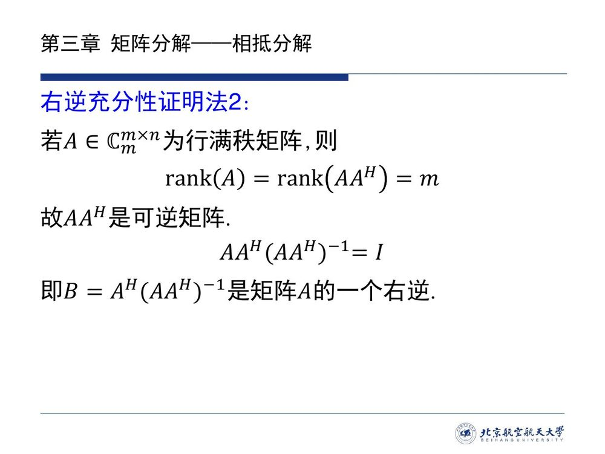

::: preview 课程预告 · 这两个公式后面会一直出现

$B=A^{\mathrm H}(AA^{\mathrm H})^{-1}$（右逆）与 $B=(A^{\mathrm H}A)^{-1}A^{\mathrm H}$（左逆）不是两个临时的技巧——它们是**广义逆**（伪逆）的雏形，也是「最小二乘」的核心：

- 对**列满秩**的超定方程组 $A\boldsymbol{x}=\boldsymbol{b}$（方程个数多于未知数，通常无解），最小的「残差平方和」解是

$$\boldsymbol{x}=(A^{\mathrm H}A)^{-1}A^{\mathrm H}\boldsymbol{b},$$

其中 $(A^{\mathrm H}A)^{-1}A^{\mathrm H}$ 正是 $A$ 的一个左逆（对称地，行满秩时 $A^{\mathrm H}(AA^{\mathrm H})^{-1}$ 是右逆）；等式 $(A^{\mathrm H}A)\boldsymbol{x}=A^{\mathrm H}\boldsymbol{b}$ 称为**正规方程**；
- 对**任何**矩阵（包括不满秩、不对称的情形），上述两条路线可以被统一成同一个对象 $A^+$（Moore–Penrose 伪逆），它满足 $AA^+A=A$——这正是 [3.2](sec32.md) 的例 3.2.2 将要构造的 $X$。

本编此处只用到 [@thm-3.1.1] 与 [@prop-3.1.1] 的结论；广义逆的完整理论与最小二乘的推导留待后续课程内容展开，这里先埋一个锚点。
:::

::: errata 命题 3.1.1 两页的表述次序不一致（本编勘误 · E3.2）

课件第 12 页把两条等式写成 $\operatorname{rank}(A)=\operatorname{rank}(AA^{\mathrm H})$ 与 $\operatorname{rank}(A^{\mathrm H})=\operatorname{rank}(A^{\mathrm H}A)$，第 13 页又把它们写成 $\operatorname{rank}(A)=\operatorname{rank}(A^{\mathrm H}A)$ 与 $\operatorname{rank}(A^{\mathrm H})=\operatorname{rank}(AA^{\mathrm H})$——两页的配对**次序相反**。这**不是矛盾**：四个量本来就相等（见上方证明第三步），两种写法都成立；但抄写时容易抄错配对，建议直接背**四项等式链**

$$\operatorname{rank}(A)=\operatorname{rank}(A^{\mathrm H}A)=\operatorname{rank}(AA^{\mathrm H})=\operatorname{rank}(A^{\mathrm H}),$$

它不依赖先写哪一对，也把两页的写法一并涵盖。课件所证的主线是 $N(A)=N(A^{\mathrm H}A)$ 与由此得到的 $\operatorname{rank}(A)=\operatorname{rank}(A^{\mathrm H}A)$。
:::

::: ex 例 3.1.D（新增）· 用公式造右逆并验证 {#ex-3.1.D}

设 $A=\begin{bmatrix}1&2&0\\ 0&1&1\end{bmatrix}$。(a) 判定 $A$ 是否有右逆；(b) 若有，用 [@thm-3.1.1] 法 2 的公式造一个并验算。

::: sol 解答

**(a)** $A$ 是 $2\times3$ 矩阵，秩为 $2=m$（两行不成比例），**行满秩**，故右逆存在（且由注 1 不唯一）。

**(b)** 先算

$$AA^{\mathrm H}=\begin{bmatrix}1&2&0\\ 0&1&1\end{bmatrix}\begin{bmatrix}1&0\\ 2&1\\ 0&1\end{bmatrix}=\begin{bmatrix}5&2\\ 2&2\end{bmatrix},\qquad \det(AA^{\mathrm H})=10-4=6\neq0,$$

可逆（也验证了 [@prop-3.1.1]：$\operatorname{rank}(AA^{\mathrm H})=\operatorname{rank}(A)=2$ ✓）。求逆：

$$(AA^{\mathrm H})^{-1}=\frac16\begin{bmatrix}2&-2\\ -2&5\end{bmatrix}.$$

于是

$$B=A^{\mathrm H}(AA^{\mathrm H})^{-1}=\frac16\begin{bmatrix}1&0\\ 2&1\\ 0&1\end{bmatrix}\begin{bmatrix}2&-2\\ -2&5\end{bmatrix}
=\frac16\begin{bmatrix}2&-2\\ 2&1\\ -2&5\end{bmatrix}.$$

**验算**：

$$AB=\frac16\begin{bmatrix}1&2&0\\ 0&1&1\end{bmatrix}\begin{bmatrix}2&-2\\ 2&1\\ -2&5\end{bmatrix}=\frac16\begin{bmatrix}6&0\\ 0&6\end{bmatrix}=I_2\ \checkmark$$

**顺带核对不唯一性**：由注 1，右逆不唯一——本例中 $A$ 的右逆构成一个 $2$ 参数的仿射族（每个输出的原像可加 $N(A)$ 中任意向量的坐标，$n-r=1$，两列各自贡献一个参数），完整写法见[习题](exercises.md) C4。∎
:::
:::

## 3.1 小结与常见错误

- **一条主线**：**任何矩阵都能相抵到标准形**（[@lem-3.1.1]：$A=P^{-1}\Gamma Q$，证明 $=$ 选基 $+$ 换基公式）$\Rightarrow$ 分解式不唯一、**标准形唯一**（[@note-3.1-rank]：相抵 $\iff$ 同秩）$\Rightarrow$ 用它解方程组（[@ex-3.1.1]：可解判据 $=$ 看 $P\boldsymbol{b}$ 的后 $m-r$ 个分量，自由度数 $=n-r$）$\Rightarrow$ 用它造单侧逆、并给出满秩判别（[@thm-3.1.1]：行满秩 $\iff$ 右逆，列满秩 $\iff$ 左逆）$\Rightarrow$ 最后通过秩等式 $\operatorname{rank}(A)=\operatorname{rank}(A^{\mathrm H}A)$（[@prop-3.1.1]）拿到闭式的单侧逆公式 $A^{\mathrm H}(AA^{\mathrm H})^{-1}$、$(A^{\mathrm H}A)^{-1}A^{\mathrm H}$。
- **一条对应**：**分解 $\leftrightarrow$ 秩**。相抵标准形由秩唯一决定；满秩分解（[3.2](sec32.md)）的中间因子个数是秩；单侧逆的存在性由「是否达到 $m$ 或 $n$」决定。本章所有结论都是「用结构把秩显出来」。

::: think 常见错误清单 · 自查五条

1. **把相抵分解当成唯一的**：不唯一的是**分解式**（$P$、$Q$ 有无穷多种），唯一的是**标准形** $\Gamma$；别把两句话写反；
2. **分块矩阵记错栏目**：右上块积的是**行**变换（$P^{-1}=E$），左下块积的是**列**变换（$Q^{-1}=F$）；算完一定用 $EAF=\Gamma$ 回代；
3. **忘记「方阵」前提**：$AB=I$ 只在**方阵**情形推出 $BA=I$；长方阵只能得单侧逆，且右逆要求行满秩、左逆要求列满秩，方向别写反；
4. **$\boldsymbol{x}$ 与 $\boldsymbol{y}$ 混用**：用相抵分解解方程组时，$\Gamma\boldsymbol{y}=P\boldsymbol{b}$ 解出的是 $\boldsymbol{y}$，必须**乘回 $Q^{-1}$** 才是 $\boldsymbol{x}$；可解判据看的是 **$P\boldsymbol{b}$**（不是 $\boldsymbol{b}$）的后 $m-r$ 个分量；
5. **把 $\operatorname{rank}(A)=\operatorname{rank}(A^{\mathrm H}A)$ 当默认事实**：它的证明用了**内积正定性**，是「实 / 复内积空间」的结论；写成 $A^{\mathrm T}A$ 或一般域上的 $A^*A$ 时要先确认前提（本课程一律在实 / 复内积空间中使用）。
:::

::: ex 即时自测（不看上文，5 分钟）{#ex-3.1.quiz}

1. 写出相抵分解式与相抵标准形；「分解不唯一」与「标准形唯一」各指什么？
2. $A=\begin{bmatrix}1&2\\ 2&4\end{bmatrix}$：写出 $A$ 的相抵标准形与一个分解式（$P^{-1}$、$Q$ 都给出）。
3. $A\in\mathbb C^{3\times2}$ 且 $\operatorname{rank}A=2$：$A$ 有右逆还是左逆？$AA^{\mathrm H}$ 与 $A^{\mathrm H}A$ 哪个可逆？另一个的秩是多少？
4. 默写 [@prop-3.1.1] 的证明主线，并指出哪一步用了内积的哪条公理。

::: sol 参考要点

1. $A=P^{-1}\Gamma Q$，$\Gamma=\begin{bmatrix}I_r&0\\0&0\end{bmatrix}$；不唯一指 $P,Q$ 的取法无穷（对任意 $*$，$P^{-1}\begin{bmatrix}I_r&*\\0&I\end{bmatrix}$ 与 $\begin{bmatrix}I_r&0\\*&I\end{bmatrix}Q$ 仍给出分解）；唯一指 $r$ 决定 $\Gamma$，无论哪种分解式中间都是同一个 $\Gamma$。
2. 秩 $1$，$\Gamma=\begin{bmatrix}1&0\\0&0\end{bmatrix}$。一个分解：第一行减第二行的一半方向——取 $P=\begin{bmatrix}1&0\\ -2&1\end{bmatrix}$（$r_2\leftarrow r_2-2r_1$），$F=Q^{-1}=\begin{bmatrix}1&-2\\ 0&1\end{bmatrix}$（$c_2\leftarrow c_2-2c_1$），则 $PAQ^{-1}=\begin{bmatrix}1&0\\0&0\end{bmatrix}=\Gamma$，即 $A=P^{-1}\Gamma Q$。**验算**：$P^{-1}\Gamma Q=\begin{bmatrix}1&0\\2&1\end{bmatrix}\begin{bmatrix}1&0\\0&0\end{bmatrix}\begin{bmatrix}1&2\\0&1\end{bmatrix}=\begin{bmatrix}1&2\\2&4\end{bmatrix}$ ✓。
3. 列满秩（$\operatorname{rank}=2=n$）：有**左逆**，**没有右逆**（$m=3>n=2$ 不满足行满秩）；$A^{\mathrm H}A$（$2\times2$）**可逆**；$AA^{\mathrm H}$（$3\times3$）**不可逆**，由 [@prop-3.1.1] 其秩为 $2$。
4. 主线：$N(A)\subseteq N(A^{\mathrm H}A)$（两边左乘 $A^{\mathrm H}$）与 $N(A^{\mathrm H}A)\subseteq N(A)$（左乘 $\boldsymbol{z}^{\mathrm H}$ 得 $(A\boldsymbol{z},A\boldsymbol{z})=0$，由**正定性**推出 $A\boldsymbol{z}=\boldsymbol{0}$）$\Rightarrow$ 同解 $\Rightarrow$ 亏加秩给出 $\operatorname{rank}(A)=\operatorname{rank}(A^{\mathrm H}A)$；对 $A^{\mathrm H}$ 重复即得四项等式链。用到的公理是 [@def-1.4.1]（4）**正定性**。
:::
:::