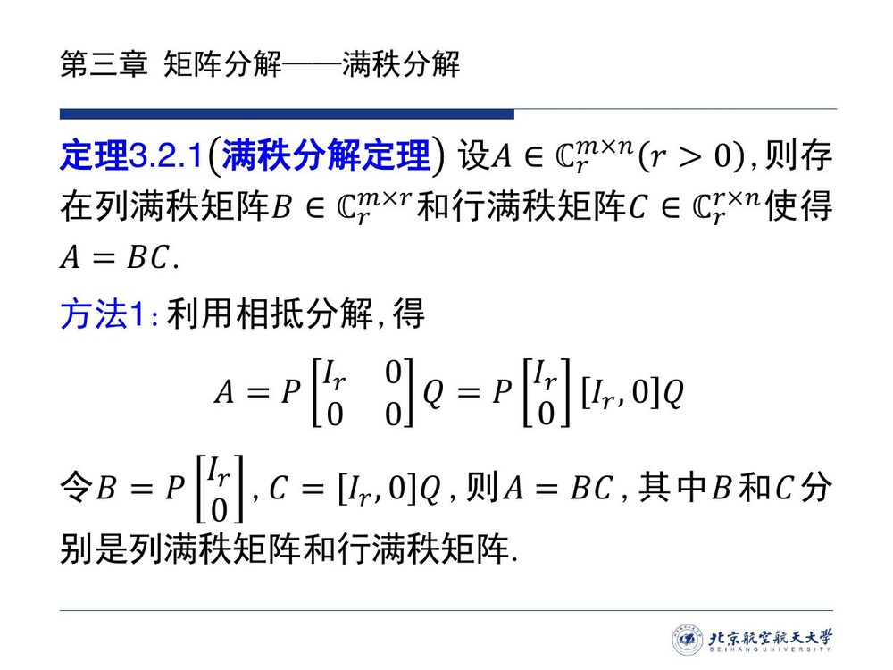
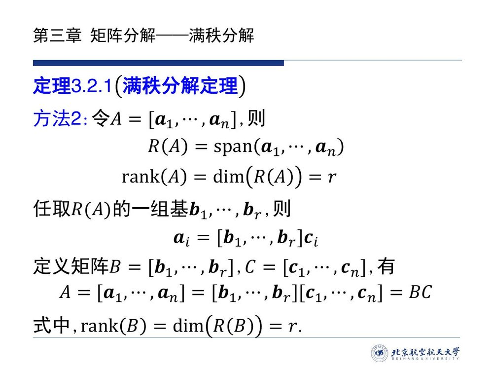
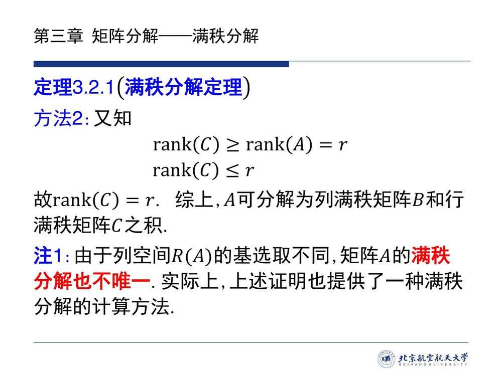
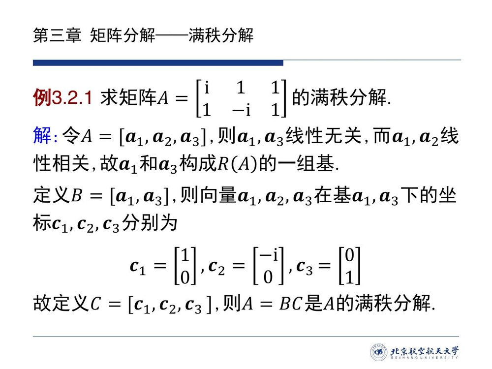
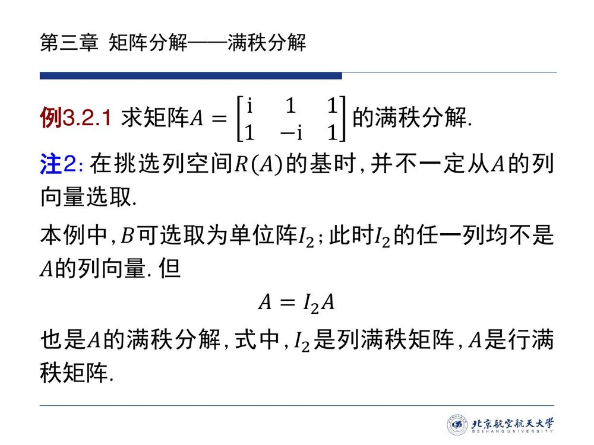
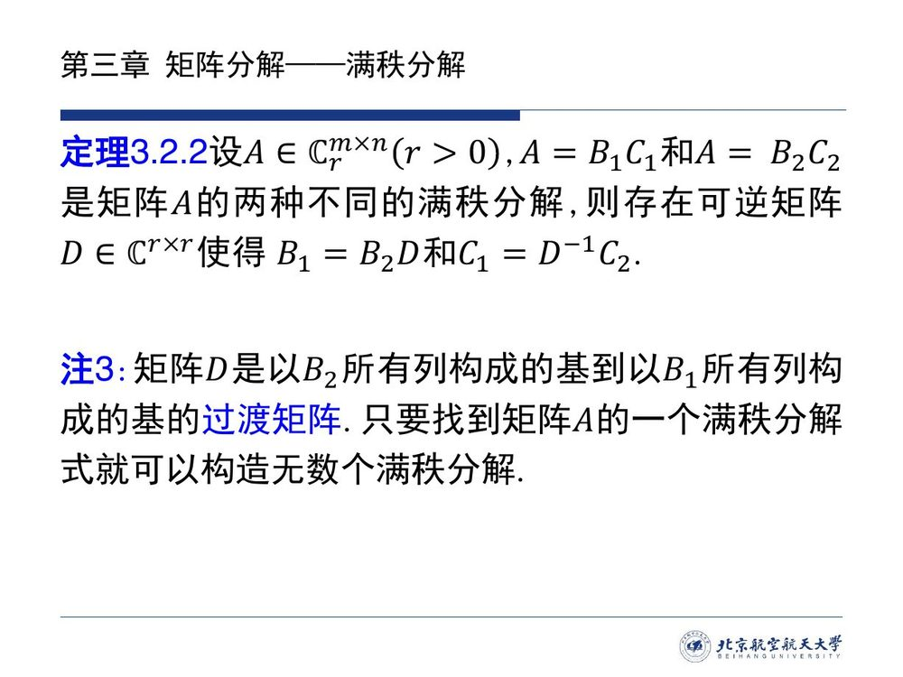
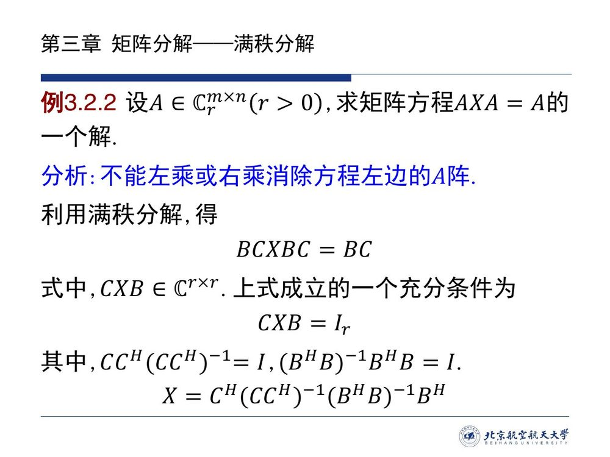

# 3.2 满秩分解

[3.1](sec31.md) 的相抵分解把任何矩阵压成了标准形 $A=P^{-1}\Gamma Q$，但代价是：**关于 $A$ 的信息几乎全被搬进了两边的可逆矩阵里**。$\Gamma$ 只记住了一个数——秩；而「$A$ 的列之间有什么线性关系」「哪些列构得成基」这些信息，要看 $P^{-1}$ 与 $Q$ 才知道。本节换一种拆法：不让可逆矩阵出场，而是把 $A$ **直接**写成两个矩阵的乘积

$$A=BC,$$

其中 $B$ 的**列**取 $R(A)$ 的一组基（于是 $B$ 列满秩、$m\times r$），$C$ **逐列记下** $A$ 的每一列在这组基下的坐标（于是 $C$ 行满秩、$r\times n$）。这一下，$A$ 的「骨架」就摆在明面上了：**列空间 $R(A)=R(B)$、秩 $=r=$ 中间因子的行列数、列之间的线性关系由 $C$ 逐列读出**。这就是**满秩分解**（full rank factorization）。

和相抵分解一样，满秩分解也不唯一；但本节会把它不唯一的程度**精确**说清：任意两种分解之间只差一个可逆矩阵 $D$（[@thm-3.2.2]）。最后用它解一个矩阵方程 $AXA=A$（[@ex-3.2.2]）——那是 [3.1](sec31.md) 结尾预告过的伪逆的第一次露面。

<aside class="lesson-brief" aria-label="3.2 学习简报">

PREREQUISITE<strong>你需要先会</strong>
相抵分解与相抵标准形（[@lem-3.1.1]）；子空间、张成与列空间（[@def-1.2.4]、[@def-1.2.3]、[@prop-1.2.1]）；基与坐标的唯一表示（[@thm-1.3.2]）、基扩充（[@cor-1.3.1]）；过渡矩阵（[@def-1.3.5]、[@prop-1.3.1]）；亏加秩定理（[@thm-2.2.5]）；行 / 列满秩与单侧逆、秩等式 $\operatorname{rank}(A)=\operatorname{rank}(A^{\mathrm H}A)$（[@thm-3.1.1]、[@prop-3.1.1]）。

TARGET<strong>本节要建立</strong>
满秩分解定理 $A=BC$（[@thm-3.2.1]）及两条构造路线（相抵分解法、列空间基法）；「满秩分解 $=$ 列空间的基 $\times$ 坐标」这一读法；不唯一的精确刻画（[@thm-3.2.2]：相差一个可逆因子 $D$，$D$ 是两组基之间的过渡矩阵）；矩阵方程 $AXA=A$ 的一个解（[@ex-3.2.2]）与伪逆的雏形。

CHECKPOINT<strong>学完的标准</strong>
给定矩阵能求出满秩分解并回代验证；能说出 $B$、$C$ 的形状、秩与几何含义（$B$ 的列是 $R(A)$ 的基，$C$ 的列是坐标）；能用行简化阶梯形（RREF）批量地取 $B$ 与 $C$；能复述 [@thm-3.2.2] 的证明主线（$R(B_1)=R(A)=R(B_2)$ $\Rightarrow$ 过渡矩阵 $\Rightarrow$ $B$ 的单射）并解释 $D$ 为什么必可逆；能用满秩分解写出 $AXA=A$ 的一个解。

</aside>

::: note 素材与说明（本节无录播）

本页依据课程第三章课件 **3.2 满秩分解**（9 页，存于 `raw/decks/3.2-满秩分解.pdf`）整理。**本节无对应录播**，故不引用课堂口述与时间戳：课件的定理、注记与例题**照录并保留原编号**（定理 3.2.1、注 1–注 3、例 3.2.1、定理 3.2.2、例 3.2.2）；课件省略的证明（定理 3.2.2 的证明、方法 2 中 $\operatorname{rank}C=r$ 的理由）、只给结论没给过程的地方，由本编补出并逐处标注「本编补」。相关编号与表述问题见[勘误与补注](errata.md)。
:::

## 3.2.1 满秩分解定理

把上一节末尾的话接着说完：[@ex-3.1.A] 里 $A=P^{-1}\Gamma Q$ 的两个「碎片」$P^{-1}$ 的前 $r$ 列、$Q$ 的前 $r$ 行，乘起来恰好还原 $A$。这不是那个例子的巧合，而是**任何**相抵分解都有的结构——相抵标准形 $\Gamma$ 本身可以拆成「竖条 $\times$ 横条」：

$$\Gamma=\begin{bmatrix}I_r&0\\0&0\end{bmatrix}_{m\times n}=\begin{bmatrix}I_r\\0\end{bmatrix}_{m\times r}\big[I_r,\ 0\big]_{r\times n},$$

于是 $A=P^{-1}\Gamma Q$ 自动是「$m\times r$ 的竖条」乘「$r\times n$ 的横条」。把这两块单独起名，就得到本节的中心定理。

::: thm 定理 3.2.1 · 满秩分解定理 {#thm-3.2.1}

设 $A\in\mathbb C^{m\times n}_r$（$r>0$），则存在**列满秩**矩阵 $B\in\mathbb C^{m\times r}_r$ 和**行满秩**矩阵 $C\in\mathbb C^{r\times n}_r$ 使得

$$A=BC .$$
:::

课件给出两条构造路线，一条从相抵分解搬过来（存在性最短），一条从列空间的基出发（几何含义最清楚、且直接给出算法）。两条都值得掌握。

::: proof 构造法 1（利用相抵分解；课件原文，记号与引理 3.1.1 统一）

对 $A$ 作相抵分解 $A=P^{-1}\Gamma Q$，把 $\Gamma$ 按上式拆开：

$$A=P^{-1}\begin{bmatrix}I_r&0\\0&0\end{bmatrix}Q=P^{-1}\begin{bmatrix}I_r\\0\end{bmatrix}\big[I_r,\ 0\big]Q .$$

**令**

$$B=P^{-1}\begin{bmatrix}I_r\\0\end{bmatrix}\in\mathbb C^{m\times r},\qquad C=\big[I_r,\ 0\big]Q\in\mathbb C^{r\times n},$$

则 $A=BC$。剩下的只需验证两者满秩：

- $B$ 的列是**可逆矩阵 $P^{-1}$ 的前 $r$ 列**，线性无关（可逆矩阵的列构成基），故 $\operatorname{rank}B=r$，$B$ 列满秩；
- $C$ 的行是**可逆矩阵 $Q$ 的前 $r$ 行**，同样线性无关，故 $\operatorname{rank}C=r$，$C$ 行满秩。

（这两句是课件「其中 $B$ 和 $C$ 分别是列满秩矩阵和行满秩矩阵」的展开。）∎
:::

::: proof 构造法 2（列空间的基与坐标；课件路线，本编补全 $\operatorname{rank}C=r$ 的理由）

**取基**：令 $A=[\boldsymbol{a}_1,\cdots,\boldsymbol{a}_n]$。按列空间的定义（[@def-1.2.3]、[@prop-1.2.1]），

$$R(A)=\operatorname{span}\{\boldsymbol{a}_1,\cdots,\boldsymbol{a}_n\},\qquad \operatorname{rank}A=\dim R(A)=r .$$

任取 $R(A)$ 的一组基 $\boldsymbol{b}_1,\cdots,\boldsymbol{b}_r$（存在性由 $\dim R(A)=r$ 保证；特别注意：**这组基不必是 $A$ 的列向量**，见 [@note-3.2-columns]）。

**记坐标**：每个 $\boldsymbol{a}_i\in R(A)$ 在这组基下的坐标唯一（[@thm-1.3.2]），记为 $\boldsymbol{c}_i\in\mathbb C^r$：

$$\boldsymbol{a}_i=[\boldsymbol{b}_1,\cdots,\boldsymbol{b}_r]\boldsymbol{c}_i,\qquad i=1,\cdots,n .$$

**拼成大矩阵**：定义

$$B=[\boldsymbol{b}_1,\cdots,\boldsymbol{b}_r]\in\mathbb C^{m\times r},\qquad C=[\boldsymbol{c}_1,\cdots,\boldsymbol{c}_n]\in\mathbb C^{r\times n},$$

按分块乘法逐列对照即得

$$A=[\boldsymbol{a}_1,\cdots,\boldsymbol{a}_n]=[\boldsymbol{b}_1,\cdots,\boldsymbol{b}_r][\boldsymbol{c}_1,\cdots,\boldsymbol{c}_n]=BC .$$

**验证满秩**：$B$ 的列是 $R(A)$ 的基，线性无关，故 $\operatorname{rank}B=\dim R(B)=r$ ✓。$C$ 的秩要两边夹（课件写「又知」，本编补出理由）：

- $\operatorname{rank}C\le r$：$C$ 只有 $r$ 行（行秩 $\le$ 行数）；
- $\operatorname{rank}C\ge\operatorname{rank}A=r$：若 $C\boldsymbol{x}=\boldsymbol{0}$ 则 $A\boldsymbol{x}=BC\boldsymbol{x}=\boldsymbol{0}$，即 $N(C)\subseteq N(A)$；由亏加秩定理（[@thm-2.2.5]），

$$\operatorname{rank}C=n-\dim N(C)\ \ge\ n-\dim N(A)=\operatorname{rank}A=r .$$

故 $\operatorname{rank}C=r$，$C$ 行满秩。∎
:::

::: note 读法（本编提炼）· 满秩分解把 $A$ 拆成了「基 $\times$ 坐标」

把两条构造路线合起来看，满秩分解说的是同一件事的两面：

> **$A=BC$ 中：$B$ 的列 $=$ 列空间 $R(A)$ 的一组基；$C$ 的列 $=$ $A$ 的各列在这组基下的坐标。**

于是 $A$ 的每一列都是「同一组基的不同坐标书写」——列之间的所有线性关系（哪几列相关、相关的系数是多少）**原封不动保存在 $C$ 里**：由 $\boldsymbol{a}_i=B\boldsymbol{c}_i$ 得 $\sum_ik_i\boldsymbol{a}_i=B\sum_ik_i\boldsymbol{c}_i$，因此

$$\sum_ik_i\boldsymbol{a}_i=\boldsymbol{0}\iff\sum_ik_i\boldsymbol{c}_i=\boldsymbol{0}$$

（「$\Longleftarrow$」直接代入；「$\Longrightarrow$」提取 $B$ 之后由 $B$ 的列无关、$B\boldsymbol{z}=\boldsymbol{0}$ 只有零解得到）。这正是「行变换保持列之间的线性关系」的正式版本，也是下一小节 RREF 算法的原理。

对照记忆：相抵分解 $A=P^{-1}\Gamma Q$ 把 $A$ 的列空间「搬走」了（要问 $P^{-1}$ 才知道），满秩分解 $A=BC$ 把列空间**留在 $B$ 里**。
:::

::: note 注 1（课件原文）· 满秩分解不唯一，且证明即算法

由于列空间 $R(A)$ 的**基选取不同**，矩阵 $A$ 的满秩分解也不唯一。实际上，上述证明也提供了一种满秩分解的**计算**方法。
:::

**不唯一的自由度到底有多大**？注 1 只说「基选得不同，分解就不同」；[3.2.3](sec32.md#sec-3.2.3) 的 [@thm-3.2.2] 会把这句话精确成「任意两种分解只差一个可逆矩阵 $D$」。

## 3.2.2 满秩分解怎么算

课件用构造法 2 现场算了一个例子——它示范了标准的手工流程：**选定一组好用的基（用列向量看相关关系）$\to$ 逐个写出坐标 $\to$ 拼成 $B$、$C$**。

::: ex 例 3.2.1（课件原文）· 求矩阵的满秩分解 {#ex-3.2.1}

求矩阵

$$A=\begin{bmatrix}\mathrm i&1&1\\ 1&-\mathrm i&1\end{bmatrix}$$

的满秩分解。
:::

::: sol 解答（课件原文，本编补验算与一处细节）

**第一步（找基）**：令 $A=[\boldsymbol{a}_1,\boldsymbol{a}_2,\boldsymbol{a}_3]$，其中 $\boldsymbol{a}_1=(\mathrm i,1)^{\mathrm T}$、$\boldsymbol{a}_2=(1,-\mathrm i)^{\mathrm T}$、$\boldsymbol{a}_3=(1,1)^{\mathrm T}$。观察：

$$\boldsymbol{a}_2=-\mathrm i\,\boldsymbol{a}_1\quad\big((-\mathrm i)(\mathrm i,1)^{\mathrm T}=(1,-\mathrm i)^{\mathrm T}\ \checkmark\big),$$

故 $\boldsymbol{a}_1,\boldsymbol{a}_2$ 线性相关；而 $\boldsymbol{a}_1,\boldsymbol{a}_3$ 不成比例，线性无关。于是 $\boldsymbol{a}_1,\boldsymbol{a}_3$（共 $2$ 个无关向量，达到 $\operatorname{rank}A=2$）构成 $R(A)$ 的一组基。

**第二步（写坐标）**：定义 $B=[\boldsymbol{a}_1,\boldsymbol{a}_3]$。三个列向量在基 $\boldsymbol{a}_1,\boldsymbol{a}_3$ 下的坐标依次是

$$\boldsymbol{c}_1=\begin{bmatrix}1\\0\end{bmatrix}\ (\boldsymbol{a}_1=\boldsymbol{a}_1),\qquad
\boldsymbol{c}_2=\begin{bmatrix}-\mathrm i\\0\end{bmatrix}\ (\boldsymbol{a}_2=-\mathrm i\,\boldsymbol{a}_1),\qquad
\boldsymbol{c}_3=\begin{bmatrix}0\\1\end{bmatrix}\ (\boldsymbol{a}_3=\boldsymbol{a}_3).$$

**第三步（拼装）**：定义 $C=[\boldsymbol{c}_1,\boldsymbol{c}_2,\boldsymbol{c}_3]$，则 $A=BC$ 是 $A$ 的一个满秩分解：

$$B=\begin{bmatrix}\mathrm i&1\\ 1&1\end{bmatrix},\qquad C=\begin{bmatrix}1&-\mathrm i&0\\ 0&0&1\end{bmatrix},\qquad
BC=\begin{bmatrix}\mathrm i&1\\ 1&1\end{bmatrix}\begin{bmatrix}1&-\mathrm i&0\\ 0&0&1\end{bmatrix}=\begin{bmatrix}\mathrm i&1&1\\ 1&-\mathrm i&1\end{bmatrix}=A\ \checkmark$$

（验算由本编补：逐行列乘可得。另外这里的 $B$ 恰好取成了 $A$ 的第 $1$、$3$ 列——**取 A 自己的列做基是最顺手的选法**，但只是选法之一，见 [@note-3.2-columns]。）∎
:::

::: note 注 2（课件原文）· 挑 $R(A)$ 的基时，不一定从 $A$ 的列向量中选取 {#note-3.2-columns}

在挑选列空间 $R(A)$ 的基时，并不一定从 $A$ 的列向量选取。

本例中，$B$ 可选取为单位阵 $I_2$；此时 $I_2$ 的任一列均不是 $A$ 的列向量。但

$$A=I_2\,A$$

也是 $A$ 的满秩分解：式中 $I_2$ 是列满秩矩阵，$A$（$2\times3$、秩 $2$，行数 $=2=r$）是行满秩矩阵。
:::

**注 2 的份量**（本编）：$A=I_2A$ 这样的分解看似「什么都没做」，却说明了 $B$、$C$ 的角色可以互相转嫁——**同一个 $A$，左边多一点、右边就少一点，只要乘积不变、两边满秩**。它同时是最好的反例素材：谁若声称「满秩分解唯一」，$A=[\boldsymbol{a}_1,\boldsymbol{a}_3]\cdot C$ 与 $A=I_2\cdot A$ 就把他驳倒了。

手工计算时还有一条更省事的路：**行简化阶梯形（RREF）一次给出全部答案**。它的原理正是上面的「读法」——行变换不改变列之间的线性关系。

::: method 用 RREF 批量求满秩分解（本编整理）{#method-3.2-rref}

设 $A$ 经行变换化为行简化阶梯形 $R$（记 $r=\operatorname{rank}A$）：

1. **$B$ 取 $A$ 的主元列**：$R$ 中主元（首个非零元）所在的列号 $p_1<\cdots<p_r$，取 $A$ 的第 $p_1,\cdots,p_r$ 列拼成 $B$；
2. **$C$ 取 $R$ 的非零行**：$C=R$ 的前 $r$ 行。

则 $A=BC$。

**为什么**（三行）：行变换 $E$（可逆）把 $A$ 化成 $R=EA$，而 $R=\begin{bmatrix}C\\O\end{bmatrix}$（$r$ 行非零）。因为 $E$ 可逆，$A=E^{-1}R=E^{-1}\begin{bmatrix}C\\O\end{bmatrix}=E^{-1}_{[:,1:r]}\,C$，所以只要认出 $E^{-1}_{[:,1:r]}$ 就是 $A$ 的主元列：$R$ 的主元列是 $\boldsymbol{e}_1,\cdots,\boldsymbol{e}_r$，而 $R=EA$ 给出 $EA_{[:,p_k]}=\boldsymbol{e}_k$，故 $A_{[:,p_k]}=E^{-1}\boldsymbol{e}_k=E^{-1}_{[:,k]}$ ✓。于是 $A=BC$，且 $B$（$A$ 的 $r$ 个无关列）列满秩、$C$（$R$ 的前 $r$ 行，含 $r$ 阶单位块）行满秩。

**它相对于「逐个写坐标」的好处**：一次消元同时得到 $B$ 和 $C$，且 $C$ 的各列就是各 $\boldsymbol{a}_i$ 的坐标——**RREF 的非零行读出来就是坐标表**。
:::

::: ex 例 3.2.A（新增）· RREF 法算一个 $3\times4$ 矩阵 {#ex-3.2.A}

求 $A=\begin{bmatrix}1&2&3&1\\ 2&4&7&3\\ 1&2&2&0\end{bmatrix}$ 的满秩分解。

::: sol 解答

**化 RREF**（[@method-3.2-rref]）：$r_2\leftarrow r_2-2r_1$ 得 $\begin{bmatrix}1&2&3\\0&0&1\\1&2&2\end{bmatrix}$ 的后续一步 $r_3\leftarrow r_3-r_1$ 为 $(0,0,-1)$，再 $r_3\leftarrow r_3+r_2$ 清零；接着回代把第一行第三列约成 $0$（$r_1\leftarrow r_1-3r_2$）：

$$A\ \rightsquigarrow\ R=\begin{bmatrix}1&2&0&-2\\ 0&0&1&1\\ 0&0&0&0\end{bmatrix},\qquad r=2,\ \text{主元列}=1,3 .$$

**取 $B$**（$A$ 的第 1、3 列）：

$$B=\begin{bmatrix}1&3\\ 2&7\\ 1&2\end{bmatrix}.$$

**取 $C$**（$R$ 的前两行）：

$$C=\begin{bmatrix}1&2&0&-2\\ 0&0&1&1\end{bmatrix}.$$

**回代验证**：

$$BC=\begin{bmatrix}1&3\\ 2&7\\ 1&2\end{bmatrix}\begin{bmatrix}1&2&0&-2\\ 0&0&1&1\end{bmatrix}
=\begin{bmatrix}1&2&3&1\\ 2&4&7&3\\ 1&2&2&0\end{bmatrix}=A\ \checkmark$$

**读信息**：$R(B)=R(A)=\operatorname{span}\{(1,2,1)^{\mathrm T},(3,7,2)^{\mathrm T}\}$（$R(A)$ 的一组基）；$C$ 的第二列 $\boldsymbol{c}_2=(2,0)^{\mathrm T}$ 说明 $\boldsymbol{a}_2=2\boldsymbol{a}_1$，第四列 $\boldsymbol{c}_4=(-2,1)^{\mathrm T}$ 说明 $\boldsymbol{a}_4=-2\boldsymbol{a}_1+\boldsymbol{a}_3$——两条关系直接验算即知 ✓。∎
:::
:::

::: note 本编补注 · 给定了 $B$（或 $C$），另一半就被唯一决定

由 $A=BC$ 与 [3.1](sec31.md) 的单侧逆（[@thm-3.1.1]）：

- **给定 $B$**：两式两边左乘 $B$ 的左逆 $(B^{\mathrm H}B)^{-1}B^{\mathrm H}$（$B$ 列满秩，$B^{\mathrm H}B$ 可逆，[@prop-3.1.1]），得

$$C=(B^{\mathrm H}B)^{-1}B^{\mathrm H}A;$$

- **给定 $C$**：两边右乘 $C$ 的右逆 $C^{\mathrm H}(CC^{\mathrm H})^{-1}$（$C$ 行满秩，$CC^{\mathrm H}$ 可逆），得

$$B=A\,C^{\mathrm H}(CC^{\mathrm H})^{-1}.$$

两条都是「一句话验算」：代回便分别得到 $(B^{\mathrm H}B)^{-1}B^{\mathrm H}BC=C$、$BCC^{\mathrm H}(CC^{\mathrm H})^{-1}=B$。**含义**：满秩分解的不唯一，唯一地来自 $B$（即 $R(A)$ 的基）的选取——**选好基，$C$ 就被算出来了**。这也再次印证注 1：不唯一的自由度 $=$ 选基的自由度。
:::

## 3.2.3 唯一性：任意两种满秩分解只差一个可逆因子

「不唯一」如果只说成「可以有很多种」，就没有信息量。真正有用的问题是：**这些分解之间有没有统一的关系？** 答案很干净——它们全部由一个可逆矩阵串起来。

::: thm 定理 3.2.2 · 满秩分解的唯一性（相差一个可逆矩阵） {#thm-3.2.2}

设 $A\in\mathbb C^{m\times n}_r$（$r>0$），$A=B_1C_1$ 和 $A=B_2C_2$ 是矩阵 $A$ 的两种不同的满秩分解，则存在**可逆**矩阵 $D\in\mathbb C^{r\times r}$ 使得

$$B_1=B_2D,\qquad C_1=D^{-1}C_2 .$$
:::

::: proof 证明（课件未给，本编补：两组基之间的过渡矩阵）

**第一步（两种分解的列空间相同）**：因为 $C_1$ 行满秩，$C_1$ 作为映射 $\mathbb C^n\to\mathbb C^r$ 是**满射**（[@thm-3.1.1]：行满秩 $\iff$ 有右逆）；于是

$$R(B_1)=R(B_1C_1)=R(A)$$

（$\subseteq$ 显然；$\supseteq$：任取 $\boldsymbol{y}=B_1C_1\boldsymbol{x}\in R(A)$，它已经是 $B_1$ 的列的线性组合）。同理 $R(B_2)=R(A)$。**两种分解的 $B$ 的列张成同一个子空间**。

**第二步（过渡矩阵）**：$B_1$、$B_2$ 的列分别是同一个 $r$ 维子空间 $R(A)$ 的基（列满秩 $\Rightarrow$ 列无关，且共 $r$ 列）。由过渡矩阵的定义与性质（[@def-1.3.5]、[@prop-1.3.1]），存在**可逆**矩阵 $D$ 使得

$$B_1=B_2D .$$

（$D$ 就是「由 $B_2$ 的列构成的基到由 $B_1$ 的列构成的基」的过渡矩阵——这正是注 3 的第一句话。）

**第三步（$C$ 随之确定）**：由 $B_2C_2=A=B_1C_1=B_2DC_1$ 得

$$B_2\,(C_2-DC_1)=O .$$

$B_2$ 列满秩，其列线性无关，故 $B_2X=O$ 只有零解（逐列用 [@thm-1.3.2] 的表示唯一性，或 [@thm-2.2.2] 单射判据），即 $C_2-DC_1=O$，$C_2=DC_1$，等价地

$$C_1=D^{-1}C_2 .$$

（$D$ 可逆由第一步已证。）∎

**证明的要点**：**不唯一性被「基的选择」吃掉了**。$B$ 一旦取定，$C$ 就唯一（本编补注）；两种取法之间由基过渡矩阵连接，$C$ 也随之被 $D^{-1}$ 折算。所以满秩分解的全部变化，就是 $R(A)$ 的全部基的变化。
:::

::: note 注 3（课件原文）· $D$ 的身份与「一个生成无穷个」{#note-3.2.unique}

矩阵 $D$ 是以 $B_2$ 所有列构成的基到以 $B_1$ 所有列构成的基的**过渡矩阵**。只要找到矩阵 $A$ 的一个满秩分解式，就可以构造**无数个**满秩分解。

**为什么无穷多**（本编补一句）：反过来看，任取可逆矩阵 $D\in\mathbb C^{r\times r}$，

$$A=B_1C_1=(B_1D)(D^{-1}C_1),$$

而 $B_1D$ 仍列满秩、$D^{-1}C_1$ 仍行满秩（可逆矩阵不改变秩），所以这也是一组满秩分解。$\mathbb C^{r\times r}$ 中可逆矩阵有无穷多个，故分解无穷多——这正是注 3 末句的出处。
:::

::: ex 例 3.2.B（新增 · 承接例 3.2.1）· 亲手验证定理 3.2.2 {#ex-3.2.B}

在 [@ex-3.2.1] 的矩阵 $A=\begin{bmatrix}\mathrm i&1&1\\ 1&-\mathrm i&1\end{bmatrix}$ 上，有两种满秩分解：

$$A=B_1C_1\ \big(B_1=[\boldsymbol{a}_1,\boldsymbol{a}_3],\ C_1=\begin{bmatrix}1&-\mathrm i&0\\ 0&0&1\end{bmatrix}\big),\qquad
A=B_2C_2\ \big(B_2=I_2,\ C_2=A\big).$$

求出 [@thm-3.2.2] 中的 $D$，并验证 $B_1=B_2D$ 与 $C_1=D^{-1}C_2$。

::: sol 解答

**求 $D$**：由 $B_1=B_2D$ 与 $B_2=I_2$，得 $D=B_1=\begin{bmatrix}\mathrm i&1\\ 1&1\end{bmatrix}$，$\det D=\mathrm i-1\neq0$，可逆 ✓。

**验证 $C_1=D^{-1}C_2$**：

$$D^{-1}A=\frac{1}{\mathrm i-1}\begin{bmatrix}1&-1\\ -1&\mathrm i\end{bmatrix}\begin{bmatrix}\mathrm i&1&1\\ 1&-\mathrm i&1\end{bmatrix}
=\frac{1}{\mathrm i-1}\begin{bmatrix}\mathrm i-1&1+\mathrm i&0\\ 0&0&\mathrm i-1\end{bmatrix}
=\begin{bmatrix}1&-\mathrm i&0\\ 0&0&1\end{bmatrix}=C_1\ \checkmark$$

（其中用到了 $\dfrac{1+\mathrm i}{\mathrm i-1}=-\mathrm i$：分子分母同乘 $(-1-\mathrm i)$ 化简即得。）

**解读 $D$**：按注 3，$D$ 是「由 $B_2$ 的列（即标准基 $\boldsymbol{e}_1,\boldsymbol{e}_2$）到由 $B_1$ 的列（即 $\boldsymbol{a}_1,\boldsymbol{a}_3$）」的过渡矩阵——即 $(\boldsymbol{a}_1,\boldsymbol{a}_3)=(\boldsymbol{e}_1,\boldsymbol{e}_2)D$ ✓，与 [@def-1.3.5] 的记号完全一致。**同一个 $A$，两种「基的选法」，被一个过渡矩阵精确地换算**。∎
:::
:::

## 3.2.4 应用：矩阵方程 $AXA=A$ 的一个解

最后一个例子把满秩分解用到「方程」上。要解的方程是 $AXA=A$——未知量是矩阵 $X$。它与普通的线性方程组有两点不同：① 未知量本身是矩阵；② **不能像数一样两边「约掉」$A$**，因为 $A$ 一般不可逆。可恨的是，这个「不能约掉」恰好是突破口：既然是「$A$ 不可逆」造成的，那就把 $A$ 拆成**可逆方向的积** $A=BC$，让 $B$、$C$ 各自把该约的约掉。

::: ex 例 3.2.2（课件原文）· 求矩阵方程 $AXA=A$ 的一个解 {#ex-3.2.2}

设 $A\in\mathbb C^{m\times n}_r$（$r>0$），求矩阵方程

$$AXA=A$$

的一个解。
:::

::: sol 解答（课件路线，本编补出每一步的验证）

**分析（课件原文）**：不能左乘或右乘消除方程左边的 $A$ 阵（$A$ 不是方阵、或即便方阵也未必可逆）。

**第一步（代入满秩分解）**：取 $A=BC$（[@thm-3.2.1]），方程变为

$$BCXBC=BC .$$

式中 $CXB\in\mathbb C^{r\times r}$——**降到了 $r$ 阶方阵上的问题**。

**第二步（从「约掉」到「凑出单位阵」）**：上式成立的一个**充分条件**是

$$CXB=I_r .$$

（若如此，则 $BCXBC=B\,(CXB)\,C=BC=A$ ✓。注意这里「约」得很小心：我们不是从 $BCXBC=BC$ 两边划掉 $B$、$C$，而是**把 $CXB$ 整块换成 $I_r$**——这一步只用到块乘法的结合性，不需要 $A$ 可逆。）

**第三步（构造 $X$）**：要 $CXB=I_r$，只需让 $C$ 与 $X$ 相乘时「抵消成 $I$」、$B$ 与 $X$ 相乘时也「抵消成 $I$」。分别取两对抵消器（课件原文）：

$$CC^{\mathrm H}(CC^{\mathrm H})^{-1}=I,\qquad (B^{\mathrm H}B)^{-1}B^{\mathrm H}B=I,$$

（可逆性：$C$ 行满秩 $\Rightarrow CC^{\mathrm H}$ 可逆；$B$ 列满秩 $\Rightarrow B^{\mathrm H}B$ 可逆，均由 [@prop-3.1.1] 保证。）于是取

$$X=C^{\mathrm H}(CC^{\mathrm H})^{-1}(B^{\mathrm H}B)^{-1}B^{\mathrm H},$$

**验证**（本编补）：

$$CXB=\underbrace{CC^{\mathrm H}(CC^{\mathrm H})^{-1}}_{I_r}\ \underbrace{(B^{\mathrm H}B)^{-1}B^{\mathrm H}B}_{I_r}=I_r\quad\Longrightarrow\quad AXA=BCXBC=B\,I_r\,C=BC=A\ \checkmark$$
∎
:::

::: note 本编补注 · 课件的「充分条件」其实是充要条件 {#note-3.2-axa-iff}

课件写「上式成立的一个充分条件为 $CXB=I_r$」。追踪两条单侧逆可以发现，条件还可以反过来：

$$AXA=A\iff CXB=I_r .$$

**「$\Longleftarrow$」**已在上方验证。**「$\Longrightarrow$」**（本编补）：设 $BCXBC=BC$。左乘 $B$ 的**左逆** $B^{\mathrm L}=(B^{\mathrm H}B)^{-1}B^{\mathrm H}$（存在性由 $B$ 列满秩，[@thm-3.1.1]）：

$$B^{\mathrm L}BCXBC=B^{\mathrm L}BC\ \Longrightarrow\ CXBC=C ;$$

再右乘 $C$ 的**右逆** $C^{\mathrm R}=C^{\mathrm H}(CC^{\mathrm H})^{-1}$（$C$ 行满秩）：

$$CXBCC^{\mathrm R}=CC^{\mathrm R}\ \Longrightarrow\ CXB=I_r .$$

**为什么值得补这一句**：等价关系把 $AXA=A$ 这个「矩阵方程」完整翻译成了**关于 $X$ 的线性方程组** $CXB=I_r$（$r^2$ 个数量方程）——解集非空，且是 $\mathbb C^{n\times m}$ 中的一个仿射子空间。例 3.2.2 给出的 $X$ 因此不是「碰巧的一个解」，而是这个解集中由两条单侧逆自然选出的那个点（也正是下框预告的伪逆 $A^+$）。
:::

::: preview 课程预告 · 这个 $X$ 就是伪逆 $A^+$

例 3.2.2 构造的

$$X=C^{\mathrm H}(CC^{\mathrm H})^{-1}(B^{\mathrm H}B)^{-1}B^{\mathrm H}$$

其实与 $B$、$C$ 的具体选法**无关**（换一种满秩分解，由 [@thm-3.2.2] 只差一个 $D$，代入后 $D$ 与 $D^{-1}$ 正好抵消），它是矩阵 $A$ 的一个固有对象——**Moore–Penrose 伪逆** $A^+$。$A^+$ 满足四条 Penrose 条件，$AXA=A$ 只是第一条；它同时扮演着 [3.1](sec31.md) 预告过的「最好的单侧逆」：当 $A$ 可逆时 $A^+=A^{-1}$；当 $A$ 列满秩时 $A^+=(A^{\mathrm H}A)^{-1}A^{\mathrm H}$（左逆）；当 $A$ 行满秩时 $A^+=A^{\mathrm H}(AA^{\mathrm H})^{-1}$（右逆）。四条条件的逐条验证、$X$ 与分解选取无关的核算以及唯一性证明见[附录 A.8](../appendix/appendix-a.md#sec-A.8)；广义逆与最小二乘的完整理论是本章后续内容的主干，此处只留一个锚点：**满秩分解是构造伪逆最短的桥**。
:::

## 3.2 小结与常见错误

- **一条主线**：**$\Gamma$ 拆成竖条 $\times$ 横条** $\Rightarrow$ 满秩分解定理 $A=BC$（[@thm-3.2.1]；$B$ 列满秩 $=$ 列空间的基，$C$ 行满秩 $=$ 坐标表）$\Rightarrow$ 两条算法（相抵分解法；RREF 法：$B$ 取主元列、$C$ 取非零行）$\Rightarrow$ 不唯一的精确刻画（[@thm-3.2.2]：任意两种分解相差可逆因子 $D$，$D$ 是过渡矩阵，[@note-3.2.unique]）$\Rightarrow$ 应用：$AXA=A$ 的解与伪逆雏形（[@ex-3.2.2]）。
- **两句话记住它**：**$B$ 是「骨架」，$C$ 是「图纸」**——$B$ 的列摆出 $R(A)$ 的形状，$C$ 逐列记下 $A$ 的每根「梁」怎么搭上去。$A$ 的全部列关系都在 $C$ 里。

::: think 常见错误清单 · 自查五条

1. **形状与满秩方向写反**：$B$ 是 $m\times r$ 且**列**满秩（$r$ 列无关），$C$ 是 $r\times n$ 且**行**满秩（$r$ 行无关）；若算出 $B$ 是 $r\times m$，说明乘法顺序已写反；
2. **以为 $R(A)$ 的基必须从 $A$ 的列里选**：注 2 的反例 $A=I_2A$ 说明不必——[3.2.2](#sec-3.2.2) 的 [@ex-3.2.A] 用 $A$ 的列、[3.2.2](#sec-3.2.2) 的 [@ex-3.2.1] 也可改用单位阵，都是合法的满秩分解；
3. **把「满秩分解不唯一」写成「随便」**：不唯一的程度是**恰好相差一个可逆矩阵 $D$**（[@thm-3.2.2]）；忘了检验 $D$ 可逆，或者把 $B_1=B_2D$、$C_1=D^{-1}C_2$ 的 $D$ 与 $D^{-1}$ 写反，都是常见失分点；
4. **对 $AXA=A$ 强行约 $A$**：从 $BCXBC=BC$ 推不出 $XBA=I$ 之类，只能**整块替换** $CXB$；答案中的 $X$ 也必须**逐个因子验算** $CXB=I_r$（本题的 $C^{\mathrm H}$、$(CC^{\mathrm H})^{-1}$、$(B^{\mathrm H}B)^{-1}$、$B^{\mathrm H}$ 四个因子顺序不能颠倒）；
5. **忘记前提 $r>0$**：定理 3.2.1、3.2.2 与例 3.2.2 都要求 $r>0$（$A=O$ 时不存在列满秩的 $B$）；遇到零矩阵要单独处理（$A=O$ 时 $AXA=A$ 对任何 $X$ 成立）。
:::

::: ex 即时自测（不看上文，5 分钟）{#ex-3.2.quiz}

1. 写出满秩分解的形状条件，并说出 $B$、$C$ 的几何含义；
2. $A=\begin{bmatrix}1&1\\1&1\end{bmatrix}$：写出两种不同的满秩分解，并求出 [@thm-3.2.2] 中的 $D$；
3. 用 RREF 法求 $\begin{bmatrix}1&2&3\\2&4&7\end{bmatrix}$ 的满秩分解（写出 $R$、主元列与 $B$、$C$）；
4. 复述 [@thm-3.2.2] 证明的第一步：为什么 $R(B_1)=R(A)$ 需要 $C_1$ 行满秩？

::: sol 参考要点

1. $A=BC$，$B\in\mathbb C^{m\times r}_r$ 列满秩（其列是 $R(A)$ 的一组基），$C\in\mathbb C^{r\times n}_r$ 行满秩（其列是 $A$ 各列在该基下的坐标）；乘积 $\Rightarrow$ $R(A)=R(B)$，$\operatorname{rank}A=r$。
2. 取 $\boldsymbol{b}_1=(1,1)^{\mathrm T}$（$R(A)=\operatorname{span}\{\boldsymbol{b}_1\}$，故 $r=1$，$B$ 可以取 $R(A)$ 中任一非零向量）。**分解一**：$B_1=\begin{bmatrix}1\\1\end{bmatrix}$，$C_1=[1\ \ 1]$（$A=B_1C_1$ ✓）。**分解二**：取 $B_2=\begin{bmatrix}2\\2\end{bmatrix}$（同一个方向的另一把尺子），对应 $C_2=[\tfrac12\ \ \tfrac12]$（验算 $B_2C_2=A$ ✓）。**$D$**：由 $B_1=B_2D$ 得 $D=\tfrac12$（$r=1$，$D$ 是 $1\times1$ 可逆矩阵）；验证 $C_1=D^{-1}C_2=2\cdot[\tfrac12\ \ \tfrac12]=[1\ \ 1]$ ✓。**推广**：$r=1$ 时全部满秩分解为 $B=c\begin{bmatrix}1\\1\end{bmatrix}$、$C=\tfrac1c[1\ \ 1]$（$c\neq0$），任意两种之间正好差 $D=c_1/c_2$。
3. 先化 RREF：$r_2\leftarrow r_2-2r_1$ 得 $\begin{bmatrix}1&2&3\\ 0&0&1\end{bmatrix}$，再回代 $r_1\leftarrow r_1-3r_2$ 得 $R=\begin{bmatrix}1&2&0\\ 0&0&1\end{bmatrix}$。$r=2$，**主元列 $=1,3$**（RREF 中单位块所在的列号），故 $B=\begin{bmatrix}1&3\\2&7\end{bmatrix}$（$A$ 的第 1、3 列）、$C=\begin{bmatrix}1&2&0\\ 0&0&1\end{bmatrix}$（$R$ 的非零行）；验算 $BC=\begin{bmatrix}1&2&3\\2&4&7\end{bmatrix}=A$ ✓（$C$ 的第二列 $(2,0)^{\mathrm T}$ 正说明 $A$ 的第二列 $=2\times$ 第一列）。**要点**：主元列要先把 RREF 化干净再取——若停在 $\begin{bmatrix}1&2&3\\0&0&1\end{bmatrix}$ 就选错列。
4. 这一半要证 $R(B_1)\subseteq R(A)$：任取 $\boldsymbol{y}=B_1\boldsymbol{u}\in R(B_1)$，要把它写成 $B_1C_1$ 乘某一向量的样子，就得先解方程 $C_1\boldsymbol{x}=\boldsymbol{u}$——这对**每个** $\boldsymbol{u}$ 都要有解，即 $C_1$ 作为映射是满射；而「行满秩 $\iff$ 有右逆 $\iff$ 满射」正是 [@thm-3.1.1] 与单侧逆的映射含义所断言的。反向 $R(A)\subseteq R(B_1)$ 不需要任何前提：$B_1C_1\boldsymbol{x}=B_1(C_1\boldsymbol{x})$ 本来就是 $B_1$ 的列组合。
:::
:::