# 3.5 Schur 分解

[2.4](../ch02/sec24.md) 留下过一个坏消息：**不是每个方阵都能对角化**（[@ex-jordan-three] 的三阶例子里，二重特征值只配得起一条特征向量）。本节带来一个好得多的消息：只要把「对角」放松成「**上三角**」，那么**每个复方阵都做得到**——这就是 Schur 引理（定理 3.5.1）；而且负责相似的那个矩阵还能从「可逆」升级成「**酉**」（定理 3.5.2）。上三角阵的对角线上摆着全部特征值，对角线以上的 $\ast$ 则是「没能对角化的那部分」的完整账本。

「人人都能三角化」这一兜底结论立刻变成一台引擎。本节后半程全部由它驱动：矩阵多项式的特征值（谱映射，推论 3.5.1）、Hamilton–Cayley 定理（$f_A(A)=O$，定理 3.5.4）、逆矩阵的多项式公式（推论 3.5.2），最后收束到**最小多项式**——给「$A$ 到底被哪个多项式清零」记账，并用它把 $g(A)$、$A^{100}$ 这类计算压到最短。另一条暗线同样值得盯住：定理 3.5.2 的证明只有一行，但对的那一行恰是「**对相似变换矩阵 $P$ 作 QR 分解**」——[3.4](sec34.md) 刚造好的工具马上回厂上班。

<aside class="lesson-brief" aria-label="3.5 学习简报">

PREREQUISITE<strong>你需要先会</strong>
相似与相似不变量（特征值、迹、行列式、秩，[@cor-2.3.4]、[@thm-sim-invariants]）；特征值与特征向量、特征多项式（[@def-eig-matrix]）；不同特征值的特征向量线性无关（[@thm-eig-independent]）；幂与逆的特征值（[@thm-eig-power]）；酉 / 正交矩阵及其列刻画（[@def-orth-matrix]、[@thm-orth-columns]）；基扩充（[@cor-1.3.1]）；带余除法（[@thm-2.1.3]）；QR 分解定理（[@thm-3.4.1]）。

TARGET<strong>本节要建立</strong>
两个 Schur 引理（[@thm-3.5.1]：相似于上三角；[@thm-3.5.2]：酉相似于上三角）及「对 $P$ 作 QR」的证明；实方阵 Schur 引理（[@thm-3.5.3]，前提：特征值全实）与旋转阵反例；矩阵多项式（[@def-3.5.1]）与谱映射（[@cor-3.5.1]：$\varphi(A)$ 的特征值为 $\varphi(\lambda_i)$，特征向量继承）；Hamilton–Cayley 定理（[@thm-3.5.4]）与「按次序乘因子」证明；逆矩阵公式（[@cor-3.5.2]）；零化多项式、最小多项式（[@def-3.5.2]、[@def-3.5.3]）与性质定理（[@thm-3.5.5]：唯一、整除一切零化多项式、与 $f_A$ 同根）；三套计算流程：带余除法算 $g(A)$、公式求 $A^{-1}$、递推算 $A^m$。

CHECKPOINT<strong>学完的标准</strong>
能独立写出 [@thm-3.5.1] 的归纳证明与 [@thm-3.5.2] 的 QR 证明；能说清实旋转阵为何不能正交三角化；能用 Schur 型证谱映射并指出特征向量继承只有一个方向；能完整走通 Hamilton–Cayley 的「逐列清零」证明；会用候选法（$f_A$ 的因式 $+$ 从低到高试算）求最小多项式，并用它或带余除法完成 $g(A)$、$A^{-1}$、$A^m$ 的全部计算与回代验算。

</aside>

::: note 素材与说明（本节无录播）

本页依据课程第三章课件 **3.5 Schur 分解**（22 页，存于 `_sources/matrix/3.5-Schur分解.pdf`）整理。**本节无对应录播**，故不引用课堂口述与时间戳：课件的定理、定义、推论、注记与例题**照录并保留原编号**（定理 3.5.1–3.5.5、注 1–注 5、定义 3.5.1–3.5.3、推论 3.5.1–3.5.2、例 3.5.1–3.5.5 及例 3.5.2 续）；课件省略的证明（定理 3.5.1、3.5.3、3.5.4、3.5.5 的证明）由本编补出并逐处标注「本编补」；例 3.5.3 的连锁笔误见[勘误与补注](errata.md)（E3.5），正文按重算后的正确版本演算。本编新增例题用字母编号（[@ex-3.5.A]、[@ex-3.5.B]）。
:::

## 3.5.1 两个 Schur 引理：把「对角化」放松成「三角化」

先看普通相似版本——它把「可对角化」这个苛刻的要求降到人人有份：

::: thm 定理 3.5.1 · Schur 引理（相似版本）{#thm-3.5.1}

任意 $n$ 阶复方阵 $A$ 相似于上三角阵 $\Lambda$，即存在可逆阵 $P$ 使得

$$P^{-1}AP=\Lambda$$

为上三角阵，其中 $\Lambda$ 的对角元素是矩阵 $A$ 的特征值。
:::

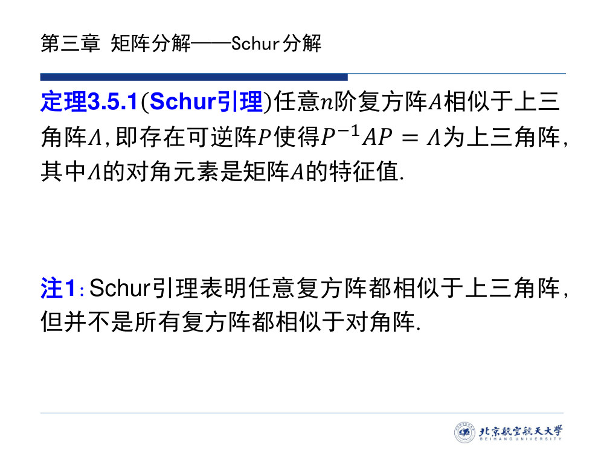

::: note 注 1（课件原文）· 三角化人人有份，对角化不是 {#note-3.5-diag}

Schur 引理表明任意复方阵都相似于上三角阵，但**并不是**所有复方阵都相似于对角阵。

（对照 [2.4](../ch02/sec24.md)：可对角化 $\iff$ 每个特征值的几何重数够用（[@thm-geom-mult]、[@thm-mult-ineq]），[@ex-jordan-three] 就是失败的样本。Schur 引理的意义在于**保底**——对角化失败时，仍有一个「对角线摆特征值、上方记余额」的标准形状可用。）
:::

课件对定理 3.5.1 只述不证。证明很短、且是后面一切的地基，本编补出——策略是**对阶数归纳，每一步吃掉一个特征向量**：

::: proof 证明（课件未给，本编补：归纳，每步吃掉一个特征向量）

**奠基**：$n=1$ 时 $A=[\lambda_1]$ 已是上三角。

**归纳步**：设结论对 $n-1$ 阶成立。取 $A$ 的一个特征值 $\lambda_1$ 及特征向量 $\boldsymbol{x}_1\neq\boldsymbol{0}$（复方阵的特征多项式在 $\mathbb C$ 上必有根——代数基本定理）。把 $\boldsymbol{x}_1$ 扩充为 $\mathbb C^n$ 的一组基（[@cor-1.3.1]），拼成可逆阵 $P_1=[\boldsymbol{x}_1,\cdots]$。则

$$P_1^{-1}AP_1=\begin{bmatrix}\lambda_1&\boldsymbol{\beta}\\ \boldsymbol{0}&A_1\end{bmatrix},$$

（第一列：$A\boldsymbol{x}_1=\lambda_1\boldsymbol{x}_1$，两边左乘 $P_1^{-1}$ 得 $\lambda_1\boldsymbol{e}_1$。）由归纳假设，存在 $n-1$ 阶可逆阵 $Q$ 使 $Q^{-1}A_1Q=\Lambda_1$ 为上三角。令

$$P=P_1\begin{bmatrix}1&\boldsymbol{0}\\ \boldsymbol{0}&Q\end{bmatrix}\quad(\text{可逆})，$$

则

$$P^{-1}AP=\begin{bmatrix}1&\boldsymbol{0}\\ \boldsymbol{0}&Q^{-1}\end{bmatrix}\begin{bmatrix}\lambda_1&\boldsymbol{\beta}\\ \boldsymbol{0}&A_1\end{bmatrix}\begin{bmatrix}1&\boldsymbol{0}\\ \boldsymbol{0}&Q\end{bmatrix}
=\begin{bmatrix}\lambda_1&\boldsymbol{\beta}Q\\ \boldsymbol{0}&\Lambda_1\end{bmatrix}$$

是上三角阵，且对角元 $=\lambda_1$ 拼上 $\Lambda_1$ 的对角元（$=A_1$ 的特征值）。

**对角元确是 $A$ 的特征值**：分块三角阵的特征多项式按行列式拆开 $f_A(\lambda)=(\lambda-\lambda_1)f_{A_1}(\lambda)$，而相似不改特征多项式（[@thm-sim-invariants]），故对角元全体（计重数）恰为 $A$ 的特征值。∎
:::

定理 3.5.1 里的 $P$ 只保证可逆。Schur 的第二步把它升级成酉——形式上只换一个词，威力却大得多：

::: thm 定理 3.5.2 · Schur 引理（酉相似版本）{#thm-3.5.2}

任意复方阵 $A$ 酉相似于上三角阵 $\Lambda$，即存在酉矩阵 $U$ 使得

$$U^{\mathrm H}AU=\Lambda$$

为上三角阵。
:::

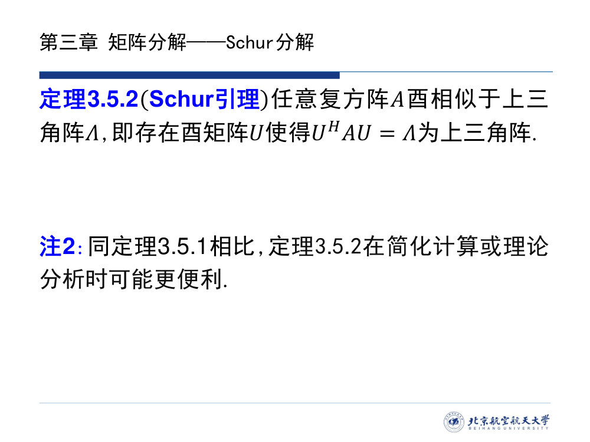

::: note 注 2（课件原文）· 酉版本更便利 {#note-3.5-unitary-why}

同定理 3.5.1 相比，定理 3.5.2 在简化计算或理论分析时可能更便利。

（本编补一句「便利」在哪：可逆阵 $P$ 的列可以病态地接近相关——数值上乘 $P^{-1}$ 会放大误差；酉矩阵保范数、条件数为 $1$，乘它**不放大任何向量的长度**。所以数值线性代数的祖训是「能用酉就不用一般可逆」——[3.4](sec34.md) 的 QR 算法收敛到 Schur 型、而不是随便什么相似标准形，正是这条祖训的体现。）
:::

::: proof 证明（课件路线：对 $P$ 作 QR 分解；本编补齐代数）

对定理 3.5.1 中的可逆阵 $P$ 作 QR 分解（[@thm-3.4.1]）：

$$P=UR,$$

式中 $U$ 是酉矩阵，$R$ 为正线上三角矩阵。将 $P=UR$（即 $P^{-1}=R^{-1}U^{\mathrm H}$）代入 $P^{-1}AP=\Lambda$：

$$R^{-1}U^{\mathrm H}AU R=\Lambda\quad\Longrightarrow\quad U^{\mathrm H}AU=R\Lambda R^{-1}.$$

由于 $R$、$R^{-1}$ 和 $\Lambda$ 均为上三角阵，而上三角阵对乘法与求逆封闭（按行归纳可证：上三角之积仍上三角；可逆上三角之逆仍上三角），故 $R\Lambda R^{-1}$ 是上三角阵。∎

**读法**：普通相似 $P^{-1}AP$ 换成 $P=UR$ 后，$R$ 从两侧把 $\Lambda$ **夹**住——「夹」不破三角性。于是「相似于上三角」免费升级为「**酉**相似于上三角」。（不经 3.5.1、直接用「单位特征向量 $+$ Gram–Schmidt 扩充」归纳构造 $U$ 也行，见习题 B15。）
:::

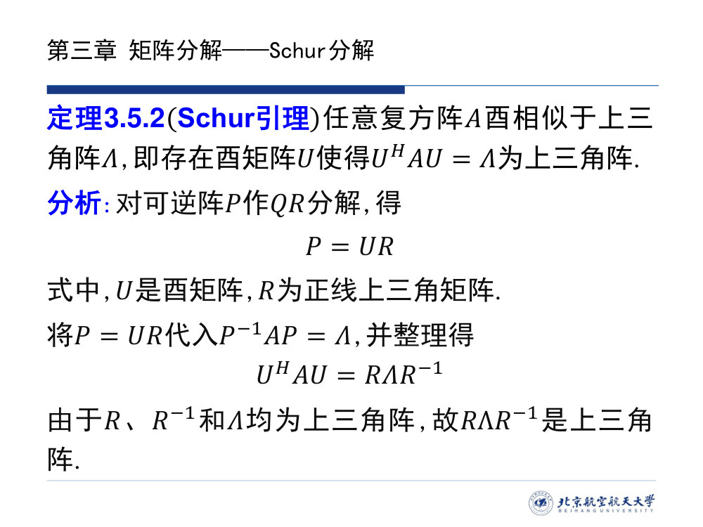

### 实矩阵的边界

课件接着问了一个精确的问题：**是否存在正交阵 $Q$ 使得实阵 $A$ 满足 $Q^{\mathrm T}AQ=\Lambda$（上三角）？** 答案是否定的，反例就是二维旋转：

::: proof 反例分析（课件原文）

取 $A=\begin{bmatrix}0&-1\\ 1&0\end{bmatrix}$（实矩阵）。其特征多项式

$$f_A(\lambda)=\lambda^2+1=0$$

解得 $\lambda=\pm\mathrm i$ 是 $A$ 的特征值。若存在实正交阵 $Q$ 使得 $Q^{\mathrm T}AQ=\Lambda$ 为上三角阵，则 $\Lambda$ 作为**实矩阵的乘积必为实阵**，实上三角阵的特征值（即其对角元）全为实数；但相似不改特征值（[@thm-sim-invariants]），$\Lambda$ 的特征值应为 $\pm\mathrm i$——**非实数**，矛盾。故不存在这样的正交阵 $Q$。

（换个角度读：若存在 $Q$，则 $Q^{\mathrm T}AQ$ 必为实阵；而 $\Lambda$ 为非实矩阵时，不存在正交阵 $Q$。）∎
:::

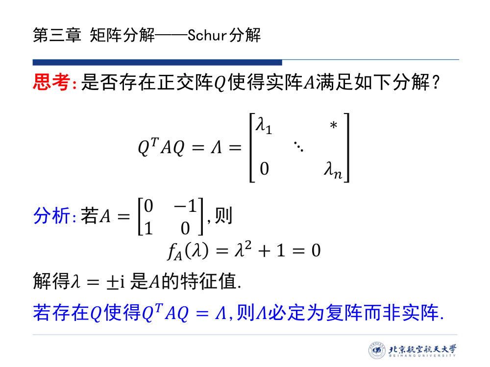

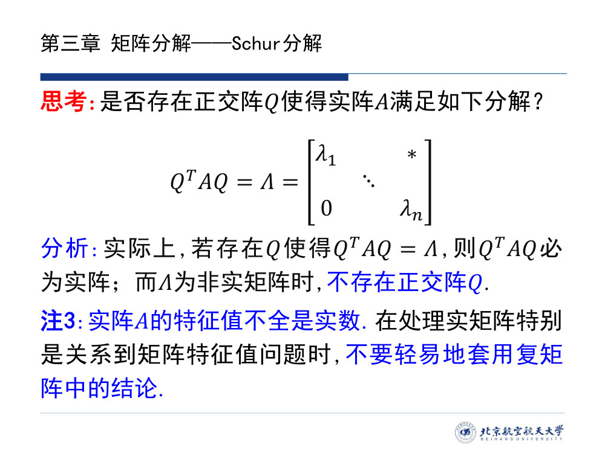

::: note 注 3（课件原文）· 实阵警告 {#note-3.5-real-warn}

实阵 $A$ 的特征值不全是实数。在处理实矩阵特别是关系到矩阵特征值问题时，**不要轻易地套用复矩阵中的结论**。

（本编注：这条警告在 [2.5](../ch02/sec25.md) 出现过一次——「正交矩阵特征值的模为 $1$，但不必是 $\pm1$」，用的正是同一个旋转阵。同一个反例在两处站岗，值得记住它。）
:::

好消息是：只要特征值**全实**，实版本照样成立：

::: thm 定理 3.5.3 · 实方阵 Schur 引理 {#thm-3.5.3}

设 $A\in\mathbb R^{n\times n}$ 的特征值均为实数，则存在正交矩阵 $Q$ 使得

$$Q^{\mathrm T}AQ=Q^{-1}AQ=\begin{bmatrix}\lambda_1&&\ast\\ &\ddots&\\ \boldsymbol{0}&&\lambda_n\end{bmatrix}$$

为上三角阵。
:::

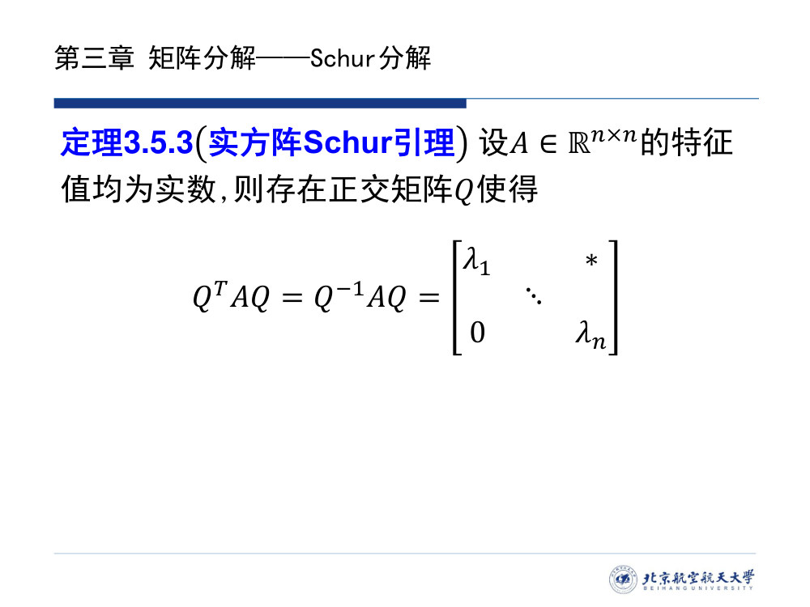

::: proof 证明（课件未给，本编补：归纳全程在实数域内运行）

把定理 3.5.1 的归纳证明逐句搬到实数域：每一步取的**特征值是实的**（前提），而实系数齐次方程组 $(A-\lambda I)\boldsymbol{x}=\boldsymbol{0}$ 有非零实解（系数矩阵奇异、实数域上即可解出），故特征向量可取**实的**；基扩充（[@cor-1.3.1]）也在实数域内完成。于是得到**实**可逆阵 $P$ 与实上三角 $\Lambda$ 使 $P^{-1}AP=\Lambda$。再照抄定理 3.5.2 的收尾：对实可逆阵 $P$ 作 QR 分解 $P=QR$（[@thm-3.4.1] 的实数版本——存在性证明逐字适用于 $\mathbb R$），$Q$ 正交、$R$ 实正线上三角，则

$$Q^{\mathrm T}AQ=R\Lambda R^{-1}$$

仍为实上三角阵。∎
:::

## 3.5.2 矩阵多项式与谱映射

Schur 型的第一笔红利：算**矩阵多项式**的特征值。

::: def 定义 3.5.1 · 矩阵多项式 {#def-3.5.1}

设 $A\in\mathbb C^{n\times n}$，定义数域 $\mathbb C$ 上的多项式

$$\varphi(\lambda)=a_n\lambda^n+a_{n-1}\lambda^{n-1}+\cdots+a_1\lambda+a_0,\qquad a_i\in\mathbb C,\ i=0,1,\cdots,n,$$

则

$$\varphi(A)=a_nA^n+a_{n-1}A^{n-1}+\cdots+a_1A+a_0I$$

称为**矩阵多项式**。
:::

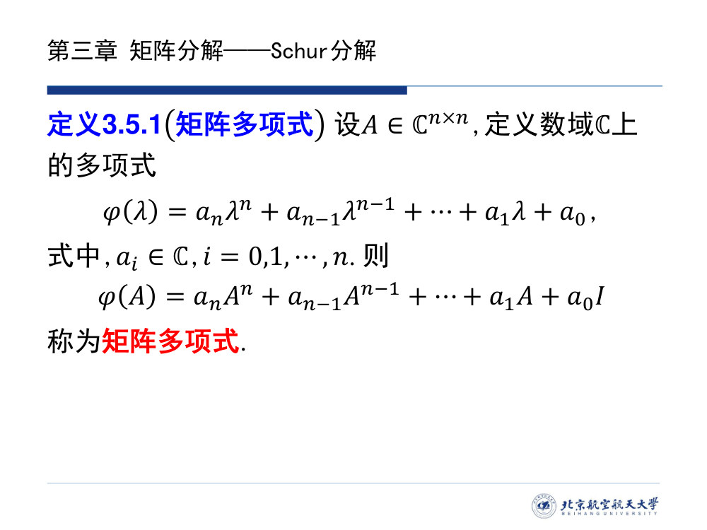

（本编注两件事：① 常数项必须补成 $a_0I$——多项式里的「$1$」在矩阵世界是单位阵，漏写 $I$ 是新手高频错误；② $\varphi(A)$ 是 $A$ 的多项式，自然与 $A$ 可交换（$A\cdot A^k=A^k\cdot A$），这条不起眼的性质在后面「按次序乘因子」的证明里是背景前提。）

::: cor 推论 3.5.1 · 谱映射 {#cor-3.5.1}

设复方阵 $A$ 的 $n$ 个特征值为 $\lambda_1,\cdots,\lambda_n$，$\varphi(\lambda)$ 为任一多项式，则 $\varphi(A)$ 的 $n$ 个特征值为 $\varphi(\lambda_1),\cdots,\varphi(\lambda_n)$；特别地，$A^m$ 的 $n$ 个特征值为 $\lambda_1^m,\cdots,\lambda_n^m$，$m\in\mathbb N$。
:::

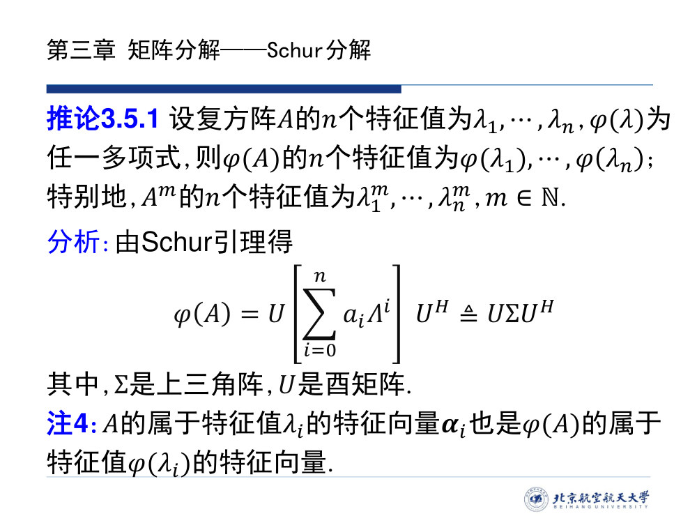

::: proof 证明（课件路线：Schur 型上一算）

由定理 3.5.2 取酉阵 $U$ 使 $U^{\mathrm H}AU=\Lambda$ 上三角，则 $A=U\Lambda U^{\mathrm H}$，且对每个 $k\ge1$，$A^k=U\Lambda^kU^{\mathrm H}$（中间的 $U^{\mathrm H}U$ 逐对相消）。于是

$$\varphi(A)=U\Big(\sum_{i=0}^{n}a_i\Lambda^i\Big)U^{\mathrm H}\triangleq U\Sigma U^{\mathrm H},$$

其中 $\Sigma=\sum_i a_i\Lambda^i$ 是**上三角阵**（上三角的幂与线性组合仍上三角），$U$ 是酉矩阵。上三角幂的对角元 $=$ 对角元的幂（归纳一行：上三角元 $(\Lambda^k)_{jj}=\lambda_j^k$，非对角元怎么填都不影响对角线），故 $\Sigma$ 的对角元为 $\varphi(\lambda_1),\cdots,\varphi(\lambda_n)$——这既是 $\Sigma$ 的特征值，也是与 $\Sigma$ 相似的 $\varphi(A)$ 的特征值（[@thm-sim-invariants]）。∎
:::

（读法对照：[2.4](../ch02/sec24.md) 的「幂与逆的特征值」（[@thm-eig-power]）是本推论的两个特款（$\varphi(\lambda)=\lambda^m$）。「逆」那条乍看不在多项式框架里——$1/\lambda$ 不是多项式；但 $A$ 可逆时 $A^{-1}$ 可以写成 $A$ 的多项式（推论 3.5.2 正是这个公式），于是也被覆盖。散装的结论被一个框架收编，这是本节的典型节奏。）

::: note 注 4（课件原文）· 特征向量也继承 {#note-3.5-eigvec}

$A$ 的属于特征值 $\lambda_i$ 的特征向量 $\boldsymbol{\alpha}_i$ 也是 $\varphi(A)$ 的属于特征值 $\varphi(\lambda_i)$ 的特征向量。

（本编补一行证明与一句提醒：$A\boldsymbol{\alpha}=\lambda\boldsymbol{\alpha}\Rightarrow A^k\boldsymbol{\alpha}=\lambda^k\boldsymbol{\alpha}\Rightarrow\varphi(A)\boldsymbol{\alpha}=\varphi(\lambda)\boldsymbol{\alpha}$。**只有一个方向**——反向不成立：$\varphi$ 会把不同特征值黏在一起，例如 $\lambda_1=1,\lambda_2=-1$、$\varphi(\lambda)=\lambda^2$ 时 $\varphi(A)=A^2$ 的特征值是 $1,1$，特征向量一大片，但它们未必是 $A$ 的特征向量。「$\varphi$ 磨掉了多少信息」这件事，[3.5.4](#sec-3.5.4) 的最小多项式会精确计量。）
:::

## 3.5.3 Hamilton–Cayley 定理：特征多项式零化自己

谱映射把 $\lambda$ 换成 $\lambda_i$；现在取 $\varphi=f_A$ 自己——由推论 3.5.1，$f_A(A)$ 的特征值是 $f_A(\lambda_1),\cdots,f_A(\lambda_n)$，全是零。课件正是用这道例题铺垫的：

::: ex 例 3.5.1（课件原文）· 求 $f_A(A)$ 的特征值 {#ex-3.5.1}

设 $f_A(\lambda)=\lambda^n+a_{n-1}\lambda^{n-1}+\cdots+a_1\lambda+a_0$ 是矩阵 $A$ 的特征多项式，求 $f_A(A)$ 的特征值。

::: sol 解答（课件路线）

设复方阵 $A$ 的 $n$ 个特征值为 $\lambda_1,\cdots,\lambda_n$，则 $f_A(A)$ 的特征值为 $f_A(\lambda_1),\cdots,f_A(\lambda_n)$（推论 3.5.1，取 $\varphi=f_A$）。又知 $\lambda_i$ 是特征方程 $f_A(\lambda)=0$ 的根，所以

$$f_A(\lambda_i)=0,\qquad\forall i .$$

$f_A(A)$ 的特征值全为零——这与「$f_A(A)=O$（零矩阵，特征值全零）」只差最后一步：特征值全零**推不出**矩阵为零（反例：$\begin{bmatrix}0&1\\ 0&0\end{bmatrix}$ 特征值全零却非零阵）。把这一步补严，就是 Hamilton–Cayley 定理的证明。∎
:::
:::

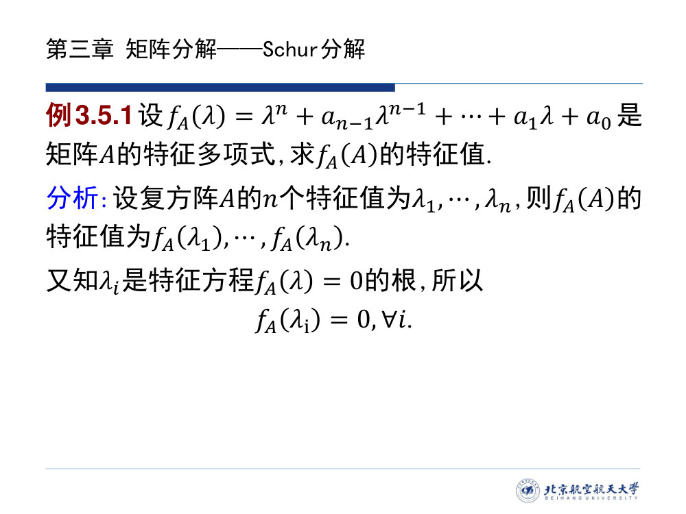

::: thm 定理 3.5.4 · Hamilton–Cayley 定理 {#thm-3.5.4}

设复方阵 $A$ 的特征多项式为 $f_A(\lambda)=\det(\lambda I-A)$，则

$$f_A(A)=O .$$
:::

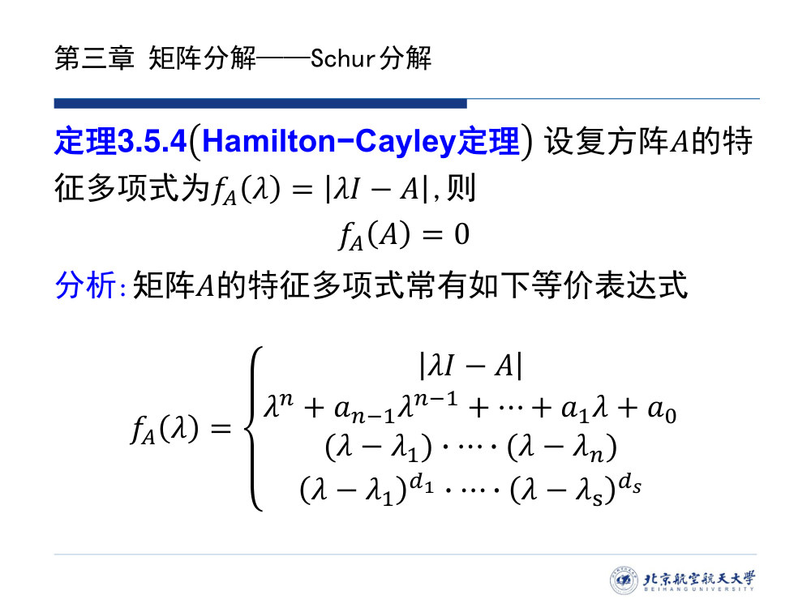

课件在「分析」里列出了特征多项式的几副面孔——$\det(\lambda I-A)=\lambda^n+a_{n-1}\lambda^{n-1}+\cdots+a_0=\prod_{i=1}^{n}(\lambda-\lambda_i)=\prod_{j=1}^{s}(\lambda-\lambda_j)^{d_j}$——但没给证明。关键在于**乘因子的次序**：

::: proof 证明（课件未给，本编补：Schur 型上按次序乘因子、逐列清零）

取 Schur 分解 $A=U\Lambda U^{\mathrm H}$（[@thm-3.5.2]）。则 $f_A(A)=U\,f_A(\Lambda)\,U^{\mathrm H}$（与推论 3.5.1 同一计算），于是只需证

$$f_A(\Lambda)=\prod_{i=1}^{n}(\Lambda-\lambda_i I)=O .$$

**按次序**定义部分积：$B_k=(\Lambda-\lambda_kI)(\Lambda-\lambda_{k-1}I)\cdots(\Lambda-\lambda_1I)$。断言：$B_k$ 的前 $k$ 列全为零，对 $k$ 归纳。

- **$k=1$**：$\Lambda$ 上三角 $\Rightarrow$ 第一列只有对角元 $\lambda_1$，故 $(\Lambda-\lambda_1I)\boldsymbol{e}_1=\boldsymbol{0}$；
- **$k\Rightarrow k+1$**：$B_{k+1}=B_k(\Lambda-\lambda_{k+1}I)$。对 $j\le k+1$：$\Lambda\boldsymbol{e}_j\in\operatorname{span}\{\boldsymbol{e}_1,\cdots,\boldsymbol{e}_j\}$（上三角！），减去 $\lambda_{k+1}\boldsymbol{e}_j$ 后，$\boldsymbol{e}_j$ 上的系数是 $\lambda_j-\lambda_{k+1}$——当 $j=k+1$ 时**恰好为零**。故 $(\Lambda-\lambda_{k+1}I)\boldsymbol{e}_j\in\operatorname{span}\{\boldsymbol{e}_1,\cdots,\boldsymbol{e}_{k}\}$（$j=k+1$）或 $\operatorname{span}\{\boldsymbol{e}_1,\cdots,\boldsymbol{e}_j\}\subseteq\operatorname{span}\{\boldsymbol{e}_1,\cdots,\boldsymbol{e}_k\}$（$j\le k$），两种情形都被归纳假设（$B_k$ 杀掉前 $k$ 个基向量）清零。

归纳到 $k=n$：$B_n=f_A(\Lambda)$ 的每一列皆零。∎

**为什么必须这么小心**：只验「$f_A(\Lambda)$ 对角元全零」（推论 3.5.1 的结论）是不够的——对角全零的上三角阵可以非零（例 3.5.1 结尾那个反例）。上面证明的心脏是**把因子按 $\lambda_1,\lambda_2,\cdots$ 的次序从右往左乘**，让第 $k$ 个因子恰好清掉第 $k$ 列：因子次序换乱，论证就散架（好在矩阵多项式里各因子 $(\Lambda-\lambda_iI)$ 两两可交换——它们都是 $\Lambda$ 的多项式——所以「$f_A(\Lambda)$」这个记号本身没有歧义，需要次序的只是**证明**）。
:::

H–C 定理的第一个用途是**把高次幂降次**。课件的标准姿势是带余除法（[@thm-2.1.3]）：

::: ex 例 3.5.2（课件原文）· 用带余除法计算矩阵多项式 {#ex-3.5.2}

已知 $A=\begin{bmatrix}-1&-2&6\\ -1&0&3\\ -1&-1&4\end{bmatrix}$，计算 $A^4-2A^2+I$。

::: sol 解答（课件路线；$f_A$ 与 $(A-I)^2$ 的验算由本编补）

**特征多项式**：$f_A(\lambda)=(\lambda-1)^3$（展开 $\lambda^3-3\lambda^2+3\lambda-1$；两个快验证：$\operatorname{tr}A=-1+0+4=3=3\times1$ ✓，$\det A=1=1^3$ ✓）。

**带余除法**：令 $g(\lambda)=\lambda^4-2\lambda^2+1$。除以 $f_A(\lambda)$：

$$g(\lambda)=f_A(\lambda)\,(\lambda+3)+4(\lambda-1)^2,$$

（验算：$f_A(\lambda)(\lambda+3)+4(\lambda-1)^2=(\lambda-1)^2\big[(\lambda-1)(\lambda+3)+4\big]=(\lambda-1)^2(\lambda^2+2\lambda+1)=(\lambda-1)^2(\lambda+1)^2=g(\lambda)$ ✓。）

**代入**：由 H–C 定理 $f_A(A)=O$，

$$g(A)=\underbrace{f_A(A)}_{=O}(A+3I)+4(A-I)^2=4(A-I)^2 .$$

**直接计算 $(A-I)^2$**：

$$A-I=\begin{bmatrix}-2&-2&6\\ -1&-1&3\\ -1&-1&3\end{bmatrix},\qquad
(A-I)^2=O .$$

（一眼看法：$A-I$ 的三行都成比例——第 $2$、$3$ 行相同、第 $1$ 行是它们的 $2$ 倍，故 $A-I=\boldsymbol{u}\,\boldsymbol{v}^{\mathrm T}$（秩 $1$），其中 $\boldsymbol{u}=(-2,-1,-1)^{\mathrm T}$、$\boldsymbol{v}=(1,1,-3)^{\mathrm T}$；而 $(A-I)^2=\boldsymbol{u}(\boldsymbol{v}^{\mathrm T}\boldsymbol{u})\boldsymbol{v}^{\mathrm T}$，$\boldsymbol{v}^{\mathrm T}\boldsymbol{u}=-2-1+3=0$，故平方为零。）因此

$$g(A)=A^4-2A^2+I=O .$$
:::
:::

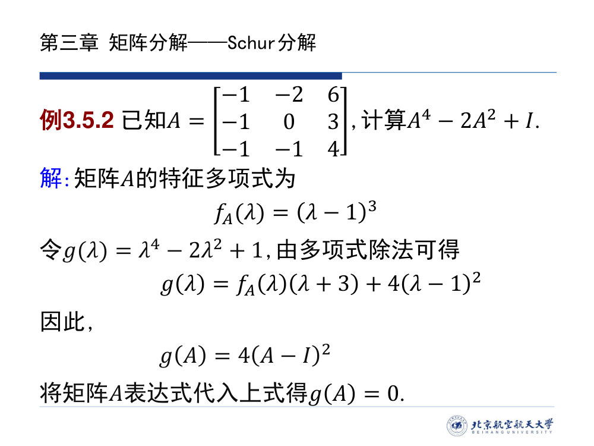

第二个用途把「求逆」变成「算多项式」：

::: cor 推论 3.5.2 · 逆矩阵的多项式公式 {#cor-3.5.2}

设复方阵 $A$ 可逆，其特征多项式为 $f_A(\lambda)=\lambda^n+a_{n-1}\lambda^{n-1}+\cdots+a_1\lambda+a_0$，则矩阵 $A$ 的逆矩阵计算公式为

$$A^{-1}=-\frac{1}{a_0}\Big(A^{n-1}+a_{n-1}A^{n-2}+\cdots+a_1I\Big).$$
:::

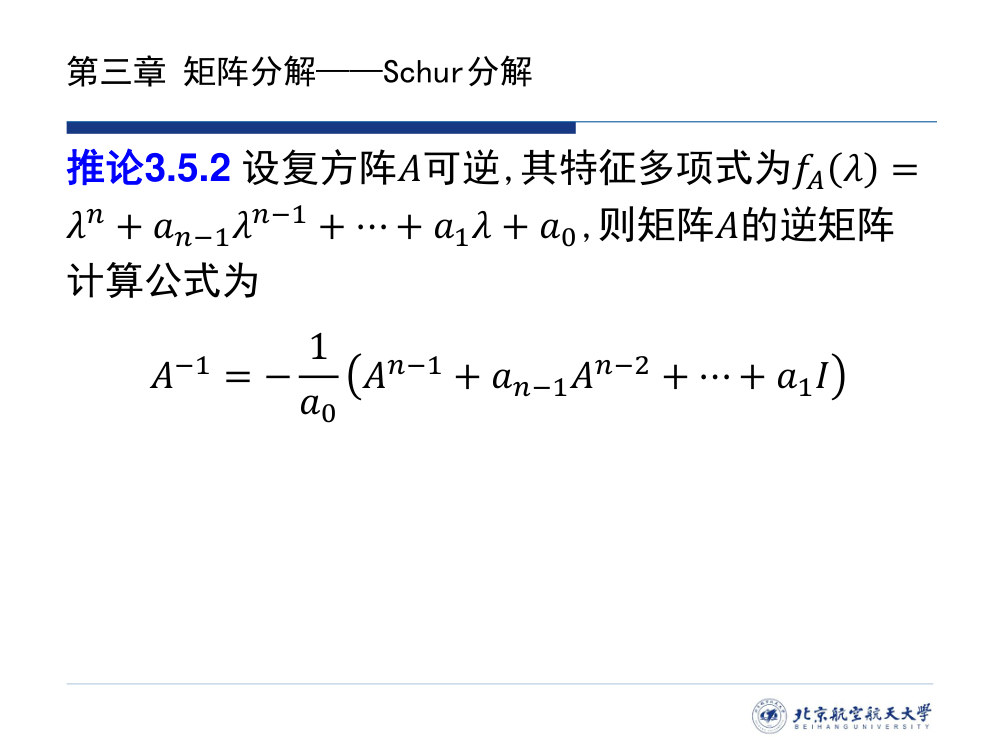

::: proof 证明（课件未给，本编补）

H–C 定理给出

$$A^n+a_{n-1}A^{n-1}+\cdots+a_1A+a_0I=O\quad\Longrightarrow\quad
A\Big(A^{n-1}+a_{n-1}A^{n-2}+\cdots+a_1I\Big)=-a_0I .$$

其中 $a_0=f_A(0)=\det(-A)=(-1)^n\det A$（$\lambda=0$ 代入），故 **$A$ 可逆 $\iff a_0\neq0$**（行列式 $=$ 特征值之积，[@thm-eig-trace]）。两边乘 $-\dfrac{1}{a_0}$：

$$A\cdot\Big[-\frac{1}{a_0}\big(A^{n-1}+a_{n-1}A^{n-2}+\cdots+a_1I\big)\Big]=I,$$

方阵情形单侧逆即逆（[3.1](sec31.md) 注 1），中括号里的矩阵就是 $A^{-1}$。∎

（读法：**$A^{-1}$ 是 $A$ 的多项式**——这补上了 [3.5.2](#sec-3.5.2) 讨论谱映射时留的口子：$\lambda\mapsto1/\lambda$ 不是多项式，但 $A\mapsto A^{-1}$ 仍是「矩阵多项式能表达的运算」。）
:::

::: ex 例 3.5.3（课件原文，含连锁笔误，见 E3.5）· 用公式求逆 {#ex-3.5.3}

求矩阵 $A=\begin{bmatrix}1&1&0\\ 0&1&1\\ 0&0&1\end{bmatrix}$ 的逆。

::: sol 解答（课件路线；因课件特征多项式符号连环出错，本编按重算版本演算，对照见勘误 E3.5）

**特征多项式**：上三角阵的对角元全为 $1$，故 $f_A(\lambda)=(\lambda-1)^3=\lambda^3-3\lambda^2+3\lambda-1$（课件印作 $\lambda^3+3\lambda^2+3\lambda+1$，符号全错——那是 $(\lambda+1)^3$ 的展开）。

**代公式**（推论 3.5.2：$n=3$，$a_2=-3$，$a_1=3$，$a_0=-1\neq0$，$A$ 可逆 ✓）：

$$A^{-1}=-\frac{1}{-1}\Big(A^2-3A+3I\Big)=A^2-3A+3I .$$

**计算**：$A^2=\begin{bmatrix}1&2&1\\ 0&1&2\\ 0&0&1\end{bmatrix}$，故

$$A^{-1}=\begin{bmatrix}1&2&1\\ 0&1&2\\ 0&0&1\end{bmatrix}-\begin{bmatrix}3&3&0\\ 0&3&3\\ 0&0&3\end{bmatrix}+\begin{bmatrix}3&0&0\\ 0&3&0\\ 0&0&3\end{bmatrix}=\begin{bmatrix}1&-1&1\\ 0&1&-1\\ 0&0&1\end{bmatrix}.$$

（课件答案的 $(1,3)$ 元印作 $0$，正确值为 $1$。）

**验算**：

$$AA^{-1}=\begin{bmatrix}1&1&0\\ 0&1&1\\ 0&0&1\end{bmatrix}\begin{bmatrix}1&-1&1\\ 0&1&-1\\ 0&0&1\end{bmatrix}
=\begin{bmatrix}1&-1+1&1-1\\ 0&1&1-1\\ 0&0&1\end{bmatrix}=I\ \checkmark$$

**另一条路互相印证**：$A=I+N$，其中 $N=\begin{bmatrix}0&1&0\\ 0&0&1\\ 0&0&0\end{bmatrix}$，$N^2=\begin{bmatrix}0&0&1\\ 0&0&0\\ 0&0&0\end{bmatrix}$，$N^3=O$。套几何级数 $(1+x)^{-1}=1-x+x^2-\cdots$（此处到 $x^2$ 截断）：

$$A^{-1}=I-N+N^2=\begin{bmatrix}1&-1&1\\ 0&1&-1\\ 0&0&1\end{bmatrix}\ \checkmark$$

两条路答案一致。∎
:::
:::

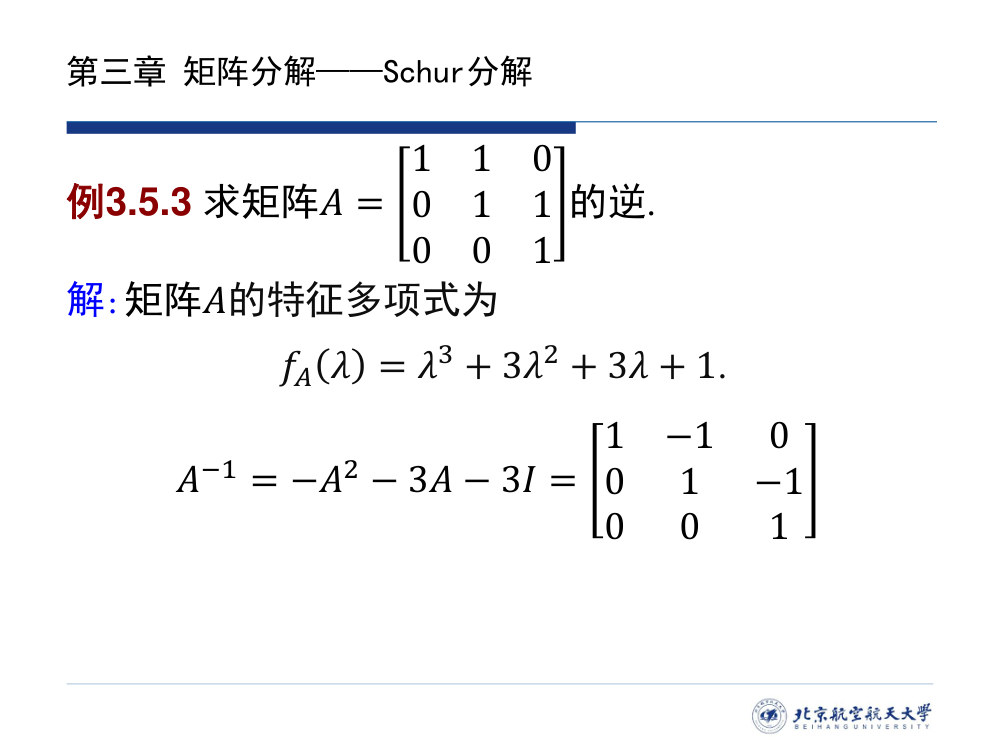

## 3.5.4 零化多项式与最小多项式

H–C 定理说 $f_A$ **零化** $A$。但例 3.5.2 里真正干活的只有 $(\lambda-1)^2$——$f_A=(\lambda-1)^3$ 里有一个因子是冗余的。把「最省的零化多项式」精确化，就是本小节的主题。

::: def 定义 3.5.2 · 零化多项式 {#def-3.5.2}

给定矩阵 $A\in\mathbb C^{n\times n}$，若存在多项式 $g(\lambda)$ 使得

$$g(A)=O,$$

则称 $g(\lambda)$ 为 $A$ 的**零化多项式**。
:::

::: def 定义 3.5.3 · 最小多项式 {#def-3.5.3}

复方阵 $A$ 的零化多项式中**最小次数**的**首 $1$** 多项式（最高次项系数为 $1$）称为矩阵 $A$ 的**最小多项式**，记为 $m_A(\lambda)$。
:::

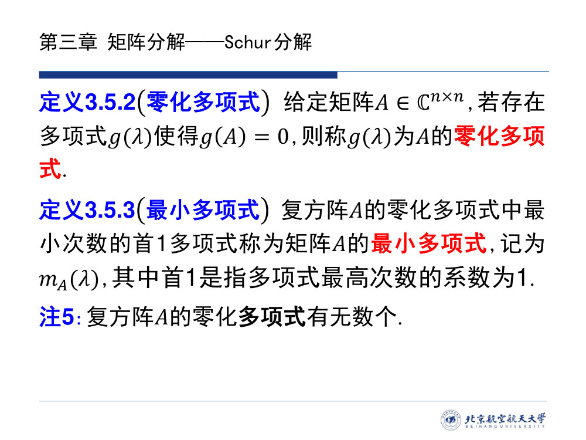

::: note 注 5（课件原文）· 零化多项式有无数个 {#note-3.5-annihil-many}

复方阵 $A$ 的零化多项式有无数个。

（本编补：若 $g$ 零化 $A$，则对任何多项式 $h$，乘积 $gh$ 也零化——$ (gh)(A)=h(A)\,g(A)=O$，因为矩阵多项式两两可交换。所以「零化多项式」是一大族，$f_A$ 只是族里被 H–C 定理点名的一个成员。）
:::

课件的思考题问得正中要害：**$A$ 的最小多项式存在吗？若存在，是 $f_A(\lambda)$ 吗？**

> 存在：零化多项式一族里至少有 $f_A$（H–C 定理），次数是非负整数、有最小值，再取首 $1$ 规约即得 $m_A$。**但不一定是 $f_A$**——反例：$A=I_2$，特征多项式 $f_A(\lambda)=(\lambda-1)^2$，而 $g(A)=A-I_2=O$，故最小多项式是 $m_A(\lambda)=\lambda-1$，比 $f_A$ 低一次。

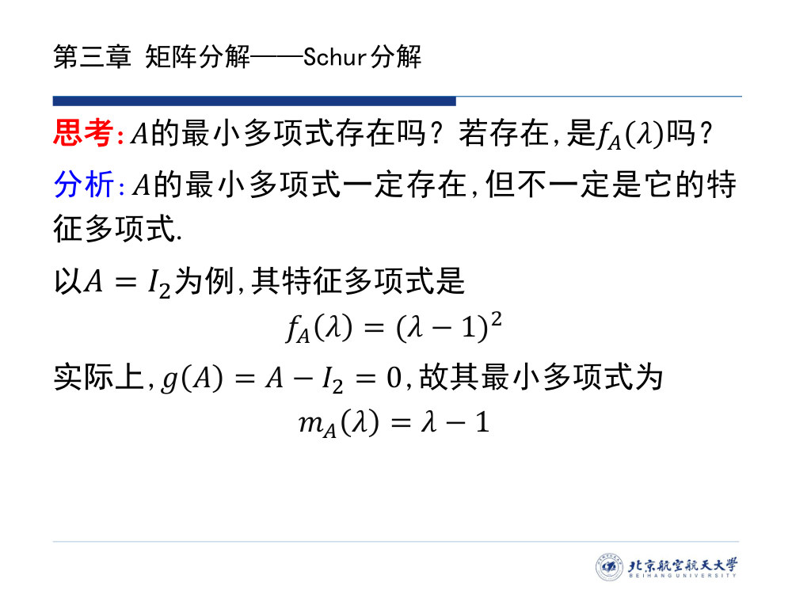

最小多项式的两条基本性质：

::: thm 定理 3.5.5 · 最小多项式的性质 {#thm-3.5.5}

设 $A\in\mathbb C^{n\times n}$，则：

（1）矩阵 $A$ 的最小多项式 $m_A(\lambda)$ 是**唯一**的，且可**整除**矩阵 $A$ 的任一零化多项式。特别地，有 $m_A(\lambda)\mid f_A(\lambda)$；

（2）矩阵 $A$ 的特征多项式 $f_A(\lambda)$ 与最小多项式 $m_A(\lambda)$ 具有**相同的根**（不计重数）。
:::

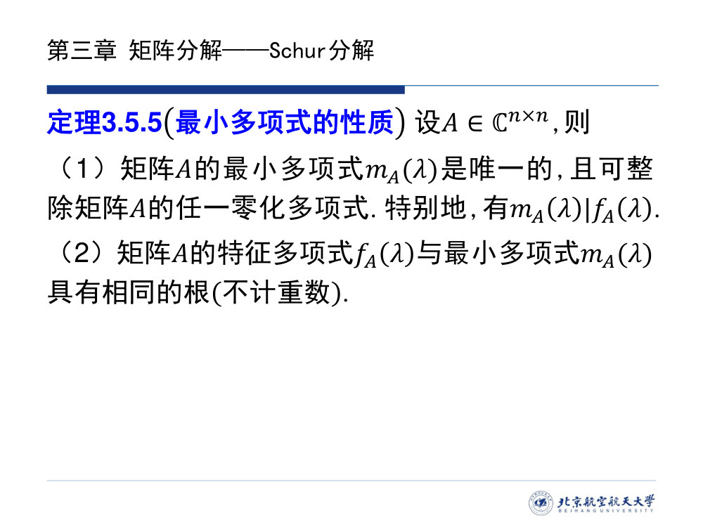

::: proof 证明（课件未给，本编补：带余除法 $+$ 特征向量继承）

**（1）整除**：设 $g$ 是 $A$ 的任一零化多项式。带余除法（[@thm-2.1.3]）：

$$g(\lambda)=q(\lambda)\,m_A(\lambda)+r(\lambda),\qquad \deg r<\deg m_A\ (\text{或 }r=0).$$

代入矩阵：$O=g(A)=\underbrace{q(A)m_A(A)}_{=O}+r(A)$，故 $r(A)=O$。若 $r\neq0$，$r$ 就是比 $m_A$ 次数更低的零化多项式——与 $m_A$ 的最小性矛盾。故 $r=0$，$m_A\mid g$。取 $g=f_A$（H–C）得 $m_A\mid f_A$。

**唯一**：若 $m_1$、$m_2$ 都是「次数最小的首一零化多项式」，则由整除性 $m_1\mid m_2$ 且 $m_2\mid m_1$；两者同次又都首 $1$，只能相等。

**（2）同根**：「$m_A$ 的根都是 $f_A$ 的根」由 $m_A\mid f_A$ 直接给出。反向：设 $\lambda_0$ 是 $f_A$ 的根，即 $\lambda_0$ 是 $A$ 的特征值，取特征向量 $\boldsymbol{\alpha}\neq\boldsymbol{0}$。由注 4 的继承性（[@note-3.5-eigvec]）：

$$\boldsymbol{0}=m_A(A)\boldsymbol{\alpha}=m_A(\lambda_0)\boldsymbol{\alpha}\quad\Longrightarrow\quad m_A(\lambda_0)=0,$$

即 $\lambda_0$ 也是 $m_A$ 的根。∎

（第二问的三行证明全靠注 4「特征向量继承」——那是 [3.5.2](#sec-3.5.2) 埋下的回收。）
:::

::: method 求最小多项式：候选法（本编整理自例 3.5.4）{#method-minpoly}

1. **算出 $f_A(\lambda)$ 并因式分解**：$f_A(\lambda)=\prod_j(\lambda-\lambda_j)^{d_j}$；
2. **列候选**：由定理 3.5.5，$m_A$ 与 $f_A$ 同根且 $m_A\mid f_A$，故 $m_A$ 只能形如 $\prod_j(\lambda-\lambda_j)^{e_j}$，$1\le e_j\le d_j$——共 $\prod_j d_j$ 个候选；
3. **从低次到高次试算**：逐个代入检验 $g(A)\stackrel{?}{=}O$，**第一个**通过的即为 $m_A$（低次通过则高次必通过——零化多项式对乘法封闭，所以次序不能反）。
:::

::: ex 例 3.5.4（课件原文）· 候选法求最小多项式 {#ex-3.5.4}

求矩阵 $A=\begin{bmatrix}2&-2&2\\ -2&-1&4\\ 2&4&-1\end{bmatrix}$ 的最小多项式。

::: sol 解答（课件路线；$f_A$ 的验算由本编补）

**特征多项式**：$f_A(\lambda)=(\lambda-3)^2(\lambda+6)$（两个快验证：$\operatorname{tr}A=2-1-1=0=3+3-6$ ✓；$\det A=-54=3\times3\times(-6)$ ✓）。

**列候选**：由定理 3.5.5（2），$m_A$ 的根集 $=\{3,-6\}$；由（1），$m_A\mid f_A$。候选只有两个：

$$(\lambda-3)(\lambda+6)\qquad\text{或}\qquad(\lambda-3)^2(\lambda+6).$$

**从低往高试**：计算

$$(A-3I)(A+6I)=O,$$

（一行验算：$A-3I=\begin{bmatrix}-1&-2&2\\ -2&-4&4\\ 2&4&-4\end{bmatrix}$ 三行成比例（$r_3=-r_2=2r_1$），$A+6I=\begin{bmatrix}8&-2&2\\ -2&5&4\\ 2&4&5\end{bmatrix}$；$A-3I$ 的第一行 $(-1,-2,2)$ 乘 $A+6I$ 三个列：$(-8+4+4,\ 2-10+8,\ -2-8+10)=(0,0,0)$ ✓，其余行是它的倍数。）故低次候选已零化，因此

$$m_A(\lambda)=(\lambda-3)(\lambda+6).$$
:::
:::

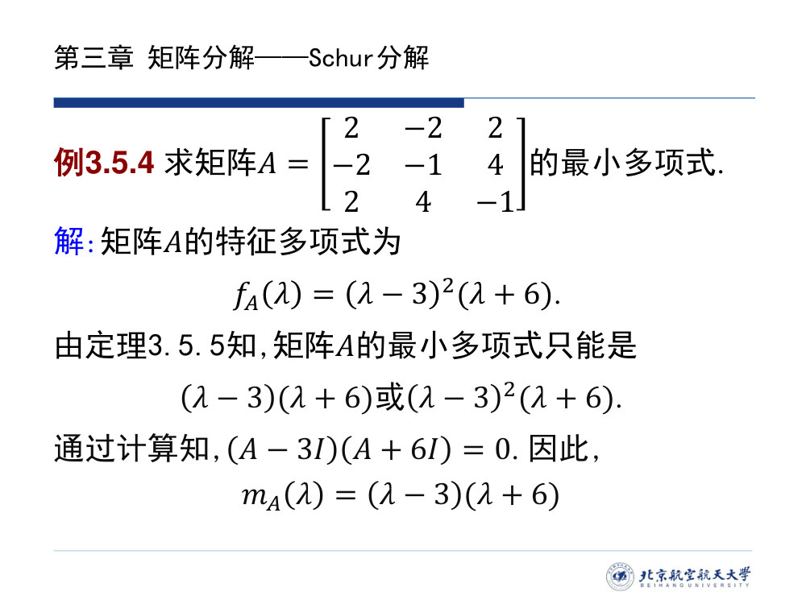

（对比一下「赢在低次」的反面教材——几何重数不足时，低次候选会被淘汰，最小多项式被迫带重因子。看 [@ex-3.5.B]。）

::: ex 例 3.5.B（新增）· 低次候选被淘汰：最小多项式带重因子 {#ex-3.5.B}

求 $A=\begin{bmatrix}2&1&0\\ 0&2&0\\ 0&0&3\end{bmatrix}$ 的最小多项式。

::: sol 解答

**特征多项式**（分块三角，行列式拆开）：$f_A(\lambda)=(\lambda-2)^2(\lambda-3)$。

**候选**：$(\lambda-2)(\lambda-3)$ 或 $(\lambda-2)^2(\lambda-3)$。

**试低次**：

$$A-2I=\begin{bmatrix}0&1&0\\ 0&0&0\\ 0&0&1\end{bmatrix},\qquad A-3I=\begin{bmatrix}-1&1&0\\ 0&-1&0\\ 0&0&0\end{bmatrix},$$

$$(A-2I)(A-3I)\ \text{的第一行}=(A-3I)\ \text{的第二行}=(0,-1,0)\neq\boldsymbol{0},$$

——低次候选落选。**试高次**：

$$(A-2I)^2=\begin{bmatrix}0&0&0\\ 0&0&0\\ 0&0&1\end{bmatrix},\qquad
(A-2I)^2(A-3I)=\begin{bmatrix}0&0&0\\ 0&0&0\\ 0&0&1\end{bmatrix}\begin{bmatrix}-1&1&0\\ 0&-1&0\\ 0&0&0\end{bmatrix}=O\ \checkmark$$

故 $m_A(\lambda)=(\lambda-2)^2(\lambda-3)$。

**为什么必须带重因子**：$\lambda=2$ 的特征子空间 $N(A-2I)$ 由 $\boldsymbol{e}_1$ 一维张成（解 $(A-2I)\boldsymbol{x}=\boldsymbol{0}$：$x_2=0$、$x_3=0$），几何重数 $1<$ 代数重数 $2$（[@thm-geom-mult]）——正是 [@ex-jordan-three] 型的「亏欠」。最小多项式里 $(\lambda-2)$ 的指数恰好记下这笔账：**每个特征值在 $m_A$ 中的重数 $=$ 其最大 Jordan 块的阶数**（最后这句是后续课程的语言，超出本课程范围，记个印象即可）。∎
:::
:::

有了最小多项式，例 3.5.2 可以做得更省——课件自己回来重做了一遍：

::: ex 例 3.5.2 续（课件原文）· 用最小多项式重做例 3.5.2 {#ex-3.5.2b}

已知 $A=\begin{bmatrix}-1&-2&6\\ -1&0&3\\ -1&-1&4\end{bmatrix}$，求 $A^4-2A^2+I$。

::: sol 解答（课件路线）

**先求 $m_A$**：由 $f_A(\lambda)=(\lambda-1)^3$ 知，$m_A$ 只能是 $\lambda-1$、$(\lambda-1)^2$ 或 $(\lambda-1)^3$。显然 $A\neq I$（排除第一个）；又例 3.5.2 已算出 $(A-I)^2=O$，故

$$m_A(\lambda)=(\lambda-1)^2 .$$

**再除**：令 $g(\lambda)=\lambda^4-2\lambda^2+1$，则

$$g(\lambda)=(\lambda-1)^2(\lambda+1)^2=m_A(\lambda)\,(\lambda+1)^2,$$

（验算：$(\lambda-1)^2(\lambda+1)^2=(\lambda^2-1)^2=\lambda^4-2\lambda^2+1$ ✓。）于是

$$g(A)=m_A(A)\,(A+I)^2=O\cdot(A+I)^2=O .$$

（对比：例 3.5.2 里除以 $f_A$（三次）得商 $\lambda+3$、余式 $4(\lambda-1)^2$；这里除以 $m_A$（二次）商是 $(\lambda+1)^2$——**除数更省，余式直接为零**。「先求最小多项式，再算 $g(A)$」是高阶矩阵多项式的标准工作流。）∎
:::
:::

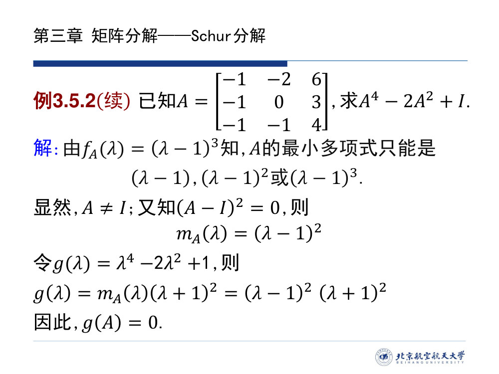

最后一类计算：**高次幂**。

::: ex 例 3.5.5（课件原文）· 用 Hamilton–Cayley 算 $A^{100}$ {#ex-3.5.5}

设 $A=\begin{bmatrix}2&1\\ 2&3\end{bmatrix}$，求 $A^{100}$。

::: sol 解答（课件路线；归纳与终值验算由本编补）

**特征多项式**：$f_A(\lambda)=(\lambda-1)(\lambda-4)$（$\operatorname{tr}A=5=1+4$ ✓，$\det A=4$ ✓）。

**降次关系**：H–C 定理给出 $(A-I)(A-4I)=O$，即

$$A^2=5A-4I .$$

**迭代归纳**：断言 $A^m=\dfrac{4^m-1}{3}A+\dfrac{4-4^m}{3}I$（$m=0,1,\cdots$）。奠基 $m=1$：$\dfrac{3}{3}A+\dfrac{0}{3}I=A$ ✓；$m=0$：$0\cdot A+\dfrac{3}{3}I=I$ ✓。归纳步：

$$A^{m+1}=A\cdot A^m=\frac{4^m-1}{3}A^2+\frac{4-4^m}{3}A=\frac{4^m-1}{3}(5A-4I)+\frac{4-4^m}{3}A=\frac{4\cdot4^m-1}{3}A-\frac{4^{m+1}-4}{3}I,$$

整理正是 $m+1$ 的公式 ✓。

**代 $m=100$**：

$$A^{100}=\begin{bmatrix}\dfrac{4^{100}+2}{3}&\dfrac{4^{100}-1}{3}\\[8pt] \dfrac{2(4^{100}-1)}{3}&\dfrac{2\cdot4^{100}+1}{3}\end{bmatrix}.$$

（逐项验算：$(1,1)$ 元 $=\dfrac{2(4^{100}-1)+(4-4^{100})}{3}=\dfrac{4^{100}+2}{3}$ ✓；$(2,2)$ 元 $=\dfrac{3(4^{100}-1)+(4-4^{100})}{3}=\dfrac{2\cdot4^{100}+1}{3}$ ✓。本编数值复核：双精度下上式与 $A^{100}$ 逐位一致 ✓。）

**另一条路对照**：$A$ 实对称，$f_A$ 无重根 $\Rightarrow$ 可对角化（[@thm-eig-independent] 型论证），$\boldsymbol{q}_1=\tfrac{1}{\sqrt2}(1,1)^{\mathrm T}$（$\lambda=4$）、$\boldsymbol{q}_2=\tfrac{1}{\sqrt2}(1,-1)^{\mathrm T}$（$\lambda=1$），$Q^{\mathrm T}AQ=\operatorname{diag}(4,1)$，于是 $A^{100}=Q\operatorname{diag}(4^{100},1)Q^{\mathrm T}$——答案相同。**H–C 递推的路不要求可对角化**（本例恰好可对角化，但例 3.5.2 型矩阵就得靠它），适用面更宽。∎
:::
:::

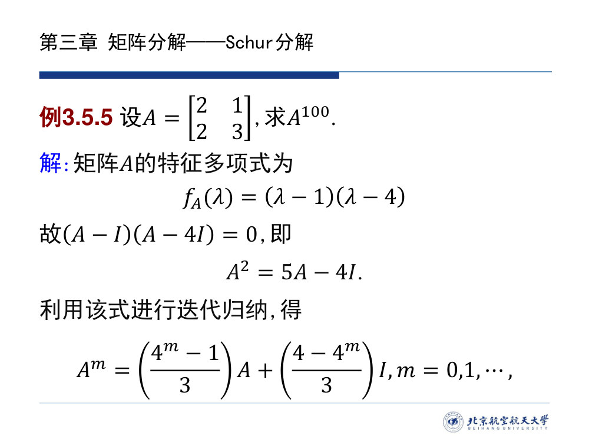

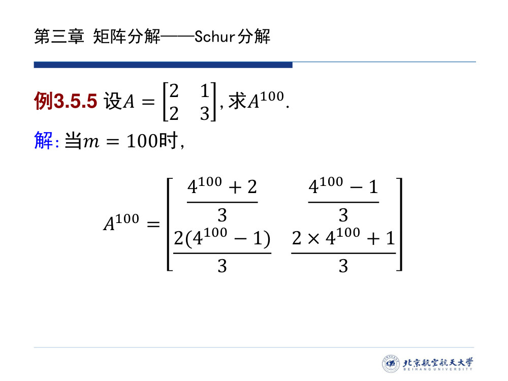

::: ex 例 3.5.A（新增）· 高次幂的两条路并排走一遍 {#ex-3.5.A}

设 $A=\begin{bmatrix}1&2\\ 2&1\end{bmatrix}$，分别用「Hamilton–Cayley 递推」与「正交对角化」两条路求 $A^{10}$，并核对一致。

::: sol 解答

**路一（H–C 递推）**：$f_A(\lambda)=\lambda^2-2\lambda-3=(\lambda-3)(\lambda+1)$，故 $A^2=2A+3I$，且任何 $A^m=\alpha_mA+\beta_mI$（每次遇 $A^2$ 就用 $2A+3I$ 顶回去）。$\alpha_m$、$\beta_m$ 用「在特征值处定系数」最快：选它们使 $h(\lambda)=\lambda^m-\alpha_m\lambda-\beta_m$ 在 $\lambda=3$ 与 $\lambda=-1$ 处都为零——则 $f_A=(\lambda-3)(\lambda+1)$ 整除 $h$，于是 $h(A)=O$（定理 3.5.5 的整除性），即 $A^m=\alpha_mA+\beta_mI$。条件写成：

$$3^m=3\alpha_m+\beta_m,\qquad (-1)^m=-\alpha_m+\beta_m .$$

$m=10$（偶数）：$\alpha_{10}=\dfrac{3^{10}-1}{4}=\dfrac{59048}{4}=14762$，$\beta_{10}=1+\alpha_{10}=14763$，故

$$A^{10}=14762\,A+14763\,I=\begin{bmatrix}14762+14763&29524\\ 29524&14762+14763\end{bmatrix}=\begin{bmatrix}29525&29524\\ 29524&29525\end{bmatrix}.$$

**路二（正交对角化）**：$A$ 实对称，$\boldsymbol{q}_1=\tfrac{1}{\sqrt2}(1,1)^{\mathrm T}$（$\lambda=3$）、$\boldsymbol{q}_2=\tfrac{1}{\sqrt2}(1,-1)^{\mathrm T}$（$\lambda=-1$），$Q=\tfrac{1}{\sqrt2}\begin{bmatrix}1&1\\ 1&-1\end{bmatrix}$（对称正交阵，$Q^{\mathrm T}=Q$），则

$$A^{10}=Q\operatorname{diag}(3^{10},1)Q^{\mathrm T}=\frac12\begin{bmatrix}3^{10}+1&3^{10}-1\\ 3^{10}-1&3^{10}+1\end{bmatrix}=\begin{bmatrix}29525&29524\\ 29524&29525\end{bmatrix}\ \checkmark$$

（$3^{10}=59049$。）两条路逐位一致；顺带一读：$A$ 对称 $\Rightarrow$ $A^{10}$ 对称，答案的形状先验地「该长这样」——**对称性是免费的验算器**。∎
:::
:::

::: note 拓展（超出课件范围，不要求掌握）· 最小多项式还能判可对角化

定理 3.5.5 之后顺理成章的一条经典结论：**$A$ 可对角化 $\iff m_A(\lambda)$ 无重根**。直观地看：可对角化时 $m_A=\prod_j(\lambda-\lambda_j)$（不同特征值各一个因子）就够零化；反之 $m_A$ 无重根时可以用 Lagrange 插值造出一组投影多项式，把空间拆成特征子空间的直和。它把 [2.4](../ch02/sec24.md) 的「几何重数够不够」翻译成了「最小多项式重数是不是 $1$」——例 3.5.B 里 $m_A$ 的重因子 $(\lambda-2)^2$ 正对应「不可对角化」的记号。证明超出本课程范围，记住结论与直觉即可。
:::

::: note 考情速递（本编依据课件小结与前章课堂考情整理；本讲无录播，未见老师原话）

课件小结页亲排：「**重要计算：最小多项式、矩阵求逆**」——这两套流程（候选法 [@method-minpoly]、逆矩阵公式 [@cor-3.5.2]）要练到条件反射，是计算大题的常驻题型；「重要结论：两个 Schur 引理、Cayley 定理、最小多项式性质」是证明题的候选池（尤其 [@thm-3.5.2] 与 [@thm-3.5.5]，各有现成评分点表，见[竞技场](arena.md)第三轮）。判断题的题源：注 1（三角化 ≠ 对角化）、注 3（实阵警告，旋转阵反例）、注 4（继承的单向性）——课件用「注」编号写下的警告，历来是判断题最爱的陷阱位。分级清单与限时赛制集中在[考场竞技场](arena.md)。
:::

## 3.5 小结与常见错误

- **一条主线**：**三角化兜底**（定理 3.5.1：归纳吃特征向量）$\Rightarrow$ **酉升级**（定理 3.5.2：对 $P$ 作 QR，$U^{\mathrm H}AU=R\Lambda R^{-1}$ 仍三角）$\Rightarrow$ **实数域的边界**（旋转阵反例；定理 3.5.3 需「特征值全实」）$\Rightarrow$ **谱映射**（推论 3.5.1：$\varphi(A)$ 特征值 $\varphi(\lambda_i)$；特征向量单向继承）$\Rightarrow$ **Hamilton–Cayley**（定理 3.5.4：Schur 型上按次序乘因子逐列清零）$\Rightarrow$ **三套计算**（带余除法算 $g(A)$：例 3.5.2；逆公式：推论 3.5.2、例 3.5.3；幂递推：例 3.5.5、例 3.5.A）$\Rightarrow$ **最小多项式**（定理 3.5.5 同根 $+$ 整除 $\Rightarrow$ 候选法 [@method-minpoly]：例 3.5.4、例 3.5.B；除数更省：例 3.5.2 续）。
- **两句话记住它**：**对角化失败，三角化兜底；兜底的形状由 Schur 保证是「酉可达」的**——所以数值世界（QR 算法）算的正是它。**$f_A$ 记全部特征值（带重数），$m_A$ 只记「必要的重数」**——算 $g(A)$ 时除以 $m_A$ 永远不亏。

::: think 常见错误清单 · 自查五条

1. **把「相似于上三角」当「可对角化」**：$\Lambda$ 对角线上方的 $\ast$ 不是垃圾，它携带「亏欠的几何重数」的全部信息；可对角化 $\iff\ast$ 可以全消去；
2. **实矩阵硬套复结论**：以为实方阵总能（正交）三角化——旋转阵 $\begin{bmatrix}0&-1\\ 1&0\end{bmatrix}$ 说不；定理 3.5.3 的前提「特征值均为实数」不可丢（注 3 的警告）；
3. **Hamilton–Cayley 证明糊弄过关**：只验「$f_A(\Lambda)$ 对角元为零」就宣布 $f_A(A)=O$——对角全零的上三角可以非零，必须「按次序乘因子、逐列清零」；计算层面同源的错误：$\varphi(A)$ 的常数项忘乘 $I$；
4. **最小多项式三连失分**：忘了「首 $1$」规约（说「最小多项式」却允许差常数倍）；以为 $m_A=f_A$ 恒成立（$I_2$ 反例）；候选法**从高往低**试——第一个通过的不是最小的，必须从低次往高次试（[@method-minpoly] 第 3 步）；
5. **逆公式与谱映射的配对错位**：推论 3.5.2 里 $a_i$ 与 $A$ 的幂差两档（$a_iA^{i-1}$…收尾是 $a_1I$），符号、$-\frac{1}{a_0}$ 因子都易掉——例 3.5.3 的课件连环错正是前车之鉴；谱映射方向记反（特征向量**从 $A$ 继承给 $\varphi(A)$**，不是反过来）。
:::

::: ex 即时自测（不看上文，5 分钟）{#ex-3.5.quiz}

1. 分别陈述定理 3.5.1 与定理 3.5.2，并说明后者证明中 QR 分解扮演的角色；
2. 实阵 $A=\begin{bmatrix}1&-1\\ 1&1\end{bmatrix}$：求 $f_A(\lambda)$，并判断是否存在正交阵 $Q$ 使 $Q^{\mathrm T}AQ$ 为上三角；
3. 设 $A$ 的特征值为 $1,-1$：写出 $A^2+I$ 的特征值；$A$ 的特征向量一定是 $A^2+I$ 的特征向量吗？反过来呢？
4. 用推论 3.5.2 求 $A=\begin{bmatrix}2&1\\ 0&3\end{bmatrix}$ 的逆并验算；
5. 证明细节题：Hamilton–Cayley 的证明里，为什么第 $k$ 个因子 $(\Lambda-\lambda_kI)$ 恰好能清掉第 $k$ 列？这一步用到了 $\Lambda$ 的什么性质？

::: sol 参考要点

1. 3.5.1：任意复方阵相似于上三角（$P^{-1}AP=\Lambda$，对角元为特征值）；3.5.2：任意复方阵**酉**相似于上三角（$U^{\mathrm H}AU=\Lambda$）。QR 的角色：对 3.5.1 的 $P$ 作 $P=UR$，代入得 $U^{\mathrm H}AU=R\Lambda R^{-1}$——上三角对乘法、求逆封闭，右边仍是上三角，相似免费升级为酉相似。
2. $f_A(\lambda)=\lambda^2-2\lambda+2$，根 $1\pm\mathrm i$ 非实。若存在实正交 $Q$，则 $Q^{\mathrm T}AQ$ 是**实**上三角阵，特征值（对角元）全实；但相似不变性要求特征值为 $1\pm\mathrm i$——矛盾。不存在（定理 3.5.3 前提不满足）。
3. $A^2+I$ 的特征值：$1^2+1=2$、$(-1)^2+1=2$，即 $2,2$。$A$ 的特征向量一定是（注 4 继承）；反过来不一定：取 $A=\operatorname{diag}(1,-1)$，则 $A^2+I=2I$，**任何**非零向量都是它的特征向量，但 $\boldsymbol{e}_1+\boldsymbol{e}_2$ 不是 $A$ 的特征向量。
4. $f_A(\lambda)=\lambda^2-5\lambda+6$（上三角，对角 $2,3$），$a_1=-5$、$a_0=6$：$A^{-1}=-\tfrac16(A-5I)=\tfrac16(5I-A)=\tfrac16\begin{bmatrix}3&-1\\ 0&2\end{bmatrix}=\begin{bmatrix}\tfrac12&-\tfrac16\\ 0&\tfrac13\end{bmatrix}$。验算：$A\cdot\tfrac16(5I-A)=\tfrac16(5A-A^2)=\tfrac16\cdot6I=I$ ✓（用了 $A^2=5A-6I$）。
5. 因为 $\Lambda$ **上三角**：$\Lambda\boldsymbol{e}_k\in\operatorname{span}\{\boldsymbol{e}_1,\cdots,\boldsymbol{e}_k\}$，减去 $\lambda_k\boldsymbol{e}_k$ 后 $\boldsymbol{e}_k$ 分量系数 $\lambda_k-\lambda_k=0$，残差落进前 $k-1$ 个基向量张成的空间——已被前 $k-1$ 个因子的乘积清零。若 $\Lambda$ 不是三角（比如满的），$\Lambda\boldsymbol{e}_k$ 会漏到后面的分量上，「逐列清零」的归纳就断了。
:::
:::
