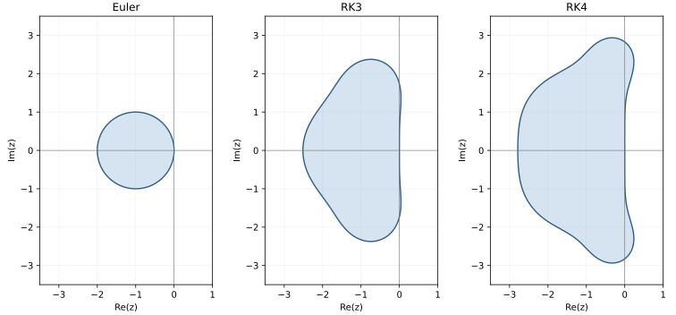

# 7.1–7.2 初值问题与单步法

初值问题给出了起点和变化率。把时间分成小段，利用当前状态和变化率估计下一时刻的状态，就能一步步算出解的近似值。

最简单的是 Euler 方法。下面从积分关系推导它，再通过增加一步内的斜率信息构造 Runge–Kutta 方法。每推导一种公式，都要继续检查一步误差怎样累积，以及步长会不会使数值解出现错误的增长。

::: intuition 直觉 · 为什么要把微分方程离散化
许多微分方程的解不能用初等函数写出；即使有积分表示，求具体数值时仍需计算。数值解法的办法是**只求节点上的近似值**：把 $[t_0,T]$ 分成步长 $h$ 的网格 $t_n=t_0+nh$，用差分方程从 $y_0$ 一步步推出 $y_1,y_2,\dots$。

Euler 法的几何意义最直白：**沿当前点的切线走一步**。切线方向是 $f(t_n,y_n)$，走 $h$ 就到 $y_n+hf(t_n,y_n)$。误差来自两处：切线只是曲线的局部近似（截断误差），以及每一步都从前一步的近似值出发（误差累积）。整章都在回答：怎样走得更准（高阶方法）、怎样保证误差不爆炸（稳定性）。
:::

## 引导算例：精确解衰减，数值解为什么越算越大？

取 $y'=-10y,\ y(0)=1$，精确解为 $e^{-10t}$。显式 Euler 将导数换成一步斜率：

$$
y_{n+1}=y_n-10hy_n=(1-10h)y_n.
$$

不用先求误差，就能从放大因子看出三种行为：

| 步长 $h$ | $1-10h$ | 数值序列 |
|:--|:--|:--|
| $0.1$ | $0$ | 第一步变成零，此后一直为零 |
| $0.2$ | $-1$ | $1,-1,1,-1,\ldots$，幅度不衰减 |
| $0.3$ | $-2$ | $1,-2,4,-8,\ldots$，幅度增长 |

第一行处于绝对稳定域内，但第一步的精确值是 $e^{-1}$，近似值零仍很不准确。因此选步长要同时通过两关：**稳定性允许多大；精度实际需要多小。**

再看为什么局部二阶误差只得到全局一阶。若每步从精确值起步的缺陷不超过 $Ch^2$，且增量对状态满足适当 Lipschitz 界，则

$$
E_{n+1}\le(1+Lh)E_n+Ch^2,\qquad E_0=0.
$$

对 $L>0$ 展开几何级数，并固定 $nh\le T$：

$$
E_n\le Ch^2\frac{(1+Lh)^n-1}{Lh}
\le\frac C L(e^{LT}-1)h.
$$

若 $L=0$，直接相加得 $E_n\le CTh$。这里的常数包含时间区间和误差传播，不能只把一项 Taylor 余项改写成“全局误差公式”。本页的局部截断误差是不除以 $h$ 的一步缺陷；另一些教材将其除以 $h$，比较阶数前先核对定义。

::: ex 从同一问题选择方法
① 对 $y'=-1000y$，显式 Euler 的严格衰减条件是什么？② 后退 Euler 的放大因子是什么？③ 后退 Euler 稳定后，能否任意增大步长仍保持精度？
:::

::: sol 参考解答
① $|1-1000h|<1$，即 $0<h<0.002$。② 由 $y_{n+1}=y_n-1000hy_{n+1}$ 得 $R=1/(1+1000h)$，对任意正步长有 $|R|<1$。③ 不能；衰减稳定不等于正确分辨快速变化。仍需误差估计和步长减半比较。若每步隐式方程只近似求解，还应检查内部求解误差。
:::

下面从初值问题出发，依次构造方法、估计误差，再说明两种稳定性各在检查什么。首次阅读可先看公式和算例，再回到证明；复习时可从各个方法盒与本节末的速查表进入。

## 7.1 初值问题与基本概念

::: def 定义 7.1.1 · 一阶初值问题与适定性 {#def-7.1.1}
称

$$
y'=f(t,y),\qquad y(t_0)=y_0,\qquad t\in[t_0,T]
$$

为**一阶常微分方程初值问题**。若 $f$ 在条带 $D_0=[t_0,T]\times\mathbb R$ 内连续，且对 $y$ 满足**Lipschitz 条件**：存在常数 $L$，使对 $D_0$ 内任意 $(t,u_1),(t,u_2)$ 有

$$
|f(t,u_1)-f(t,u_2)|\le L|u_1-u_2|,
$$

则在该有限区间上解存在、唯一，并对初值连续依赖。若连续性与 Lipschitz 条件只在初值附近成立，先得到局部结论；延伸到整个区间还需保证解可以继续延拓。
:::

::: note Lipschitz 条件在算什么
Lipschitz 条件控制「$y$ 变一点，$f$ 变多少」。它比「$f$ 连续」强，比「$f$ 可微且导数有界」弱：若 $\partial f/\partial y$ 在 $D_0$ 上有界，则由中值定理 $f$ 满足 Lipschitz 条件。它既是存在唯一性的条件，也是后面**收敛性**证明里控制误差传播的关键。
:::

数值解法只在节点上求近似值。设 $y(t)$ 是精确解，$y_n$ 是数值解，则 $e_n=y(t_n)-y_n$ 称为**整体截断误差**。为了分析误差，还要定义「只走一步」的局部误差。

::: def 定义 7.1.2 · 局部截断误差与整体截断误差 {#def-7.1.2}
设单步法写成

$$
y_{n+1}=y_n+h\Phi(t_n,y_n,h),
$$

其中 $\Phi$ 称为**增量函数**。称

$$
R_{n+1}=y(t_{n+1})-y(t_n)-h\Phi(t_n,y(t_n),h)
$$

为单步法在 $t_{n+1}$ 处的**局部截断误差**——它从精确值 $y(t_n)$ 出发，只计一步。称

$$
e_n=y(t_n)-y_n
$$

为**整体截断误差**——它从数值解 $y_n$ 出发，带着此前所有步的累积误差。
:::

::: note 局部误差与整体误差差在哪
局部误差是「假设这一步之前全对，这一步错多少」；整体误差是「实际算到最后，总共错多少」。局部误差 $O(h^{p+1})$ 经过 $O(1/h)$ 步累积，通常变成整体 $O(h^p)$——少一阶。这就是定理 7.1 的内容。
:::

## 7.2.1 Euler 法、后退 Euler、梯形法

::: def 定义 7.2.1 · 显式与隐式单步法 {#def-7.2.1}
形如

$$
y_{n+1}=y_n+h\Phi(t_n,y_n,h)
$$

的方法称为**显式单步法**：右端只含已知的 $y_n$，可直接算出 $y_{n+1}$。若右端含 $y_{n+1}$，则称为**隐式单步法**：每步要解一个方程（通常用迭代）。
:::

导数描述瞬时斜率，计算时却要跨过一个有限步长。把微分方程在一步上积分，便得到两者的联系：

$$
y(t_{n+1})-y(t_n)=\int_{t_n}^{t_{n+1}}f(t,y(t))\,dt.
$$

若用左端点矩形公式近似右端积分，就得到显式 Euler；用右端点矩形公式，得到后退 Euler；用梯形公式，得到隐式梯形法。这也把本章与[数值积分](../ch06/sec61.md)连在了一起：求积公式怎样选择斜率，会决定时间推进公式。

**显式 Euler**：

$$
y_{n+1}=y_n+hf(t_n,y_n).
$$

局部截断误差 $O(h^2)$，一阶方法。几何上沿当前点切线走一步。

**后退 Euler**：

$$
y_{n+1}=y_n+hf(t_{n+1},y_{n+1}).
$$

隐式，每步解一个方程；一阶，但绝对稳定区域更大，适合刚性方程。

**梯形法**：

$$
y_{n+1}=y_n+\frac h2\left[f(t_n,y_n)+f(t_{n+1},y_{n+1})\right].
$$

隐式，二阶；是「前后两个斜率的平均」。

**改进 Euler（预测–校正）**：

$$
\bar y_{n+1}=y_n+hf(t_n,y_n),\qquad
y_{n+1}=y_n+\frac h2\left[f(t_n,y_n)+f(t_{n+1},\bar y_{n+1})\right].
$$

显式，二阶：先用 Euler 预测一个 $\bar y_{n+1}$，再用梯形公式校正一次。隐式梯形用的是尚待求出的 $y_{n+1}$；这里用的是已算出的预测值，所以校正一次并没有解出隐式梯形方程。它是二级二阶 R-K 方法的一种（见 [7.2.2](#sec-7.2.2)）。

::: method[core] 四个一阶/二阶方法的对照 {#method-7.2-euler-family}
| 方法 | 公式 | 显/隐 | 阶 | 每步函数求值 |
|:--|:--|:--:|:--:|:--:|
| 显式 Euler | $y_{n+1}=y_n+hf_n$ | 显 | 1 | 1 |
| 后退 Euler | $y_{n+1}=y_n+hf_{n+1}$ | 隐 | 1 | 需迭代 |
| 梯形法 | $y_{n+1}=y_n+\frac h2(f_n+f_{n+1})$ | 隐 | 2 | 需迭代 |
| 改进 Euler | 预测 + 校正 | 显 | 2 | 2 |
:::

::: ex 例 7.2.1 · 三种方法解同一初值问题 {#ex-7.2.1}
分别用 Euler 法、改进 Euler 法和经典 R-K 法求解

$$
y'=1-\frac{2ty}{1+t^2},\qquad 0\le t\le2,\qquad y(0)=0,
$$

取步长 $h=0.5$，并与精确解

$$
y(t)=\frac{t(3+t^2)}{3(1+t^2)}
$$

比较。

**Euler 法**：

$$
y_{n+1}=y_n+0.5\left(1-\frac{2t_ny_n}{1+t_n^2}\right),\qquad t_n=0.5n.
$$

| $n$ | $t_n$ | $y_n$ | $y(t_n)$ | $y(t_n)-y_n$ |
|:--:|:--:|:--:|:--:|:--:|
| 0 | 0.0 | 0 | 0 | 0 |
| 1 | 0.5 | 0.500000 | 0.433333 | $-0.066667$ |
| 2 | 1.0 | 0.800000 | 0.666667 | $-0.133333$ |
| 3 | 1.5 | 0.900000 | 0.807692 | $-0.092308$ |
| 4 | 2.0 | 0.984615 | 0.933333 | $-0.051282$ |

**改进 Euler 法**：

$$
k_1=1-\frac{2t_ny_n}{1+t_n^2},\qquad
k_2=1-\frac{2(t_n+h)(y_n+hk_1)}{1+(t_n+h)^2},\qquad
y_{n+1}=y_n+\frac h2(k_1+k_2).
$$

| $n$ | $t_n$ | $y_n$ | $k_1$ | $k_2$ | $y(t_n)-y_n$ |
|:--:|:--:|:--:|:--:|:--:|:--:|
| 0 | 0.0 | 0 | 1.000000 | 0.600000 | 0 |
| 1 | 0.5 | 0.400000 | 0.680000 | 0.260000 | $0.033333$ |
| 2 | 1.0 | 0.635000 | 0.365000 | 0.245385 | $0.031667$ |
| 3 | 1.5 | 0.787596 | 0.272988 | 0.260728 | $0.020096$ |
| 4 | 2.0 | 0.921025 | — | — | $0.012308$ |

**经典 R-K 法**：

$$
\begin{aligned}
k_1&=1-\frac{2t_ny_n}{1+t_n^2},\\
k_2&=1-\frac{2(t_n+\frac h2)(y_n+\frac h2k_1)}{1+(t_n+\frac h2)^2},\\
k_3&=1-\frac{2(t_n+\frac h2)(y_n+\frac h2k_2)}{1+(t_n+\frac h2)^2},\\
k_4&=1-\frac{2(t_n+h)(y_n+hk_3)}{1+(t_n+h)^2},\\
y_{n+1}&=y_n+\frac h6(k_1+2k_2+2k_3+k_4).
\end{aligned}
$$

| $n$ | $t_n$ | $y_n$ | $y(t_n)-y_n$ |
|:--:|:--:|:--:|:--:|
| 0 | 0.0 | 0 | 0 |
| 1 | 0.5 | 0.433218 | $0.000115$ |
| 2 | 1.0 | 0.666312 | $0.000355$ |
| 3 | 1.5 | 0.807423 | $0.000269$ |
| 4 | 2.0 | 0.933156 | $0.000177$ |

**比较**：终点处三者的绝对误差依次约为 $0.051282$、$0.012308$ 和 $0.000177$，每步分别调用 $f$ 一次、两次和四次。计算成本与所需精度应一起比较。
:::

::: note 误差为什么不是单调增
表 7-1 的误差先增后减，不是「越走越错」。整体误差是各步局部误差的累积，而局部误差的系数 $y''(t)$ 随 $t$ 变化；误差曲线不必单调。**判断阶要看步长减半时误差的下降比例**，不能看单点误差大小。
:::

## 7.2.2 Runge–Kutta 方法

::: def 定义 7.2.2 · 显式 Runge–Kutta 方法 {#def-7.2.2}
$N$ 级显式 Runge–Kutta 方法的一般形式为

$$
y_{n+1}=y_n+h\sum_{i=1}^Nc_ik_i,
\qquad
k_i=f\left(t_n+a_ih,\ y_n+h\sum_{j=1}^{i-1}b_{ij}k_j\right),
$$

其中 $c_i,a_i,b_{ij}$ 是待定常数，$a_i=\sum_jb_{ij}$。$N$ 称为**级**。
:::

::: intuition 直觉 · RK 是「多问几个斜率再加权」
Euler 只用起点的一个斜率，所以只有一阶。改进 Euler 用起点和预测终点两个斜率平均，升到二阶。RK 的一般思路：在 $[t_n,t_{n+1}]$ 内多取几个点，分别问「这里的斜率是多少」，再加权平均。增加级数提供了更多可调系数，能否提高阶还取决于这些系数满足的条件；但每级都要算一次 $f$，而且阶不会无限随级数增长（$N=5$ 时最高仍为 4 阶）。
:::

**中点公式（RK2）**：

$$
k_1=f(t_n,y_n),\quad
k_2=f\left(t_n+\frac h2,y_n+\frac h2k_1\right),\quad
y_{n+1}=y_n+hk_2.
$$

::: note 二级 R-K 的阶条件
二级 R-K 方法

$$
y_{n+1}=y_n+h(c_1k_1+c_2k_2),\quad
k_1=f(t_n,y_n),\quad
k_2=f(t_n+a_2h,y_n+a_2hk_1)
$$

要达到二阶，系数须满足

$$
c_1+c_2=1,\qquad c_2a_2=\frac12 .
$$

三个未知数、两个方程，所以二级二阶 R-K 方法有**一族**：$a_2=1$ 得改进 Euler，$a_2=\frac12$ 得中点公式。三级最高三阶，四级最高四阶；$N$ 级 R-K 的最高阶 $p(N)$ 满足

$$
p(5)=4,\quad p(6)=5,\quad p(7)=6,\quad p(8)=6,\quad p(9)=7.
$$

**级数增加不等于阶数同步增加**——这是 RK 方法的一个反直觉事实。
:::

### 由二阶走向三阶：系数是怎样定出来的？ {#rk3-construction}

二阶条件只匹配到精确解的 $h^2$ 项。若希望再匹配 $h^3$ 项，需要第三个斜率，并展开到足够高的次数。以下按 lecture17 pp.6–12 的构造说明，所有 $k_i$ 都表示斜率，不含步长因子 $h$。

$$
\begin{aligned}
k_1&=f(t,y),\\
k_2&=f(t+a_2h,y+a_2hk_1),\\
k_3&=f(t+a_3h,y+h(a_3-b_{32})k_1+hb_{32}k_2),\\
y_+&=y+h(c_1k_1+c_2k_2+c_3k_3).
\end{aligned}
$$

在本段中 $(t,y)$ 是一步的精确起点，所有偏导数也在该点取值。记

$$
\begin{aligned}
F&=f_t+ff_y=y'',\\
G&=f_{tt}+2ff_{ty}+f^2f_{yy},\\
y^{(3)}&=G+Ff_y.
\end{aligned}
$$

多元 Taylor 展开给出

$$
\begin{aligned}
k_2&=f+a_2hF+\tfrac12a_2^2h^2G+O(h^3),\\
k_3&=f+a_3hF+h^2\left(\tfrac12a_3^2G+a_2b_{32}Ff_y\right)+O(h^3).
\end{aligned}
$$

第二式中多出的 $a_2b_{32}Ff_y$，来自把 $k_2=f+a_2hF+O(h^2)$ 代入第三个取值点的纵坐标。代回更新式后，与

$$
y(t+h)=y+hf+\tfrac12h^2F+\tfrac16h^3(G+Ff_y)+O(h^4)
$$

逐项比较，得到四个条件：

$$
\begin{aligned}
c_1+c_2+c_3&=1,&c_2a_2+c_3a_3&=\tfrac12,\\
c_2a_2^2+c_3a_3^2&=\tfrac13,&c_3a_2b_{32}&=\tfrac16.
\end{aligned}
$$

::: method[core] 三级三阶 RK {#method-rk3}
取 $a_2=1/2,a_3=1,b_{32}=2$，得到

$$
\begin{aligned}
k_1&=f(t_n,y_n),\\
k_2&=f(t_n+h/2,y_n+hk_1/2),\\
k_3&=f(t_n+h,y_n-hk_1+2hk_2),\\
y_{n+1}&=y_n+\tfrac h6(k_1+4k_2+k_3).
\end{aligned}
$$

在相应光滑性条件下，单步缺陷为 $O(h^4)$，固定区间全局误差为 $O(h^3)$。每步计算三次 $f$。
:::

例如解 $y'=y,y(0)=1$，取 $h=0.1$。三个斜率依次为 $1,1.05,1.11$，得 $y_1=1.1051666667$；精确值 $e^{0.1}\approx1.1051701860$。这个单步误差约为 $3.52\times10^{-6}$，还需固定终点的步长减半实验才能观察全局三阶。

**四阶 RK（RK4）**：

$$
\begin{aligned}
k_1&=f(t_n,y_n),\\
k_2&=f\left(t_n+\frac h2,y_n+\frac h2k_1\right),\\
k_3&=f\left(t_n+\frac h2,y_n+\frac h2k_2\right),\\
k_4&=f(t_n+h,y_n+hk_3),\\
y_{n+1}&=y_n+\frac h6(k_1+2k_2+2k_3+k_4).
\end{aligned}
$$

四阶方法，每步 4 次函数求值；常用于非刚性问题。

### 同一组节点上的精度比较 {#ex-rk-slide-comparison}

lecture17 p.15 用 $y'=2t^2+2y,\ y(0)=1$ 比较 Euler、改进 Euler 和 RK4，步长为 $h=0.1$。移项并乘积分因子 $e^{-2t}$，得精确解

$$
y(t)=\tfrac32e^{2t}-t^2-t-\tfrac12.
$$

下表按各方法逐步推进，内部不作小数截断，显示时保留四位小数：

| $t_n$ | Euler | 改进 Euler | RK4 | 精确解 |
|:--|--:|--:|--:|--:|
| 0.0 | 1.0000 | 1.0000 | 1.0000 | 1.0000 |
| 0.1 | 1.2000 | 1.2210 | 1.2221 | 1.2221 |
| 0.2 | 1.4420 | 1.4948 | 1.4977 | 1.4977 |
| 0.3 | 1.7384 | 1.8375 | 1.8432 | 1.8432 |
| 0.4 | 2.1041 | 2.2685 | 2.2783 | 2.2783 |
| 0.5 | 2.5569 | 2.8118 | 2.8274 | 2.8274 |
| 0.6 | 3.1183 | 3.4964 | 3.5201 | 3.5202 |
| 0.7 | 3.8139 | 4.3578 | 4.3927 | 4.3928 |
| 0.8 | 4.6747 | 5.4393 | 5.4894 | 5.4895 |
| 0.9 | 5.7377 | 6.7938 | 6.8643 | 6.8645 |
| 1.0 | 7.0472 | 8.4856 | 8.5834 | 8.5836 |

同一步长下，RK4 与真值在前几行显示相同的四位小数，仍有非零误差。比较计算成本时，还应记住每步分别调用 $f$ 一次、两次和四次；想观察方法的阶，下一步要固定终点，再减半步长。

## 7.2.3 收敛性与稳定性

::: def 定义 7.2.3 · 相容性 {#def-7.2.3}
若增量函数满足

$$
\Phi(t,y,0)=f(t,y),
$$

则称单步法与微分方程**相容**。等价地，$\lim_{h\to0}\Phi(t,y,h)=f(t,y)$：步长趋于零时，差分方程还原为微分方程。
:::

::: thm 定理 7.1 · 局部 $p+1$ 阶 ⇒ 整体 $p$ 阶 {#thm-7.2.1}
在固定时间区间 $[t_0,T]$ 上，设增量函数 $\Phi(t,y,h)$ 在相关区域对 $y$ 一致满足 Lipschitz 条件，常数 $K$ 与足够小的 $h$ 无关，数值解留在该区域内，且初值精确。若局部截断误差一致满足

$$
R_{n+1}=O(h^{p+1})\qquad(p\ge1),
$$

则整体截断误差

$$
e_{n+1}=O(h^p).
$$
:::

::: proof[core] 证明
由整体误差的递推：

$$
e_{n+1}=R_{n+1}+e_n+h\left[\Phi(t_n,y(t_n),h)-\Phi(t_n,y_n,h)\right].
$$

取绝对值并用 Lipschitz 条件：

$$
|e_{n+1}|\le|R_{n+1}|+(1+hK)|e_n|.
$$

先设 $K>0$。利用精确初值 $e_0=0$，反复展开：

$$
|e_{n+1}|\le\sum_{k=0}^n(1+hK)^k|R_{n+1-k}|
\le\frac{(1+hK)^{n+1}-1}{hK}\max|R|.
$$

因 $(1+hK)^{n+1}\le e^{(n+1)hK}\le e^{(T-t_0)K}$，且 $\max|R|=O(h^{p+1})$，故

$$
|e_{n+1}|\le\frac{e^{(T-t_0)K}-1}{hK}O(h^{p+1})=O(h^p).
$$

若 $K=0$，直接求和得 $|e_{n+1}|\le(n+1)\max|R|=O(h^p)$。若初始误差仅满足 $e_0=O(h^p)$，递推中还需保留 $(1+hK)^{n+1}|e_0|$，在固定终点下仍不改变全局阶。

$\blacksquare$
:::

### 初值已经有误差，后面的计算会怎样？ {#euler-initial-stability}

前面的证明先取 $e_0=0$，用来单独观察离散化误差。若初值本身也有误差，Euler 在 $|y''|\le M$、$L>0$ 时满足

$$
|e_n|\le e^{L(t_n-t_0)}|e_0|
+\frac{Mh}{2L}\left(e^{L(t_n-t_0)}-1\right).
$$

第一项传播初始误差，第二项累积每步不超过 $Mh^2/2$ 的局部缺陷。$L=0$ 时第二项换成 $Mh(t_n-t_0)/2$。因而要保持整体一阶，初始误差也应至少为 $O(h)$。

下面比较同一数值方法生成的两组解，只改变初始值。这样可以直接观察初始扰动如何随计算传播，而不必预先知道精确解。

::: thm Euler 的有限时间初值扰动稳定性 {#thm-euler-perturbation}
在固定区间 $[t_0,T]$ 上，设 $f$ 对 $y$ 有统一 Lipschitz 常数 $L\ge0$，两组 Euler 解 $u_n,v_n$ 留在该区域。则对同一网格

$$
|u_n-v_n|\le e^{L(T-t_0)}|u_0-v_0|.
$$

右端常数不依赖步长 $h$。初值越接近，整个有限区间上的两组数值解也越接近。
:::

::: proof 证明
两式相减，令 $\delta_n=u_n-v_n$，有

$$
\delta_{n+1}=\delta_n+h[f(t_n,u_n)-f(t_n,v_n)],\qquad
|\delta_{n+1}|\le(1+hL)|\delta_n|.
$$

递推即得 $|\delta_n|\le(1+hL)^n|\delta_0|\le e^{Lnh}|\delta_0|$，而 $nh\le T-t_0$。$\blacksquare$
:::

若每步更新还加入一个扰动 $\eta_{j+1}$，同样递推可得

$$
|\delta_n|\le e^{L(T-t_0)}\left(|\delta_0|+\sum_{j=0}^{n-1}|\eta_{j+1}|\right).
$$

这条估计把初始误差与逐步扰动放在了一起。它允许有限时间内出现增长；下面的绝对稳定性则检查衰减测试方程在选定步长下能否继续衰减。

::: thm 定理 7.2 · 相容 ⇔ 至少一阶 {#thm-7.2.2}
设 $\Phi$ 连续且对 $h$ 满足 Lipschitz 条件，则单步法与微分方程相容的**充分必要条件**是它至少是一阶方法。
:::

::: proof 证明
**必要性**：若相容，则 $\Phi(t,y,0)=f(t,y)$。把 $\Phi(t,y(t),h)$ 在 $h=0$ 处展开：

$$
\Phi(t,y(t),h)=\Phi(t,y(t),0)+O(h)=f(t,y(t))+O(h).
$$

于是

$$
R_{n+1}=y(t_{n+1})-y(t_n)-h\Phi(t_n,y(t_n),h)
=hy'(t_n)+O(h^2)-h[f(t_n,y(t_n))+O(h)]=O(h^2),
$$

即至少一阶。

**充分性**：若 $R_{n+1}=O(h^{p+1})$（$p\ge1$），则

$$
\frac{y(t_{n+1})-y(t_n)}{h}=\Phi(t_n,y(t_n),h)+O(h^p).
$$

令 $h\to0$，左端趋于 $y'(t_n)=f(t_n,y(t_n))$，故 $\Phi(t_n,y(t_n),0)=f(t_n,y(t_n))$。$\blacksquare$
:::

::: thm 定理 7.3 · 相容 + Lipschitz ⇒ 收敛 {#thm-7.2.3}
设 $\Phi$ 连续并对 $y,h$ 满足 Lipschitz 条件。若单步法与微分方程相容，则方法收敛。
:::

::: proof 证明
由定理 7.2，相容 ⇒ 至少一阶，即 $R_{n+1}=O(h^2)$；再由定理 7.1，整体误差 $O(h)$，故 $h\to0$ 时 $e_n\to0$。$\blacksquare$
:::

::: def 定义 7.2.4 · 绝对稳定性与稳定区域 {#def-7.2.4}
对**测试方程**

$$
y'=\lambda y\qquad(\lambda\in\mathbb C),
$$

单步法写成

$$
y_{n+1}=R(h\lambda)y_n,
$$

$R$ 称为**放大因子**。若 $|R(z)|<1$（$z=h\lambda$），则称方法在 $z$ 处**绝对稳定**；所有这样的 $z$ 组成**绝对稳定区域**。
:::

常用方法的放大因子：

| 方法 | $R(z)$ | 负实轴上的严格稳定区间 |
|:--|:--|:--|
| Euler | $1+z$ | $-2<z<0$ |
| 后退 Euler | $1/(1-z)$ | $z<0$ |
| 梯形 | $(1+z/2)/(1-z/2)$ | $z<0$ |
| 二级二阶 R-K | $1+z+z^2/2$ | $-2<z<0$ |
| 三级三阶 R-K | $1+z+z^2/2+z^3/6$ | $-2.51<z<0$ |
| 经典 RK4 | $1+z+z^2/2+z^3/6+z^4/24$ | $-2.78<z<0$ |

### 从各级斜率推导稳定多项式 {#rk-stability-derivation}

令 $z=h\lambda$。把 $f(t,y)=\lambda y$ 代入 RK3，有

$$
\begin{aligned}
k_1&=\lambda y_n,\\
k_2&=\lambda y_n(1+z/2),\\
k_3&=\lambda y_n(1+z+z^2).
\end{aligned}
$$

所以 $R_3(z)=1+z+z^2/2+z^3/6$。对 RK4，把四个斜率写成 $k_j=\lambda y_nq_j$，相应的系数为

$$
\begin{aligned}
q_1&=1,\\
q_2&=1+z/2,\\
q_3&=1+z/2+z^2/4,\\
q_4&=1+z+z^2/2+z^3/4.
\end{aligned}
$$

按权 $1,2,2,1$ 合并，得到 $R_4(z)=1+z+z^2/2+z^3/6+z^4/24$。这些计算说明表中的多项式来自哪里，也提供了核对实现的办法。

当 $\lambda$ 为复数时，要检查整个复平面中的 $|R(z)|<1$。下图阴影是严格稳定域，曲线是 $|R(z)|=1$ 的边界。

<picture>
  <source media="(max-width: 600px)" srcset="../../assets/figures/rk-stability-regions-mobile.svg">
  
</picture>

Euler 的稳定域是圆盘 $|1+z|<1$。对纯虚数 $z=i\beta$，Euler 有 $|R|^2=1+\beta^2$，除原点外都不稳定；RK4 则有

$$
|R_4(i\beta)|^2=1+\frac{\beta^6(\beta^2-8)}{576},
$$

所以 $0<|\beta|<2\sqrt2$ 时严格衰减。负实轴区间适合衰减模态的步长判断；遇到振荡模态，就要回到复稳定域。后退 Euler 与梯形法的稳定域都包含整个开左半平面。

::: ex 例 7.2.2 · Euler 法的稳定步长 {#ex-7.2.2}
用 Euler 法求解

$$
y'=-5y+t,\qquad y(t_0)=y_0,
$$

从绝对稳定性考虑，对步长 $h$ 有何限制？

**解** 线性化后 $\lambda=-5$。Euler 的放大因子为 $1+h\lambda=1-5h$，绝对稳定要求

$$
|1-5h|<1\iff -1<1-5h<1\iff 0<h<0.4 .
$$
:::

::: ex 例 7.2.3 · RK4 的稳定步长 {#ex-7.2.3}
用经典 R-K 方法求解

$$
y'=1-\frac{10ty}{1+t^2},\qquad 0\le t\le10,\qquad y(0)=0,
$$

从绝对稳定性考虑，对步长 $h$ 有何限制？

**解** $\lambda=\partial f/\partial y=-10t/(1+t^2)$。在 $[0,10]$ 上

$$
\max|\lambda|=\max_{0\le t\le10}\frac{10t}{1+t^2}=5\quad(\text{在 }t=1\text{ 处}).
$$

RK4 的实稳定区间为 $-2.78<z<0$，故

$$
-2.78<-5h<0\iff 0<h<0.556 .
$$
:::

::: note 稳定 ≠ 精确
稳定步长限制控制的是误差是否持续放大，实际精度还要看截断误差。例如用 Euler 法解 $y'=-10y$，取 $h=0.25$ 时放大因子为 $-1.5$，数值解交替变号且幅值增长，而正初值对应的精确解始终为正并逐渐衰减。RK4 也有步长限制：对 $y'=-20y$，$h=0.1$ 时 $R(-2)=1/3$，$h=0.2$ 时 $R(-4)=5$，后一种数值解按 $5^n$ 增长。
:::

::: think[core] 本节常见错误
1. **把局部误差阶当整体阶。** 局部 $O(h^{p+1})$ 对应整体 $O(h^p)$；写「RK4 局部四阶、整体四阶」时要说清是哪个。
2. **相容性验证只看 $h\to0$。** 要具体算 $\Phi(t,y,0)=f(t,y)$；例如中点公式 $\Phi=f(t+h/2,y+hf/2)$ 在 $h=0$ 时确实是 $f$，故相容。
3. **把「收敛」与「稳定」混为一谈。** 收敛比较固定时间区间上 $h\to0$ 时的误差；初值扰动稳定性控制两条数值轨道的距离；绝对稳定性检查测试方程在所选 $h$ 下的衰减。
4. **隐式方法不会解方程。** 后退 Euler / 梯形每步要解 $y_{n+1}=y_n+hf(t_{n+1},y_{n+1})$；非线性时用 Newton 迭代，初值可取显式 Euler 的预测值。
5. **稳定区间记错符号。** Euler 是 $-2<h\lambda<0$；后退 Euler 是 $|1-h\lambda|>1$，包含整个左半平面；RK4 是 $-2.78<h\lambda<0$。
6. **以为阶越高越稳定。** RK4 的稳定区间比 Euler 大，但仍有限；刚性方程要用 A-稳定方法（[7.5.2](sec74.md#sec-7.5.2)）。
7. **用「步长减半误差减半」判断二阶方法。** 一阶方法步长减半误差约减半；二阶方法应减到约四分之一。要先确认方法阶数，再看比例。
:::

::: method[core] 本节公式速查
| 概念 | 公式 / 判据 |
|:--|:--|
| 局部截断误差 | $R_{n+1}=y(t_{n+1})-y(t_n)-h\Phi(t_n,y(t_n),h)$ |
| 整体误差阶 | $R=O(h^{p+1})\Rightarrow e_n=O(h^p)$ |
| 相容性 | $\Phi(t,y,0)=f(t,y)$ |
| 收敛性 | 相容 + $\Phi$ 对 $y$ Lipschitz |
| 绝对稳定 | 测试方程 $y'=\lambda y$，$\lvert R(h\lambda)\rvert<1$ |
| Euler 稳定区间 | $-2<h\lambda<0$ |
| RK4 稳定区间 | $-2.78<h\lambda<0$ |
:::
