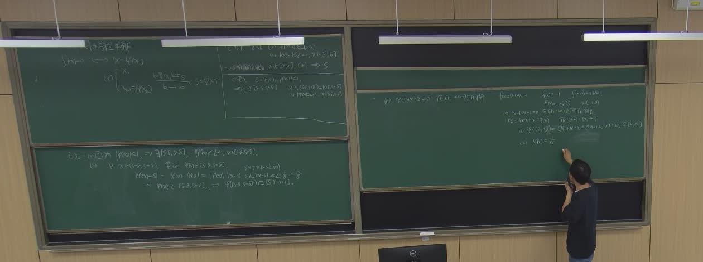
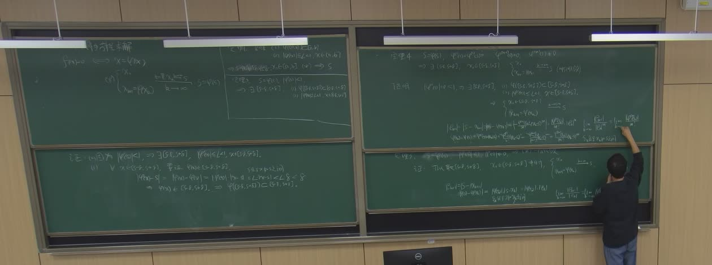
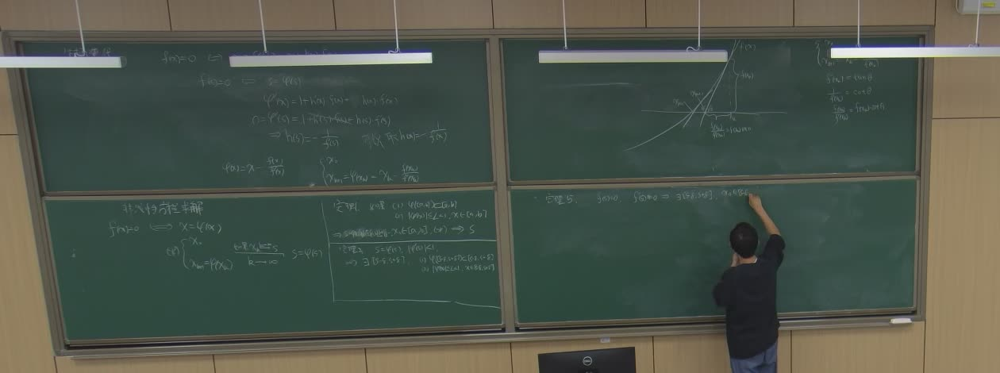
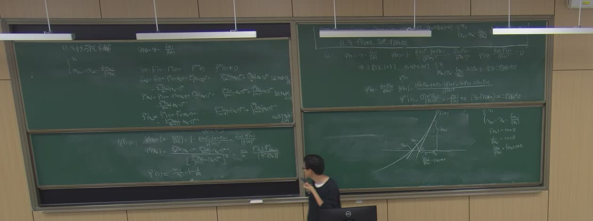

# 第 8 讲（10-12）：不动点迭代的唯一性、压缩收敛、收敛阶与牛顿法

> 课堂实录精编。本讲**无课件、全程板书**（与[第 7 讲](lec07.md)、[第 9 讲](lec09.md)相同），
> 承接第 7 讲末尾引入的不动点形式 $f(x)=0\iff x=\varphi(x)$ 与存在性——本讲把「**唯一**」
> 「**收敛**」「**有多快**」一次补齐，再把**牛顿法**当作不动点框架下「设计迭代函数」的答案讲出来。
>
> 主线四段：**定理一与定理二**（自映射 + 压缩两条条件 ⟹ 存在唯一 + 收敛 + 先验/后验误差估计，
> 条件框被老师**加框强调**）→ **例题** $x-\ln x=2$（四步验证，套用两条定理）→ **定理三 · 收敛阶**
> （$\varphi$ 在不动点处导数消失到第 $m-1$ 阶 ⟹ $m$ 阶收敛）→ **牛顿法**（挑 $\lambda=-1/f'$ 使
> $\varphi'(s)=0$ 白拿二阶；结尾推到重根 $\varphi'(s)=1-\frac1m$，为修正 Newton 埋线）。
>
> 本讲公式以**教师摄像头板书关键帧**为唯一权威：平台语音识别与本地 whisper 转写都错得厉害
> （「不动点」被写成「浮动阶级」，「二阶收敛」被写成「二倍收入」），**不要按转写字面引用**；
> 原始转写与板书关键帧存档于 `_sources/numerical/transcripts/`（不随书发布）。本页只有两条线：
> **〔课堂〕**是板书与录音里确实出现的内容，**〔教材〕**是颜书 4.1.2–4.1.5 的对应条目；
> 理论细节与数值实验由[正文 4.1.2–4.1.4](../course/ch04/sec41.md#sec-4.1.2) 承载，
> 本页负责「老师实际怎么讲」。

::: note 先看哪一段
- **复习 / 考前**：只读下面的「10 分钟复习版」+ §十「老师强调」+ §十一「记号与考注」。
- **跟课 / 补笔记**：读 §一–§八（〔课堂〕），对照板书时间戳与四张板书照片。
- **做题**：对应正文 [4.1.2–4.1.4 习题](../course/ch04/sec41.md#sec-4.1-exercises)（教材习题 1–5），
  本页例题的完整迭代表在 §三。
:::

::: method[core] 10 分钟复习版 · 第 8 讲

**一句话**：不动点迭代的全部理论是「**两条条件管两件事**」——自映射保证**每一步都留在区间里**，
压缩保证**误差一步比一步小**；两条合起来给出存在、唯一、收敛与误差估计，而**收敛有多快**
由 $\varphi$ 在不动点处**导数消失到第几阶**决定，牛顿法就是「把 $\varphi'(s)$ 设计成零」的答案。

**必记结论**

| 内容 | 要点 |
|:--|:--|
| **不动点形式** | $f(x)=0\iff x=\varphi(x)$，迭代格式 (F)：$x_{k+1}=\varphi(x_k)$ |
| **定理一（存在唯一）** | (i) 自映射 $\varphi([a,b])\subseteq[a,b]$；(ii) 压缩 $\lvert\varphi'(x)\rvert\le L\lt1$ ⟹ 存在**唯一**不动点 $s\in[a,b]$ |
| **定理二（收敛）** | 同两条条件下，**任意** $x_0\in[a,b]$ 迭代都收敛到 $s$ |
| **先验误差估计** | $\lvert x_k-s\rvert\le\dfrac{L^k}{1-L}\lvert x_1-x_0\rvert$——迭代前就能预算要多少步 |
| **后验误差估计** | $\lvert x_k-s\rvert\le\dfrac{L}{1-L}\lvert x_k-x_{k-1}\rvert$——停机判据的来源：步差要除以 $1-L$ 才是误差 |
| **局部收敛** | 只要 $\lvert\varphi'(s)\rvert\lt1$，就存在 $\delta\gt0$：初值取进 $(s-\delta,s+\delta)$ 必收敛（不需要全局压缩） |
| **收敛阶（定义）** | $\lim\dfrac{\lvert e_{k+1}\rvert}{\lvert e_k\rvert^p}=C$；$p=1,\,0\lt C\lt1$ 线性；$p=2$ 平方（有效数字翻倍） |
| **定理三（收敛阶）** | $\varphi'(s)=\cdots=\varphi^{(m-1)}(s)=0,\ \varphi^{(m)}(s)\neq0$ ⟹ $m$ 阶收敛，且极限值为 $\dfrac{\varphi^{(m)}(s)}{m!}$ |
| **Newton 设计** | 把 $f=0$ 写成 $x=x+\lambda(x)f(x)$；令 $\varphi'(s)=1+\lambda(s)f'(s)=0$ 得 $\lambda(x)=-\dfrac1{f'(x)}$ |
| **Newton 导数** | $\varphi'(x)=\dfrac{f(x)f''(x)}{[f'(x)]^2}$，单根处 $\varphi'(s)=0$、$\varphi''(s)=\dfrac{f''(s)}{f'(s)}\neq0$ ⟹ **至少二阶**（一般恰二阶） |
| **重根退化** | $m$ 重根时 $f'(s)=0$，牛顿法退化为**线性**收敛，$\varphi'(s)=1-\dfrac1m$（$m=2$ 时 $\frac12$，$m=3$ 时 $\frac23$）——正文 4.1.6 修正 Newton 的动机 |
| **课堂例题** | $x-\ln x=2$ 在 $[2,4]$：$\varphi=2+\ln x$ 自映射（$\ln2+2\approx2.69$、$\ln4+2\approx3.39$）且 $\lvert\varphi'\rvert=\frac1x\le\frac12$，$s\approx3.146193$ |

**老师强调的考点**（据板书加框与课堂反复回扣整理）：**① 定理二、三的条件框**被老师**加框强调**
——「这两条各管什么」是本讲反复回扣的一条线（自映射管越界、压缩管靠近，缺一不可）；
**② 后验误差估计里的 $\dfrac{L}{1-L}$**：相邻两步靠近**不等于**误差小，整条几何级数尾巴都要算进去，
「步差 $\neq$ 误差」是考题最爱挖的坑；**③ 收敛阶定理的极限式** $\lim\dfrac{e_{k+1}}{e_k^m}=\dfrac{\varphi^{(m)}(s)}{m!}$
要会写会证（Taylor 展开前 $m-1$ 项全消失），牛顿法是它的标准特例；**④ 牛顿法的二阶不是背的，
是设计出来的**——「挑 $\lambda$ 让 $\varphi'(s)=0$」这一步是本讲的方法论核心；**⑤ 重根时牛顿法掉阶**：
$\varphi'(s)=1-\frac1m\in(0,1)$，线性收敛——「为什么重根要修正」的答案。

**对应正文**：[4.1.2 简单迭代法](../course/ch04/sec41.md#sec-4.1.2)（定理 4.1–4.2）、
[4.1.3 收敛阶](../course/ch04/sec41.md#sec-4.1.3)（定理 4.3–4.4）、[4.1.5–4.1.6 Newton 法与重根](../course/ch04/sec41b.md)；
第 9 讲开场对三条定理做了完整复盘（[第 9 讲 §一–§二](lec09.md)）。

:::

## 课堂时间线 {#lec08-S1}

| 时间 | 内容 |
|---|---|
| 00:00–01:30 | 课前准备（转写多为噪声） |
| 01:30–10:00 | 复习不动点形式；**定理一**：自映射 + 压缩 ⟹ 存在唯一（存在性第 7 讲已证，本讲补唯一性） |
| 10:00–16:00 | **定理二**：任意初值收敛；先验误差估计 $\dfrac{L^k}{1-L}\lvert x_1-x_0\rvert$ |
| 16:00–21:00 | **例题** $x-\ln x=2$，$[2,4]$：连续、异号、自映射、压缩四步验证；写出 $x_{k+1}=2+\ln x_k$ |
| 21:00–30:00 | 定理二证明：中值定理 + 压缩 + 几何级数尾和；后验误差估计与停机判据 |
| 30:00–38:00 | **局部收敛**（$\delta$ 邻域版）：$\lvert\varphi'(s)\rvert\lt1$ ⟹ 邻域自映射 + 压缩；回扣「条件各管什么」 |
| 38:00–45:30 | **收敛阶**定义与**定理三**：导数消失 $m-1$ 阶 ⟹ $m$ 阶收敛；误差估计 $\dfrac{M_m}{m!}\lvert e_k\rvert^m$ |
| 46:30–51:41 | 课间休息（板书大擦除） |
| 51:41–58:00 | **Newton 设计**：$f=0$ 化为 $x=x+\lambda(x)f(x)$，令 $\varphi'(s)=0$ 解出 $\lambda=-\dfrac1{f'}$ |
| 58:00–66:00 | Newton 公式 $x_{k+1}=x_k-\dfrac{f(x_k)}{f'(x_k)}$；$\varphi'=\dfrac{ff''}{(f')^2}$ ⟹ 至少二阶 |
| 66:00–73:00 | 二阶收敛证明收尾；右板开写**「定理 5」**（全局收敛）并画切线下降几何图（证明留给下一讲） |
| 73:00–93:00 | **高阶导数链与重根分析**：$\varphi''(s)=\dfrac{f''(s)}{f'(s)}$；$m$ 重根时 $\varphi'(s)=1-\dfrac1m$，线性收敛 |
| 93:00–99:00 | 收尾与下一讲预告（全局收敛定理的证明） |

> 时间戳为教师流回放进度，允许 $\pm2\!-\!3$ 分钟误差；左右两块黑板同时推进，左右板内容的时间可能交错。
> 板书大擦除发生在 20:30、26:00–26:30、课间（46:30–51:41）与 01:08 起多次；「要看某一版完整板书，
> 取擦板标记前一张帧」（见 `_sources/numerical/transcripts/lec08-20261012-board/INDEX.md`）。

## 一、开场：把不动点框架重新立起来（01:30–10:00） {#lec08-S2}

老师在左板上先写下等价改写与迭代格式（承[第 7 讲](lec07.md)末尾）：

$$f(x)=0\quad\Longleftrightarrow\quad x=\varphi(x),\qquad\text{(F)}\quad x_{k+1}=\varphi(x_k).$$

若 $x_k\to s$ 且 $\varphi$ 连续，取极限得 $s=\varphi(s)$——$s$ 既是 $\varphi$ 的不动点，也是原方程的根。
**改写不唯一**：同一个 $f$ 可以造出许多 $\varphi$，有的收敛有的发散；本讲的理论就是回答
「什么样的 $\varphi$ 保证收敛、收敛有多快」。

::: thm[core] 定理一 · 不动点的存在唯一〔课堂〕
设 $\varphi\in C[a,b]$，在 $(a,b)$ 内可导，且满足两条条件：

1. **自映射**：当 $x\in[a,b]$ 时 $\varphi(x)\in[a,b]$；
2. **压缩**：存在 $L\lt1$，使 $\lvert\varphi'(x)\rvert\le L$ 对 $x\in(a,b)$ 成立。

则 $\varphi$ 在 $[a,b]$ 内有**唯一**不动点 $s$。
:::

::: proof
**存在性**（第 7 讲已证，本讲一句话带过）：令 $g(x)=\varphi(x)-x$。自映射给出 $g(a)\ge0$、
$g(b)\le0$，$g$ 连续，由介值定理存在 $s$ 使 $g(s)=0$，即 $\varphi(s)=s$。

**唯一性**（本讲补齐）：反证。设另有一个不动点 $t\neq s$。由中值定理，$s,t$ 之间存在 $\xi$ 使

$$\lvert s-t\rvert=\lvert\varphi(s)-\varphi(t)\rvert=\lvert\varphi'(\xi)\rvert\,\lvert s-t\rvert\le L\,\lvert s-t\rvert.$$

$\lvert s-t\rvert\gt0$ 而 $L\lt1$，两边同除即得 $1\le L$，矛盾。故 $s=t$。$\blacksquare$
:::

::: intuition 两条条件各管一件事
**自映射**管「出不出界」：没有它，迭代可能第一步就跳出 $[a,b]$，压缩常数就换了一个（甚至不存在）；
**压缩**管「靠不靠近」：没有它，迭代可以在区间里打转甚至发散（如 $\varphi(x)=x^3-1$ 在根附近
$\varphi'(s)\approx5.26\gt1$，见[正文例 1 的对照](../course/ch04/sec41.md#sec-4.1.2)）。
老师把这两条**加框**写在定理二旁，本讲后面反复回扣：「这两条各管什么」。
:::

::: note 〔教材〕对应
两条条件与结论即[正文定理 4.1](../course/ch04/sec41.md#sec-4.1.2)（原书 4.1.2 定理）的存在唯一部分。
教材例 1 用 $x^3-x-1=0$、$\varphi=\sqrt[3]{x+1}$；课堂本讲换了下面的对数例题，两条例题互为补充。
:::

## 二、定理二：任意初值都收敛 + 先验误差估计（10:00–16:00） {#lec08-S3}

::: thm[core] 定理二 · 压缩收敛与误差估计〔课堂〕
在定理一的两条条件下，取**任意** $x_0\in[a,b]$，迭代 (F) 都收敛到 $s$，且有误差估计

$$\lvert x_k-s\rvert\le\frac{L^k}{1-L}\lvert x_1-x_0\rvert\qquad(\text{先验}).$$
:::

板书在定理二的条件框**加框强调**，右侧写出先验估计式。老师特别指出这个界的**用法**：
不等式右端在**迭代开始前**就全部已知（$L$、$x_1-x_0$ 都是现成的），所以可以反过来解出
「要达到精度 $\varepsilon$ 至少迭代多少步」——令 $\frac{L^k}{1-L}\lvert x_1-x_0\rvert\le\varepsilon$ 解出 $k$，
这是**先验**（迭代前）的步数预算。

::: proof（21:00–30:00 板书）
**第 1 步 · 一步压缩。** $x_k\in[a,b]$（自映射保证每一步都留在区间里），对 $\varphi$ 在 $s$ 与 $x_k$
之间用中值定理，存在 $\xi_k$ 介于两者之间：

$$\lvert x_{k+1}-s\rvert=\lvert\varphi(x_k)-\varphi(s)\rvert=\lvert\varphi'(\xi_k)\rvert\,\lvert x_k-s\rvert\le L\,\lvert x_k-s\rvert.$$

递推得 $\lvert x_k-s\rvert\le L^k\lvert x_0-s\rvert\to0$——收敛成立。

**第 2 步 · 步差估计。** 同样用中值定理，

$$\lvert x_{k+1}-x_k\rvert=\lvert\varphi(x_k)-\varphi(x_{k-1})\rvert\le L\lvert x_k-x_{k-1}\rvert\le\cdots\le L^k\lvert x_1-x_0\rvert.$$

**第 3 步 · 几何级数尾和。** 把误差拆成从 $k$ 步开始的全部步差之和，再让 $x_m\to s$：

$$\lvert x_k-s\rvert\le\sum_{j=k}^{\infty}\lvert x_{j+1}-x_j\rvert\le\sum_{j=k}^{\infty}L^j\lvert x_1-x_0\rvert
=\frac{L^k}{1-L}\lvert x_1-x_0\rvert.\ \blacksquare$$
:::

::: note 后验误差估计：停机判据的来源
对上式「从最后一项往前看」同样的尾巴，得**后验**形式（$k\ge1$）：

$$\lvert x_k-s\rvert\le\frac{L}{1-L}\,\lvert x_k-x_{k-1}\rvert.$$

老师在这里停了一下强调：**相邻两步靠近 $\neq$ 误差小**——还要乘上放大因子 $\frac{L}{1-L}$，
把「剩下的整条尾巴」都算进去。这就是迭代程序里停止准则不能直接写 $\lvert x_k-x_{k-1}\rvert\lt\varepsilon$、
而要写 $\frac{L}{1-L}\lvert x_k-x_{k-1}\rvert\lt\varepsilon$ 的原因。$L=\frac12$ 时因子恰为 $1$，
是最省事也最「凑巧」的情形（见下面例题）。
:::

## 三、例题：$x-\ln x=2$，$[2,4]$（16:00–21:00） {#lec08-S4}

右板例题按**四步验证**写出（板书原文步骤）：

**① 连续且端点异号。** $f(x)=x-\ln x-2$ 在 $[2,4]$ 连续，

$$f(2)=2-\ln2-2=-\ln2\approx-0.693\lt0,\qquad f(4)=4-\ln4-2=2-\ln4\approx0.614\gt0,$$

由介值定理，$f$ 在 $(2,4)$ 内**至少有一个根**。

**② 改写成不动点形式。** $x-\ln x=2\iff x=2+\ln x$，取 $\varphi(x)=2+\ln x$。

**③ 自映射。** $\varphi$ 在 $[2,4]$ 上单调增，

$$\varphi(2)=2+\ln2\approx2.693\in[2,4],\qquad\varphi(4)=2+\ln4\approx3.386\in[2,4],$$

故 $\varphi([2,4])\subseteq[2,4]$（左端 $\ln2+2\gt2$、右端 $\ln4+2\lt4$，板书原话：「$\ln2+2$ 肯定大于 2，
$\ln4+2$ 肯定属于 4」）。

**④ 压缩。** $\varphi'(x)=\dfrac1x$，当 $x\in[2,4]$ 时

$$\lvert\varphi'(x)\rvert=\frac1x\le\frac12=L\lt1.$$

四步齐（连续异号 + 自映射 + 压缩），定理一、二全部条件满足：**唯一根 $s\in[2,4]$，
任意初值 $x_0\in[2,4]$ 迭代必收敛**。板书写出迭代格式

$$x_{k+1}=2+\ln x_k.$$

::: note 〔教材〕例题对照与补算声明
教材 4.1.2 的例 1 是 $x^3-x-1=0$（$\varphi=\sqrt[3]{x+1}$，$L=\frac{1}{3\sqrt[3]{4}}$）；
课堂例题 $x-\ln x=2$ 是另一条经典题（板书为准），教材未收录。**板书只写了四步验证与迭代格式**，
下面的迭代表为编者按格式补算（Python 复算，见 `numerical/tools/verify_teaching_examples.py`），
引用时注明是**补算**、不是板书原文。
:::

取 $x_0=3$（$s\approx3.146193$）：

| $k$ | $x_k$ | $\lvert x_k-s\rvert$ | $\lvert x_k-x_{k-1}\rvert$ |
|:--:|:--:|:--:|:--:|
| 0 | 3.000000 | $1.46\times10^{-1}$ | — |
| 1 | 3.098612 | $4.76\times10^{-2}$ | $9.86\times10^{-2}$ |
| 2 | 3.130954 | $1.52\times10^{-2}$ | $3.23\times10^{-2}$ |
| 3 | 3.141338 | $4.86\times10^{-3}$ | $1.04\times10^{-2}$ |
| 4 | 3.144649 | $1.54\times10^{-3}$ | $3.31\times10^{-3}$ |
| 5 | 3.145702 | $4.91\times10^{-4}$ | $1.05\times10^{-3}$ |
| 6 | 3.146037 | $1.56\times10^{-4}$ | $3.35\times10^{-4}$ |
| 7 | 3.146144 | $4.96\times10^{-5}$ | $1.06\times10^{-4}$ |

::: ex 例题 · 把两条误差估计用在表上
$L=\frac12$ 时后验因子 $\frac{L}{1-L}=1$，于是后验估计恰好是 $\lvert x_k-s\rvert\le\lvert x_k-x_{k-1}\rvert$：
拿 $k=5$ 验证，$\lvert x_5-s\rvert\approx4.91\times10^{-4}\le\lvert x_5-x_4\rvert\approx1.05\times10^{-3}$ ✓。
先验估计给步数预算：要 $\lvert x_k-s\rvert\le10^{-4}$，令
$\frac{(1/2)^k}{1-1/2}\lvert x_1-x_0\rvert=2\cdot(1/2)^k\cdot0.0986\le10^{-4}$，解得 $k\ge11$；
实测 $k=7$ 就达标（$\lvert x_7-s\rvert\approx4.96\times10^{-5}$）——**界是保守的，
这正是「用不等式换确定性」的代价**。

另一个值得看的量是相邻两行的比值 $\frac{\lvert x_k-s\rvert}{\lvert x_{k-1}-s\rvert}\to\varphi'(s)=\frac1s\approx0.318$：
**全局压缩常数 $L=\frac12$ 是保守值，真实的渐近速率是 $\lvert\varphi'(s)\rvert$**——二者谁大谁小、
各管什么，是判卷时常见的辨析点（同[正文例 1 的迁移练习](../course/ch04/sec41.md#sec-4.1.2)）。
:::

## 四、局部收敛：$\delta$ 邻域版（30:00–38:00） {#lec08-S5}

定理一、二要求**整个区间**上压缩，条件偏强。老师随后把条件**局部化**（板书左板下块）：

::: thm[core] 定理 · 局部收敛〔课堂〕
设 $\varphi(s)=s$，$\varphi'(s)$ 存在且 $\lvert\varphi'(s)\rvert\lt1$。则存在 $\delta\gt0$，
只要 $x_0\in(s-\delta,s+\delta)$，迭代 (F) 就收敛到 $s$。
:::

::: proof
取 $L$ 满足 $\lvert\varphi'(s)\rvert\lt L\lt1$。由导数定义，存在 $\delta\gt0$ 使 $x\in(s-\delta,s+\delta)$
时 $\left\lvert\frac{\varphi(x)-\varphi(s)}{x-s}\right\rvert\le L$，即

$$\lvert\varphi(x)-s\rvert=\lvert\varphi(x)-\varphi(s)\rvert\le L\lvert x-s\rvert\lt\lvert x-s\rvert\lt\delta.$$

左边说明 $\varphi$ 把邻域映回邻域 $\varphi((s-\delta,s+\delta))\subseteq(s-\delta,s+\delta)$（自映射回归），
右边说明在邻域内压缩——定理一、二的两条条件在**小邻域**里复活，收敛照旧。$\blacksquare$
:::

::: intuition 全局压缩是「奢侈版」，局部收敛是「够用版」
牛顿法就是典型：它的 $\varphi$ 往往**不满足**全局压缩（$f'$ 会变小甚至变号），但单根处
$\varphi'(s)=0$，局部收敛白送。所以老师把这条放在定理三之前讲——它是「牛顿法只要好初值」的
理论根据（第 9 讲的全局收敛定理再解决「初值怎么选才算好」）。
:::

## 五、定理三：导数消失的阶数 = 收敛的阶数（38:00–45:30） {#lec08-S6}

右板上块先写**收敛阶的定义**（板书原样）：

$$\lim_{k\to\infty}\frac{\lvert x_{k+1}-s\rvert}{\lvert x_k-s\rvert^{p}}=C\gt0
\quad\Longrightarrow\quad\text{迭代是 } p \text{ 阶收敛}.$$

$p=1$ 且 $0\lt C\lt1$ 为**线性收敛**；$p=2$ 为**平方收敛**。然后是本讲的第三条主定理
（板书标「定理 m」的条件块，与[第 9 讲 §二](lec09.md)复盘的「定理三」同一条）：

::: thm[core] 定理三 · 收敛阶〔课堂〕
设 $s=\varphi(s)$ 是不动点，$\varphi$ 在 $s$ 的某邻域内有 $m$ 阶连续导数，且

$$\varphi'(s)=\varphi''(s)=\cdots=\varphi^{(m-1)}(s)=0,\qquad\varphi^{(m)}(s)\neq0,$$

则存在 $\delta\gt0$，对 $x_0\in(s-\delta,s+\delta)$ 迭代 (F) 收敛到 $s$，且为 **$m$ 阶收敛**：

$$\lim_{k\to\infty}\frac{x_{k+1}-s}{(x_k-s)^m}=\frac{\varphi^{(m)}(s)}{m!}.$$
:::

::: proof（板书证明思路，38:00–45:30）
把 $\varphi(x_k)$ 在 $s$ 处 Taylor 展开到 $m$ 阶（前 $m-1$ 阶导数在 $s$ 处**全为零**，中间项整段消失）：

$$x_{k+1}-s=\varphi(x_k)-\varphi(s)=\frac{\varphi^{(m)}(\xi_k)}{m!}(x_k-s)^m,
\qquad \xi_k \text{ 介于 } s \text{ 与 } x_k.$$

右端除以 $(x_k-s)^m$ 后取极限，$\xi_k\to s$ 连续性给出极限 $\frac{\varphi^{(m)}(s)}{m!}\neq0$。
同邻域还有**误差估计**（板书在定理下方）：

$$\lvert x_{k+1}-s\rvert\le\frac{M_m}{m!}\lvert x_k-s\rvert^m,\qquad M_m=\max\lvert\varphi^{(m)}\rvert\ \text{于邻域}.$$

先取 $\delta$ 使 $\frac{M_m}{m!}\delta^{m-1}\le\rho\lt1$（把邻域收缩成自映射 + 压缩），再套局部收敛。$\blacksquare$
:::

::: intuition 「阶」是误差的幂次，不是步数
$m$ 阶收敛的含义是**误差按 $m$ 次幂缩小**：$e_{k+1}\approx C\,e_k^m$。一阶时误差每步乘一个固定常数
（$10^{-1},10^{-2},10^{-3},\dots$），二阶时误差**平方**、有效数字**翻倍**（$10^{-3}\to C\cdot10^{-6}\to C\cdot10^{-12}$）。
「想加速，就让 $\varphi$ 在根处的前几阶导数尽量为零」——下一节牛顿法就是这句话的执行。
:::

## 六、Newton 的设计：挑一个 $\lambda$ 让 $\varphi'(s)=0$（51:41–58:00） {#lec08-S7}

课间擦板后，老师换了一种讲法——**不从「切线」讲牛顿法，从「设计迭代函数」讲**（板书原文思路）：

> 把 $f(x)=0$ 转化成 $x=x$（恒等），再把右边加一项 $x=x+\lambda(x)\,f(x)$——行不行？
> 只要 $\lambda(s)\,f'(s)\neq-1$，两个方程等价；**设计空间打开了**：挑 $\lambda$ 让迭代又快又稳。

设 $\varphi(x)=x+\lambda(x)f(x)$。求导并在根 $s$ 处（$f(s)=0$）代入：

$$\varphi'(x)=1+\lambda'(x)f(x)+\lambda(x)f'(x)
\quad\Longrightarrow\quad
\varphi'(s)=1+\lambda(s)f'(s).$$

要 $\varphi'(s)=0$（白拿至少二阶），只需 $\lambda(s)=-\dfrac{1}{f'(s)}$。最省事的选择是**全程**取

$$\lambda(x)=-\frac{1}{f'(x)}
\quad\Longrightarrow\quad
\varphi(x)=x-\frac{f(x)}{f'(x)},$$

这就是**牛顿迭代**：

$$x_{k+1}=x_k-\frac{f(x_k)}{f'(x_k)}.$$

::: note 为什么这样挑 $\lambda$
要求只在**根处**成立（$\lambda(s)=-\frac1{f'(s)}$），理论上 $\lambda$ 有无数种取法（只在一个点取值约束不了
函数）；取 $\lambda=-\frac1{f'}$ 的好处是**处处不用单独算 $\lambda$**——它由 $f'$ 自动给出，且让 $\varphi'$
有一个全局可写的表达式，下面的二阶证明才做得下去。这是「设计观点」与「切线观点」的交会处：
$x-\frac{f(x_k)}{f'(x_k)}$ 恰是 $f$ 在 $x_k$ 处**切线的零点**（板书 66:00–73:00 在右板画了切线下降图）。
:::

## 七、Newton 至少二阶：证明与导数链（58:00–66:00；高阶链 73:00–93:00） {#lec08-S8}

对 $\varphi(x)=x-\dfrac{f(x)}{f'(x)}$ 求导（商法则，分子分母消去后）：

$$\varphi'(x)=1-\frac{[f'(x)]^2-f(x)f''(x)}{[f'(x)]^2}=\frac{f(x)f''(x)}{[f'(x)]^2}.$$

设 $s$ 是**单根**（$f(s)=0$、$f'(s)\neq0$）：代入得 $\varphi'(s)=0$——定理三取 $m=2$ 的条件
「$\varphi'(s)=0$」已满足。再算 $\varphi''(s)$：把 $f$ 在 $s$ 处展开 $f(x)=f'(s)(x-s)+\frac{f''(s)}2(x-s)^2+\cdots$
代入上式，得

$$\varphi''(s)=\frac{f''(s)}{f'(s)}.$$

一般情形 $f''(s)\neq0$，故 $\varphi''(s)\neq0$，**恰为二阶收敛**（若 $f''(s)$ 也恰好为零则阶数更高，
由定理三的 $m$ 判定）。板书在结论旁标注「**至少二阶**」，另起一行「且 $\varphi'(s)=0$，二阶收敛」
（[第 9 讲 §二](lec09.md)复盘时重写了这一段）。

::: proof 二阶收敛的完整链条（板书 58:00–73:00）
1. 单根 $\Rightarrow$ $f'(s)\neq0$，$\varphi$ 在 $s$ 附近有连续二阶导（$f'$、$f''$ 连续且 $f'\neq0$）；
2. $\varphi'(s)=0$、$\varphi''(s)=\frac{f''(s)}{f'(s)}\neq0$，由**定理三**（$m=2$）得局部收敛且
   $\lim\dfrac{e_{k+1}}{e_k^2}=\dfrac{\varphi''(s)}{2}=\dfrac{f''(s)}{2f'(s)}$；
3. 局部收敛保证「初值足够靠近就收敛」——全局性（初值到底要多近）由右板开写的**「定理 5」**
   （全局收敛四条件）回答，**证明在第 9 讲 §四、§六 完成**。$\blacksquare$
:::

## 八、结尾：重根时牛顿法掉阶——$\varphi'(s)=1-\frac1m$（73:00–93:00） {#lec08-S9}

最后一段老师把定理三往两个方向推（左板长链条，帧 b181–b193；此段转写质量最差，
以下按板书帧整理，个别中间步骤为编者补全）：

**方向一 · 阶数还能不能更高。** 把 $\varphi'$、$\varphi''$、$\varphi'''$……逐阶求导（板书的导数链），
每一阶的分子都含因子 $f(x)$——只要 $s$ 是单根、$f^{(j)}(s)\neq0\ (j=2,\dots,m)$，定理三照用：
**牛顿法的阶由 $f$ 在根处前几阶导数里「第一个不为零的」决定**，单根情形一般停在二阶。

**方向二 · 重根。** 设 $s$ 是 $f$ 的 $m$ 重根：$f(x)=(x-s)^m g(x)$，$g(s)\neq0$，则
$f(s)=f'(s)=\cdots=f^{(m-1)}(s)=0$。此时牛顿迭代的 $\varphi$ 在 $s$ 处不直接有定义（$f'=0$），
但极限存在：对 $x\neq s$ 化简

$$\varphi(x)-s=(x-s)-\frac{f(x)}{f'(x)}
=(x-s)\,\frac{(m-1)g(x)+(x-s)g'(x)}{m\,g(x)+(x-s)g'(x)},$$

令 $x\to s$ 得

$$\varphi'(s)=\lim_{x\to s}\frac{\varphi(x)-s}{x-s}=\frac{m-1}{m}=1-\frac1m.$$

$m=2$ 时 $\varphi'(s)=\frac12$，$m=3$ 时 $\frac23$——**落在 $(0,1)$ 内，牛顿法退化为一阶（线性）收敛，
速率 $1-\frac1m$，重数越高越慢**。这解释了「重根为什么必须修正」：正文
[4.1.6 的两个修正方案](../course/ch04/sec41b.md)（已知 $m$ 时 $x_{k+1}=x_k-m\frac{f}{f'}$；未知 $m$ 时的
修正 Newton）就是把这一速率重新推回二阶。

::: ex 例题 · 重根速率口算
$f(x)=(x-1)^2\,\mathrm e^{x}$ 在 $s=1$ 有二重根。按公式 $\varphi'(s)=1-\frac12=\frac12$，
牛顿法误差每步约减半——从 $10^{-2}$ 到 $10^{-10}$ 实测要 27 步；同函数用修正 Newton
（$m=2$ 已知）只要 3 步。**掉一档阶，慢一个数量级还多**。
:::

## 九、下一讲预告与「定理 5」 {#lec08-S10}

右板结尾写出的**「定理 5」**即牛顿法**全局收敛定理**的前几条条件（板书可见 $f(a)f(b)\lt0$、
$f'$ 不变号等）与切线下降几何图；完整四条件、四格图像与第一种情形的证明都在
[第 9 讲 §四–§六](lec09.md)。老师把它编为「定理 5」接在「定理一/二/三」之后——课堂自编编号，
**不对应原书**（见 §十一考注）。

::: preview 下一讲起点
第 9 讲从复盘本讲三条定理开始，然后：全局收敛定理四条件与证明 → 割线法（差商代替导数，
阶 $\frac{1+\sqrt5}2$）→ 单点割线法 → Steffensen（点到即止）→ 插值引论（范德蒙德病态与换基）。
本讲的「收敛阶定理 + 牛顿二阶」正是割线法阶数分析（$1\lt\frac{1+\sqrt5}2\lt2$）的参照系。
:::

## 十、老师强调 {#lec08-S11}

- **三条定理是一条递进链**：存在（有没有）→ 收敛（收不收敛）→ 收敛阶（有多快）；前两级看
  $\varphi$ 的**整体**性质（自映射 + 压缩），第三级才看 $s$ **局部**的高阶导。
- **条件框是考点**：定理二、三的条件被**加框**强调，「这两条各管什么」「缺一条会怎样」
  是课堂反复回扣的提问方式（自映射管越界、压缩管靠近、$\varphi^{(m)}(s)\neq0$ 管阶数不掉）。
- **步差 ≠ 误差**：后验估计的 $\frac{L}{1-L}$ 不能丢——相邻两步靠近只是「必要观感」，
  误差要连几何级数尾巴一起算；$L=\frac12$ 时因子恰为 1 是巧合不是通例。
- **先验管预算、后验管停机**：同一个误差估计的两个方向，程序里用后验，手算规划用先验。
- **牛顿法是设计出来的，不是背出来的**：「把 $f=0$ 写成 $x=x+\lambda f$，挑 $\lambda$ 让
  $\varphi'(s)=0$」——先定目标（二阶），再反解参数；「切线图」只是同一公式的几何读法。
- **重根要修正**：$m$ 重根时 $\varphi'(s)=1-\frac1m\in(0,1)$，牛顿法掉到线性；修正 Newton
  把 $m$ 乘回去（或用 $f f''$ 组合）恢复二阶——「为什么」的答案就在本讲结尾这段推导里。
- 方法论（承[第 7 讲](lec07.md)）：证明的过程不必人人掌握，「但结论和公式必须记得住、能自己推」。

## 十一、记号与考注（本讲特有） {#lec08-S12}

1. **板书分区**：左板自上而下三块是**定理一（存在唯一）/ 定理二（收敛与误差估计）/
   局部收敛（$\delta$ 邻域）**；右板前半是**例题 $x-\ln x=2$**，课间擦板后依次写
   **收敛阶定义与定理三**（右上）、**Newton 设计与二阶证明**（左上重写）、**「定理 5」与切线图**
   （右下）、**高阶导数链与重根分析**（左板重写）。
2. **定理编号**：板书用课堂自编的「定理一 / 定理二 / 定理三（m 阶）/ 定理 5（全局收敛）」，
   是板书内部序号，**不是原书编号**；对应关系为：定理一、二 → [正文定理 4.1](../course/ch04/sec41.md#sec-4.1.2)，
   局部收敛 → 定理 4.2，定理三 → [定理 4.4](../course/ch04/sec41.md#sec-4.1.3)（一阶情形即定理 4.3），
   定理 5 → 原书 4.1.5 定理 4.7（第 9 讲完成）。本编保留课堂说法以便对照板书。
3. **课堂例题与教材例 1 不同**：教材 4.1.2 例 1 为 $x^3-x-1=0$；课堂例题 $x-\ln x=2$（板书为准）
   四步验证的结构与教材例 1 完全同构，两题都应会做。本页迭代表为**编者补算**，非板书原文。
4. **两个「速率」别记串**：误差估计里的 $L$ 是**区间上的全局压缩常数**（例题取 $\frac12$）；
   实测的渐近速率是 $\lvert\varphi'(s)\rvert$（例题 $\frac1s\approx0.318$）。先验/后验估计用 $L$
   （保守、可证明），实测收敛比用 $\varphi'(s)$（紧、渐近）——考试问「收敛速度由什么决定」
   按定理三答 $\varphi'(s)$ 或更高阶的 $\varphi^{(m)}(s)$。
5. **重根结论的适用范围**：$\varphi'(s)=1-\frac1m$ 的推导要求 $g$ 在根附近光滑且 $g(s)\neq0$
   （即恰好 $m$ 重，不多不少）；「修正 Newton」的 $m$ 是**重数**不是迭代步数。
6. **未讲内容**：Steffensen 加速本讲未提（第 9 讲点到即止）；收敛阶定理的证明课堂写了 Taylor
   主线，邻域收缩细节（$\frac{M_m}{m!}\delta^{m-1}\lt1$）为板书「和刚才的情况完全一样」一句带过，
   本页按正文补全；全局收敛定理课堂只写了条件块开头，**证明完整留在第 9 讲**。
7. **转录说明**：本讲有**双转写**（平台 ASR + 本地 whisper 交叉校验，`_sources` 归档）；
   课间 46:30–51:41 为静默，01:36 起转写混入「字幕志愿者 / 点赞订阅」等**幻觉窗口**（whisper
   对静默+噪声段的已知行为）；两稿在公式处均大面积失真，**本页公式以板书关键帧为准**。
   主要参照帧：b041（00:20 定理一/二与例题）、b091（00:45 收敛阶定理）、b135（01:07 Newton 设计）、
   b193（01:36 重根分析），已复制四帧入书 `src/assets/lectures/lec08-board-*.jpg`。
8. **本页数值复算**：例题迭代表、$s\approx3.146193$、后验界核对与重根速率 $\varphi'(s)=1-\frac1m$
   的级数验证均由 Python 复算（`numerical/tools/verify_teaching_examples.py` 的 `check_fixed_point_log_example`）。
## 十二、课堂口述与标准术语对照（节选） {#lec08-S13}

| 老师口述/转写 | 标准术语 |
|---|---|
| 浮动阶级 / 浮动点附近 | 不动点（附近） |
| 收练 / 收链 / 受编 | 收敛 |
| 二级事件 / 二倍收入 / 20 分 | 二阶收敛 |
| S 圈 / S delta | $x_0$（初值）/ $S_\delta$（$\delta$ 邻域） |
| 肌腔 / 乔银肩 | 区间 |
| 大变动 / 板上大变动（帧索引备注） | 擦板 / 换板（非口述内容） |

> 转写错误远不止上表；凡本页公式与转写冲突，一律以板书关键帧为准（§十一考注 7）。
