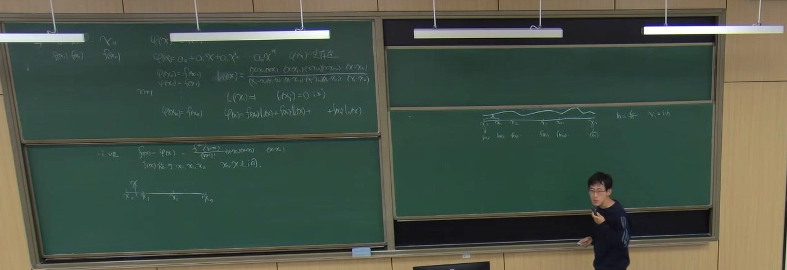
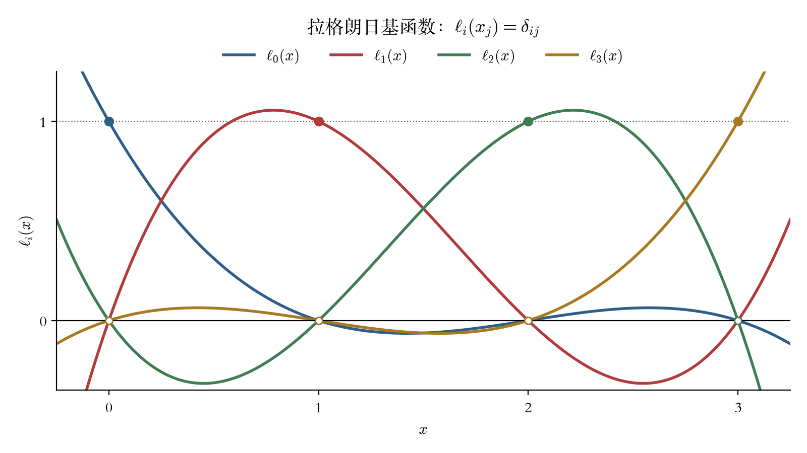
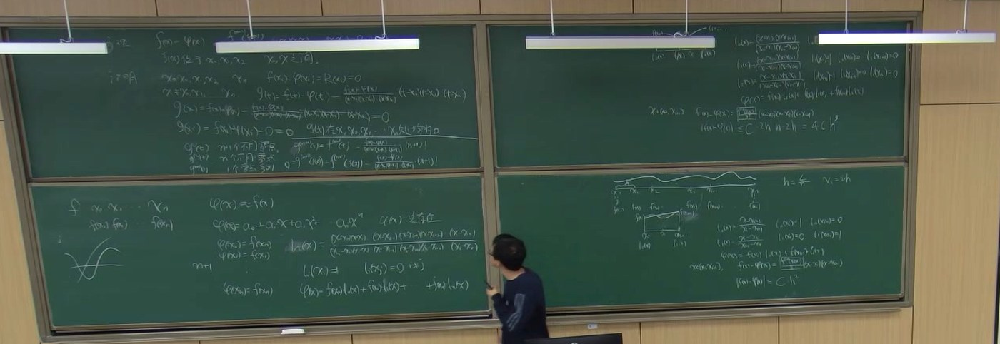
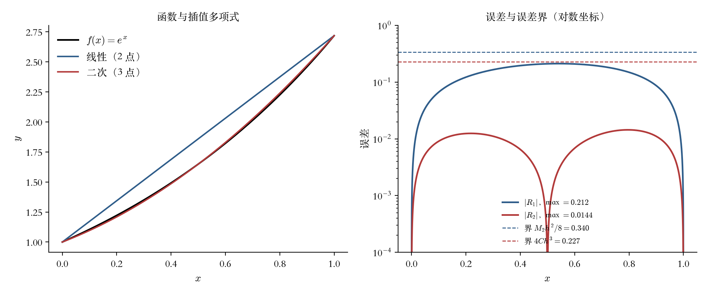
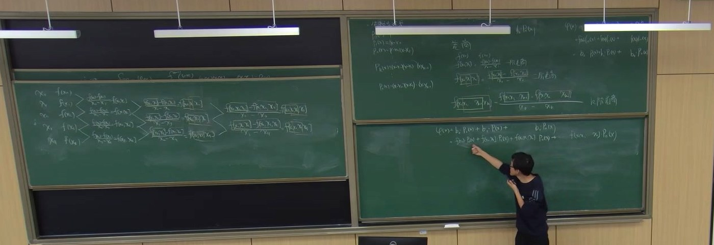
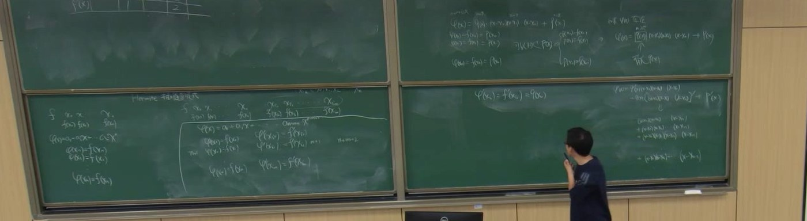
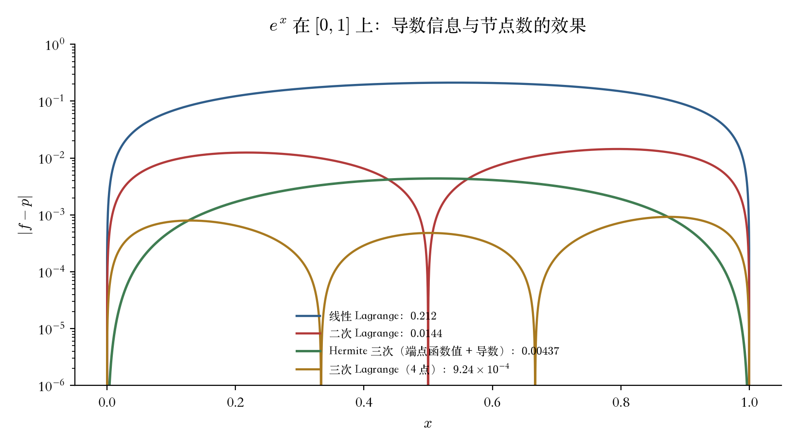
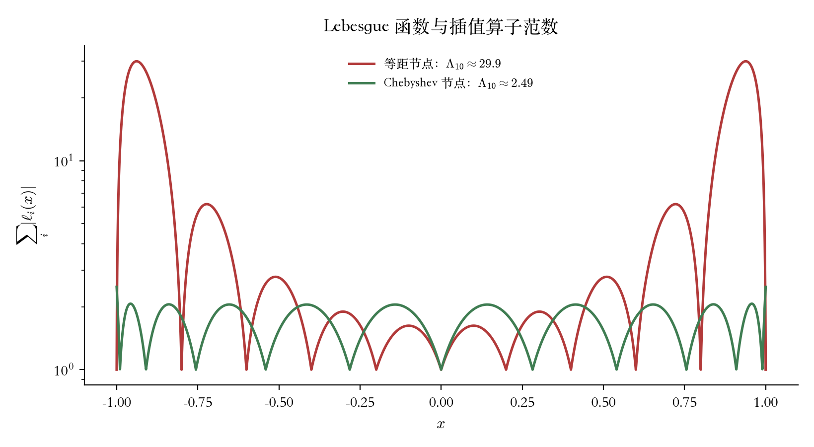
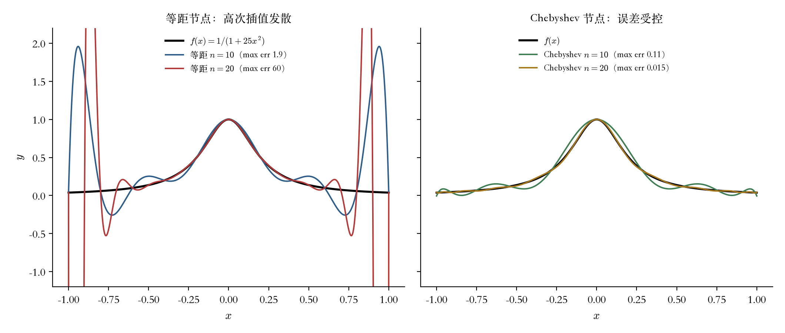

# 第 10 讲（10-19）：拉格朗日插值的余项定理、牛顿插值与差商、埃尔米特插值

> 课堂实录精编。本讲**无课件、全程板书**（与[第 9 讲](lec09.md)、[第 7 讲](lec07.md)相同），
> 承接[第 9 讲](lec09.md)末尾的插值引论：采样点、范德蒙德矩阵、「存在唯一但病态」、换基到
> 拉格朗日基。第 9 讲只把拉格朗日公式写出来就下课了，**余项、误差界与另外两种插值
> （牛顿、埃尔米特）都留到本讲**。
> 本讲主线四段：**拉格朗日公式与唯一性**（$n+1$ 个条件、$n+1$ 个系数，基函数 $l_i$ 的
> $\delta$ 性质是全部构造的支点）；**余项定理**（构造辅助函数 $g(t)$，用 Rolle 定理套 $n+1$ 次，
> 得到 $R_n(x)=\dfrac{f^{(n+1)}(\xi)}{(n+1)!}\omega_{n+1}(x)$，再用它算等距节点下的 $h^2$、$h^3$
> 误差界）；**牛顿插值**（差商、差商表、$N_n(x)=f[x_0]+\sum f[x_0,\dots,x_k]\prod(x-x_j)$，
> 以及「加一个节点只添一项」的工程价值）；**埃尔米特插值**（同时插函数值与导数值，
> $2n+2$ 个条件、$2n+1$ 次多项式、余项里出现 $\prod(x-x_i)^2$）。
> 本讲公式以**教师摄像头板书**为唯一权威：平台语音识别与本地 whisper 转写都错得厉害
> （「拉格朗日」被写成「拉网程度」，「插值」被写成「插片 / 差距」），**不要按转写字面引用**；
> 原始转写与板书关键帧存档于 `_sources/numerical/transcripts/`（不随书发布）。
>
> **本页分三条线读**，每条线用不同的盒子标记：
> **〔课堂〕** 是板书与录音里确实出现的内容（含老师原话的整理稿）；
> **〔教材〕** 是颜庆津《数值分析》第 5 章的对应条目；
> **〔延伸〕** 是本编补的、课堂没讲但学完应当知道的内容（病态与稳定计算、Lebesgue 常数、
> Runge 现象、Hermite–Fejér、插值的应用地图、数值实验与分层练习）。延伸内容**不冒充课堂内容**，
> 每处都单独标注；只想知道老师讲了什么，读〔课堂〕与 §七 即可。



::: note 先看哪一段
- **复习 / 考前**：只读下面的「10 分钟复习版」+ §七「老师强调的五件事」+ §十四「一页纸公式卡」。
- **跟课 / 补笔记**：读 §一–§六（〔课堂〕），对照板书时间戳与四张板书照片。
- **想真正会用**：加读 §八–§十二（〔延伸〕），尤其是重心公式、Lebesgue 常数、Runge 现象与数值实验。
- **做题**：§十三 分层练习（A 概念 / B 推导 / C 编程），答案折叠在每题下面。
:::

::: method[core] 10 分钟复习版 · 第 10 讲

**一句话**：插值多项式「过点」只是及格线，**余项**才回答「点与点之间差多少」；拉格朗日给的是**存在唯一 + 显式公式**，牛顿给的是**可增量计算**（差商表），埃尔米特给的是**连导数一起插**（$2n+2$ 个条件）。

**必记结论**

| 内容 | 要点 |
|:--|:--|
| **插值条件** | 已知 $n+1$ 个互异点 $(x_i,f(x_i))$，求 $\varphi$ 使 $\varphi(x_i)=f(x_i)$；$n+1$ 个条件、$n+1$ 个待定系数 |
| **唯一性** | 系数矩阵为范德蒙德矩阵，$\det A=\prod_{i\lt j}(x_j-x_i)\neq0$（节点互异）$\Rightarrow$ 次数 $\le n$ 的插值多项式**存在且唯一** |
| **拉格朗日基** | $l_i(x)=\prod\limits_{j\neq i}\dfrac{x-x_j}{x_i-x_j}$，$\deg l_i=n$，$l_i(x_j)=\delta_{ij}$ |
| **拉格朗日公式** | $L_n(x)=\sum\limits_{i=0}^{n}f(x_i)\,l_i(x)$；系数**直接就是函数值**，不必解病态方程组 |
| **余项定理** | $R_n(x)=f(x)-L_n(x)=\dfrac{f^{(n+1)}(\xi)}{(n+1)!}\,\omega_{n+1}(x)$，$\omega_{n+1}(x)=\prod\limits_{i=0}^{n}(x-x_i)$，$\xi$ 在 $x,x_0,\dots,x_n$ 的最小与最大之间 |
| **余项证明** | 固定 $x$，令 $g(t)=f(t)-L_n(t)-\dfrac{f(x)-L_n(x)}{\omega_{n+1}(x)}\omega_{n+1}(t)$；$g$ 有 $n+2$ 个零点 $\Rightarrow$ Rolle 套 $n+1$ 次 $\Rightarrow g^{(n+1)}(\xi)=0$ |
| **误差界** | $\lvert R_n(x)\rvert\le\dfrac{M_{n+1}}{(n+1)!}\lvert\omega_{n+1}(x)\rvert$，$M_{n+1}=\max\lvert f^{(n+1)}\rvert$ |
| **一次插值** | $R_1(x)=\dfrac{f''(\xi)}{2}(x-x_0)(x-x_1)$，$\lvert R_1\rvert\le\dfrac{M_2h^2}{8}$（等距，$h=x_1-x_0$） |
| **二次插值** | 三点等距 $x_0,x_0+h,x_0+2h$：$\lvert(x-x_0)(x-x_1)(x-x_2)\rvert\le2h\cdot h\cdot2h=4h^3$，故 $\lvert R_2\rvert\le4Ch^3$（$C=M_3/6$） |
| **差商** | $f[x_i]=f(x_i)$；$f[x_i,\dots,x_{i+k}]=\dfrac{f[x_{i+1},\dots,x_{i+k}]-f[x_i,\dots,x_{i+k-1}]}{x_{i+k}-x_i}$ |
| **牛顿公式** | $N_n(x)=f[x_0]+\sum\limits_{k=1}^{n}f[x_0,\dots,x_k]\prod\limits_{j=0}^{k-1}(x-x_j)$；与 $L_n$ **是同一个多项式** |
| **牛顿余项** | $R_n(x)=f[x_0,\dots,x_n,x]\,\omega_{n+1}(x)$；且 $f[x_0,\dots,x_k]=\dfrac{f^{(k)}(\xi)}{k!}$ |
| **增量性** | 增加节点 $x_{n+1}$ 只需在末尾添一项 $f[x_0,\dots,x_{n+1}]\prod_{j=0}^{n}(x-x_j)$，旧系数不动 |
| **埃尔米特条件** | $\varphi(x_i)=f(x_i)$ 且 $\varphi'(x_i)=f'(x_i)$，$i=0,\dots,n$，共 $2n+2$ 个条件；取 $\deg\varphi\le2n+1$ |
| **埃尔米特基** | $h_i(x)=\bigl[1-2l_i'(x_i)(x-x_i)\bigr]l_i^2(x)$，$\hat h_i(x)=(x-x_i)l_i^2(x)$；$H=\sum[f(x_i)h_i+f'(x_i)\hat h_i]$ |
| **埃尔米特余项** | $f(x)-H_{2n+1}(x)=\dfrac{f^{(2n+2)}(\xi)}{(2n+2)!}\prod\limits_{i=0}^{n}(x-x_i)^2$ |

**老师强调的考点**（据板书加框/箭头与课堂反复回扣整理）：**① $n+1$ 个条件决定 $n+1$ 次多项式**——「唯一存在」是后面所有公式的合法性来源，先数条件再谈公式；**② 余项定理的证明**是 Rolle 定理的「$n+2$ 个零点 $\to$ $n+1$ 阶导一个零点」链条，辅助函数 $g(t)$ 的构造是考试最容易断的一步；**③ 误差界要会把 $\lvert\omega_{n+1}\rvert$ 算成 $h$ 的幂**——二次插值时老师在板上逐项乘出 $2h\cdot h\cdot2h=4h^3$，这个常数不是背的，是算的；**④ 牛顿插值的价值在差商表**：手算按表斜着做，编程按表递推，**加节点只添一项**；**⑤ 埃尔米特的条件数是 $2(n+1)$，次数上界是 $2n+1$**，余项分母是 $(2n+2)!$、乘积要**平方**，这三处最容易各错一位。

**对应正文**：插值与逼近见[第 5 章](../course/ch05/overview.md)（原书第 5 章）；拉格朗日公式的引入见[第 9 讲](lec09.md) §十一–§十二；本章 5.3–5.5 节的余项、牛顿插值与 Hermite 插值即由本讲补齐。

**延伸层速览**（本编补充，详见 §八–§十四）：插值算子的**病态**（Vandermonde 条件数、Lebesgue 常数 $\Lambda_n$、重心公式）、**Runge 现象与 Chebyshev 节点**、**一般重数的 Hermite 插值**、**插值的应用地图**（数值积分 / ODE / 有限元 / 图形学 / 机器学习）、**可复现数值实验**与**分层练习**。

:::

## 课堂时间线 {#lec10-S1}

| 时间 | 内容 |
|---|---|
| 00:00–01:30 | 课前准备、作业与上节回顾（转写多为噪声） |
| 01:30–06:00 | 插值问题复述：$n+1$ 个点、$n+1$ 个条件、$\varphi(x)=a_0+a_1x+\cdots+a_nx^n$「唯一存在」 |
| 06:00–14:30 | 拉格朗日基 $l_i(x)$ 的构造与 $\delta$ 性质；$L_n(x)=\sum f(x_i)l_i(x)$ |
| 14:30–20:00 | 两点、三点情形的基函数展开；$l_0,l_1$ 的显式写法与取值表 |
| 20:00–36:00 | 一次插值与二次插值的误差界：$\lvert R_1\rvert\le Ch^2$、$\lvert R_2\rvert\le4Ch^3$ |
| 36:00–47:00 | **余项定理的证明**：构造 $g(t)$、Rolle 定理套 $n+1$ 次、$g^{(n+1)}(\xi)=0$ |
| 47:00–52:00 | 牛顿插值的动机：换一组基 $P_0,P_1,\dots,P_n$，系数待定 |
| 52:00–58:00 | **差商**定义：一阶、二阶、$k$ 阶差商；差商与导数的关系 |
| 58:00–70:00 | **差商表**与牛顿插值公式 $N_n(x)=f[x_0]+\sum f[x_0,\dots,x_k]\prod(x-x_j)$ |
| 70:00–78:00 | 牛顿余项 $R_n=f[x_0,\dots,x_n,x]\omega_{n+1}(x)$；与拉格朗日余项等价 |
| 78:00–84:00 | **埃尔米特插值**引入：为什么要插导数；条件计数 $2n+2$ |
| 84:00–93:00 | 埃尔米特插值多项式的次数、唯一性与基函数构造 |
| 93:00–99:00 | 埃尔米特余项 $\dfrac{f^{(2n+2)}(\xi)}{(2n+2)!}\prod(x-x_i)^2$；用「加重根」解释构造 |

> 时间戳为教师流回放进度，允许 $\pm1$ 分钟误差；课间无单独休息，板书在 47:00 与 78:00 两次大擦除。

## 一、开场：把「插值」这件事重新数一遍（01:30–06:00） {#lec10-S2}

老师在左板上从最朴素的写法开始（04:00 起边讲边写）：

$$\varphi(x)=a_0+a_1x+a_2x^2+\cdots+a_nx^n,\qquad \varphi(x_i)=f(x_i)\quad(i=0,1,\dots,n).$$

板右侧紧接着写了一个词：**「$\varphi(x)$ 唯一存在」**。这句话不是装饰，而是本讲所有公式的**合法性来源**：先数清楚「有几个条件、几个未知数」，再谈怎么把系数求出来。

- 未知数：$a_0,\dots,a_n$ 共 $n+1$ 个；
- 条件：$\varphi(x_i)=f(x_i)$ 共 $n+1$ 个；
- 写成矩阵就是范德蒙德方程组，节点互异时行列式 $\prod_{i\lt j}(x_j-x_i)\neq0$，所以**解存在且唯一**。

::: thm[core] 定理 · 插值多项式的存在唯一性
设 $x_0,x_1,\dots,x_n$ 是 $[a,b]$ 上**互异**的 $n+1$ 个节点，$f_0,\dots,f_n$ 为任意给定值。则存在**唯一**的次数不超过 $n$ 的多项式 $p_n$，使

$$p_n(x_i)=f_i,\qquad i=0,1,\dots,n.$$
:::

::: proof
**写成方程组。** 令 $p_n(x)=a_0+a_1x+\cdots+a_nx^n$，则 $n+1$ 个条件就是

$$\begin{bmatrix}
1&x_0&x_0^2&\cdots&x_0^n\\
1&x_1&x_1^2&\cdots&x_1^n\\
\vdots&\vdots&\vdots&&\vdots\\
1&x_n&x_n^2&\cdots&x_n^n
\end{bmatrix}
\begin{bmatrix}a_0\\a_1\\\vdots\\a_n\end{bmatrix}
=\begin{bmatrix}f_0\\f_1\\\vdots\\f_n\end{bmatrix}.$$

系数矩阵是**范德蒙德矩阵** $V$，其行列式为

$$\det V=\prod_{0\le i\lt j\le n}(x_j-x_i).$$

节点互异 $\Rightarrow$ 每个因子 $x_j-x_i\neq0$ $\Rightarrow$ $\det V\neq0$ $\Rightarrow$ 解存在且唯一。$\blacksquare$
:::

**这个证明只回答了「有没有、唯不唯一」，没有回答「怎么算、算得准不准」。** 后者才是本讲与 §八 的正题：

- 范德蒙德矩阵在 $n=10$、等距节点、$[0,1]$ 上条件数约为 $1.2\times10^8$（本编实测，见 §八）；
  $n=20$ 时约 $9.7\times10^{16}$——双精度下**直接解系数会丢光有效数字**；
- 所以拉格朗日换基、牛顿换基、重心公式再换一次，本质上都是在**避开这个病态矩阵**；
- 「存在唯一」是**理论**，「能算准」是**数值**，两者之间隔着一个条件数。

::: note 为什么老师要在这里停一下
第 9 讲已经用范德蒙德矩阵说明过「存在唯一但病态」，本讲换到基函数视角。老师把「唯一存在」四个字写在板头，是为了给后面的三件事发通行证：**拉格朗日公式**（直接写出解）、**牛顿公式**（换一组基写同一个解）、**埃尔米特公式**（条件加倍后仍唯一）。三套公式形式不同，背后是同一个「条件数 = 未知数」的计数。
:::

## 二、拉格朗日基：让系数「自己跳出来」（06:00–20:00） {#lec10-S3}

### 2.1 基函数的构造 {#lec10-S4}

不直接解 $a_i$，而是先造 $n+1$ 个「开关函数」$l_i(x)$，要求

$$l_i(x_j)=\delta_{ij}=\begin{cases}1,&j=i,\\ 0,&j\neq i.\end{cases}$$

满足这个要求的 $n$ 次多项式只有一条路：**在 $x_j\ (j\neq i)$ 处放根，在 $x_i$ 处归一化**。于是

$$l_i(x)=\prod_{\substack{j=0\ j\neq i}}^{n}\frac{x-x_j}{x_i-x_j}
=\frac{(x-x_0)\cdots(x-x_{i-1})(x-x_{i+1})\cdots(x-x_n)}
{(x_i-x_0)\cdots(x_i-x_{i-1})(x_i-x_{i+1})\cdots(x_i-x_n)}.$$

板书把分子分母一行排开、每个因子加括号，正是为了看清「分子缺谁、分母就是谁减谁」——这是手写时最不容易错的形式。

### 2.2 插值多项式 {#lec10-S5}

$$\boxed{\,L_n(x)=\sum_{i=0}^{n}f(x_i)\,l_i(x)\,}$$

**验证**：$L_n(x_j)=\sum_i f(x_i)l_i(x_j)=f(x_j)\cdot1+\sum_{i\neq j}f(x_i)\cdot0=f(x_j)$。次数：每个 $l_i$ 是 $n$ 次，线性组合仍 $\le n$ 次。由唯一性，**它就是那个插值多项式**。

$$L_n(x)=f(x_0)l_0(x)+f(x_1)l_1(x)+\cdots+f(x_n)l_n(x).$$

### 2.3 两点与三点情形（板书写在右下板） {#lec10-S6}

两点 $x_0,x_1$：

$$l_0(x)=\frac{x-x_1}{x_0-x_1},\qquad l_1(x)=\frac{x-x_0}{x_1-x_0},$$

$$\varphi(x)=f(x_0)l_0(x)+f(x_1)l_1(x),\qquad x\in[x_0,x_1].$$

板上还写了取值表：$l_0(x_0)=1,\ l_0(x_1)=0$；$l_1(x_0)=0,\ l_1(x_1)=1$。三点 $x_0,x_1,x_2$ 时同理：

$$l_0(x)=\frac{(x-x_1)(x-x_2)}{(x_0-x_1)(x_0-x_2)},\quad
l_1(x)=\frac{(x-x_0)(x-x_2)}{(x_1-x_0)(x_1-x_2)},\quad
l_2(x)=\frac{(x-x_0)(x-x_1)}{(x_2-x_0)(x_2-x_1)}.$$



**图注（读图）**：四条曲线分别是 $\ell_0,\ell_1,\ell_2,\ell_3$（节点 $0,1,2,3$）。实心点是「自己的节点」，
函数值为 $1$；空心点是「别人的节点」，函数值为 $0$。$L_n$ 就是把这四条曲线按 $f(x_i)$ 加权求和——
**每个节点只影响自己那盏灯**，这就是 $\delta$ 性质的全部含义。

### 2.4 算一遍：三点插值 {#lec10-S7}

取节点 $x_0=0,x_1=1,x_2=2$，$f(x)=x^2+1$，即 $f_0=1,f_1=2,f_2=5$。

$$l_0(x)=\frac{(x-1)(x-2)}{(0-1)(0-2)}=\frac{x^2-3x+2}{2},$$

$$l_1(x)=\frac{(x-0)(x-2)}{(1-0)(1-2)}=-x^2+2x,$$

$$l_2(x)=\frac{(x-0)(x-1)}{(2-0)(2-1)}=\frac{x^2-x}{2}.$$

于是

$$L_2(x)=1\cdot l_0(x)+2\cdot l_1(x)+5\cdot l_2(x)
=\frac{x^2-3x+2}{2}-2x^2+4x+\frac{5x^2-5x}{2}=x^2+1.$$

**两件事同时被验证**：

1. **过点**：$L_2(0)=1,L_2(1)=2,L_2(2)=5$；
2. **次数**：$L_2$ 是二次，恰好等于 $f$——因为 $f$ 本身就是二次多项式，而二次插值多项式唯一，
   所以 $L_2\equiv f$，$R_2\equiv0$（$f^{(3)}=0$，余项定理也给出同样结论）。

若只问 $x=0.5$ 处的值：$L_2(0.5)=1.25$，与 $f(0.5)=1.25$ 一致。

::: method 计算量与存储：$O(n^2)$ 从哪里来
- **求值**：算一个 $l_i(x)$ 要 $n$ 次乘法（$n$ 个因子），$n+1$ 个基函数共 $O(n^2)$；
- **存储**：若把每个 $l_i$ 的多项式系数都存下来，是 $(n+1)\times(n+1)$ 的三角表，$O(n^2)$；
- **改进**：预先算好**重心权重** $w_i=1/\prod_{j\neq i}(x_i-x_j)$，之后每求一个点只需 $O(n)$
  （§八 的重心公式）；这是实际软件里拉格朗日插值的标准实现。
:::

::: intuition 基函数的「开关」直觉
$l_i$ 在 $x_i$ 处等于 $1$、在其余节点处等于 $0$，所以 $L_n$ 在 $x_i$ 处**只留下 $f(x_i)$ 这一项**。换句话说，插值多项式不是「解出来的」，而是**被基函数一项一项拼出来的**：每个节点贡献一个「只在自己家门口亮」的灯。牛顿插值换了一组同样能拼出 $L_n$ 的灯，只是那组灯更容易「加一盏」。
:::

## 三、余项定理：点与点之间到底差多少（20:00–47:00） {#lec10-S8}

插值多项式在节点上与 $f$ 相等，但在两个节点之间不一定。余项定理回答这个差。

::: thm[core] 定理 · 插值余项（板书标题「定理」）
设 $f\in C^{n+1}[a,b]$，$x_0,\dots,x_n$ 是 $[a,b]$ 内互异的 $n+1$ 个节点，$L_n$ 是相应的拉格朗日插值多项式。则对任意 $x\in[a,b]$，存在 $\xi=\xi(x)$ 介于 $x,x_0,\dots,x_n$ 的最小值与最大值之间，使

$$R_n(x)=f(x)-L_n(x)=\frac{f^{(n+1)}(\xi)}{(n+1)!}\,\omega_{n+1}(x),\qquad
\omega_{n+1}(x)=\prod_{i=0}^{n}(x-x_i).$$
:::

### 3.1 证明：一个辅助函数 + $n+1$ 次 Rolle {#lec10-S9}

板书把证明分成「$x$ 是节点」与「$x$ 不是节点」两种情形：

**情形一：$x=x_k$。** 此时 $\omega_{n+1}(x_k)=0$，且 $L_n(x_k)=f(x_k)$，两边都是 $0$，结论平凡。

**情形二：$x\neq x_0,\dots,x_n$。** 固定这个 $x$，构造

$$g(t)=f(t)-L_n(t)-\frac{f(x)-L_n(x)}{\omega_{n+1}(x)}\,\omega_{n+1}(t).$$

这个 $g$ 的设计意图是「让 $t=x$ 也成为零点」：

- $g(x)=f(x)-L_n(x)-\dfrac{f(x)-L_n(x)}{\omega_{n+1}(x)}\omega_{n+1}(x)=0$；
- $g(x_i)=f(x_i)-L_n(x_i)-\dfrac{f(x)-L_n(x)}{\omega_{n+1}(x)}\cdot0=0$。

所以 $g$ 在 $x,x_0,x_1,\dots,x_n$ 这 **$n+2$ 个互异点**上为零。反复用 Rolle 定理：

$$g\ \text{有}\ n+2\ \text{个零点}\ \Longrightarrow\ g'\ \text{有}\ n+1\ \text{个零点}
\Longrightarrow\cdots\Longrightarrow\ g^{(n+1)}\ \text{有}\ 1\ \text{个零点}\ \xi.$$

在 $\xi$ 处，

$$0=g^{(n+1)}(\xi)=f^{(n+1)}(\xi)-L_n^{(n+1)}(\xi)
-\frac{f(x)-L_n(x)}{\omega_{n+1}(x)}\,\omega_{n+1}^{(n+1)}(\xi).$$

而 $L_n$ 是 $n$ 次多项式，$L_n^{(n+1)}\equiv0$；$\omega_{n+1}$ 是首项系数为 $1$ 的 $n+1$ 次多项式，故 $\omega_{n+1}^{(n+1)}=(n+1)!$。代入得

$$0=f^{(n+1)}(\xi)-\frac{f(x)-L_n(x)}{\omega_{n+1}(x)}(n+1)!,$$

移项即得定理。$\blacksquare$

::: think 证明的「骨架」只有三句话
① 造 $g(t)$，把待证的 $x$ 塞进零点集；② $n+2$ 个零点 $\Rightarrow$ Rolle 套 $n+1$ 次 $\Rightarrow$ $g^{(n+1)}$ 有一个零点；③ 在 $\xi$ 处求导，利用 $L_n^{(n+1)}=0$、$\omega_{n+1}^{(n+1)}=(n+1)!$ 解出 $R_n$。考试写证明时，**第 ① 步的辅助函数是最容易断的地方**：分母为什么是 $\omega_{n+1}(x)$？因为要保证 $g(x)=0$；分子为什么是 $f(x)-L_n(x)$？因为那正是我们要估计的量。
:::



### 3.2 误差界：把 $\lvert\omega_{n+1}\rvert$ 算成 $h$ 的幂 {#lec10-S10}

定理给出的是「存在 $\xi$」，实际估计时要放大：

$$\lvert R_n(x)\rvert\le\frac{M_{n+1}}{(n+1)!}\lvert\omega_{n+1}(x)\rvert,\qquad
M_{n+1}=\max_{[a,b]}\lvert f^{(n+1)}\rvert.$$

**一次插值（两点等距，$h=x_1-x_0$）**：

$$\lvert(x-x_0)(x-x_1)\rvert\le\frac{h^2}{4}\quad\Longrightarrow\quad
\lvert R_1(x)\rvert\le\frac{M_2}{2}\cdot\frac{h^2}{4}=\frac{M_2h^2}{8}.$$

**二次插值（三点等距 $x_0,x_0+h,x_0+2h$）**：板书在右板下方逐项乘出

$$\lvert(x-x_0)(x-x_1)(x-x_2)\rvert\le 2h\cdot h\cdot 2h=4h^3
\quad\Longrightarrow\quad
\lvert R_2(x)\rvert\le\frac{M_3}{6}\cdot4h^3=\frac{2M_3}{3}h^3.$$

板上的写法是 $\lvert f(x)-\varphi(x)\rvert\le C\cdot2h\cdot h\cdot2h=4Ch^3$，其中 $C=\dfrac{M_3}{6}$。**这个 $4$ 不是背的，是三个因子在区间端点取最大后乘出来的**：$x$ 到最远两个节点的距离各不超过 $2h$，到中间节点的距离不超过 $h$。

::: note 误差界的两种读法
- **「阶」的读法**：$R=O(h^{n+1})$——节点加密一倍，误差按 $2^{-(n+1)}$ 缩小。这是收敛阶的来源。
- **「常数」的读法**：$M_{n+1}$ 与 $\lvert\omega_{n+1}\rvert$ 的常数都要算清楚。老师在板上把 $2h\cdot h\cdot2h$ 写全，就是提醒**考试可能只给区间和节点，要你自己把常数乘出来**。
:::
### 3.3 算一遍：$e^x$ 的误差与界 {#lec10-S11}

取 $f(x)=\mathrm e^x$，在 $[0,1]$ 上做线性与二次插值。实测（$20001$ 个等距采样点）：

| 插值 | 区间 | $h$ | 实测 $\max\lvert R\rvert$ | 误差比（$h$ 减半） | 理论界 |
|:--|:--|--:|--:|--:|--:|
| 线性（2 点） | $[0,1]$ | $1$ | $0.2119$ | — | $M_2h^2/8=0.3398$ |
| 线性（2 点） | $[0,0.5]$ | $0.5$ | $0.0404$ | $5.2$ | $0.0849$ |
| 线性（2 点） | $[0,0.25]$ | $0.25$ | $0.00887$ | $4.6$ | $0.0212$ |
| 二次（3 点） | $[0,1]$ | $0.5$ | $0.01442$ | — | $4Ch^3=0.2265$ |
| 二次（3 点） | $[0,0.5]$ | $0.25$ | $0.001339$ | $10.8$ | $0.0283$ |

**读表三件事**：

1. **阶是对的**：线性误差比约 $4=2^2$，二次约 $8\sim11\approx2^3$——这正是 $O(h^2)$、$O(h^3)$；
2. **界是松的**：线性界 $0.3398$ 比实测 $0.2119$ 大 $1.6$ 倍，二次界 $0.2265$ 比实测 $0.0144$ 大 $15.7$ 倍；
   界是「最坏情况」，实际误差取决于 $M_{n+1}$ 与 $\lvert\omega_{n+1}\rvert$ 是否在同一点取到最大；
3. **阶比常数重要**：考试若问「加密一倍误差降多少」，答 $2^{-(n+1)}$；若问「估计这个区间上的最大误差」，
   才需要把 $M_{n+1}$ 与 $\lvert\omega_{n+1}\rvert$ 的常数都算出来。



**图注（读图）**：右图两条虚线是对应的理论界，实线是实际误差。注意误差在节点处**精确为零**（插值条件），
在两个节点之间隆起；二次插值在 $x=0.5$ 处也有一个零点，把误差分成两段。**界的形状是「包络」，不是误差曲线本身。**

### 3.4 余项的三种写法（同一件事的三种语言） {#lec10-S12}

| 写法 | 表达式 | 什么时候好用 |
|:--|:--|:--|
| **拉格朗日型** | $R_n(x)=\dfrac{f^{(n+1)}(\xi)}{(n+1)!}\omega_{n+1}(x)$ | 估计误差界、证明收敛阶 |
| **牛顿型（差商）** | $R_n(x)=f[x_0,\dots,x_n,x]\,\omega_{n+1}(x)$ | 已知差商表、要「加节点」时 |
| **Peano 核型**（延伸） | $R_n(x)=\dfrac{1}{n!}\displaystyle\int_a^b f^{(n+1)}(t)K_n(x,t)\,dt$ | 泛函分析、误差展开、超收敛分析 |

三者的关系：拉格朗日型与牛顿型由 $f[x_0,\dots,x_n,x]=f^{(n+1)}(\xi)/(n+1)!$ 互化；
Peano 核型把「存在某个 $\xi$」换成了「对一个核积分」，条件更弱（$f\in C^{n+1}$ 即可），
但计算更繁。**本讲只要求前两种**；Peano 核在 §十 的延伸里给一个直观解释。

::: think 关于 $\xi$ 的三个常见误解
1. **$\xi$ 是 $x$ 的函数**：$\xi=\xi(x)$，随 $x$ 变；不能把它当常数提到积分或极限外，也不能对 $x$ 求导时当常数。
2. **$\xi$ 不一定在区间中点**：它只保证在 $x$ 与全体节点的最小、最大之间；具体位置未知。
3. **$f^{(n+1)}$ 变号时界要取绝对值最大**：$M_{n+1}=\max\lvert f^{(n+1)}\rvert$，不是最大值。
:::


## 四、牛顿插值：换一组能「加节点」的基（47:00–78:00） {#lec10-S13}

拉格朗日公式漂亮，但有一个工程缺陷：**每加一个节点，所有 $l_i$ 都要重算**。牛顿插值换一组基，让「加节点」只在末尾添一项。

### 4.1 为什么换基 {#lec10-S14}

把插值多项式写成

$$\varphi(x)=b_0P_0(x)+b_1P_1(x)+\cdots+b_nP_n(x),$$

其中

$$P_0(x)=1,\quad P_1(x)=x-x_0,\quad P_2(x)=(x-x_0)(x-x_1),\quad\dots,\quad
P_k(x)=\prod_{j=0}^{k-1}(x-x_j).$$

这组 $P_k$ 是「逐层加根」的：$P_k$ 在 $x_0,\dots,x_{k-1}$ 处为零，在 $x_k$ 处不为零。代入节点条件 $\varphi(x_k)=f(x_k)$，从 $k=0$ 开始逐个解：

$$b_0=f(x_0),\qquad
b_1=\frac{f(x_1)-f(x_0)}{x_1-x_0},\qquad
b_2=\frac{\text{（一阶差商的差）}}{x_2-x_0},\ \dots$$

这些 $b_k$ 就是**差商**。

### 4.2 差商的定义与表 {#lec10-S15}

$$f[x_i]=f(x_i),$$

$$f[x_i,x_{i+1}]=\frac{f(x_{i+1})-f(x_i)}{x_{i+1}-x_i},$$

$$f[x_i,\dots,x_{i+k}]
=\frac{f[x_{i+1},\dots,x_{i+k}]-f[x_i,\dots,x_{i+k-1}]}{x_{i+k}-x_i}.$$

差商表按「斜线」组织（板书画的正是这张表）：

| $x_i$ | $f(x_i)$ | 一阶差商 | 二阶差商 | 三阶差商 |
|:--|:--|:--|:--|:--|
| $x_0$ | $f(x_0)$ | | | |
| $x_1$ | $f(x_1)$ | $f[x_0,x_1]$ | | |
| $x_2$ | $f(x_2)$ | $f[x_1,x_2]$ | $f[x_0,x_1,x_2]$ | |
| $x_3$ | $f(x_3)$ | $f[x_2,x_3]$ | $f[x_1,x_2,x_3]$ | $f[x_0,x_1,x_2,x_3]$ |

板上的箭头从左上斜向右下，每个新差商由**左边一列的两个相邻值**相减、再除以**跨度**（$x_{i+k}-x_i$）得到。

::: method 方法 · 差商表怎么算（手算与编程同构）
1. 第 0 列抄 $x_i$，第 1 列抄 $f(x_i)$；
2. 第 $k$ 阶差商列的第 $i$ 项：取第 $k-1$ 阶列的第 $i+1$ 项减第 $i$ 项，除以 $x_{i+k}-x_i$；
3. 表的最上一行（斜线）就是牛顿公式的系数：$f[x_0],f[x_0,x_1],f[x_0,x_1,x_2],\dots$。

时间复杂度 $O(n^2)$（表的大小），空间 $O(n^2)$ 或不存全表、只留斜线 $O(n)$。**加节点**时只需在表底加一行、往右上算一条斜线，旧系数不动——这正是拉格朗日公式给不了的。
:::

### 4.3 牛顿插值公式 {#lec10-S16}

$$\boxed{\,N_n(x)=f[x_0]+\sum_{k=1}^{n}f[x_0,x_1,\dots,x_k]\prod_{j=0}^{k-1}(x-x_j)\,}$$

写开：

$$N_n(x)=f(x_0)+f[x_0,x_1](x-x_0)+f[x_0,x_1,x_2](x-x_0)(x-x_1)+\cdots
+f[x_0,\dots,x_n](x-x_0)\cdots(x-x_{n-1}).$$

由插值多项式的唯一性，$N_n$ 与 $L_n$ **是同一个多项式**，只是换了基、换了算法。

### 4.4 牛顿余项与差商–导数关系 {#lec10-S17}

$$R_n(x)=f(x)-N_n(x)=f[x_0,x_1,\dots,x_n,x]\,\omega_{n+1}(x).$$

与拉格朗日余项对照，立刻得到差商与导数的关系：

$$f[x_0,x_1,\dots,x_k]=\frac{f^{(k)}(\xi)}{k!},\qquad \xi\in(\min x_i,\max x_i).$$

这条式子有两个用处：一是**理论上**把差商看成「离散化的 $k$ 阶导数」；二是**数值上**可以用差商近似导数（第 9 讲的割线法就是 $k=1$ 的情形）。

::: note 牛顿公式的「增量」价值（老师反复回扣）
假设已有 $x_0,\dots,x_n$ 的差商表，现在新增节点 $x_{n+1}$。拉格朗日公式要重算全部 $l_i$（$O(n^2)$ 甚至更高）；牛顿公式只需在表底加一行、算出新的斜线项 $f[x_0,\dots,x_{n+1}]$，然后在 $N_n$ 末尾加

$$f[x_0,\dots,x_{n+1}](x-x_0)\cdots(x-x_n).$$

旧系数**一个都不动**。这就是「牛顿插值适合逐步加密采样」的原因，也是后面自适应插值、外推算法的基础。
:::


### 4.5 算一遍：$f(x)=x^3$ 的差商表 {#lec10-S18}

取 $x_0=0,x_1=1,x_2=2,x_3=3$，$f(x)=x^3$：

| $x_i$ | $f(x_i)$ | 一阶差商 | 二阶差商 | 三阶差商 |
|--:|--:|--:|--:|--:|
| $0$ | $0$ | | | |
| $1$ | $1$ | $\dfrac{1-0}{1-0}=1$ | | |
| $2$ | $8$ | $\dfrac{8-1}{2-1}=7$ | $\dfrac{7-1}{2-0}=3$ | |
| $3$ | $27$ | $\dfrac{27-8}{3-2}=19$ | $\dfrac{19-7}{3-1}=6$ | $\dfrac{6-3}{3-0}=1$ |

牛顿公式：

$$N_3(x)=0+1\cdot x+3\cdot x(x-1)+1\cdot x(x-1)(x-2).$$

展开：

$$N_3(x)=x+3x^2-3x+x^3-3x^2+2x=x^3.$$

**两个可验证的结论**：

1. **三次多项式的三阶差商是常数** $1$，等于首项系数（$x^3$ 的系数）；四阶差商为 $0$。
2. **牛顿形式与拉格朗日形式是同一个多项式**：本例中 $N_3$ 展开就是 $x^3$，与 $L_3$ 相同。

若再加一个节点 $x_4=4$，$f(4)=64$，只需在表底添一行：

$$f[x_3,x_4]=\frac{64-27}{4-3}=37,$$

$$f[x_2,x_3,x_4]=\frac{37-19}{4-2}=9,$$

$$f[x_1,\dots,x_4]=\frac{9-6}{4-1}=1,$$

$$f[x_0,\dots,x_4]=\frac{1-1}{4-0}=0.$$

所以 $N_4=N_3+0\cdot x(x-1)(x-2)(x-3)=x^3$——**加节点只添一项，且这一项可以为零**。

### 4.6 差商的四条性质 {#lec10-S19}

::: note 差商的代数性质（证明都不难，考试常以小题出现）
1. **对称性**：$f[x_0,\dots,x_k]$ 与节点的排列顺序无关。例如 $f[x_0,x_1]=f[x_1,x_0]$。
   证明：牛顿插值多项式与节点顺序无关（唯一性），而首项系数就是 $f[x_0,\dots,x_k]$。
2. **线性性**：对任意常数 $\alpha,\beta$，
   $(\alpha f+\beta g)[x_0,\dots,x_k]=\alpha f[x_0,\dots,x_k]+\beta g[x_0,\dots,x_k]$。
3. **多项式再生**：若 $f$ 是 $m$ 次多项式，则 $k\le m$ 时 $f[x_0,\dots,x_k]$ 是 $m-k$ 次多项式；
   $k\gt m$ 时 $f[x_0,\dots,x_k]=0$。特别地，$m$ 次多项式的 $m$ 阶差商等于其首项系数。
4. **与导数同阶**：$f[x_0,\dots,x_k]=\dfrac{f^{(k)}(\xi)}{k!}$，$\xi$ 在节点最小与最大之间。
   这是拉格朗日余项与牛顿余项互化的桥。
:::

**性质 3 的直接用途**：看到一张差商表，**对角线什么时候变成常数，就能读出插值多项式的次数**。
上例三阶差商为 $1$、四阶为 $0$，说明 $f$ 是三次多项式且首项系数为 $1$——不用展开就能判断。

### 4.7 增量算法：$O(n^2)$ 建表、$O(n)$ 求值 {#lec10-S20}

差商表可以**原地**计算（用一个数组 `d` 覆盖已用过的函数值）：

```text
输入：节点 x[0..n]，函数值 f[0..n]
d = f
for k = 1, 2, ..., n:
    for i = n, n-1, ..., k:
        d[i] = (d[i] - d[i-1]) / (x[i] - x[i-k])
输出：d[0..n]，其中 d[k] = f[x_0, ..., x_k]
```

时间复杂度 $O(n^2)$，空间 $O(n)$（不存整张表，只存最后一行/对角线）。建好系数后，用**嵌套乘法**求值：

$$N_n(x)=d_0+(x-x_0)\Bigl(d_1+(x-x_1)\bigl(d_2+\cdots+(x-x_{n-1})d_n\bigr)\Bigr),$$

只需 $O(n)$ 次乘加。**加节点**时从 $k=n+1$ 继续外层循环即可，旧系数不动——这就是 4.3 节说的「增量性」的算法版本。

::: method 手算与编程的两种节奏
- **手算**：画表，按斜线从左上到右下，每格「右上减左上、除以跨度」；最后取**最上面一行**作为系数。
- **编程**：原地数组，外层 $k$ 从 $1$ 到 $n$，内层 $i$ 从 $n$ 倒着到 $k$；结束后 `d[k]` 就是第 $k$ 个系数。
- **验算**：若 $f$ 是多项式，差商表某一列变成常数后，下一列应为 $0$；不满足就说明算错了。
:::

### 4.8 为什么牛顿公式一定过所有点（归纳证明） {#lec10-S21}

设 $N_k$ 是过前 $k+1$ 个节点的牛顿多项式。归纳假设 $N_{k-1}$ 过前 $k$ 个点。令

$$N_k(x)=N_{k-1}(x)+f[x_0,\dots,x_k]\,\omega_k(x),\qquad \omega_k(x)=\prod_{j=0}^{k-1}(x-x_j).$$

- 对 $i\lt k$：$\omega_k(x_i)=0$，所以 $N_k(x_i)=N_{k-1}(x_i)=f(x_i)$；
- 对 $i=k$：由差商定义，
  $$f[x_0,\dots,x_k]=\frac{f(x_k)-N_{k-1}(x_k)}{\omega_k(x_k)},$$
  所以 $N_k(x_k)=f(x_k)$；
- 次数：$N_{k-1}$ 次数 $\le k-1$，第二项次数 $\le k$，故 $\deg N_k\le k$。

由插值多项式的唯一性，$N_k$ 就是 $L_k$。$\blacksquare$




## 五、埃尔米特插值：连导数一起插（78:00–99:00） {#lec10-S22}

前面的插值只要求「过点」。如果已知的不只是函数值，还有导数值（例如知道速度、斜率），就应该把导数条件也用上——这就是**埃尔米特插值**。

### 5.1 条件计数 {#lec10-S23}

在 $x_0,\dots,x_n$ 上要求

$$\varphi(x_i)=f(x_i),\qquad \varphi'(x_i)=f'(x_i),\qquad i=0,1,\dots,n.$$

每个节点两个条件，共 $2(n+1)=2n+2$ 个条件，因此取

$$\varphi(x)=a_0+a_1x+\cdots+a_{2n+1}x^{2n+1},\qquad \deg\varphi\le2n+1.$$

板右侧把条件逐行写成两列：$\varphi(x_0)=f(x_0),\varphi'(x_0)=f'(x_0)$；$\varphi(x_1)=f(x_1),\varphi'(x_1)=f'(x_1)$；$\dots$；$\varphi(x_n)=f(x_n),\varphi'(x_n)=f'(x_n)$，并在旁边标出总条件数。对「每个节点只给一阶导数」的情形，共 $2(n+1)=2n+2$ 个条件——这个计数是唯一性与构造的起点。

::: thm[core] 定理 · 埃尔米特插值的唯一性
设 $f\in C^{2n+2}[a,b]$，$x_0,\dots,x_n$ 互异。则存在**唯一**的次数不超过 $2n+1$ 的多项式 $H_{2n+1}$，满足上述 $2n+2$ 个条件。
:::

**证明（存在性 + 唯一性）**：设 $H_1,H_2$ 都满足条件，令 $D=H_1-H_2$。则 $D(x_i)=0$ 且 $D'(x_i)=0$，即每个 $x_i$ 都是 $D$ 的**至少二重根**。$D$ 有 $2n+2$ 个根（计重数），若 $D\not\equiv0$ 则 $\deg D\ge2n+2$，与 $\deg D\le2n+1$ 矛盾。故 $D\equiv0$，唯一。存在性由下面的显式构造给出。

### 5.2 基函数构造 {#lec10-S24}

仍用拉格朗日基 $l_i(x)$，但每个节点要造两个基函数：一个管函数值，一个管导数值。取

$$h_i(x)=\bigl[1-2l_i'(x_i)(x-x_i)\bigr]\,l_i^2(x),\qquad
\hat h_i(x)=(x-x_i)\,l_i^2(x).$$

直接验证（$l_i(x_j)=\delta_{ij}$，$l_i'(x_i)$ 是常数）：

- $h_i(x_j)=\delta_{ij}$，且 $h_i'(x_j)=0$；
- $\hat h_i(x_j)=0$，且 $\hat h_i'(x_j)=\delta_{ij}$。

于是

$$\boxed{\,H_{2n+1}(x)=\sum_{i=0}^{n}\Bigl[f(x_i)\,h_i(x)+f'(x_i)\,\hat h_i(x)\Bigr]\,}$$

满足全部 $2n+2$ 个条件。$l_i^2$ 保证「在别的节点处，函数值与导数同时为零」；前面的线性因子 $1-2l_i'(x_i)(x-x_i)$ 专门用来把 $h_i'(x_i)$ 调成 $0$——这是构造里最巧的一步。

::: note 课堂的另一种构造思路：往「低一阶的埃尔米特多项式」上加双根项
板右下方还写了一条构造路线：先取一个较低次的埃尔米特插值多项式 $p(x)$（例如只用到前 $n$ 个节点），再令

$$\varphi(x)=p(x)+q(x)\,(x-x_0)^2\cdots(x-x_{n-1})^2,$$

用剩下的节点条件去定 $q$。**双根因子** $(x-x_i)^2$ 的作用是：加上它以后，$p$ 在旧节点处的函数值与导数**都不被破坏**（因为因子和它的导数在 $x_i$ 处都为零）。这与上面 $l_i^2$ 的想法是同一件事的两种说法：**要保住一个节点的两个条件，就乘上它的平方**。
:::

### 5.3 埃尔米特余项 {#lec10-S25}

::: thm[core] 定理 · 埃尔米特插值余项
在与上面的埃尔米特唯一性定理相同的条件下，存在 $\xi\in(\min\{x,x_0,\dots,x_n\},\max\{x,x_0,\dots,x_n\})$，使

$$f(x)-H_{2n+1}(x)=\frac{f^{(2n+2)}(\xi)}{(2n+2)!}\prod_{i=0}^{n}(x-x_i)^2.$$
:::

证明与拉格朗日余项同构：固定 $x$，令

$$g(t)=f(t)-H_{2n+1}(t)-\frac{f(x)-H_{2n+1}(x)}{\prod_i(x-x_i)^2}\prod_i(t-x_i)^2,$$

则 $g$ 在 $x$ 与每个 $x_i$ 处为零，且在每个 $x_i$ 处**导数也为零**（二重根），共 $2n+3$ 个零点（计重数）；Rolle 套 $2n+2$ 次得 $g^{(2n+2)}(\xi)=0$，再用 $H^{(2n+2)}\equiv0$、$\bigl(\prod(t-x_i)^2\bigr)^{(2n+2)}=(2n+2)!$ 即得。

::: think 三个「位数」别记串
| 插值类型 | 条件数 | 次数上界 | 余项分母 | 余项乘积 |
|:--|:--|:--|:--|:--|
| 拉格朗日（$n+1$ 点） | $n+1$ | $n$ | $(n+1)!$ | $\prod(x-x_i)$ |
| 牛顿（$n+1$ 点） | $n+1$ | $n$ | 差商形式 | $\prod(x-x_i)$ |
| 埃尔米特（$n+1$ 点，带一阶导） | $2n+2$ | $2n+1$ | $(2n+2)!$ | $\prod(x-x_i)^2$ |

记法：**条件数 = 次数上界 + 1**；埃尔米特每个节点翻倍，所以 $2n+2$、$2n+1$、$(2n+2)!$、平方。
:::


### 5.4 算一遍：$e^x$ 的三次 Hermite 插值 {#lec10-S26}

取 $n=1$（两个节点 $0,1$），已知

$$f(0)=1,\quad f'(0)=1,\quad f(1)=\mathrm e,\quad f'(1)=\mathrm e.$$

设 $H_3(x)=a+bx+cx^2+dx^3$，四个条件给出四个方程：

$$\begin{aligned}
H_3(0)&=a=1,\\
H_3'(0)&=b=1,\\
H_3(1)&=1+1+c+d=\mathrm e,\\
H_3'(1)&=1+2c+3d=\mathrm e.
\end{aligned}$$

由后两式解得

$$c=2\mathrm e-5\approx0.4366,\qquad d=3-\mathrm e\approx0.2817.$$

所以

$$\boxed{\,H_3(x)=1+x+(2\mathrm e-5)x^2+(3-\mathrm e)x^3\,}$$

**验算**：$H_3(0)=1$，$H_3'(0)=1$，$H_3(1)=1+1+(2e-5)+(3-e)=e$，
$H_3'(1)=1+2(2e-5)+3(3-e)=1+4e-10+9-3e=e$。四个条件全部满足。

**误差**：在 $[0,1]$ 上实测 $\max\lvert f-H_3\rvert=0.00437$；余项界为

$$\lvert R_3\rvert\le\frac{M_4}{4!}\max_{[0,1]}\lvert x^2(1-x)^2\rvert
=\frac{\mathrm e}{24}\cdot\frac{1}{16}=\frac{\mathrm e}{384}\approx0.00708.$$

实测 $0.00437$ 落在界内，且比界小约 $1.6$ 倍——与线性插值的情形一样，界是「最坏情况」。



**图注（读图）**：绿线是「2 个节点 + 2 个导数」的三次 Hermite，黄线是「4 个节点」的三次 Lagrange。
两者次数相同（都是三次），但误差曲线形状不同：Hermite 在端点处**导数也精确**，误差在内部隆起；
三次 Lagrange 在 4 个节点处误差为零，内部有 3 个零点。**同样次数下，节点多的 Lagrange 通常更准；
但若导数信息便宜、节点昂贵，Hermite 更划算。**

::: method 手算 Hermite 的两条路
1. **待定系数法**（本节）：设 $H=\sum_{j=0}^{2n+1}a_jx^j$，代入 $2n+2$ 个条件解线性方程组。
   适合 $n$ 小（$n=1$ 是 $4\times4$，$n=2$ 是 $6\times6$），优点是直接、缺点是大 $n$ 时方程病态。
2. **基函数法**（5.2）：先算 $l_i(x)$ 与 $l_i'(x_i)$，再套
   $H=\sum[f(x_i)h_i+f'(x_i)\hat h_i]$。适合编程与理论分析，$O(n^2)$ 预处理、$O(n)$ 求值。
:::

::: note 本编补充 · 一般重数的 Hermite 插值
若节点 $x_i$ 上不仅给函数值，还给到 $m_i-1$ 阶导数（$m_i$ 重），总条件数
$N=\sum_i m_i$，则存在唯一次数 $\le N-1$ 的多项式满足全部条件；余项为

$$f(x)-H_{N-1}(x)=\frac{f^{(N)}(\xi)}{N!}\prod_{i=0}^{n}(x-x_i)^{m_i}.$$

每个节点「重数」$m_i$ 就是该点条件的个数。本节是 $m_i=2$ 的特例；$m_i=1$ 退化为拉格朗日；
$m_i$ 不全相等时，用**重节点差商**（confluent divided differences）计算，见 §十。
:::


## 六、把五种插值放在一张表里 {#lec10-S27}

| 方法 | 已知信息 | 基 / 系数 | 单点求值 | 加节点 | 稳定性 | 典型用途 |
|:--|:--|:--|--:|:--|:--|:--|
| 直接解范德蒙德 | 函数值 | $a_0,\dots,a_n$ | $O(n)$ | 重解 | **差**（$\mathrm{cond}\,V$ 指数增长） | 只适合极小 $n$、教学 |
| 拉格朗日 | 函数值 | $l_i(x)$，系数 $f(x_i)$ | $O(n^2)$ | 全部重算 | 中（显式但可能抵消） | 理论推导、误差分析 |
| 牛顿 | 函数值 | $P_k(x)$，系数差商 | $O(n)$（建表后） | **只添一项** | 较好（顺序影响） | 逐步加密、手算、外推 |
| 埃尔米特 | 函数值 + 导数 | $h_i,\hat h_i$ | $O(n^2)$ | 重算 | 中 | 斜率重要、节点昂贵 |
| **重心拉格朗日**（延伸） | 函数值 | 权重 $w_i$ | **$O(n)$** | 权重重算 | **好**（实际标准） | 通用求值、软件库 |

**同一组节点上，拉格朗日与牛顿给出的是同一个多项式**（唯一性），差别只在**算法**：一个适合写公式、做误差分析，一个适合逐步加密、手算与编程。**重心公式**（§八）把拉格朗日的求值降到 $O(n)$ 且数值稳定，是今天软件里的默认实现；它不改变插值多项式，只改变「怎么算」。

::: method 怎么选：一张决策表
- **只要公式、要证误差**：拉格朗日（显式、$\delta$ 性质好用）。
- **节点会逐步增加 / 要手算**：牛顿（差商表、增量）。
- **有导数且节点少**：Hermite（同样节点数下精度更高）。
- **要在很多点上快速求值**：重心拉格朗日（$O(n)$、稳定）。
- **$n$ 很大且节点等距**：不要用高次全局插值——先看 §九 的 Runge 现象，改用分段/样条。
:::

## 七、老师强调的五件事：为什么、怎么考、怎么用 {#lec10-S28}

> 这一节不是复述公式，而是把老师在板上的**加框、箭头、反复回扣**翻译成「考试怎么问、工作怎么用」。
> 五件事按课堂出现顺序排列；引号内是板书上的关键词或公式，不是逐字录音。

### 7.1 先数条件，再谈公式 {#lec10-S29}

**板书要点**：「$\varphi(x)$ 唯一存在」、条件逐行排列、$n+1$ 个条件。

**为什么强调**：插值问题的所有公式都建立在「条件数 = 未知数」上。数错条件，后面的次数、余项、
Hermite 的 $2n+2$ 会连环错。老师把这句话写在板头，是给三套公式发「合法性通行证」。

**怎么考**：
- 给 $n+1$ 个点，问插值多项式次数上界——答 $n$，不是 $n+1$；
- 给「函数值 + 一阶导」问条件数与次数——答 $2n+2$ 与 $2n+1$；
- 问「为什么节点必须互异」——范德蒙德行列式 $\prod(x_j-x_i)\neq0$；
- 问「存在唯一是否等于好算」——不等于，条件数可能 $10^8$ 以上（§八）。

::: think 30 秒自测
「5 个节点、每个节点给函数值和一阶导数，Hermite 多项式的次数上界是多少？」
——条件数 $2\times5=10$，次数上界 $10-1=9$。若答「5 次」或「10 次」，就是没数条件。
:::

### 7.2 余项证明的辅助函数 {#lec10-S30}

**板书要点**：「定理」、$g(t)$ 的构造、$n+2$ 个零点、Rolle 箭头链。

**为什么强调**：这是本讲唯一一个「完整证明」，也是最能区分「会背公式」与「会做证明」的地方。
辅助函数 $g(t)$ 的构造不是灵感，而是**目标导向**：要证 $R_n(x)=\frac{f^{(n+1)}(\xi)}{(n+1)!}\omega(x)$，
就造一个 $g$，让 $g$ 在 $x$ 与所有节点处为零，再用 Rolle 把零点「传染」到 $n+1$ 阶导。

**怎么考**：
- 直接要求「证明插值余项定理」——按 5 步写；
- 给一个具体 $n$（如 $n=2$）要求写出 $g(t)$ 并数零点；
- 问「为什么 $g^{(n+1)}(\xi)=0$」——因为 $g$ 有 $n+2$ 个零点，Rolle 套 $n+1$ 次。

::: method 证明模板（五步，照写不丢分）
1. **分情形**：$x$ 是节点（平凡）与 $x$ 不是节点（一般）。
2. **造 $g$**：$g(t)=f(t)-L_n(t)-\dfrac{f(x)-L_n(x)}{\omega_{n+1}(x)}\omega_{n+1}(t)$。
3. **数零点**：$g(x)=0$，$g(x_i)=0$，共 $n+2$ 个互异零点。
4. **套 Rolle**：$g'$ 有 $n+1$ 个零点，$\dots$，$g^{(n+1)}$ 有 $1$ 个零点 $\xi$。
5. **求导代入**：$L_n^{(n+1)}=0$，$\omega_{n+1}^{(n+1)}=(n+1)!$，解出 $R_n$。
:::

**最容易断的一步**：第 2 步的分母为什么是 $\omega_{n+1}(x)$？因为要让 $g(x)=0$；
分子为什么是 $f(x)-L_n(x)$？因为那正是要估计的量。**记住「让 $x$ 成为零点」这个目标，构造就自然了。**

### 7.3 误差界的常数是算出来的 {#lec10-S31}

**板书要点**：$\lvert f(x)-\varphi(x)\rvert\le C\cdot2h\cdot h\cdot2h=4Ch^3$，并在下方划线。

**为什么强调**：很多教材只写 $O(h^{n+1})$，考试却常给具体区间与节点，要你算常数。老师把三个因子
$2h,h,2h$ 逐个乘出来，就是示范「阶」与「常数」是两件事。

**怎么考**：
- 给 $f$、区间、节点，求 $\max\lvert R_n\rvert$ 的上界；
- 问「节点加密一倍，误差降为几分之一」——$2^{-(n+1)}$；
- 给实测误差，问「是否落在界内」——要会比较。

::: ex 例题 · 二次插值的界
$f(x)=\mathrm e^x$，节点 $0,0.5,1$，$h=0.5$。求 $\max_{[0,1]}\lvert R_2\rvert$ 的上界。

**解**：$M_3=\max\lvert f'''\rvert=\mathrm e$，$C=M_3/6=\mathrm e/6$，
$\max\lvert\omega_3\rvert\le2h\cdot h\cdot2h=4h^3=0.5$。所以

$$\lvert R_2\rvert\le\frac{\mathrm e}{6}\cdot0.5\approx0.2265.$$

实测最大误差 $0.0144$（§3.3 表），远小于界——**界是安全的，但不紧**。
:::

### 7.4 差商表：手算与编程的共同语言 {#lec10-S32}

**板书要点**：差商表、斜线箭头、$f[x_0,x_1]$、$f[x_0,x_1,x_2]$ 的方框。

**为什么强调**：牛顿插值的一切都从表来。手算时表是「斜着做」的流程；编程时表是「原地数组」的递推；
考试时表是「给函数值，填表写公式」的固定题型。

**怎么考**：
- 给 4–5 个点，填差商表并写牛顿公式；
- 问「加一个节点要改几项」——一项；
- 问「三阶差商为什么是常数」——三次多项式的三阶差商等于首项系数；
- 给差商表反推 $f$ 的次数——看哪一列变成常数。

::: think 三个高频错误
1. 分母写成相邻节点之差——应是 $x_{i+k}-x_i$（跨度）；
2. 牛顿公式第 $k$ 项乘了 $k+1$ 个因子——应是 $k$ 个（$\prod_{j=0}^{k-1}$）；
3. 加节点时重算旧系数——旧系数不动，只在末尾添一项。
:::

### 7.5 Hermite 的三个数：$2n+2$、$2n+1$、$(2n+2)!$ {#lec10-S33}

**板书要点**：条件两列、$2n+1$ 次、余项的分母与平方。

**为什么强调**：Hermite 的公式长，但**结构极规整**：条件数、次数、余项分母、乘积的幂，四个位置
一一对应。记住「每个节点翻倍」这一条，四个数可以现场推，不用背。

**怎么考**：
- 问条件数与次数上界；
- 问余项表达式；
- 给 $f$ 与节点，构造三次 Hermite（如 §5.4）；
- 问「为什么余项里是平方」——因为每个节点是二重根。

::: think 一句话记忆
**「条件翻倍、次数 = 条件数 $-1$、分母 $(2n+2)!$、乘积平方」**：
$n+1$ 个节点、每个给函数值与一阶导 → 条件 $2n+2$、次数 $2n+1$、分母 $(2n+2)!$、乘积 $\prod(x-x_i)^2$。
:::

::: think 板书的「强调记号」怎么读
- **加框**：拉格朗日公式、余项定理、牛顿公式、埃尔米特公式——这四块是「要能默写」的；
- **画箭头**：$n+2$ 个零点 $\to$ $n+1$ 个零点 $\to\cdots\to$ 一个零点，箭头标的是 Rolle 的递推方向；
- **写「唯一存在」**：提醒先数条件，再谈公式；
- **在 $2h\cdot h\cdot2h$ 下方划线**：误差界的常数是算出来的，不是背的。
:::

## 八、插值的病态与稳定计算〔延伸〕 {#lec10-S34}

> 这一节回答第 9 讲留下的那句「存在唯一 ≠ 能算出来」。老师在第 9 讲点到「范德蒙德病态」，
> 本讲换了基（拉格朗日、牛顿），但**换基只是第一步**：要真正算得准、算得快，还要再走一步——
> 重心公式（barycentric formula）。

| 课堂内容 | 对应延伸 | 在哪一节 |
|:--|:--|:--|
| 拉格朗日公式 | 重心公式、Lebesgue 常数 | §8.1–§8.3 |
| 范德蒙德病态 | 条件数实测、系数误差 | §8.2 |
| 余项定理 | Peano 核、误差展开 | §10.3 |
| 牛顿/差商 | Neville、重节点差商 | §8.4、§10.1 |
| Hermite | 一般重数、Hermite–Fejér、三次样条 | §10 |
| 误差界 | Runge 现象、Chebyshev 节点 | §9 |
| 「怎么用」 | 应用地图、数值实验、分层练习 | §11–§13 |

### 8.1 插值是一个线性算子，误差由 $\Lambda_n$ 控制 {#lec10-S35}

对固定节点，插值 $I_n:f\mapsto L_n$ 是线性算子。设 $p_n^*$ 是次数 $\le n$ 的**最佳一致逼近**多项式，
则

$$\lVert f-L_n\rVert_\infty\le\lVert f-p_n^*\rVert_\infty+\lVert p_n^*-L_n\rVert_\infty
\le(1+\Lambda_n)\lVert f-p_n^*\rVert_\infty,$$

其中

$$\Lambda_n=\max_{x\in[a,b]}\sum_{i=0}^{n}\lvert l_i(x)\rvert$$

称为**Lebesgue 常数**（Lebesgue constant），$\sum_i\lvert l_i(x)\rvert$ 称为 **Lebesgue 函数**。
$\Lambda_n$ 只依赖节点分布，不依赖 $f$——它是「插值这个算子能把误差放大多少倍」的度量。

- **等距节点**：$\Lambda_n\sim\dfrac{2^{n+1}}{\mathrm e\,n\log n}$，指数增长；
- **Chebyshev 节点**：$\Lambda_n\sim\dfrac{2}{\pi}\log n$，对数增长。

本编实测（$n=10$，$[-1,1]$）：等距节点 $\Lambda_{10}\approx29.9$，Chebyshev 节点 $\Lambda_{10}\approx2.49$。
这就是为什么「节点选得好」比「公式写得漂亮」更重要。



### 8.2 范德蒙德矩阵的条件数：一个具体的病态例子 {#lec10-S36}

| $n$ | 等距节点 $\mathrm{cond}(V)$ | Chebyshev 节点 $\mathrm{cond}(V)$ |
|--:|--:|--:|
| 5 | $4.9\times10^{3}$ | — |
| 10 | $1.16\times10^{8}$ | $3.6\times10^{3}$ |
| 15 | $3.12\times10^{12}$ | $2.83\times10^{5}$ |
| 20 | $9.69\times10^{16}$ | $2.31\times10^{7}$ |

（本编用 NumPy 在 $[0,1]$（等距）/ $[-1,1]$（Chebyshev）上实测；不同区间数字会变，量级规律不变。）

**病态的直接后果**：直接解 $V\boldsymbol a=\boldsymbol f$ 求系数，$n=20$、$f=\mathrm e^x$ 时，
系数的最大误差可达 $0.54$——而 $e^x$ 的 Taylor 系数真值都在 $[0,1]$ 内，误差已与真值**同量级**。
但有趣的是，**插值多项式在这些点上的值仍然可能很准**（$10^{-13}$ 量级）：病态的是「求系数」这个中间步骤，
不是「插值问题」本身。这就是为什么换基（不求系数）能绕开病态。

::: note 本编补充 · 条件数与算法
- **问题条件数**：插值问题本身（给定 $f_i$ 求 $L_n$ 的值）条件数由 $\Lambda_n$ 控制，通常不大；
- **算法条件数**：解范德蒙德求系数、再逐项求值，会把 $V$ 的病态引进来；
- **结论**：同一个数学问题，换一个算法（拉格朗日/牛顿/重心）可以完全改变数值表现。
:::

### 8.3 重心公式：把拉格朗日求值降到 $O(n)$ {#lec10-S37}

定义**重心权重**

$$w_i=\frac{1}{\prod_{j\neq i}(x_i-x_j)},\qquad i=0,\dots,n.$$

则

$$l_i(x)=\frac{\omega_{n+1}(x)}{x-x_i}\,w_i,\qquad \omega_{n+1}(x)=\prod_{j=0}^{n}(x-x_j).$$

代入 $L_n=\sum f_i l_i$，并把 $\omega_{n+1}(x)$ 约掉（利用 $\sum l_i(x)=1$），得到**第二重心公式**：

$$\boxed{\ L_n(x)=\frac{\displaystyle\sum_{i=0}^{n}\frac{w_i}{x-x_i}f(x_i)}
{\displaystyle\sum_{i=0}^{n}\frac{w_i}{x-x_i}}\ },\qquad x\neq x_i;$$

在节点处直接取 $L_n(x_i)=f(x_i)$。

::: method 重心算法（实际软件的标准做法）
1. 预处理：算 $w_i=1/\prod_{j\neq i}(x_i-x_j)$，$O(n^2)$（等距节点有闭式，可 $O(n)$）；
2. 求值：对每个 $x$，算两个和（分子、分母），$O(n)$；
3. 节点增加：加一个节点只需更新所有权重（每个乘 $1/(x_i-x_{\text{new}})$），再算新权重，$O(n)$；
4. 稳定性：把权重同乘一个常数不影响结果；第二形式不需要算 $\omega_{n+1}(x)$，避免上溢/下溢。
:::

**为什么稳定**：第二形式把「大数相减」变成了「带权和之比」，且分母与分子同阶；即使 $w_i$ 很大，
公因子也会约掉。实际实现中常把 $w_i$ 归一化（除以 $\max\lvert w_i\rvert$）以避免溢出。

::: ex 例题 · 三个节点的重心权重
节点 $0,1,2$：

$$w_0=\frac{1}{(0-1)(0-2)}=\frac12,\qquad
w_1=\frac{1}{(1-0)(1-2)}=-1,\qquad
w_2=\frac{1}{(2-0)(2-1)}=\frac12.$$

在 $x=0.5$ 处，$x-x_i=0.5,-0.5,-1.5$。分母：

$$\frac12\cdot\frac{1}{0.5}+(-1)\cdot\frac{1}{-0.5}+\frac12\cdot\frac{1}{-1.5}
=1+2-\frac13=\frac83.$$

分子：

$$\frac12\cdot\frac{1}{0.5}+(-1)\cdot\frac{2}{-0.5}+\frac12\cdot\frac{5}{-1.5}
=1+4-\frac53=\frac{10}{3}.$$

所以 $L_2(0.5)=\dfrac{10/3}{8/3}=1.25$，与 §2.4 的结果一致。$\checkmark$
:::

### 8.4 Neville 算法：不算系数，直接求值 {#lec10-S38}

若只需要**一个点**的插值值，Neville 算法更直接。令 $P_{i,k}(x)$ 是过 $x_i,\dots,x_{i+k}$ 的 $k$ 次插值多项式，则

$$P_{i,0}(x)=f(x_i),$$

$$P_{i,k}(x)=\frac{(x-x_i)P_{i+1,k-1}(x)-(x-x_{i+k})P_{i,k-1}(x)}{x_{i+k}-x_i}.$$

按 $k=1,2,\dots,n$ 逐层算，最后 $P_{0,n}(x)$ 就是 $L_n(x)$。时间 $O(n^2)$，空间 $O(n)$，
**不需要预先求任何系数**，也不会碰范德蒙德矩阵。适合「节点固定、只求少数点」的场合；
若要在大量点上求值，重心公式的 $O(n)$ 更快。

### 8.5 实践建议（一张清单） {#lec10-S39}

| 场景 | 推荐 | 理由 |
|:--|:--|:--|
| 通用、多次求值 | 重心拉格朗日 | $O(n)$、稳定、实现短 |
| 节点逐步增加 | 牛顿（差商） | 增量更新，$O(n)$ 加一点 |
| 只求一个点 | Neville | 无需系数，$O(n^2)$ |
| 有导数、节点少 | Hermite | 同节点数精度更高 |
| $n$ 大、节点等距 | **不要全局插值** | Runge 现象（§九），改分段/样条 |
| 数据有噪声 | 最小二乘/正则化 | 插值会穿过噪声，见 §十一 |

## 九、Runge 现象与节点选择〔延伸 / 下一讲预告〕 {#lec10-S40}

> 老师在本讲末把「收敛性」留到了下一讲。这一节先把最著名的反例讲清楚：
> **节点越多，插值多项式不一定越准**——这就是 Runge 现象。它不是公式错了，是「等距节点 + 高次」
> 这个组合本身有问题。

### 9.1 反例：$f(x)=1/(1+25x^2)$ {#lec10-S41}

在 $[-1,1]$ 上取等距节点，次数 $n=10,20$ 的插值多项式：

| $n$ | 等距节点 $\max\lvert f-L_n\rvert$ | Chebyshev 节点 $\max\lvert f-L_n\rvert$ |
|--:|--:|--:|
| 10 | $1.92$ | $0.109$ |
| 20 | $59.8$ | $0.0153$ |

$n=20$ 时等距插值在端点附近**剧烈振荡**，最大误差接近 $60$——比函数本身（$\le1$）大两个量级。
换 Chebyshev 节点，误差显著下降（本例 $0.109\to0.0153$）。



**图注（读图）**：左图红线（$n=20$）在 $x\approx\pm0.95$ 处冲出画面，这不是绘图错误，是真实值；
右图同样的 $n$，Chebyshev 节点把振荡压到 $10^{-2}$ 以下。**节点分布改变的是 $\omega_{n+1}$ 的形状，
从而改变误差的形状。**

### 9.2 为什么会发散 {#lec10-S42}

由余项 $R_n=\dfrac{f^{(n+1)}(\xi)}{(n+1)!}\omega_{n+1}(x)$：

- 等距节点时，$\lvert\omega_{n+1}(x)\rvert$ 在区间**端点附近最大**，且随 $n$ 快速增长；
- $f=1/(1+25x^2)$ 在 $x=\pm\mathrm i/5$ 有奇点，$f^{(n+1)}$ 增长很快；
- 两者相乘，端点附近的误差被放大到发散。

**收敛性理论**（了解即可）：若 $f$ 在包含 $[a,b]$ 的某个椭圆（Bernstein 椭圆）内解析，
等距节点插值在椭圆足够大时收敛；若奇点太靠近区间，则会发散。Chebyshev 节点使 $\lvert\omega_{n+1}\rvert$
最小化（在首一多项式中），因此对同样的 $f$ 有最好的收敛性。

### 9.3 Chebyshev 节点 {#lec10-S43}

在 $[-1,1]$ 上，两类常用节点：

- **零点**（zeros）：$x_k=\cos\dfrac{(2k+1)\pi}{2(n+1)}$，$k=0,\dots,n$；
- **极值点**（extrema，含端点）：$x_k=\cos\dfrac{k\pi}{n}$，$k=0,\dots,n$。

换到 $[a,b]$：$t_k=\dfrac{a+b}{2}+\dfrac{b-a}{2}x_k$。

**误差界**：对 Chebyshev 零点，

$$\lvert\omega_{n+1}(x)\rvert\le2^{-n},\qquad
\lvert R_n(x)\rvert\le\frac{M_{n+1}}{2^n(n+1)!}.$$

这个界仍然含 $M_{n+1}$，对 Runge 函数 $M_{n+1}$ 增长很快，所以理论上不能保证对所有解析函数都收敛；
但实际中 Chebyshev 节点远比等距节点稳健。

::: ex 例题 · $n=4$ 的 Chebyshev 零点
$x_k=\cos\dfrac{(2k+1)\pi}{10}$，$k=0,\dots,4$：

$$x_0=\cos\frac{\pi}{10}\approx0.9511,\quad
x_1=\cos\frac{3\pi}{10}\approx0.5878,\quad
x_2=\cos\frac{5\pi}{10}=0,$$
$$x_3=\cos\frac{7\pi}{10}\approx-0.5878,\quad
x_4=\cos\frac{9\pi}{10}\approx-0.9511.$$

节点在端点附近**加密**、在中间稀疏——这正是抑制端点振荡的关键。
:::

::: note 下一讲预告
Runge 现象说明「高次全局插值」不可靠。下一讲的两条出路：
1. **分段低次插值**（分段线性、分段二次）：把区间切小，每段用低次多项式，收敛性由 $h\to0$ 保证；
2. **三次样条**：分段三次 + $C^2$ 连续，兼顾光滑与稳定，是工程上最常用的插值。
本讲的余项定理、差商与 Hermite 构造，是这两条出路的直接工具（样条的连续性条件与 Hermite 构造同源）。
:::

## 十、Hermite 的进一步：重节点差商与 Hermite–Fejér〔延伸〕 {#lec10-S44}

### 10.1 重节点差商：把导数塞进差商表 {#lec10-S45}

普通差商要求节点互异；Hermite 插值在同一个节点上给多个条件，可以把节点「重复」写：
节点序列 $\underbrace{x_0,\dots,x_0}_{m_0},\underbrace{x_1,\dots,x_1}_{m_1},\dots$。
对重复节点，定义

$$f[\underbrace{x_i,\dots,x_i}_{k+1}]=\frac{f^{(k)}(x_i)}{k!}.$$

特别地，$f[x_i,x_i]=f'(x_i)$。差商表的其余格子仍用递推公式，只是分母为 $0$ 时用上面的导数定义。

::: ex 例题 · $e^x$ 在节点 $0,0,1,1$ 上的重节点差商
节点序列 $0,0,1,1$，函数值与导数：$f(0)=1,f'(0)=1,f(1)=e,f'(1)=e$。

| 节点 | $f$ | 一阶 | 二阶 | 三阶 |
|:--|--:|--:|--:|--:|
| $0$ | $1$ | | | |
| $0$ | $1$ | $f[0,0]=f'(0)=1$ | | |
| $1$ | $e$ | $f[0,1]=e-1$ | $f[0,0,1]=(e-1-1)/1=e-2$ | |
| $1$ | $e$ | $f[1,1]=f'(1)=e$ | $f[0,1,1]=(e-(e-1))/1=1$ | $f[0,0,1,1]=(1-(e-2))/1=3-e$ |

于是 Hermite 多项式写成牛顿形式：

$$H_3(x)=1+1\cdot x+(e-2)x^2+(3-e)x^2(x-1)
=1+x+(2e-5)x^2+(3-e)x^3,$$

与 §5.4 的待定系数法结果完全一致。**重节点差商把 Hermite 插值纳入了牛顿框架**：
不用单独记基函数公式，只要把节点重复、导数当差商用。
:::

### 10.2 Hermite–Fejér：节点选得好，Hermite 型插值也收敛 {#lec10-S46}

**Hermite–Fejér 插值**是一类特殊的 Hermite 插值：在 Chebyshev 节点上取 $f$ 的函数值，
但把导数条件**人为设为 $0$**，构造次数 $\le2n+1$ 的多项式。**Hermite–Fejér 定理**说：
对连续函数 $f\in C[-1,1]$，这类插值在 $[-1,1]$ 上**一致收敛**到 $f$。

它说明：Hermite 型插值（带重节点）不必然像 Runge 那样发散，节点分布是关键；若进一步使用 $f$ 的真实导数
（真正的 Hermite 插值，要求 $f\in C^1$ 以上），收敛更快。反过来，等距节点 + 高次也可能发散——
**发散与否取决于节点分布与 $f$ 的光滑性，而不是「Hermite」这个名字**。

### 10.3 Peano 核：余项的积分形式 {#lec10-S47}

拉格朗日余项说「存在 $\xi$」，Peano 核把它写成积分：

$$R_n(x)=\frac{1}{n!}\int_a^b f^{(n+1)}(t)\,K_n(x,t)\,dt,$$

$$K_n(x,t)=(x-t)_+^n-\sum_{i=0}^{n}l_i(x)\,(x_i-t)_+^n,$$

其中 $(u)_+=\max(u,0)$。好处：只要求 $f\in C^{n+1}$，不用「存在 $\xi$」；而且核 $K_n$ 只依赖节点，
可以预先分析。坏处：积分一般要数值算，表达式比拉格朗日型复杂。**本讲不要求掌握，知道有这种写法即可**。

### 10.4 三次 Hermite 样条：下一章的正题 {#lec10-S48}

把 $[a,b]$ 分成小区间，每段用三次 Hermite（端点函数值 + 导数），并保证一阶、二阶导数连续，
就得到**三次 Hermite 样条**。它比全局高次插值稳定，又比分段线性光滑，是工程上最常用的插值之一。
本讲 §5.2 的基函数 $h_i,\hat h_i$ 就是每个小区间上的「形状函数」；样条的连续性条件
（三弯矩方程）与 Hermite 构造同源：都是「用节点值与导数把各段多项式联立」。详见[第 5 章 5.3 三次样条](../course/ch05/sec53.md)。

## 十一、插值的应用地图〔延伸〕 {#lec10-S49}

插值不是「考试题」，它是很多数值方法的**底层积木**。下表把本讲的公式与后续方法对上：

| 领域 | 插值扮演什么 | 用到的本讲公式 |
|:--|:--|:--|
| **数值积分** | 用插值多项式代替 $f$ 再积分 → Newton–Cotes；误差项由 $f^{(k)}(\xi)$ 给出 | 拉格朗日基、余项定理 |
| **常微分方程** | 多步法用过去点的插值多项式外推（Adams–Bashforth）；预估-校正 | 牛顿/拉格朗日、误差界 |
| **有限元** | 单元上的形函数就是分片多项式基（Lagrange/Hermite 元） | 拉格朗日基、Hermite 基 |
| **计算机图形学** | 三次 Hermite / Bézier 曲线；关键帧插值 | Hermite 基、导数条件 |
| **信号处理** | 采样率转换、sinc 插值（带限信号） | 插值条件、误差分析 |
| **机器学习** | 多项式回归 vs 插值；过拟合 ≈ Runge 振荡；正则化 ≈ 用平滑换穿过噪声 | 高次插值、Runge、最小二乘 |
| **参数辨识/实验设计** | 用少量采样点重建响应面；Chebyshev 节点用于试验设计 | 节点选择、Lebesgue 常数 |

**一句话**：插值是「用有限个点恢复函数」的最小模型；所有「用离散数据近似连续对象」的方法，
都可以看成插值 + 某种近似准则（积分、微分、最小二乘、正则化）。

## 十二、数值实验：把结论跑一遍〔延伸〕 {#lec10-S50}

> 这一节的代码都可以直接复制运行（只依赖 NumPy）。每个实验都给出**可核对的输出**，
> 不是「示意代码」。实验的目的不是重复 §3.3 的表，而是把三个容易「嘴上懂、手上错」的点跑出来：
> 系数病态、重心求值、Runge 发散。

### 12.1 实验一：范德蒙德系数有多不可靠 {#lec10-S51}

```python
import numpy as np, math

f = np.exp
for n in (10, 15, 20):
    x = np.linspace(0, 1, n + 1)
    V = np.vander(x, increasing=True)
    a = np.linalg.solve(V, f(x))                 # 直接解系数
    exact = np.array([1 / math.factorial(k) for k in range(n + 1)])
    print(n, np.linalg.cond(V), np.max(np.abs(a - exact)))
```

输出（本机实测）：

| $n$ | $\mathrm{cond}(V)$ | 系数最大误差 |
|--:|--:|--:|
| 10 | $1.16\times10^{8}$ | $6.7\times10^{-7}$ |
| 15 | $3.12\times10^{12}$ | $4.5\times10^{-5}$ |
| 20 | $9.69\times10^{16}$ | $0.54$ |

**读法**：$n=20$ 时系数误差 $0.54$，而 $e^x$ 的系数真值最大是 $1$——**系数几乎全错**。
但若只用这些系数在 $[0,1]$ 上求值，误差仍可能很小（插值问题本身不坏，坏的是「求系数」这个算法）。
这就是「换基」的动机。

### 12.2 实验二：重心公式的 $O(n)$ 求值 {#lec10-S52}

```python
import numpy as np

def bary_weights(x):
    n = len(x); w = np.ones(n)
    for i in range(n):
        for j in range(n):
            if i != j:
                w[i] /= (x[i] - x[j])
    return w / np.max(np.abs(w))          # 归一化，避免溢出

def bary_eval(x, f, w, t):
    out = np.empty_like(t)
    for k, tt in enumerate(t):
        if np.any(np.isclose(x, tt)):
            out[k] = f[np.argmin(np.abs(x - tt))]
        else:
            q = w / (tt - x)
            out[k] = (q @ f) / q.sum()
    return out

x = np.linspace(0, 1, 11); f = np.exp(x); w = bary_weights(x)
t = np.linspace(0, 1, 100001)
p = bary_eval(x, f, w, t)
print(np.max(np.abs(p - np.exp(t))))      # ~1e-13
```

**读法**：$n=10$、$10^5$ 个求值点，最大误差 $10^{-13}$ 量级；求值是 $O(n)$，不需要解方程。
`bary_weights` 的 $O(n^2)$ 只做一次；节点增加时，权重可以增量更新。

### 12.3 实验三：Runge 现象与 Chebyshev 节点 {#lec10-S53}

```python
import numpy as np

def lagrange_eval(nodes, vals, x):
    out = np.zeros_like(x, dtype=float)
    for i, (xi, fi) in enumerate(zip(nodes, vals)):
        li = np.ones_like(x)
        for j, xj in enumerate(nodes):
            if j != i:
                li *= (x - xj) / (xi - xj)
        out += fi * li
    return out

runge = lambda x: 1 / (1 + 25 * x * x)
t = np.linspace(-1, 1, 40001)
for n in (10, 20):
    x = np.linspace(-1, 1, n + 1)
    print("equi", n, np.max(np.abs(lagrange_eval(x, runge(x), t) - runge(t))))
    k = np.arange(n + 1)
    xc = np.cos((2 * k + 1) * np.pi / (2 * (n + 1)))
    print("cheb", n, np.max(np.abs(lagrange_eval(xc, runge(xc), t) - runge(t))))
```

输出：

```text
equi 10 1.9156588027848243
equi 20 59.822308710728215
cheb 10 0.10915351008220009
cheb 20 0.015333733638525637
```

**读法**：等距节点 $n$ 从 $10$ 到 $20$，误差从 $1.9$ 涨到 $59.8$（发散）；Chebyshev 节点从 $0.109$ 降到 $0.0153$（收敛）。
**节点分布比次数更重要**。

### 12.4 实验四：Lebesgue 常数 {#lec10-S54}

```python
import numpy as np

def leb(nodes, t):
    L = np.zeros_like(t)
    for i in range(len(nodes)):
        li = np.ones_like(t)
        for j in range(len(nodes)):
            if j != i:
                li *= (t - nodes[j]) / (nodes[i] - nodes[j])
        L += np.abs(li)
    return L.max()

t = np.linspace(-1, 1, 200001); n = 10
print("equi", leb(np.linspace(-1, 1, n + 1), t))
k = np.arange(n + 1)
print("cheb", leb(np.cos((2 * k + 1) * np.pi / (2 * (n + 1))), t))
```

输出：`equi 29.899...`、`cheb 2.489...`。与 §8.1 的表一致。

### 12.5 实验小结 {#lec10-S55}

| 实验 | 验证了什么 | 关键数字 |
|:--|:--|:--|
| 范德蒙德系数 | 「存在唯一」不等于「系数算得准」 | $n=20$ 系数误差 $0.54$ |
| 重心求值 | 换基后 $O(n)$、稳定 | $10^5$ 点误差 $10^{-13}$ |
| Runge | 节点分布决定收敛性 | 等距 $n=20$：$59.8$；Chebyshev：$0.0153$ |
| Lebesgue | 插值算子范数 | 等距 $29.9$ vs Chebyshev $2.49$ |

## 十三、分层练习（A 概念 / B 推导 / C 编程） {#lec10-S56}

> 题目按「A 概念 → B 推导 → C 编程」三层。答案折叠在每题下面，先自己做，再展开核对。
> 带 $\star$ 的题是延伸题，不要求一遍全对。

### A 组 · 概念（4 题） {#lec10-S57}

::: ex A1 · 数条件
$7$ 个互异节点、每个节点只给函数值，插值多项式次数上界是多少？若每个节点再给一阶导数，条件数与次数上界各是多少？
::: sol
只给函数值：条件 $7$ 个，次数上界 $7-1=6$。再给一阶导数：条件 $2\times7=14$ 个，次数上界 $14-1=13$。
:::
:::

::: ex A2 · 节点为什么必须互异
若 $x_0=x_1$，范德蒙德行列式等于多少？插值多项式还唯一吗？
::: sol
行列式 $\prod_{i\lt j}(x_j-x_i)$ 中含因子 $x_1-x_0=0$，故 $\det V=0$，矩阵奇异。
此时两个条件 $p(x_0)=f_0$、$p(x_1)=f_1$ 若 $f_0\neq f_1$ 矛盾；若 $f_0=f_1$ 则两个条件重复，
只剩 $n$ 个独立条件，次数 $\le n-1$ 的多项式即可，**不唯一**（可加 $c\prod_{j\neq0}(x-x_j)$）。
:::
:::

::: ex A3 · 基函数的单位和性质
证明 $\sum_{i=0}^{n}l_i(x)=1$，并说明它在重心公式推导中的作用。
::: sol
$\sum l_i$ 是 $n$ 次多项式，在 $n+1$ 个节点上都等于 $1$（因为 $\sum_i l_i(x_j)=1$），
由唯一性它恒等于常数 $1$。
作用：在 $L_n=\omega(x)\sum w_i f_i/(x-x_i)$ 中，用 $1=\omega(x)\sum w_i/(x-x_i)$ 作分母，
约去 $\omega(x)$，得到重心第二形式。
:::
:::

::: ex A4 $\star$ · 牛顿与拉格朗日
同一组节点上，牛顿多项式与拉格朗日多项式是什么关系？为什么还要学两种？
::: sol
由插值多项式的唯一性，它们是**同一个多项式**，只是基不同。
拉格朗日适合写公式、做误差分析（$\delta$ 性质直观）；牛顿适合增量计算（加节点只添一项，差商表可手算）。
算法不同，数学对象相同。
:::
:::

### B 组 · 推导（4 题） {#lec10-S58}

::: ex B1 · 余项定理（按模板写一遍）
设 $f\in C^{n+1}[a,b]$，$L_n$ 过 $x_0,\dots,x_n$。证明存在 $\xi$ 使
$f(x)-L_n(x)=\dfrac{f^{(n+1)}(\xi)}{(n+1)!}\omega_{n+1}(x)$。
::: sol
按 §7.2 的五步：
1. $x=x_k$ 平凡；设 $x\neq x_k$。
2. 令 $g(t)=f(t)-L_n(t)-\dfrac{f(x)-L_n(x)}{\omega_{n+1}(x)}\omega_{n+1}(t)$。
3. $g(x)=0$，$g(x_k)=0$（$k=0,\dots,n$），共 $n+2$ 个零点。
4. Rolle 套 $n+1$ 次：存在 $\xi$ 使 $g^{(n+1)}(\xi)=0$。
5. $L_n^{(n+1)}=0$，$\omega_{n+1}^{(n+1)}=(n+1)!$，代入得
   $0=f^{(n+1)}(\xi)-\dfrac{f(x)-L_n(x)}{\omega_{n+1}(x)}(n+1)!$，移项即得。
:::
:::

::: ex B2 · 三节点差商的对称性
直接验证 $f[x_0,x_1,x_2]=f[x_1,x_0,x_2]$。
::: sol
左边 $=\dfrac{f[x_1,x_2]-f[x_0,x_1]}{x_2-x_0}$。
右边：$f[x_1,x_0]=\dfrac{f_0-f_1}{x_0-x_1}=f[x_0,x_1]$，
$f[x_0,x_2]=\dfrac{f_2-f_0}{x_2-x_0}$，
所以右边 $=\dfrac{f[x_0,x_2]-f[x_1,x_0]}{x_2-x_1}$。
通分（公分母 $(x_2-x_0)(x_1-x_0)(x_2-x_1)$）可证两边相等；更简单的说法是：
牛顿插值多项式与节点顺序无关，首项系数就是二阶差商，故对称。
:::
:::

::: ex B3 · 线性插值的 $h^2/8$ 界
设节点 $x_0,x_1=x_0+h$，$f\in C^2$。证明 $\lvert R_1(x)\rvert\le\dfrac{M_2h^2}{8}$。
::: sol
$R_1=\dfrac{f''(\xi)}{2}(x-x_0)(x-x_1)$。在 $[x_0,x_1]$ 上，
$\lvert(x-x_0)(x-x_1)\rvert$ 在 $x=x_0+h/2$ 取最大 $h^2/4$。
所以 $\lvert R_1\rvert\le\dfrac{M_2}{2}\cdot\dfrac{h^2}{4}=\dfrac{M_2h^2}{8}$。
:::
:::

::: ex B4 · Hermite 基的导数性质
设 $h_i(x)=\bigl[1-2l_i'(x_i)(x-x_i)\bigr]l_i^2(x)$。证明 $h_i(x_j)=\delta_{ij}$ 且 $h_i'(x_j)=0$。
::: sol
$l_i(x_j)=\delta_{ij}$，故 $h_i(x_j)=\delta_{ij}$。
求导：$h_i'=\bigl[1-2a(x-x_i)\bigr]'l_i^2+\bigl[1-2a(x-x_i)\bigr]\cdot2l_il_i'$，
其中 $a=l_i'(x_i)$。在 $x=x_i$：第一项 $-2a\cdot1$，第二项 $1\cdot2l_i'(x_i)=2a$，相加为 $0$。
在 $x=x_j\neq x_i$：$l_i(x_j)=0$，两项都为 $0$。
:::
:::

### C 组 · 编程（3 题） {#lec10-S59}

::: ex C1 · 实现重心拉格朗日
实现 `bary_weights(x)` 与 `bary_eval(x,f,w,t)`，用 $f=\mathrm e^x$、$n=10$ 等距节点、$10^5$ 个求值点测试，
要求最大误差 $<10^{-10}$。
::: sol
见 §12.2 的代码。验收：`max|p-exp(t)|` 在 $10^{-13}$ 量级；若你用未归一化的权重且出现 `inf/nan`，
把权重除以 $\max\lvert w_i\rvert$ 即可。
:::
:::

::: ex C2 · 实现增量牛顿
用原地数组实现差商表（§4.7 的伪代码），对 $f(x)=x^3$、节点 $0,1,2,3$ 输出系数；再加节点 $4$，验证新系数为 $0$。
::: sol
系数应为 `[0, 1, 3, 1]`（对应 $0+x+3x(x-1)+x(x-1)(x-2)=x^3$）；加节点 $4$ 后，
新的四阶差商为 $0$，所以系数向量变为 `[0,1,3,1,0]`。若你的实现输出 `[0,1,7,19]`，说明只做了一阶差商。
:::
:::

::: ex C3 $\star$ · 复现 Runge 表
用 §12.3 的代码复现「等距 $n=10/20$、Chebyshev $n=10/20$」的四行误差，并与 §9.1 的表对照。
::: sol
输出应为 `1.9157`、`59.8223`、`0.10915`、`0.015334`（保留四位）。若你的 Chebyshev 节点顺序反了，
误差不会变（插值多项式与节点顺序无关）；若误差反而变大，检查是否把 $\cos$ 用成了 $\sin$。
:::
:::

## 十四、一页纸公式卡 {#lec10-S60}

::: method[core] 考前 10 分钟：只看这一页
| 名称 | 公式 | 备注 |
|:--|:--|:--|
| 插值条件 | $p(x_i)=f(x_i)$，$i=0,\dots,n$ | $n+1$ 条件、$n+1$ 系数 |
| 范德蒙德 | $\det V=\prod_{i\lt j}(x_j-x_i)$ | 节点互异 $\Leftrightarrow$ 唯一 |
| 拉格朗日基 | $l_i(x)=\prod_{j\neq i}\dfrac{x-x_j}{x_i-x_j}$ | $l_i(x_j)=\delta_{ij}$ |
| 拉格朗日公式 | $L_n=\sum f(x_i)l_i(x)$ | 系数即函数值 |
| 余项 | $R_n=\dfrac{f^{(n+1)}(\xi)}{(n+1)!}\omega_{n+1}(x)$ | $\omega_{n+1}=\prod(x-x_i)$ |
| 余项证明 | $g(t)=f-L_n-\dfrac{R_n(x)}{\omega_{n+1}(x)}\omega_{n+1}(t)$ | $n+2$ 零点，Rolle $n+1$ 次 |
| 误差界 | $\lvert R_n\rvert\le\dfrac{M_{n+1}}{(n+1)!}\lvert\omega_{n+1}\rvert$ | $M_{n+1}=\max\lvert f^{(n+1)}\rvert$ |
| 线性界 | $\lvert R_1\rvert\le M_2h^2/8$ | 等距，$h=x_1-x_0$ |
| 二次界 | $\lvert R_2\rvert\le4Ch^3$，$C=M_3/6$ | $2h\cdot h\cdot2h$ |
| 差商 | $f[x_i,\dots,x_{i+k}]=\dfrac{f[x_{i+1},\dots,x_{i+k}]-f[x_i,\dots,x_{i+k-1}]}{x_{i+k}-x_i}$ | 分母跨度 |
| 牛顿公式 | $N_n=f[x_0]+\sum_{k=1}^{n}f[x_0,\dots,x_k]\prod_{j=0}^{k-1}(x-x_j)$ | 与 $L_n$ 同一个 |
| 牛顿余项 | $R_n=f[x_0,\dots,x_n,x]\omega_{n+1}$ | 差商形式 |
| 差商–导数 | $f[x_0,\dots,x_k]=\dfrac{f^{(k)}(\xi)}{k!}$ | 互化桥 |
| Hermite 条件 | $H(x_i)=f(x_i)$，$H'(x_i)=f'(x_i)$ | $2n+2$ 条件 |
| Hermite 次数 | $\deg H\le2n+1$ | 条件数减一 |
| Hermite 基 | $h_i=[1-2l_i'(x_i)(x-x_i)]l_i^2$，$\hat h_i=(x-x_i)l_i^2$ | 管函数值/导数 |
| Hermite 余项 | $f-H=\dfrac{f^{(2n+2)}(\xi)}{(2n+2)!}\prod(x-x_i)^2$ | 分母、平方 |
| 重心权重 | $w_i=1/\prod_{j\neq i}(x_i-x_j)$ | 先算一次 |
| 重心公式 | $L_n(x)=\dfrac{\sum w_if_i/(x-x_i)}{\sum w_i/(x-x_i)}$ | $O(n)$，稳定 |
| Lebesgue | $\Lambda_n=\max\sum\lvert l_i(x)\rvert$ | 等距指数增长 |

**最小必背集（10 条）**：拉格朗日基、拉格朗日公式、余项定理、一次/二次误差界、差商定义、牛顿公式、
差商–导数关系、Hermite 条件与次数、Hermite 余项、重心公式。

**一句话串起来**：**先数条件定次数（唯一性），再用基函数写公式（拉格朗日/牛顿/Hermite），
最后用余项估误差（拉格朗日型/差商型）；要算得准，换重心基；要避免 Runge，换节点或分段。**
:::

## 十五、常见错误清单：十二条 {#lec10-S61}

| # | 错误 | 后果 | 纠正 |
|--:|:--|:--|:--|
| 1 | 次数写成 $n+1$ | 公式、余项全错 | $n+1$ 个点 $\Rightarrow$ 次数 $\le n$ |
| 2 | Hermite 条件数写成 $n+1$ | 次数、余项连环错 | 每节点两个条件，共 $2n+2$ |
| 3 | 余项里把 $\xi$ 当常数 | 不能求导/提极限 | $\xi=\xi(x)$，随 $x$ 变 |
| 4 | 误差界用 $f$ 的最大值代替 $M_{n+1}$ | 界算小、结论错 | $M_{n+1}=\max\lvert f^{(n+1)}\rvert$ |
| 5 | 差商分母用相邻节点差 | 表全错 | 分母是跨度 $x_{i+k}-x_i$ |
| 6 | 牛顿第 $k$ 项乘 $k+1$ 个因子 | 公式多一次 | 乘 $k$ 个：$\prod_{j=0}^{k-1}$ |
| 7 | 加节点时重算旧系数 | 失去牛顿优势 | 旧系数不动，末尾添一项 |
| 8 | Hermite 余项漏平方 | 分母/幂次错 | $\prod(x-x_i)^2$，$(2n+2)!$ |
| 9 | 以为「存在唯一」等于「算得准」 | 直接解范德蒙德丢精度 | 换基/重心公式（§八） |
| 10 | 以为节点越多越准 | 等距高次插值发散 | Runge 现象（§九） |
| 11 | 用等距高次插值做工程 | 端点振荡 | 分段/样条/Chebyshev 节点 |
| 12 | 把插值用于带噪声数据 | 穿过噪声、过拟合 | 最小二乘/正则化（§十一） |

::: think 考前自查：只看这五条
1. 条件数 = 未知数；次数 = 条件数 $-1$（对 Hermite 同样成立）。
2. 余项 = $f^{(n+1)}(\xi)/(n+1)!\cdot\omega$；Hermite 把 $n+1$ 换成 $2n+2$、$\omega$ 换成平方。
3. 差商表斜着做，分母是跨度；牛顿系数取最上面一行。
4. 误差界先算 $M_{n+1}$，再算 $\max\lvert\omega\rvert$，最后乘起来。
5. 算不准 → 重心；发散 → 换节点/分段。
:::

## 十六、学习建议与作业 {#lec10-S62}

### 16.1 三遍读法 {#lec10-S63}

- **第一遍（跟课）**：读 §一–§六，对照四张板书照片与时间线，把老师加框的四块公式默写一遍。
- **第二遍（教材）**：读 §七 + 教材 §5.1–5.2，把「老师强调的五件事」逐条落成自己的话；做 §十三 的 A/B 组。
- **第三遍（延伸）**：读 §八–§十二，跑一遍 §12 的四个实验；做 C 组与 §13 的 $\\star$ 题。
  这一遍的目标不是「多学几个公式」，而是建立**「条件数—稳定性—收敛性」**的判断力。

### 16.2 动手清单（建议按顺序） {#lec10-S64}

1. **默写**：拉格朗日基、余项定理、牛顿公式、Hermite 公式、重心公式（五块）。
2. **手算**：$f(x)=x^3$ 在 $0,1,2,3$ 的差商表；$f(x)=\\mathrm e^x$ 在 $0,1$ 的三次 Hermite。
3. **估界**：对 $\\mathrm e^x$ 在 $[0,1]$ 的线性/二次插值，先算界，再与 §3.3 的实测比较。
4. **跑实验**：§12 的四个脚本，至少复现 Runge 与 Lebesgue 两张表。
5. **做题**：§13 的 A1–A4、B1–B4；C1–C3 选做两题。

### 16.3 作业与下一讲 {#lec10-S65}

- 本讲板末**未写作业题**（是否口头布置以课程群为准）；若老师未另布置，建议以 §13 的 B 组作为书面作业。
- 第 9 讲的插值引论 + 本讲，对应教材第 5 章 **5.1–5.2**（插值、余项、牛顿、Hermite）。
- 下一讲预计进入**分段插值、三次样条与 Runge 现象的工程处理**；本讲的余项、差商、Hermite 基是直接工具。
  可先读[第 5 章 5.3 三次样条](../course/ch05/sec53.md)与[5.2 Hermite](../course/ch05/sec52.md) 预习。

## 十七、转录与板书说明 {#lec10-S66}

::: note 素材与可信度
- **录播**：《数值分析 I》第 7 周星期一第 1–2 节（2026-10-19 08:00–09:35），教师流 1:38:59，
  学院路校区主 M402；平台会话 `sub_id=5884622`、`resource_guid=88d9ea3c173b4398b35471cbb614e240`。
- **板书**：本讲**无课件**，平台「PPT」检测只抓到 1 帧，且是「无视频信号」黑屏（本课程课件流整段无信号），
  故公式全部以教师摄像头关键帧为准；本页嵌入 **4 张板书关键帧**（12:00 / 40:00 / 68:00 / 96:00），
  均从 1920×1080 原片裁剪、轻度增强。
- **本编生成插图**：5 张（拉格朗日基、$\\mathrm e^x$ 误差、Runge、Hermite 对比、Lebesgue），
  由 `numerical/tools/make_lec10_figures.py` 生成，数据与 §3.3、§9、§12 的表一致，可复现。
- **口述**：平台语音识别 2133 句、本地 whisper.cpp（large-v3-turbo-q8_0）2009 句，两路都未校对；
  本讲音频混响重、老师语速快，**同音错字极多**，正文只取与板书互证的内容，不按转写字面引用。
- **三条线的边界**：§一–§六 与 §七 的「板书要点」来自课堂；§八–§十四 是本编补充，已在标题标注〔延伸〕，
  不冒充老师讲过的内容。若只需课堂范围，读到 §七 即可。
:::

**代表性转写错词**（左为转写，右为板书/上下文确认）：

| 转写 | 应为 | 出处 |
|:--|:--|:--|
| 拉网程度 / 拉钩的传输模式 | 拉格朗日 | 平台稿 06:29、05:04 |
| 插片 / 差距 / 差值点 | 插值 / 插值点 | 平台稿 41:47；whisper 多处 |
| 牛顿摩像石 | 牛顿插值 | whisper 01:06:34 |
| 叉子变数量 | 插值多项式 | 平台稿 10:29 |
| 犯X / 伤势 | $\varphi(x)$ / 上式 | whisper 01:30:36 |
| 二二四四 | $l_2(x)$（或二次插值） | 平台稿 29:21 |
| 拉网差距点 | 插值节点 | 平台稿 14:15 |

> 引用本讲内容时，**公式一律以板书为准**；时间戳只用于定位，不作为逐字引文的依据。
> 扩展内容的参考书：颜庆津《数值分析》（第 4 版）§5.1–5.3；Trefethen, *Approximation Theory and
> Approximation Practice*（重心公式与 Lebesgue 常数）；Stoer & Bulirsch, *Introduction to Numerical Analysis*
> （Hermite 与 Peano 核）。
