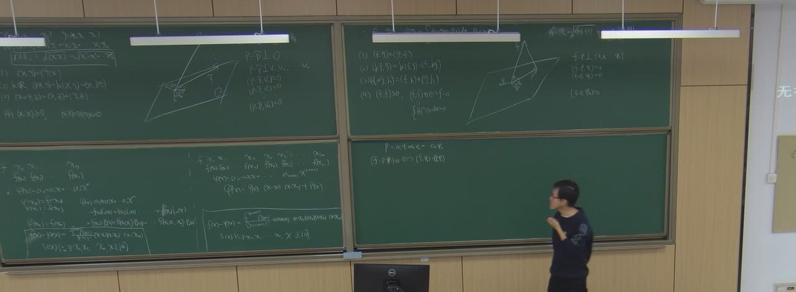
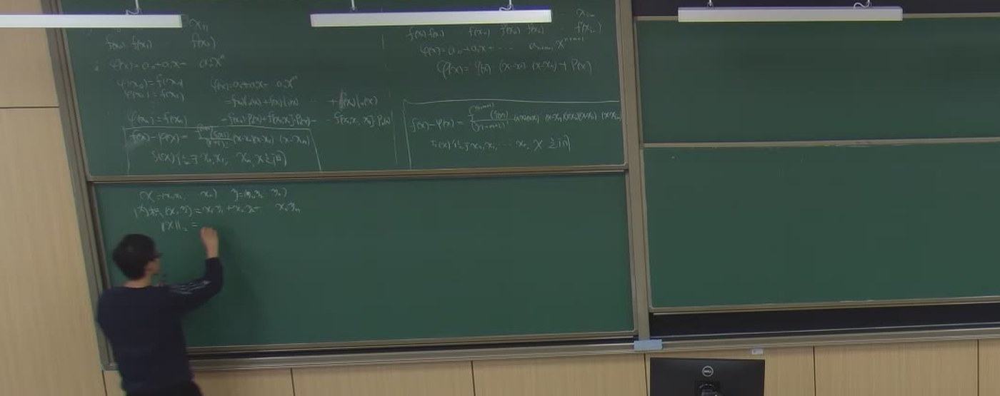
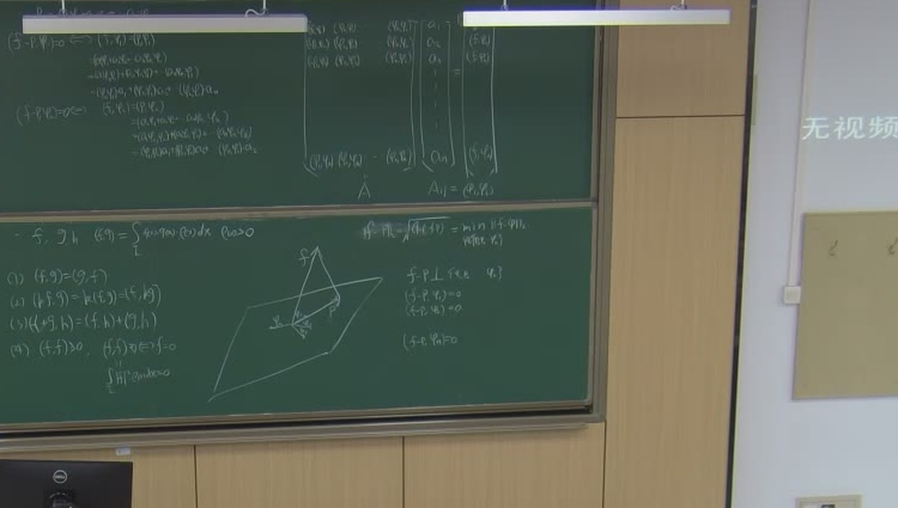
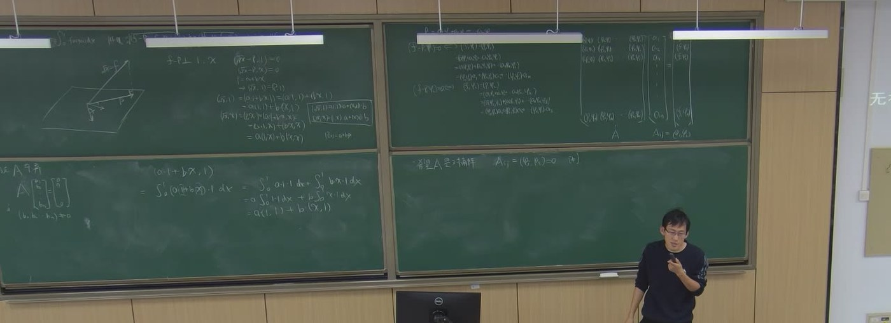
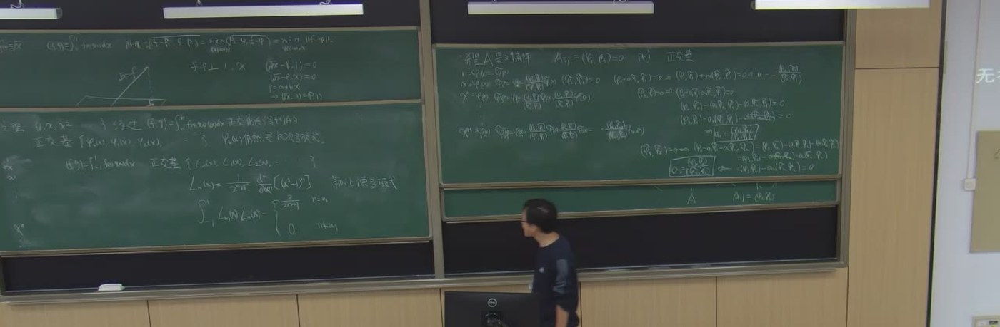

# 第 11 讲（10-21）：埃尔米特余项收尾、内积空间与最佳平方逼近、Gram–Schmidt 与正交多项式

> 课堂实录精编。本讲**无课件、全程板书**（与[第 9 讲](lec09.md)、[第 10 讲](lec10.md)相同）。
> 前半段承接[第 10 讲](lec10.md)：第 10 讲末尾写出了埃尔米特余项公式并解释了「加重根」构造，
> **公式的推导留到本讲**用重节点差商补全；
> 后半段转入教材 **5.5–5.6**：内积空间、正交投影、法方程、Gram–Schmidt 正交化与 Legendre 多项式。
> 这正是[第 5 章导览](../course/ch05/overview.md)原先标注「教材有、课堂未讲」的部分。
>
> **两条线要分清**：
> **〔课堂〕** 是板书与录音里确实出现的内容；**〔教材〕** 是颜庆津《数值分析》（第 4 版）第 5 章
> 的对应条目；**〔延伸〕** 是本编补的、课堂没讲但学完应当知道的内容。
> 原始转写与 198 帧板书存于 `_sources/numerical/transcripts/`（不随书发布）。
> 本讲公式以**板书为唯一权威**：平台 ASR 与 whisper 在 03:00–12:00 段都错得厉害，
> 不要按转写字面引用。

::: note 本讲主线：一句话
**插值的余项**回答「多项式与函数差多少」；**内积**把这个「差」变成可以测量的长度；
**投影**给出「差最小」的几何条件；**法方程**把几何条件翻译成线性方程组；
**正交化**把方程组变成对角阵。五步是一条链，不是五个孤立知识点。
:::

::: method[core] 10 分钟复习版 · 第 11 讲

**一句话**：最佳逼近不是「解一个很大的方程组」，而是「把 $f$ 投影到子空间上」；投影条件是 $f-p$ 与子空间正交，写成方程就是法方程；把基正交化，法方程就变成对角阵。

**必记结论**

| 内容 | 要点 |
|:--|:--|
| **埃尔米特条件** | 每个节点同时给函数值与一阶导数：$2n+2$ 个条件，次数上界 $2n+1$ |
| **埃尔米特余项** | $f(x)-H_{2n+1}(x)=\dfrac{f^{(2n+2)}(\xi)}{(2n+2)!}\prod\limits_{i=0}^{n}(x-x_i)^2$，$\xi$ 在含 $x$ 的区间内 |
| **课堂证明路线** | 把每个节点看成二重节点，用牛顿差商：$f(x)-H_{2n+1}(x)=f[x_0,x_0,\dots,x_n,x_n,x]\prod(x-x_i)^2$，再用差商中值定理 |
| **教材证明路线** | 构造辅助函数 $g(t)$，数出 $2n+3$ 个零点（计重数），Rolle 套 $2n+2$ 次 |
| **内积四公理** | $(x,y)=(y,x)$；$(kx,y)=k(x,y)=(x,ky)$；$(x+y,z)=(x,z)+(y,z)$；$(x,x)\ge0$，$(x,x)=0\iff x=0$ |
| **范数与距离** | $\lVert x\rVert=\sqrt{(x,x)}$，$d(x,y)=\lVert x-y\rVert$ |
| **函数内积** | $(f,g)=\displaystyle\int_a^b\rho(x)f(x)g(x)\,dx$，$\rho\ge0$ 为权函数 |
| **最佳逼近** | 在 $M=\operatorname{span}\{\varphi_0,\dots,\varphi_n\}$ 中求 $p$ 使 $\lVert f-p\rVert$ 最小 |
| **投影条件** | $p$ 是最佳逼近 $\iff$ $f-p\perp M$ $\iff$ $(f-p,\varphi_i)=0$，$i=0,\dots,n$ |
| **法方程** | $p=\sum a_j\varphi_j$，$\sum_j(\varphi_i,\varphi_j)a_j=(f,\varphi_i)$，即 $G\boldsymbol a=\boldsymbol b$ |
| **Gram 矩阵** | $G_{ij}=(\varphi_i,\varphi_j)$ 对称正定；$\{\varphi_i\}$ 线性无关 $\Rightarrow$ $G$ 非奇异，法方程唯一可解 |
| **正交基** | 若 $(\varphi_i,\varphi_j)=0\ (i\ne j)$，则 $a_i=\dfrac{(f,\varphi_i)}{(\varphi_i,\varphi_i)}$，法方程退化为对角 |
| **Gram–Schmidt** | $\psi_k=\varphi_k-\sum\limits_{j<k}\dfrac{(\varphi_k,\psi_j)}{(\psi_j,\psi_j)}\psi_j$ |
| **正交多项式** | $1,x,\dots,x^n$ 正交化后，$\psi_k$ 仍是 $k$ 次多项式；Legendre：$L_n=\dfrac{1}{2^nn!}\dfrac{d^n}{dx^n}(x^2-1)^n$，$\int_{-1}^1L_nL_m=\dfrac{2}{2n+1}\delta_{nm}$ |

**老师强调的五件事**（据板书与课堂反复回扣整理）：

1. **余项里节点因子要平方**，分母是 $(2n+2)!$，不是 $(n+1)!$；这是 Hermite 与 Lagrange 唯一但致命的区别。
2. **函数空间里的「1」是常值函数，不是数 1**；$a$ 才是数。老师在这一处停了很久，专门纠正符号混淆。
3. **最佳逼近的几何图像是投影**：$f-p$ 垂直于整个子空间，不只是垂直于某一个基函数。
4. **Gram 矩阵非奇异不是显然的**：要用内积正定性 + 基函数线性无关，证明 $G\boldsymbol c=0\Rightarrow\boldsymbol c=0$。
5. **正交化的目的就是让 $G$ 变成对角阵**：老师原话是「我们最希望 $A$ 是对角阵」，这样每个系数单独算，不用解耦合方程。

:::

## 课堂时间线 {#lec11-S1}

| 时间 | 内容 |
|---|---|
| 00:00–03:00 | 课前准备，黑板空白 |
| 03:00–06:00 | **埃尔米特问题复述**：$2n+2$ 个条件、$2n+1$ 次多项式；列出 $\varphi(x_i)=f(x_i)$、$\varphi'(x_i)=f'(x_i)$ |
| 06:00–12:00 | **余项定理**：重节点牛顿差商 / 差商中值定理，得到 $R_{2n+1}=\dfrac{f^{(2n+2)}(\xi)}{(2n+2)!}\prod(x-x_i)^2$ |
| 12:00–17:00 | **$\mathbb R^n$ 的内积**：四公理、范数 $\lVert x\rVert_2=\sqrt{x_1^2+\cdots+x_n^2}$、距离 |
| 17:00–22:00 | **正交投影的几何**：子空间、投影 $\bar P$、$P-\bar P\perp V$、$(P-\bar P,V_i)=0$ |
| 22:00–30:00 | **函数空间的内积**：$(f,g)=\int_a^b\rho fg\,dx$；最佳逼近 $\min\lVert f-p\rVert$；$f-p\perp\varphi_i$ |
| 30:00–40:00 | **法方程**：$(f-p,\varphi_i)=0$ 展开；$G_{ij}=(\varphi_i,\varphi_j)$；矩阵形式 |
| 40:00–52:00 | **Gram 矩阵非奇异**：反设 $G\boldsymbol c=0$，推出 $\lVert\sum c_i\varphi_i\rVert^2=0$，与线性无关矛盾 |
| 52:00–72:00 | **例题**：$f(x)=\sqrt{x}$ 在 $[0,1]$ 上用 $\operatorname{span}\{1,x\}$ 作最佳平方逼近；列法方程，算术留给学生 |
| 72:00–86:00 | **Gram–Schmidt 正交化**：逐项减去在已有正交基上的投影；推导系数公式 |
| 86:00–93:00 | **正交多项式定理**：$1,x,\dots,x^n$ 正交化后，$\psi_k$ 仍是 $k$ 次多项式 |
| 93:00–99:00 | **Legendre 多项式**：$L_n$ 的 Rodrigues 公式、正交性；末尾预告 Chebyshev |

## §一 埃尔米特余项：课堂用重节点差商收尾 {#lec11-S2}

### 1.1 问题与条件计数 {#lec11-S3}

给定互异节点 $x_0,\dots,x_n$，要求次数不超过 $2n+1$ 的多项式 $H_{2n+1}$ 满足

$$
H_{2n+1}(x_i)=f(x_i),\qquad H'_{2n+1}(x_i)=f'(x_i),\quad i=0,\dots,n .
$$

共 $2(n+1)=2n+2$ 个条件，恰好确定 $2n+2$ 个系数。板书第一行就是这张「条件表」：

$$
\begin{array}{c|cccc}
 & x_0 & x_1 & \cdots & x_n\\ \hline
f & f(x_0) & f(x_1) & \cdots & f(x_n)\\
f' & f'(x_0) & f'(x_1) & \cdots & f'(x_n)
\end{array}
$$

> 对照[第 10 讲](lec10.md)：那里用「双根因子」构造 $h_i(x)=\bigl[1-2l_i'(x_i)(x-x_i)\bigr]l_i^2(x)$ 与 $\hat h_i(x)=(x-x_i)l_i^2(x)$，并直接给出余项。本讲补的是**余项为什么长这样**。

### 1.2 课堂路线：把每个节点看成二重节点 {#lec11-S4}

板书在左板写的是重节点差商。把节点序列改写成

$$
z_0=z_1=x_0,\quad z_2=z_3=x_1,\quad \dots,\quad z_{2n}=z_{2n+1}=x_n,
$$

并对 $z_0,\dots,z_{2n+1}$ 作牛顿插值。由于重节点处的一阶差商就是导数：

$$
f[x_i,x_i]=f'(x_i),
$$

这个牛顿插值多项式恰好满足 Hermite 条件，因此它就是 $H_{2n+1}$。牛顿余项为

$$
f(x)-H_{2n+1}(x)=f[z_0,\dots,z_{2n+1},x]\prod_{i=0}^{2n+1}(x-z_i).
$$

把 $z$ 换回 $x_i$，每个节点出现两次，乘积变成平方：

$$
\boxed{\;f(x)-H_{2n+1}(x)
=f[x_0,x_0,\dots,x_n,x_n,x]\prod_{i=0}^{n}(x-x_i)^2\;}
$$

再用**差商中值定理**（$2n+2$ 阶差商等于某点的 $2n+2$ 阶导数除以阶乘）：

$$
f[x_0,x_0,\dots,x_n,x_n,x]=\frac{f^{(2n+2)}(\xi)}{(2n+2)!},
$$

即得板书框出的

$$
f(x)-H_{2n+1}(x)=\frac{f^{(2n+2)}(\xi)}{(2n+2)!}\prod_{i=0}^{n}(x-x_i)^2,
\qquad \xi\in(\min\{x,x_0,\dots,x_n\},\max\{x,x_0,\dots,x_n\}).
$$

> 板书在 06:00–12:00 反复写的就是这条链：$f[x_0,x_1]$、$f[x_0,x_1,x_2]$…… 直到 $2n+2$ 阶差商。
> 平台 ASR 把这段识别成「三连踏 / 拉幅 / 牛腿」等无关词，**完全不可用**；以板书为准。

### 1.3 教材路线：辅助函数 + Rolle（定理 5.3） {#lec11-S5}

教材 5.2 的证明走另一条路（原书 p.101–104，定理 5.3）。固定 $x$（先设 $x$ 不是节点），构造

$$
g(t)=f(t)-H_{2n+1}(t)-\frac{f(x)-H_{2n+1}(x)}{\prod_{i=0}^{n}(x-x_i)^2}\prod_{i=0}^{n}(t-x_i)^2 .
$$

- $g(x)=0$；
- 在每个 $x_i$ 处，$g(x_i)=0$ 且 $g'(x_i)=0$，即为二重零点。

所以 $g$ 共有 $(n+1)\times2+1=2n+3$ 个零点（计重数）。反复用 Rolle 定理 $2n+2$ 次，得到某个 $\xi$ 使 $g^{(2n+2)}(\xi)=0$。而

$$
g^{(2n+2)}(t)=f^{(2n+2)}(t)-\frac{f(x)-H_{2n+1}(x)}{\prod_{i=0}^{n}(x-x_i)^2}(2n+2)!,
$$

代入 $t=\xi$ 即得同一个公式。

::: proof[skip] 两种路线为什么等价
重节点差商路线与辅助函数路线证的是同一个余项公式；前者用「插值余项 = 差商 × 节点多项式」，后者用「构造零点 + Rolle」。
教材选辅助函数，是因为它对一般重数 $m_i$ 的 Hermite 插值（定理 5.3）也直接成立；课堂选差商，是因为它把 Hermite 和上一讲的牛顿插值接在一起，计算上更自然。
:::

### 1.4 易错点 {#lec11-S6}

1. **分母写成 $(n+1)!$**：Hermite 有 $2n+2$ 个条件，分母必须是 $(2n+2)!$。
2. **乘积不平方**：每个节点同时约束函数值与导数，所以节点因子出现两次，必须写成 $(x-x_i)^2$。
3. **把 $\xi$ 写成固定点**：$\xi$ 依赖 $x$，只能在「含 $x$ 与所有节点的最小区间」内保证存在。
4. **忽略 $x$ 等于节点的情况**：此时余项两边都为 $0$，公式仍成立；辅助函数证明要先排除 $x=x_i$，再连续延拓。

## §二 内积空间：把「逼近」变成「投影」 {#lec11-S7}

### 2.1 内积的四条公理 {#lec11-S8}

板书先在 $\mathbb R^n$ 上写：

$$
(x,y)=x_1y_1+x_2y_2+\cdots+x_ny_n,
\qquad
\lVert x\rVert_2=\sqrt{(x,x)}=\sqrt{x_1^2+\cdots+x_n^2}.
$$

内积满足：

$$
\begin{aligned}
(1)&\quad (x,y)=(y,x),\\
(2)&\quad k\in\mathbb R,\quad (kx,y)=k(x,y)=(x,ky),\\
(3)&\quad (x+y,z)=(x,z)+(y,z),\\
(4)&\quad (x,x)\ge0,\qquad (x,x)=0\iff x=0 .
\end{aligned}
$$

随后把 $\mathbb R^n$ 换成函数空间：

$$
(f,g)=\int_a^b\rho(x)f(x)g(x)\,dx,\qquad \rho(x)\ge0,
$$

四条公理逐条照搬；第四条变成

$$
(f,f)=\int_a^b\rho(x)f^2(x)\,dx\ge0,
\qquad
(f,f)=0\iff f=0\ \text{（在连续意义下）}.
$$

> **老师在这里专门停下來强调**：函数空间里的「$1$」是**常值函数** $1(x)\equiv1$，不是数 $1$；
> $a,b$ 是数，$f,g,1,x$ 是向量（函数）。把「$a\cdot1$」里的 $1$ 当成数，是这一节最常见的符号错误。

### 2.2 范数、距离与两个标准不等式 {#lec11-S9}

由内积定义范数 $\lVert x\rVert=\sqrt{(x,x)}$ 与距离 $d(x,y)=\lVert x-y\rVert$。它们满足

$$
\lvert(x,y)\rvert\le\lVert x\rVert\,\lVert y\rVert
\quad\text{（Cauchy–Schwarz）},
\qquad
\lVert x+y\rVert\le\lVert x\rVert+\lVert y\rVert
\quad\text{（三角不等式）}.
$$

这两条是内积空间的标准性质；课堂的重点不在证明，而在用它们把「逼近误差」写成可计算的范数。

### 2.3 最佳逼近的几何刻画 {#lec11-S10}

给定子空间

$$
M=\operatorname{span}\{\varphi_0,\dots,\varphi_n\},
$$

求 $p\in M$ 使

$$
\lVert f-p\rVert=\min_{q\in M}\lVert f-q\rVert .
$$

板书在 $\mathbb R^n$ 里画了投影图：$P$ 是空间中的向量，$\bar P$ 是它在平面 $V$ 上的投影，则

$$
\lVert P-\bar P\rVert=\min_{Q\in V}\lVert P-Q\rVert,
\qquad
P-\bar P\perp V .
$$

「垂直于整个子空间」等价于「垂直于每个基向量」：

$$
(P-\bar P,V_i)=0,\quad i=1,\dots,n .
$$

把 $P$ 换成 $f$、$\bar P$ 换成 $p$、$V_i$ 换成 $\varphi_i$，就得到函数空间的最佳逼近条件：

$$
\boxed{\;f-p\perp M
\iff (f-p,\varphi_i)=0,\quad i=0,\dots,n\;}
$$

::: proof[skip] 为什么「垂直」等价于「最短」
对任意 $q\in M$，令 $r=q-p\in M$。若 $f-p\perp M$，则 $(f-p,r)=0$，于是

$$
\lVert f-q\rVert^2=\lVert (f-p)-r\rVert^2
=\lVert f-p\rVert^2+\lVert r\rVert^2\ge\lVert f-p\rVert^2 .
$$

反之，若 $f-p$ 在某个基方向 $\varphi_i$ 上有非零投影，取 $q=p+\lambda\varphi_i$，则

$$
\lVert f-q\rVert^2=\lVert f-p\rVert^2-2\lambda(f-p,\varphi_i)+\lambda^2\lVert\varphi_i\rVert^2,
$$

当 $\lambda$ 很小时第二项占主导，误差会变小，矛盾。故必须 $(f-p,\varphi_i)=0$。
:::

## §三 法方程与 Gram 矩阵 {#lec11-S11}

### 3.1 把投影条件翻译成方程 {#lec11-S12}

令

$$
p=\sum_{j=0}^{n}a_j\varphi_j .
$$

代入 $(f-p,\varphi_i)=0$：

$$
(f,\varphi_i)=\Big(\sum_{j=0}^{n}a_j\varphi_j,\varphi_i\Big)
=\sum_{j=0}^{n}a_j(\varphi_i,\varphi_j),
\qquad i=0,\dots,n .
$$

写成矩阵：

$$
G\boldsymbol a=\boldsymbol b,\qquad
G_{ij}=(\varphi_i,\varphi_j),\quad b_i=(f,\varphi_i).
$$

$G$ 称为 **Gram 矩阵**（板书写作 $A$，并注明 $A_{ij}=(\varphi_i,\varphi_j)$）。展开就是板书右板的那一列方程：

$$
\begin{pmatrix}
(\varphi_0,\varphi_0)&(\varphi_1,\varphi_0)&\cdots&(\varphi_n,\varphi_0)\\
(\varphi_0,\varphi_1)&(\varphi_1,\varphi_1)&\cdots&(\varphi_n,\varphi_1)\\
\vdots&\vdots&\ddots&\vdots\\
(\varphi_0,\varphi_n)&(\varphi_1,\varphi_n)&\cdots&(\varphi_n,\varphi_n)
\end{pmatrix}
\begin{pmatrix}a_0\\a_1\\\vdots\\a_n\end{pmatrix}
=
\begin{pmatrix}(f,\varphi_0)\$f,\varphi_1)\\\vdots\$f,\varphi_n)\end{pmatrix}.
$$

由于 $( \varphi_i,\varphi_j)=(\varphi_j,\varphi_i)$，$G$ 是对称矩阵；若把第 $i$ 行写成 $(\varphi_i,\varphi_j)$，它与上式只是转置关系，解相同。

### 3.2 课堂证明：Gram 矩阵非奇异 {#lec11-S13}

板书的反证法：

假设 $G\boldsymbol c=0$ 且 $\boldsymbol c=(c_0,\dots,c_n)^{\mathrm T}\ne0$。则对每个 $i$，

$$
\sum_{j=0}^{n}(\varphi_i,\varphi_j)c_j=0
\iff
\Big(\varphi_i,\sum_{j=0}^{n}c_j\varphi_j\Big)=0 .
$$

第 $i$ 个方程乘以 $c_i$，再对 $i$ 求和：

$$
0=\sum_{i=0}^{n}c_i\Big(\varphi_i,\sum_{j=0}^{n}c_j\varphi_j\Big)
=\Big(\sum_{i=0}^{n}c_i\varphi_i,\sum_{j=0}^{n}c_j\varphi_j\Big)
=\Big\lVert\sum_{i=0}^{n}c_i\varphi_i\Big\rVert^2 .
$$

所以 $\sum_i c_i\varphi_i=0$。但 $\{\varphi_i\}$ 线性无关，故 $c_0=\cdots=c_n=0$，与 $\boldsymbol c\ne0$ 矛盾。因此 $G$ 非奇异。

> 一句话版本：**$G$ 正定**。对任意 $\boldsymbol c\ne0$，
> $\boldsymbol c^{\mathrm T}G\boldsymbol c=\lVert\sum c_i\varphi_i\rVert^2>0$。
> 这是教材 5.6 的写法，和板书的「乘 $c_i$ 求和」是同一件事。

### 3.3 唯一性（教材定理 5.8） {#lec11-S14}

若 $p,q$ 都是最佳逼近，则 $f-p\perp M$ 且 $f-q\perp M$，所以

$$
(p-q,p-q)=(p-f+f-q,p-q)=0+0=0,
$$

故 $p=q$。最佳平方逼近元素唯一。

### 3.4 正交基的威力 {#lec11-S15}

若 $\{\varphi_i\}$ 两两正交，$G$ 是对角阵，法方程解耦：

$$
a_i=\frac{(f,\varphi_i)}{(\varphi_i,\varphi_i)} .
$$

这就是老师反复说的「我们希望 $A$ 是对角阵」。下一节的 Gram–Schmidt 就是把任意基变成这样的正交基。

## §四 例题：根号函数的一次最佳平方逼近（$[0,1]$） {#lec11-S16}

> **板书核对**：老师在 54:30 写的是 $f(x)=\sqrt{x}$，不是 $x^2$；内积是 $(f,g)=\int_0^1 fg\,dx$；
> 子空间是 $\operatorname{span}\{1,x\}$。他把法方程列到 69:30，**算术没有在板上算完**，留给学生。
> 下面的数值是本编补算，并已与教材例 8（原书 p.129）对照。

### 4.1 题目与投影条件 {#lec11-S17}

求 $p=a+bx$，使

$$
\lVert f-p\rVert^2=\int_0^1\bigl(\sqrt{x}-a-bx\bigr)^2dx
$$

最小。投影条件为

$$
(f-p,1)=0,\qquad (f-p,x)=0 .
$$

等价地：

$$
(f,1)=(p,1)=a(1,1)+b(x,1),\qquad
(f,x)=(p,x)=a(1,x)+b(x,x).
$$

### 4.2 内积计算 {#lec11-S18}

$$
\begin{aligned}
(1,1)&=\int_0^1 1\,dx=1,\\
(1,x)&=\int_0^1 x\,dx=\frac12,\\
(x,x)&=\int_0^1 x^2\,dx=\frac13,\\
(f,1)&=\int_0^1 x^{1/2}\,dx=\frac23,\\
(f,x)&=\int_0^1 x^{3/2}\,dx=\frac25 .
\end{aligned}
$$

### 4.3 法方程与解 {#lec11-S19}

$$
\begin{pmatrix}1&\frac12\\[2pt]\frac12&\frac13\end{pmatrix}
\begin{pmatrix}a\\b\end{pmatrix}
=
\begin{pmatrix}\frac23\\[2pt]\frac25\end{pmatrix}.
$$

行列式 $\det G=1\cdot\frac13-\frac12\cdot\frac12=\frac1{12}$。解得

$$
a=\frac{\frac23\cdot\frac13-\frac12\cdot\frac25}{1/12}
=\frac{\frac29-\frac15}{1/12}
=\frac{1}{45}\cdot12=\frac{4}{15},
$$

$$
b=\frac{1\cdot\frac25-\frac12\cdot\frac23}{1/12}
=\frac{\frac25-\frac13}{1/12}
=\frac{1}{15}\cdot12=\frac45.
$$

所以

$$
\boxed{\;p(x)=\frac{4}{15}+\frac45 x=\frac{4}{15}+\frac{12}{15}x,\qquad 0\le x\le1\;}
$$

与教材例 8 的结果完全一致。教材用变量替换 $x=(1+t)/2$ 化到 $[-1,1]$，再用 Legendre 多项式展开；
老师则直接在 $[0,1]$ 上列法方程。两条路算的是同一个多项式。

### 4.4 验证与误差 {#lec11-S20}

正交性验证：

$$
(f-p,1)=\frac23-\Bigl(\frac{4}{15}+\frac45\cdot\frac12\Bigr)
=\frac23-\Bigl(\frac{4}{15}+\frac25\Bigr)=0,
$$

$$
(f-p,x)=\frac25-\Bigl(\frac{4}{15}\cdot\frac12+\frac45\cdot\frac13\Bigr)
=\frac25-\Bigl(\frac{2}{15}+\frac{4}{15}\Bigr)=0 .
$$

误差：

$$
\lVert f-p\rVert^2=(f,f)-2(f,p)+(p,p).
$$

其中

$$
(f,f)=\int_0^1 x\,dx=\frac12,\qquad
(f,p)=\frac{4}{15}\cdot\frac23+\frac45\cdot\frac25=\frac{112}{225},
$$

$$
(p,p)=\Bigl(\frac{4}{15}\Bigr)^2
+2\cdot\frac{4}{15}\cdot\frac45\cdot\frac12
+\Bigl(\frac45\Bigr)^2\cdot\frac13
=\frac{112}{225}.
$$

所以

$$
\lVert f-p\rVert^2=\frac12-2\cdot\frac{112}{225}+\frac{112}{225}
=\frac12-\frac{112}{225}
=\frac{1}{450},
\qquad
\lVert f-p\rVert=\frac{1}{\sqrt{450}}\approx0.04714 .
$$

> 注意 $p(0)=4/15\approx0.267$，$p(1)=16/15\approx1.067$：最佳平方逼近在端点可以明显偏离，
> 它不是插值，不要求过点。这是「逼近」与「插值」的第一区别。

### 4.5 用正交基再算一遍（连接下一节） {#lec11-S21}

在 $[0,1]$ 上把 $\{1,x\}$ 正交化：

$$
\psi_0=1,\qquad
\psi_1=x-\frac{(x,1)}{(1,1)}\cdot1=x-\frac12 .
$$

则

$$
(f,\psi_0)=\frac23,\quad (\psi_0,\psi_0)=1
\Rightarrow c_0=\frac23,
$$

$$
(f,\psi_1)=\frac25-\frac12\cdot\frac23=\frac1{15},\quad
(\psi_1,\psi_1)=\frac13-\frac12+\frac14=\frac1{12}
\Rightarrow c_1=\frac45 .
$$

于是

$$
p=c_0\psi_0+c_1\psi_1
=\frac23+\frac45\Bigl(x-\frac12\Bigr)
=\frac{4}{15}+\frac45x .
$$

同一个结果，**不用解 $2\times2$ 方程组**，两个系数各算各的。维数越高，这个优势越大；这就是正交化的工程价值。

## §五 Gram–Schmidt 与正交多项式 {#lec11-S22}

### 5.1 动机：让 Gram 矩阵变成对角阵 {#lec11-S23}

板书从 72:00 开始转入正交化。老师反复说「我们希望 $A$ 是……」（ASR 把后半句识别成「对的」；结合上下文与正交化的目的，应为「对角阵」）：

> **「我们最希望 $A$ 是对角阵。」**

若 $G$ 对角，$a_i=(f,\varphi_i)/(\varphi_i,\varphi_i)$，不用解耦合方程。Gram–Schmidt 就是把任意线性无关组变成正交组的标准算法。

### 5.2 两项正交化 {#lec11-S24}

给定 $\varphi_0,\varphi_1$，令

$$
\psi_0=\varphi_0,\qquad
\psi_1=\varphi_1-\alpha\psi_0 .
$$

要求 $(\psi_1,\psi_0)=0$：

$$
0=(\varphi_1-\alpha\psi_0,\psi_0)
=(\varphi_1,\psi_0)-\alpha(\psi_0,\psi_0)
\Rightarrow
\alpha=\frac{(\varphi_1,\psi_0)}{(\psi_0,\psi_0)} .
$$

这就是板书在右板写的那一步。

### 5.3 一般公式 {#lec11-S25}

$$
\boxed{\;
\psi_k=\varphi_k-\sum_{j=0}^{k-1}
\frac{(\varphi_k,\psi_j)}{(\psi_j,\psi_j)}\,\psi_j,
\qquad k=0,1,\dots,n,\quad \psi_0=\varphi_0 .
\;}
$$

归纳验证：设 $\psi_0,\dots,\psi_{k-1}$ 已两两正交。对 $m<k$，

$$
(\psi_k,\psi_m)=(\varphi_k,\psi_m)
-\frac{(\varphi_k,\psi_m)}{(\psi_m,\psi_m)}(\psi_m,\psi_m)=0,
$$

其余 $j\ne m$ 的项由 $(\psi_j,\psi_m)=0$ 消去。所以 $\psi_k$ 与所有前面的 $\psi_m$ 正交。

### 5.4 定理：正交化后次数不降 {#lec11-S26}

取 $\varphi_k=x^k$。由于 $\psi_k$ 是 $\varphi_0,\dots,\varphi_k$ 的线性组合，且 $\varphi_k$ 的系数为 $1$，减去的是次数 $<k$ 的项，所以

$$
\psi_k(x)=x^k+\text{低次项},
$$

仍是 $k$ 次多项式。板书在 89:30 写的定理就是这一条：

> $1,x,x^2,\dots,x^n$ 经过 $(f,g)=\int_a^b\rho fg\,dx$ 正交化得到的 $\psi_0,\psi_1,\dots,\psi_n$，
> 其中 $\psi_k$ 仍然是 $k$ 次多项式。

### 5.5 Legendre 多项式 {#lec11-S27}

在 $[-1,1]$、权 $\rho=1$ 下，正交化 $\{1,x,x^2,\dots\}$ 得到 **Legendre 多项式**。标准形式（Rodrigues 公式）：

$$
L_n(x)=\frac{1}{2^nn!}\frac{d^n}{dx^n}\bigl(x^2-1\bigr)^n .
$$

正交性：

$$
\int_{-1}^{1}L_n(x)L_m(x)\,dx
=\frac{2}{2n+1}\delta_{nm}.
$$

前几个：

$$
L_0=1,\qquad L_1=x,\qquad
L_2=\frac12(3x^2-1),\qquad
L_3=\frac12(5x^3-3x).
$$

递推（教材 5.5.2）：

$$
(n+1)L_{n+1}(x)=(2n+1)xL_n(x)-nL_{n-1}(x).
$$

> **归一化提醒**：Gram–Schmidt 若保持首项系数为 $1$，得到的是「首一正交多项式」$P_k$；
> Legendre 多项式 $L_n$ 的首项系数是 $\dfrac{(2n)!}{2^n(n!)^2}$，与 $P_n$ 相差一个常数倍。
> 正交性不受非零常数倍影响（教材性质 1），所以两者是同一组正交方向的不同刻度。
> 老师板书写的是标准 Legendre 形式，没有展开这个归一化细节。

### 5.6 Chebyshev 预告 {#lec11-S28}

课堂最后（96:30 左右）提到 Chebyshev（ASR 写作「切皮区」）。教材 5.5.2 的标准定义：

$$
T_n(x)=\cos(n\arccos x),\qquad -1\le x\le1,
$$

带权 $\rho(x)=1/\sqrt{1-x^2}$ 正交：

$$
\int_{-1}^{1}\frac{T_n(x)T_m(x)}{\sqrt{1-x^2}}\,dx
=
\begin{cases}
0,&n\ne m,\\
\dfrac{\pi}{2},&n=m\ne0,\\
\pi,&n=m=0.
\end{cases}
$$

递推 $T_{n+1}=2xT_n-T_{n-1}$，零点 $x_i=\cos\dfrac{(2i-1)\pi}{2n}$。这些是下一章 Gauss 求积的预备。

## §六 教材补充：课堂没展开但应当知道 {#lec11-S29}

以下内容**不是课堂内容**，按教材 5.5–5.6 补齐，供二刷与考试复习使用。

### 6.1 正交多项式系的刻画（教材定理 5.6） {#lec11-S30}

$\{\varphi_k\}$（$\deg\varphi_k=k$）是 $[a,b]$ 上带权 $\rho$ 的正交多项式系，当且仅当对任意次数 $\le k-1$ 的多项式 $q$，

$$
\int_a^b\rho(x)q(x)\varphi_k(x)\,dx=0,\qquad k=1,2,\dots
$$

必要性：$q$ 可写成 $\varphi_0,\dots,\varphi_{k-1}$ 的线性组合，逐项正交。充分性：取 $q=\varphi_j$（$j<k$）即得两两正交。

### 6.2 正交多项式的四条性质（教材 5.5.1） {#lec11-S31}

| 性质 | 内容 |
|:--|:--|
| 1 | $\{c_k\varphi_k\}$（$c_k\ne0$）仍是正交多项式系 |
| 2 | 首项系数为 $1$ 的正交多项式系唯一 |
| 3 | $k$ 次正交多项式在 $(a,b)$ 内有 $k$ 个互异实零点 |
| 4 | 三项递推（首一情形）：$p_{k+1}=(x-\alpha_k)p_k-\beta_kp_{k-1}$，其中 $\alpha_k=\dfrac{(xp_k,p_k)}{(p_k,p_k)}$，$\beta_k=\dfrac{(p_k,p_k)}{(p_{k-1},p_{k-1})}$ |

性质 3 的证明思路：若奇重零点少于 $k$ 个，构造 $q$ 为这些零点之积，则 $q\varphi_k$ 不变号且不恒为零，积分不可能为 $0$，与定理 5.6 矛盾。

### 6.3 常用正交多项式一览 {#lec11-S32}

| 名称 | 区间 | 权 $\rho(x)$ | 表达式 / 递推 | 正交性 |
|:--|:--|:--|:--|:--|
| Legendre | $[-1,1]$ | $1$ | $L_n=\dfrac{1}{2^nn!}\dfrac{d^n}{dx^n}(x^2-1)^n$ | $\int L_nL_m=\dfrac{2}{2n+1}\delta_{nm}$ |
| Chebyshev | $[-1,1]$ | $\dfrac{1}{\sqrt{1-x^2}}$ | $T_n=\cos(n\arccos x)$ | $\int \dfrac{T_nT_m}{\sqrt{1-x^2}}=\dfrac{\pi}{2}\delta_{nm}$（$n,m\ne0$） |
| Laguerre | $[0,\infty)$ | $e^{-x}$ | $U_n=e^x\dfrac{d^n}{dx^n}(x^ne^{-x})$ | $\int_0^\infty e^{-x}U_nU_m=(n!)^2\delta_{nm}$ |
| Hermite | $(-\infty,\infty)$ | $e^{-x^2}$ | $H_n=(-1)^ne^{x^2}\dfrac{d^n}{dx^n}e^{-x^2}$ | $\int_{-\infty}^\infty e^{-x^2}H_nH_m=2^nn!\sqrt{\pi}\,\delta_{nm}$ |

### 6.4 正交基下的最佳平方逼近 {#lec11-S33}

若 $\{\varphi_k\}$ 正交，则

$$
p=\sum_{k=0}^{n}c_k\varphi_k,\qquad
c_k=\frac{(f,\varphi_k)}{(\varphi_k,\varphi_k)} .
$$

误差公式：

$$
\lVert f-p\rVert^2=(f,f)-\sum_{k=0}^{n}\frac{(f,\varphi_k)^2}{(\varphi_k,\varphi_k)} .
$$

Legendre 展开（教材 5.6.2，原书 p.129–131）：

$$
c_k=\frac{2k+1}{2}\int_{-1}^{1}f(x)L_k(x)\,dx,
\qquad
p_n(x)=\sum_{k=0}^{n}c_kL_k(x).
$$

若区间是 $[a,b]$，先作变量替换 $x=\dfrac{a+b}{2}+\dfrac{b-a}{2}t$，化到 $[-1,1]$。

### 6.5 最佳一致逼近（本编补充，教材 5.6 不展开） {#lec11-S34}

在 $C[a,b]$ 中使 $\lVert f-p_n\rVert_\infty=\max_{a\le x\le b}\lvert f(x)-p_n(x)\rvert$ 最小，称为最佳一致逼近。Chebyshev 交替定理给出特征：误差在 $n+2$ 个点交替取 $\pm\lVert f-p_n\rVert_\infty$。这与本讲的 $L^2$ 逼近是两套不同的度量，不要混用。

## §七 老师强调与易错点 {#lec11-S35}

1. **Hermite 余项的分母与平方**：$(2n+2)!$、$\prod(x-x_i)^2$，两处都容易各错一位。
2. **「1」的身份**：在函数空间里它是常值函数，不是数；$a$ 才是数。老师在这一处反复纠正。
3. **投影条件是对整个子空间**：只需对基函数逐个验证 $(f-p,\varphi_i)=0$，不必对子空间每个元素验证。
4. **Gram 矩阵非奇异要证**：不能因为「看起来像内积表」就默认可逆；用 $\lVert\sum c_i\varphi_i\rVert^2=0$ + 线性无关。
5. **正交化公式的分母**：是 $(\psi_j,\psi_j)$，不是 $(\varphi_j,\varphi_j)$（虽然数值可能相同，但定义上要用已正交化的向量）。
6. **Legendre 的区间与权**：只在 $[-1,1]$、权 $1$ 下是这个形式；换区间要作线性变换，换权则是另一族多项式。
7. **最佳平方逼近不过点**：$p(0)=4/15$、$p(1)=16/15$，它在端点明显偏离 $\sqrt{x}$；不要拿插值条件去要求它。
8. **归一化不唯一**：首一正交多项式与 Legendre 多项式只差常数倍，正交性不变；写公式时要说明用的是哪一种。

**本讲板末没有布置作业**（课堂以 Legendre 多项式与 Chebyshev 预告收束）。

::: note 书面作业在 SPOC 上（补记） {#lec11-hw-note}
老师把作业发在北航 SPOC → 作业测试，形式为「附件 PDF + 文件上传」，每章一份单元自测题：
- 「矩阵特征值与特征向量的计算」（自测题 3，10-11 至 10-18，已截止）→ [精讲](../course/ch03/exercises.md#hw-3-meta)；
- 「非线性方程解法」（自测题 4，10-25 至 11-01，**可提交**）→ [精讲](../course/ch04/exercises.md#hw-4-meta)。

本讲所讲的最佳平方逼近与正交多项式**尚无对应的单元自测题**；自测题 5（插值）发布后回填。
四份已有作业的索引与讲次映射见[老师布置的作业 · 总览](homework.md)。
:::

### 课堂口述与标准术语对照 {#lec11-S36}

平台 ASR 与本地 whisper 在本讲都有大量同音错字；下表只列反复出现、会影响理解的几组。

| 转写中的写法 | 标准术语 / 说明 |
|:--|:--|
| 内肌、内心、那一期 | 内积 |
| 正教授、正交较大 | 正交化 |
| 顺庞、十分之正交八里 | Gram–Schmidt |
| 领域绕路、尼斯多德 | Legendre（勒让德） |
| 切皮区 | Chebyshev（切比雪夫） |
| 屁股 | 投影（「它就是一个投影」） |
| 对的（「我们希望 A 是对的」） | 对角阵（结合正交化上下文） |
| 三连踏、拉幅、牛腿 | 03:00–12:00 的 Hermite 余项推导被整段误识，无逐词对应；以板书为准 |

## §八 分层练习 {#lec11-S37}

::: note 练习使用说明
A 组检查概念，B 组检查计算，C 组检查证明。答案折叠，先自己做再展开。
:::

### A 组 · 概念 {#lec11-S38}

**A1.** Hermite 插值有 $n+1$ 个节点、每个节点给函数值与一阶导数，条件数是多少？次数上界是多少？余项分母是多少？

::: note 答案
条件数 $2(n+1)=2n+2$；次数上界 $2n+1$；余项分母 $(2n+2)!$。
:::

**A2.** 判断：最佳平方逼近多项式一定过所有采样点。

::: note 答案
错。最佳平方逼近只要求 $L^2$ 误差最小，不要求插值；例如 $\sqrt{x}$ 的一次最佳逼近在 $x=0$ 处等于 $4/15\ne0$。
:::

**A3.** 内积空间里，「$f-p\perp M$」为什么等价于「对所有基函数 $\varphi_i$，$(f-p,\varphi_i)=0$」？

::: note 答案
因为 $M=\operatorname{span}\{\varphi_i\}$，任意 $q\in M$ 可写成 $\sum c_i\varphi_i$；由内积线性性，$(f-p,q)=\sum c_i(f-p,\varphi_i)$。所以对所有基函数为零等价于对任意 $q\in M$ 为零。
:::

**A4.** Gram 矩阵 $G_{ij}=(\varphi_i,\varphi_j)$ 什么时候是对角阵？此时法方程怎么解？

::: note 答案
当 $\{\varphi_i\}$ 两两正交时，$G$ 对角；$a_i=(f,\varphi_i)/(\varphi_i,\varphi_i)$，每个系数独立计算。
:::

### B 组 · 计算 {#lec11-S39}

**B1.** 在 $[0,1]$ 上，用 $\operatorname{span}\{1,x\}$ 求 $f(x)=x^2$ 的一次最佳平方逼近。

::: note 答案
$(1,1)=1$，$(1,x)=1/2$，$(x,x)=1/3$，$(f,1)=1/3$，$(f,x)=1/4$。法方程

$$
\begin{pmatrix}1&1/2\\1/2&1/3\end{pmatrix}\begin{pmatrix}a\\b\end{pmatrix}
=\begin{pmatrix}1/3\\1/4\end{pmatrix}
\Rightarrow a=-\frac16,\ b=1,
$$

故 $p(x)=x-\frac16$。注意这与课堂例题 $\sqrt{x}$ 不同；这是本编补充的对照题。
:::

**B2.** 在 $[-1,1]$ 上，用 $\{L_0,L_1\}$ 求 $f(x)=x^2$ 的一次最佳平方逼近。

::: note 答案
$(f,L_0)=\int_{-1}^1x^2dx=2/3$，$(L_0,L_0)=2$，故 $c_0=1/3$；$(f,L_1)=\int_{-1}^1x^3dx=0$，故 $c_1=0$。$p=1/3$。这符合对称性：偶函数在奇基函数上的投影为零。
:::

**B3.** 在 $[0,1]$ 上把 $\{1,x\}$ 正交化，并用正交基求 $f(x)=\sqrt{x}$ 的最佳一次逼近。

::: note 答案
$\psi_0=1$，$\psi_1=x-\frac12$。$c_0=2/3$，$c_1=4/5$，故 $p=\frac23+\frac45(x-\frac12)=\frac{4}{15}+\frac45x$。
:::

### C 组 · 证明 {#lec11-S40}

**C1.** 证明：若 $\{\varphi_0,\dots,\varphi_n\}$ 线性无关，则 Gram 矩阵 $G$ 正定。

::: note 答案
对任意 $\boldsymbol c\ne0$，$\boldsymbol c^{\mathrm T}G\boldsymbol c=\sum_{i,j}c_ic_j(\varphi_i,\varphi_j)=\lVert\sum_i c_i\varphi_i\rVert^2$。由线性无关，$\sum_i c_i\varphi_i\ne0$；由内积正定，其范数平方 $>0$。故 $G$ 正定。
:::

**C2.** 证明：Gram–Schmidt 得到的 $\psi_k$ 两两正交，且 $\operatorname{span}\{\psi_0,\dots,\psi_k\}=\operatorname{span}\{\varphi_0,\dots,\varphi_k\}$。

::: note 答案
正交性对 $k$ 归纳：$(\psi_k,\psi_m)=(\varphi_k,\psi_m)-\frac{(\varphi_k,\psi_m)}{(\psi_m,\psi_m)}(\psi_m,\psi_m)=0$（$m<k$），其余项由已有正交性消去。张成空间相同：$\psi_k$ 是 $\varphi_0,\dots,\varphi_k$ 的线性组合，且 $\varphi_k$ 的系数为 $1$，故两个三角矩阵互为逆，张成空间逐层相同。
:::

## §九 一页纸公式卡 {#lec11-S41}

| 场景 | 公式 |
|:--|:--|
| Hermite 余项 | $f-H_{2n+1}=\dfrac{f^{(2n+2)}(\xi)}{(2n+2)!}\prod(x-x_i)^2$ |
| 重节点差商 | $f[x_i,x_i]=f'(x_i)$；$f[x_0,x_0,\dots,x_n,x_n,x]=\dfrac{f^{(2n+2)}(\xi)}{(2n+2)!}$ |
| 内积（函数） | $(f,g)=\int_a^b\rho fg\,dx$，$\rho\ge0$ |
| 范数 | $\lVert f\rVert=\sqrt{(f,f)}$ |
| 最佳逼近条件 | $(f-p,\varphi_i)=0$，$i=0,\dots,n$ |
| 法方程 | $G\boldsymbol a=\boldsymbol b$，$G_{ij}=(\varphi_i,\varphi_j)$，$b_i=(f,\varphi_i)$ |
| 正交基系数 | $a_i=(f,\varphi_i)/(\varphi_i,\varphi_i)$ |
| Gram–Schmidt | $\psi_k=\varphi_k-\sum_{j<k}\frac{(\varphi_k,\psi_j)}{(\psi_j,\psi_j)}\psi_j$ |
| Legendre | $L_n=\frac{1}{2^nn!}\frac{d^n}{dx^n}(x^2-1)^n$；$\int_{-1}^1L_nL_m=\frac{2}{2n+1}\delta_{nm}$ |
| Legendre 递推 | $(n+1)L_{n+1}=(2n+1)xL_n-nL_{n-1}$ |
| Chebyshev | $T_n=\cos(n\arccos x)$；$\int_{-1}^1\frac{T_nT_m}{\sqrt{1-x^2}}=\frac{\pi}{2}\delta_{nm}$（$n,m\ne0$） |

## 归档材料 {#lec11-S42}

- 平台 ASR 原始转写：`_sources/numerical/transcripts/lec11-20261021-asr-platform.md`（1866 句，未校对）
- 本地 whisper 交叉转写：`_sources/numerical/transcripts/lec11-20261021-whisper-timed.md` / `.srt`（1930 段，未校对）
- 板书关键帧：`_sources/numerical/transcripts/lec11-20261021-board/`（198 帧，每 30 秒一帧）+ `INDEX.md` + `sheets/`
- 素材索引：`_sources/numerical/transcripts/lec11-20261021-INDEX.md`

## 对应正文 {#lec11-S43}

- 埃尔米特插值：[第 10 讲](lec10.md) §五、[第 5 章 5.2](../course/ch05/sec52.md)
- 正交多项式与最佳平方逼近：[第 5 章 5.5–5.6](../course/ch05/sec55.md)
- 内积、投影与最小二乘的矩阵语言：[补充篇 2.2](../supplement/sec22.md)、[补充篇 2.3](../supplement/sec23.md)
