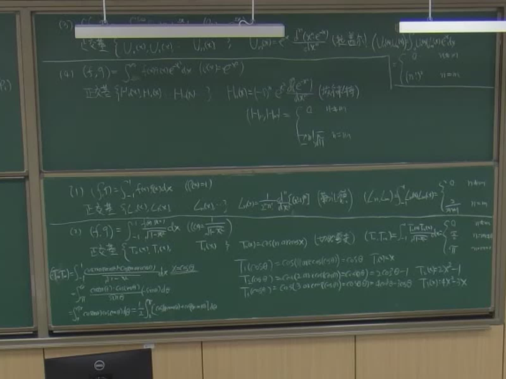
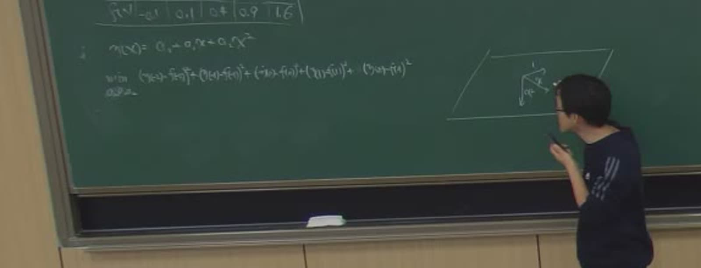
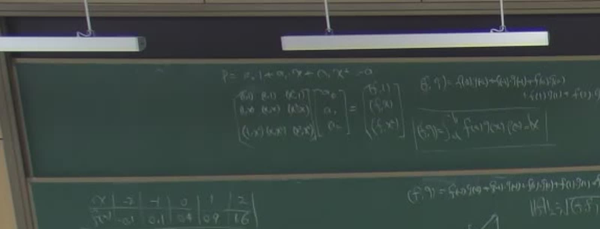
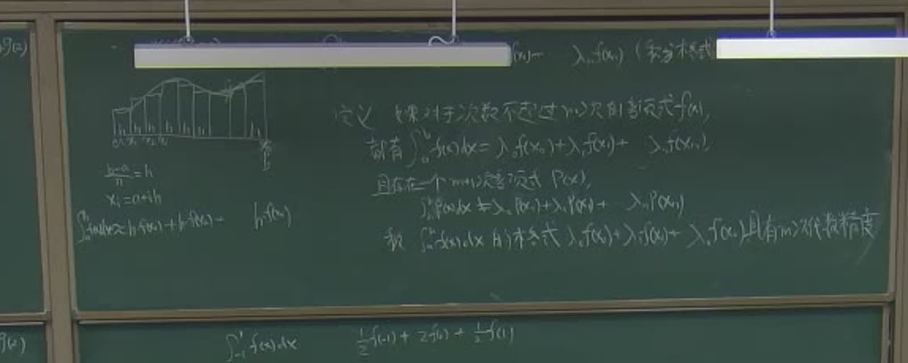
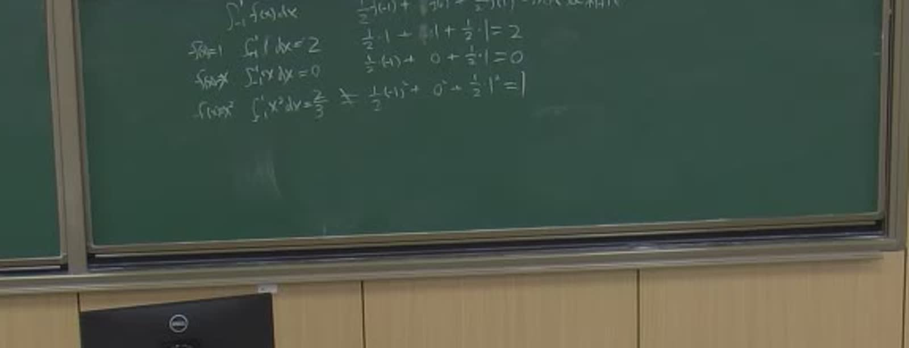
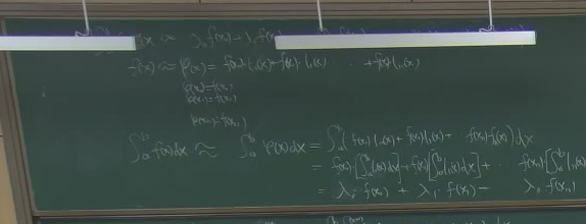

# 第 12 讲（10-26）：正交多项式族与零点定理、离散内积与最小二乘、数值积分开篇

> 课堂实录精编。本讲**无课件、全程板书**（与[第 9 讲](lec09.md)、[第 10 讲](lec10.md)、[第 11 讲](lec11.md)相同）。
> 前半段把[第 11 讲](lec11.md)的「正交化让法方程变对角」兑现成**四族经典正交多项式**（Legendre、Chebyshev、Laguerre、Hermite）与**零点定理**，补上[5.5–5.6 正文](../course/ch05/sec54.md)标注「课堂未展开」处；中段把内积换成**求和**，同一套投影与法方程变成**最小二乘拟合**；后半段转入教材**第 6 章**的求积公式、节点与权、**$m$ 次代数精度**与**插值型求积**。
> **〔课堂〕** 是板书与录音里确实出现的内容；**〔教材〕** 是颜庆津《数值分析》（第 4 版）5.5–5.6 与 6.1–6.3 的对应条目；**〔延伸〕** 是本编补的内容。
> 原始转写与 198 帧板书存于 `_sources/numerical/transcripts/`（不随书发布）；公式以**板书为唯一权威**——平台 ASR 在「正交多项式族」「数值积分」两段错得最厉害（族名、$\varphi_i$、求积系数几乎全错），不要按转写字面引用。

::: note 本讲主线：一条投影链
**正交多项式**是让 Gram 矩阵对角的那组基；内积从积分换成**求和**，同一套投影与法方程就变成**最小二乘拟合**；再换成**节点函数值的加权和**，就是**数值积分**。三件事共用一条链：$f-p\perp M$。
:::

::: method[core] 10 分钟复习版 · 第 12 讲

**一句话**：上一讲证明了「正交基下法方程对角」；这一讲先给出四族现成的正交基，再把内积换成离散求和得到最小二乘，最后把积分换成节点加权和（数值积分），并用插值多项式给出权 $\lambda_i$。

**必记结论**（完整公式见 §九）

| 内容 | 要点 |
|:--|:--|
| **正交基** | $a_i=\dfrac{(f,\varphi_i)}{(\varphi_i,\varphi_i)}$，误差公式见 §九 |
| **四族「区间 + 权」** | Legendre：$[-1,1]$、$1$；Chebyshev：$[-1,1]$、$1/\sqrt{1-x^2}$；Laguerre：$[0,\infty)$、$e^{-x}$；Hermite：$(-\infty,\infty)$、$e^{-x^2}$ |
| **零点定理** | $k$ 次正交多项式在 $(a,b)$ 内恰有 $k$ 个互异实零点；Gauss 求积的节点就取这些根 |
| **离散内积与最小二乘** | $(f,g)=\sum\limits_i f(x_i)g(x_i)$；最小二乘即取 $\varphi_j=x^j$ 的最佳平方逼近，法方程不变 |
| **求积与代数精度** | $\int_a^b f\approx\sum\limits_{i=0}^n\lambda_if(x_i)$；对 $\deg\le m$ 精确、对某个 $m+1$ 次不精确 $\Rightarrow$ $m$ 次 |
| **插值型求积** | $\lambda_i=\int_a^b l_i\,dx$；$n+1$ 个节点至少 $n$ 次；$[-1,1]$ 上梯形只有 $1$ 次 |

**老师强调的五件事**（据板书与课堂反复回扣整理）：

1. **四族的「区间 + 权」是一套的**：写公式必须连区间与权一起写。
2. **正交化的全部目的就是让 Gram 矩阵对角**：原话「我们最希望 $A$ 是对角阵」——对角后每个系数单独算。
3. **零点定理是下一章的门票**：$k$ 次正交多项式在区间内恰有 $k$ 个互异实根。
4. **离散内积不是「另起一套」**：最小二乘就是离散内积下的最佳平方逼近。
5. **求积系数只由节点决定**：代数精度是「精确成立的最高次数」，不是误差阶。

:::

## 课堂时间线

| 时间 | 内容 |
|---|---|
| 00:00–05:00 | 函数内积 $(f,g)=\int_a^b\rho fg\,dx$、范数与投影条件 $f-p\perp\varphi_i$ |
| 05:00–15:00 | 法方程 $A\boldsymbol a=\boldsymbol b$、$A_{ij}=(\varphi_i,\varphi_j)$；Gram–Schmidt 显式 |
| 15:00–20:00 | **Legendre**：Rodrigues 公式、正交性 $\dfrac{2}{2n+1}$ |
| 20:00–27:00 | **Chebyshev**：$x=\cos\theta$ 换元推导正交性，$T_0$–$T_3$ 逐个写出 |
| 27:00–30:00 | **Laguerre、Hermite**：定义与正交性常数 |
| 30:00–40:00 | **零点定理**：$k$ 次正交多项式在 $[a,b]$ 上有 $k$ 个不同根；讲证明思路 |
| 40:00–53:00 | 内积四公理复述；用 Lagrange 基验证加法性，引出**离散内积** |
| 53:00–70:00 | **例题**：5 点数据表、二次拟合、$3\times3$ 法方程 |
| 70:00–76:00 | 正交基对照：Gram 矩阵对角、系数逐个算 |
| 76:00–80:00 | **数值积分**：求积公式、等距节点 $h=(b-a)/n$、左矩形公式 |
| 80:00–85:00 | **代数精度**定义（$m$ 次） |
| 85:00–90:00 | 梯形公式：用 $f=1,x,x^2$ 验证，得「一次代数精度」 |
| 90:00–98:00 | **插值型求积**：$\lambda_i=\int_a^b l_i\,dx$；余项为零 $\Rightarrow$ 至少 $n$ 次精度 |

## §一 从投影到正交多项式：把 Gram 矩阵变成对角阵

本节要回答：正交化把法方程的哪一步变简单了？一句话——把「解耦合方程组」变成「逐个做内积」。

### 1.1 第 11 讲留下的链条（一屏复述）

给定 $M=\operatorname{span}\{\varphi_0,\dots,\varphi_n\}$、$p=\sum_{j=0}^{n}a_j\varphi_j$，最佳平方逼近的**投影条件**是

$$
\boxed{\;f-p\perp M\iff (f-p,\varphi_i)=0,\quad i=0,1,\dots,n\;}
$$

写成**法方程** $G\boldsymbol a=\boldsymbol b$，其中 $G_{ij}=(\varphi_i,\varphi_j)$、$b_i=(f,\varphi_i)$（板书写作 $A\boldsymbol a=\boldsymbol b$）。若基两两正交（$i\ne j$ 时 $(\varphi_i,\varphi_j)=0$），$G$ 是对角阵，法方程解耦、误差也随之简化：

$$
a_i=\frac{(f,\varphi_i)}{(\varphi_i,\varphi_i)},\qquad
\lVert f-p\rVert^2=(f,f)-\sum_{i=0}^{n}\frac{(f,\varphi_i)^2}{(\varphi_i,\varphi_i)},\qquad i=0,1,\dots,n .
$$

> 上一讲反复说「我们希望 $A$ 是对角阵」，落点就是这两行；剩下的问题是**怎么把普通基变成正交基**。

### 1.2 幂函数系的正交化：板书给出的显式形式

把 $\{1,x,x^2,\dots\}$ 逐项正交化，板书一行一行写开：

$$
\begin{aligned}
\varphi_0(x)&=1,\\
\varphi_1(x)&=x-\frac{(x,\varphi_0)}{(\varphi_0,\varphi_0)}\varphi_0,\\
\varphi_2(x)&=x^2-\frac{(x^2,\varphi_0)}{(\varphi_0,\varphi_0)}\varphi_0
-\frac{(x^2,\varphi_1)}{(\varphi_1,\varphi_1)}\varphi_1,\\
&\ \ \vdots\\
\varphi_k(x)&=x^k-\sum_{j=0}^{k-1}\frac{(x^k,\varphi_j)}{(\varphi_j,\varphi_j)}\,\varphi_j .
\end{aligned}
$$

关键事实（上一讲已证、这里直接引用）：$\varphi_k$ 是 $x^0,x^1,\dots,x^k$ 的线性组合，且 $x^k$ 的系数为 $1$，所以

$$
\deg\varphi_k=k,\qquad \varphi_k(x)=x^k+\text{低次项}.
$$

这就是「**正交多项式**」：正交化后仍是一串次数递增的多项式。

> **符号提醒**：本节 $\varphi_i$ 专指正交化之后的基；第 11 讲曾用 $\varphi_i$ 记任意基、$\psi_i$ 记正交化结果。读笔记先看清「哪一组是正交的」。

### 1.3 一个对照：Lagrange 基与正交基

板书写内积性质时，顺手对照了 **Lagrange 基**：

$$
l_i(x_j)=\delta_{ij},\qquad \sum_{i=0}^{n}l_i(x)=1,
\qquad (f,l_i)=\int_a^b\rho f l_i\,dx .
$$

插值的 Lagrange 基在**节点上**是单位阵；正交基在**内积下**是对角阵——都是「换基让矩阵变简单」，只是标准不同。

::: proof[skip] 为什么正交化不改变张成的子空间
设 $\varphi_0,\dots,\varphi_{k-1}$ 已两两正交。由构造，$\varphi_k$ 是 $x^k$ 减去 $\varphi_0,\dots,\varphi_{k-1}$ 的线性组合，故

$$
\operatorname{span}\{\varphi_0,\dots,\varphi_k\}=\operatorname{span}\{1,x,\dots,x^k\}.
$$

正交性：对 $m<k$，

$$
(\varphi_k,\varphi_m)=(x^k,\varphi_m)-\frac{(x^k,\varphi_m)}{(\varphi_m,\varphi_m)}(\varphi_m,\varphi_m)=0,
$$

其余 $j\ne m$ 的项由 $(\varphi_j,\varphi_m)=0$ 消去；归纳即得两两正交。
:::

## §二 四族经典正交多项式

本节要回答：四族正交基各配什么区间和权？带权内积一律为 $(f,g)=\int_a^b\rho fg\,dx$，下面每族只写权与自己的公式。

### 2.1 Legendre 多项式（勒让德）

区间 $[-1,1]$、权 $\rho=1$。正交基 $\{L_0,L_1,\dots,L_n\}$，生成公式（Rodrigues 公式）：

$$
L_n(x)=\frac{1}{2^nn!}\frac{d^n}{dx^n}\bigl(x^2-1\bigr)^n,
$$

正交性：

$$
(L_n,L_m)=\int_{-1}^{1}L_n(x)L_m(x)\,dx
=\begin{cases}
0,&n\ne m,\\[2pt]
\dfrac{2}{2n+1},&n=m.
\end{cases}
$$

前四个（按教材补全）：

$$
L_0=1,\quad L_1=x,\quad
L_2=\frac{3x^2-1}{2},\quad
L_3=\frac{5x^3-3x}{2}.
$$

递推：

$$
(n+1)L_{n+1}(x)=(2n+1)xL_n(x)-nL_{n-1}(x).
$$

### 2.2 Chebyshev 多项式（切比雪夫）：板书现场推导

区间 $[-1,1]$、权 $\rho(x)=1/\sqrt{1-x^2}$。正交基 $\{T_0,T_1,\dots,T_n\}$，定义：

$$
T_n(x)=\cos\bigl(n\arccos x\bigr),\qquad -1\le x\le 1 .
$$

**板书推导**（本讲最完整的一段）：令 $x=\cos\theta$，则 $\theta=\arccos x$，$dx=-\sin\theta\,d\theta$：

$$
(T_m,T_n)=\int_{-1}^{1}\frac{\cos(m\arccos x)\cos(n\arccos x)}{\sqrt{1-x^2}}\,dx
=\int_{0}^{\pi}\cos m\theta\,\cos n\theta\,d\theta .
$$

用积化和差 $\cos m\theta\cos n\theta=\dfrac12\bigl[\cos(m+n)\theta+\cos(m-n)\theta\bigr]$：

$$
(T_m,T_n)=\frac12\int_{0}^{\pi}\bigl[\cos(m+n)\theta+\cos(m-n)\theta\bigr]\,d\theta
=\begin{cases}
0,&m\ne n,\\[2pt]
\dfrac{\pi}{2},&m=n\ne0,\\[2pt]
\pi,&m=n=0.
\end{cases}
$$

同一个换元写出前几个 $T_n$：

$$
\begin{aligned}
T_0(\cos\theta)&=\cos 0=1 &&\Rightarrow T_0(x)=1,\\
T_1(\cos\theta)&=\cos\theta &&\Rightarrow T_1(x)=x,\\
T_2(\cos\theta)&=\cos 2\theta=2\cos^2\theta-1 &&\Rightarrow T_2(x)=2x^2-1,\\
T_3(\cos\theta)&=\cos 3\theta=4\cos^3\theta-3\cos\theta &&\Rightarrow T_3(x)=4x^3-3x .
\end{aligned}
$$

三步（换元、积化和差、回代）就是板书内容；递推 $T_{n+1}=2xT_n-T_{n-1}$ 由 $\cos(n+1)\theta+\cos(n-1)\theta=2\cos\theta\cos n\theta$ 得到。

> **与 Legendre 的区别**：Legendre 的权是 $1$，Chebyshev 的权是 $1/\sqrt{1-x^2}$——分母在端点发散，正好抵消换元带来的 $\sin\theta$。权不是「配着好看」，是被区间与换元逼出来的。

### 2.3 Laguerre 与 Hermite（拉盖尔、埃尔米特）

**Laguerre**：区间 $[0,\infty)$、权 $\rho=e^{-x}$，

$$
U_n(x)=e^{x}\frac{d^n}{dx^n}\bigl(x^ne^{-x}\bigr),\qquad
(U_n,U_m)=\int_{0}^{\infty}U_n(x)U_m(x)e^{-x}\,dx
=\begin{cases}
0,&n\ne m,\\
(n!)^2,&n=m.
\end{cases}
$$

**Hermite**：区间 $(-\infty,\infty)$、权 $\rho=e^{-x^2}$，

$$
H_n(x)=(-1)^ne^{x^2}\frac{d^n}{dx^n}e^{-x^2},\qquad
(H_n,H_m)=\int_{-\infty}^{\infty}H_n(x)H_m(x)e^{-x^2}\,dx
=\begin{cases}
0,&n\ne m,\\
2^nn!\sqrt{\pi},&n=m.
\end{cases}
$$

::: note 板书进度与补全范围
板书对 Hermite 只写到「正交基 $\{H_0,\dots,H_n\}$」与正交性常数，显式公式未展开；上面按教材 5.5.2 补全。
:::

### 2.4 四族一览（板书四条的汇总）

| 名称 | 区间 | 权 $\rho(x)$ | 生成公式 | 正交性常数 |
|:--|:--|:--|:--|:--|
| Legendre | $[-1,1]$ | $1$ | $L_n=\dfrac{1}{2^nn!}\dfrac{d^n}{dx^n}(x^2-1)^n$ | $\dfrac{2}{2n+1}$ |
| Chebyshev | $[-1,1]$ | $\dfrac{1}{\sqrt{1-x^2}}$ | $T_n=\cos(n\arccos x)$ | $\dfrac{\pi}{2}$（$n\ne0$）、$\pi$（$n=0$） |
| Laguerre | $[0,\infty)$ | $e^{-x}$ | $U_n=e^x\dfrac{d^n}{dx^n}(x^ne^{-x})$ | $(n!)^2$ |
| Hermite | $(-\infty,\infty)$ | $e^{-x^2}$ | $H_n=(-1)^ne^{x^2}\dfrac{d^n}{dx^n}e^{-x^2}$ | $2^nn!\sqrt{\pi}$ |

## §三 零点定理：$k$ 次正交多项式有 $k$ 个互异实根

本节要回答：为什么「$k$ 次正交多项式恰有 $k$ 个实根」是下一章 Gauss 求积的门票？因为 Gauss 节点要取这些根，而定理保证它们互异、落在区间内部。

### 3.1 板书定理与教材的准确说法

::: thm[core] 定理 · 正交多项式的零点
设 $(f,g)=\displaystyle\int_a^b\rho(x)f(x)g(x)\,dx$，$\varphi_0,\varphi_1,\dots,\varphi_n$ 是 $[a,b]$ 上带权 $\rho$ 的正交多项式系，则 $\varphi_k(x)$ 在 $[a,b]$ 上有 $k$ 个不同根。
:::

教材 5.5.1 性质 3 的准确说法是「在 $(a,b)$ 内恰有 $k$ 个**互异实**零点」；「互异」与「实」不能漏，否则定理不成立（复根、重根都不允许）。板书只框结论，证明只讲思路。

### 3.2 证明思路（教材 5.5.1，课堂只讲思路）

::: proof[skip] 零点定理的证明
反证。设 $\varphi_k$ 在 $(a,b)$ 内**变号**的零点（奇重零点）只有 $r<k$ 个，记为 $t_1,\dots,t_r$。令

$$
q(x)=\prod_{j=1}^{r}(x-t_j),
$$

则 $q$ 是 $r<k$ 次多项式，且 $q(x)\varphi_k(x)$ 在 $(a,b)$ 内**不变号**（每穿过一个奇重零点，$q\varphi_k$ 的符号恰好被 $q$ 翻回来），又不恒为零，于是

$$
\int_a^b\rho(x)q(x)\varphi_k(x)\,dx\ne0 .
$$

但 $\deg q=r<k$，由正交多项式系的刻画（教材定理 5.6，即 $\varphi_k$ 与一切次数 $<k$ 的多项式正交），上式必须为 $0$，矛盾。故奇重零点至少有 $k$ 个；而 $\deg\varphi_k=k$，零点总数不超过 $k$，所以恰有 $k$ 个互异实零点。
:::

定理 5.6 的「刻画」为什么够用：任意 $\deg\le k-1$ 的 $q$ 都是 $\varphi_0,\dots,\varphi_{k-1}$ 的线性组合，逐项与 $\varphi_k$ 正交，故 $(q,\varphi_k)=0$；反之取 $q=\varphi_j\ (j<k)$ 即得两两正交。

### 3.3 为什么这条定理重要

下一章 Gauss 求积要选 $n+1$ 个节点使代数精度达到 $2n+1$，取的正是 $n+1$ 次正交多项式的 $n+1$ 个零点。零点定理保证了「$n+1$ 个节点互异且落在区间内部」——这是 Gauss 公式成立的前提。本讲只把门票交到手，第 6 章再验票。

## §四 离散内积：把积分换成求和

本节要回答：把积分换成求和，第 11 讲的投影与法方程为什么原封不动还能用？因为四条公理仍然成立，只有正定性退了一步——它只保证节点上的误差为零。

### 4.1 内积四公理复述（40:00 起）

连续内积与离散内积共用同一套公理；板书又写了一遍，作为「换内积」的依据：

$$
\begin{aligned}
(1)&\quad (f,g)=(g,f),\\
(2)&\quad k\in\mathbb R,\quad (kf,g)=k(f,g)=(f,kg),\\
(3)&\quad (f+g,h)=(f,h)+(g,h),\\
(4)&\quad (f,f)\ge0,\qquad (f,f)=0\iff f\equiv0 .
\end{aligned}
$$

连续内积是

$$
(f,g)=\int_a^b\rho(x)f(x)g(x)\,dx ;
$$

离散内积是

$$
\boxed{\;(f,g)=\sum_{i=0}^{m}f(x_i)g(x_i)\;}
$$

（若带权则是 $\sum_i\omega_i f(x_i)g(x_i)$，$\omega_i>0$）。四条公理照搬：对称、齐次、加法都是求和的性质；正定性要求「若 $\sum_i f^2(x_i)=0$ 则 $f$ 在所有节点上为 $0$」——这只是「在节点上为零」，不是「恒为零」。

**为什么可以照搬**：求和是有限项相加，不涉及极限，代数公理逐条成立；代价在正定性——离散内积只量节点上的误差，所以最小二乘只关心采样点的残差平方和。

### 4.2 用 Lagrange 基验证加法性

为说明求和确实是内积，板书把 $f,g$ 在节点上用 Lagrange 基展开：

$$
f(x)=\sum_{i=0}^{m}f(x_i)l_i(x),\qquad
g(x)=\sum_{i=0}^{m}g(x_i)l_i(x),
$$

再按节点合并同类项：

$$
\begin{aligned}
(f+g,h)&=\bigl[f(x_0)+g(x_0)\bigr]h(x_0)+\bigl[f(x_1)+g(x_1)\bigr]h(x_1)+\cdots\\
&=\bigl[f(x_0)h(x_0)+f(x_1)h(x_1)+\cdots\bigr]
+\bigl[g(x_0)h(x_0)+g(x_1)h(x_1)+\cdots\bigr]\\
&=(f,h)+(g,h).
\end{aligned}
$$

对称性与齐次性同理。

### 4.3 同一套投影条件

在离散内积下，把「函数」看成向量 $\boldsymbol f=(f(x_0),\dots,f(x_m))^{\mathrm T}$，内积就是 $\boldsymbol f^{\mathrm T}\boldsymbol g$，于是第 11 讲的投影图原封不动：

$$
\lVert f-p\rVert_2=\min_{p\in M}\lVert f-p\rVert_2
\iff (f-p,\varphi_i)=0,\quad i=0,\dots,n,
$$

法方程也原封不动：

$$
G\boldsymbol a=\boldsymbol b,\qquad
G_{ij}=(\varphi_i,\varphi_j)=\sum_{k=0}^{m}\varphi_i(x_k)\varphi_j(x_k),\quad
b_i=(f,\varphi_i)=\sum_{k=0}^{m}f(x_k)\varphi_i(x_k).
$$

**最小二乘拟合**就是「取 $\varphi_j=x^j$、用离散内积」的最佳平方逼近。名字变了，数学没变。

### 4.4 连续内积与离散内积对照

| | 连续内积（第 11 讲、本讲前半） | 离散内积（本讲中段） |
|:--|:--|:--|
| 定义 | $(f,g)=\int_a^b\rho fg\,dx$ | $(f,g)=\sum_i f(x_i)g(x_i)$ |
| 「向量」 | 函数本身 | $(f(x_0),\dots,f(x_m))$ |
| 正定性的「零」 | $f\equiv0$ | $f$ 在所有节点为 $0$ |
| 典型问题 | 最佳平方逼近 | 最小二乘曲线拟合 |
| 法方程 | $G\boldsymbol a=\boldsymbol b$ | $G\boldsymbol a=\boldsymbol b$（同一个） |
| 正交基的效果 | 解耦 | 解耦（离散正交多项式） |

## §五 课堂例题：5 点数据表上的二次拟合

本节要回答：最小二乘拟合怎么直接套第 11 讲的法方程？数据表一填，$3\times3$ 法方程就出来了。

::: note 板书核对与补算说明
数据表写在左板（53:00 起），拟合对象 $m(x)=a_0+a_1x+a_2x^2$，目标 $\min\lVert a_0+a_1x+a_2x^2-f\rVert_2$；老师只列法方程，算术留给学生，解与验算为本编复算。70:00 前后板面较挤：自然基与正交基两种写法并排，局部的归一化系数笔迹有擦改、难以逐项辨认，故不逐项复述；结论以「换成正交基后 Gram 矩阵对角、系数逐个算」为准。
:::

### 5.1 题目：数据与目标

板书给出的数据表：

$$
\begin{array}{c|ccccc}
x_i & -2 & -1 & 0 & 1 & 2\\ \hline
y_i & 0 & 0.1 & 0.4 & 0.9 & 1.6
\end{array}
$$

（这组 $y_i$ 恰为 $0.1(x+2)^2$。）要求拟合二次多项式 $m(x)=a_0+a_1x+a_2x^2$，使

$$
\min_{a_0,a_1,a_2}\sqrt{\sum_{i=0}^{4}\bigl(y_i-m(x_i)\bigr)^2}
=\min_{a_0,a_1,a_2}\bigl\lVert a_0+a_1x+a_2x^2-f\bigr\rVert_2
$$

最小。

### 5.2 思路：照搬法方程

把 $\{1,x,x^2\}$ 当作基、$(f,g)=\sum_i f(x_i)g(x_i)$ 当作内积，这就是「离散内积下的最佳平方逼近」，法方程即（板书原式）

$$
\begin{pmatrix}
(1,1)&(1,x)&(1,x^2)\\
(x,1)&(x,x)&(x,x^2)\\
(x^2,1)&(x^2,x)&(x^2,x^2)
\end{pmatrix}
\begin{pmatrix}a_0\\a_1\\a_2\end{pmatrix}
=
\begin{pmatrix}(f,1)\\(f,x)\\(f,x^2)\end{pmatrix}.
$$

### 5.3 步骤：求和、列方程、求解

五个节点对称，故

$$
\sum x_i=0,\quad \sum x_i^2=10,\quad \sum x_i^3=0,\quad \sum x_i^4=34,\quad n=5 .
$$

右端：

$$
\begin{aligned}
(f,1)&=\sum y_i=0+0.1+0.4+0.9+1.6=3.0,\\
(f,x)&=\sum x_iy_i=0\cdot(-2)+0.1\cdot(-1)+0.4\cdot0+0.9\cdot1+1.6\cdot2=4.0,\\
(f,x^2)&=\sum x_i^2y_i=0\cdot4+0.1\cdot1+0.4\cdot0+0.9\cdot1+1.6\cdot4=7.4 .
\end{aligned}
$$

法方程具体化为

$$
\begin{pmatrix}5&0&10\\0&10&0\\10&0&34\end{pmatrix}
\begin{pmatrix}a_0\\a_1\\a_2\end{pmatrix}
=\begin{pmatrix}3.0\\4.0\\7.4\end{pmatrix}.
$$

第二行立刻给出 $10a_1=4.0\Rightarrow a_1=0.4$。第一、三行联立：

$$
\begin{cases}
5a_0+10a_2=3.0,\\
10a_0+34a_2=7.4,
\end{cases}
\Rightarrow
\begin{cases}
a_0+2a_2=0.6,\\
10a_0+34a_2=7.4.
\end{cases}
$$

消元：$a_0=0.6-2a_2$ 代入第二式得 $6+14a_2=7.4$，故 $a_2=0.1$，$a_0=0.6-0.2=0.4$。

### 5.4 结果与验算

所以

$$
\boxed{\;m(x)=0.4+0.4x+0.1x^2\;}
$$

逐点代入：

$$
\begin{aligned}
m(-2)&=0.4-0.8+0.4=0,\\
m(-1)&=0.4-0.4+0.1=0.1,\\
m(0)&=0.4,\\
m(1)&=0.4+0.4+0.1=0.9,\\
m(2)&=0.4+0.8+0.4=1.6,
\end{aligned}
$$

与 $y_i$ 完全一致，残差全为 $0$；平方和 $0$ 是最小可能值（非负），故确为最小二乘解。

### 5.5 解读：拟合与插值、换正交基（70:00–76:00）

数据恰好落在二次多项式上时，最小二乘**精确复原**该多项式，残差为零——「拟合」与「插值」并不对立：前者要求总平方误差最小，后者要求过点；数据光滑时两者可以重合。板书数字特意配成 $\sum x_i=\sum x_i^3=0$，法方程立刻解耦成 $10a_1=4$。

板书随后把同一套法方程换成正交多项式基 $P_0,P_1,P_2$ 重写：

$$
\begin{pmatrix}
(P_0,P_0)&(P_0,P_1)&(P_0,P_2)\\
(P_1,P_0)&(P_1,P_1)&(P_1,P_2)\\
(P_2,P_0)&(P_2,P_1)&(P_2,P_2)
\end{pmatrix}
\begin{pmatrix}a_0\\a_1\\a_2\end{pmatrix}
=
\begin{pmatrix}(f,P_0)\\(f,P_1)\\(f,P_2)\end{pmatrix},
$$

由于 $i\ne j$ 时 $(P_i,P_j)=0$，矩阵成为对角阵，三个系数各算各的——第 11 讲「正交基让法方程解耦」的落地。

## §六 数值积分开篇：求积公式、代数精度与插值型求积

本节要回答：算不出的积分怎么用节点函数值近似；「一个求积公式有多准」怎么定义、怎么验证、权从哪来。

### 6.1 问题：积分算不出来怎么办

板书在 76:00 转入本章问题：要算 $I(f)=\displaystyle\int_a^b f(x)\,dx$，但很多 $f$ 没有初等原函数（$e^{-x^2}$、$\dfrac{\sin x}{x}$ 等）。办法是**用节点函数值加权求和**代替积分：

$$
\boxed{\;\int_a^b f(x)\,dx\approx\lambda_0f(x_0)+\lambda_1f(x_1)+\cdots+\lambda_nf(x_n)\;}
$$

称为**求积公式**，$x_0,\dots,x_n$ 为**求积节点**，$\lambda_0,\dots,\lambda_n$ 为**求积系数**（权）。板书旁有示意图：把 $[a,b]$ 分成小段，用矩形代替曲边梯形。

### 6.2 最简单的构造：等距节点 + 矩形

取等距节点

$$
h=\frac{b-a}{n},\qquad x_i=a+ih,\quad i=0,1,\dots,n,
$$

用左端点函数值乘 $h$ 累加（左矩形公式）：

$$
\int_a^b f(x)\,dx\approx hf(x_0)+hf(x_1)+\cdots+hf(x_{n-1})
=h\sum_{i=0}^{n-1}f(x_i).
$$

这就是板书那排矩形：简单但精度低；要谈精度，先定义。

### 6.3 代数精度：板书定义（80:00–85:00）

::: def 定义 · 求积公式的代数精度
如果对于次数不超过 $m$ 次的多项式 $f(x)$，都有

$$
\int_a^b f(x)\,dx=\lambda_0f(x_0)+\lambda_1f(x_1)+\cdots+\lambda_nf(x_n),
$$

且存在一个 $m+1$ 次多项式 $P(x)$，使

$$
\int_a^b P(x)\,dx\ne\lambda_0P(x_0)+\lambda_1P(x_1)+\cdots+\lambda_nP(x_n),
$$

则称求积公式 $\displaystyle\int_a^b f(x)\,dx\approx\sum_{i=0}^{n}\lambda_if(x_i)$ **具有 $m$ 次代数精度**。
:::

教材的顺序相反：先讲 Newton–Cotes、再谈精度；课堂先定义精度、再反过来检验公式，本页按课堂顺序。

**读法**：

- 只查「$1,x,x^2,\dots,x^m$ 精确、$x^{m+1}$ 不精确」即可，不必验证所有多项式；
- 代数精度是**精确成立的最高次数**，不是误差阶，也不是收敛阶（对比见 §七）；
- 由 $f=1$ 精确可得 $\sum_i\lambda_i=b-a$，这是检查求积公式写错没有的第一道关。

### 6.4 例：$[-1,1]$ 上的梯形公式，代数精度只有一次（85:00–90:00）

板书取 $[a,b]=[-1,1]$，节点 $-1,0,1$，$h=1$，用复化梯形（两个小区间）：

$$
\int_{-1}^{1}f(x)\,dx\approx\frac12f(-1)+f(0)+\frac12f(1).
$$

板书逐条验证：

| 取 $f$ | 精确值 $\int_{-1}^1 f\,dx$ | 公式值 | 是否精确 |
|:--|:--|:--|:--|
| $f=1$ | $2$ | $\dfrac12\cdot1+1+\dfrac12\cdot1=2$ | 精确 |
| $f=x$ | $0$ | $\dfrac12(-1)+0+\dfrac12\cdot1=0$ | 精确 |
| $f=x^2$ | $\dfrac23$ | $\dfrac12\cdot1+0+\dfrac12\cdot1=1$ | **不精确**（$1\ne\dfrac23$） |

故**代数精度为 $1$**（板书旁注「一次代数精度」）。

> **误差多大**：$\int_{-1}^1x^2dx-\bigl(\frac12+\frac12\bigr)=\frac23-1=-\frac13$。这正是复化梯形误差公式的一个特例：$I-T=-\dfrac{(b-a)h^2}{12}f''(\xi)=-2\cdot\dfrac{1}{12}\cdot2=-\dfrac13$，与直接相减一致。

### 6.5 插值型求积公式：$\lambda_i$ 从哪里来（90:00–98:00）

板书最后 8 分钟从「权」回到插值。**为什么绕到插值**：$f$ 的原函数算不出来，但多项式 $l_i$ 的积分能逐项算，$\lambda_i$ 因此只依赖节点与区间。

把 $f$ 用 $n+1$ 个节点上的 Lagrange 插值多项式代替，

$$
f(x)\approx p(x)=\sum_{i=0}^{n}f(x_i)l_i(x),
\qquad
l_i(x_j)=\delta_{ij},
$$

两边积分：

$$
\begin{aligned}
\int_a^b f(x)\,dx&\approx\int_a^b p(x)\,dx
=\int_a^b\Bigl(\sum_{i=0}^{n}f(x_i)l_i(x)\Bigr)dx\\
&=\sum_{i=0}^{n}f(x_i)\int_a^b l_i(x)\,dx
=\sum_{i=0}^{n}\lambda_if(x_i),
\end{aligned}
$$

于是得到**插值型求积公式**的权：

$$
\boxed{\;\lambda_i=\int_a^b l_i(x)\,dx\;}
$$

它与被积函数无关——即「权由节点决定」。

**余项与代数精度**。把插值余项一起积分：

$$
\begin{aligned}
\int_a^b f(x)\,dx
&=\int_a^b p(x)\,dx+\int_a^b\frac{f^{(n+1)}(\xi_x)}{(n+1)!}(x-x_0)(x-x_1)\cdots(x-x_n)\,dx\\
&=\sum_{i=0}^{n}\lambda_if(x_i)
+\int_a^b\frac{f^{(n+1)}(\xi_x)}{(n+1)!}\,\omega_{n+1}(x)\,dx .
\end{aligned}
$$

若 $f$ 是次数不超过 $n$ 的多项式，则 $f^{(n+1)}\equiv0$，余项为零，故

$$
\int_a^b f(x)\,dx=\sum_{i=0}^{n}\lambda_if(x_i)
\qquad(\deg f\le n),
$$

即：**$n+1$ 个节点的插值型求积公式至少有 $n$ 次代数精度**（教材定理 6.1，板书以「$n$ 次代数精度」收尾）。

### 6.6 与教材第 6 章的接口

课堂在 98:00 结束，教材 6.2–6.3 的后续内容（按教材补齐，课堂未讲）：

- **Newton–Cotes 公式**：等距节点下 $\lambda_k=(b-a)\dfrac{(-1)^{n-k}}{n\,k!\,(n-k)!}\int_0^n\prod_{j\ne k}(t-j)\,dt$；
- $n=1$ 是梯形公式 $T=\dfrac{b-a}{2}[f(a)+f(b)]$，$n=2$ 是 Simpson 公式 $S=\dfrac{b-a}{6}\bigl[f(a)+4f(\frac{a+b}{2})+f(b)\bigr]$；
- **定理 6.2**：Newton–Cotes 系数满足 $\sum\lambda_k=b-a$ 且关于中点对称；$n$ 为偶数时代数精度至少 $n+1$（Simpson 是 $3$ 次）。

这些是下一讲的主线。

## §七 老师强调与易错点

本节只留一份考前检查清单，每条对应正文的展开处，不重复推导。

1. **Chebyshev 的换元只对 $[-1,1]$ 成立**：$x=\cos\theta$ 把 $[-1,1]$ 映到 $[0,\pi]$，$\sqrt{1-x^2}=\sin\theta$；换区间要先线性变换到 $[-1,1]$。
2. **零点定理的三个关键词**：「$k$ 个」「互异」「实根（在 $(a,b)$ 内）」；少一个都不成立，证明数的是「奇重零点」。
3. **系数分母是 $(\varphi_i,\varphi_i)$，不是 $1$**：只有**标准**正交基分母才是 $1$（此时 $c_i=(f,e_i)$）；这是最常见的丢分点。
4. **离散内积的正定性只在节点上**：$\sum_i f^2(x_i)=0$ 只能推出 $f$ 在节点为零，推不出 $f\equiv0$。
5. **拟合不过点**：最小二乘不要求 $m(x_i)=y_i$，只要求残差平方和最小；§五残差为零是数据特殊。
6. **代数精度别和误差阶混**：前者是「对几次多项式精确」，后者是「$h$ 的几次方」；梯形公式代数精度 $1$、复化误差 $O(h^2)$。

## 板书关键帧

七帧按时间排序，标题给出时间点与内容。

![第 12 讲板书 · 35:00：零点定理——$k$ 次正交多项式在 $[a,b]$ 上有 $k$ 个不同根（左板上方）](../assets/lectures/lec12-board-zeros-theorem.jpg)

## 课堂口述与标准术语对照

平台 ASR 在「正交多项式族」「数值积分」两段错得最厉害：族名几乎全军覆没，$\lambda_i$ 与 $f(x_i)$ 被读成无关词。下表只列反复出现、影响理解的几组。

| 转写中的写法 | 标准术语 / 说明 |
|:--|:--|
| 内肌、内心、那一期、内息 | 内积 |
| 约然的内积、离散离心 | 离散内积 |
| 正交基准 | 正交基 |
| 正交大组装、正交二指的动作 | 正交化（后者重复出现十余次） |
| 顺庞、十分之正交八里 | Gram–Schmidt（施密特正交化） |
| 领域绕路、尼斯多德 | Legendre（勒让德） |
| 切皮区 | Chebyshev（切比雪夫） |
| 拉盖尔、拉格 | Laguerre（拉盖尔） |
| 塞1、塞2、塞3（φ 被读成「塞」） | $\varphi_1,\varphi_2,\varphi_3$ |
| 败、败二、败三 | $\varphi_0$ 一类基函数（板书符号被读成「败」） |
| 求积公式段（「代数精」「拉姆达」） | 求积系数 $\lambda_i$、代数精度；整段无逐词对应，以板书为准 |

## §八 分层练习

练习按概念、计算、证明三组排列；答案折叠在本节末尾，先做再展开；B1、B3 为补充题（非课堂原题）。

### A 组 · 概念

**A1.** 为什么说「正交多项式是让 Gram 矩阵变对角阵的基」？

**A2.** Chebyshev 多项式的权为什么是 $1/\sqrt{1-x^2}$？

**A3.** 零点定理为什么要求「互异实根」，而不是「$k$ 个根」？

**A4.** 离散内积 $(f,g)=\sum_i f(x_i)g(x_i)$ 满足内积公理吗？正定性与连续内积有何不同？

### B 组 · 计算

**B1.** 在 $[-1,1]$ 上把 $f(x)=x^3$ 按 Legendre 基展开到二次，求 $c_0,c_1,c_2$。

**B2.** 用 §五的数据表，验证法方程的解 $m(x)=0.4+0.4x+0.1x^2$ 确实使残差平方和为零。

**B3.** 求积公式 $\int_{-1}^1f\,dx\approx f\!\left(-\frac{1}{\sqrt3}\right)+f\!\left(\frac{1}{\sqrt3}\right)$ 的代数精度是多少？

### C 组 · 证明

**C1.** 证明：正交多项式系一定线性无关。

**C2.** 证明：若 $\{\varphi_k\}$ 是正交多项式系且 $\deg\varphi_k=k$，则对任意次数 $\le k-1$ 的多项式 $q$，$(q,\varphi_k)=0$。

::: sol 答案 · A 组（概念）与 B 组（计算）
**A1.** 因为 $(\varphi_i,\varphi_j)=0\ (i\ne j)$ 时 $G$ 对角，每个 $a_i=(f,\varphi_i)/(\varphi_i,\varphi_i)$ 独立算，不必解方程组。

**A2.** 因为 $T_n=\cos(n\arccos x)$，令 $x=\cos\theta$ 时 $dx=-\sin\theta\,d\theta$，而 $\sqrt{1-x^2}=\sin\theta$；权取 $1/\sqrt{1-x^2}$ 正好抵消 $dx$ 中的 $\sin\theta$，化成 $\int_0^\pi\cos m\theta\cos n\theta\,d\theta$。

**A3.** 复根不能作求积节点；重根使符号论证失效。准确结论是 $(a,b)$ 内 $k$ 个互异实零点，证明按「奇重零点」计数。

**A4.** 满足对称、齐次、加法；正定性弱化为「$\sum_i f^2(x_i)=0\Rightarrow f$ 在节点为零」，推不出 $f\equiv0$——所以最小二乘只关心节点上的误差。

**B1.** $x^3$ 在偶基 $L_0,L_2$ 上的投影为零，$L_1=x$ 是奇函数，故 $c_0=0$，$c_2=0$，

$$
c_1=\frac32\int_{-1}^1x^3\cdot x\,dx=\frac32\cdot\frac25=\frac35 ,
$$

$p_2(x)=\frac35x$（补充题）。

**B2.** 见 §5.4：逐点均有 $m(x_i)=y_i$，残差全为 $0$，平方和 $0$ 最小（非负）。

**B3.** 两点 Gauss 公式。$f=1$：$1+1=2$ ✓；$f=x$：$-\frac1{\sqrt3}+\frac1{\sqrt3}=0$ ✓；$f=x^2$：$\frac13+\frac13=\frac23$ ✓；$f=x^3$：$-\frac{1}{3\sqrt3}+\frac{1}{3\sqrt3}=0$ ✓；$f=x^4$：$\frac19+\frac19=\frac29\ne\frac25$ ✗。故代数精度为 $3$（补充题；第 6 章 Gauss 求积）。
:::

::: sol 答案 · C 组（证明）
**C1.** 设 $\sum_{k=0}^{n}c_k\varphi_k=0$。两边与 $\varphi_j$ 作内积，由正交性得 $c_j(\varphi_j,\varphi_j)=0$；又 $(\varphi_j,\varphi_j)>0$，故 $c_j=0$，$j=0,\dots,n$。

**C2.** $q$ 是 $\varphi_0,\dots,\varphi_{k-1}$ 的线性组合（同空间、次数匹配）；由内积线性性，$(q,\varphi_k)=\sum_{j<k}\alpha_j(\varphi_j,\varphi_k)=0$。
:::

## §九 一页纸公式卡

考前只背这张表；来历见对应小节。

| 场景 | 公式 |
|:--|:--|
| 正交基系数 | $a_i=\dfrac{(f,\varphi_i)}{(\varphi_i,\varphi_i)}$ |
| 正交基误差 | $\lVert f-p\rVert^2=(f,f)-\sum_i\dfrac{(f,\varphi_i)^2}{(\varphi_i,\varphi_i)}$ |
| 幂函数正交化 | $\varphi_k=x^k-\sum_{j<k}\dfrac{(x^k,\varphi_j)}{(\varphi_j,\varphi_j)}\varphi_j$ |
| Legendre | $L_n=\dfrac{1}{2^nn!}\dfrac{d^n}{dx^n}(x^2-1)^n$；$\int_{-1}^1L_nL_m=\dfrac{2}{2n+1}\delta_{nm}$ |
| Legendre 递推 | $(n+1)L_{n+1}=(2n+1)xL_n-nL_{n-1}$ |
| Legendre 展开 | $c_k=\dfrac{2k+1}{2}\int_{-1}^1fL_k\,dx$ |
| Chebyshev | $T_n=\cos(n\arccos x)$；$\int_{-1}^1\dfrac{T_nT_m}{\sqrt{1-x^2}}=\dfrac{\pi}{2}\delta_{nm}$（$n\ne0$） |
| Chebyshev 递推 | $T_{n+1}=2xT_n-T_{n-1}$ |
| Laguerre | $U_n=e^x\dfrac{d^n}{dx^n}(x^ne^{-x})$；$\int_0^\infty e^{-x}U_nU_m=(n!)^2\delta_{nm}$ |
| Hermite | $H_n=(-1)^ne^{x^2}\dfrac{d^n}{dx^n}e^{-x^2}$；$\int_{-\infty}^\infty e^{-x^2}H_nH_m=2^nn!\sqrt\pi\,\delta_{nm}$ |
| 零点定理 | $\deg\varphi_k=k\Rightarrow\varphi_k$ 在 $(a,b)$ 内恰有 $k$ 个互异实根 |
| 离散内积 | $(f,g)=\sum_i f(x_i)g(x_i)$ |
| 离散法方程 | $G_{ij}=\sum_k\varphi_i(x_k)\varphi_j(x_k)$，$b_i=\sum_kf(x_k)\varphi_i(x_k)$ |
| 求积公式 | $\int_a^b f\approx\sum_{i=0}^n\lambda_if(x_i)$，$\sum_i\lambda_i=b-a$ |
| 代数精度 | $1,x,\dots,x^m$ 精确、$x^{m+1}$ 不精确 $\Rightarrow$ $m$ 次 |
| 梯形（$[-1,1]$，$h=1$） | $\dfrac12f(-1)+f(0)+\dfrac12f(1)$，一次代数精度 |

## 归档材料

- 平台 ASR 原始转写：`_sources/numerical/transcripts/lec12-20261026/lec12-20261026-asr-platform.md`（2102 句，未校对）
- 本地 whisper 交叉转写：`_sources/numerical/transcripts/lec12-20261026-whisper-timed.md`（1723 段）/ `lec12-20261026-whisper.srt`（未校对）
- 板书关键帧：`_sources/numerical/transcripts/lec12-20261026-board/`（每 30 秒一帧）+ `INDEX.md`
- 素材索引：`_sources/numerical/transcripts/lec12-20261026-INDEX.md`

## 对应正文

- 正交多项式与最佳平方逼近：[第 5 章 5.5–5.6](../course/ch05/sec54.md)、[第 5 章导览](../course/ch05/overview.md)
- 曲线拟合（最小二乘，教材补齐）：[第 5 章 5.4](../course/ch05/sec52.md)
- 数值积分：[第 6 章导览](../course/ch06/overview.md)、[6.1–6.3 插值型求积与 Newton–Cotes](../course/ch06/sec61.md)
- 内积、投影与正交化的矩阵语言：[补充篇 2.1](../ch02/sec21.md)、[补充篇 2.2](../ch02/sec22.md)、[补充篇 2.3](../ch02/sec23.md)
- 上一讲（内积空间、法方程、Gram–Schmidt）：[第 11 讲](lec11.md)
