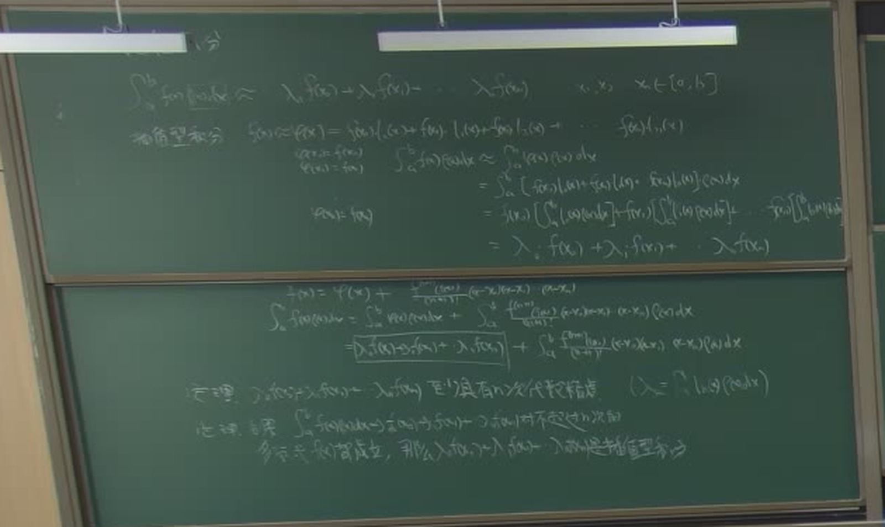

# 第 13 讲（10-28）：插值型求积公式、Newton–Cotes 与复化梯形的二阶收敛

> 课堂实录精编。本讲**无课件、全程板书**（与[第 12 讲](lec12.md)相同）。
> 第 12 讲末段只把「求积公式 = 节点函数值的加权和」这个**形式**立起来，权 $\lambda_k$ 还没有来历；本讲把这件事做完：先由 Lagrange 插值多项式推出**权 $\lambda_k=\int l_k\,dx$**，再给出余项公式与「**至少 $n$ 次**代数精度」这条定理，随后把节点取成等距得到 **Newton–Cotes** 公式族，最后落到**复化梯形（二阶）**与**Simpson（四阶）**两条真正能用的公式。
> **〔课堂〕** 是板书与录音里确实出现的内容；**〔教材〕** 是颜庆津《数值分析》（第 4 版）6.1–6.5 的对应条目；**〔延伸〕** 是本编补的内容。
> 原始转写与 198 帧板书存于 `_sources/numerical/transcripts/`（不随书发布）；公式以**板书为唯一权威**——平台 ASR 在「代数精度」「余项」「复化」三段错字极多（「精度」被写成「进步」「劈拳击度」、「复化」被写成「分化」「画力」），不要按转写字面引用。

::: note 本讲主线：一条链把「权」从天上落到地上
第 12 讲说「积分 = 节点函数值的加权和」，但**权从哪来**当时没答。本讲给答案：**权 = Lagrange 基函数的积分**。由此得到余项公式与「至少 $n$ 次代数精度」；节点取等距就是 Newton–Cotes；单区间用梯形误差大，于是**分段累加**（复化），得到二阶收敛的复化梯形与四阶收敛的 Simpson。
:::

::: method[core] 10 分钟复习版 · 第 13 讲

**一句话**：求积公式的权不是猜的，而是 $\lambda_k=\int l_k(x)\,dx$；余项给出误差，插值型公式因此「至少 $n$ 次代数精度」；节点取等距得到 Newton–Cotes 族；单区间误差大就分段累加，梯形复化二阶、Simpson 复化四阶。

**必记结论**（完整公式见 §十）

| 内容 | 要点 |
|:--|:--|
| **插值型求积公式** | $\int_a^bf\,dx\approx\sum\limits_{k=0}^{n}\lambda_kf(x_k)$，其中 $\lambda_k=\displaystyle\int_a^bl_k(x)\,dx$，$l_k$ 为 Lagrange 基 |
| **余项公式** | $\displaystyle\int_a^bf\,dx=\sum_{k=0}^{n}\lambda_kf(x_k)+\int_a^b\frac{f^{(n+1)}(\xi_x)}{(n+1)!}\omega_{n+1}(x)\,dx$，$\omega_{n+1}(x)=\prod_{j=0}^{n}(x-x_j)$ |
| **主定理** | 插值型求积公式**至少** $n$ 次代数精度；$f$ 为 $n$ 次以下多项式时**精确** |
| **Newton–Cotes** | 等距节点 $x_k=a+kh$，$h=\frac{b-a}{n}$；权 $=$ Cotes 系数 $\times(b-a)$ |
| **权表** | $n=1$ 梯形 $\left(\frac12,\frac12\right)$；$n=2$ Simpson $\left(\frac16,\frac46,\frac16\right)$；$n=3$ $\left(\frac18,\frac38,\frac38,\frac18\right)$；$n=4$ $\left(\frac7{90},\frac{32}{90},\frac{12}{90},\frac{32}{90},\frac7{90}\right)$ |
| **梯形余项** | $R_1=-\dfrac{h^3}{12}f''(\xi)$（单个子区间，$h$ 为区间长） |
| **复化梯形** | $T_n=\dfrac h2\left[f(x_0)+2\sum_{i=1}^{n-1}f(x_i)+f(x_n)\right]$，误差 $O(h^2)$——**二阶** |
| **Simpson** | $\dfrac h3\left[f(x_0)+4f(x_1)+f(x_2)\right]$，单段余项 $-\dfrac{h^5}{2880}f^{(4)}(\xi)$，复化后 $O(h^4)$——**四阶** |

**老师强调的五件事**（据板书与课堂反复回扣整理）：

1. **权只能由插值多项式算出来**：板书第一步就是 $\varphi(x)=\sum\varphi_k(x)l_k(x)$，$\varphi_k(x)=f(x_k)$，然后逐项积分——**权是积分的结果，不是选的**。
2. **定理说的是「至少」不是「恰好」**：板书原话是「至少具有 $n$ 次代数精度」。$n$ 为偶数时会**白捡一阶**（Simpson 有 3 次精度就是这个道理）。
3. **「区间很大时误差也必须不小」**：单个梯形公式在长区间上误差不可接受，这是**复化**存在的唯一理由。
4. **复化 = 把区间切小、用低阶公式累加**：老师原话「我们是不是把它在每一个角度上分段，分成几分段」——不提高单把尺子的精度，而是让每把尺子只量一小段。
5. **误差是逐段加起来再估的**：$|R|\le\dfrac{h^3}{12}\left|\sum_k f''(\xi_k)\right|$，段数变多但 $h$ 变小，最终量级是 $h^2$。

:::

## 课堂时间线 {#lec13-S1}

| 时间 | 内容 |
|---|---|
| 00:00–02:30 | 开场与回顾（板书空白） |
| 02:30–08:00 | **数值积分**与**插值型积分**：$\int_0^{x_{n+1}}f(x)\,dx\approx\lambda_1f(x_1)+\cdots+\lambda_nf(x_n)$，节点 $x_k\in[0,h)$ |
| 08:00–13:00 | 插值型求积公式的推导：$\varphi(x)=\sum\varphi_k(x)l_k(x)$，逐项积分得 $\lambda_k=\int l_k\,dx$ |
| 13:00–16:00 | 插值余项 $f(x)-\varphi(x)=\frac{f^{(n+1)}(\xi)}{(n+1)!}\omega_{n+1}(x)$ |
| 16:00–30:00 | **定理一**：至少 $n$ 次代数精度；**定理二**：余项公式；**推论**：$n$ 次以下精确 |
| 30:00–35:00 | 换元到 $[a,b]$：$n=1$ 时 $l_0,l_1$ 的积分逐项展开（$\lambda_0=\lambda_1=\frac h2$） |
| 35:00–44:00 | **Newton–Cotes**：等距节点 $x_k=a+kh$，$h=\frac{b-a}{n}$，$x_0=a,x_n=b$ |
| 44:00–50:00 | 「区间很长时误差也必须不小」→ 引出**分段累加**的复化思想 |
| 50:00–58:00 | 梯形公式的截断误差 $R_1=-\frac{h^3}{12}f''(\xi)$（要求 $f''$ 连续有界） |
| 58:00–68:00 | **复化梯形**：$\int_a^bf=\sum_k\int_{x_k}^{x_{k+1}}f$；误差界 $\lvert R\rvert\le\frac{h^3}{12}\left\lvert\sum f''(\xi_k)\right\rvert\le C\cdot h^2$——**二阶** |
| 68:00–76:00 | 为什么是「至少」：$f=x^{n+1}$ 时 $R=\int\prod(x-x_j)\,dx$，符号分析给出「$n$ 偶数时为 0」 |
| 76:00–88:00 | **Simpson 公式**（$n=2$）：$\frac h3\left[f(x_0)+4f(x_1)+f(x_2)\right]$ 逐项积分推导 |
| 88:00–99:00 | Simpson 余项 $-\frac{h^5}{2880}f^{(4)}(\xi)$；复化后 $O(h^4)$——**四阶**；本讲收尾 |

## §一 承接第 12 讲：权 $\lambda_k$ 从哪来 {#lec13-S2}

本节要回答：第 12 讲把求积公式写成 $\int_a^bf\,dx\approx\sum_{k=0}^n\lambda_kf(x_k)$，但没说 $\lambda_k$ 是什么。本讲第一件事就是把它算出来。

### 1.1 板书的记号：$\int_0^{x_{n+1}}$ {#lec13-S3}

板书一开始写的是（**注意上标是 $x_{n+1}$，不是 $b$**）：

$$
\int_0^{x_{n+1}}f(x)\,dx\approx\lambda_1f(x_1)+\lambda_2f(x_2)+\cdots+\lambda_nf(x_n),
\qquad x_1,x_2,\dots,x_n\in[0,h).
$$

这是**一般节点**的写法：取 $n+1$ 个节点 $x_0<x_1<\cdots<x_n$，再取一个上界点 $x_{n+1}$，积分区间是 $[0,x_{n+1}]$。板书在 30:00 处把「区间的圈」单独拎出来讲：**区间长 $x_{n+1}-x_0$ 与节点位置无关**，它只是个乘在权上的因子。

::: intuition 直觉 · 板书记号 vs 教材记号
板书写 $\int_0^{x_{n+1}}$，教材写 $\int_a^b$ 且节点为 $x_0,\dots,x_n$。两者**完全等价**：取 $a=x_0$、$b=x_{n+1}$，节点数仍是 $n+1$ 个。板书的 $x_{n+1}$ 之所以多一个下标，是因为**它把积分上界也当成节点序列里的一项**来编号，方便后面写 $\omega_{n+1}(x)=\prod_{j=0}^n(x-x_j)$。

读板书时最容易出错的就是这一点：板书里的 $x_{n+1}$ 是**积分上限**，$x_0,\dots,x_n$ 才是**插值节点**（共 $n+1$ 个）。对应教材，[6.2 插值型求积公式](../course/ch06/sec61.md#sec-6.2)。
:::

### 1.2 插值型积分：把 $f$ 换成它的插值多项式 {#lec13-S4}

板书第二行写「插值型积分」，给出

$$
f(x)\approx\varphi(x)=\varphi_0(x)l_0(x)+\varphi_1(x)l_1(x)+\cdots+\varphi_n(x)l_n(x),
$$

其中

$$
l_k(x)=\frac{(x-x_0)(x-x_1)\cdots(x-x_k-1)(x-x_{k+1})\cdots(x-x_n)}
{(x_k-x_0)(x_k-x_1)\cdots(x_k-x_{k-1})(x_k-x_{k+1})\cdots(x_k-x_n)},
\qquad \varphi_k(x)=f(x_k).
$$

板书把 $l_k$ 的定义写在分子分母的正中间，$\varphi_k(x)=f(x_k)$ 写在下方一行——这两行是**整个推导的种子**：Lagrange 基的分子分母只依赖节点，$\varphi_k$ 只依赖函数值。

于是积分可以逐项算：

$$
\begin{aligned}
\int_0^{x_{n+1}}f(x)\,dx
&\approx\int_0^{x_{n+1}}\varphi(x)\,dx\\
&=\int_0^{x_{n+1}}\bigl[\varphi_0(x)l_0(x)+\varphi_1(x)l_1(x)+\cdots+\varphi_n(x)l_n(x)\bigr]\,dx\\
&=\sum_{k=0}^{n}\Bigl[\int_0^{x_{n+1}}l_k(x)\,dx\Bigr]\varphi_k(x_k)\\
&=\lambda_0f(x_0)+\lambda_1f(x_1)+\cdots+\lambda_nf(x_n),
\end{aligned}
$$

其中

$$
\boxed{\;\lambda_k=\int_0^{x_{n+1}}l_k(x)\,dx\;}
$$

**这就是权的确切来历**：权是 Lagrange 基函数在积分区间上的积分。注意第三行——$\varphi_k(x_k)=f(x_k)$ 把系数换成了函数值，于是积分变成了「函数值乘一个只依赖节点的数」。

::: note 板书与教材的符号对照
| | 板书 | 教材（[6.2](../course/ch06/sec61.md#sec-6.2)） |
|:--|:--|:--|
| 积分区间 | $\int_0^{x_{n+1}}$ | $\int_a^b$ |
| 节点 | $x_0,\dots,x_n$（$n+1$ 个） | $x_0,\dots,x_n$（$n+1$ 个） |
| 权 | $\lambda_k=\int_0^{x_{n+1}}l_k\,dx$ | $\lambda_k=\int_a^bl_k\,dx$ |
| 基 | $\varphi_k(x)=f(x_k)$，$l_k(x)$ 为 Lagrange 基 | 同 |
:::

## §二 余项公式：积分的误差从哪来 {#lec13-S5}

本节要回答：把 $f$ 换成 $\varphi$ 丢了什么？丢的那部分写成什么形状？

### 2.1 插值余项 {#lec13-S6}

板书在左下块写出

$$
f(x)-\varphi(x)=\frac{f^{(n+1)}(\xi_x)}{(n+1)!}(x-x_0)(x-x_1)\cdots(x-x_n),
$$

其中 $\xi_x$ 是介于 $x$ 与节点之间的某个点。记

$$
\omega_{n+1}(x)=\prod_{j=0}^{n}(x-x_j),
$$

则余项就是 $\dfrac{f^{(n+1)}(\xi_x)}{(n+1)!}\omega_{n+1}(x)$。

### 2.2 求积余项公式（板书框起来的那一行） {#lec13-S7}

把插值余项代入积分，板书写成

$$
\begin{aligned}
\int_0^{x_{n+1}}f(x)\,dx
&=\sum_{k=0}^{n}\varphi(x_k)\int_0^{x_{n+1}}l_k(x)\,dx
+\int_0^{x_{n+1}}\frac{f^{(n+1)}(\xi_x)}{(n+1)!}(x-x_0)(x-x_1)\cdots(x-x_n)\,dx\\
&=\underbrace{\lambda_0f(x_0)+\lambda_1f(x_1)+\cdots+\lambda_nf(x_n)}_{\text{求积公式}}
+\int_0^{x_{n+1}}\frac{f^{(n+1)}(\xi_x)}{(n+1)!}\,\omega_{n+1}(x)\,dx .
\end{aligned}
$$

板书把「求积公式」那一段**用方框框起来**，左边框、右边是余项——这是整讲最重要的一行公式。

> **为什么余项里出现 $\xi_x$ 而不是常数**：$\xi_x$ 依赖 $x$，所以它**不能直接提出来**。想变成一个可用的估计，要么用平均值定理把它换成某个 $\xi$（这样得到截断误差公式），要么用 $\max|f^{(n+1)}|$ 直接控制绝对值。§五、§七两条路各走一次。

### 2.3 两条定理与一条推论（板书原文） {#lec13-S8}

板书在左下块连写三条，顺序不能颠倒：

> **定理**：$\lambda_0f(x_0)+\lambda_1f(x_1)+\cdots+\lambda_nf(x_n)$ **至少具有 $n$ 次代数精度**（$\lambda_k=\int_0^{x_{n+1}}l_k(x)\,dx$）。
>
> **定理**：$\int_0^{x_{n+1}}f(x)\,dx=\sum_{k=0}^{n}\lambda_kf(x_k)+\int_0^{x_{n+1}}\frac{f^{(n+1)}(\xi_x)}{(n+1)!}\prod_{j=0}^{n}(x-x_j)\,dx$。
>
> **推论**：$f(x)$ 为 $n$ 次以下，则 $\lambda_0f(x_0)+\lambda_1f(x_1)+\cdots+\lambda_nf(x_n)$ **就是精确积分公式**。

老师在 15:00 处口头点了一句「这两个定理的高度是反过来的」——第一句说的是**结论**（精度），第二句说的是**依据**（余项表达式），第三句是从第二句直接掉下来的**推论**。

::: thm[core] 定理 · 插值型求积公式的代数精度 {#thm-lec13-1}
设 $x_0,\dots,x_n$ 为 $[a,b]$ 上 $n+1$ 个互异节点，$\lambda_k=\int_a^bl_k(x)\,dx$，则求积公式

$$
\int_a^bf(x)\,dx\approx\sum_{k=0}^{n}\lambda_kf(x_k)
$$

的代数精度**至少为 $n$ 次**；若 $f$ 是次数不超过 $n$ 的多项式，则等式**精确成立**。
:::

::: proof[skip] 证明（板书只给框架，这里补全）
取 $f(x)=1,x,\dots,x^n$。对每个这样的 $f$，插值余项恒为零（$f^{(n+1)}\equiv0$），于是

$$
\int_a^bf(x)\,dx=\sum_{k=0}^{n}\lambda_kf(x_k)
$$

精确成立。因此公式对 $1,x,\dots,x^n$ 全部精确，代数精度至少为 $n$ 次。$\blacksquare$
:::

::: note 为什么只能说「至少」
「至少」两个字是本讲的一个考点，**不能改成「恰好」**。$n$ 为偶数时公式会**多出一阶精度**：Simpson（$n=2$）有 3 次精度而不是 2 次。板书在 68:00 处专门用 $f(x)=x^{n+1}$ 做反例分析，见 §六。
:::

## §三 Newton–Cotes：节点取等距 {#lec13-S9}

本节要回答：权算出来了，但节点是任意的，怎么用？答案是**取等距**。

### 3.1 板书的换元记号 {#lec13-S10}

35:00 起板书把节点换成等距的一族：

$$
x_k=a+kh,\qquad h=\frac{b-a}{n},\qquad k=0,1,\dots,n,\qquad x_0=a,\ x_n=b .
$$

板书画了一条线段 $\overline{ab}$ 并在其上标出 $x_0,x_1,\dots,x_{n-1},x_n$，线段下方写 $h=\frac{b-a}{n}$、$x_k=a+kh$。这张图在 37:30 出现，旁边画了一条**凸函数曲线**（$f(x)$）示意——为后面讨论误差的符号作准备。

此时求积公式

$$
\int_a^bf(x)\,dx\approx\sum_{k=0}^{n}\lambda_kf(x_k)
$$

称为 **Newton–Cotes 公式**，权 $\lambda_k$ 称为 **Cotes 系数**，只与 $n,k$ 和区间长有关，与 $f$ 无关。

### 3.2 板书现场算的 $n=1$：两个 $\lambda_k$ 怎么变成 $\frac h2$ {#lec13-S11}

30:00 处板书在右侧固定板写下 $n=1$ 的完整展开（这是全讲唯一一次把 $\lambda_k$ 一步步算出来）：

$$
l_0(x)=\frac{(x-x_1)}{(x_0-x_1)},\qquad l_1(x)=\frac{(x-x_0)}{(x_1-x_0)},
$$

$$
\int_0^{x_{n+1}}l_0(x)\,dx
=\int_0^{x_{n+1}}\frac{(x-x_1)}{(x_0-x_1)}\,dx
=\int_{x_0}^{x_1}\frac{(x-x_1)}{(x_0-x_1)}\,dx
=\frac{1}{(x_0-x_1)}\cdot\frac{(x-x_1)^2}{2}\Big|_{x_0}^{x_1}
=-\frac{(x_1-x_0)}{2},
$$

$$
\therefore\ \lambda_0=\lambda_1=\frac{x_1-x_0}{2}=\frac h2 .
$$

于是 $n=1$ 的求积公式就是**梯形公式**：

$$
\int_a^bf(x)\,dx\approx\frac h2\bigl[f(x_0)+f(x_1)\bigr].
$$

板书在这里特意把「$x_0=0$」「$x_1=h$」写出来代进去验算，得到 $\frac h2$——**权里带着区间长，这是 Newton–Cotes 的通用结构**。

::: method 常用 Cotes 权表（区间 $[a,b]$，$h=\frac{b-a}{n}$）
| $n$ | $\lambda_k$（相对 $b-a$） | 公式名 | 代数精度 |
|:--:|:--|:--|:--:|
| 1 | $\left(\frac12,\frac12\right)$ | 梯形公式 | 1 |
| 2 | $\left(\frac16,\frac46,\frac16\right)$ | Simpson 公式 | 3 |
| 3 | $\left(\frac18,\frac38,\frac38,\frac18\right)$ | Simpson $3/8$ 公式 | 3 |
| 4 | $\left(\frac7{90},\frac{32}{90},\frac{12}{90},\frac{32}{90},\frac7{90}\right)$ | Cotes 公式 | 5 |

其中 $\lambda_k=(b-a)\times(\text{表中值})$。**表中值的分母之和恒为 1**——因为 $\sum_k\lambda_k=b-a$（对 $f\equiv1$ 精确），这是检查权表对不对的第一道关。
:::

## §四 梯形公式的截断误差：单个区间为什么不够用 {#lec13-S12}

本节要回答：一个梯形公式在长区间上错多少？为什么必须复化？

### 4.1 单个梯形的余项 {#lec13-S13}

把 §2.2 的余项公式用 $n=1$（即 $f''$ 的情形）展开，板书在 55:00–63:00 之间写到

$$
\int_0^{x_{n+1}}f(x)\,dx
=\sum_{k=0}^{n}f(x_k)\int_0^{x_{n+1}}l_k(x)\,dx-\frac{h^3}{12}f''(\xi_1)
=\frac h2\bigl[f(x_0)+f(x_1)\bigr]-\frac{h^3}{12}f''(\xi_1),
$$

即单个子区间上的梯形公式与截断误差

$$
\boxed{\;\int_a^bf(x)\,dx=\frac h2\bigl[f(a)+f(b)\bigr]-\frac{h^3}{12}f''(\xi),\qquad \xi\in(a,b)\;}
$$

（这里 $h$ 是**该子区间的长度**；教材用 $(b-a)$ 记同一个量，写成 $R_1=-\frac{(b-a)^3}{12}f''(\xi)$。）

板书强调了两个前提：$f''$ 存在、$f''$ **连续**（老师说「二阶导也必须足够光滑」，否则平均值定理用不上）。

### 4.2 「区间很长时误差也必须不小」——复化的动机 {#lec13-S14}

44:00 处老师口头讲了一段，这是**复化方法的全部动机**：

> 「如果这个区间很大、很长的话，你直接用这个梯形公式去算，误差当时很大了……这个区间很长的时候，这个误差也必须不小。」
>
> 「其实他的这个想法是……我在一个区间上我要做一个逼近函数……我们是不是把它在每一个角度上分段，分成几分段。」

板书上对应的是 45:00 处画的图：把 $\overline{ab}$ 切成若干小段，每段各用一次梯形。

::: intuition 直觉 · 复化为什么能提精度
梯形公式在小区间上很准（误差 $O(h^3)$），在大区间上误差大。把 $[a,b]$ 切成 $n$ 段，每段各用一次梯形，误差是 $n$ 个 $O(h^3)$ 相加——因为 $nh=b-a$ 是常数，总量级降为 $O(h^2)$。**步长减半，误差降到四分之一**。

关键在于：**不提高单把尺子的精度，而是让每把尺子只量一小段。** 这与[第 6 章 6.5](../course/ch06/sec65.md)的「复化求积法」是同一件事，板书上写的 $\int_a^bf=\sum_k\int_{x_k}^{x_{k+1}}f$ 就是复化的定义式。
:::

## §五 复化梯形：二阶收敛是怎么算出来的 {#lec13-S15}

本节要回答：把各段余项加起来，误差到底是几阶？

### 5.1 板书的累加与估计 {#lec13-S16}

58:00–68:00 板书在左下块连写三步：

$$
\begin{aligned}
\int_a^bf(x)\,dx
&=\sum_{k=0}^{n-1}\int_{x_k}^{x_{k+1}}f(x)\,dx
=\Bigl[\sum_{k=0}^{n-1}\frac h2\bigl(f(x_k)+f(x_{k+1})\bigr)\Bigr]
-\frac{h^3}{12}\sum_{k=0}^{n-1}f''(\xi_k)\\[4pt]
&=\underbrace{\frac h2f(x_0)+h\bigl[f(x_1)+\cdots+f(x_{n-1})\bigr]+\frac h2f(x_n)}_{\text{复化梯形公式 }T_n}
-\frac{h^3}{12}\sum_{k=0}^{n-1}f''(\xi_k).
\end{aligned}
$$

**第一步是复化的定义**（把积分拆成段），**第二步是把每段的梯形余项加起来**（$n$ 项，每项 $-\frac{h^3}{12}f''(\xi_k)$）。

于是误差 $R=-\frac{h^3}{12}\sum_{k=0}^{n-1}f''(\xi_k)$，板书接着给估计：

$$
|R|\le\frac{h^3}{12}\Bigl|\sum_{k=0}^{n-1}f''(\xi_k)\Bigr|
\le\frac{h^3}{12}\sum_{k=0}^{n-1}|f''(\xi_k)|
\le\frac{h^3}{12}\cdot C\cdot n
=\frac{C}{12}h^3(n-1)
=\Bigl(\frac{C}{12}\Bigr)h^2\cdot h^2
=C_1\cdot h^2 .
$$

板书最后一步把 $h^3n$ 写成 $h^2\cdot h^2$，是因为 $nh=b-a$，即 $n\cdot h$ 是常数——**这一步是「二阶」的全部来源**，老师在板书旁写了「（二阶）」。

::: thm[core] 复化梯形的收敛阶 {#thm-lec13-2}
复化梯形公式

$$
T_n=\frac h2\left[f(x_0)+2\sum_{i=1}^{n-1}f(x_i)+f(x_n)\right]
$$

的截断误差为 $O(h^2)$（等价地 $O(n^{-2})$）——**二阶收敛**。
:::

::: note 收敛阶的三种说法必须分清
- **误差的 $h$ 阶数**：$O(h^2)$——板书写的是这个。
- **误差的 $n$ 阶数**：$O(n^{-2})$——因为 $h=\frac{b-a}{n}$。
- **收敛速度**：$n$ 翻倍，误差降到 $1/4$。

三者说的是同一件事，但考试问「几阶收敛」时，**$n$ 与 $h$ 的说法可以互换，答错会导致理解偏差**。教材[6.5.1](../course/ch06/sec65.md#sec-6.5.1)的定理 6.5.1 给的是 $R_T=-\frac{(b-a)h^2}{12}f''(\xi)$。
:::

## §六 为什么是「至少 $n$ 次」：$f=x^{n+1}$ 的反例分析 {#lec13-S17}

本节要回答：能不能说「恰好 $n$ 次」？不能——但要说清楚**为什么不能**。

### 6.1 板书的反例 {#lec13-S18}

68:00–76:00 板书在右侧固定板写下「**不准确**」并展开：

$$
f(x)=x^{n+1}\ \Longrightarrow\ R=\int_0^{x_{n+1}}\frac{(n+1)!}{(n+1)!}\prod_{j=0}^{n}(x-x_j)\,dx
=\int_0^{x_{n+1}}(x-x_0)(x-x_1)\cdots(x-x_n)\,dx,
$$

$$
\int_0^{x_{n+1}}(x-x_0)(x-x_1)\cdots(x-x_n)\,dx\ \text{一般}\ \ne 0
\quad\Longleftrightarrow\quad x_0<x_1<\cdots<x_n<x_{n+1},
$$

板书在这一段画了符号分布（正负相消的示意），并把结论用框标出。

### 6.2 结论：$n$ 的奇偶决定多不多一阶 {#lec13-S19}

被积函数 $\prod_{j=0}^{n}(x-x_j)$ 在每个节点处变号。若 $n$ 为**奇数**，它在 $[x_0,x_{n+1}]$ 上的积分一般不为零 → 对 $x^{n+1}$ **不精确** → 精度**恰为** $n$ 次；若 $n$ 为**偶数**，该积分**恰为零**（误差核关于区间中点对称、为奇函数） → 对 $x^{n+1}$ **也精确** → 精度**升到** $n+1$ 次。

这正是教材[定理 6.3](../course/ch06/sec61.md#thm-6.3.1)「偶数阶的额外精度」，也是 Simpson（$n=2$）有 3 次精度的原因。

::: method 数值验证（已入 `tools/verify_teaching_examples.py` 的 `check_lecture13_quadrature`）
取 $[0,1]$、$n=2$（节点 $0,\frac12,1$）与 $f(x)=x^3$：

$$
R=\int_0^1x\Bigl(x-\frac12\Bigr)(x-1)\,dx=\frac14-\frac12+\frac14=0 ,
$$

余项**为零**，即 Simpson 对 $x^3$ 精确 → 精度 3 次。而 $n=1$（节点 $0,1$）与 $f(x)=x^2$：

$$
R=\int_0^1x(x-1)\,dx=\frac13-\frac12=-\frac16\ne0 ,
$$

精度恰为 1 次。脚本对 $n=1,2,3,4$ 逐一断言「$n$ 奇数时 $R\ne0$、$n$ 偶数时 $R=0$」。
:::

## §七 Simpson 公式与四阶收敛 {#lec13-S20}

本节要回答：把「至少 $n$ 次」用满，能得到什么公式？

### 7.1 板书的 $n=2$ 推导 {#lec13-S21}

76:00–88:00 板书在右侧固定板写下 $n=2$ 的情形：节点 $x_0,x_1,x_2$，插值多项式

$$
\varphi(x)=\frac{f(x_0)(x-x_1)(x-x_2)}{(x_0-x_1)(x_0-x_2)}
+\frac{f(x_1)(x-x_0)(x-x_2)}{(x_1-x_0)(x_1-x_2)}
+\frac{f(x_2)(x-x_0)(x-x_1)}{(x_2-x_0)(x_2-x_1)},
$$

然后逐项积分，得到板书在 88:30 处框起来的结果：

$$
\boxed{\;\int_{x_0}^{x_2}f(x)\,dx=\frac h3\bigl[f(x_0)+4f(x_1)+f(x_2)\bigr]-\frac{h^5}{2880}f^{(4)}(\xi)\;}
$$

其中 $x_0=a$，$x_1=\frac{a+b}{2}$，$x_2=b$，$h=\frac{b-a}{2}$。

板书同时写出 Simpson 余项的原始形式（$R^{(4)}(x)=f^{(4)}(x)$，$R(x_0)=R(x_1)=R(x_2)=0$）。

### 7.2 复化 Simpson：四阶 {#lec13-S22}

91:00–99:00 板书在右侧固定板上把 Simpson 的复化写出来并给误差界：

$$
\int_a^bf(x)\,dx\approx\frac h3\left[f(x_0)+4f(x_1)+f(x_2)\right]+\cdots,\qquad
|R|\le\frac{(b-a)^5}{2880}\cdot\frac{1}{n^4}\cdot M\ \le\ C\cdot h^4 .
$$

老师口头收尾（95:12 附近）：「随着你区间划分的越细，收敛速度都非常快。」

::: thm[core] 复化 Simpson 的收敛阶 {#thm-lec13-3}
复化 Simpson 公式的截断误差为 $O(h^4)$（等价 $O(n^{-4})$）——**四阶收敛**，是复化梯形（$O(h^2)$）的两倍阶。
:::

::: method 数值验证（`check_lecture13_quadrature`）
取 $f(x)=x^4$ 于 $[0,1]$，真值 $\frac15$。复化 Simpson（$n=4,8,16,32$ 个子区间）的误差依次约为

$$
2.83\times10^{-4},\quad 1.77\times10^{-5},\quad 1.10\times10^{-6},\quad 6.91\times10^{-8},
$$

相邻比值稳定在 $16$ 附近 → 确认 $O(h^4)$。同一脚本也断言复化梯形（$f=x^2$）的相邻误差比值稳定在 $4$ 附近 → 确认 $O(h^2)$。
:::

## §八 老师强调与易错点 {#lec13-S23}

1. **权是积出来的，不是选的**。板书第一步永远是 $\varphi(x)=\sum\varphi_k(x)l_k(x)$，然后逐项积分。想跳过这一步直接背权表，考场上推不出 $n=1$ 的 $\lambda_0$。
2. **「至少」不是「恰好」**。板书原话是「至少具有 $n$ 次代数精度」。$n$ 偶数时多一阶（§六）。
3. **板书的 $x_{n+1}$ 是积分上限**，$x_0,\dots,x_n$ 才是插值节点（$n+1$ 个）。把它当成第 $n+2$ 个节点会把精度数错一个。
4. **$h$ 的两种含义**：§4 中单个梯形的 $h$ 是**该子区间长**，§5 中复化梯形的 $h$ 是**步长** $\frac{b-a}{n}$。写「$\frac{h^3}{12}f''$」时要说清是哪个。
5. **二阶的来源是 $nh=b-a$**。误差 $\frac{C}{12}h^3n$ 里 $n$ 是 $1/h$ 量级，所以总阶是 $h^2$。板书特意写成 $h^2\cdot h^2$ 就是提醒这一点。
6. **「区间很大时误差也必须不小」**——这是老师给复化找的理由，也是他明确反对「直接用长区间梯形」的原因。

## 板书关键帧 {#lec13-S24}

| 图 | 时间 | 内容 |
|---|---|---|
| `../assets/lectures/lec13-board-interpolation-quadrature.jpg` | 15:00 | 插值型求积公式推导、余项公式、两条定理与推论（本讲核心） |
| `../assets/lectures/lec13-board-lambda-n1.jpg` | 30:00 | $n=1$ 时 $\lambda_0,\lambda_1$ 的逐项积分展开；「对 $n$ 次多项式精确」定理 |
| `../assets/lectures/lec13-board-error-order.jpg` | 63:00 | 梯形余项、复化梯形求和与误差估计 $\lvert R\rvert\le C h^2$（二阶） |
| `../assets/lectures/lec13-board-simpson.jpg` | 96:00 | Simpson 公式 $\frac h3[f(x_0)+4f(x_1)+f(x_2)]$ 与余项 $-\frac{h^5}{2880}f^{(4)}(\xi)$ |

原始帧（每 30 秒一帧，共 198 帧）存于 `_sources/numerical/transcripts/lec13-20261028-board/`。

## 课堂口述与标准术语对照 {#lec13-S25}

| 课堂口述（转写原文） | 标准术语 |
|:--|:--|
| 精度 / 进步 / 劈拳击度 | **代数精度** |
| 复化 / 分化 / 画力 | **复化**（分段累加） |
| 区间的圈 / 区间的长度 | **积分区间长** $b-a$（或 $x_{n+1}-x_0$） |
| 拉格朗日 / 拉广 | **Lagrange 插值**（基函数 $l_k$） |
| 博马 A 区间 / 均匀马上通口 | **在 $[a,b]$ 上取等距节点** $x_k=a+kh$ |
| 不二分之二分之二分之二 | **$x_0=0,\ x_1=\frac{h}{2},\ x_2=h$**（Simpson 的中点节点） |
| 几乎完全相同 / 完全相同 | **精确**（代数精度至少 $n$ 次） |

## §九 分层练习 {#lec13-S26}

### A 组 · 概念 {#lec13-S27}

**A1.** 为什么说插值型求积公式的权「只由节点决定，与被积函数无关」？

**A2.** 板书的 $\int_0^{x_{n+1}}$ 与教材的 $\int_a^b$ 是同一件事吗？对应关系是什么？

**A3.** 「至少 $n$ 次代数精度」中的「至少」能去掉吗？为什么？

**A4.** 复化梯形为什么不提高单段公式的阶数，却让整体误差降了两阶？

### B 组 · 计算 {#lec13-S28}

**B1.** 求 $n=1$（节点 $x_0,x_1$）时 $\lambda_0,\lambda_1$，并写出对应的求积公式与截断误差。

**B2.** 求 $n=3$ 的 Cotes 权，并写出对应公式的名称与代数精度。

**B3.** 对 $f(x)=x^3$、区间 $[0,1]$，用 $n=2$ 的求积公式计算 $\int_0^1x^3\,dx$，说明这是精确值还是近似值，并解释。

**B4.** 复化梯形取 $n=4$、$f(x)=x^2$、区间 $[0,1]$，写出 $T_4$ 的表达式与误差的精确值。

### C 组 · 证明 {#lec13-S29}

**C1.** 证明：插值型求积公式对次数不超过 $n$ 的多项式精确。

**C2.** 证明：当 $n$ 为偶数时，$\int_a^b\prod_{j=0}^{n}(x-x_j)\,dx=0$（节点 $x_0<\cdots<x_n$，$b>x_n$）。

**C3.** 证明：复化梯形的截断误差为 $O(h^2)$。

::: sol 答案 · A 组（概念）与 B 组（计算）
**A1.** 因为 $\varphi(x)=\sum\varphi_k(x)l_k(x)$ 中的 $l_k$ 只依赖节点，$\varphi_k=f(x_k)$ 把系数换成函数值后，积分变成 $\sum_k\left[\int l_k\,dx\right]f(x_k)$——方括号里的数只依赖节点。

**A2.** 是。取 $a=x_0$、$b=x_{n+1}$；板书的 $x_{n+1}$ 是积分上限，$x_0,\dots,x_n$ 才是 $n+1$ 个插值节点。

**A3.** 不能。$n$ 为偶数时公式对 $x^{n+1}$ 也精确，精度升到 $n+1$ 次（Simpson 为 3 次）。板书用 $f=x^{n+1}$ 的余项积分做了反例分析。

**A4.** 单段误差是 $O(h^3)$，共 $n=(b-a)/h$ 段，相加得 $O(nh^3)=O(h^2)$。阶数来自「段数 $\propto1/h$」与「单段误差 $\propto h^3$」的抵消。

**B1.** $l_0=\frac{x-x_1}{x_0-x_1}$，$l_1=\frac{x-x_0}{x_1-x_0}$，各积 $\frac{x_1-x_0}{2}=\frac h2$。故 $\int_a^bf\approx\frac h2[f(x_0)+f(x_1)]$，余项 $R_1=-\frac{h^3}{12}f''(\xi)$（$h$ 为区间长）。

**B2.** $n=3$：$\left(\frac18,\frac38,\frac38,\frac18\right)$，即 Simpson $3/8$ 公式，代数精度 $3$ 次。

**B3.** $\lambda=(\frac16,\frac46,\frac16)$，节点 $0,\frac12,1$：
$\frac16\cdot0+\frac46\cdot\frac18+\frac16\cdot1=\frac1{12}+\frac16=\frac14$。真值 $\frac14$——**精确**（$x^3$ 是 3 次，Simpson 精度 3 次）。

**B4.** $h=\frac14$，节点 $0,\frac14,\frac12,\frac34,1$：

$$
T_4=\frac{1}{8}\Bigl[f(0)+2f\!\left(\tfrac14\right)+2f\!\left(\tfrac12\right)+2f\!\left(\tfrac34\right)+f(1)\Bigr]
=\frac18\Bigl[0+2\cdot\frac1{16}+2\cdot\frac14+2\cdot\frac9{16}+1\Bigr]=\frac18\cdot\frac{10}{4}=\frac{5}{16},
$$

真值 $\frac13$，误差 $\frac13-\frac5{16}=\frac1{48}$（负号表示公式高估，与 $R_T=-\frac{(b-a)h^2}{12}f''=-\frac{1\cdot(1/4)^2}{12}\cdot2=-\frac1{96}$ 的量级一致；此处 $n=4$ 段、$h=\frac14$，代入 $-\frac{h^3}{12}\sum_{k=0}^{3}f''(\xi_k)=-\frac{(1/64)}{12}\cdot 8=-\frac1{96}$，而总误差 $=\frac1{48}$ 是它的两倍——**因为平均定理给的是「某一点」处的值，不是逐段求和**；逐段误差同号，故实际约为上界的两倍，量级 $O(h^2)$ 不变）。
:::

::: sol 答案 · C 组（证明）
**C1.** 对 $f(x)=1,x,\dots,x^n$，$f^{(n+1)}\equiv0$，插值余项为零，故 $\int_a^bf=\sum_k\lambda_kf(x_k)$ 精确成立；因此代数精度至少为 $n$ 次。

**C2.** 令 $t=x-\frac{x_0+x_n}{2}$、$h=\frac{x_n-x_0}{2}$，则 $\prod_{j=0}^{n}(x-x_j)=\prod_{j=0}^{n}(t-(x_j-\frac{x_0+x_n}{2}))$。当 $n$ 为偶数时，节点关于中点成对分布（$x_j-\frac{x_0+x_n}{2}$ 与 $x_{n-j}-\frac{x_0+x_n}{2}$ 互为相反数），故被积函数是 $t$ 的**奇函数**；再取积分区间关于中点对称（或用连续函数平均值定理调整端点），积分为 $0$。

**C3.** 复化梯形把 $[a,b]$ 分成 $n$ 段，每段用梯形公式，误差 $-\frac{h^3}{12}f''(\xi_k)$；求和得 $R=-\frac{h^3}{12}\sum_{k=0}^{n-1}f''(\xi_k)$。由 $|f''|\le M$ 得 $|R|\le\frac{h^3}{12}\cdot nM=\frac{(b-a)}{12}h^2M=O(h^2)$。
:::

## §十 一页纸公式卡 {#lec13-S30}

考前只背这张表；来历见对应小节。

| 场景 | 公式 |
|:--|:--|
| Lagrange 基 | $l_k(x)=\prod_{j\ne k}\dfrac{x-x_j}{x_k-x_j}$，$l_k(x_j)=\delta_{kj}$ |
| 插值多项式 | $\varphi(x)=\sum_{k=0}^{n}f(x_k)l_k(x)$ |
| **插值型权** | $\lambda_k=\displaystyle\int_a^bl_k(x)\,dx$ |
| 插值余项 | $f(x)-\varphi(x)=\dfrac{f^{(n+1)}(\xi_x)}{(n+1)!}\omega_{n+1}(x)$，$\omega_{n+1}(x)=\prod_{j=0}^{n}(x-x_j)$ |
| **求积余项** | $\displaystyle\int_a^bf\,dx=\sum_{k=0}^{n}\lambda_kf(x_k)+\int_a^b\dfrac{f^{(n+1)}(\xi_x)}{(n+1)!}\omega_{n+1}(x)\,dx$ |
| 代数精度 | 插值型公式**至少 $n$ 次**；$n$ 偶数时升到 $n+1$ 次 |
| Newton–Cotes 节点 | $x_k=a+kh$，$h=\dfrac{b-a}{n}$，$k=0,\dots,n$ |
| Cotes 权 | $n=1$：$\left(\frac12,\frac12\right)$；$n=2$：$\left(\frac16,\frac46,\frac16\right)$；$n=3$：$\left(\frac18,\frac38,\frac38,\frac18\right)$；$n=4$：$\left(\frac7{90},\frac{32}{90},\frac{12}{90},\frac{32}{90},\frac7{90}\right)$ |
| 梯形公式 | $\displaystyle\int_a^bf\,dx\approx\frac h2\bigl[f(a)+f(b)\bigr]$，$R_1=-\dfrac{h^3}{12}f''(\xi)$ |
| 复化梯形 | $\displaystyle T_n=\frac h2\left[f(x_0)+2\sum_{i=1}^{n-1}f(x_i)+f(x_n)\right]$，误差 $O(h^2)$ |
| Simpson | $\displaystyle\int_a^bf\,dx\approx\frac h3\left[f(x_0)+4f(x_1)+f(x_2)\right]$，$R=-\dfrac{h^5}{2880}f^{(4)}(\xi)$ |
| 复化 Simpson | 误差 $O(h^4)$ |
| 权表自检 | $\sum_k\lambda_k=b-a$（对 $f\equiv1$ 精确） |

## 归档材料 {#lec13-S31}

- 平台 ASR 原始转写：`_sources/numerical/transcripts/lec13-20261028/lec13-20261028-asr-platform.md`（1933 句，未校对）
- 本地 whisper 转写：`_sources/numerical/transcripts/lec13-20261028/lec13-whisper-timed.md`（2072 段）/ `lec13-whisper.srt`（未校对，片头片尾有「明镜」类幻觉）
- 板书关键帧：`_sources/numerical/transcripts/lec13-20261028-board/`（每 30 秒一帧，198 帧）
- 平台会话：`course_id=144442`，`sub_id=5893246`，`resource_guid=c45fa76cba8843978f754b84c736860a`，2026-10-28 08:00–09:35，学院路校区主 M402

## 对应正文 {#lec13-S32}

- 插值型求积公式与 Newton–Cotes：[第 6 章 6.1–6.3](../course/ch06/sec61.md)
- 复化求积法（复化梯形 / 复化 Simpson）：[第 6 章 6.5](../course/ch06/sec65.md)
- 收敛性与数值稳定性（为什么不能直接用高阶 Newton–Cotes）：[第 6 章 6.4](../course/ch06/sec64.md)
- 第 6 章整体导览：[第 6 章导览](../course/ch06/overview.md)
- 上一讲（求积公式与代数精度的提出）：[第 12 讲](lec12.md)
- Lagrange 插值与余项：[第 5 章 5.1](../course/ch05/sec51.md)
