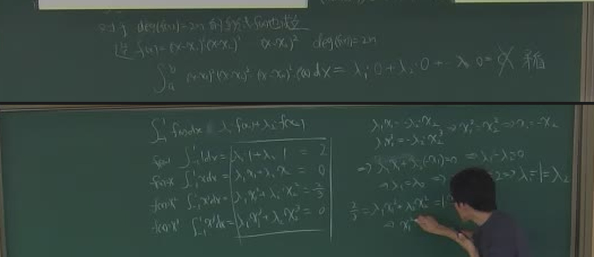

# 第 14 讲（11-02）：Gauss 型求积——节点也自由，精度从 $n$ 次提到 $2n-1$ 次

> 课堂实录精编。本讲**无课件、全程板书**（与[第 13 讲](lec13.md)相同）。
> [第 13 讲](lec13.md)把求积公式的**权**算出来了（$\lambda_k=\int l_k\,dx$），但**节点是给定的**——$n+1$ 个节点只能保证 $n$ 次代数精度。本讲把这个限制拆掉：让**节点也变成未知数**，用 $2n$ 个自由度换到 $2n-1$ 次精度，这就是 **Gauss 型求积公式**。课堂完整推导了两点 Gauss–Legendre（节点 $\pm\frac1{\sqrt3}$、权 $1,1$），并当场做完一个**带权 $\rho=x^2$ 的三点 Gauss 算例**（节点 $\pm\sqrt{5/7},0$）——一般情形就此归结到**正交多项式的零点**，这正是[第 12 讲](lec12.md)的零点定理在这里兑现。
> **〔课堂〕** 是板书与录音里确实出现的内容；**〔教材〕** 是颜庆津《数值分析》（第 4 版）6.7 的对应条目；**〔延伸〕** 是本编补的内容。
> 原始转写与 198 帧板书存于 `_sources/numerical/transcripts/`（不随书发布）；公式以**板书为唯一权威**——平台 ASR 与 whisper 在本讲把「代数精度」写成「带子进度」「代步方式」「差值性」等（见文末对照表），不要按转写字面引用。

::: note 本讲主线：把节点从「给定的」变成「解出来的」
插值型求积在 $n+1$ 个节点上至少有 $n$ 次代数精度，这是下界。Gauss 求积同时选择节点和权，使 $n$ 个节点的公式达到 $2n-1$ 次精度。例如，两点梯形公式只有一次精度，两点 Gauss 公式有三次精度。下面先用矩条件构造公式，再证明这一精度上限。

而节点不能乱选：要让这 $2n$ 个方程有解，节点必须取成**正交多项式的根**。这就是[第 12 讲](lec12.md)零点定理在这里的兑现。
:::

::: method[core] 10 分钟复习版 · 第 14 讲

**一句话**：节点也当未知数 → $2n$ 个自由度 → 精度上限 $2n-1$ 次；节点必须取正交多项式的根；两点 Gauss–Legendre 的节点是 $\pm\frac1{\sqrt3}$、权是 $1,1$。

**必记结论**（完整公式见 §十）

| 内容 | 要点 |
|:--|:--|
| **Gauss 型求积** | $\displaystyle\int_a^bf(x)\,dx\approx\sum_{k=1}^{n}\lambda_kf(x_k)$，节点**自由**，代数精度 $2n-1$ 次 |
| **参数计数** | $n$ 节点与 $n$ 权提供 $2n$ 个未知量，用来构造前 $2n$ 个矩条件；精度上限由平方多项式反证 |
| **上界（反证）** | 取 $g(x)=\prod_{k=1}^n(x-x_k)^2$：左端 $\int g>0$，右端 $\sum\lambda_k g(x_k)=0$，矛盾 |
| **两点 Gauss–Legendre** | $[-1,1]$ 上：节点 $x_{1,2}=\pm\frac1{\sqrt3}$，权 $\lambda_1=\lambda_2=1$；精度 $3$ 次 |
| **Gauss 型必为插值型** | $n$ 个节点、精度 $2n-1>n-1$ $\Rightarrow$ 它一定是插值型公式（比第 13 讲的「至少 $n-1$」强） |
| **节点来源** | 节点 $=$ 第 $n$ 个正交多项式 $\varphi_n(x)$ 的 $n$ 个互异根（零点定理保证互异且在区间内） |
| **权来源** | $\lambda_k=\displaystyle\int_a^b\rho(x)\frac{\varphi_n(x)}{(x-x_k)\varphi_n'(x_k)}\,dx$（Lagrange 基函数在节点处按连续延拓取值）；自检 $\sum_k\lambda_k=\displaystyle\int_a^b\rho\,dx$（不带权时 $=b-a$） |
| **余项** | 在光滑性条件下余项含 $f^{(2n)}$，对应 $n$ 节点 Gauss 公式的 $2n-1$ 次精度 |

**老师强调的五件事**（据板书与课堂反复回扣整理）：

1. **「现在一共就拉开 $x_1,x_2$ 两个未知数，四个方程」**——老师原话，用来说明自由度与条件的计数。这是全讲的钥匙。
2. **精度「不能再往上了」**：老师原话「那现在还能不能再往上写了？不能了……我们再取 4 的话它会出现矛盾」。上界不是猜的，是证的。
3. **$n$ 个节点要有 $2n$ 个关系**：从 $1$ 次到 $n$ 次多项式逐个列矩条件。$n$ 越大方程组越难解——这正是需要**一般性定理**的原因。
4. **Gauss 型一定是插值型**：精度 $2n-1$ 已经超过插值型的「至少 $n-1$」，所以它必然落在插值型的框架里。
5. **节点就是正交多项式的根**：老师原话「它就是我第 $n$ 个这个正交多项式……上次咱们也讲过一条定理（零点定理）」——第 12 讲的门票在这里兑现。

:::

## 课堂时间线 {#lec14-S1}

| 时间 | 内容 |
|---|---|
| 00:00–15:00 | 回顾[第 13 讲](lec13.md)：插值型求积 $\lambda_k=\int l_k\,dx$、余项公式、「至少 $n$ 次代数精度」 |
| 15:00–19:30 | **Gauss 的想法**：节点也自由 $\Rightarrow$ $2n$ 个自由度 $\Rightarrow$ 精度可到 $2n-1$ 次 |
| 19:30–23:00 | **上界反证**：$deg(f)=2n$ 时构造 $f_1(x)=\prod(x-x_k)^2$ 得到矛盾 |
| 23:00–33:00 | **两点 Gauss–Legendre 完整推导**：四个矩条件 $\Rightarrow$ $\lambda_1=\lambda_2=1$、$x_1^2=x_2^2=\frac13$ |
| 33:00–38:00 | 一般情形：$n$ 个节点、$2n$ 个矩条件；**Gauss 型必为插值型** |
| 38:00–45:00 | 三点情形：**带权 $\rho=x^2$ 的算例**出场（$\int_{-1}^1f(x)x^2dx$，对 $\deg f\le5$ 精确）；开始正交化 |
| 45:00–58:00 | **正交化**：内积 $(f,g)=\int_{-1}^1f g\,x^2\,dx$（权是 $x^2$）；逐条算 $(x,\varphi_0)=0$、$(\varphi_1,\varphi_1)=\frac25$、$(x^3,\varphi_1)=\frac27$ 等 |
| 58:00–66:00 | 得到 $\varphi_2=x^2-\frac35$、$\varphi_3=x\bigl(x^2-\frac57\bigr)$；三个节点 $\pm\sqrt{5/7},0$ |
| 66:00–76:00 | 权的求法（矩条件）+ 代数精度 $2n-1$；**节点 $=$ 正交多项式的根**的定理表述 |
| 76:00–86:00 | 余项：出现 $f^{(2n)}$（板书字迹偏淡，本页按教材给式并注明） |
| 86:00–99:00 | 转入**一阶常微分方程组**的记号（$\frac{dy}{dx}=f(x,y)$、向量形式）——ASR 在此段出现「长规根方程」（常微分方程）；本页不展开 |

## §一 回顾：插值型求积给了「至少 $n$ 次」 {#lec14-S2}

本节要回答：上一讲的结论里，哪一条挡住了我们想要更高精度？

### 1.1 板书上的那条框 {#lec14-S3}

00:00–15:00 板书重新写了一遍[第 13 讲](lec13.md)的核心：

$$
\int_0^1f(x)\,dx=\sum_{k=0}^{n}\varphi(x_k)\int_0^1l_k(x)\,dx
+\int_0^1\frac{f^{(n+1)}(\xi_x)}{(n+1)!}(x-x_0)(x-x_1)\cdots(x-x_n)\,dx ,
$$

$$
\int_0^1f(x)\,dx\approx\lambda_1f(x_1)+\lambda_2f(x_2)+\cdots+\lambda_nf(x_n),
\qquad \lambda_k=\int_0^1l_k(x)\,dx .
$$

以及那条关键定理（板书加框）：

> **等式**：$\int_0^1f(x)\,dx=\lambda_1f(x_1)+\lambda_2f(x_2)=\cdots=\lambda_nf(x_n)$
> $\Rightarrow$ 对 $k$ 次及以下多项式都精确（必须成立）。

老师口头把这条链捋了一遍：「$n+1$ 个差值点，它至少是 $n$ 次的代数精度」。

### 1.2 「至少 $n$ 次」的天花板在哪 {#lec14-S4}

关键在于：**插值型公式的节点是「给定的」**。给定 $n+1$ 个节点，权就只能由 $l_k$ 算出，别无选择；这只保证至少 $n$ 次精度，不能推出至多 $n$ 次。对称节点可能多满足一些矩条件，例如三点 Simpson 具有三次精度。

老师提问：「那现在还能不能再往上写了？」——答案就在下一节。

::: intuition 直觉 · 自由度计数
节点给定后，$n+1$ 个权由前 $n+1$ 个矩条件唯一确定。更高次条件有时也会因对称性自动满足，例如 Simpson 公式；要系统提高精度，可以把节点也作为未知数。未知量个数提示了构造方向，严格的精度上限还要靠后面的平方多项式反证。
:::

## §二 Gauss 的想法：节点也自由 {#lec14-S5}

本节要回答：同时选择节点和权，怎样达到 $2n-1$ 次精度？

### 2.1 参数计数 {#lec14-S6}

板书在 19:30 前后写下「$(*)$」标记的那一段。老师口述（19:50）：

> 「现在一共就拉开 $x_1$、$x_2$ 两个未知数……我现在已经给出了四个关系……那相当于我们刚刚说的，它的代数精度最高就能到这个。」

计数是这样的：

$$
\begin{aligned}
&\underbrace{\text{节点 }x_1,\dots,x_n}_{n\text{ 个}}+\underbrace{\text{权 }\lambda_1,\dots,\lambda_n}_{n\text{ 个}}=2n\text{ 个自由参数},\\[4pt]
&\underbrace{f=1,x,x^2,\dots,x^{2n-1}}_{2n\text{ 个矩条件}}\quad\text{作为待满足的条件},\\[4pt]
&\text{若这些条件可满足，则代数精度至少为 }2n-1\text{ 次}.
\end{aligned}
$$

这就是「$n$ 个点、$2n$ 个关系」的来源。老师在 35:18 讲三点情形时又复述了一遍：「我现在要解这个……需要几个关键？6 个关系……从次数为零的一个多项式算起来，一直到次数为 5 的多项式，才能达到六个关系」。

### 2.2 上界的严格证明（板书的「矛盾」） {#lec14-S7}

计数只是「至多 $2n-1$ 次」的可能性；要证明**到不了 $2n$ 次**，板书给了一个反证（19:30–23:00 的上块）：

> 「$(*)$ $deg(f(x))=2n$ 的 $f(x)$ 不满足 $f(x_i)$ 构造」
>
> 「造 $f_1(x)=(x-x_1)^2(x-x_2)^2$，$(x-x_k)^2$，$deg(f_1(x))=2n$」

$$
\underbrace{\int_a^b(x-x_1)^2(x-x_2)^2\cdots(x-x_n)^2\,dx}_{>0}
\ =\ \sum_{k=1}^{n}\lambda_k\,f_1(x_k)
\ =\ \underbrace{\lambda_1\cdot0+\lambda_2\cdot0+\cdots+\lambda_n\cdot0}_{=0},
$$

**矛盾**——左边严格大于 $0$（被积函数非负且不恒为零），右边却等于 $0$（每个节点处函数值为零）。

::: thm[core] 定理 · Gauss 型求积的精度上界 {#thm-lec14-1}
$n$ 个节点的求积公式 $\displaystyle\int_a^bf(x)\,dx\approx\sum_{k=1}^{n}\lambda_kf(x_k)$ 的代数精度**最高为 $2n-1$ 次**。若达到 $2n-1$ 次，则称它为 **Gauss 型求积公式**。
:::

## §三 两点 Gauss–Legendre：板书完整推导 {#lec14-S8}

本节要回答：$2n-1$ 次真的做得到吗？两点情形能不能手算出来？

### 3.1 四个矩条件 {#lec14-S9}

取 $n=2$，节点 $x_1,x_2$、权 $\lambda_1,\lambda_2$ 都未知，区间取 $[-1,1]$。板书在 22:30 的下块写下四个方程：

$$
\begin{aligned}
f(x)\equiv1   &:\quad \int_{-1}^{1}1\,dx=\lambda_1\cdot1+\lambda_2\cdot1=2,\\
f(x)\equiv x   &:\quad \int_{-1}^{1}x\,dx=\lambda_1x_1+\lambda_2x_2=0,\\
f(x)\equiv x^2 &:\quad \int_{-1}^{1}x^2\,dx=\lambda_1x_1^2+\lambda_2x_2^2=\frac23,\\
f(x)\equiv x^3 &:\quad \int_{-1}^{1}x^3\,dx=\lambda_1x_1^3+\lambda_2x_2^3=0.
\end{aligned}
$$

（板书上方另有一条一般式 $\int_{-1}^1x^n\,dx=\lambda_1x_1^n+\lambda_2x_2^n+\cdots+\lambda_nx_n^n$。）

### 3.2 求解：板书的四行推导 {#lec14-S10}

由第 2、4 个方程（都是右边为 $0$）：

$$
\lambda_1x_1=-\lambda_2x_2,\qquad \lambda_1x_1^3=-\lambda_2x_2^3,
$$

两式相除得 $x_1^2=x_2^2$，即 $x_1=-x_2$（节点互异）。代回第 2 式得 $\lambda_1=\lambda_2$；再代回第 1 式：

$$
\lambda_1+\lambda_2=2\ \Longrightarrow\ \boxed{\lambda_1=1=\lambda_2}.
$$

再由第 3 式：

$$
\frac23=\lambda_1x_1^2+\lambda_2x_2^2=1\cdot(x_1^2+x_2^2)
\ \Longrightarrow\ x_1^2=x_2^2=\frac13
\ \Longrightarrow\ \boxed{x_1^2=x_2^2=\frac{\sqrt3}{3}} .
$$

取 $x_1=-\frac1{\sqrt3}$（较小者），$x_2=+\frac1{\sqrt3}$。

::: thm[core] 两点 Gauss–Legendre 求积公式 {#thm-lec14-2}
在 $[-1,1]$ 上，

$$
\int_{-1}^{1}f(x)\,dx\approx f\!\left(-\frac1{\sqrt3}\right)+f\!\left(\frac1{\sqrt3}\right),
$$

节点 $x_{1,2}=\pm\frac1{\sqrt3}$、权 $\lambda_1=\lambda_2=1$，代数精度为 **3 次**。
:::

::: method 数值验证（已入 `tools/verify_teaching_examples.py` 的 `check_lecture14_gauss`）
对 $f=1,x,x^2,x^3$ 逐一复算：
$\int1=2=1+1$ ✓；$\int x=0=\frac{-1}{\sqrt3}+\frac1{\sqrt3}$ ✓；
$\int x^2=\frac23=\frac13+\frac13$ ✓；$\int x^3=0$ ✓；
而 $f=x^4$：真值 $\frac25$，公式值 $\frac29$，**不等** → 精度恰为 $3$ 次（不是 $4$ 次）。

脚本还断言了三点 Gauss–Legendre（节点 $0,\pm\sqrt{3/5}$，权 $8/9,5/9,5/9$）对 $1,\dots,x^5$ 精确、对 $x^6$ 不精确。
:::

### 3.3 与同节点数的 Newton–Cotes 对比 {#lec14-S11}

这是本讲最值得记住的对照：

| 公式 | 节点数 | 节点 | 权 | 代数精度 |
|:--|:--:|:--|:--|:--:|
| 梯形（Newton–Cotes $n=1$） | 2 | $-1,1$ | $1,1$ | 1 |
| **两点 Gauss–Legendre** | 2 | $\pm\frac1{\sqrt3}$ | $1,1$ | **3** |
| Simpson（Newton–Cotes $n=2$） | 3 | $-1,0,1$ | $\frac13,\frac43,\frac13$ | 3 |
| **三点 Gauss–Legendre** | 3 | $0,\pm\sqrt{3/5}$ | $\frac89,\frac59,\frac59$ | **5** |

**同样两个点，精度从 1 次跳到 3 次**——代价只是节点位置变了，公式长度一点没增加。这就是 Gauss 求积的全部卖点。

::: note 权相同、节点不同
两点情形下梯形与 Gauss 的权都是 $1,1$（因为 $\sum\lambda_k=b-a=2$ 且对称），**唯一的差别就是节点从 $\pm1$ 换成了 $\pm\frac1{\sqrt3}$**。这是理解「节点也自由」最直观的一个例子。
:::

## §四 一般情形：$n$ 个节点、$2n$ 个条件 {#lec14-S12}

### 4.1 Gauss 型必为插值型 {#lec14-S13}

老师口头（27:41 起）把这条讲得很细：

> 「当这个基础格式有 $n$ 个点……它的代数精度只要是 $n-1$、至少是 $n-1$，它就是插值型的。」
>
> 「但我现在这个东西代数精度都已经到 $2n-1$ 了，已经超过了 $n-1$ 了……那说明它肯定是一个插值型的计算。」
>
> 「$n+1$ 个点，只要代数精度至少是 $n$，它就有插值性了；那 $n$ 个点，代数精度只要是 $n-1$，它就有插值性了。」

这条推理用的是[第 13 讲](lec13.md)的定理（$n+1$ 个节点的插值型公式至少 $n$ 次精度）的**逆命题**：**精度够高 $\Rightarrow$ 一定是插值型的**。

板书上对应的写法（60:00 帧上块右端）：

> 「$0$ 是 $\displaystyle\int_0^1\varphi(x)f(x)\,dx=\sum_{k=0}^{n}\lambda_kf(x_k)$（精确型）」
>
> 「$\Rightarrow$ 对 $deg(f(x))\le 2n-1$ 的多项式都成立」

### 4.2 为什么必须求助一般性定理 {#lec14-S14}

老师接着说（24:00 起）：

> 「如果我再加多点，把这点再加上去，这个事情就很麻烦了……你不可能再去解它……你就要写一个 $2n-1$ 阶的一个……盖头盖头盘子，这也是很麻烦的。」
>
> 「那所以你有没有……有没有一般性的地方能够告诉我们？」

答案就是**正交多项式**——它一次性给出了所有 $n$ 的节点。

## §五 正交多项式路线：带权 $x^2$ 的三点 Gauss 算例 {#lec14-S15}

本节要回答：节点的「一般性来源」到底长什么样？板书没有再抽象推一遍，而是**当场做了一个完整的算例**——在带权 $x^2$ 的内积下正交化，把三个节点算出来。

### 5.1 题目：带权 $\rho=x^2$ 的三点 Gauss 公式 {#lec14-S16}

45:00 起板书在左侧板写下这一节的目标（字迹清楚）：

> 「求带权 $\rho=x^2$：$\displaystyle\int_{-1}^{1}f(x)x^2\,dx\approx\lambda_1f(x_1)+\lambda_2f(x_2)+\lambda_3f(x_3)$，对 $\deg f(x)\le 5$ 的恒成立。」

老师口述（32:26）先把路线说了一遍：

> 「上次咱们学过，我现在有了这么一个内积……在这个内积之下，我是不是可以把原来我的幂函数系进行正交化？」

内积的定义是

$$
(f,g)=\int_{-1}^{1}f(x)g(x)\,x^2\,dx ,
$$

**注意权是 $x^2$，区间仍是 $[-1,1]$**——这正是板书每一行积分末尾那个 $x^2$ 因子的来历（如 $(x,\varphi_0)=\int_{-1}^1x\cdot1\cdot x^2\,dx$）。这一点极易看漏：若不把 $x^2$ 当权、只当成被积函数的一部分，整套正交化都会算错。

### 5.2 正交化：$\varphi_1,\varphi_2,\varphi_3$ {#lec14-S17}

板书用 Gram–Schmidt 逐个写开（45:00 帧左中块）：

$$
\varphi_1(x)=x-\frac{(x,\varphi_0)}{(\varphi_0,\varphi_0)}\varphi_0(x),
$$

$$
\varphi_2(x)=x^2-\frac{(x^2,\varphi_1)}{(\varphi_1,\varphi_1)}\varphi_1(x)-\frac{(x^2,\varphi_0)}{(\varphi_0,\varphi_0)}\varphi_0(x),
$$

$$
\varphi_3(x)=x^3-\frac{(x^3,\varphi_1)}{(\varphi_1,\varphi_1)}\varphi_1(x)
-\frac{(x^3,\varphi_0)}{(\varphi_0,\varphi_0)}\varphi_0(x)
-\frac{(x^3,\varphi_2)}{(\varphi_2,\varphi_2)}\varphi_2(x).
$$

下面按区间 $[-1,1]$、权 $x^2$ 复算正交化所用的内积：

$$
(x,\varphi_0)=\int_{-1}^{1}x\cdot1\cdot x^2\,dx=0,\qquad
(x^2,\varphi_1)=\int_{-1}^{1}x^2\cdot x\cdot x^2\,dx=0,
$$

$$
(\varphi_1,\varphi_1)=\int_{-1}^{1}x\cdot x\cdot x^2\,dx=\frac{2}{5},\qquad
(x^3,\varphi_1)=\int_{-1}^{1}x^3\cdot x\cdot x^2\,dx=\frac{2}{7},
$$

$$
(x^2,\varphi_2)=\int_{-1}^{1}x^2\Bigl(x^2-\frac35\Bigr)x^2\,dx=\frac8{175},\qquad
(x^3,\varphi_2)=\int_{-1}^{1}x^3\Bigl(x^2-\frac35\Bigr)x^2\,dx=0.
$$

把这些值代回去，板书得到（46:00 左侧块末行，可辨认）：

$$
\varphi_2(x)=x^2-\frac35,\qquad
\varphi_3(x)=x^3-\frac57x=x\Bigl(x^2-\frac57\Bigr).
$$

::: method 复算（`check_lecture14_gauss` 中已断言）
带权 $\rho=x^2$、区间 $[-1,1]$：

| 量 | 值 |
|:--|:--|
| $(\varphi_0,\varphi_0)=\int x^2$ | $\frac23$ |
| $(\varphi_1,\varphi_1)=\int x^4$ | $\frac25$ |
| $\varphi_2=x^2-\frac{(x^2,1)}{(1,1)}$ | $x^2-\frac35$ |
| $\varphi_3=x^3-\frac{(x^3,x)}{(x,x)}x$ | $x^3-\frac{5}{7}x$ |

（$\frac{(x^2,1)}{(1,1)}=\frac{2/5}{2/3}=\frac35$，$\frac{(x^3,x)}{(x,x)}=\frac{2/7}{2/5}=\frac57$。）
:::

### 5.3 三个节点：$\varphi_3$ 的根 {#lec14-S18}

$\varphi_3=x\bigl(x^2-\frac57\bigr)$ 的三个根是

$$
x_1=-\sqrt{\frac57},\qquad x_2=0,\qquad x_3=+\sqrt{\frac57} .
$$

老师口述（45:03）：「我们已经说了我们那三个根……它就推出**负的根号 7 分之 5**」——ASR 把这句转成「负的这个根号7分之5」，正是 $-\sqrt{5/7}$。

板书接着由二次方程解出 $x_1^2=\frac57$（对应 21:00 帧那一步的放大版），并框出 $x_1,x_2,x_3$。

::: thm[core] 节点 $=$ 正交多项式的根 {#thm-lec14-3}
设 $\{g_k\}$ 是 $[a,b]$ 上带权 $\rho$ 的正交多项式系。则采用相应插值型权的 $n$ 节点求积公式为 Gauss 型的**充分必要条件**是：它的节点 $x_1,\dots,x_n$ 是 $n$ 次正交多项式 $g_n(x)$ 的 $n$ 个零点。
:::

这兑现了[第 12 讲](lec12.md)的**零点定理**：$k$ 次正交多项式在 $(a,b)$ 内恰有 $k$ 个互异实零点——保证 Gauss 节点存在、互异、且落在区间内部。老师口头（31:33）：「$x_1,x_2,\dots,x_n$ 是……$\varphi_n$ 的 $n$ 个根……上次咱们也讲过一条定理。」

### 5.4 权与精度：这个算例的收尾 {#lec14-S19}

节点定下后，三个权由矩条件解出（对 $f=1,x,x^2$ 精确，这是 $3$ 个方程解 $3$ 个未知数）。教材给出的结果是

$$
\lambda_1=\frac{7}{25},\qquad \lambda_2=\frac{8}{75},\qquad \lambda_3=\frac{7}{25},
$$

且 $\lambda_1+\lambda_2+\lambda_3=\frac{7}{25}+\frac{8}{75}+\frac{7}{25}=\frac{21+8+21}{75}=\frac{50}{75}=\frac23=\int_{-1}^{1}x^2dx$ ✓（权之和 $=$ 区间质量，最快的自检）。

老师口头（45:38）把这个算例的落点讲了出来：「我们已经把这三个根算出来，我们已经又知道……它的代数精度是 $2n-1$」——三点情形即 **$5$ 次精度**。

::: note 核验要点：内积的权是 $x^2$，区间是 $[-1,1]$
读板书内积列表时最容易犯的错，是把每一行末尾的 $x^2$ 当成被积函数的一部分，进而把区间误读成 $[0,1]$。**判别只需一行**：$(\varphi_1,\varphi_1)=\frac25$、$(x^3,\varphi_1)=\frac27$ 都只在 $[-1,1]$ 上成立（$[0,1]$ 上分别是 $\frac15$、$\frac17$），所以区间是 $[-1,1]$，$x^2$ 是权。右板末段确实出现过 $[0,1]$ 的写法，那是换元后的另一种表述，不属于本算例。
:::

## §六 Gauss 求积公式与它的余项 {#lec14-S20}

### 6.1 余项里的 $f^{(2n)}$：怎样读出代数精度 {#lec14-S21}

75:00–87:00 板书在左板写下这一支的余项，**字迹偏淡**（$f^{(2n)}$ 与节点因子的形状可辨，但每一步的系数看不清）。本页因此**按〔教材〕6.7 给出定式**，并明确区分「板书能确认的」与「教材补全的」：

**〔教材〕定理 6.6 的形式**（单点 $\eta$）——设 $a_n$ 是 $\varphi_n$ 的最高次项系数：

$$
R(f)=\frac{f^{(2n)}(\eta)}{a_n^2(2n)!}\int_a^b\rho(x)\varphi_n^2(x)\,dx,\qquad \eta\in(a,b).
$$

**板书上能确认的**只有一件事：余项里的最高阶导数是 **$f^{(2n)}$**，而不是插值型求积的 $f^{(n+1)}$。完整余项公式说明：对次数不超过 $2n-1$ 的多项式，余项为零。

> 另有一种等价的**积分形式**（来自 $2n-1$ 次 Hermite 插值余项）：$\displaystyle\int_a^b\rho(x)\frac{f^{(2n)}(\xi_x)}{(2n)!}\prod_{k=1}^{n}(x-x_k)^2\,dx$。权 $\rho$ 非负时，核 $\rho(x)\prod(x-x_k)^2$ 非负。若 $f^{(2n)}$ 连续，利用其上下界和介值性可得到上面的单点余项式；导数本身可以变号。这个思路也用于[Simpson 余项](lec13.md#lec13-S23)。

**与插值型求积对照着看**：

| | 插值型求积（第 13 讲） | Gauss 型求积（本讲） |
|:--|:--|:--|
| 节点数 | $n+1$ | $n$ |
| 余项里的最高阶导数 | $f^{(n+1)}$ | $\boldsymbol{f^{(2n)}}$ |
| 代数精度 | 至少 $n$ 次 | $2n-1$ 次 |

比较精度时应固定节点数。$n$ 节点插值型公式至少有 $n-1$ 次精度，Gauss 公式达到 $2n-1$ 次；具体的 Newton–Cotes 精度还受节点对称性影响。

### 6.2 Gauss 求积的存在性与唯一性（教材 6.7.1） {#lec14-S22}

板书上「节点是 $\varphi_n$ 的根」这一句，实际上已经隐含了定理的证明思路：节点一旦由 $\varphi_n$ 定出，权就由矩条件**唯一确定**（矩条件构成关于权的线性方程组，以单项式写出时，系数矩阵为 Vandermonde 矩阵，节点互异保证它非奇异）。

教材 6.7.1 把它写成「矩方程路线」：节点必须先由正交多项式定出，权再由矩条件解出。**本讲课堂走的是这条路**（不是待定系数法硬解非线性方程组）。

::: method 构造路径对照
| | 待定系数法（课件 15 p8） | 矩方程路线（教材 6.7.1，本讲课堂） |
|:--|:--|:--|
| 步骤 | 直接解 $2n$ 个非线性方程 | 先由 $\varphi_n$ 定出节点，再解线性方程组定权 |
| 优点 | 两点情形可手算 | 任意 $n$ 都可行，且能证明存在唯一 |
| 缺点 | $n\ge3$ 时方程组规模爆炸 | 需要正交多项式这套工具 |
:::

## §七 老师强调与易错点 {#lec14-S23}

1. **「现在一共就拉开两个未知数，四个方程」**——自由度计数是全讲的钥匙。$n$ 个节点 $2n$ 个参数，$2n$ 个矩条件。
2. **上界是证的，不是猜的**：构造 $g(x)=\prod(x-x_k)^2$ 得到「左端正、右端零」的矛盾。
3. **$2n-1$ 是上限**，不是「至少」——Gauss 型恰好取到这个上限，所以它的余项用 $f^{(2n)}$。
4. **Gauss 型必为插值型**：精度 $2n-1>n-1$，由第 13 讲定理的逆用得出。
5. **节点必须取正交多项式的根**，否则矩条件无解——这是[第 12 讲](lec12.md)零点定理在本讲的唯一出口。
6. **内积的权是 $x^2$，不是 1**：本讲 §五 的算例是**带权**的（$\int_{-1}^1f(x)x^2dx$）。看板书积分列表时，末尾那个 $x^2$ 是权，不是被积函数的一部分；漏掉它整套正交化都会算错。
7. **区间只有一个：$[-1,1]$**（本讲主体）。右板末段出现的 $[0,1]$ 写法是换元后的表述，不属于 §五 的算例——不要据此把内积也换成 $[0,1]$。

## 板书关键帧 {#lec14-S24}

| 图 | 时间 | 内容 |
|---|---|---|
| `../assets/lectures/lec14-board-moment-equations.jpg` | 22:30 | 上界反证（$2n$ 次不可能）+ 两点 Gauss 的四个矩条件与求解（本讲核心） |
| `../assets/lectures/lec14-board-solve-two-point.jpg` | 30:00 | 框出的结论 $\lambda_1=1=\lambda_2$、$x_1^2=x_2^2=\frac{\sqrt3}{3}$ |
| `../assets/lectures/lec14-board-orthogonal-polynomials.jpg` | 60:00 | 带权 $x^2$ 的正交化：Gram–Schmidt 形式、内积列表（每行带权 $x^2$）、$\varphi_2=x^2-\frac35$ |

原始帧（每 30 秒一帧，共 198 帧）存于 `_sources/numerical/transcripts/lec14-20261102-board/`。

> 末段（约 86:00 起）板书与口述转入**一阶常微分方程组**的记号（$\frac{dy}{dx}=f(x,y)$、向量形式 $\\boldsymbol y'=\\boldsymbol f(x,\\boldsymbol y)$，ASR 写作「长规根方程」），即教材第 7 章的开篇内容，**不在本次考纲**。板书字迹偏淡且含多处涂改，本页不展开，只在此留痕。下一讲若从 7.1 开讲，按同一流程处理。

## 课堂口述与标准术语对照 {#lec14-S25}

| 课堂口述（转写原文） | 标准术语 |
|:--|:--|
| 代步方式 / 代为方程度 / 差时机分 | **代数精度** |
| 带子进度 / 劈拳击度 | **代数精度** |
| 差值点 / 插值点 | **插值节点** |
| 差值性多项式 / 差值性机会 | **插值型（公式）** |
| 正形的 n 个根 / 正交动箱 | **正交多项式的 $n$ 个根** |
| 内向多向式 | **幂函数系** |
| 区间圈 / 区间的长度 | **积分区间长** |
| 矛盾 | **反证得到的矛盾**（上界证明） |
| 根号7分之5 | $\sqrt{5/7}$（带权 $x^2$ 三点 Gauss 的节点） |
| 长规根方程 | **常微分方程**（末段转题，不在本次考纲） |

## §八 分层练习 {#lec14-S26}

### A 组 · 概念 {#lec14-S27}

**A1.** 为什么 Newton–Cotes 公式的精度被「$n+1$ 个节点 $\Rightarrow$ 至多 $n$ 次」卡死？Gauss 怎么绕过去的？

**A2.** 「$n$ 个节点、$2n$ 个自由参数 $\Rightarrow$ 精度至多 $2n-1$ 次」这个计数论证的漏洞在哪？板书如何补上？

**A3.** 为什么 Gauss 型求积公式一定也是插值型公式？

**A4.** Gauss 求积的节点为什么必须取正交多项式的根？用零点定理说明。

### B 组 · 计算 {#lec14-S28}

**B1.** 在 $[-1,1]$ 上写出两点 Gauss–Legendre 公式，并验证它对 $f=1,x,x^2,x^3$ 精确、对 $f=x^4$ 不精确。

**B2.** 在 $[-1,1]$ 上写出三点 Gauss–Legendre 公式（节点与权），并验证它对 $1,\dots,x^5$ 精确。

**B3.** 求 $[0,1]$ 上的两点 Gauss 求积公式（把 $[-1,1]$ 的结果作线性换元）。

**B4.** 两点 Gauss–Legendre 公式对 $f(x)=x^4$ 的误差是多少？

**B5.**（课堂算例）在带权 $\rho=x^2$ 的内积 $(f,g)=\int_{-1}^1fg\,x^2dx$ 下：算出 $\varphi_2,\varphi_3$；写出三点 Gauss 公式的节点；验证 $(\varphi_1,\varphi_1)=\frac25$、$(x^3,\varphi_1)=\frac27$；并用权之和 $=\int_{-1}^1x^2dx=\frac23$ 自检权表 $\frac7{25},\frac8{75},\frac7{25}$。

### C 组 · 证明 {#lec14-S29}

**C1.** 证明：$n$ 个节点的求积公式的代数精度不可能达到 $2n$ 次。

**C2.** 证明：若求积公式的代数精度至少为 $n-1$（$n$ 个节点），则它必为插值型求积公式。

**C3.** 证明：$[0,1]$ 上的两点 Gauss 求积公式与 $[-1,1]$ 上的两点 Gauss–Legendre 公式等价（作线性换元）。

::: sol 答案 · A 组（概念）与 B 组（计算）
**A1.** 节点给定时只有 $n+1$ 个权可调，矩条件的个数超过 $n+1$ 就无解。Gauss 让节点也成为未知数，自由度变成 $2n$，矩条件可用到 $2n$ 个。

**A2.** 计数只给出「至多」的上限，不保证「$2n$ 个方程有解」。板书用反证补上：若能到 $2n$ 次，取 $g=\prod(x-x_k)^2$ 则右端为 $0$、左端 $>0$，矛盾。

**A3.** 第 13 讲的定理说「$n+1$ 个节点的插值型公式至少 $n$ 次精度」；其逆否命题即「精度 $\ge n$（$n+1$ 节点）$\Rightarrow$ 插值型」。Gauss 型有 $n$ 个节点、精度 $2n-1\ge n-1$，故落在插值型框架内。

**A4.** 零点定理说 $n$ 次正交多项式在 $(a,b)$ 内恰有 $n$ 个互异实零点；取这 $n$ 个根作节点，矩条件才有解，且节点互异、落在区间内。

**B1.** $\int_{-1}^{1}f\approx f(-\frac1{\sqrt3})+f(\frac1{\sqrt3})$。验证：$1\mapsto2$；$x\mapsto0$；$x^2\mapsto\frac29+\frac29=\frac23$；$x^3\mapsto0$；$x^4\mapsto\frac29\ne\frac25$。

**B2.** 节点 $0,\pm\sqrt{3/5}$，权 $\frac89,\frac59,\frac59$：$\int1=2=\frac89+\frac59+\frac59$；$\int x=0$；$\int x^2=\frac23=\frac59\cdot\frac35+\frac89\cdot0+\frac59\cdot\frac35=\frac23$；$\int x^4=\frac25=\frac59\cdot\frac9{25}\cdot2=\frac25$ ✓；$\int x^6=\frac27$，公式值 $=\frac59\cdot\frac{27}{125}\cdot2=\frac{18}{125}\ne\frac27$。

**B3.** 作 $x=\frac{t+1}{2}$，$\int_0^1f(x)dx=\frac12\int_{-1}^1f(\frac{t+1}{2})dt$，故节点 $x=\frac{1\pm1/\sqrt3}{2}$、权各 $\frac12$。

**B4.** 真值 $\frac25$，公式值 $\frac29$，误差 $\left|\frac25-\frac29\right|=\frac{2}{45}$。

**B5.** $(\varphi_0,\varphi_0)=\frac23$、$(\varphi_1,\varphi_1)=\frac25$、$(x^3,\varphi_1)=\frac27$；$\varphi_2=x^2-\frac{(x^2,1)}{(1,1)}=x^2-\frac{2/5}{2/3}=x^2-\frac35$；$\varphi_3=x^3-\frac{(x^3,x)}{(x,x)}x=x^3-\frac{2/7}{2/5}x=x^3-\frac57x$，根 $0,\pm\sqrt{5/7}$；权由矩条件解出 $\frac7{25},\frac8{75},\frac7{25}$，和 $=\frac{21+8+21}{75}=\frac23$ ✓。

**C1.** 见 A2。

**C2.** 设公式 $\sum_{k=1}^{n}\lambda_kf(x_k)$ 对次数 $\le n-1$ 的多项式精确。由第 13 讲的余项公式反推，误差核必为 $C\prod_{k=1}^n(x-x_k)$ 的常数倍，即公式是 Lagrange 型——这就是「插值型」。

**C3.** $x=\frac{t+1}{2}$ 把 $[-1,1]$ 映到 $[0,1]$，$\frac12\int_{-1}^1f(\frac{t+1}{2})dt$ 中 $\frac{t+1}{2}$ 在节点 $\pm\frac1{\sqrt3}$ 处取值 $\frac{1\pm1/\sqrt3}{2}$，与 B3 一致；权由 $\frac12$ 乘过去。
:::

## §九 一页纸公式卡 {#lec14-S30}

考前只背这张表；来历见对应小节。

| 场景 | 公式 |
|:--|:--|
| Gauss 型求积 | $\displaystyle\int_a^bf(x)\,dx\approx\sum_{k=1}^{n}\lambda_kf(x_k)$，精度 $2n-1$ 次 |
| 参数计数 | $n$ 节点 $+n$ 权 $=2n$ 参数 $\Rightarrow$ 至多 $2n$ 个矩条件 $\Rightarrow$ 精度 $\le2n-1$ |
| 上界反证 | $g(x)=\prod_{k=1}^{n}(x-x_k)^2$：$\int g>0$ 而 $\sum\lambda_k g(x_k)=0$ |
| 两点 Gauss–Legendre（$[-1,1]$） | 节点 $\pm\frac1{\sqrt3}$，权 $1,1$，精度 $3$ 次 |
| 三点 Gauss–Legendre（$[-1,1]$） | 节点 $0,\pm\sqrt{3/5}$，权 $\frac89,\frac59,\frac59$，精度 $5$ 次 |
| 两点 Gauss（$[0,1]$） | 节点 $\frac{1\pm1/\sqrt3}{2}$，权 $\frac12,\frac12$ |
| Gauss 余项 | $\displaystyle R(f)=\frac{f^{(2n)}(\eta)}{a_n^2(2n)!}\int_a^b\rho\,\varphi_n^2\,dx$（教材定理 6.6）；积分形式含平方因子 $\prod(x-x_k)^2$ |
| 节点来源 | $x_1,\dots,x_n$ $=$ 第 $n$ 个正交多项式 $\varphi_n$ 的 $n$ 个互异根 |
| 权自检 | $\sum_{k=1}^{n}\lambda_k=b-a$ |
| 精度对比 | $n$ 节点 Newton–Cotes：$n-1$ 次；$n$ 节点 Gauss：$2n-1$ 次 |

## 归档材料 {#lec14-S31}

- 平台 ASR 原始转写：`_sources/numerical/transcripts/lec14-20261102/lec14-20261102-asr-platform.md`（2119 句，未校对）
- 本地 whisper 转写：`_sources/numerical/transcripts/lec14-20261102/lec14-whisper-timed.md`（1869 段）/ `lec14-whisper.srt`（未校对；该讲 whisper 输出含坏字节，已按容错方式转写）
- 板书关键帧：`_sources/numerical/transcripts/lec14-20261102-board/`（每 30 秒一帧，198 帧）
- 平台会话：`course_id=144442`，`sub_id=5897234`，`resource_guid=fc35df7a10064b9ba741bfa2cab075ae`，2026-11-02 08:00–09:35，学院路校区主 M402

## 对应正文 {#lec14-S32}

- Gauss 型求积公式（一般理论、四种 Gauss 公式）：[第 6 章 6.7](../course/ch06/sec67.md)
- 插值型求积与 Newton–Cotes（上一讲）：[第 6 章 6.1–6.3](../course/ch06/sec61.md)
- 正交多项式与零点定理（节点的来源）：[第 5 章 5.5](../course/ch05/sec55.md)、[第 12 讲 §三](lec12.md#lec12-S11)
- 复化求积法（工程上如何真正用起来）：[第 6 章 6.5](../course/ch06/sec65.md)、[第 13 讲](lec13.md)
- 上一讲：[第 13 讲](lec13.md)
