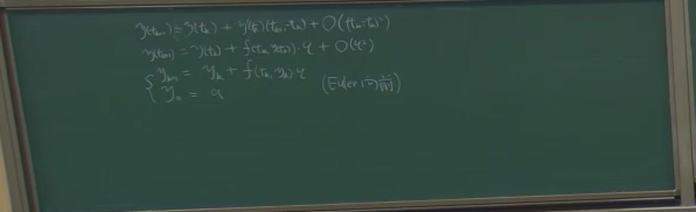
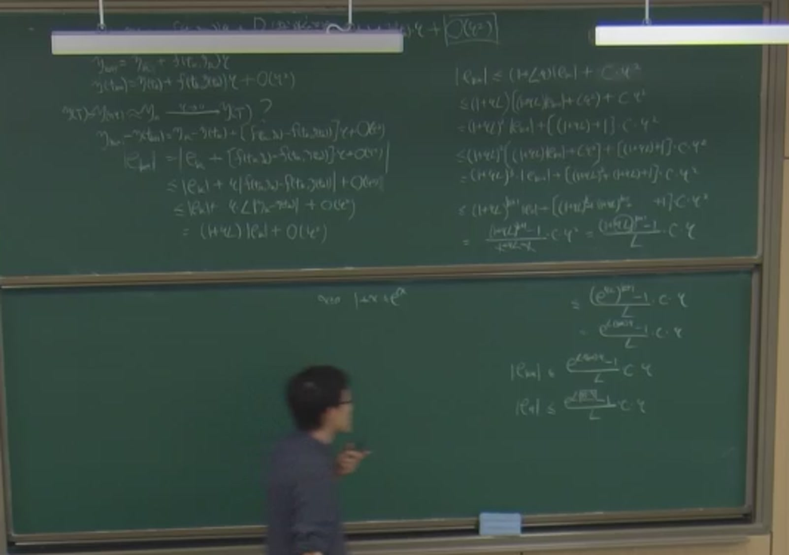
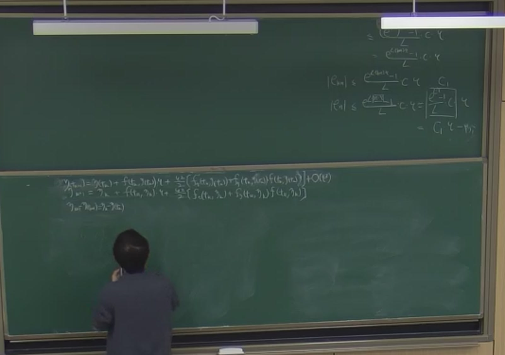
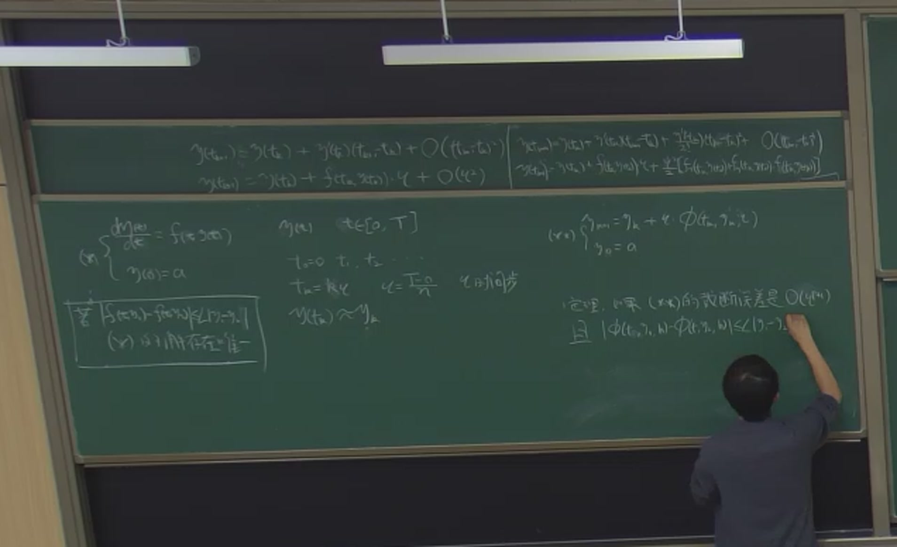
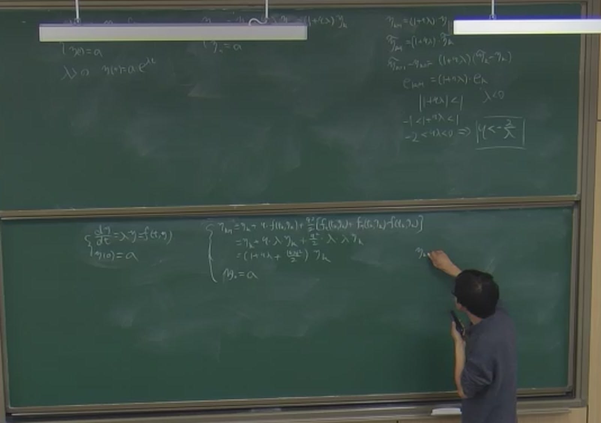
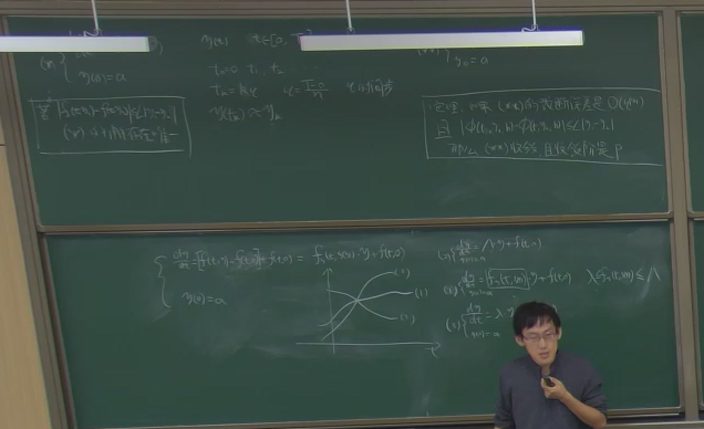

# 第 15 讲（11-04）：常微分方程初值问题的数值解法开章——Euler 向前、收敛性与稳定性

> 课堂实录精编。本讲**无课件、全程板书**（与[第 13 讲](lec13.md)、[第 14 讲](lec14.md)相同）。
> [11-02 那一讲](lec14.md)的末段用一阶常微分方程的记号开了个头，本讲正式翻开**第 7 章**：把 $y'=f(t,y)$ 离散成网格上的递推格式。课堂先用 **Taylor 展开**推出 **Euler 向前**，再用「把数值解换成精确解」的手法定义**截断误差**，然后用与[第 8 讲](lec08.md)迭代法误差估计**同一套手法**证出收敛性（整体误差 $O(\tau)$，比局部截断误差**降一阶**），随后用 Taylor 多留一项造出**二阶格式**。后半讲回答另一个问题：**舍入误差会不会淹没真实解**——用一个两条分支的数列做引子，在模型方程 $y'=\lambda y$ 上得到稳定性条件 $|1+\tau\lambda|<1$（$\lambda<0$ 时等价于**步长限制 $\tau<2/|\lambda|$**），最后用**中值定理线性化 + 两个极端方程**的直观把结论推广到一般的 $f(t,y)$。
> **〔课堂〕** 是板书与录音里确实出现的内容；**〔教材〕** 是颜庆津《数值分析》（第 4 版）7.1–7.2 的对应条目；**〔延伸〕** 是本编补的内容。
> 原始转写与 198 帧板书存于 `_sources/numerical/transcripts/`（不随书发布）；公式以**板书为唯一权威**——平台 ASR 与 whisper 在本讲把「截断误差」写成「节调误差」「斜调误差」「阶段误差」、把「Lipschitz 条件」写成「渔屋鞋条件」「力气的条件」等（见文末对照表），不要按转写字面引用。

::: note 本讲主线：离散化只回答「怎么算」，收敛性回答「算得对不对」，稳定性回答「敢不敢算下去」
第 7 章的问题一句话就能说完：微分方程的解是**连续**的，计算机只能存**离散**的点——于是把时间区间切成步长 $\tau$ 的小段，用**差分格式**从 $y_0$ 一格一格往前推。但「能算」不等于「算得对」：每一步的格式都差精确解一点点（**截断误差**），这些差会不会随着步数无限累积？这是**收敛性**。而即使理论上收敛，计算机每步还偷偷带进来一点**舍入误差**——它会不会沿某条指数增长的通道被放大到淹没真实解？这是**稳定性**。本讲在模型方程 $y'=\lambda y$ 上把两个问题都算到底：Euler 向前**收敛但只有一阶**，且**步长受 $|1+\tau\lambda|<1$ 约束**——「精度高」与「能算下去」从此成为两条独立的验收线。
:::

::: method[core] 10 分钟复习版 · 第 15 讲

**一句话**：把 $[0,T]$ 切成步长 $\tau$ 的网格，Taylor 展开一步就得到 Euler 向前；「数值解换成精确解」差出来的叫截断误差（Euler 是 $O(\tau^2)$），误差递推 + 几何级数 + $1+s\le e^s$ 给出整体误差 $O(\tau)$——**降一阶**；Taylor 多留一项得二阶格式（截断 $O(\tau^3)$ ⟹ 整体 $O(\tau^2)$）；舍入误差沿 $|1+\tau\lambda|\ge1$ 的通道指数放大 ⟹ $\lambda<0$ 时步长必须 $\tau<2/|\lambda|$。

**必记结论**（完整公式见 §十）

| 内容 | 要点 |
|:--|:--|
| **问题设定** | $\dfrac{dy}{dt}=f(t,y)$，$y(0)=\alpha$；网格 $t_k=\tau k$，$\tau=\dfrac{T-0}{N}$；$y(t_k)\approx y_k$ |
| **Euler 向前** | $y_{k+1}=y_k+\tau f(t_k,y_k)$；由 $y(t_{k+1})=y(t_k)+f(t_k,y(t_k))\tau+O(\tau^2)$ 扔掉余项而来 |
| **截断误差** | 把格式里数值解全部换成精确解后两边之差；Euler 为 $O(\tau^2)$（恰是 Taylor 余项） |
| **收敛性证明** | Lipschitz：$\lvert f(t,y_1)-f(t,y_2)\rvert\le L\lvert y_1-y_2\rvert$ ⟹ $\lvert E_{k+1}\rvert\le(1+L\tau)\lvert E_k\rvert+C\tau^2$；$E_0=0$；几何级数 + $1+s\le e^s$ ⟹ $\lvert E_n\rvert\le\dfrac{e^{LT}-1}{L}C\,\tau=G\tau$ |
| **降一阶规律** | 局部截断误差 $O(\tau^{p+1})$ ⟹ 整体误差 $O(\tau^{p})$：Euler $p=1$，Taylor 二阶 $p=2$ |
| **Taylor 二阶格式** | $y''=f_t+f_y\cdot f$（链式法则）⟹ $y_{k+1}=y_k+\tau f+\dfrac{\tau^2}{2}[f_t+f_yf]$，截断 $O(\tau^3)$ |
| **一般单步格式** | $y_{k+1}=y_k+\tau\Phi(t_k,y_k,\tau)$；**定理**：截断 $O(\tau^{p+1})$ 且 $\Phi$ 对 $y$ 满足 Lipschitz ⟹ 收敛且 $p$ 阶 |
| **稳定性（模型方程）** | $y'=\lambda y$：Euler 向前误差传播 $\delta_{k+1}=(1+\tau\lambda)\delta_k$；条件 $\lvert1+\tau\lambda\rvert<1$；$\lambda<0$ ⟹ $\boxed{\tau<2/\lvert\lambda\rvert}$ |
| **二阶格式的稳定性** | 放大因子 $1+\tau\lambda+\dfrac{(\tau\lambda)^2}{2}$，条件 $\lvert\,1+\tau\lambda+\tfrac{(\tau\lambda)^2}{2}\,\rvert<1$（同样给出步长限制） |
| **一般 $f$ 的线性化** | $f(t,y)-f(t,\bar y)=f_y(t,\xi)(y-\bar y)$（中值定理）⟹ 扰动方程是「$\lambda y$ 型」；只需对 $\lambda$ 上、下界两个**极端方程**验证稳定 |

**老师强调的五件事**（据板书与课堂反复回扣整理）：

1. **「我还是从精确解就开始了」**——老师原话（04:29）。数值格式的推导起点是精确解的 Taylor 展开这个**恒等式**，近似发生在「扔掉余项、把 $y(t_k)$ 换成 $y_k$」两步；先把恒等式写对，再谈近似。
2. **「把它全部换成精确的，它是不对的——它一定得差个什么东西」**——老师原话（10:36–10:58）。课堂提问「格式里所有 $y_k$ 换成精确解还成立吗」，并用反问收尾：「那如果成立的话，咱们为什么还需要解方程呢？」截断误差就是被这个反问逼出来的定义。
3. **「完全一模一样的方法，只不过现在我们把它套到一个常微分方程上」**——老师原话（28:47–28:55）。收敛性证明就是[第 8 讲](lec08.md)迭代法误差估计的同一套：减一下、三角不等式、Lipschitz、逐层展开、几何级数。
4. **「它总是比我这个东西降一阶」**——老师原话（1:01:21）。局部截断误差二阶 ⟹ 整体一阶；三阶 ⟹ 二阶。这是本讲最重要的定量规律，也是「一阶精度要 10 万步」的根源。
5. **「先有感觉——专门学数学的话，你有这种感觉，实际上会帮助你学很多事情」**——老师原话（1:31:10–1:31:38）。一般 $f$ 的稳定性分析先讲**直观**（三条解曲线夹在两个极端方程之间），再承认严格证明不易：「实际上如果严格证明起来，它这个事情确实是对的」。书上分析方法「就是这么来的」。
:::

## 课堂时间线 {#lec15-S1}

| 时间 | 内容 |
|---|---|
| 00:00–02:00 | 片头静默 |
| 02:00–04:30 | **开题**：离散化思想——把 $[0,T]$ 切成 $N$ 段、$\tau=(T-0)/N$；数值解是离散的，$y(t_k)\approx y_k$ |
| 04:30–07:45 | **从精确解出发**：Taylor 展开一步 ⟹ **Euler 向前格式** $\{y_{k+1}=y_k+\tau f(t_k,y_k);\ y_0=\alpha\}$（板书标注「(Euler 向前)」） |
| 07:45–13:30 | **截断误差**：课堂问答「换成精确解还成立吗」⟹ 定义截断误差；$f(t,y)=y'(t)$ ⟹ 差 = Taylor 余项，本格式为 $O(\tau^2)$ |
| 13:30–16:30 | **收敛性定义**（$\tau\to0$、$n\to\infty$ 时误差 $\to0$）+ **Lipschitz 条件**（保证解存在唯一、也保证数值解收敛） |
| 16:30–28:00 | **收敛性证明**：误差递推 $\lvert E_{k+1}\rvert\le(1+L\tau)\lvert E_k\rvert+C\tau^2$ ⟹ $E_0=0$（初值无误差）⟹ 几何级数求和 ⟹ $1+s\le e^s$ ⟹ $\lvert E_n\rvert\le G\tau$ |
| 28:00–31:50 | **复盘**：局部 $O(\tau^2)$ ⟹ 整体 $O(\tau)$，**降一阶**；与[第 8 讲](lec08.md)迭代法误差估计同一套手法 |
| 31:50–34:00 | **一阶太慢**：精度 $10^{-5}$ 需步长 $10^{-5}$、$[0,1]$ 上约 10 万步；机器精度 $10^{-16}$；要上高阶格式 |
| 34:00–40:00 | **Taylor 二阶法**：链式法则 $y''=f_t+f_y\cdot f$（板书逐项推）⟹ 二阶格式，截断误差 $O(\tau^3)$ |
| 40:00–46:26 | 二阶格式的**截断误差不用重算**：数值解本就来自「Taylor 展开换掉精确解」，截断误差就是把换掉的再换回去 ⟹ 多出来的正是原余项 $O(\tau^3)$ |
| 46:26–51:55 | 课间 |
| 51:55–58:00 | **二阶格式误差估计**：把 $f_y\cdot f$ 打包成大 $F(t,y)$，仍满足 Lipschitz ⟹ $\lvert E_n\rvert\le G\tau^2$ |
| 58:00–1:06:40 | **一般单步格式** $y_{k+1}=y_k+\tau\Phi(t_k,y_k,\tau)$；**一般定理**（板书框出）：截断 $O(\tau^{p+1})$ 且 $\Phi$ 对 $y$ Lipschitz ⟹ 收敛且 $p$ 阶 |
| 1:06:44–1:14:00 | **数列的教训**：差分方程 $y_{n+1}=\frac52y_n-y_{n-1}$ 通项两分支；舍入误差激发 $\varepsilon 2^n$ 增长分支 ⟹ 稳定性问题引入 |
| 1:14:00–1:20:30 | **模型方程稳定性**：$y'=\lambda y$ + Euler 向前 ⟹ 放大因子 $1+\tau\lambda$；$\lvert1+\tau\lambda\rvert<1$；$\lambda<0$ ⟹ $\tau<2/\lvert\lambda\rvert$（板书框出） |
| 1:20:30–1:25:00 | **二阶格式的稳定性**：$f$ 不显含 $t$、$f_y=\lambda$ ⟹ 放大因子 $1+\tau\lambda+\frac{(\tau\lambda)^2}{2}$，条件 $\lvert\cdot\rvert<1$ |
| 1:25:00–1:31:40 | **一般 $f$**：中值定理线性化 ⟹ 扰动方程是「$\lambda(t)y$ 型」；**三曲线直观**：只需对 $\lambda$ 上、下界两个极端方程验证 |
| 1:31:40–1:35:45 | 应用到 Euler 向前（$f(t_k,\bar y)$ 相减消掉）；「书上的分析方法就是这么来的」；收尾：**下周三（11-11）最后一次课**；「谢谢大家」 |
| 1:35:45–1:39 | 课后答疑：隐式格式的求解思路（转写含混，仅记要点，见 §十一末注） |

## §一 开题：把时间切成长 $\tau$ 的一格一格 {#lec15-S2}

老师的开场没有回顾上一讲的 Gauss 求积，直接翻进新章（02:02 起）：把时间区间「切一下」，在网格点上建立离散的解——

> 「首先呢，你就把我们这段距离**切一下**……毕竟解的是数学问题，它（精确解）是连续的，我们（数值解）就是在这几个点上。」

板书先把问题与网格一次写全（04:20 关键帧）：

$$
(\mathrm{A})\quad\begin{cases}\dfrac{dy}{dt}=f(t,y(t)),\\[2pt] y(0)=\alpha,\end{cases}\qquad
t\in[0,T],\quad t_0=0,\ t_1,\ t_2,\ \dots,\quad t_k=\tau k,\quad \tau=\frac{T-0}{N}\ (\text{$\tau$ 为时间步}),\quad y(t_k)\approx y_k
$$

::: note 课堂记号与教材的对应
课堂用 $\tau$ 作步长、初值记 $\alpha$、节点下标 $k$；[教材 7.1](../course/ch07/sec71.md) 用 $h$、$y_0$、下标 $n$。三组记号一一对应：$\tau\leftrightarrow h$、$\alpha\leftrightarrow y_0$、$k\leftrightarrow n$。本页沿用课堂记号。
:::

接下来的两句话确立了全章的立场（03:47–04:16）：

> 「本来我们要解的是方程里的 $y(t)$……毕竟我们解的不正确，我们就用 $y_k$ 来代替 $y(t_k)$——这就是我们的数值解。」

也就是说：**数值解的定义就是网格点上的序列 $\{y_k\}$**，它与精确解 $y(t_k)$ 之间的距离，是接下来整讲要管的两件事（截断误差的累积、舍入误差的放大）。

## §二 从精确解出发：Taylor 展开一步 ⟹ Euler 向前 {#lec15-S3}

::: thm[core] Euler 向前（显式 Euler）格式 {#thm-lec15-1}
$$
\begin{cases}
y_{k+1}=y_k+\tau f(t_k,y_k),\\
y_0=\alpha.
\end{cases}
\qquad\text{（板书标注：Euler 向前）}
$$
:::

推导是三行板书（11:40 关键帧，公式逐字核对）：

$$
y(t_{k+1})=y(t_k)+y'(t_k)\,(t_{k+1}-t_k)+O\bigl((t_{k+1}-t_k)^2\bigr)
=y(t_k)+f(t_k,y(t_k))\cdot\tau+O(\tau^2).
$$

老师反复强调推导的**起点是精确解**（04:29）：

> 「我还是从精确解就开始了。」

其中 $y'(t_k)$ 不是新东西，它**由方程本身提供**（05:15）：

> 「$y$ 的导数就是我们上面的常微分方程。」

于是在恒等式里做两件事——**扔掉余项 $O(\tau^2)$、把精确的 $y(t_k)$ 换成数值的 $y_k$**——格式就出来了。老师特意在写完格式后声明（06:04–06:15）：

> 「到目前为止我们还没有干那种近似的事情……这就是我们的精确理论。」

这句话的用意是把账分清：Taylor 展开本身是恒等式；**近似只发生在「扔余项」与「换 $y_k$」这两步**，而它们各自的代价马上就要算清楚。

## §三 截断误差：把数值解塞回格式，差出来的是什么 {#lec15-S4}

这是本讲第一个完整的课堂问答（08:01–11:02），值得整段还原：

> 「我们以前用的最常用的方法就是：我把数值的东西和精确的东西比。……现在我想把这个（数值格式）一模一样地——把精确解也写成这样（同型的递推）。**那我把这里边的数值解，全部换成精确解，这个式子还成立吗？**……如果你觉得它对，为什么你觉得它对？（学生迟疑）**那如果这件事情成立的话，咱们为什么还需要解方程呢？**一个离散的东西和一个连续的东西一模一样——它是不成立的。数值解是我们一步一步推算上去的，精确解是个连续的东西、是我们不知道的。你把这里边所有离散的东西全部换成精确的，它是不对的——**它一定得差个什么东西**。」

这个「差出来的东西」在 11:51 被命名：

> 「这叫做**截断误差**。」

它具体是什么？老师现场把它算了出来（12:03–13:04）：格式里的 $f(t_k,y(t_k))$ 其实就是 $y'(t_k)$——

> 「$f(t,y)$ 实际上是 $y$ 在 $t$ 里面的导数……那这两个一比，**这不就是 Taylor 展开嘛**……还是几阶小量。」

::: def 截断误差（课堂口径） {#def-lec15-1}
把数值格式中的所有数值解 $y_k$ 换成精确解 $y(t_k)$ 后，等式两边出现的差称为该格式的**截断误差**。它恰好等于推导格式时扔掉的 Taylor 余项，因此其阶数由「展开保留到几阶」直接读出：Euler 向前的截断误差为 $O(\tau^2)$。
:::

〔教材〕对应[定义 7.1.2](../course/ch07/sec71.md#def-7.1.2) 的局部截断误差（教材口径为 $O(\tau^{p+1})$ 记 $p+1$ 阶；课堂直接说「差是 $\tau^2$ 的量」）。

## §四 收敛性：Lipschitz 条件、误差递推与「降一阶」 {#lec15-S5}

### 收敛性问的是什么 {#lec15-S6}

（13:54–15:21）老师把问题摆成一句话：给一个 $\tau$ 就能算出一个 $y_n$；$\tau$ 变小则 $n$ 变大——

> 「随着我这个 $\tau$ 趋于 0 的时候……我最后这个 $y_n$ 的误差，它实际上真的是趋于 0？那现在我们这个问题就是：**我看看是不是真的就让它逼近了**。」

〔教材〕即[定义 7.1.3](../course/ch07/sec71.md) 的收敛性：$\max_k\lvert y(t_k)-y_k\rvert\to0\ (\tau\to0)$。

### 前提：Lipschitz 条件 {#lec15-S7}

（15:21–16:30）证明开始前先立条件，板书在左侧框出（04:20 / 1:04:30 关键帧可见）：

$$
\boxed{\ \forall y_1,y_2:\ \lvert f(t,y_1)-f(t,y_2)\rvert\le L\lvert y_1-y_2\rvert\ }\qquad(\text{Lipschitz 条件})
$$

> 「这个条件叫 Lipschitz 条件，它保证是**解存在唯一**……并且这个条件也保证我们的数值解它是收敛的。」

### 误差递推 {#lec15-S8}

（16:47–20:01）老师先点明方法论——这套手法学生已经见过：

> 「和以前做的那个叫什么——以前我们算那个**简单迭代**或者迭代法一样。我们还是把这个东西**减一下**。」

定义 $E_k=\lvert y_k-y(t_k)\rvert$，把 Euler 格式与精确解的同型式子相减：

$$
y_{k+1}-y(t_{k+1})=y_k-y(t_k)-\bigl[f(t_k,y_k)-f(t_k,y(t_k))\bigr]\tau+O(\tau^2),
$$

取绝对值、用三角不等式（老师口中的「三点共识」）与 Lipschitz 条件（板书 20:00 关键帧逐行核对）：

$$
\lvert E_{k+1}\rvert
\le \lvert E_k\rvert+\tau\lvert f(t_k,y_k)-f(t_k,y(t_k))\rvert+O(\tau^2)
\le \lvert E_k\rvert+\tau L\lvert y_k-y(t_k)\rvert+O(\tau^2)
=(1+L\tau)\lvert E_k\rvert+O(\tau^2).
$$

把 $O(\tau^2)$ 写成常数倍 $C\tau^2$（「反正它是同阶小量」，20:01–20:17），递推关系就定型：

$$
\lvert E_{k+1}\rvert\le(1+L\tau)\lvert E_k\rvert+C\tau^2.
$$

### 递推展开到 $E_0$，再求和 {#lec15-S9}

（20:35–24:10）「完全重复刚刚那个操作」逐层代入，板书右侧一列写满（27:30 关键帧）：

$$
\lvert E_{k+1}\rvert\le(1+L\tau)^{k+1}\lvert E_0\rvert+\bigl[(1+L\tau)^{k}+\cdots+(1+L\tau)+1\bigr]\,C\tau^2.
$$

问到 $E_0$ 时老师停了一拍（23:32–23:45）：

> 「$E_0$ 的误差它是什么？$E_0$ 有没有误差？**$E_0$ 没有误差——$E_0$ 就初值了。**所以这就是它的目的了。」

初值是给定的，不含误差，首项消失。剩下的几何级数求和（24:10–24:54）：

$$
\bigl[(1+L\tau)^{k+1}-1\bigr]C\tau^2=\frac{(1+L\tau)^{k+1}-1}{(1+L\tau)-1}\,C\tau^2=\frac{(1+L\tau)^{k+1}-1}{L}\,C\tau.
$$

老师在这里特意放慢（24:19–25:01）：

> 「你本来以为……每一步差的是 $\tau^2$，但你一算发现：这一除**多出了一个 $\tau$**……最后就只剩了一个 $\tau$。」

### $1+s\le e^s$ 与最终估计 {#lec15-S10}

（25:14–26:03）把 $(1+L\tau)^{k+1}$ 换成指数，用的是一条老不等式（板书中部单独写了一行）：

$$
\forall s\ge0:\quad 1+s\le e^{s}.
$$

> 「当你这个 $s\ge0$ 的时候，$1+s$ 是不是不超过 $e$ 的 $s$ 次方……这个事儿我们是知道的——纯纯地用（麦克劳林/）泰勒展开（就）能比出来。」

令 $s=L\tau$ 得 $(1+L\tau)^{k+1}\le e^{L(k+1)\tau}$；而 $n\tau=T$ 是**总时间**（27:23–27:45，老师当场问「$N\tau$ 是什么东西？」并自答「你一共总的计算时间」）。于是

$$
\lvert E_n\rvert\ \le\ \frac{e^{L\cdot n\tau}-1}{L}\,C\,\tau\ =\ \underbrace{\frac{e^{LT}-1}{L}\,C}_{=\,G\ (\text{与 $\tau$ 无关})}\cdot\ \tau\ =\ G\,\tau.
$$

::: thm[core] Euler 向前的收敛性（课堂板书版） {#thm-lec15-2}
设 $f$ 关于 $y$ 满足 Lipschitz 条件（常数 $L$），初值准确。则 Euler 向前格式的整体误差满足

$$
\lvert E_n\rvert\ \le\ \frac{e^{LT}-1}{L}\,C\,\tau\ =\ G\,\tau\qquad(\text{板书末行：}\ \lvert E_n\rvert\le G\,\tau),
$$

其中 $G=\dfrac{e^{LT}-1}{L}C$ 不依赖于 $\tau$。故 $\tau\to0$ 时 $y_n\to y(T)$：**格式收敛，收敛阶为 1**。
:::

::: method 数值验证（已入 `tools/verify_teaching_examples.py` 的 `check_lecture15_ode`）
$y'=y$、$y(0)=1$、$T=1$：Euler 向前在 $\tau=0.01$ 与 $\tau=0.005$ 下的整体误差之比为 $1.99\ (\approx2^1)$——**一阶收敛**实测成立；Taylor 二阶格式在 $\tau=0.02$ 与 $\tau=0.01$ 下误差之比为 $3.97\ (\approx2^2)$——**二阶收敛**实测成立（见 §六）。
:::

### 复盘：为什么整体误差「降一阶」 {#lec15-S11}

（29:00–31:40）老师在收尾时把整条逻辑链又走了一遍，这是全讲最重要的教学点：

> 「……我从这个数值格式出发，我要看这个数值格式的效果究竟好不好：先把所有的数值解都用精确的来代替，格式两边必然不一致——多出来的东西就叫做**截断误差**，在我们这个格式里它是**二阶**的。……然后用 Lipschitz 条件，把 $E_{k+1}$ 与 $E_k$ 之间的误差发展关系递推，最后我们递推到最后一位——本来我的截断误差是 $\tau^2$，但经过每一步的积累之后……消了一个 $\tau^2$……**最后我整体的误差就变成一阶**。也就是说，虽然每一步的截断误差都是差一个同样量级（$\tau^2$），但是经过积累之后，最后那一步的误差变成了一阶。」

并再一次点破来源（28:47–28:55）：

> 「实际上就是我们以前算的那个**迭代法误差估计**，完全一模一样的方法——只不过现在我们把它套到一个常微分方程上。」

〔延伸〕这正是[第 8 讲](lec08.md)先验误差估计 $\lVert x_n-x^\ast\rVert\le\dfrac{q^n}{1-q}\lVert x_1-x_0\rVert$ 的结构同源：几何级数与「除以 $1-q$ 多出一个因子」在那里对应「除以 $L\tau$ 多出一个 $\tau$」。

## §五 一阶太慢：从 $10^{-5}$ 的账算起 {#lec15-S12}

（31:50–34:00）结论虽是收敛，老师立刻给出工程账：

> 「欧拉向前……我发现它是一阶的。一阶的收敛精度相当低。比如你要让你的精度达到 $10^{-5}$……那步长大概也得是 $10^{-5}$。你想想，如果你从 0 到 1……那你得算**10 万步**，你才能达到 $10^{-5}$ 的精度要求。这样的话对我们的计算机来说，实在是**太难以承受**。所以一般来说，我们肯定要上一个精度更高的格式。」

老师还给了一个参照系（32:18–33:23）：做数值计算要有阶的意识——

> 「一般来说，我们在（数值）计算里会要求精度应该是以机器精度来比的、$10^{-10}$ 几次方——这才算高精度。你一个 $10^{-5}$ 并不能算高精度。」

〔延伸〕账目：$[0,1]$ 要走 10 万步 ⟹ 步数 $=1/\tau$ 与精度同阶，一阶格式把精度提高一位就要**十倍**的开销；机器精度约 $10^{-16}$（1:12:43 老师再次引用）。这正是下一节造高阶格式的动机。

## §六 Taylor 二阶法：把展开多留一项 {#lec15-S13}

（34:05–34:44）提阶的路线就藏在截断误差的来源里：

> 「我们是从……（Taylor 展开）来找它的阶……我把它放到高一点——$t_{k+1}$、$t_k$，我把它展开到高一点。」

于是 Taylor 展开多留一项。麻烦在于 $y''$ 得自己算——老师在左板现场用链式法则推（35:24–37:30，37:30 关键帧）：

> 「$f$ 是个二元函数……首先要对它的**第一个位置**求偏导（$f_t$）……然后又对它的**第二个位置**求偏导（$f_y$），第二个位置是 $y$，对 $y$ 求一次导数……$y$ 的导数就是 $f$——所以（第二项）是 $f_y$ 乘以 $f$。最后我发现这就是我的二阶导数。」

$$
y'(t_k)=f(t_k,y(t_k)),\qquad
y''(t_k)=\frac{d}{dt}\,y'(t_k)=f_t(t_k,y(t_k))+f_y(t_k,y(t_k))\,f(t_k,y(t_k)).
$$

::: thm[core] Taylor 二阶格式 {#thm-lec15-3}
把展开保留到 $\tau^2$ 项（余项 $O(\tau^3)$），扔掉余项并换成数值解（45:30 关键帧）：

$$
y(t_{k+1})=y(t_k)+f(t_k,y(t_k))\,\tau+\frac{\tau^2}{2}\Bigl[f_t\bigl(t_k,y(t_k)\bigr)+f_y\bigl(t_k,y(t_k)\bigr)f\bigl(t_k,y(t_k)\bigr)\Bigr]+O(\tau^3),
$$

$$
\begin{cases}
y_{k+1}=y_k+\tau f(t_k,y_k)+\dfrac{\tau^2}{2}\Bigl[f_t(t_k,y_k)+f_y(t_k,y_k)\,f(t_k,y_k)\Bigr],\\
y_0=\alpha.
\end{cases}
$$
:::

## §七 二阶格式的误差估计：把 $f_y\cdot f$ 打包成大 $F$ {#lec15-S14}

### 截断误差不用重算 {#lec15-S15}

（40:27–42:58）老师先用一段漂亮的「对称性观察」省掉了整个计算：

> 「大家想想，这个格式的截断误差是什么？……我这个数值解是从哪来的？是把上面的 Taylor 展开里面所有的精确解全部换成数值解、并且把余项扔掉。那现在我让你干的事情是**换回去**——截断误差干的事情就是把你（格式）里面所有的数值解全部换成精确解。你往上看：**是不是完全是一个东西？**……它多出来的一个东西（就是那个余项）……所以截断误差是几阶的了？——**三阶**。」

::: note 为什么这一步是「免费」的
格式与精确解之间只差两步操作：换 $y_k$、扔余项。截断误差的定义恰好把这两步**逆回去**，于是差量就是当初扔掉的余项本身。任何由 Taylor 展开直接导出的格式都享有这个便利——**截断误差的阶 = 保留到的最后一阶 $+1$**。
:::

### 误差递推的第二次执行 {#lec15-S16}

（43:03–58:00）「完全重复我刚刚那个操作」——同样的减法、同样的三角不等式，只是现在格式里有两处涉及 $y$：$f(t_k,y_k)$ 与 $f_y(t_k,y_k)f(t_k,y_k)$。第二处怎么处理？老师把它**整体打包**（52:00–55:10）：

> 「整个这坨东西，你只要把这种东西看成一个大（写的）东西——我只要把这个 $f_y(t,y)f(t,y)$ 看成一个大 $F(t,y)$。因为我足够光滑的，我这个大 $F$ 还是满足 Lipschitz 条件的……$\lvert F(t,y_1)-F(t,y_2)\rvert\le L\lvert y_1-y_2\rvert$。」

于是（55:00–57:30 与 1:01:40 关键帧）：

$$
\lvert E_{k+1}\rvert\le\lvert E_k\rvert+\tau L\lvert E_k\rvert+\frac{\tau^2}{2}L\cdot L\lvert E_k\rvert+O(\tau^3)
=(1+\tau L+\tfrac{\tau^2L^2}{2})\lvert E_k\rvert+O(\tau^3)\ \le\ (1+2\tau L)\lvert E_k\rvert+C\tau^3,
$$

（最后一步用 $\tau L$ 小，把 $1+\tau L+\frac{(\tau L)^2}{2}\le1+2\tau L$ 收进系数。）递推、求和、$1+s\le e^s$ 原样再来一遍（板书下板整列，1:01:40 关键帧）：

$$
\lvert E_n\rvert\le\frac{e^{2LT}-1}{2L}\,C\,\tau^2\ =\ G'\tau^2.
$$

::: note 「总是降一阶」的规律（1:01:07–1:01:26 老师原话）
> 「当我的截断误差是二阶的时候，我这总的精度呢，它是一阶的；当我的截断误差是三阶的时候呢，我总的精度是二阶的——**它总是比我这个东西降一阶**。」

原因也在递推里看得见：$n$ 步求和把每步的 $C\tau^{p+1}$ 累成 $n\cdot C\tau^{p+1}=\dfrac{T}{\tau}\cdot C\tau^{p+1}=TC\tau^{p}$——**步数 $n=T/\tau$ 正好比幂次多「除一个 $\tau$」**。
:::

## §八 一般单步格式与一般定理 {#lec15-S17}

（1:01:28–1:04:30）两个具体格式摆在一起，老师问了一句：能不能统一？

> 「我们看这两个东西会不会统一写成这种形式。」

板书在右上角给出**一般单步格式**（1:05:00 关键帧，编号 $(\times)$）：

$$
(\times)\quad\begin{cases}
y_{k+1}=y_k+\tau\,\Phi(t_k,\,y_k,\,\tau),\\
y_0=\alpha,
\end{cases}
$$

其中 $\Phi$ 是**增量函数**：Euler 向前的 $\Phi(t_k,y_k,\tau)=f(t_k,y_k)$；Taylor 二阶的 $\Phi=f(t_k,y_k)+\frac{\tau}{2}\bigl[f_t+f_yf\bigr]$（老师：「它还得把这个 $\tau$ 提出来……它不仅包含 $f(t_k,y_k)$，还包含后面这个二分之 $\tau$ 里的这一坨」，1:02:43–1:03:01）。接着给出本讲的一般定理，板书整框（1:04:30–1:05:30）：

::: thm[core] 单步法收敛定理（课堂板书版） {#thm-lec15-4}
> **定理**：如果 $(\times)$ 格式的截断误差是 $O(\tau^{p+1})$，且
> $$\lvert \Phi(t,\tau,y_1)-\Phi(t,\tau,y_2)\rvert\le L\lvert y_1-y_2\rvert,$$
> 则 $(\times)$ 格式收敛，**且收敛阶数是 $p$**。（板书原文照录）

证明即 §四/§七两段的手法合体：$\Phi$ 的 Lipschitz 代替 $f$ 的 Lipschitz 进入误差递推，余下逐层展开、几何级数、$1+s\le e^s$ 原样照搬。老师补了一句让条件显得可信（1:05:19–1:05:32）：

> 「这个大 $\Phi$ 它实际上想的就是 $f(t,y)$ 这一大堆东西的组合——$f$ 本身如果是满足这个条件的，它一大堆东西的组合肯定还是满足这个条件。」
:::

## §九 一个数列的教训：舍入误差会走另一条分支 {#lec15-S18}

（1:06:44）「显示（显式格式）和收敛的地方就说到这儿了——和截断误差是有关系的」。接下来的问题换了一条线：**舍入误差**。老师先立了一个反差极大的数列例子（1:07:05–1:13:45，1:13:20 关键帧）：

$$
\begin{cases}
y_{n+1}=\dfrac52\,y_n-y_{n-1},\\[2pt]
y_1=\dfrac12,\qquad y_2=\Bigl(\dfrac12\Bigr)^{2},
\end{cases}
\qquad\text{通项}\quad y_n=\alpha\Bigl(\dfrac12\Bigr)^{n}+\beta\,2^{\,n}.
$$

（通项由特征根 $\frac12,\,2$ 给出；验证：$\bigl(\frac12\bigr)^{n+1}=\frac52\bigl(\frac12\bigr)^n-\bigl(\frac12\bigr)^{n-1}$ 成立。）老师先让初值落在纯衰减分支上（$\beta=0$，即 $y_n=(\frac12)^n$），然后问全班：

> 「我现在要用计算机，我把这个数列交到计算机（里），让计算机去做一个计算——你觉不觉得它会出问题？……**计算机真的能给我们老老实实算到精确的分支吗？**计算机最麻烦的是它有一个**舍入误差**……它是不可能给你老老实实地只算到这一支的。」

关键在于通项有**两个分支**（1:08:48–1:09:51）：

> 「你看这个数列，它有两个分支：一个分支是衰减的（$\bigl(\frac12\bigr)^n$ 的分支），另一个是迅速指数增加的（$2^n$ 的分支）。你以为你算的是衰减分支，但计算机每一步都会带进来一点舍入误差……而随着计算的进行，这个误差会增长多大？」

板书把这句话写成了公式（1:13:20 关键帧）：

$$
\hat y_1=\frac12+\varepsilon\cdot 2\ \longrightarrow\ \hat y_n=\Bigl(\frac12\Bigr)^{n}+\varepsilon\,2^{\,n}.
$$

::: note 这条公式在说什么
通项的系数 $\alpha,\beta$ 由**两个初值**决定：只要 $\hat y_1$ 被舍入误差挪动了 $\varepsilon\cdot2$（等价于把 $\beta$ 从 $0$ 挪到 $\varepsilon$），增长分支 $2^n$ 就被**点亮**。哪怕 $\varepsilon$ 只有机器精度 $10^{-16}$，$2^n$ 的指数增长也会在几十步内把它放大到可见量级——老师原话（1:12:50–1:13:10）：「你就算是（机器精度）$10^{-16}$……一般要是你算了（足够多步）你就发现你不对啊……它已经开始发散了，你都不用算（很多）次。」〔延伸〕定量账：$2^{n}\cdot10^{-16}$ 长到 $O(1)$ 只需 $n\approx53$ 步；数列数值验证见 `check_lecture15_ode`。
:::

老师随后给出本段的结论，也是整条稳定性主线的引子（1:13:10–1:13:45）：

> 「你的一个数值结果，不光是要考虑（截断误差）——**理论上的前提是你没有舍入误差**。如果我舍入误差呢？它一下子就放得很大……它顺着这个路径就会**淹没你的真实解**——本来是随机扰动之类的，最后变成主要的部分。那现在我们就要知道怎么处理。」

## §十 模型方程 $y'=\lambda y$：稳定性分析的标准样本 {#lec15-S19}

### 为什么选 $y'=\lambda y$ {#lec15-S20}

（1:14:25–1:15:10）处理舍入误差问题，老师选择从**最简单的方程**开始：

> 「我们就从最简单的这个问题开始：$\dfrac{dy}{dt}=\lambda y$。$f(t,y)$ 长什么样呢？它就是 $\lambda y$ 一个样子。它这里边我们先**假设它是不显含 $t$ 的**……简简单单的，$y$ 的一个线性方程。然后呢，我们用什么东西？我们用**欧拉向前**来解决这个问题。」

::: thm[core] 模型方程上的 Euler 向前与误差传播 {#thm-lec15-5}
模型方程 $\dfrac{dy}{dt}=\lambda y,\ y(0)=\alpha$（$\lambda$ 为常数）。Euler 向前给出

$$
y_{k+1}=y_k+\tau\lambda y_k=(1+\tau\lambda)\,y_k .
$$

设 $\hat y_k$ 为带舍入误差的实际计算值（每步引入扰动 $\varepsilon$），两式相减（$f(t_k,\bar y)$ 项恰好消掉）得**误差传播律**

$$
\delta_{k+1}=\hat y_{k+1}-y_{k+1}=(1+\tau\lambda)\,\delta_k+\varepsilon,
\qquad\text{增长率由}\ \boxed{\ \lvert1+\tau\lambda\rvert<1\ }\ \text{控制}.
$$
:::

### 步长限制的推导 {#lec15-S21}

（1:17:45–1:20:30）老师先把「不希望什么」说清楚：

> 「我希望我上一步引入的舍入误差，放到下一步它不会（放大）……那要我这个格式稳住了，什么样的条件？是不是 $\lvert1+\tau\lambda\rvert$（要小于 1）？」

解这个不等式（83:20 关键帧）：

$$
\lvert1+\tau\lambda\rvert<1\ \Longleftrightarrow\ -1<1+\tau\lambda<1
\ \Longleftrightarrow\ -2<\tau\lambda<0
\ \Longrightarrow\ \boxed{\ \tau<-\frac{2}{\lambda}=\frac{2}{\lvert\lambda\rvert}\ }\quad(\lambda<0).
$$

其中 $\lambda<0$ 的理由老师给得很有味道（1:19:07–1:19:30）：

> 「咱们一般的现实生活里面（的常微分方程），它都是描述现实自然世界的一个东西——自然世界里面也不可能说（永远）指数增加……所以一般来说 $\lambda$ 就是**小于零**的（衰减）。」

于是结论落地（1:19:30–1:20:48）：

> 「如果 $\lambda$ 小于零的话，我就会对我的**步长**有一个限制……为了保证舍入误差不会积累，你就对时间步长有要求。……**刚刚 $\lambda$ 很大的时候，步长就必须很小**——这就是稳定性对步长提出的要求。」

::: method 数值验证（`check_lecture15_ode` 续）
$\lambda=-5$：$\tau=0.39$ 时 $\lvert1+\tau\lambda\rvert=0.95<1$（衰减）；$\tau=0.4$ 时因子恰为 $-1$（不振荡衰减也不放大，临界）；$\tau=0.5$ 时 $\lvert1-2.5\rvert=1.5>1$（放大）——**边界恰在 $\tau=2/\lvert\lambda\rvert=0.4$**，与板书框出的条件一致。
:::

### 二阶格式的稳定性 {#lec15-S22}

（1:20:52–1:25:00）「换一个——我们换二阶格式」。把 §六的格式代到 $y'=\lambda y$ 上，链式项自动简化（板书 1:23:20 下板，老师逐项念：$f_t=0$「不显含 $t$」，$f_y=\lambda$）：

$$
y_{k+1}=y_k+\tau\lambda y_k+\frac{\tau^2}{2}\,\lambda\cdot\lambda\,y_k
=\Bigl(1+\tau\lambda+\frac{(\tau\lambda)^2}{2}\Bigr)y_k,
$$

误差传播与稳定性条件同型：

$$
\delta_{k+1}=\Bigl(1+\tau\lambda+\frac{(\tau\lambda)^2}{2}\Bigr)\delta_k+\varepsilon,
\qquad
\Bigl|\,1+\tau\lambda+\frac{(\tau\lambda)^2}{2}\,\Bigr|<1.
$$

〔延伸〕对 $\lambda<0$，该条件同样给出 $\tau<2/\lvert\lambda\rvert$（令 $z=\tau\lambda$，$p(z)=1+z+\frac{z^2}{2}$ 恒正，$p(z)<1\iff-2<z<0$）——**阶数提高不放松稳定性对步长的限制**。

## §十一 一般 $f$：中值定理线性化与「两个极端方程」 {#lec15-S23}

### 从「常数实验」到一般情形 {#lec15-S24}

（1:25:35–1:26:45）老师先回望刚做完的事：

> 「刚刚（是把）$f_y$ 当成（一个）常数，这样的东西我做了一个什么操作？……我来检验就是在什么情况下，有这个格式（可以）不让这个舍入误差（放大）。那对于一般的 $f(t,y)$ 来说，如果我（的方程）长成别的样子，那怎么办？……那这儿我就先做一些简单的**感觉性的分析**。」

〔延伸〕这一操作在数值分析里有标准名称——**冻结系数法**（把变系数在一点冻结成常数来检验稳定性）；课堂未点名（转写此处已含混），但做法即此。

### 中值定理给出扰动方程 {#lec15-S25}

（1:26:51–1:28:00）把 $f(t,y)$ 在基准值 $\bar y$（如精确解）附近拆开，对 $y$ 用**中值定理**（老师口中的「终止定语」）：

$$
f(t,y)=\bigl[f(t,y)-f(t,\bar y)\bigr]+f(t,\bar y)
=f_y\bigl(t,\xi\bigr)\,(y-\bar y)+f(t,\bar y),
\qquad \xi\ \text{介于}\ y\ \text{与}\ \bar y\ \text{之间}.
$$

> 「它是 $f_y$ 在（$y$ 和 $\bar y$）之间的某一点取值。……那现在我的方程就长这样了。」

于是扰动（误差）满足的方程是「$\lambda y$ 型」的线性方程，只是「$\lambda$」换成了随 $t$、随 $\xi$ 变动的 $f_y(t,\xi)$。老师随即设它有界（1:28:00–1:28:26）：

> 「如果 $f_y$ ……它不超过一个（正的）数——大的 $\lambda$（大蓝牙）；也不小于一个（数）——小的 $\lambda$（小蓝牙）。」

即 $\lambda_{\min}\ \le\ f_y(t,\xi)\ \le\ \lambda_{\max}$。

### 老师的直观论证：三条曲线与两个极端方程 {#lec15-S26}

这是本讲后半最「老师个人风格」的一段（1:28:26–1:31:38，板书画了三条解曲线的示意图）。先立直观：

> 「实际上我有种感觉：这个（扰动方程）的解……它是介于（以大 $\lambda$ 为系数的方程的解）和（以小 $\lambda$ 为系数的方程的解）**之间**的。这是我们的一种感觉。这种感觉对不对呢？好像（一时）难以证明，但是现在我们的感觉就是……（在板上画三条曲线）假设我这个是第一个方程的解，因为它是随着 $t$ 发展的……这个可能就是我第二个方程的解，然后这个可能就是我第三个方程的解。这是我的一种直观的、数（形结合）的感觉。」

然后把它变成**判据**（1:30:42–1:31:38）：

> 「只要我的数值格式，对（大 $\lambda$ 那个）方程对、也对下面（小 $\lambda$ 那个）方程对——对它的**两个极端方程**对——那我这事就对了。……实际上如果严格证明起来（不容易），但这个事情确实是对的。我们首先要有一个感觉——**专门学数学的话，你有这种感觉，实际上会帮助你学很多事情**。我只需要我的数学方法对这两个（极端）是对的，它对中间的（也）对。」

### 应用到 Euler 向前 {#lec15-S27}

（1:31:48–1:34:50）「我们刚刚那个分析方法它可以处理什么东西？」——把 Euler 向前用到线性化方程 $(2):\ \frac{dy}{dt}=\lambda y+f(t,\bar y)$ 上（1:30:50 关键帧右侧）：

$$
y_{k+1}=y_k+\tau\bigl(\lambda y_k+f(t_k,\bar y)\bigr)=(1+\tau\lambda)y_k+\tau f(t_k,\bar y),
$$

带舍入误差的实际计算值 $\hat y_{k+1}=(1+\tau\lambda)\hat y_k+\tau f(t_k,\bar y)+\varepsilon$；两式相减——

> 「你以为你算的是上面这个东西，电脑给你算的是下面这个东西，这两个一减呢……$f(t_k,\bar y)$ 这个东西**刚好减没了**……它就重新变成了（$(1+\tau\lambda)\delta_k+\varepsilon$）。」

于是判据回到 §十的简单规矩（1:33:50–1:34:50）：

> 「现在的问题就是你只是要把这个大蓝牙和小蓝牙确定出来……就变成原来的简单的规矩。……你看这个书上它是怎么分析的，我给你讲讲——它那些分析方法是怎么来的：**实际上就是直观**——（线性化方程有）两个极端方程，我的真实的解介于两个极端之间，所以我的方法只要对上下那两个（极端）方程对，对中间的这些也对。所以我只需要分析这两个极端方程，（步长限制）就套下来了。」

::: note 课后答疑（1:35:45–1:39，仅记要点）
下课铃后有一段针对单个学生的答疑，转写已高度含混（whisper 在此段出现整段重复幻觉）。可辨认的主题：**隐式格式**（如后退 Euler / 梯形）在非线性 $f$ 下无法直接解出 $y_{k+1}$，需要用**泰勒展开线性化**或迭代法求解；老师提示「精确一点你展开就可以了」。此段不计入本讲考核内容，仅备查。
:::

## §十二 老师强调与易错点 {#lec15-S28}

1. **推导起点是精确解**（§二）：先写恒等式，再谈近似。把「扔余项」与「换 $y_k$」两笔账分开，截断误差才会算得干净。
2. **截断误差的定义是「换回去」**（§三、§七）：数值解怎么来的（精确解换掉 + 扔余项），截断误差就怎么算（换回去看多出什么）。Taylor 型格式的截断误差因此不用重算。
3. **降一阶**（§四、§七）：局部 $O(\tau^{p+1})$ ⟹ 整体 $O(\tau^p)$。根源是 $n=T/\tau$ 步的求和。考试写「Euler 收敛」必须带阶数。
4. **收敛与稳定是两回事**（§九、§十）：收敛性只管截断误差的累积（前提：初值精确、无舍入）；稳定性管舍入误差的传播。两条验收线独立，稳定性还会反过来限制步长（$\tau<2/|\lambda|$）。
5. **$\lambda<0$ 的现实理由**（§十）：描述自然世界的方程以衰减为主，所以稳定域问题只在 $\lambda<0$ 一侧才有牙齿；$\lambda$ 很大（刚性前兆）时步长被迫很小——这正是第 7 章后面「刚性问题」的入口（[教材 7.4–7.5](../course/ch07/sec74.md)，课堂未到）。
6. **先直观后严格**（§十一）：两个极端方程的判据来自「解曲线夹逼」的直观；老师明确说严格证明不易但结论正确，并点明教材的分析方法即由此而来。

## 板书关键帧 {#lec15-S29}

本讲板书经历多轮擦写，以下 8 帧为裁切入库的关键帧（原图 198 帧存 `_sources/numerical/transcripts/lec15-20261104-board/`）：

| 时间 | 内容 | 文件（`src/assets/lectures/`） |
|---|---|---|
| 04:20 | 问题设定：$(\mathrm{A})$、网格 $\tau=(T-0)/N$、$y(t_k)\approx y_k$；Lipschitz 条件框 | `lec15-board-setup.jpg` |
| 11:40 | Taylor 展开 ⟹ Euler 向前（板书标注「(Euler 向前)」） | `lec15-board-euler.jpg` |
| 27:30 | 收敛性证明全链：递推、几何级数、$1+s\le e^s$、$G\tau$ | `lec15-board-convergence.jpg` |
| 45:30 | Taylor 二阶格式（精确解版 + 数值格式版） | `lec15-board-taylor2.jpg` |
| 1:05:00 | 一般格式 $(\times)$：$\Phi(t_k,y_k,\tau)$ + 收敛定理框 | `lec15-board-phi-theorem.jpg` |
| 1:13:20 | 数列例子：$\frac52$ 递推、通项两分支、$\varepsilon 2^n$ | `lec15-board-example.jpg` |
| 1:23:20 | 模型方程稳定性：$\lvert1+\tau\lambda\rvert<1$、$\tau<-2/\lambda$ 框；二阶格式放大因子 | `lec15-board-stability.jpg` |
| 1:30:50 | 线性化：三方程 $(1)(2)(3)$ + 三曲线直观图 + Euler 误差传播 | `lec15-board-linearize.jpg` |

## 课堂口述与标准术语对照 {#lec15-S30}

| 转写（平台 ASR / whisper） | 实指 |
|:--|:--|
| 练习方法 / 一块 | 离散方法 / 格式 |
| 长途康复运输热试 / 长腹肌肉设计 | 常微分方程数值解 |
| 渔屋鞋条件 / 力气的条件 / 1/7 条件 | Lipschitz 条件 |
| 节调误差 / 斜调误差 / 阶段误差 / 节奏误差 / 结算误差 / 截断红茶 | 截断误差 |
| 数点 / 收链 / 收件 | 收敛 |
| 欧拉向前爬 / 欧拉上弦 / 欧拉向前吧 | 欧拉向前（显式 Euler） |
| 套 / 扣 / MT / 一红 | $\tau$（步长）、$O(\cdot)$ |
| 首入误差 / 手的入差 / 扯入度差 / 尺度不差 | 舍入误差 |
| 填导 / 天导 / 球偏走 | 偏导 |
| 三点共识 | 三角不等式 |
| 唯一不息的条件 | 解的存在唯一性条件 |
| 终止定语 | 中值定理 |
| 大蓝牙 / 小蓝牙 | $f_y$ 的上界 / 下界 |
| 通向 / 风向 | 通项 |
| 二分之一分子 / 二十一的脂肪 | $(1/2)^n$ 分支 |
| 二十四肪 / 二分之四分子 | $2^n$ 分支 |
| 金月 / 金质铁 / 戒指戒 | 精确解 |
| 大赛 / 大范 | $\Phi$（一般格式的增量函数） |
| 挨了被的 | $L$ 倍的（Lipschitz 常数倍） |
| 降音机 / 插头 | 降一阶 / 阶 |
| 述实格式 / 硕实合 | 隐式格式（课后答疑段） |

## §十三 分层练习 {#lec15-S31}

**A 组（概念）**

**A1.** 用自己的话说出「截断误差」的定义，并解释为什么 Euler 向前的截断误差恰为 $O(\tau^2)$ 而不用重新计算。

**A2.** 收敛性与稳定性分别控制哪种误差？为什么说「收敛的格式也可能把解算飞」？

**A3.** 老师在 §九的数列例子里，为什么单给 $y_1$ 一个扰动就会点亮 $2^n$ 分支？写出含扰动 $\delta_1$（$\delta_2=0$）时通项中 $\beta$ 的值。

**B 组（计算）**

**B1.** 对 $y'=y$、$y(0)=1$，取 $\tau=0.1$ 手算 Euler 向前的前三步，并与 $e^{0.1}=1.105171$ 比较。

**B2.** 模型方程 $\lambda=-10$：写出 Euler 向前的稳定步长范围，并判断 $\tau=0.25$ 是否稳定。

**B3.** 把 Taylor 二阶格式代到 $y'=\lambda y$，验证放大因子为 $1+\tau\lambda+\frac{(\tau\lambda)^2}{2}$，并说明 $\lambda<0$ 时条件等价于 $\tau<2/\lvert\lambda\rvert$。

**C 组（证明）**

**C1.** 按 §四的板书补全从 $\lvert E_{k+1}\rvert\le(1+L\tau)\lvert E_k\rvert+C\tau^2$ 到 $\lvert E_n\rvert\le G\tau$ 的每一步（含几何级数求和与 $1+s\le e^s$ 的使用位置）。

**C2.** 用「两个极端方程」判据说明：若 $f_y$ 在解附近介于 $\lambda_{\min}$ 与 $\lambda_{\max}$（均 $<0$）之间，则 Euler 向前稳定要求 $\tau<2/\max(\lvert\lambda_{\min}\rvert,\lvert\lambda_{\max}\rvert)$——**为什么由绝对值大的那个决定？**

::: sol 答案 · A 组（概念）与 B 组（计算）
**A1.** 截断误差 = 把格式里的数值解全部换成精确解后两边之差。Euler 向前本来就是从精确解的 Taylor 展开扔掉 $O(\tau^2)$ 余项、换掉 $y(t_k)$ 得来的；「换回去」恰好复原被扔的余项，故差量 $=O(\tau^2)$，无需重算。

**A2.** 收敛性控制**截断误差**的累积（假设每步计算精确）；稳定性控制**舍入误差**的传播（真实计算每步都带扰动）。若 $\lvert1+\tau\lambda\rvert>1$，任何 $10^{-16}$ 量级的扰动都沿指数通道放大并淹没真实解——格式收敛但结果作废。

**A3.** 通项 $y_n=\alpha(\frac12)^n+\beta 2^n$ 的系数由**两个**初值决定。给扰动 $\delta_1=\varepsilon$、$\delta_2=0$，误差 $\delta_n$ 满足同一递推，解 $\begin{cases}\frac{\alpha}{2}+2\beta=\varepsilon\\ \frac{\alpha}{4}+4\beta=0\end{cases}$：由第二式 $\alpha=-16\beta$，代回第一式 $-6\beta=\varepsilon$，故 $\beta=-\frac{\varepsilon}{6}\ne0$——**增长分支被点亮**，$\delta_n=\frac{8\varepsilon}{3}\bigl(\frac12\bigr)^n-\frac{\varepsilon}{6}\,2^n$，其模随 $n$ 以 $2^n$ 放大。扰动不论多小（哪怕机器精度），只要非零就必然点亮 $2^n$ 分支。

**B1.** $y_1=1+0.1\cdot1=1.1$；$y_2=1.1+0.1\cdot1.1=1.21$；$y_3=1.21+0.1\cdot1.21=1.331$。真值 $e^{0.3}=1.349859$，误差 $\approx0.019$，与一阶理论 $O(\tau)$ 相符。

**B2.** $\lvert1-10\tau\rvert<1\iff-1<1-10\tau<1\iff 0<\tau<0.2$。$\tau=0.25$ 给出 $\lvert1-2.5\rvert=1.5>1$，**不稳定**。

**B3.** $f=\lambda y$ 不显含 $t$ 故 $f_t=0$；$f_y=\lambda$，代入 $y_{k+1}=y_k+\tau f+\frac{\tau^2}{2}[f_t+f_yf]=y_k+\tau\lambda y_k+\frac{\tau^2}{2}\lambda^2 y_k=(1+\tau\lambda+\frac{(\tau\lambda)^2}{2})y_k$。令 $z=\tau\lambda<0$，$p(z)=1+z+\frac{z^2}{2}$ 判别式 $1-2<0$ 恒正，$p(z)<1\iff z(z+2)<0\iff-2<z<0\iff\tau<2/\lvert\lambda\rvert$。

**C2.** 线性化扰动方程的系数 $f_y(t,\xi)$ 介于 $\lambda_{\min}$ 与 $\lambda_{\max}$ 之间；两个极端方程的稳定条件分别为 $\tau<2/\lvert\lambda_{\max}\rvert$ 与 $\tau<2/\lvert\lambda_{\min}\rvert$，同时满足取交集即较小者——$2/\lvert\lambda\rvert$ 随 $\lvert\lambda\rvert$ 增大而变小，故由 $\lvert\lambda\rvert$ 大者决定。
:::

::: method 数值验证（已入 `tools/verify_teaching_examples.py` 的 `check_lecture15_ode`）
① Euler 向前（$y'=y$）步长减半误差比 $1.99\approx2$（一阶）；② Taylor 二阶误差比 $3.97\approx4$（二阶）；③ §九数列：单点扰动 $\delta_1=\varepsilon$ 时 $\delta_n=\frac{8\varepsilon}{3}(\frac12)^n-\frac{\varepsilon}{6}\,2^n$，取 $\varepsilon=10^{-16}$、$n=20$ 得 $\lvert\delta_{20}\rvert\approx1.7\times10^{-11}$（机器精度被放大 5 个量级）；$n=30$ 时已达 $\approx1.8\times10^{-8}$；④ 稳定性边界：$\lambda=-5$ 时 $\tau=0.39$ 衰减、$\tau=0.4$ 临界（因子 $=-1$）、$\tau=0.5$ 放大。
:::

## §十四 一页纸公式卡 {#lec15-S32}

| 场景 | 公式 |
|:--|:--|
| 问题设定 | $\dfrac{dy}{dt}=f(t,y)$，$y(0)=\alpha$；$t_k=\tau k$，$\tau=\dfrac{T}{N}$，$y(t_k)\approx y_k$ |
| Euler 向前 | $y_{k+1}=y_k+\tau f(t_k,y_k)$；截断误差 $O(\tau^2)$，整体误差 $O(\tau)$ |
| Taylor 二阶 | $y_{k+1}=y_k+\tau f+\dfrac{\tau^2}{2}[f_t+f_yf]$；截断 $O(\tau^3)$，整体 $O(\tau^2)$ |
| 截断误差 | 格式换回精确解后多出的量 $=$ 被扔的 Taylor 余项 |
| 收敛定理 | 截断 $O(\tau^{p+1})$ + $\Phi$ 对 $y$ Lipschitz ⟹ 整体误差 $O(\tau^p)$（**降一阶**） |
| 误差递推 | $\lvert E_{k+1}\rvert\le(1+L\tau)\lvert E_k\rvert+C\tau^{p+1}$；$E_0=0$；几何级数 + $1+s\le e^s$ |
| Euler 收敛界 | $\lvert E_n\rvert\le\dfrac{e^{LT}-1}{L}C\,\tau=G\tau$ |
| 稳定性（模型方程） | $\lvert1+\tau\lambda\rvert<1$；$\lambda<0\iff\tau<\dfrac{2}{\lvert\lambda\rvert}$ |
| 二阶格式稳定性 | $\Bigl\lvert1+\tau\lambda+\dfrac{(\tau\lambda)^2}{2}\Bigr\rvert<1$（$\lambda<0$ 同样 $\tau<2/\lvert\lambda\rvert$） |
| 一般 $f$ 线性化 | $f(t,y)-f(t,\bar y)=f_y(t,\xi)(y-\bar y)$ ⟹ 只需对 $\lambda$ 上、下界两个极端方程验证 |

## 归档材料 {#lec15-S33}

- 平台 ASR 原始转写：`_sources/numerical/transcripts/lec15-20261104/lec15-20261104-asr-platform.md`（1988 句，未校对）
- 本地 whisper 转写：`_sources/numerical/transcripts/lec15-20261104/lec15-whisper-timed.md`（2228 段，坏字节条目已容错丢弃）/ `lec15-whisper.srt`（未校对）
- 板书关键帧：`_sources/numerical/transcripts/lec15-20261104-board/`（每 30 秒一帧，198 帧）
- 素材索引：`_sources/numerical/transcripts/lec15-20261104-INDEX.md`
- 平台会话：`course_id=144442`，`sub_id=5899494`，2026-11-04 08:00–09:35，学院路校区主 M402

## 对应正文 {#lec15-S34}

- 初值问题、单步法、Euler 格式与截断误差（教材口径）：[第 7 章 7.1–7.2](../course/ch07/sec71.md)
- 迭代法误差估计（收敛性证明的手法来源）：[第 8 讲](lec08.md)、[第 4 章 4.1](../course/ch04/sec41.md)
- 步长选择、方程组与刚性问题（本讲稳定性问题的后续）：[第 7 章 7.4–7.5](../course/ch07/sec74.md)（课堂未到）
- 上一讲：[第 14 讲](lec14.md)（末段 ODE 记号即本讲引子）

> 老师在收尾时说明：**下周三（11-11）为本学期最后一次课**。
