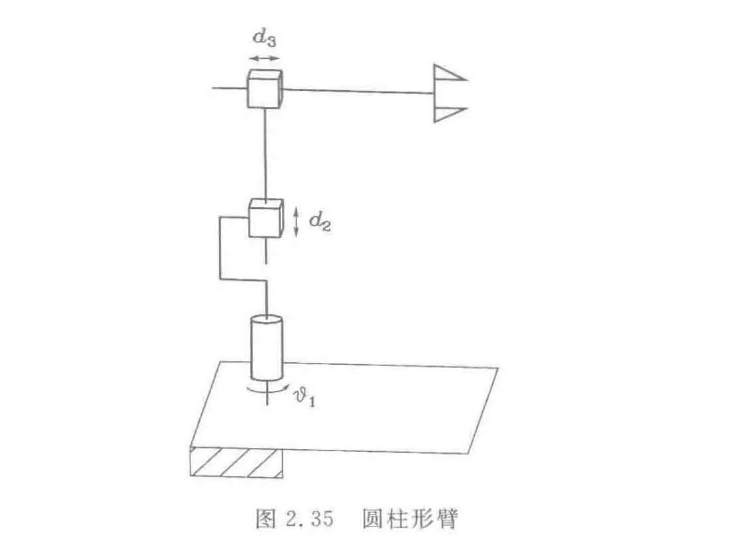
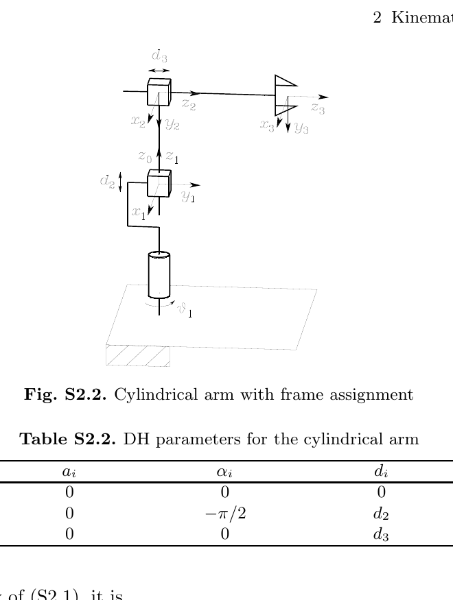

# 作业二：教材习题 2-4 / 2-12 / 2-19（附详细解答与验算）

::: note 作业信息（据录播与课件）
- **题号**：教材第 2 章习题 **2-4、2-12、2-19**（课堂 PPT 末页「作业：2-4, 2-12, 2-19」，录播 2:12:36 展示）；
- **提交**：智学北航 → 我的课 → 进入课程 → **课程作业**栏目（平台已建作业条目并标注截止时间）；
- **截止**：**当周周日 24:00** 前（录播 1:19:40 与 2:16:49 两次重申）；
- **计分**：平时分 = 考勤 + 作业；**缺交扣分、做错不扣分**——「只要交了就有分，目的是认真做，不要抄」（录播 1:21:36–1:22:00）。
:::

三题正好串成本章主线的一条链：**2-4 验证姿态表示的核心公式 → 2-12 用 DH 法建立正运动学 → 2-19 反过来求逆解**。下文每题给「题目 → 思路 → 详细推导 → 结果 → 验算 → 易错点」，全部结论已与**官方解答手册**（*Solution Manual*, Springer 2009，Problem 2.4 / 2.12 / 2.19）逐项核对，并通过 2 万组随机数值实验。

## 2-4 · 验证绕任意轴旋转的旋转矩阵由式（2.25）给出

**题目原文**（教材 p.75 第 2.4 题，逐字）：

> **2.4** 验证绕任意轴旋转一定角度所对应的旋转矩阵由式（2.25）给出。

**思路**：式（2.25）是**结论**，式（2.24）的五步合成是**已知**。所以只需把五步合成算到底，看是否等于式（2.25）。关键是三步：① 把五步写成「相似变换」$MR_z(\vartheta)M^T$；② 认出 $M$ 的第三列恰是旋转轴 $\boldsymbol r$；③ 证明反对称部分等于叉积矩阵 $[\boldsymbol r]_\times$。

::: note 与正文的关系
正文 [2.5.1](sec2-5.md#sec-2.5.1) 已把这条推导**完整写出**（含「旋转保持叉积 → 共轭恒等式」的工具化版本）；本作业要求你**独立复现**并数值验算——同一件事，作业走「逐元素硬乘」路线，正文走「共轭恒等式搬运」路线，两相对照更能看清哪些是机械计算、哪些是结构。
:::

### 详细推导

**第 0 步：把 α、β 用 r 的分量写出。** 这一步是整道题的入口，必须交代清楚：式（2.24）的五步合成里用的是**球坐标**的两个角，而题目给的是 $\boldsymbol r$ 的**笛卡儿分量**。所以要先把两套描述对上。

看图 2.10 的几何：先从 $z$ 轴出发，绕 $y$ 转 $\beta$ 把 $z$ 压到与 $\boldsymbol r$ 同高度的方向，再绕 $z$ 转 $\alpha$ 转到 $\boldsymbol r$ 的方位。于是 $\boldsymbol r$ 的方向由

$$\boldsymbol r=\begin{bmatrix}\cos\alpha\sin\beta\\ \sin\alpha\sin\beta\\ \cos\beta\end{bmatrix}$$

给出（$\boldsymbol r$ 是单位向量）。**这个式子的读法是「球坐标 → 笛卡儿」**：$\beta$ 是极角（与 $z$ 轴的夹角），$\alpha$ 是方位角。

**反解**：由第三分量直接得 $\cos\beta=r_z$；再由前两个分量，$\sqrt{r_x^2+r_y^2}=\sin\beta$（因为 $r_x^2+r_y^2=\sin^2\beta(\cos^2\alpha+\sin^2\alpha)=\sin^2\beta$），于是 $\sin\beta=\sqrt{r_x^2+r_y^2}$。最后 $\cos\alpha=r_x/\sin\beta$、$\sin\alpha=r_y/\sin\beta$。合起来就是式（1）：

$$\sin\alpha=\frac{r_y}{\sqrt{r_x^2+r_y^2}},\quad \cos\alpha=\frac{r_x}{\sqrt{r_x^2+r_y^2}},\qquad \sin\beta=\sqrt{r_x^2+r_y^2},\quad \cos\beta=r_z .\tag{1}$$

**分母不为零的条件**：$\sqrt{r_x^2+r_y^2}=0$ 意味着 $\boldsymbol r$ 沿 $\pm z$ 轴，此时 $\alpha$ 任意（球坐标的固有奇点，与欧拉角的万向锁同源）。后面第 4 步的推导要求 $\sin\beta\neq0$；$\boldsymbol r=\pm\boldsymbol z$ 的情形可以由连续性取极限得到，结果仍成立。

**第 1 步：合并前两个因子。** 记

$$M=R_z(\alpha)R_y(\beta)=\begin{bmatrix}c_\alpha c_\beta & -s_\alpha & c_\alpha s_\beta\\ s_\alpha c_\beta & c_\alpha & s_\alpha s_\beta\\ -s_\beta & 0 & c_\beta\end{bmatrix},$$

则式（2.24）可写成**相似变换**（因为 $R_y(-\beta)R_z(-\alpha)=M^T$）：

$$R(\vartheta,\boldsymbol r)=M\,R_z(\vartheta)\,M^T .\tag{2}$$

**第 2 步：认出 $M$ 的第三列就是 $\boldsymbol r$。** 把式（1）代入 $M$ 的第三列：

$$M_{:,3}=\begin{bmatrix}c_\alpha s_\beta\\ s_\alpha s_\beta\\ c_\beta\end{bmatrix}
=\begin{bmatrix}\dfrac{r_x}{\sqrt{r_x^2+r_y^2}}\cdot\sqrt{r_x^2+r_y^2}\\[2mm] \dfrac{r_y}{\sqrt{r_x^2+r_y^2}}\cdot\sqrt{r_x^2+r_y^2}\\[2mm] r_z\end{bmatrix}
=\begin{bmatrix}r_x\\ r_y\\ r_z\end{bmatrix}=\boldsymbol r .$$

这就是「绕 $\boldsymbol r$ 转」被编码进 $M$ 的地方——**$M$ 正是把 $\boldsymbol z$ 轴转到 $\boldsymbol r$ 的那次旋转**。

**第 3 步：展开相似变换。** 记 $M=[\boldsymbol m_1\ \boldsymbol m_2\ \boldsymbol m_3]$（按列分块）。由 (2)：

$$R = M R_z(\vartheta) M^T
= \big[c_\vartheta\boldsymbol m_1+s_\vartheta\boldsymbol m_2,\ -s_\vartheta\boldsymbol m_1+c_\vartheta\boldsymbol m_2,\ \boldsymbol m_3\big]M^T
= c_\vartheta(\boldsymbol m_1\boldsymbol m_1^T+\boldsymbol m_2\boldsymbol m_2^T)+s_\vartheta(\boldsymbol m_2\boldsymbol m_1^T-\boldsymbol m_1\boldsymbol m_2^T)+\boldsymbol m_3\boldsymbol m_3^T .$$

因 $M$ 正交，$\boldsymbol m_1\boldsymbol m_1^T+\boldsymbol m_2\boldsymbol m_2^T=I-\boldsymbol m_3\boldsymbol m_3^T=I-\boldsymbol r\boldsymbol r^T$，于是

$$R(\vartheta,\boldsymbol r)=c_\vartheta I+(1-c_\vartheta)\,\boldsymbol r\boldsymbol r^T+s_\vartheta\underbrace{(\boldsymbol m_2\boldsymbol m_1^T-\boldsymbol m_1\boldsymbol m_2^T)}_{=:\,S}.\tag{3}$$

**第 4 步：证明 $S=[\boldsymbol r]_\times$。** 由 $\boldsymbol m_1=[c_\alpha c_\beta,\ s_\alpha c_\beta,\ -s_\beta]^T$、$\boldsymbol m_2=[-s_\alpha,\ c_\alpha,\ 0]^T$ 逐元素计算：

| $(i,j)$ | $(m_2\boldsymbol m_1^T)_{ij}-(\boldsymbol m_1\boldsymbol m_2^T)_{ij}$ | 代入 (1) | $[\boldsymbol r]_\times$ 对应元 |
|:--:|:--|:--|:--|
| (1,1) | $-s_\alpha c_\alpha c_\beta+s_\alpha c_\alpha c_\beta$ | $0$ | $0$ √ |
| (1,2) | $-s_\alpha^2 c_\beta-c_\alpha^2 c_\beta=-c_\beta(s_\alpha^2+c_\alpha^2)$ | $-r_z$ | $-r_z$ √ |
| (1,3) | $s_\alpha s_\beta$ | $r_y$ | $r_y$ √ |
| (2,1) | $c_\alpha^2 c_\beta+s_\alpha^2 c_\beta=c_\beta$ | $r_z$ | $r_z$ √ |
| (2,3) | $-c_\alpha s_\beta$ | $-r_x$ | $-r_x$ √ |
| (3,1) | $-s_\alpha s_\beta$ | $-r_y$ | $-r_y$ √ |
| (3,2) | $c_\alpha s_\beta$ | $r_x$ | $r_x$ √ |

即 $S=[\boldsymbol r]_\times=\begin{bmatrix}0&-r_z&r_y\\ r_z&0&-r_x\\ -r_y&r_x&0\end{bmatrix}$。

**被省略的 (2,2) 与 (3,3) 补上**（这两格也最容易出错）：

$(2,2)$：$(m_2\boldsymbol m_1^{\mathrm T})_{22}-(\boldsymbol m_1\boldsymbol m_2^{\mathrm T})_{22}=m_{2,2}m_{1,2}-m_{1,2}m_{2,2}=0$——**同一对元素的乘积相减，恒为零**，不需要代任何三角函数。同理 $(3,3)=m_{2,3}m_{1,3}-m_{1,3}m_{2,3}=0$。

$(3,2)$：$m_{2,3}m_{1,2}-m_{1,3}m_{2,2}=0\cdot c_\alpha c_\beta-(-s_\beta)c_\alpha=c_\alpha s_\beta=r_x$ ✓（与表中一致）。

**为什么对角元必然为零**：$S=\boldsymbol m_2\boldsymbol m_1^{\mathrm T}-\boldsymbol m_1\boldsymbol m_2^{\mathrm T}$ 是「外积减转置外积」，**任何**这种形式的矩阵都是反对称的（$S^{\mathrm T}=\boldsymbol m_1\boldsymbol m_2^{\mathrm T}-\boldsymbol m_2\boldsymbol m_1^{\mathrm T}=-S$），而反对称矩阵的对角元必为零。所以只要认出 $S$ 是反对称的，对角元就不用逐个算——**这是一步结构性观察，省掉两格机械计算**。

**为什么 $S$ 必须等于 $[\boldsymbol r]_\times$**：$M$ 的第三列是 $\boldsymbol r$，而 $R_z(\vartheta)$ 的转轴是 $\boldsymbol z$；相似变换 $MR_z(\vartheta)M^{\mathrm T}$ 把转轴从 $\boldsymbol z$ 搬到 $M\boldsymbol z=\boldsymbol r$。所以在 $\vartheta$ 的一阶项上，$R$ 的生成元必须是「绕 $\boldsymbol r$ 的叉乘」，即 $[\boldsymbol r]_\times$。这一步给出了「$S=[\boldsymbol r]_\times$」的**必然性**，而逐元素计算只是**验证**它。

**第 5 步：展开得式（2.25）。** 把 (3) 写成分量：

$$R(\vartheta,\boldsymbol r)=\begin{bmatrix}
r_x^2(1-c_\vartheta)+c_\vartheta & r_xr_y(1-c_\vartheta)-r_zs_\vartheta & r_xr_z(1-c_\vartheta)+r_ys_\vartheta\\
r_xr_y(1-c_\vartheta)+r_zs_\vartheta & r_y^2(1-c_\vartheta)+c_\vartheta & r_yr_z(1-c_\vartheta)-r_xs_\vartheta\\
r_xr_z(1-c_\vartheta)-r_ys_\vartheta & r_yr_z(1-c_\vartheta)+r_xs_\vartheta & r_z^2(1-c_\vartheta)+c_\vartheta
\end{bmatrix}$$

正是式（2.25）。□

::: note 官方解答手册走的是等价的代数路线
手册（Solution Manual p.3）直接把 $R_z(\alpha)R_y(\beta)$、$R_z(\alpha)R_y(\beta)R_z(\vartheta)$ 乘开，再用 $R_y(-\beta)R_z(-\alpha)=(R_z(\alpha)R_y(\beta))^T$ 得同一个矩阵，最后代入 (1) 整理。本教程的「相似变换 + $M_{:,3}=\boldsymbol r$ + $S=[\boldsymbol r]_\times$」写法与它完全等价，但把「为什么第三列是 $\boldsymbol r$」这一步显式化了——**这正是式（2.25）成立的几何内核**。
:::

### 验算

2 万组随机 $(\vartheta,\boldsymbol r)$（$\boldsymbol r$ 随机方向、$\vartheta\in(-\pi,\pi)$），比对式（2.25）与式（2.24）五步合成、以及手册的 $(s_\alpha,c_\alpha,s_\beta,c_\beta)$ 形式：

| 检验项 | 最大偏差 | 结论 |
|:--|--:|:--|
| 式(2.25) ≡ 式(2.24) 五步合成 | $1.1\times10^{-15}$ | 机器精度内相等 |
| 式(2.25) ≡ 官方手册形式 | $6.1\times10^{-16}$ | 三方一致 |
| $R\boldsymbol r=\boldsymbol r$（轴不变） | $1.1\times10^{-15}$ | √ |
| $R^TR=I$、$\det R=+1$ | $2.0\times10^{-15}$ | √ |
| $\operatorname{tr}R=1+2\cos\vartheta$ | $1.1\times10^{-15}$ | √（式 2.27 的自洽性） |
| $R(-\vartheta,-\boldsymbol r)=R(\vartheta,\boldsymbol r)$ | $0$ | √（式 2.26 不唯一性） |
| $\vartheta=0\Rightarrow R=I$；$\vartheta=\pi\Rightarrow R=2\boldsymbol r\boldsymbol r^T-I$ | $\le10^{-16}$ | √ 特例 |

::: think 两个易错点
1. **符号**：$S$ 的反对称项符号取决于 $[\boldsymbol r]_\times$ 的约定（本课程取 $[\boldsymbol r]_\times\boldsymbol p=\boldsymbol r\times\boldsymbol p$）。若把 $s_\vartheta$ 项的符号写反，得到的是绕 $-\boldsymbol r$ 转 $\vartheta$——而由 $R(-\vartheta,-\boldsymbol r)=R(\vartheta,\boldsymbol r)$，错号等价于把 $\boldsymbol r$ 取反，**在同一组随机测试里能立刻暴露**。
2. **$\sin\vartheta=0$ 的反解**：由 $R$ 反解 $(\vartheta,\boldsymbol r)$ 用式（2.28）要除以 $2\sin\vartheta$，$\vartheta\to0,\pi$ 时病态（数值实验中 $|\sin\vartheta|\le10^{-2}$ 的 143 组偏差放大到 $10^{-7}$，良态区仅 $10^{-12}$）——这就是教程 [@thm-2.5.B] 说的失效情形，$\vartheta=0$ 时轴任意、$\vartheta=\pi$ 时须另用对称部分求轴。
:::

## 2-12 · 圆柱形臂的正运动学

**题目原文**（教材 p.75 第 2.12 题，逐字）：

> **2.12** 列出如图 2.35 中的圆柱形臂的正运动学方程。

**原题图 2.35**（教材扫描，p.75）：



**结构**：关节 1 绕竖直轴 $z_0$ 转动（$\vartheta_1$）；关节 2 沿竖直方向移动（$d_2$）；关节 3 沿水平径向移动（$d_3$）。末端位置由**柱坐标** $(d_3,\vartheta_1,d_2)$ 决定——这正是「圆柱形」得名的原因。

<figure>
<svg height="330" viewBox="0 0 680 330" width="680" xmlns="http://www.w3.org/2000/svg">
<g font-size="12.5" font-family="sans-serif">
<!-- ===== 左：俯视图 ===== -->
<text class="diagram-text" x="20" y="20">俯视图（xy 平面）</text>
<line class="diagram-axis" x1="40" y1="240" x2="200" y2="240"/>
<line class="diagram-axis" x1="120" y1="250" x2="120" y2="60"/>
<text class="diagram-text" x="205" y="245">x<tspan class="sb">0</tspan></text>
<text class="diagram-text" x="126" y="58">y<tspan class="sb">0</tspan></text>
<circle class="diagram-node" cx="120" cy="240" r="7"/>
<!-- 零位：沿 +y0 -->
<line class="diagram-muted" x1="120" y1="240" x2="120" y2="120"/>
<text class="diagram-note" x="124" y="130">零位（ϑ<tspan class="sb">1</tspan>=0）</text>
<!-- 转动后的臂 -->
<line class="diagram-accent" x1="120" y1="240" x2="60" y2="146"/>
<circle cx="60" cy="146" r="4" fill="var(--accent)"/>
<text class="diagram-text" x="18" y="140">末端 P</text>
<text class="diagram-note" x="72" y="200">d<tspan class="sb">3</tspan></text>
<!-- 角度弧 -->
<path class="diagram-sage" d="M 120 180 A 60 60 0 0 0 96 205"/>
<text class="diagram-note" x="128" y="196">ϑ<tspan class="sb">1</tspan></text>
<!-- 投影虚线 -->
<line class="diagram-muted" x1="60" y1="146" x2="60" y2="240"/>
<line class="diagram-muted" x1="60" y1="146" x2="120" y2="146"/>
<text class="diagram-note" x="44" y="256">p_x</text>
<text class="diagram-note" x="86" y="140">p_y</text>
<!-- ===== 右：侧视图 ===== -->
<text class="diagram-text" x="300" y="20">侧视图（竖直面）</text>
<line class="diagram-axis" x1="320" y1="270" x2="620" y2="270"/>
<line class="diagram-axis" x1="370" y1="280" x2="370" y2="40"/>
<text class="diagram-text" x="622" y="275">径向</text>
<text class="diagram-text" x="376" y="38">z<tspan class="sb">0</tspan></text>
<!-- 立柱 -->
<rect x="360" y="100" width="20" height="170" fill="var(--paper)" stroke="var(--line-strong)" stroke-width="1.2"/>
<!-- 升降距离 d2 -->
<line class="diagram-sage" x1="348" y1="270" x2="348" y2="150"/>
<path class="diagram-sage" d="M 344 158 L 348 150 L 352 158"/>
<path class="diagram-sage" d="M 344 262 L 348 270 L 352 262"/>
<text class="diagram-note" x="306" y="215">d<tspan class="sb">2</tspan></text>
<!-- 滑座 -->
<rect x="356" y="136" width="28" height="28" fill="var(--paper)" stroke="var(--accent)" stroke-width="1.6"/>
<!-- 水平臂 -->
<line class="diagram-accent" x1="384" y1="150" x2="560" y2="150"/>
<circle cx="560" cy="150" r="4" fill="var(--accent)"/>
<text class="diagram-text" x="566" y="146">P</text>
<!-- d3 尺寸线（与 d2 同款双向箭头） -->
<line class="diagram-sage" x1="384" y1="186" x2="560" y2="186"/>
<path class="diagram-sage" d="M 392 182 L 384 186 L 392 190"/>
<path class="diagram-sage" d="M 552 182 L 560 186 L 552 190"/>
<text class="diagram-note" x="462" y="180">d<tspan class="sb">3</tspan></text>
<!-- 转动轴 -->
<path class="diagram-muted" d="M 370 96 A 44 44 0 0 1 414 138" />
<text class="diagram-note" x="392" y="98">绕 z<tspan class="sb">0</tspan> 转 ϑ<tspan class="sb">1</tspan></text>
</g>
</svg>
<figcaption>圆柱形臂的关节配置：转动关节 $\vartheta_1$（绕 $z_0$）+ 竖直移动 $d_2$ + 径向移动 $d_3$。末端位置 $p_x=-d_3\sin\vartheta_1$、$p_y=d_3\cos\vartheta_1$、$p_z=d_2$（本教程自绘示意，对照原书图 2.35）。</figcaption>
</figure>

### 详细推导

**第 1 步：建系。** 按 [@method-2.8.dh] 的四规则建连杆坐标系：$z_0$ 沿关节 1 转轴（竖直）；$z_1$ 沿关节 2 的移动方向（竖直，与 $z_0$ 同向）；因关节 3 沿水平径向移动，取 $z_2$ 沿该径向、$x_2$ 与之配合（故 $\alpha_2=-\pi/2$）。

对照官方解答手册的建系结果（Fig. S2.2，可见各系的 $x_i,y_i,z_i$ 与 $\vartheta_1,d_2,d_3$ 标注）：



**第 2 步：填 DH 参数表。**

| 连杆 $i$ | $a_i$ | $\alpha_i$ | $d_i$ | $\vartheta_i$ |
|:--:|:--:|:--:|:--:|:--:|
| 1 | 0 | 0 | 0 | $\vartheta_1$ |
| 2 | 0 | $-\pi/2$ | $d_2$ | 0 |
| 3 | 0 | 0 | $d_3$ | 0 |

读法：$a_i$ 全为 0（相邻 $z$ 轴皆相交或平行、公垂线长度为零——[@method-2.8.zero] 的「能零则零」）；$\alpha_1=0$（$z_0\parallel z_1$）、$\alpha_2=-\pi/2$（$z_1\to z_2$ 由竖直转为水平）、$\alpha_3=0$（$z_2\parallel z_3$）；关节 1 是转动型故 $\vartheta_1$ 是变量，关节 2、3 是移动型故 $d_2,d_3$ 是变量、对应角列为常数 0。

**第 3 步：写各关节变换矩阵**（代入 [@method-2.8.A] 的通式）。先把通式抄在这里，后面每个 $A$ 都对着它填：

$$A_i^{i-1}=\begin{bmatrix}
c_i&-s_ic_{\alpha_i}&s_is_{\alpha_i}&a_ic_i\\
s_i&c_ic_{\alpha_i}&-c_is_{\alpha_i}&a_is_i\\
0&s_{\alpha_i}&c_{\alpha_i}&d_i\\
0&0&0&1
\end{bmatrix}. \tag{DH}$$

**$A_1^0$**：$\vartheta_1$ 是变量，$a_1=0$、$\alpha_1=0$、$d_1=0$。代入后 $c_{\alpha_1}=1$、$s_{\alpha_1}=0$：

$$A_1^0=\begin{bmatrix}c_1&-s_1&0&0\\ s_1&c_1&0&0\\ 0&0&1&0\\ 0&0&0&1\end{bmatrix}.$$

（这就是绕 $z$ 转 $\vartheta_1$ 的纯转动矩阵——$\alpha=d=a=0$ 时 DH 矩阵退化为它，可用来检查通式没抄错。）

**$A_2^1$**：$\vartheta_2=0$（移动关节）、$a_2=0$、$\alpha_2=-\pi/2$、$d_2$ 是变量。代入 $c_2=1,s_2=0$、$c_{\alpha_2}=0,s_{\alpha_2}=-1$：

- 第 1 行：$[1,\ -0\cdot0=0,\ 0\cdot(-1)=0,\ 0]$；
- 第 2 行：$[0,\ 1\cdot0=0,\ -1\cdot(-1)=1,\ 0]$；
- 第 3 行：$[0,\ -1,\ 0,\ d_2]$。

$$A_2^1=\begin{bmatrix}1&0&0&0\\ 0&0&1&0\\ 0&-1&0&d_2\\ 0&0&0&1\end{bmatrix}.$$

**这个矩阵的几何含义**：它把 $z_1$（竖直）转到 $z_2$（水平径向），同时沿 $z_1$ 平移 $d_2$。第 2 行第 3 列的 $+1$ 与第 3 行第 2 列的 $-1$ 正是 $\alpha_2=-90^\circ$ 的「换轴」结果——**若把 $\alpha_2$ 写成 $+\pi/2$，这两个符号都会反过来**，最终位置里 $p_y$ 的符号就错。

**$A_3^2$**：$\vartheta_3=0$、$a_3=0$、$\alpha_3=0$、$d_3$ 是变量：

$$A_3^2=\begin{bmatrix}1&0&0&0\\ 0&1&0&0\\ 0&0&1&d_3\\ 0&0&0&1\end{bmatrix}.$$

（纯平移。）

**第 4 步：连乘**（[@thm-2.8.A]）。用定义 $P_{ij}=\sum_k A_{ik}B_{kj}$ 逐元素算，不靠「取某一行」的捷径（那个捷径在平移列上容易出错）。

**先算 $P=A_2^1A_3^2$**。$A_2^1$ 每行只有一个非零元，可以很快：

- $P$ 第 1 行：$(A_2^1)_{11}=1$ ⇒ 取 $A_3^2$ 第 1 行 $[1,0,0,0]$；
- $P$ 第 2 行：$(A_2^1)_{23}=1$ ⇒ 取 $A_3^2$ 第 3 行 $[0,0,1,d_3]$；
- $P$ 第 3 行：$(A_2^1)_{32}=-1$、$(A_2^1)_{34}=d_2$ ⇒ $-1\times[0,1,0,0]+d_2\times[0,0,0,1]=[0,-1,0,d_2]$；
- $P$ 第 4 行：$(A_2^1)_{44}=1$ ⇒ $[0,0,0,1]$。

$$P=A_2^1A_3^2=\begin{bmatrix}1&0&0&0\\ 0&0&1&d_3\\ 0&-1&0&d_2\\ 0&0&0&1\end{bmatrix}.$$

**读法**：$d_3$ 落在第 2 行第 4 列——它沿 $z_2$ 平移，而 $\alpha_2=-90^\circ$ 恰好把 $z_2$ 换到了原 $y$ 的位置。

**再算 $T_3^0=A_1^0P$**。$A_1^0$ 只在前两行有非零元，所以：

$$T_{1j}=c_1P_{1j}-s_1P_{2j},\qquad T_{2j}=s_1P_{1j}+c_1P_{2j},\qquad T_{3j}=P_{3j},\qquad T_{4j}=P_{4j}.$$

逐列代入：

| $j$ | $P_{1j}$ | $P_{2j}$ | $T_{1j}$ | $T_{2j}$ |
|:--:|:--:|:--:|:--|:--|
| 1 | 1 | 0 | $c_1$ | $s_1$ |
| 2 | 0 | 0 | $0$ | $0$ |
| 3 | 0 | 1 | $-s_1$ | $c_1$ |
| 4 | 0 | $d_3$ | $-d_3s_1$ | $d_3c_1$ |

$$\boxed{\;T_3^0(\boldsymbol q)=A_1^0A_2^1A_3^2=\begin{bmatrix}
c_1 & 0 & -s_1 & -d_3s_1\\
s_1 & 0 & c_1 & d_3c_1\\
0 & -1 & 0 & d_2\\
0&0&0&1
\end{bmatrix},\qquad \boldsymbol q=[\vartheta_1\ d_2\ d_3]^T.\;}$$

**结果**：末端执行器的**位置**与**方向**（$\boldsymbol n,\boldsymbol s,\boldsymbol a$ 为前三列）分别为

$$\boldsymbol p=\begin{bmatrix}-d_3s_1\\ d_3c_1\\ d_2\end{bmatrix},\qquad
\boldsymbol n=\begin{bmatrix}c_1\\ s_1\\ 0\end{bmatrix},\quad
\boldsymbol s=\begin{bmatrix}0\\ 0\\ -1\end{bmatrix},\quad
\boldsymbol a=\begin{bmatrix}-s_1\\ c_1\\ 0\end{bmatrix}.$$

**几何解读**：长度 $d_3$ 的臂绕 $z_0$ 转 $\vartheta_1$ 后指到径向；注意零位（$\vartheta_1=0$）时 $p_x=0,p_y=d_3$——**臂指向 $+y_0$**，这是本建系约定的产物（$\boldsymbol p=[0,d_3,0]^T$ 是把 $[0,d_3]^T$ 逆时针转 $\vartheta_1$ 的结果）；$z$ 坐标只由 $d_2$ 决定，与两个水平变量解耦；$\boldsymbol s=-\boldsymbol z_0$ 说明末端坐标系的 $y$ 轴朝下。

### 验算

| 检验项 | 结果 |
|:--|:--|
| DH 连乘 ≡ 上述闭式 $T_3^0$（2 万组随机 $\boldsymbol q$） | 最大偏差 $1.1\times10^{-16}$ |
| 旋转块正交、$\det=+1$ | $2.2\times10^{-16}$ |
| 三个 $A$ 矩阵与官方手册逐项一致 | $6.1\times10^{-17}$ |
| 样例 $\boldsymbol q=[0.9,\ 0.35,\ 1.25]$ | $\boldsymbol p=(-0.979159,\ 0.777012,\ 0.350000)$（与 $-d_3s_1,d_3c_1,d_2$ 一致） |

::: think 易错点
1. **$\alpha_2$ 的符号**：必须比划「从 $z_1$（竖直）绕 $x_2$ 转到 $z_2$（水平径向）」的方向。取 $+\pi/2$ 会得到 $p_y=-d_3c_1$ 一类结果——**与官方手册差一个符号**，这类错误在单元测试里会立刻暴露（见验算表第 1 行）。
2. **$d$ 列与 $\vartheta$ 列**：移动关节的变量必须写进 $d$ 列、$\vartheta$ 列置常数 0；写成 $\vartheta_2$ 会连锁导致 $A_2^1$ 用错形式。
3. **零位方向**：本题约定零位指向 $+y_0$（故 $p_x=-d_3s_1$ 带负号）。不同教材/厂商的零位约定可能不同，**答案的形式随约定变、物理内容不变**——抄答案时要连约定一起抄。
:::

## 2-19 · 圆柱形臂的逆运动学

**题目原文**（教材 p.76 第 2.19 题，逐字）：

> **2.19** 求解如图 2.35 中的圆柱形臂的逆运动学方程。

（原题图同 2-12 的图 2.35，见上。）

**思路**：正解位置式 $\boldsymbol p=[-d_3s_1,\ d_3c_1,\ d_2]^T$ 已在上题得到，逆解就是对它做「平方求和 + 取比 + 直读」三步——注意 $d_3$ 是**移动关节的实际长度**，有明确物理约束 $d_3\ge0$，这一条恰好把解定成唯一。

### 详细推导

**第 1 步：分离 $d_2$。** 第三式只含 $d_2$：

$$d_2=p_z .$$

**第 2 步：平方求和消去 $\vartheta_1$。**

$$p_x^2+p_y^2=d_3^2(s_1^2+c_1^2)=d_3^2
\;\Longrightarrow\; d_3=\sqrt{p_x^2+p_y^2}\quad(\text{取 }d_3\ge0\ \text{支}).$$

**第 3 步：作比得 $\vartheta_1$。** 由 $\sin\vartheta_1=-p_x/d_3$、$\cos\vartheta_1=p_y/d_3$（$d_3>0$ 时两式可同除以 $d_3$）：

$$\vartheta_1=\operatorname{Atan2}\!\left(\frac{-p_x}{d_3},\ \frac{p_y}{d_3}\right)=\operatorname{Atan2}(-p_x,\ p_y).$$

用 `Atan2` 而非 $\arccos$ 的理由见 [@thm-2.4.A]（唯一化象限 + 精度均匀）。

::: thm 结论 2.19 · 圆柱形臂的逆解 {#thm-2.19}
$$\boxed{\;\vartheta_1=\operatorname{Atan2}(-p_x,\,p_y),\qquad d_3=\sqrt{p_x^2+p_y^2},\qquad d_2=p_z\;}$$

**解的存在性**：任意 $\boldsymbol p\in\mathbb{R}^3$ 都可达（$d_2$ 无界、$d_3$ 取到任意非负值、$\vartheta_1$ 全周），故**无「超出工作空间」的不可达情形**——这与拟人臂等有界臂不同。

**解的唯一性与奇异**：$d_3>0$ 时解唯一；当 $d_3=0$（末端落在转轴 $z_0$ 上，即 $p_x=p_y=0$）时 $\vartheta_1$ **任意**，逆解有无穷多组——臂在轴线上，转不转都到同一处（教程 [2.12](sec2-12.md#sec-2.12) 提到的「无穷多解」在本机型的实例）。
:::

### 验算

| 检验项 | 结果 |
|:--|:--|
| 随机 $\boldsymbol q$（$d_3>0$）正解 → 逆解回代 | 最大偏差 $2.2\times10^{-16}$ |
| 随机 $\boldsymbol p$ 逆解 → 正解回代 | 最大偏差 $2.2\times10^{-16}$ |
| 样例 $\boldsymbol q=[0.83,\ 0.2,\ 1.4]$ | $\boldsymbol p=(-1.033104,\ 0.944826,\ 0.200000)$ → 逆解得 $[0.830000,\ 0.2,\ 1.4]$ √ |
| $d_3=0$ 奇异：9 个不同 $\vartheta_1$ 均给出同一 $\boldsymbol p$ | √（验证「$\vartheta_1$ 任意」） |

::: think 易错点
1. **忘记 $d_3\ge0$**：若允许 $d_3<0$，则 $\vartheta_1'=\vartheta_1+\pi$、$d_3'=-d_3$ 也是同一点的形式解（多出一支「假解」）。移动关节长度非负——**这一条约束才是「解唯一」的来源**，不是公式给的。
2. **轴上奇异当成「无解」**：$d_3=0$ 不是无解而是**无穷多解**（$\vartheta_1$ 任意）。编程时应特判：若 $p_x=p_y=0$，$\vartheta_1$ 取上一次的值或 0（术语上叫「沿既定姿态保持」）。
3. **用 $\arccos$ 求 $\vartheta_1$**：只能得到 $[0,\pi]$ 的值，丢一半象限——必须用 `Atan2`。
:::

## 附：验算脚本

以下脚本可独立运行（需 NumPy），复现上表全部结论：

```python
import numpy as np
rng = np.random.default_rng(20260916)

Rz = lambda t: np.array([[np.cos(t),-np.sin(t),0],[np.sin(t),np.cos(t),0],[0,0,1.]])
Ry = lambda t: np.array([[np.cos(t),0,np.sin(t)],[0,1.,0],[-np.sin(t),0,np.cos(t)]])

# —— 2-4：式(2.25) vs 五步合成   ——
def rodrigues(th, r):
    r = np.asarray(r,float)/np.linalg.norm(r)
    K = np.array([[0,-r[2],r[1]],[r[2],0,-r[0]],[-r[1],r[0],0]])
    return np.cos(th)*np.eye(3) + (1-np.cos(th))*np.outer(r,r) + np.sin(th)*K
def five(th, r):
    r = np.asarray(r,float)/np.linalg.norm(r)
    a = np.arctan2(r[1], r[0]); b = np.arctan2(np.hypot(r[0],r[1]), r[2])
    return Rz(a) @ Ry(b) @ Rz(th) @ Ry(-b) @ Rz(-a)
print(max(np.abs(rodrigues(t,r) - five(t,r)).max()
          for t,r in zip(rng.uniform(-np.pi,np.pi,20000), rng.normal(size=(20000,3)))))

# —— 2-12 / 2-19：圆柱形臂 ——
def A(a, al, d, th):
    c,s,ca,sa = np.cos(th),np.sin(th),np.cos(al),np.sin(al)
    return np.array([[c,-s*ca,s*sa,a*c],[s,c*ca,-c*sa,a*s],[0,sa,ca,d],[0,0,0,1.]])
def fk(q):
    t1,d2,d3 = q
    return (A(0,0,0,t1) @ A(0,-np.pi/2,d2,0) @ A(0,0,d3,0))
def fk_p(q):
    t1,d2,d3 = q; return np.array([-d3*np.sin(t1), d3*np.cos(t1), d2])
def ik(p):
    px,py,pz = p; d3 = np.hypot(px,py)
    return np.array([np.arctan2(-px,py) if d3>0 else np.nan, pz, d3])

q = [0.9, 0.35, 1.25]; print(fk(q)[:3,3], fk_p(q))          # 正解
q = [0.83, 0.2, 1.4];   print(ik(fk_p(q)))                  # 逆解回代
p_test = np.array([0.7, -1.1, 0.4])
print(np.abs(fk_p(ik(p_test)) - p_test).max())               # 逆→正 复现 p（≈0）
```

::: method 与教程已有练习的对应
- [习题集](exercises.md) **C1**（原书 2.4）已给 Rodrigues 公式的验证代码与验收标准；
- [习题集](exercises.md) **C2**（原书 2.12 + 2.19）已给圆柱形臂的 DH 表、正运动学与逆解，**结论与本页一致**（$d_2=p_z$、$d_3=\sqrt{p_x^2+p_y^2}$、$\vartheta_1=\operatorname{Atan2}(-p_x,p_y)$）。
- 差别：C2 面向练习（留白让读者填），本页是完整解答，可直接用于作业作答与自查。
:::

依据 Siciliano 等《机器人学：建模、规划与控制》第 2 章习题 2-4/2-12/2-19 · 与官方解答手册（Springer, 2009）逐项核对 · 数值验算通过 · 整理日期 2026-09-16
