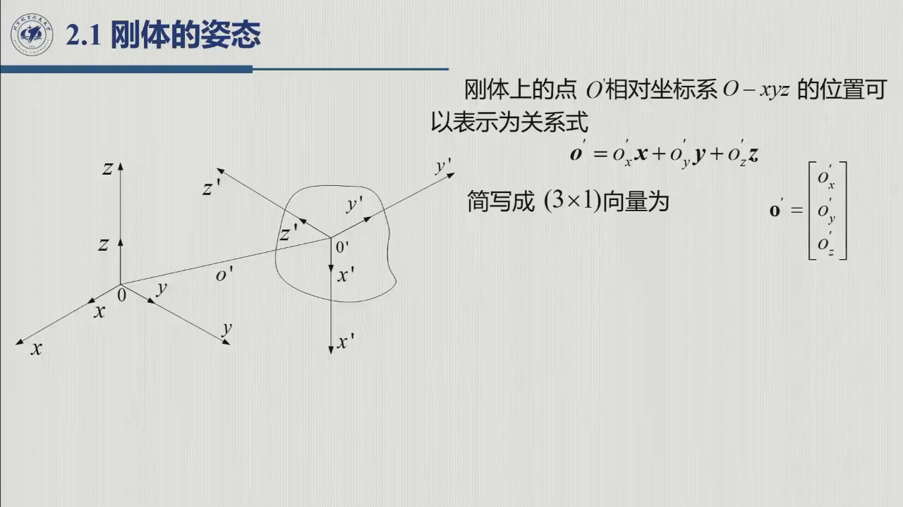
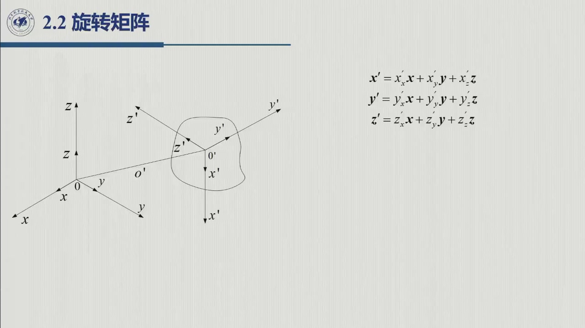

# 2.1 刚体的姿态

夹爪到达了工件上方，却横着对准工件，仍然不能完成抓取。上一章把任务分成建模、规划与控制；开始建模时，首先要说清楚工具**在哪里、朝哪里**。这两个问题分别由位置和姿态回答，合起来叫**位姿**。

本节用固连在刚体上的坐标系描述位姿，再解释三根轴上的 9 个方向余弦。读完后，你应能从轴的方向写出分量，分清位置与方向的单位，并检查一组三轴能否表示刚体的朝向。

<aside class="margin-note">NOTE / 6 DOF无额外约束的空间刚体有 6 个自由度：位置 3 个、姿态 3 个。姿态的 3 个参数是局部计数，不保证某一套角度参数在所有朝向下都唯一、无奇异。</aside>

{{#include ../assets/figures/robot-pose.md}}

## 2.1.1 位姿与位置的描述

::: def 定义 2.1.1 · 位姿（pose） {#def-2.1.1}
把一个坐标系固定在刚体上：原点 $O'$ 随刚体移动，三根轴随刚体转动。相对于已选定的参考系，$O'$ 的**位置**与固连系的**姿态**（orientation，即三根轴的指向）共同确定刚体的位姿（pose）。这里假定刚体形状以及固连系在刚体上的安装方式已经确定。

无额外约束的空间刚体有 3 个平移自由度和 3 个转动自由度；机械手的关节约束可能限制实际可实现的位姿，不能据此断言任意机器人都有 6 个自由度。
:::

令 $O\text{-}xyz$ 为右手正交参考系，$\boldsymbol x,\boldsymbol y,\boldsymbol z$ 为三轴单位向量。位置向量 $\overrightarrow{OO'}$ 可沿三轴分解：

$$\overrightarrow{OO'}=o'_x\boldsymbol x+o'_y\boldsymbol y+o'_z\boldsymbol z,\qquad
\boldsymbol o'=\begin{bmatrix}o'_x\\o'_y\\o'_z\end{bmatrix}\in\mathbb R^3
\qquad(\text{原书式 }2.1)$$

左边的箭头是几何向量，右边的列是它在参考系中的**坐标表示**。原书将二者都简记为 $\boldsymbol o'$；下文沿用这一习惯，但换坐标系时要说明分量在哪个系中。若采用米，三个位置分量都以米计。

::: note 原书的 bound vector 指什么？
原书称位置向量为 bound vector，强调起点 $O$ 和终点 $O'$ 已指定；这里理解为**有固定起点的位置向量**。旧译“有界向量”容易让人误以为长度存在某个上界。

点 $O'$ 与向量 $\overrightarrow{OO'}$ 是不同对象。改变参考原点，点的位置坐标会改变；自由向量只描述大小与方向，平移原点不会改变它的分量（前提是坐标轴方向保持不变）。[§2.7](sec2-7.md) 将把这一差别写进统一的变换公式。
:::

给出 $O'$ 的位置仍未确定姿态。即使再给出工具轴 $\boldsymbol z'$ 的方向，夹爪仍可绕这根轴滚转，横向的 $\boldsymbol x'$、$\boldsymbol y'$ 会随之改变。因此**一根轴的方向不等于完整姿态**；需要描述整个固连系。

## 2.1.2 姿态与方向余弦

在刚体上固连右手正交坐标系 $O'\text{-}x'y'z'$。把三根轴的单位向量分别沿参考系分解：

$$\begin{aligned}
\boldsymbol x'&=x'_x\boldsymbol x+x'_y\boldsymbol y+x'_z\boldsymbol z,\\
\boldsymbol y'&=y'_x\boldsymbol x+y'_y\boldsymbol y+y'_z\boldsymbol z,\\
\boldsymbol z'&=z'_x\boldsymbol x+z'_y\boldsymbol y+z'_z\boldsymbol z.
\end{aligned}\qquad(\text{原书式 }2.2)$$

下标表示沿哪根**参考轴**的分量，例如 $x'_y$ 是本体系 $x'$ 轴沿参考系 $y$ 轴的分量。

::: thm 原理 2.1.A · 方向余弦与三个独立参数 {#thm-2.1.A}
由于三轴都是单位向量，每个分量都是两根轴夹角的余弦。例如

$$x'_y=\boldsymbol x'\cdot\boldsymbol y=\cos\angle(\boldsymbol x',\boldsymbol y).$$

它是无量纲的数，范围为 $[-1,1]$。负值表示沿该参考轴的负方向有分量，不表示夹角为负。

三根轴共给出 9 个方向余弦，但必须同时满足：

$$\|\boldsymbol x'\|^2=\|\boldsymbol y'\|^2=\|\boldsymbol z'\|^2=1,\qquad
\boldsymbol x'\cdot\boldsymbol y'=\boldsymbol y'\cdot\boldsymbol z'=\boldsymbol z'\cdot\boldsymbol x'=0.$$

三条单位长度约束、三条垂直约束，共 6 个独立约束，使连续独立参数为 $9-6=3$。此外，两坐标系约定均为右手系，还须有 $\boldsymbol x'\times\boldsymbol y'=\boldsymbol z'$，以排除镜像。右手条件选择正交三轴的手性，不再减少一个连续自由度。矩阵写法见 [§2.2 的参数计数](sec2-2.md#note-2.2.2)。
:::

### 从读数理解“投影”

先看一个 $xy$ 平面内的例子。左图的位置点为 $P=(0.30,0.20,0)\,\mathrm m$；右图的单位方向为 $(0.60,0.80,0)^{\mathrm T}$。两图都沿参考轴读分量，但**左图读长度，右图读无量纲的方向余弦**。两图各用自己的比例尺，屏幕上的箭头长度不能跨图比较。

<figure>
<svg class="figure-svg" viewBox="0 0 920 330" xmlns="http://www.w3.org/2000/svg" role="img" aria-labelledby="fig-21-title fig-21-desc">
<title id="fig-21-title">位置分量与单位方向分量的带数对照</title>
<desc id="fig-21-desc">左图：点 P 的 x 坐标零点三零米、y 坐标零点二零米、z 坐标零，虚线连接轴上读数与点。右图：单位方向的 x 分量零点六零、y 分量零点八零、z 分量零，平方和为一。两图都在 xy 平面内，z 轴朝向屏幕外。</desc>
<defs>
<marker id="f21-m" markerWidth="9" markerHeight="9" refX="7" refY="3" orient="auto"><path d="M0,0 L7,3 L0,6 Z" fill="var(--muted)"/></marker>
<marker id="f21-b" markerWidth="9" markerHeight="9" refX="7" refY="3" orient="auto"><path d="M0,0 L7,3 L0,6 Z" fill="var(--fig-blue)"/></marker>
</defs>
<text class="diagram-text" x="240" y="32" text-anchor="middle">位置：分量单位为 m</text>
<text class="diagram-text" x="700" y="32" text-anchor="middle">单位方向：分量无量纲</text>
<g stroke="var(--line-strong)" stroke-width="1.5" marker-end="url(#f21-m)">
<line x1="100" y1="245" x2="395" y2="245"/><line x1="100" y1="245" x2="100" y2="65"/>
<line x1="560" y1="245" x2="855" y2="245"/><line x1="560" y1="245" x2="560" y2="65"/>
</g>
<g stroke="var(--line-strong)" stroke-dasharray="5 4" fill="none">
<path d="M280,245 V125 H100"/><path d="M674,245 V93 H560"/>
</g>
<g stroke="var(--fig-blue)" stroke-width="2.5" marker-end="url(#f21-b)">
<line x1="100" y1="245" x2="280" y2="125"/><line x1="560" y1="245" x2="674" y2="93"/>
</g>
<g class="diagram-text">
<text x="82" y="267">O</text><text x="395" y="267">x</text><text x="80" y="68">y</text>
<text x="280" y="270" text-anchor="middle">0.30</text><text x="90" y="130" text-anchor="end">0.20</text><text x="292" y="120">P</text>
<text x="542" y="267">O</text><text x="855" y="267">x</text><text x="540" y="68">y</text>
<text x="674" y="270" text-anchor="middle">0.60</text><text x="550" y="98" text-anchor="end">0.80</text><text x="689" y="88">单位轴 x′</text>
</g>
<text class="diagram-note" x="240" y="306" text-anchor="middle">z = 0；位置向量长度约 0.361 m</text>
<text class="diagram-note" x="700" y="306" text-anchor="middle">z 分量为 0；0.60² + 0.80² = 1</text>
</svg>
<figcaption>分量读取示例（本教程绘）。两图的 z 轴均指向屏幕外。右图只描述一根轴，另外两根轴的朝向也须确定：可先选定一根与它垂直的横向轴，再由叉积确定第三轴。三轴必须共同满足单位长度、正交与右手条件。</figcaption>
</figure>

### 一组完整位姿：位置与朝向分别填写

::: ex 带数示范 · 绕参考 z 轴正转 90° {#ex-2.1.pose}
设固连系原点的位置为 $\boldsymbol o'=(0.30,-0.20,0.10)^{\mathrm T}\,\mathrm m$。固连系最初与参考系同向，随后绕与参考 $z$ 轴平行、经过 $O'$ 的轴按右手定则转 $+90^\circ$，保持 $O'$ 不动。从 $+z$ 一侧朝原点看，这个转动为逆时针。于是

$$\boldsymbol x'=(0,1,0)^{\mathrm T},\qquad
\boldsymbol y'=(-1,0,0)^{\mathrm T},\qquad
\boldsymbol z'=(0,0,1)^{\mathrm T}.$$

逐列检查：$x'$ 指向参考 $+y$，$y'$ 指向参考 $-x$，$z'$ 保持不变。把这三列并排写出，就得到顶部图中的

$$R=\begin{bmatrix}0&-1&0\\1&0&0\\0&0&1\end{bmatrix}.$$

例如 $y'_x=-1=\cos180^\circ$，$x'_x=0=\cos90^\circ$。矩阵元素没有米或角度单位，位置列仍以米计。
:::

::: think 练习 1 · 同一位姿下，点与方向怎样读？ {#practice-2.1.point}
沿用上例。工具上的点 $P$ 在固连系中的坐标为 $(0.10,0,0)^{\mathrm T}\,\mathrm m$，某单位方向在固连系中为 $(1,0,0)^{\mathrm T}$。

1. 先按 $x'$ 的朝向判断：点 $P$ 在参考系中的坐标是什么？该单位方向在参考系中又是什么？
2. 若保持三轴朝向不变，只把 $O'$ 的参考系 $x$ 坐标增加 $0.20\,\mathrm m$，上述两项各怎样变化？

::: sol 练习 1 核对
从 $O'$ 沿 $x'$ 走 $0.10\,\mathrm m$，就是沿参考 $+y$ 走 $0.10\,\mathrm m$，所以

$$\boldsymbol p=\boldsymbol o'+0.10\boldsymbol x'
=(0.30,-0.10,0.10)^{\mathrm T}\,\mathrm m.$$

单位方向只是 $\boldsymbol x'=(0,1,0)^{\mathrm T}$，不加 $\boldsymbol o'$。平移后，点坐标变为 $(0.50,-0.10,0.10)^{\mathrm T}\,\mathrm m$，方向仍为 $(0,1,0)^{\mathrm T}$。如果给方向也加上位置，它通常连单位长度都不再保持。
:::
:::

::: think 练习 2 · 三根轴都垂直，就够了吗？ {#practice-2.1.handedness}
另一组候选轴为 $\boldsymbol x'=(1,0,0)^{\mathrm T}$、$\boldsymbol y'=(0,1,0)^{\mathrm T}$、$\boldsymbol z'=(0,0,-1)^{\mathrm T}$。

检查三根轴的长度、两两点积和 $\boldsymbol x'\times\boldsymbol y'$。它们能否表示参考右手系经过刚体转动后的朝向？如果只指定 $\boldsymbol z'=(0,0,1)^{\mathrm T}$，又是否能唯一确定姿态？

::: sol 练习 2 核对
三根轴长度均为 1，两两点积均为 0，但 $\boldsymbol x'\times\boldsymbol y'=(0,0,1)^{\mathrm T}=-\boldsymbol z'$。这是左手系，对应矩阵 $\operatorname{diag}(1,1,-1)$ 的行列式为 $-1$，不能由右手系仅作刚体转动得到。下一节将把“正交且行列式为 $+1$”写成旋转矩阵的判据。

只给定 $z'$ 也不够。例如 $(\boldsymbol x',\boldsymbol y')=(\boldsymbol x,\boldsymbol y)$ 和 $(\boldsymbol y,-\boldsymbol x)$ 都与 $\boldsymbol z'=\boldsymbol z$ 组成右手系，却相差绕 $z'$ 的 $90^\circ$ 转动；连续滚转角仍未确定。
:::
:::

::: think 默写点 · 合上书再写
1. 位姿由什么组成？“6 个自由度”适用于什么对象？
2. 写出方向余弦 $x'_y$ 的点积表达式、单位和取值范围。
3. 9 个方向余弦有哪些连续约束？还要检查什么手性条件？
4. 为什么只给位置和一根工具轴的方向仍不够？

::: sol 核对
1. 位置与姿态。无额外约束的空间刚体有 3 个平移、3 个转动自由度；不代表任意机械手都能实现任意位姿，也不保证一套角度参数能全局唯一地表示姿态。
2. $x'_y=\boldsymbol x'\cdot\boldsymbol y$，无量纲，取值 $[-1,1]$。
3. 三条单位长度、三条两两垂直约束，留下 3 个连续独立参数；还须 $\boldsymbol x'\times\boldsymbol y'=\boldsymbol z'$，排除左手镜像。
4. 位置只确定 $O'$；指定一根工具轴后，绕该轴的滚转仍可改变另外两根轴。
:::
:::

## 2.1 小结与常见错误

位姿需要同时说明原点的位置与固连系三轴的朝向。位置分量有长度单位；三轴的方向余弦无量纲，按列组成下一节的旋转矩阵。三轴的单位长度、正交性与右手性必须一起检查。

- 把位置当位姿：固定 $O'$ 后，刚体仍可绕它转动。
- 把一根轴当完整姿态：绕该轴的滚转尚未确定。
- 把方向余弦当角度：它是夹角的余弦，负号表示投影朝向。
- 给方向叠加平移：同向平移坐标系时，改变的是点的位置坐标。

接下来，[§2.2](sec2-2.md) 将用矩阵统一处理三根轴，并区分姿态描述、坐标变换与旋转操作。
