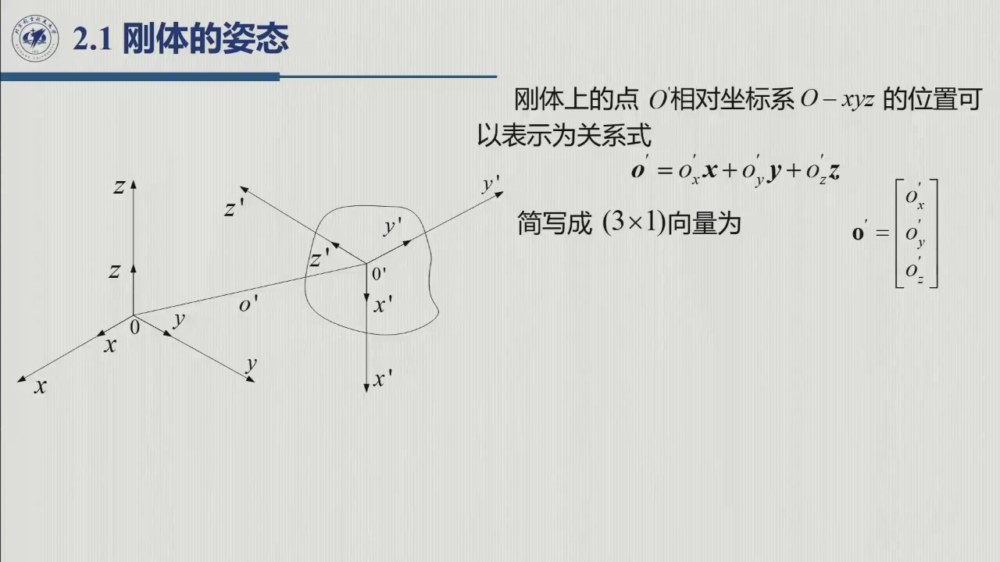
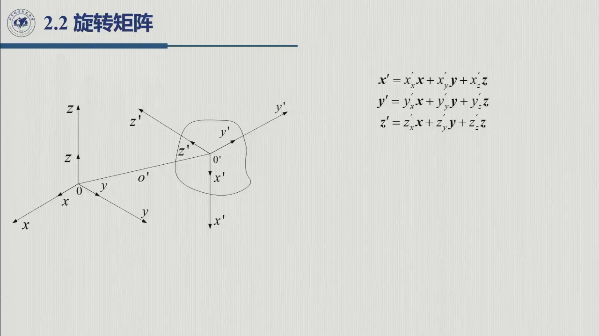

# 2.1 刚体的姿态

要描述机器人，第一步是学会描述**一个刚体**。刚体在空间中的完整描述 = **位置**（参考点坐标）+ **姿态**（固连坐标系三根轴的指向），二者合称**位姿**。本节给出这两半的数学写法——其中姿态那一半，正是 2.2 节旋转矩阵的定义来源。录播对应第 1 周 1:56–2:01（幻灯片 07016 / 07208）。

<aside class="lesson-brief" aria-label="2.1 学习简报">

PREREQUISITE<strong>你需要先会</strong>
空间直角坐标系与向量表示；单位向量、投影（点积）的几何含义。

TARGET<strong>本节要建立</strong>
位姿的两半概念；位置向量 $\boldsymbol o'$ 的写法；用**方向余弦**完整描述姿态（原书式 2.1–2.2）。

CHECKPOINT<strong>学完的标准</strong>
能说清「为什么只有位置不足以确定刚体」；能写出固连系三轴在参考系中的展开式并指出每个系数是什么。

</aside>

## 2.1.1 位姿与位置的描述

::: def 定义 2.1.1 · 位姿（pose） {#def-2.1.1}
**刚体**（rigid body）可由其在空间中相对参考坐标系 $O\text{-}xyz$ 的**位置**与**方向**（orientation，又称姿态）完整描述，二者合称**位姿**（position and orientation）。位置占 3 个数、姿态需要 3 个独立角度，合起来正是「6 个数」——这一直觉在 [1.2.1](../ch01/sec1-2.md#sec-1.2.1) 的六自由度判据里已经见过。
:::

令 $O\text{-}xyz$ 为标准正交参考坐标系，$\boldsymbol x,\boldsymbol y,\boldsymbol z$ 为三轴单位向量。刚体上取一点 $O'$ 作为参考点（图 2.1），其位置可沿三轴分解：

$$\boldsymbol o'=o'_x\boldsymbol x+o'_y\boldsymbol y+o'_z\boldsymbol z,\qquad
\boldsymbol o'=\begin{bmatrix}o'_x\\ o'_y\\ o'_z\end{bmatrix}\in\mathbb{R}^3\qquad(\text{原书式 }2.1)$$

::: note 为什么 $\boldsymbol o'$ 是「有界向量」
它自带作用点与作用线（从原点 $O$ 指向 $O'$），因此不同于自由向量——后者只有方向与模长。原书特别点出了这一区别；后续做「向量的坐标变换」时，点与自由向量的区别就体现在要不要叠加平移（这正是 [2.7](sec2-7.md) 引入齐次变换的动机）。
:::

## 2.1.2 姿态与方向余弦

只有位置还不够——刚体绕该点还能任意转向。为描述指向，在刚体上**固连**一个标准正交坐标系 $O'\text{-}x'y'z'$（原点取在 $O'$），再把它的三根轴单位向量 $\boldsymbol x',\boldsymbol y',\boldsymbol z'$ 用参考系的三轴展开：

$$\begin{aligned}
\boldsymbol x' &= x'_x\boldsymbol x+x'_y\boldsymbol y+x'_z\boldsymbol z\\
\boldsymbol y' &= y'_x\boldsymbol x+y'_y\boldsymbol y+y'_z\boldsymbol z\\
\boldsymbol z' &= z'_x\boldsymbol x+z'_y\boldsymbol y+z'_z\boldsymbol z
\end{aligned}\qquad(\text{原书式 }2.2)$$

::: thm 原理 2.1.A · 9 个系数即方向余弦 {#thm-2.1.A}
式 2.2 中的每个系数都是**方向余弦**：例如 $x'_y=\boldsymbol x'\cdot\boldsymbol y=\cos\angle(\boldsymbol x',\boldsymbol y)$，就是固连系某根轴与参考系某根轴夹角的余弦（录播：「它就是两个单位向量做点积」）。
又因单位向量模长为 1、三轴两两垂直，这 9 个方向余弦并不独立——**只有 3 个独立**（[@note-2.2.2] 的账本，下一节展开）。
:::

看下图，两图对照着看：左图把位置向量 $\boldsymbol o'$ 沿三根参考轴拆成 **3 个系数**；右图对固连系的一根轴 $\boldsymbol x'$ 做同样的事——每个系数都是它在某根参考轴上的投影，这正是「方向余弦」的几何来源。

<figure>
<svg class="figure-svg" viewBox="0 0 920 340" xmlns="http://www.w3.org/2000/svg" role="img" aria-labelledby="fig-21-title fig-21-desc">
<title id="fig-21-title">位置分解与方向余弦分解</title>
<desc id="fig-21-desc">左图：位置向量 o′ 沿参考系三根轴分解为三个系数，虚线画出分解长方体。右图：固连系单位轴 x′ 同样沿三根参考轴分解，三个系数就是方向余弦；对 y′、z′ 重复同样分解共得 9 个数。</desc>
<defs>
<marker id="f21-m" markerWidth="9" markerHeight="9" refX="7" refY="3" orient="auto"><path d="M0,0 L7,3 L0,6 Z" fill="var(--muted)"/></marker>
<marker id="f21-b" markerWidth="9" markerHeight="9" refX="7" refY="3" orient="auto"><path d="M0,0 L7,3 L0,6 Z" fill="var(--fig-blue)"/></marker>
<marker id="f21-g" markerWidth="9" markerHeight="9" refX="7" refY="3" orient="auto"><path d="M0,0 L7,3 L0,6 Z" fill="var(--fig-gold)"/></marker>
<marker id="f21-n" markerWidth="9" markerHeight="9" refX="7" refY="3" orient="auto"><path d="M0,0 L7,3 L0,6 Z" fill="var(--fig-green)"/></marker>
<marker id="f21-p" markerWidth="9" markerHeight="9" refX="7" refY="3" orient="auto"><path d="M0,0 L7,3 L0,6 Z" fill="var(--fig-purple)"/></marker>
</defs>
<text class="diagram-text" x="240" y="40" text-anchor="middle">位置：参考点沿三轴分解（式 2.1）</text>
<text class="diagram-text" x="690" y="40" text-anchor="middle">姿态：固连系轴逐一分解（式 2.2）</text>
<g stroke="var(--line-strong)" stroke-width="1.3" marker-end="url(#f21-m)">
<line x1="240" y1="268" x2="405" y2="313"/>
<line x1="240" y1="268" x2="162" y2="223"/>
<line x1="240" y1="268" x2="240" y2="96"/>
</g>
<text class="diagram-note" x="414" y="322">x</text>
<text class="diagram-note" x="150" y="220" text-anchor="end">y</text>
<text class="diagram-note" x="232" y="90" text-anchor="end">z</text>
<g stroke="var(--line)" stroke-dasharray="4 4" fill="none">
<line x1="348" y1="297" x2="311" y2="276"/><line x1="348" y1="297" x2="348" y2="170"/>
<line x1="203" y1="247" x2="311" y2="276"/><line x1="203" y1="247" x2="203" y2="119"/>
<line x1="240" y1="141" x2="348" y2="170"/><line x1="240" y1="141" x2="203" y2="119"/>
<line x1="311" y1="276" x2="311" y2="148"/><line x1="348" y1="170" x2="311" y2="148"/><line x1="203" y1="119" x2="311" y2="148"/>
</g>
<circle class="diagram-node" cx="240" cy="268" r="4"/>
<line stroke="var(--fig-gold)" stroke-width="1.8" marker-end="url(#f21-g)" x1="240" y1="268" x2="348" y2="297"/>
<line stroke="var(--fig-green)" stroke-width="1.8" marker-end="url(#f21-n)" x1="240" y1="268" x2="203" y2="247"/>
<line stroke="var(--fig-purple)" stroke-width="1.8" marker-end="url(#f21-p)" x1="240" y1="268" x2="240" y2="141"/>
<line stroke="var(--fig-blue)" stroke-width="2.6" marker-end="url(#f21-b)" x1="240" y1="268" x2="311" y2="148"/>
<text class="diagram-text" fill="var(--fig-gold)" x="356" y="302">o′<tspan class="sb">x</tspan></text>
<text class="diagram-text" fill="var(--fig-green)" x="196" y="244" text-anchor="end">o′<tspan class="sb">y</tspan></text>
<text class="diagram-text" fill="var(--fig-purple)" x="248" y="136">o′<tspan class="sb">z</tspan></text>
<text class="diagram-text" fill="var(--fig-blue)" x="300" y="140" text-anchor="end">o′</text>
<g stroke="var(--line)" stroke-dasharray="4 4" fill="none">
<line x1="805" y1="299" x2="772" y2="280"/><line x1="805" y1="299" x2="805" y2="250"/>
<line x1="656" y1="249" x2="772" y2="280"/><line x1="656" y1="249" x2="656" y2="199"/>
<line x1="690" y1="219" x2="805" y2="250"/><line x1="690" y1="219" x2="656" y2="199"/>
<line x1="772" y1="280" x2="772" y2="230"/><line x1="805" y1="250" x2="772" y2="230"/><line x1="656" y1="199" x2="772" y2="230"/>
</g>
<circle class="diagram-node" cx="690" cy="268" r="4"/>
<line stroke="var(--fig-gold)" stroke-width="1.8" marker-end="url(#f21-g)" x1="690" y1="268" x2="805" y2="299"/>
<line stroke="var(--fig-green)" stroke-width="1.8" marker-end="url(#f21-n)" x1="690" y1="268" x2="656" y2="249"/>
<line stroke="var(--fig-purple)" stroke-width="1.8" marker-end="url(#f21-p)" x1="690" y1="268" x2="690" y2="219"/>
<line stroke="var(--fig-blue)" stroke-width="2.6" marker-end="url(#f21-b)" x1="690" y1="268" x2="772" y2="230"/>
<text class="diagram-text" fill="var(--fig-blue)" x="782" y="224">x′</text>
<text class="diagram-text" fill="var(--fig-gold)" x="812" y="308">x′<tspan class="sb">x</tspan> = x′·x</text>
<text class="diagram-text" fill="var(--fig-green)" x="648" y="246" text-anchor="end">x′<tspan class="sb">y</tspan> = x′·y</text>
<text class="diagram-text" fill="var(--fig-purple)" x="698" y="212">x′<tspan class="sb">z</tspan> = x′·z</text>
<text class="diagram-note" x="240" y="334" text-anchor="middle">位置 = 3 个系数（有界向量：有作用点 O）</text>
<text class="diagram-note" x="690" y="334" text-anchor="middle">对 y′、z′ 重复同样分解 → 9 个系数 = 9 个方向余弦</text>
</svg>
<figcaption>方向余弦的几何来源（本教程绘）：固连系每根轴在参考系三轴上的投影给出三个系数，三根轴共 9 个——单位模长与两两垂直把这 9 个数的独立自由度压到 3 个（[@thm-2.1.A]）。</figcaption>
</figure>

于是，把这 9 个数按列排成（3×3）矩阵，就得到下一节的**旋转矩阵** $R$（原书式 2.3）——本节只立概念，矩阵的性质与运算全部留给 [2.2](sec2-2.md)。

::: think 默写点 · 合上书再写（主动回忆）

不看正文与速查卡，先写出下面几条，再展开核对。写不出来就说明这一节还没「拿走」。

1. 位姿由哪两半组成？各几个独立变量？
2. 9 个方向余弦为什么只有 3 个独立？
3. 给出刚体上一点的位置，是否就确定了它的位姿？

::: sol 核对

位置（3）+ 姿态（3）。

$R$ 的 9 个元素受正交条件 $R^{\mathrm T}R=I$（6 个独立约束），剩 3 个。

不能。绕该点还剩三个转动自由度，姿态必须另外描述。

:::

:::

## 2.1 小结与常见错误

- **一条主线**：位姿 = 位置（参考点 3 个坐标，式 2.1）+ 姿态（固连系三轴在参考系中的 9 个方向余弦，式 2.2）；后者只有 3 个独立量。
- **一个区分**：$\boldsymbol o'$ 是有界向量（点），不是自由向量——涉及不同原点时必须补平移。

::: think 常见错误清单 · 自查两条
1. 以为给出原点位置就等于确定了刚体——绕该点还剩三个转动自由度，姿态必须另外描述；
2. 把方向余弦说成「夹角」——它是**夹角的余弦**，取值 $[-1,1]$，符号携带朝向信息。
:::
