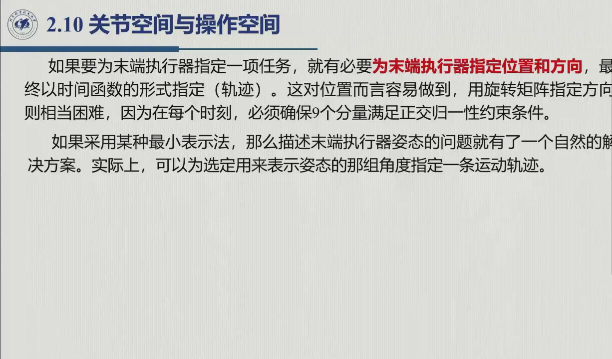

# 2.10 关节空间与操作空间

上一节从[关节变量](../recall.md#joint)算出了末端位姿。现在反过来问：若任务是“笔尖到这里”，和“笔尖到这里，并朝向这个角度”，对同一台机械手的要求有什么不同？本节先区分关节、位姿与任务的维数，再用两连杆臂看可达区域，最后解释多出来的关节自由度能做什么。

## 2.10.1 两个空间与正逆映射

图中提到旋转矩阵的 9 个分量都要满足正交归一条件。准确说，$R^{\mathrm T}R=I$ 给出 **6 个独立约束**（三列单位长度、三对列正交），再用 $\det R=+1$ 选出旋转这一分支。因此姿态只有 3 个局部独立自由度。欧拉角便于指定任务，但沿用 [§2.4](sec2-4.md) 的分支与奇异条件；旋转矩阵仍适合连乘、插值及检验。

::: def 定义 2.10.1 · 操作空间与关节空间 {#def-2.10.1}
**关节空间** $\mathcal Q$：所有允许的独立关节变量组合。对开链单自由度关节，用

$$\boldsymbol q=[q_1\ \cdots\ q_n]^T\qquad(\text{原书式 }2.81)$$

作局部坐标；R 关节用转角，P 关节用位移。有限限位可给出区间；无转数限制的理想 R 关节，其几何角度按整圈等价，属于圆 $S^1$。因此 $\mathcal Q$ 一般是区间、圆等的积，不能一概当成全局 $\mathbb R^n$。若系统还记录转数，须另保留该状态。

**操作空间**描述末端的位姿。选定适合结构的局部最小坐标后，可写为

$$\boldsymbol x_e=\begin{bmatrix}\boldsymbol p_e\\\boldsymbol\phi_e\end{bmatrix},\qquad
\boldsymbol x_e=k(\boldsymbol q)\qquad(\text{原书式 }2.80,\ 2.82).$$

本节用 $m$ 表示**与结构相适配的完整末端位姿的局部独立维数**，用 $r\le m$ 表示某项任务的独立约束维数。例如平面臂的完整位姿是 $(p_x,p_y,\phi)$，$m=3$；只指定位置时任务维数 $r=2$。一般空间位姿是 6 维，但即使一台两轴臂也可输出三个位置坐标和三个姿态坐标；这些**表示分量数**不等于它能独立控制的维数。不能据“用了 6 个数”就认定 $m=6$、或认为有 $n\ge6$。
:::

::: note 姿态可以显式提取，最小坐标有局部边界 {#note-2.10.k}
DH 连乘给出 $T_e^b(\boldsymbol q)$ 的有限三角表达式。位置从第 4 列读取；方向也可以在选定分支的非奇异区域，用 [§2.4.4](sec2-4.md#sec-2.4.4) 的 Atan2 公式显式提取。例如 ZYZ 的 $\sin\vartheta>0$ 分支有

$$\varphi=\operatorname{Atan2}(r_{23},r_{13}),\quad
\vartheta=\operatorname{Atan2}\!\left(\sqrt{r_{13}^2+r_{23}^2},r_{33}\right),\quad
\psi=\operatorname{Atan2}(r_{32},-r_{31}).$$

这里 $r_{ij}=r_{ij}(\boldsymbol q)$。这就是局部显式的姿态函数；问题在于不存在覆盖整个 $SO(3)$ 的一套全局光滑、无奇异的三参数坐标。原书关于一般方向分量不能写成封闭式的措辞，在此按上述局部条件理解。姿态坐标跳变或退化不代表 $T_e^b$ 的正解失效。
:::

::: ex 例 2.5（原书）· 三连杆平面臂的显式 $k(\boldsymbol q)$ {#ex-book-2.5}
平面内完整位姿只需 $[p_x\ p_y\ \phi]^T$，$m=n=3$。由 [§2.9.1](sec2-9.md#sec-2.9.1) 得

$$\boldsymbol x_e=k(\boldsymbol q)=\begin{bmatrix}a_1c_1+a_2c_{12}+a_3c_{123}\\a_1s_1+a_2s_{12}+a_3s_{123}\\\vartheta_1+\vartheta_2+\vartheta_3\end{bmatrix}.$$

其中 $c_{12}=\cos(\vartheta_1+\vartheta_2)$，其余同理；$\phi$ 按整圈等价。取 $a=(1,1,0.5)$ m、$\boldsymbol q=(0,\pi/2,-\pi/2)$，得到 $\boldsymbol p=(1.5,1)$ m、$\phi=0$。若只指定位置，第三个任务条件就被释放了；它是否产生连续自运动，还要检查位形与限位。
:::

## 2.10.2 工作空间

::: def 定义 2.10.2 · 可达工作空间与灵活工作空间 {#def-2.10.2}
先固定研究的参考点，例如工具中心点 TCP（tool center point，即工具坐标系原点），以及允许的关节域 $\mathcal Q$。

- **可达工作空间**：$\mathcal W_R=\{\boldsymbol p_e(\boldsymbol q):\boldsymbol q\in\mathcal Q\}$。一个点只需存在一种允许的末端方向。
- **灵活工作空间**：对规定的方向集合 $\mathcal O_{\rm req}$，其中每一种方向都能在该点实现。平面完整定向用 $\mathcal O_{\rm req}=S^1$，空间完整定向用 $SO(3)$；只要求某个接近轴方向是另一种任务。

因此 $\mathcal W_D\subseteq\mathcal W_R$。位置可达不保证指定的姿态也可达，更不保证从当前位形存在一条满足限位、避障等要求的连续路径。
:::

若 $\mathcal Q$ 是**有限闭区间的乘积**，它紧且连通；连续的位置映射便使 $\mathcal W_R$ 紧（在欧氏位置空间中即闭且有界）且连通。条件不能省：无界 P 行程可给出无界工作空间；开放限位未必给出闭集；碰撞约束或闭链装配分支可能把允许位形分开。连通也不排除中间有洞。

边界由机械几何、限位与约束共同决定。平面、球面、环面、柱面是一些典型模型中的元素，不能穷尽一般机械手。阅读厂商俯视图、侧视图时，先核对参考点在法兰还是 TCP、工具尺寸、姿态、负载与关节限制；两张投影视图也未必能唯一确定完整三维区域。

::: ex 例 2.6（原书作图思路的补充）· 两连杆平面臂 {#ex-book-2.6}
关节限位给出 $\mathcal Q=[q_1^m,q_1^M]\times[q_2^m,q_2^M]$。整个矩形中的点都要映射，**工作空间是整个域的像**。为寻找轮廓，既要看关节域的边界，也要看域内的位置映射退化集合。

对两杆长度 $a_1,a_2>0$，

$$p_x=a_1\cos q_1+a_2\cos(q_1+q_2),\qquad
p_y=a_1\sin q_1+a_2\sin(q_1+q_2).$$

其位置雅可比行列式为 $a_1a_2\sin q_2$。因此 $q_2=0,\pm\pi$ 是临界候选；其中 $q_2=0$ 在 $q_1$ 横轴、$q_2$ 纵轴图中是**水平线段**，可在限位矩形内部。原书例 2.6 的线段 $ad$ 表示伸直位形；本教程下图另用全转关节例说明，未照搬原书图 2.30 的限位轮廓。

先看两关节均允许全转、忽略碰撞的情况：工作空间为完整圆环。由

$$\rho^2=p_x^2+p_y^2=a_1^2+a_2^2+2a_1a_2\cos q_2$$

得 $|a_1-a_2|\le\rho\le a_1+a_2$。取 $a_1=1$ m、$a_2=0.6$ m，便是 $0.4\le\rho\le1.6$ m；$q_2=0$ 映到外圆，$q_2=\pm\pi$ 映到内圆。全转角的 $q_1=-\pi,+\pi$ 是同一条接缝，其像通常位于圆环内部。因此**边界候选的像不全是最终轮廓**。
:::

下图先读左边：蓝色代表整个关节域，水平虚线在域内。右边填充的是整个位置像，两个不同的关节组合可映到同一个点 P；正负 $q_2$ 标记两种肘分支，避免用受视角影响的“朝上、朝下”认号。

<figure>
<svg class="figure-svg" viewBox="0 0 920 350" xmlns="http://www.w3.org/2000/svg" role="img" aria-labelledby="fig-210-title fig-210-desc">
<title id="fig-210-title">全转两连杆臂：整个关节域映成圆环</title>
<desc id="fig-210-desc">左图两轴角度从负 pi 到正 pi，q2=0 是矩形内部水平线，其像是右图外圆。q2=正负 pi 映到内圆。左右竖边是全转角接缝，像不必是工作空间边界。右图两组杆长相同的位形到达同一点 P。</desc>
<text class="diagram-text" x="235" y="28" text-anchor="middle">关节域 Q：两角均允许全转</text>
<text class="diagram-text" x="705" y="28" text-anchor="middle">位置像：0.4 ≤ ρ ≤ 1.6 m</text>
<rect x="100" y="65" width="270" height="220" fill="var(--fig-blue)" fill-opacity=".10" stroke="var(--line-strong)"/>
<line x1="100" y1="175" x2="370" y2="175" stroke="var(--accent)" stroke-width="2.5" stroke-dasharray="7 5"/>
<text class="diagram-text" x="235" y="112" text-anchor="middle">q₂ &gt; 0 分支</text>
<text class="diagram-text" x="235" y="243" text-anchor="middle">q₂ &lt; 0 分支</text>
<text class="diagram-note" x="235" y="165" text-anchor="middle">q₂ = 0 → 外圆</text>
<text class="diagram-text" x="83" y="70" text-anchor="end">+π</text>
<text class="diagram-text" x="83" y="180" text-anchor="end">0</text>
<text class="diagram-text" x="83" y="290" text-anchor="end">−π</text>
<text class="diagram-text" x="83" y="48" text-anchor="end">q₂</text>
<text class="diagram-text" x="100" y="309" text-anchor="middle">−π</text>
<text class="diagram-text" x="370" y="309" text-anchor="middle">+π</text>
<text class="diagram-text" x="396" y="309">q₁</text>
<text class="diagram-note" x="235" y="338" text-anchor="middle">左右边按角度周期拼接；上下边映到内圆</text>
<text class="diagram-text" x="480" y="157" text-anchor="middle">p(q)</text>
<path d="M420 180 H530 L520 173 M530 180 L520 187" stroke="var(--line-strong)" stroke-width="1.8" fill="none"/>
<path d="M817 185 A112 112 0 1 1 593 185 A112 112 0 1 1 817 185 Z M733 185 A28 28 0 1 0 677 185 A28 28 0 1 0 733 185 Z" fill="var(--fig-blue)" fill-opacity=".10" stroke="var(--accent)" fill-rule="evenodd"/>
<path d="M705 185 L775 185 L775 143" fill="none" stroke="var(--fig-gold)" stroke-width="2.6"/>
<path d="M705 185 L737.941176 123.235294 L775 143" fill="none" stroke="var(--fig-blue)" stroke-width="2.6"/>
<circle cx="705" cy="185" r="4" fill="var(--ink)"/>
<circle cx="775" cy="143" r="5" fill="var(--accent)"/>
<text class="diagram-text" x="792" y="135">P</text>
<text class="diagram-note" x="705" y="62" text-anchor="middle">q₂ = 0：ρ = 1.6 m</text>
<text class="diagram-note" x="705" y="319" text-anchor="middle">q₂ = ±π：ρ = 0.4 m</text>
<text class="diagram-note" x="705" y="340" text-anchor="middle">两种肘分支映到同一个 P</text>
</svg>
<figcaption>全转、无障碍的教学例，杆长 1 m 与 0.6 m。上、下边和内部零线给出圆环边界；不能据此把任意限位矩形都画成整圆环。</figcaption>
</figure>

::: think 操作任务 · 哪些线真的围住可达区域？
先预测，再操作下方演示：

1. 选“全转”，把 $q_2$ 设为 $0°$；扫 $q_1$，检查 $\rho$ 是否一直为 1.600 m。再把 $q_2$ 设为 $180°$，应为 0.400 m。
2. 选“肘限位”：$q_1\in[-180°,180°]$、$q_2\in[30°,150°]$。先用半径公式算内、外径，再看读数；这次边界来自限位，不包含伸直位形。
3. 选“双关节限位”：$q_1\in[-60°,60°]$、$q_2\in[-120°,120°]$。为什么右图不再是整圆环？比较橙色关节域边界的像、红色临界集合的像和蓝色内部样本，找一段落在样本内部的候选线。

图中蓝点是 $73\times73$ 网格的映射，不能用散点缝隙证明“不可达”。橙线是关节域边界的像；红线是域内 $\sin q_2=0$ 的临界候选。数值读数对应当前所选位形，工具不计算碰撞或路径。
:::

::: note 不运行脚本也能核对
全转时为 $[0.4,1.6]$ m。只限制肘角到 $[30°,150°]$，且肩角仍全转时，半径范围为

$$\sqrt{1.36-0.6\sqrt3}\le\rho\le\sqrt{1.36+0.6\sqrt3},\qquad
0.5664\le\rho\le1.5489\ \mathrm m\quad(\text{约数}).$$

肩角不能全转后，半径全域仍不能单独描述整个区域，还须核对各半径上的方位覆盖。
:::

两轴平面臂一般位置只有离散的肘分支，不能在同一普通点上任取平面朝向。作为对照，理想全转、无障碍的三连杆平面臂 $a=(1,1,0.5)$ m，其可达位置是半径 2.5 m 的圆盘，能实现**所有平面朝向**的灵活工作空间则是半径 1.5 m 的圆盘：给定朝向 $\phi$，前两杆只需到达腕点 $\boldsymbol w=\boldsymbol p-0.5[\cos\phi,\sin\phi]^T$；两根等长杆能到达半径 $[0,2]$，所以“所有 $\phi$ 都可行”等价于 $\|\boldsymbol p\|+0.5\le2$。此结论允许边界奇异位形；限位和障碍会改变集合。

::: note 精度与重复定位精度 · 用一组数据分开看 {#note-2.10.acc}
**定位精度**关注实际到达相对指令目标的偏差；**重复定位精度**关注相同条件下多次回访的散布。用一维自编数据说明：目标 $x=100.0$ mm，三次量测为 $100.8,101.0,101.2$ mm，均值为 $101.0$ mm。均值相对目标偏了 **1.0 mm**，各次相对均值的最大偏差只有 **0.2 mm**。小散布可以和大目标偏差同时出现；这里的最大偏差是示范统计量，不冒充厂商标准的重复精度指标。

比较真实规格须统一测试姿态、负载、速度、温度、接近路径和统计方法。DH 尺寸与零位偏差可产生系统误差，柔性、热漂、传感器和控制也会影响结果。[下一节的标定](sec2-11.md) 可降低模型能解释的系统偏差，不能保证消除随机散布或全部非几何误差。示教再现尤其关心回访一致性；离线指定绝对坐标还要重视定位精度。
:::

## 2.10.3 运动学冗余

::: def 定义 2.10.3 · 冗余相对任务而言 {#def-2.10.3}
沿用本节的 $n,m,r$：独立关节数、结构适配的完整位姿维数、任务独立约束维数。

- **本质冗余**：$n>m$，即便指定完整位姿，关节变量仍多于所需的独立位姿变量。
- **功能冗余**：任务放松部分位姿要求，$r<m$；例如 $n=m=3$ 的平面 3R 臂只做位置任务，$r=2$。

对光滑任务映射，任务雅可比 $J_{\rm task}\in\mathbb R^{r\times n}$ 的[零空间](../recall.md#nullspace)包含不产生**一阶任务变化**的关节速度，其维数总是

$$\dim\mathcal N(J_{\rm task})=n-\operatorname{rank}J_{\rm task}.$$

正常位形下若任务行满秩，才可简写为 $n-r$。在无额外约束的正常点附近，这对应局部可连续选择的关节自由度；限位、碰撞与任务奇异可能阻止这样的有限运动。奇异点瞬时零空间变大，不能直接称为结构多了自由度。
:::

原书的例子可用同一口径判断：4R 平面臂 $n=4,m=3$ 是本质冗余；6 轴空间臂完整位姿任务 $m=r=6$ 时正常点不冗余，激光切割若允许绕工具轴自转不受约束，则任务为位置 3 维、轴方向 2 维，$r=5$，出现功能冗余。空间 7 轴臂的完整位姿维数通常为 6；“肩 3、肘 1、腕 3”的人臂模型也是一种理想化近似。

::: ex 定点自运动 · 先算到同一个点，再谈冗余 {#ex-2.10.self}
取无障碍、全转的平面 3R 臂 $a=(1,1,0.5)$ m，只要求 $\boldsymbol p=(1,0)$ m。任选末端朝向 $\phi$，令

$$\boldsymbol w=\begin{bmatrix}1-0.5\cos\phi\\-0.5\sin\phi\end{bmatrix},\quad
c_2=\frac{\|\boldsymbol w\|^2-2}{2},\quad
q_2=\arccos c_2,$$
$$q_1=\operatorname{Atan2}(w_y,w_x)-\operatorname{Atan2}(\sin q_2,1+\cos q_2),\qquad
q_3=\phi-q_1-q_2.$$

取正肘角分支：

| 选择的 $\phi$ | $q_1$ | $q_2$ | $q_3$ | 回代位置 |
|:--|--:|--:|--:|:--|
| $0°$ | $-75.5225°$ | $151.0450°$ | $-75.5225°$ | $(1,0)$ m |
| $90°$ | $-82.5772°$ | $112.0243°$ | $60.5529°$ | $(1,0)$ m |

用公式而非表中舍入角回代，位置误差只应有浮点舍入量。对 $0°\le\phi\le90°$，腕点半径在 $[0.5,\sqrt{1.25}]$ 内，前两杆一直可达且 $\sin q_2\ne0$，所以能连续改变朝向而保持尖端不动。若还指定 $\phi=0°$，这一自由选择就消失了。
:::

::: think 反例 · 瞬时不动，能否有限地动？
两根 1 m 的平面杆完全伸直，尖端在 $(2,0)$。这时位置雅可比为 $J=\left[\begin{smallmatrix}0&0\\2&1\end{smallmatrix}\right]$，零空间有方向 $(1,-2)^T$。但试取 $\boldsymbol q=(\varepsilon,-2\varepsilon)$，位置变为 $(2\cos\varepsilon,0)$，只在一阶近似下不变。由三角不等式，保持最远点 $(2,0)$ 必须两杆沿正 x 方向伸直，附近没有非平凡有限自运动。这是奇异退化，不能凭核维数 1 宣称这台 2R 臂冗余。
:::

冗余可用于避限位、避障或调整姿态，但不是可行性保证。某关节到达上限时，关节速度还须满足该关节不能继续增大的条件；必须同时存在满足任务、限位与碰撞约束的速度方向或路径，其余关节才可能补偿。[第 3 章](../ch03/overview.md) 会用雅可比与优化方法处理这些选择，最小关节速度范数也不等同于最小能量。

::: think 默写与独立练习 · 先写再展开 {#practice-2.10}
1. 解释 $n,m,r$，并指出“用 6 个数描述位姿”为什么不保证有 6 个可控维数。一般 DH 姿态正解能否显式写出？
2. 对演示的肘限位预设，独立算出内外径。$q_2=0$ 是对角线吗？整个工作空间是否仅由关节域周界映成？
3. 对三杆 $a=(1,1,0.5)$ m，点 $(2,0)$ 是否可达？要求所有平面朝向时是否灵活可达？分别取 $\phi=0°$ 和 $180°$ 检查腕点。
4. 把精度示例的每次量测都减去 1.0 mm，均值目标偏差与相对均值散布各变多少？这能否证明全部位姿都标定好了？
5. 例中 3R 定点任务的正常位形零空间几维？若加上朝向条件呢？伸直 2R 的瞬时核能否据此保证定点运动？

::: sol 核对与解释
1. $n$ 为独立关节数，$m$ 为结构适配的完整位姿局部独立维数，$r$ 为任务独立约束维数。输出分量间可以有约束。DH 矩阵可显式连乘，欧拉角可在分支非奇异区显式提取；局部坐标限制不等于一般正解无解析式。
2. 肘限位内外径约 $0.5664,1.5489$ m。$q_2=0$ 是水平线，未包含在此预设中；全转预设下它在域内并映成外圆。工作空间是整个域的像，边界要核关节域边界与内部临界候选，再判断哪些是外露轮廓。
3. 位置可达。$\phi=0°$ 时 $\boldsymbol w=(1.5,0)$ 可达，$\phi=180°$ 时 $\boldsymbol w=(2.5,0)$ 超出前两杆的 2 m。故不能实现所有朝向，不在半径 1.5 m 的灵活圆盘内。
4. 校正后量测为 $99.8,100.0,100.2$ mm，均值目标偏差为 0，最大散布仍为 0.2 mm。这只校正这组数据的常值偏差，不能推出全工作空间、其他载荷和温度下都准确。
5. 正常点位置任务 $n-r=3-2=1$；完整位姿任务行满秩时为 0。伸直 2R 的核来自降秩，二阶位移反例说明它不保证有限定点自运动。
:::
:::

## 2.10 小结与常见错误

- 关节空间经过正运动学映到末端位姿；最小坐标是局部工具。先说任务要求，再数独立约束。
- 可达位置是整个允许关节域的像；灵活性还须对指定方向集合逐一满足。位置可达、姿态可达、路径可行要分别检查。
- 正常点的任务冗余自由度为 $n-r$；一般瞬时核维数为 $n-\operatorname{rank}J_{\rm task}$。不能把奇异退化当成可用自运动。
- 小重复散布不保证小目标偏差。下一节把标称几何与真实量测放到一起，讨论能被运动学标定解释和修正的误差。
