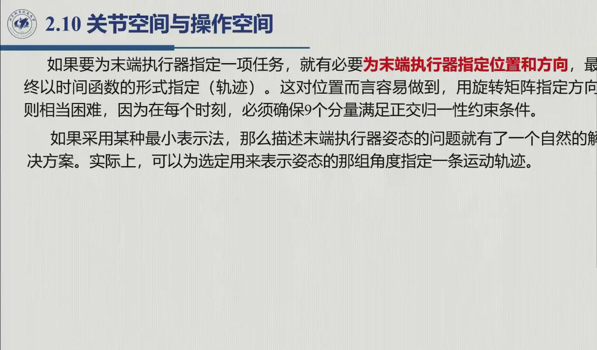

# 2.10 关节空间与操作空间

这一节给正运动学两端的空间命名，并刻画它们的维数关系与边界——它是任务指定（第 4 章）、冗余分析（第 3 章）与性能指标共同的骨架。录播 1:35:10–1:49:32（1:37–1:42 为课堂练习段）。

## 2.10.1 两个空间与正逆映射

给末端指定任务，就是指定它位置和方向的轨迹。如果用旋转矩阵直接指定方向，**每时每刻都要满足 9 个分量的正交归一约束**，太笨拙（录播 1:42:51：「写成 $T$ 不直观……自然想到用欧拉角」）。于是自然改用最简表示：

::: def 定义 2.10.1 · 操作空间与关节空间 {#def-2.10.1}
**操作空间**（operational space）：末端执行器位姿向量

$$\boldsymbol x_e=\begin{bmatrix}\boldsymbol p_e\\ \boldsymbol\phi_e\end{bmatrix}\in\mathbb{R}^m\qquad(\text{原书式 }2.80)$$

其中 $\boldsymbol\phi_e$ 是选定的欧拉角（$m\le n$）。**关节空间**（joint space，位形空间）：关节变量向量

$$\boldsymbol q=[q_1\ \cdots\ q_n]^T\in\mathbb{R}^n\qquad(\text{原书式 }2.81)$$

（转动关节 $q_i=\vartheta_i$，移动关节 $q_i=d_i$）。正运动学写成（原书式 2.82）

$$\boldsymbol x_e=k(\boldsymbol q),$$

$k(\cdot)$ 一般是**非线性**向量函数。
:::

::: note 解析式一般写不出（原书；录播 1:45:18–1:46:51） {#note-2.10.k}
$k(\boldsymbol q)$ 的**位置分量**好办（$T_e^b$ 第 4 列），**方向分量** $\boldsymbol\phi_e(\boldsymbol q)$ 在 $m=6$ 的一般情形没有封闭形式——只能先算 $\boldsymbol n_e,\boldsymbol s_e,\boldsymbol a_e$，再用 [2.4.4](sec2-4.md#sec-2.4.4) 的 Atan2 公式反解。「可不可以写成 $\boldsymbol x_e=k(\boldsymbol q)$？可以……但解析的本来式写不出来，写成 $T$ 的就可以。」只有最简单的结构是例外，见下例。
:::

::: ex 例 2.5（原书）· 三连杆平面臂的显式 $k(\boldsymbol q)$ {#ex-book-2.5}
平面臂任务只需 $[p_x\ p_y\ \phi]^T$（$m=3=n$），由 [2.9.1](sec2-9.md#sec-2.9.1) 式 2.63 直接读出：

$$\boldsymbol x_e=k(\boldsymbol q)=\begin{bmatrix}a_1c_1+a_2c_{12}+a_3c_{123}\\ a_1s_1+a_2s_{12}+a_3s_{123}\\ \vartheta_1+\vartheta_2+\vartheta_3\end{bmatrix}.$$

三个关节变量至多能指定 3 个独立操作变量；若任务只要位置 $\boldsymbol x_e=[p_x\ p_y]^T$，就出现自由度的运动学冗余（下一小节）。
:::

## 2.10.2 工作空间

::: def 定义 2.10.2 · 可达工作空间与灵活工作空间 {#def-2.10.2}
**工作空间**：所有关节做一切可能运动时，末端执行器坐标系**原点**扫过的区域。
- **可达工作空间**（reachable）：至少能从**一个**方向到达的点的集合；
- **灵活工作空间**（dexterous）：能从**任意**方向到达的点的集合。

显然有灵活工作空间 ⊆ 可达工作空间。自由度小于 6 的机械手，无法在空间中任意地定位 + 定向（原书）。
:::

从数学上看，可达工作空间是 $\boldsymbol p_e(\boldsymbol q)$ 在关节限位盒子 $q_i^{m}\le q_i\le q_i^{M}$ 下的像。作为连续函数的像，它**有界、闭合、连通**；边界曲面则由**平面、球形、环形、圆柱形**的曲面元素拼成，这些形状正是转动 / 移动关节的产物。厂商数据手册上的俯视图 + 侧视图，画的就是它（不含末端执行器）。

::: ex 例 2.6（原书）· 两连杆平面臂的工作空间作图法 {#ex-book-2.6}
关节空间是矩形 $[q_1^m,q_1^M]\times[q_2^m,q_2^M]$（原书图 2.29）。可达工作空间则是该矩形**周界**在臂平面中的像，作法是沿矩形边界的线段 $ab,bc,cd,da,ae,ef,fd$ 逐段作图（原书图 2.30）。其中 $da$ 是对角线（把矩形分成两半），沿它臂与前臂**共线**（$q_2=0$），运动性能同样会损失——这正是后文（第 3 章）要讲的运动学奇异。每条线段扫出一段圆弧，共得弧 $AB,BC,CD,DA,AE,EF,FD$；**外轮廓 $CDAEFHC$** 围出可达工作空间。区域 $BCDAB$ 对应**肘朝下**姿态、$DAEFD$ 对应**肘朝上**姿态，两者之交（区域 $BADHB$）是两种姿态都能到达的部分。点 $a$、$d$ 处臂的姿态发生切换（$q_2>0$ 肘朝下、$q_2<0$ 肘朝上），这也是 [2.12.1](sec2-12.md#sec-2.12.1) 逆解双支的几何根源。
:::

例 2.6 的作图法可以浓缩成一张「左右对照」图：左边的关节空间矩形逐段扫出右边工作空间的边界弧。其中 $q_2=0$ 的对角线对应外轮廓（两杆共线伸直），而肘上 / 肘下两支解对应同一点的两条到达路径。

<figure>
<svg class="figure-svg" viewBox="0 0 920 360" xmlns="http://www.w3.org/2000/svg" role="img" aria-labelledby="fig-210-title fig-210-desc">
<title id="fig-210-title">关节空间矩形与可达工作空间的对应</title>
<desc id="fig-210-desc">左图：关节空间是 q1、q2 平面上的矩形，q2=0 的对角线把矩形分成肘朝下（q2 大于 0）与肘朝上（q2 小于 0）两半。右图：两连杆臂的可达工作空间是半径 |a1−a2| 到 a1+a2 的圆环，同一工作空间内的点 P 可由肘上、肘下两支姿态到达。</desc>
<defs>
<marker id="f210-m" markerWidth="9" markerHeight="9" refX="7" refY="3" orient="auto"><path d="M0,0 L7,3 L0,6 Z" fill="var(--muted)"/></marker>
<marker id="f210-g" markerWidth="8" markerHeight="8" refX="6" refY="2.5" orient="auto"><path d="M0,0 L6,2.5 L0,5 Z" fill="var(--fig-gold)"/></marker>
<marker id="f210-b" markerWidth="8" markerHeight="8" refX="6" refY="2.5" orient="auto"><path d="M0,0 L6,2.5 L0,5 Z" fill="var(--fig-blue)"/></marker>
</defs>
<text class="diagram-text" x="245" y="36" text-anchor="middle">关节空间：矩形（原书图 2.29）</text>
<text class="diagram-text" x="690" y="36" text-anchor="middle">可达工作空间：矩形边界的像（原书图 2.30）</text>
<g stroke="var(--line-strong)" stroke-width="1.3" marker-end="url(#f210-m)">
<line x1="70" y1="290" x2="420" y2="290"/>
<line x1="70" y1="290" x2="70" y2="52"/>
</g>
<text class="diagram-text" fill="var(--ink-2)" x="428" y="295">q<tspan class="sb">1</tspan></text>
<text class="diagram-text" fill="var(--ink-2)" x="62" y="48" text-anchor="end">q<tspan class="sb">2</tspan></text>
<rect x="130" y="173" width="230" height="117" fill="var(--accent)" fill-opacity=".10" stroke="var(--line-strong)"/>
<line x1="130" y1="290" x2="360" y2="290" stroke="var(--accent)" stroke-width="2" stroke-dasharray="7 5"/>
<text class="diagram-note" fill="var(--accent-text)" x="245" y="283" text-anchor="middle">q<tspan class="sb">2</tspan> = 0：两杆共线（伸直，q<tspan class="sb">1</tspan> 扫出外弧）</text>
<text class="diagram-text" x="245" y="215" text-anchor="middle">肘朝下（q<tspan class="sb">2</tspan> &gt; 0）</text>
<text class="diagram-text" x="245" y="322" text-anchor="middle">肘朝上（q<tspan class="sb">2</tspan> &lt; 0）</text>
<text class="diagram-mono" x="130" y="306" text-anchor="middle">q<tspan class="sb">1</tspan><tspan class="sp">m</tspan></text>
<text class="diagram-mono" x="356" y="306" text-anchor="middle">q<tspan class="sb">1</tspan><tspan class="sp">M</tspan></text>
<text class="diagram-mono" x="60" y="177" text-anchor="end">q<tspan class="sb">2</tspan><tspan class="sp">M</tspan></text>
<text class="diagram-mono" x="60" y="333" text-anchor="end">q<tspan class="sb">2</tspan><tspan class="sp">m</tspan></text>
<text class="diagram-note" x="245" y="352" text-anchor="middle">沿矩形的每条边逐段作图 → 工作空间的边界弧</text>
<line x1="432" y1="196" x2="556" y2="196" stroke="var(--line-strong)" stroke-width="1.8" marker-end="url(#f210-m)"/>
<text class="diagram-note" x="494" y="184" text-anchor="middle">k(q) 逐点映射</text>
<path d="M 810 210 A 120 120 0 1 1 570 210 A 120 120 0 1 1 810 210 Z
         M 714 210 A 24 24 0 1 0 666 210 A 24 24 0 1 0 714 210 Z"
      fill="var(--accent)" fill-opacity=".10" stroke="var(--accent)" stroke-width="1.2" fill-rule="evenodd"/>
<text class="diagram-text" fill="var(--accent-text)" x="690" y="66" text-anchor="middle">R = a<tspan class="sb">1</tspan> + a<tspan class="sb">2</tspan>（q<tspan class="sb">2</tspan> = 0 的伸直弧）</text>
<line x1="690" y1="292" x2="690" y2="240" stroke="var(--line-strong)" stroke-width="1" marker-end="url(#f210-m)"/>
<text class="diagram-text" x="690" y="308" text-anchor="middle">r = |a<tspan class="sb">1</tspan> − a<tspan class="sb">2</tspan>|（折回 / 限位弧）</text>
<g stroke-width="2.6" fill="none">
<path stroke="var(--fig-gold)" marker-end="url(#f210-g)" d="M690 210 L768 211 L762 159"/>
<path stroke="var(--fig-blue)" marker-end="url(#f210-b)" d="M690 210 L716 136 L762 159"/>
</g>
<circle cx="768" cy="211" r="4" fill="var(--fig-gold)"/>
<circle cx="716" cy="136" r="4" fill="var(--fig-blue)"/>
<circle class="diagram-fill-accent" cx="762" cy="159" r="6"/>
<text class="diagram-text" x="778" y="152">P：两支解都能到</text>
<text class="diagram-text" fill="var(--fig-gold)" x="742" y="222">肘下</text>
<text class="diagram-text" fill="var(--fig-blue)" x="690" y="158">肘上</text>
<text class="diagram-note" x="690" y="352" text-anchor="middle">外轮廓 = 可达工作空间（厂商手册俯视图即此图；不含末端执行器）</text>
</svg>
<figcaption>关节空间 → 工作空间（本教程绘）：左边矩形的边界逐段映射为右边圆环的边界弧；$q_2=0$ 对角线对应外边界（也是第 3 章的运动学奇异），肘上 / 肘下两支解在边界点 a、d 处切换（[@ex-book-2.6]）。</figcaption>
</figure>

::: note 精度 vs 重复定位精度（原书；录播 1:47:40 老师：「这些你了解就行了」） {#note-2.10.acc}
- **精度**（accuracy）：指令位姿与实际到达位姿之差，源于 DH 参数与真实机械尺寸的偏差——量级一般小于 1 mm，并随工作空间位置变化（2.11 节的标定就是为压缩它）；
- **重复定位精度**（repeatability）：**回到先前到过的位置**的能力，取决于机械 + 传感器 + 控制器，通常比精度更小。以行程 1.5 m 的机械手为例：精度 0.2–1 mm，重复定位精度 0.02–0.2 mm。它是示教再现（第 6 章）的关键参数。
:::

## 2.10.3 运动学冗余

::: def 定义 2.10.3 · 冗余的两种用法 {#def-2.10.3}
- **本质冗余**（kinematically redundant）：$m<n$——关节空间维数超过任务位形空间维数；
- **功能冗余**：即便 $m=n$，特定任务只用 $r<m$ 个操作分量时也出现冗余。

关键在于，冗余是**相对任务而言**的：同一台机械手可能对此任务冗余、对彼任务却不冗余。它带来的工程红利是（原书）：当冗余机械手的某个关节**到达机械限位**时，其余关节可以「顶替」它继续完成同一末端运动——非冗余机械手则做不到。
:::

原书给了三个实例，正好覆盖两种冗余。三连杆平面臂只指定位置时是功能冗余（$n=m=3,r=2$），一旦加上方向，冗余随即消失；四自由度平面臂是本质冗余（$n=4,m=3$）；6 自由度机器人用于激光切割时，绕接近轴的自转与任务无关，于是 $r=5$，构成功能冗余。

::: intuition 为什么要故意造冗余机械手（原书 + 录播 1:48:01–1:49:32）
人臂就是 7 自由度（肩 3 + 肘 1 + 腕 3）：基座与手都固定之后，**肘还能动**——这份冗余可以用来避障、绕开奇异、优化姿态。老师举的实例是：**空间站机械臂就是七自由度**，「可以求最小范数、最小能量的解，甚至避障」。这套系统性的处理方法放在第 3 章。
:::

::: think 默写点 · 合上书再写（主动回忆）

先不看正文与速查卡，把下面几条默写出来，再展开核对。写不出来，就说明这一节还没真正「拿走」。

1. 写出 $\boldsymbol x_e=k(\boldsymbol q)$，并说明为什么方向分量一般写不出解析式。
2. 可达工作空间与灵活工作空间是什么关系？
3. 精度与重复定位精度分别是什么？哪个能靠标定改善？

::: sol 核对

$\boldsymbol x_e=k(\boldsymbol q)$：位置分量就是 $T_e^b$ 的第 4 列（好办）；方向分量在 $m=6$ 的一般情形**没有封闭形式**——只能先算 $\boldsymbol n_e,\boldsymbol s_e,\boldsymbol a_e$，再用 Atan2 反解欧拉角。

灵活工作空间 $\subseteq$ 可达工作空间：前者要求**任意方向**都能到达。

精度 = 指令位姿与真实位姿之差（**可标定改善**）；重复精度 = 多次回访同一点的散布（示教再现的命根，主要取决于机械重复性与编码器分辨率）。

:::

:::

## 2.10 小结与常见错误

- **一张地图**：关节空间 $\mathbb{R}^n$ —$k(\boldsymbol q)$→ 操作空间 $\mathbb{R}^m$，而任务只占其中的 $r$ 维；冗余由 $m<n$（本质）或 $r<m$（功能）判定。
- **两个工作空间**：可达 ⊇ 灵活；边界 = 平面 / 球 / 环 / 柱面拼图；手册视图 = 可达工作空间。

::: think 常见错误清单 · 自查三条
1. 把「末端原点的工作空间」当成「带姿态的工作空间」——定义 2.10.2 只看原点，只有灵活工作空间才涉及任意方向到达；
2. 认为 6 自由度机械手对任何任务都「刚好」——激光切割（$r=5$）就是功能冗余的日常反例；
3. 混淆精度与重复定位精度——前者对标称参数的偏差（可标定改善），后者对回访一致性（示教再现的命根）。
:::
