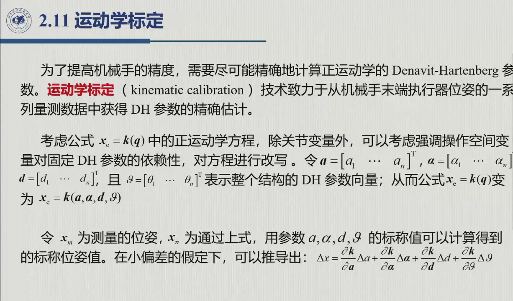

# 2.11 运动学标定

[DH](../recall.md#dh) 几何量有些可以直接测量，但装配公差、柔性、工具接口和传感器零位会让图纸值不能直接代表运行中的有效模型。**运动学标定**用末端位姿量测反推一组固定规范下可辨识的有效参数；它能降低模型可解释的系统误差，不能凭一次实验保证全工作空间准确。课程把它定位在「了解」层次（录播 1:51:03：「只讲一下基本原理」），本节对应录播区间 1:49:32–1:55:29。

::: preview 先修补 · 最小二乘（本节只用到这一条）

标定要用到的「超定方程最小二乘」，一句话就能说清：**方程数多于未知数、又没有精确解时，就取使残差平方和最小的那个解**。

$$\min_{\boldsymbol\xi}\|A\boldsymbol\xi-\boldsymbol b\|^2\ \Longrightarrow\ \boldsymbol\xi=(A^{\mathrm T}A)^{-1}A^{\mathrm T}\boldsymbol b$$

（推导思路：展开目标函数，对 $\boldsymbol\xi$ 求导并置零，即得**正规方程** $A^{\mathrm T}A\boldsymbol\xi=A^{\mathrm T}\boldsymbol b$；$A$ [列满秩](../recall.md#rank)时 $A^{\mathrm T}A$ 可逆。）式中的 $(A^{\mathrm T}A)^{-1}A^{\mathrm T}$ 是 $A$ 的左广义逆。它适合解释公式来源；实际程序优先用 QR 或 SVD，避免显式形成可能病态的 $A^{\mathrm T}A$。

不过有三点要提醒。① $A$ 必须**列满秩**；方程数多于未知数只是必要条件。② 位姿分量有长度和角度两种单位，需先选局部姿态残差并按噪声尺度加权。③ 上式只对**线性**问题能一步到位，而本节的 $k(\boldsymbol\xi)$ 是非线性的，因此必须迭代求解。

:::

## 2.11.1 问题设定

要做标定，先得把正运动学中隐含的参数显式写出来。固定 DH 规范、基座、工具和零位约定，令 $\boldsymbol\xi\in\mathbb R^p$ 表示真正要估的参数子集。教材把 $\boldsymbol a,\boldsymbol\alpha,\boldsymbol d,\boldsymbol\vartheta$ 四列暂列为 $4n$ 个上限项，但 R 行的 $\vartheta_i$、P 行的 $d_i$ 通常是当前关节读数，不是固定几何常数；若估计编码器零偏，应写成 $\vartheta_i=q_i+b_i$ 或 $d_i=q_i+b_i$，把 $b_i$ 单独列入。固定项、已知项和不可辨识的组合都应删去，实际未知数是 $p\le4n$。于是式 2.82 改写为

$$\boldsymbol x_e=k(\boldsymbol\xi,\boldsymbol q).$$

接下来还要引入两个位姿：$\boldsymbol x_m$ 为外部测量位姿，$\boldsymbol x_n=k(\boldsymbol\xi_0,\boldsymbol q)$ 为当前参数和关节读数算出的名义位姿。位置残差可直接用米或毫米；姿态残差应在选定的局部坐标中表达，例如相对旋转的旋转向量 $\operatorname{Log}(R_n^{\mathrm T}R_m)$，不要在欧拉角跨分支或奇异点时直接相减。两者的残差记为 $\boldsymbol r=\boldsymbol x_m-\boldsymbol x_n$；位置和姿态噪声不同则使用权重矩阵 $W$。这个残差较小，正是线性化假定的由来。

## 2.11.2 线性化、最小二乘与迭代

::: method 标定三步法（原书式 2.85–2.89） {#method-2.11.steps}
1. **线性化**：在当前参数附近一阶展开（录播 1:53:10 老师：「在标称值附近给它展开……整理之后得到了（下式）」）：

$$\boldsymbol r\approx\Phi_k\,\Delta\boldsymbol\xi,\qquad
\Phi_k=\frac{\partial\boldsymbol k}{\partial\boldsymbol\xi}(\boldsymbol\xi_k,\boldsymbol q),$$

其中 $\Phi_k$ 是 $m\times p$ 的**运动学标定矩阵**，即参数空间到所选残差坐标的雅可比；教材的 $m\times4n$ 是把所有上限项都列入的特例。堆叠 $t$ 个位形后，$\Phi_k^*\in\mathbb R^{tm\times p}$。这里要留意一个字母差异：英文原版把参数偏差记作 $\boldsymbol\zeta$，本编用 $\Delta\boldsymbol\xi$，以区别于关节变量 $\boldsymbol q$。

2. **超定量测 + 最小二乘**：算术条件是 $tm\ge p$，但还必须满足 $\operatorname{rank}(\Phi_k^*)=p$，并让最小奇异值不能太小。把各次残差堆叠起来（原书式 2.87 的子集形式），得 $\boldsymbol r^*\approx\Phi_k^*\,\Delta\boldsymbol\xi$，再取最小二乘解

$$\Delta\boldsymbol\xi=(\Phi_k^{*T}\Phi_k^*)^{-1}\Phi_k^{*T}\,\boldsymbol r^* ,$$

其中正规方程中的逆只用于推导；程序优先 QR/SVD，接近奇异时使用阻尼最小二乘。量测位形要铺开工作空间和姿态范围，不能只把样本数堆在一角。

3. **修正、验证 + 迭代**：参数按 $\boldsymbol\xi_{k+1}=\boldsymbol\xi_k+\Delta\boldsymbol\xi$ 更新（原书式 2.89）。每轮都用新参数重算 $\Phi_k^*$、名义位姿和残差，直到修正量与训练残差达到停止条件；再用未参与拟合的验证位形检查 RMS 和最大误差。修正量变小不等于真值恢复，验证误差变坏时应停止并检查模型、量测、权重和可辨识性。
:::

这三步串起来，并不是走一遍就结束——它本身就是一个**闭环**（见下图）：每转一轮，参数、线性化矩阵、残差三者同时刷新，再用独立位形验证。

<figure>
<svg class="figure-svg" viewBox="0 0 920 330" xmlns="http://www.w3.org/2000/svg" role="img" aria-labelledby="fig-211-t fig-211-d">
<title id="fig-211-t">运动学标定的迭代闭环</title>
<desc id="fig-211-d">四个节点依次为：正运动学算名义位姿、与量测作差、线性化加权最小二乘解参数偏差、参数更新；第四步经下方回路回到第一步，直到偏差收敛。</desc>
<defs>
<marker id="f211-m" markerWidth="9" markerHeight="9" refX="7" refY="3" orient="auto"><path d="M0,0 L7,3 L0,6 Z" fill="var(--muted)"/></marker>
</defs>
<text class="diagram-text" x="460" y="34" text-anchor="middle">运动学标定：一个迭代闭环</text>
<g fill="none" stroke="var(--line-strong)" stroke-width="1.8" marker-end="url(#f211-m)">
<line x1="226" y1="134" x2="266" y2="134"/>
<line x1="456" y1="134" x2="496" y2="134"/>
<line x1="686" y1="134" x2="726" y2="134"/>
<path d="M 823 172 V 250 H 133 V 176"/>
</g>
<rect class="diagram-node" x="40" y="96" width="186" height="76" rx="10"/>
<text class="diagram-text" x="133" y="124" text-anchor="middle">① 正运动学算位姿</text>
<text class="diagram-mono" x="133" y="150" text-anchor="middle">x_n = k(ξ, q)</text>
<rect class="diagram-node" x="270" y="96" width="186" height="76" rx="10"/>
<text class="diagram-text" x="363" y="124" text-anchor="middle">② 与量测作差</text>
<text class="diagram-mono" x="363" y="150" text-anchor="middle">Δx = x_m − x_n</text>
<rect class="diagram-node" x="500" y="96" width="186" height="76" rx="10"/>
<text class="diagram-text" x="593" y="124" text-anchor="middle">③ 线性化 + 加权求解</text>
<text class="diagram-mono" x="593" y="150" text-anchor="middle">Δξ = (Φ<tspan class="sp">T</tspan>WΦ)<tspan class="sp">−1</tspan>Φ<tspan class="sp">T</tspan>WΔx</text>
<rect class="diagram-node" x="730" y="96" width="186" height="76" rx="10" stroke="var(--accent)"/>
<text class="diagram-text" fill="var(--accent-text)" x="823" y="124" text-anchor="middle">④ 参数更新</text>
<text class="diagram-mono" fill="var(--accent-text)" x="823" y="150" text-anchor="middle">ξ′ = ξ + Δξ</text>
<text class="diagram-note" x="478" y="238" text-anchor="middle">Δξ 未收敛 → 再来一轮：用新参数重算 Φ 与残差（三样同时刷新）</text>
<text class="diagram-note" x="478" y="296" text-anchor="middle">tm ≥ p 只是必要条件；还要列满秩、条件数可接受、位形覆盖充分，并用独立数据验证</text>
<text class="diagram-note" x="478" y="316" text-anchor="middle">独立验证：检查未参与拟合位形的 RMS 与最大误差</text>
</svg>
<figcaption>标定闭环（本教程绘）：非线性问题线性化求解的通用套路——「算、比、解、更、验」五拍循环。正规方程是推导工具，实际还要检查秩、条件数、权重和验证误差（[@method-2.11.steps]）。</figcaption>
</figure>

::: note 谁做标定、何时做（原书 + 录播 1:50:43–1:51:01） {#note-2.11.who}
**厂家**通常提供出厂参数与验收精度；**用户**在碰撞、检修或更换部件后，应先做几何和安全复核，再决定是否重新标定。增量式位置传感器回到参考姿态并初始化计数，属于 homing/reference（回零/找参考），不是用外部位姿量测估计 DH 参数的几何标定；绝对式编码器也不因此免除工具、基座或柔性误差检查。
:::

::: think 操作任务 · 宽分布真的比多测几次同姿态好吗？
下面演示用名义两连杆臂 $a^0=(1.00,0.60)$ m 合成量测。真实长度是 $a^\star=(1.04,0.57)$ m，所以待估偏差为 $(0.04,-0.03)$ m。每个样本只估两个长度偏差；这是一个故意简化的可辨识例，不代表工业标定的完整参数表。

1. 先选“宽分布、无噪声”，预测估计值应接近 $(0.04,-0.03)$ m。
2. 选“集中分布”：即使样本数增加，$\Phi$ 的两列也可能近相关；看秩、条件数和估计误差。
3. 加入毫米级噪声，比较训练 RMS 与真值偏差；再用少量样本观察 $tm\ge p$ 只是必要条件。
4. 读数中的“估计偏差”不是“已证明全域准确”：还要用未参与拟合的位形验证。

:::

::: note 不运行脚本也能核对
对样本 $q=(q_1,q_2)$，长度偏差的一阶模型为

$$\begin{bmatrix}\Delta p_x\\\Delta p_y\end{bmatrix}
\approx
\begin{bmatrix}
\cos q_1&\cos(q_1+q_2)\\
\sin q_1&\sin(q_1+q_2)
\end{bmatrix}
\begin{bmatrix}\Delta a_1\\\Delta a_2\end{bmatrix}.$$

宽分布且无噪声时，至少两个不共线的样本即可满列秩并恢复 $(0.04,-0.03)$ m；样本集中在同一小角域时，方程数虽增加，最小奇异值仍可能很小，估计对噪声敏感。
:::

::: think 默写点 · 合上书再写（主动回忆）

1. 为什么不能把“4n”直接当成 4n 个都可独立估计的物理常数？给出一个 R 行和一个零偏参数的例子。
2. 写出局部姿态残差为什么需要选分支、单位与权重。
3. 对 $\Phi^*\in\mathbb R^{tm\times p}$，分别说明 $tm\ge p$、列满秩、条件数和验证集各自保证什么。
4. 演示中真实长度偏差是多少？若把测量噪声加大，训练 RMS 和验证误差应怎样变化？

::: sol 核对

教材的 $m\times4n$ 是上限写法；实际 $\Phi$ 是 $m\times p$，$p$ 只包含当前规范下可辨识的参数子集。R 行的角度通常是当前 $q_i$ 读数；编码器零偏则写成 $\vartheta_i=q_i+b_i$ 并估 $b_i$。

$tm\ge p$ 只说明方程数够；还要列满秩、条件数可接受。量测位姿太集中会让最小奇异值变小、噪声被放大。

① 参数 $\boldsymbol\xi_{k+1}=\boldsymbol\xi_k+\Delta\boldsymbol\xi$；② 用新参数重算 $\Phi$；③ 用新参数重算正运动学和残差；④ 用独立位形验证，而不是只看训练残差。

:::

:::

## 2.11 小结与常见错误

- **一个闭环**：机械误差 → 位姿量测 → 残差坐标与权重 → 线性化 + 最小二乘 → 参数修正 → 独立验证。$p$ 是实际未知数，$tm\ge p$ 只是必要条件。
- **一个本质**：标定是**迭代**的非线性最小二乘；正规方程便于推导，QR/SVD 更适合实现，收敛和验证必须分开看。

::: think 常见错误清单 · 自查两条
1. 以为做一轮线性化就能得到最终参数——$\boldsymbol x_e=k(\boldsymbol\xi,\boldsymbol q)$ 是非线性的，$\Phi$ 与残差都随参数更新而变，必须迭代并验证；
2. 把 $tm\ge p$ 当成充分条件——还要列满秩、条件数可接受、姿态残差口径一致；
3. 把回零当成几何标定，或把训练残差小当成全域精度已证——两者都需要单独复核。
:::
