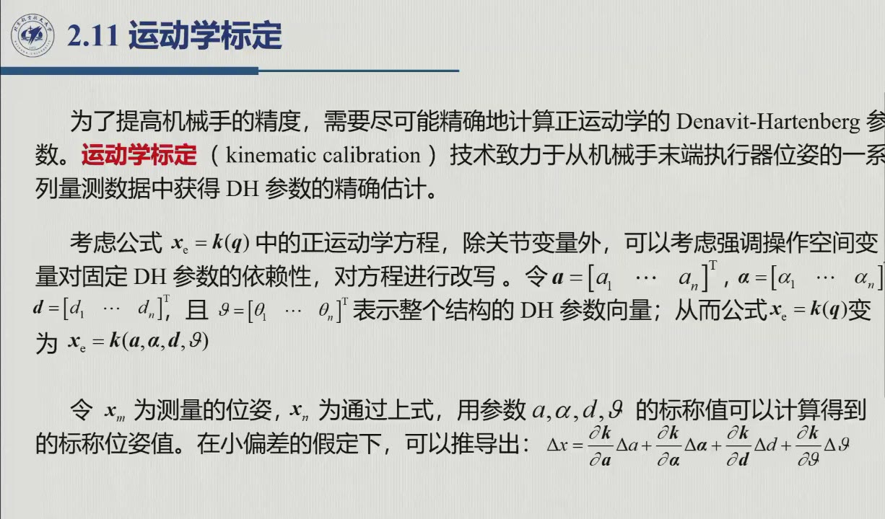

# 2.11 运动学标定

DH 常数（杆长、扭角）名义上是量出来的，装配完成之后却**无法直接测量**；而这组参数一旦不准，一切位姿都会系统性失准。**运动学标定**的思路，正是用末端位姿的量测值反推参数——这是一个标准的非线性辨识问题。课程把它定位在「了解」层次（录播 1:51:03：「只讲一下基本原理」），但本节仍把原理讲全，对应的录播区间是 1:49:32–1:55:29。

<aside class="lesson-brief" aria-label="2.11 学习简报">

PREREQUISITE<strong>你需要先会</strong>
$\boldsymbol x_e=k(\boldsymbol q)$（[@def-2.10.1]）；最小二乘解的超定方程（附录 / 数值分析基础）。

TARGET<strong>本节要建立</strong>
参数向量 $\boldsymbol\xi$ 与标定矩阵 $\Phi$；线性化 $\Delta\boldsymbol x=\Phi\,\Delta\boldsymbol\xi$（式 2.86）；量测次数条件与最小二乘迭代（式 2.87–2.89）。

CHECKPOINT<strong>学完的标准</strong>
能说清「为什么量测组数要 ≥ 4n、为什么建议远大于 4n」；能复述一轮迭代里哪三样东西被更新。

</aside>

::: preview 先修补 · 最小二乘（本节只用到这一条）

标定要用到的「超定方程最小二乘」，一句话就能说清：**方程数多于未知数、又没有精确解时，就取使残差平方和最小的那个解**。

$$\min_{\boldsymbol\xi}\|A\boldsymbol\xi-\boldsymbol b\|^2\ \Longrightarrow\ \boldsymbol\xi=(A^{\mathrm T}A)^{-1}A^{\mathrm T}\boldsymbol b$$

（推导思路：展开目标函数，对 $\boldsymbol\xi$ 求导并置零，即得**正规方程** $A^{\mathrm T}A\boldsymbol\xi=A^{\mathrm T}\boldsymbol b$；$A$ 列满秩时 $A^{\mathrm T}A$ 可逆。）式中的 $(A^{\mathrm T}A)^{-1}A^{\mathrm T}$ 称为 $A$ 的**左广义逆**——本节式 2.87 的 $\Delta\boldsymbol\xi=(\Phi^{*\mathrm T}\Phi^*)^{-1}\Phi^{*\mathrm T}\Delta\boldsymbol x^*$ 正是它的直接套用（把 $A$ 换成 $\Phi^*$、$\boldsymbol b$ 换成 $\Delta\boldsymbol x^*$ 即可）。

不过有两点要提醒。① 要让 $A^{\mathrm T}A$ 可逆，$A$ 必须**列满秩**；若量测位姿过于集中，$A^{\mathrm T}A$ 就会接近奇异——这正是「$tm\gg4n$」的由来。② 上式只对**线性**问题能一步到位，而本节的 $k(\boldsymbol\xi)$ 是非线性的，因此必须迭代求解。

:::

## 2.11.1 问题设定

要做标定，先得把正运动学中隐含的参数显式写出来。令 $\boldsymbol a,\boldsymbol\alpha,\boldsymbol d,\boldsymbol\vartheta$ 分别为四列 DH 参数向量，把它们拼成一个 $4n$ 维的参数向量，则式 2.82 改写为（原书式 2.84）

$$\boldsymbol x_e=k(\boldsymbol a,\boldsymbol\alpha,\boldsymbol d,\boldsymbol\vartheta).$$

接下来还要引入两个位姿：$\boldsymbol x_m$ 为测量位姿（由限位装置或三角测量给出），$\boldsymbol x_n$ 为用标称参数 + 传感器读数算出的位姿；两者的偏差记为 $\Delta\boldsymbol x=\boldsymbol x_m-\boldsymbol x_n$（录播 1:52:00：「一个是算的、一个是测的……不会太大」）。这个偏差很小，正是后文「小偏差假定」的由来。

## 2.11.2 线性化、最小二乘与迭代

::: method 标定三步法（原书式 2.85–2.89） {#method-2.11.steps}
1. **线性化**：在标称参数附近一阶展开（录播 1:53:10 老师：「在标称值附近给它展开……整理之后得到了（下式）」）：

$$\Delta\boldsymbol x=\frac{\partial\boldsymbol k}{\partial\boldsymbol a}\Delta\boldsymbol a+\frac{\partial\boldsymbol k}{\partial\boldsymbol\alpha}\Delta\boldsymbol\alpha+\frac{\partial\boldsymbol k}{\partial\boldsymbol d}\Delta\boldsymbol d+\frac{\partial\boldsymbol k}{\partial\boldsymbol\vartheta}\Delta\boldsymbol\vartheta=\Phi\,\Delta\boldsymbol\xi,$$

其中 $\Phi=[\ \partial\boldsymbol k/\partial\boldsymbol a\ \ \partial\boldsymbol k/\partial\boldsymbol\alpha\ \ \partial\boldsymbol k/\partial\boldsymbol d\ \ \partial\boldsymbol k/\partial\boldsymbol\vartheta\ ]$ 为 $m\times 4n$ 的**运动学标定矩阵**，即参数空间到操作空间的雅可比（原书脚注）；$\Delta\boldsymbol\xi$ 为参数偏差。这里要留意一个字母差异：英文原版把参数偏差记作 $\boldsymbol\zeta$，中文版沿用同一字母，本编改记为 ξ，以区别于 DH 关节变量 $\boldsymbol q$——对照原书时请注意这个差异。

2. **超定量测 + 最小二乘**：一组位姿只能给出 $m$ 个方程，而未知数有 $4n$ 个，方程数不够用，因此必须量测 $t$ 个位姿，使方程总数 $tm\ge4n$；为避免 $\Phi$ 病态，还建议 $tm\gg 4n$。把各次量测堆叠起来（原书式 2.87），得 $\Delta\boldsymbol x^*=\Phi^*\,\Delta\boldsymbol\xi$，再取最小二乘解

$$\Delta\boldsymbol\xi=(\Phi^{*T}\Phi^*)^{-1}\Phi^{*T}\,\Delta\boldsymbol x^* ,$$

其中 $(\Phi^{*T}\Phi^*)^{-1}\Phi^{*T}$ 即 $\Phi^*$ 的左广义逆。

3. **修正 + 迭代**：参数按 $\boldsymbol\xi'=\boldsymbol\xi+\Delta\boldsymbol\xi$ 更新（原书式 2.89）。要注意，这是**非线性**参数估计：每轮迭代都得用上一轮的参数重算 $\Phi$，并重算 $\Delta\boldsymbol x$（新的量测值与新的正运动学计算值之差），如此反复，直到 $\Delta\boldsymbol\xi$ 收敛到给定阈值（录播 1:55:00–1:55:18：「再迭代，一直到这个差值特别小……满足你的要求之后就停止迭代」）。
:::

这三步串起来，并不是走一遍就结束——它本身就是一个**闭环**（见下图）：每转一轮，参数、线性化矩阵、偏差三者同时刷新，直到修正量收敛。

<figure>
<svg class="figure-svg" viewBox="0 0 920 330" xmlns="http://www.w3.org/2000/svg" role="img" aria-labelledby="fig-211-t fig-211-d">
<title id="fig-211-t">运动学标定的迭代闭环</title>
<desc id="fig-211-d">四个节点依次为：正运动学算名义位姿、与量测作差、线性化加最小二乘解参数偏差、参数更新；第四步经下方回路回到第一步，直到偏差收敛。</desc>
<defs>
<marker id="f211-m" markerWidth="9" markerHeight="9" refX="7" refY="3" orient="auto"><path d="M0,0 L7,3 L0,6 Z" fill="var(--muted)"/></marker>
</defs>
<text class="diagram-text" x="460" y="34" text-anchor="middle">运动学标定：一个迭代闭环</text>
<g fill="none" stroke="var(--line-strong)" stroke-width="1.8" marker-end="url(#f211-m)">
<line x1="226" y1="134" x2="266" y2="134"/>
<line x1="456" y1="134" x2="496" y2="134"/>
<line x1="686" y1="134" x2="726" y2="134"/>
<path d="M 823 172 V 250 H 133 V 176"/>
</g>
<rect class="diagram-node" x="40" y="96" width="186" height="76" rx="10"/>
<text class="diagram-text" x="133" y="124" text-anchor="middle">① 正运动学算位姿</text>
<text class="diagram-mono" x="133" y="150" text-anchor="middle">x_n = k(ξ, q)</text>
<rect class="diagram-node" x="270" y="96" width="186" height="76" rx="10"/>
<text class="diagram-text" x="363" y="124" text-anchor="middle">② 与量测作差</text>
<text class="diagram-mono" x="363" y="150" text-anchor="middle">Δx = x_m − x_n</text>
<rect class="diagram-node" x="500" y="96" width="186" height="76" rx="10"/>
<text class="diagram-text" x="593" y="124" text-anchor="middle">③ 线性化 + 最小二乘</text>
<text class="diagram-mono" x="593" y="150" text-anchor="middle">Δξ = (Φ<tspan class="sp">T</tspan>Φ)<tspan class="sp">−1</tspan>Φ<tspan class="sp">T</tspan>Δx</text>
<rect class="diagram-node" x="730" y="96" width="186" height="76" rx="10" stroke="var(--accent)"/>
<text class="diagram-text" fill="var(--accent-text)" x="823" y="124" text-anchor="middle">④ 参数更新</text>
<text class="diagram-mono" fill="var(--accent-text)" x="823" y="150" text-anchor="middle">ξ′ = ξ + Δξ</text>
<text class="diagram-note" x="478" y="238" text-anchor="middle">Δξ 未收敛 → 再来一轮：用新参数重算 Φ 与 Δx（三样同时刷新）</text>
<text class="diagram-note" x="478" y="296" text-anchor="middle">量测位姿数 tm ≥ 4n（宜远大于，量测铺满工作空间防 Φ<tspan class="sp">T</tspan>Φ 病态）；一轮只在小偏差假定下成立，故必须迭代</text>
</svg>
<figcaption>标定闭环（本教程绘）：非线性问题线性化求解的通用套路——「算、比、解、更」四拍循环。一步线性化只在小偏差下才准，所以靠**迭代**收敛（录播 1:55:00：「再迭代，一直到这个差值特别小」）；四拍与三步法一一对应（[@method-2.11.steps]）。</figcaption>
</figure>

::: note 谁做标定、何时做（原书 + 录播 1:50:43–1:51:01） {#note-2.11.who}
**厂家**负责做出厂标定，以保证手册里标称的精度（录播：「一般都是厂家的，厂家给你的手册上就会有明确的（标定后的参数值）」）；**用户**则在使用中遇到碰撞、检修或更换部件之后，需要重新标定。另有一类「用户级标定」，它与参数辨识无关：对于增量式（非绝对式）位置传感器，只要把机械手调到给定的参考姿态，再用该姿态值初始化传感器即可。
:::

::: think 默写点 · 合上书再写（主动回忆）

先不看正文与速查卡，把下面几条写出来，再展开核对。写不出来，就说明这一节还没真正「拿走」——还没变成你自己的东西。

1. 写出 $\Delta\boldsymbol x=\Phi\Delta\boldsymbol\xi$，说明 $\Phi$ 的维数与物理含义。
2. 量测数条件是什么？为什么建议远大于？
3. 一轮迭代里哪三样东西被更新？

::: sol 核对

$\Phi$ 是 $m\times4n$ 的**运动学标定矩阵**（参数空间到操作空间的雅可比）；$\Delta\boldsymbol\xi$ 是 $4n$ 维参数偏差。

$tm\ge4n$；建议 $tm\gg4n$——量测位姿太集中会让 $\Phi^{*\mathrm T}\Phi^*$ 接近奇异（病态）。

① 参数 $\boldsymbol\xi'=\boldsymbol\xi+\Delta\boldsymbol\xi$；② 用新参数重算 $\Phi$；③ 用新参数重算正运动学、得到新的 $\Delta\boldsymbol x$。迭代至 $\Delta\boldsymbol\xi$ 收敛。

:::

:::

## 2.11 小结与常见错误

- **一个闭环**：机械误差 → 精度损失 → 位姿量测 → 线性化 + 最小二乘 → 参数修正。未知数共 $4n$ 个，量测方程总数须满足 $tm\ge4n$（宜远大于，以防病态）。
- **一个本质**：标定是**迭代**的非线性最小二乘——一步线性化只管得住小偏差，收敛靠的是循环。

::: think 常见错误清单 · 自查两条
1. 以为做一轮线性化就能得到最终参数——$\boldsymbol x_e=k(\boldsymbol\xi)$ 是非线性的，$\Phi$ 与 $\Delta\boldsymbol x$ 都随参数更新而变，必须迭代；
2. 量测位姿取得「太整齐」——所有位姿挤在工作空间的一隅，会让 $\Phi^T\Phi$ 接近奇异；量测应铺满工作空间并留有余量（$tm\gg 4n$）。
:::
