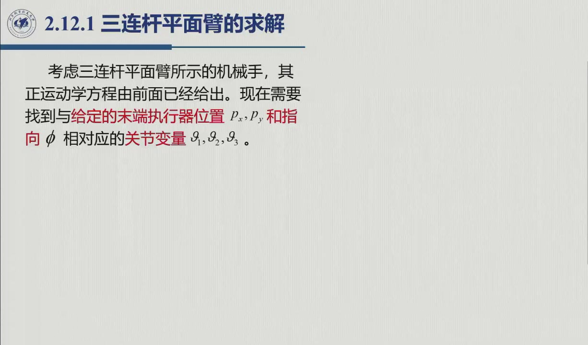
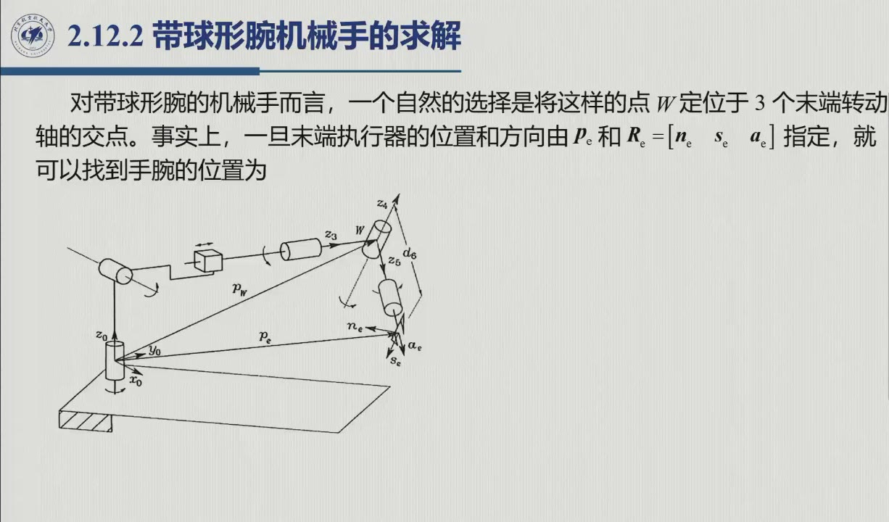

# 2.12 逆运动学问题

正运动学是函数计算，逆运动学则是解方程：给定 $(\boldsymbol p_e,R_e)$ 求 $\boldsymbol q$。解方程比算函数难得多，难处集中在四条——**非线性、多解、可能无解 / 无穷多解、无通用解析法**。本节把课程覆盖的解法全部推导一遍：先讲平面臂（代数 + 几何双法），再讲球形腕解耦框架（含球形臂、拟人臂、球形腕三个子问题）。录播 1:55:29–2:13:16。

## 2.12.1 问题有多难：四难点与存在性

::: thm 定理 2.12.A · 逆运动学的四难点（原书） {#thm-2.12.A}
1. **非线性**：方程组是三角函数的复合，闭合形式解未必存在；
2. **多重解**：同一末端位姿可对应多组关节变量。解数随自由度与**非零 DH 参数个数**增长：无关节限位的 6 自由度机械手可多达 **16** 组解，需按准则（如肘上 / 肘下）选解；机械关节限位会削减实际可行解数；
3. **无穷多解**：运动学冗余（[@def-2.10.3]）情形；
4. **可能无解**：给定位姿超出可达 / 灵活工作空间。
:::

存在性判据很直接：位姿落在灵活工作空间内，解就必然存在（原书）。难的是怎么求。录播 1:57:29 老师把解法版图讲得直白：「正运动学不管什么机械臂都能算；逆运动学没有通用（解析）方法，只能针对特殊构型」——数值法虽然通用，却得不到全部解（见第 3 章）。既然通用解析法走不通，闭合解就只能在特殊构型上做文章，靠的是两种直觉（原书）：**代数直觉**（找含未知量的关键方程）与**几何直觉**（找化简未知量的结构关键点）。

## 2.12.2 三连杆平面臂的求解

要看清逆解怎么做，先从最简单的三连杆平面臂入手。任务很明确：给定 $(p_x,p_y,\phi)$（末端位置与方向角），求 $(\vartheta_1,\vartheta_2,\vartheta_3)$（原书 §2.12.1）。这里有个前提值得注意：若不给方向角 $\phi$，臂就变成冗余的，逆解有无穷多（原书脚注）。

**代数解法**的思路是「先分离腕心，再平方相加消元」，一共五步（录播 1:58:31：「没有什么技巧……就是简单的三角关系」）：

1. 方向方程 $\phi=\vartheta_1+\vartheta_2+\vartheta_3$；
2. **腕心分离**：腕心 $W$（末梢沿末杆回退 $a_3$ 处，即坐标系 2 原点）只依赖前两角：
$$p_{wx}=p_x-a_3c_\varphi=a_1c_1+a_2c_{12},\qquad p_{wy}=p_y-a_3s_\varphi=a_1s_1+a_2s_{12};$$
3. 平方相加消 $\vartheta_1$（存在性要求 $-1\le c_2\le 1$，否则点在工作空间外）：
$$c_2=\frac{p_{wx}^2+p_{wy}^2-a_1^2-a_2^2}{2a_1a_2},\qquad
s_2=\pm\sqrt{1-c_2^2},\qquad \vartheta_2=\operatorname{Atan2}(s_2,c_2);$$
（$s_2$ **正号肘朝下、负号肘朝上**）
4. 把 $c_2,s_2$ 代回腕心方程，解这个线性组：
$$s_1=\frac{(a_1+a_2c_2)p_{wy}-a_2s_2\,p_{wx}}{p_{wx}^2+p_{wy}^2},\qquad
c_1=\frac{(a_1+a_2c_2)p_{wx}+a_2s_2\,p_{wy}}{p_{wx}^2+p_{wy}^2},\qquad
\vartheta_1=\operatorname{Atan2}(s_1,c_1);$$
5. 回代 $\vartheta_3=\phi-\vartheta_1-\vartheta_2$。

还要注意 $s_2=0$（两杆共线，可能伸直或折叠）的情形：此时机械臂处于运动学奇异（第 3 章），两支解合一，但 $\vartheta_1$ 仍然唯一——除非同时满足 $a_1=a_2$ 且 $\boldsymbol p_w=\boldsymbol 0$（原书）。

**几何解法**走的是另一条路：先看图形，再列式子（录播 2:01:10：「这是个三角形……用余弦公式」）。$a_1,a_2$ 与线段 $OW$ 构成一个三角形，对边用余弦定理，得到与代数法相同的 $c_2$（$\vartheta_2=\pm\arccos c_2$，负肘上 / 正肘下）。设 $\alpha=\operatorname{Atan2}(p_{wy},p_{wx})$，则
$$\beta=\arccos\frac{p_{wx}^2+p_{wy}^2+a_1^2-a_2^2}{2a_1\sqrt{p_{wx}^2+p_{wy}^2}}\ \big(\beta\in(0,\pi)\big),\qquad \vartheta_1=\alpha\pm\beta\quad(\vartheta_2<0\text{ 取}+,\ \vartheta_2>0\text{ 取}-);$$
最后同样 $\vartheta_3=\phi-\vartheta_1-\vartheta_2$。两种解法给出的解数一致，但几何法多给出一层图像：「双支 = 三角形镜像」（原书图 2.31）；同样的思路也适用于运动学等价的平行四边形臂（原书 §2.9.2）。

「双支 = 三角形镜像」这句话可以直接画出来——就长下图这样：同一个腕心 $W$、同一个末端方向 $\varphi$，两组两连杆三角形一上一下互为镜像，而 $\vartheta_1=\alpha\pm\beta$ 的两个符号选择，就发生在这里。

<figure>
<svg class="figure-svg" viewBox="0 0 920 340" xmlns="http://www.w3.org/2000/svg" role="img" aria-labelledby="fig-212-title fig-212-desc">
<title id="fig-212-title">同一腕心的两支解：肘上与肘下</title>
<desc id="fig-212-desc">基座 O 到腕心 W 的虚线上方与下方各有一组两连杆三角形：金色为肘朝下支（s2 取正），蓝色为肘朝上支（s2 取负），两支共享相同的腕心 W 与末端方向 φ；图上标出 α、β 与 θ1 的两支取值。</desc>
<defs>
<marker id="f212-m" markerWidth="9" markerHeight="9" refX="7" refY="3" orient="auto"><path d="M0,0 L7,3 L0,6 Z" fill="var(--muted)"/></marker>
<marker id="f212-s" markerWidth="8" markerHeight="8" refX="6" refY="2.5" orient="auto"><path d="M0,0 L6,2.5 L0,5 Z" fill="var(--sage)"/></marker>
</defs>
<text class="diagram-text" x="460" y="36" text-anchor="middle">同一腕心 W、同一末端方向 φ 的两支解</text>
<line class="diagram-axis" x1="180" y1="250" x2="352" y2="250"/>
<text class="diagram-note" x="360" y="254">x</text>
<line x1="180" y1="250" x2="430" y2="205" stroke="var(--line)" stroke-dasharray="5 5"/>
<text class="diagram-text" x="305" y="228" text-anchor="middle">|OW|（余弦定理）</text>
<circle class="diagram-node" cx="180" cy="250" r="6"/>
<text class="diagram-note" x="170" y="272" text-anchor="end">O</text>
<text class="diagram-note" x="424" y="196" text-anchor="end">腕心 W</text>
<circle class="diagram-fill-accent" cx="430" cy="205" r="6"/>
<line x1="430" y1="205" x2="487" y2="165" stroke="var(--sage)" stroke-width="4.5" marker-end="url(#f212-s)"/>
<line x1="430" y1="205" x2="524" y2="205" stroke="var(--line)" stroke-dasharray="4 4"/>
<path d="M 470 205 A 40 40 0 0 0 463 182" fill="none" stroke="var(--fig-green)" stroke-width="1.8"/>
<text class="diagram-text" fill="var(--fig-green)" x="478" y="196">φ</text>
<text class="diagram-note" x="497" y="158">末端（a<tspan class="sb">3</tspan> = φ − θ<tspan class="sb">1</tspan> − θ<tspan class="sb">2</tspan> 仍成立）</text>
<path d="M 290 250 A 110 110 0 0 0 288 230" fill="none" stroke="var(--fig-green)" stroke-width="1.8"/>
<text class="diagram-text" fill="var(--fig-green)" x="300" y="240">α</text>
<path d="M 237 261 A 58 58 0 0 0 237 240" fill="none" stroke="var(--fig-gold)" stroke-width="1.8"/>
<text class="diagram-text" fill="var(--fig-gold)" x="250" y="258">β</text>
<g fill="none" stroke-width="3">
<path stroke="var(--fig-gold)" d="M180 250 L337 281 L430 205" stroke-dasharray="1 0"/>
<path stroke="var(--fig-blue)" d="M180 250 L316 166 L430 205"/>
</g>
<circle cx="337" cy="281" r="4.5" fill="var(--fig-gold)"/>
<circle cx="316" cy="166" r="4.5" fill="var(--fig-blue)"/>
<text class="diagram-text" fill="var(--fig-gold)" x="252" y="284">a<tspan class="sb">1</tspan></text>
<text class="diagram-text" fill="var(--fig-gold)" x="392" y="262">a<tspan class="sb">2</tspan></text>
<text class="diagram-text" fill="var(--fig-blue)" x="234" y="204">a<tspan class="sb">1</tspan></text>
<text class="diagram-text" fill="var(--fig-blue)" x="362" y="176">a<tspan class="sb">2</tspan></text>
<text class="diagram-text" fill="var(--sage)" x="452" y="176">a<tspan class="sb">3</tspan></text>
<text class="diagram-text" fill="var(--fig-gold)" x="342" y="304">肘朝下支</text>
<text class="diagram-text" fill="var(--fig-blue)" x="290" y="150">肘朝上支</text>
<text class="diagram-mono" x="600" y="84">金：s<tspan class="sb">2</tspan> &gt; 0（θ<tspan class="sb">1</tspan> = α − β）</text>
<text class="diagram-mono" x="600" y="106">蓝：s<tspan class="sb">2</tspan> &lt; 0（θ<tspan class="sb">1</tspan> = α + β）</text>
<text class="diagram-mono" x="600" y="128">θ<tspan class="sb">3</tspan> = φ − θ<tspan class="sb">1</tspan> − θ<tspan class="sb">2</tspan>（各支不同）</text>
<text class="diagram-note" x="460" y="326" text-anchor="middle">两支共享腕心 W 与末端方向 φ：差异全部被 θ<tspan class="sb">1</tspan>、θ<tspan class="sb">2</tspan> 的符号与 θ<tspan class="sb">3</tspan> 吸收——这就是「多解」的几何本体</text>
</svg>
<figcaption>平面臂逆解的两支（本教程绘，对照原书图 2.31）：代数法里 $s_2=\pm\sqrt{1-c_2^{\ 2}}$ 的正负号，在几何法里就是三角形的上下镜像；$\vartheta_1=\alpha\pm\beta$、$\vartheta_3=\varphi-\vartheta_1-\vartheta_2$ 随支各自取值。$s_2=0$（伸直）时两支合一，退化为第 3 章的运动学奇异。</figcaption>
</figure>

看静态图不过瘾？下面的**操作台**可以直接拖：改变两个关节角，末端、肘部、可达工作空间与「同一 P 的另一支解」会全部实时联动。试试把 $c_2$ 拖到 $\pm1$ 附近，看两支解如何合并成奇异。

<figure class="arm-lab">
<svg id="alab-svg" class="figure-svg" viewBox="0 0 920 430" xmlns="http://www.w3.org/2000/svg" role="img" aria-labelledby="alab-t alab-d">
<title id="alab-t">两连杆平面臂操作台</title>
<desc id="alab-d">拖动滑杆改变关节角，实时观察末端位置、可达工作空间圆环与肘上肘下两支解；两杆共线时给出奇异提示。</desc>
<path d="M 479 245 A 189 189 0 1 1 101 245 A 189 189 0 1 1 479 245 Z M 311 245 A 21 21 0 1 0 269 245 A 21 21 0 1 0 311 245 Z" fill="var(--accent)" fill-opacity=".08" stroke="var(--accent)" stroke-width="1" fill-rule="evenodd"/>
<text class="diagram-text" fill="var(--accent-text)" x="290" y="44" text-anchor="middle">R = a<tspan class="sb">1</tspan> + a<tspan class="sb">2</tspan></text>
<line x1="290" y1="292" x2="290" y2="270" stroke="var(--line-strong)" stroke-width="1" marker-end="url(#alab-m)"/>
<text class="diagram-text" x="290" y="310" text-anchor="middle">r = |a<tspan class="sb">1</tspan> − a<tspan class="sb">2</tspan>|</text>
<g stroke="var(--line)" stroke-dasharray="3 5">
<line x1="180" y1="245" x2="400" y2="245"/><line x1="290" y1="135" x2="290" y2="355"/>
</g>
<g stroke="var(--line-strong)" stroke-width="1.2" marker-end="url(#alab-m)">
<line x1="290" y1="245" x2="352" y2="245"/>
<line x1="290" y1="245" x2="290" y2="190"/>
</g>
<text class="diagram-note" x="358" y="249">x</text>
<text class="diagram-note" x="284" y="184" text-anchor="end">y</text>
<g id="alab-ghost" stroke="var(--fig-gold)" stroke-width="2" stroke-dasharray="6 4" fill="none">
<line id="alab-g1" x1="290" y1="245" x2="294" y2="140"/><line id="alab-g2" x1="294" y1="140" x2="369" y2="101"/>
<circle id="alab-ge" cx="294" cy="140" r="4.5" fill="var(--fig-gold)" stroke="none"/>
</g>
<circle cx="290" cy="245" r="7" fill="var(--paper)" stroke="var(--ink-2)" stroke-width="1.5"/>
<g stroke="var(--fig-blue)" stroke-width="4" fill="none">
<line id="alab-m1" x1="290" y1="245" x2="376" y2="185"/>
<line id="alab-m2" x1="376" y1="185" x2="369" y2="101"/>
</g>
<circle id="alab-me" cx="376" cy="185" r="5.5" fill="var(--paper)" stroke="var(--fig-blue)" stroke-width="2"/>
<circle id="alab-mt" cx="369" cy="101" r="6" fill="var(--accent-text)" stroke="var(--paper)" stroke-width="2"/>
<text class="diagram-text" x="620" y="34" text-anchor="middle">两连杆平面臂操作台（a<tspan class="sb">1</tspan> = 1，a<tspan class="sb">2</tspan> = 0.8）</text>
<text class="diagram-text" x="560" y="110">P = <tspan id="alab-rp" fill="var(--accent-text)">+</tspan></text>
<text class="diagram-text" x="560" y="140">|P| = <tspan id="alab-rm">+</tspan>　　c<tspan class="sb">2</tspan> = <tspan id="alab-rc">+</tspan></text>
<text class="diagram-text" x="560" y="170">本支：<tspan id="alab-rb">+</tspan></text>
<text class="diagram-text" fill="var(--fig-red)" x="560" y="200"><tspan id="alab-rw"> </tspan></text>
<text class="diagram-note" x="560" y="242">蓝实线 = 当前解；金虚线 = 同一 P 的另一支解</text>
<text class="diagram-note" x="560" y="266">拖动滑杆，或用 Tab 聚焦后按方向键微调</text>
<text class="diagram-note" x="560" y="298">观察：θ<tspan class="sb">2</tspan> 变号 → 肘上 / 肘下翻转，P 不动；</text>
<text class="diagram-note" x="560" y="322">c<tspan class="sb">2</tspan> → ±1 时两支合一（伸直 / 折回 = 奇异，见第 3 章）</text>
<defs>
<marker id="alab-m" markerWidth="8" markerHeight="8" refX="6" refY="2.5" orient="auto"><path d="M0,0 L6,2.5 L0,5 Z" fill="var(--muted)"/></marker>
</defs>
</svg>

<label>关节角 θ1 <input type="range" id="alab-t1" min="-180" max="180" step="1" value="35" aria-label="关节角 1">35°</label>
<label>关节角 θ2 <input type="range" id="alab-t2" min="-180" max="180" step="1" value="60" aria-label="关节角 2">60°</label>
<label><input type="checkbox" id="alab-show" checked> 显示另一支解</label>

<figcaption>交互操作台（本教程绘）：拖动 $\vartheta_1,\vartheta_2$ 观察正运动学 $\boldsymbol p=a_1e(\vartheta_1)+a_2e(\vartheta_{1}+\vartheta_{2})$、可达工作空间（环形）与双支解。另一支解按 $\vartheta_2\to-\vartheta_2$、$\vartheta_1\to 2\alpha-\vartheta_1$（$\alpha=\operatorname{Atan2}(p_y,p_x)$）实时算出——[@ex-book-2.6] 与 [@thm-2.12.A] 的「肘上 / 肘下」在指尖上验证。</figcaption>
</figure>

## 2.12.3 解耦：带球形腕机械手的求解

::: thm 定理 2.12.B · 闭合解的充分条件（原书） {#thm-2.12.B}
6 自由度运动学结构具有闭合形式逆解的充分条件如下，满足其一即可：
- **三个连续转动关节的轴交于一点**（球形腕）；
- **三个连续转动关节的轴平行**。

这就解释了工程界为什么把主流机械手设计成「臂 + 球形腕」——录播 2:02:06：「一个博士（论文）里给出的条件」（文献：Pieper, 1968，见[勘误补注](errata.md)）。
:::

解耦的关键，是把一个 6 元问题拆成两个 3 元子问题，让位置与方向分离（「位置解和方向解被解耦」，原书）。操作上分五步：

::: method 解耦五步（原书式 2.93） {#method-2.12.decouple}
选定 3 个末端转动轴的交点 $W$（腕心）。由给定的 $\boldsymbol p_e$ 与 $R_e=[\boldsymbol n_e\ \boldsymbol s_e\ \boldsymbol a_e]$：
1. **算腕心**：
$$\boldsymbol p_w=\boldsymbol p_e-d_6\,\boldsymbol a_e;$$
（$d_6$ 即 [2.9.6](sec2-9.md#sec-2.9.6) 的「外移长度」；录播 2:05:04：「减去 $d_6$ 这么长度的矢量」。）
2. 解**臂**的逆运动学得 $(q_1,q_2,q_3)$（$\boldsymbol p_w$ 只依赖前三个关节）；
3. 由正运动学算 $R_3^0(\vartheta_1,\vartheta_2,\vartheta_3)$；
4. **方向分离**：$R_6^3(\vartheta_4,\vartheta_5,\vartheta_6)=R_3^{0T}R_6^0$；
5. 解**腕**的逆运动学（= ZYZ 反解，见 [2.12.6](#sec-2.12.6)）。
:::

这个框架并不限定臂的具体形态：只要结构满足上述条件，位置与方向就能分开处理——下面两小节分别给出球形臂与拟人臂两个实例。

## 2.12.4 球形臂的求解

先看球形臂。给定腕心位置 $\boldsymbol p_w$，求 $(\vartheta_1,\vartheta_2,d_3)$（原书 §2.12.3，正运动学见 [2.9.3](sec2-9.md#sec-2.9.3) 式 2.65）。为了把变量分离开，先把 $\boldsymbol p_w$ 移到系 1 中表达（左乘 $A_0^1$），再令它与 $A_2^1A_3^2$ 的第 4 列相等：

$$\begin{bmatrix}p_{wx}c_1+p_{wy}s_1\\ -p_{wz}\\ -p_{wx}s_1+p_{wy}c_1\end{bmatrix}=\begin{bmatrix}d_3s_2\\ -d_3c_2\\ d_2\end{bmatrix}\qquad(\text{原书式 }2.94)$$

求解分三步，逐一拿下 $\vartheta_1$、$d_3$、$\vartheta_2$：

1. **第三行只含 $\vartheta_1$**：$-p_{wx}s_1+p_{wy}c_1=d_2$。作**半角代换** $t=\tan(\vartheta_1/2)$（$c_1=\frac{1-t^2}{1+t^2},\ s_1=\frac{2t}{1+t^2}$），化为二次方程

$$(d_2+p_{wy})\,t^2+2p_{wx}\,t+(d_2-p_{wy})=0
\ \Longrightarrow\ t=\frac{-p_{wx}\pm\sqrt{p_{wx}^2+p_{wy}^2-d_2^2}}{d_2+p_{wy}},$$

即两支解（对应两种肩姿态）

$$\vartheta_1=2\operatorname{Atan2}\!\big(-p_{wx}\pm\sqrt{p_{wx}^2+p_{wy}^2-d_2^2},\ p_{wy}+d_2\big).$$

判别式 $p_{wx}^2+p_{wy}^2\ge d_2^2$ 是解存在的几何条件——腕心到 $z_0$ 轴的距离不得小于 $|d_2|$，否则判别式为负、解不存在。

2. **求 $d_3$**：$\vartheta_1$ 已知后，对**前两行**的平方求和（右端 $s_2^2+c_2^2=1$，左端第二行恰为 $-p_{wz}$）：

$$d_3=\sqrt{(p_{wx}c_1+p_{wy}s_1)^2+p_{wz}^2}\qquad(\text{只取 } d_3>0\ \text{支});$$

$\vartheta_1$ 的两支给出**同一个** $d_3$。

3. **求 $\vartheta_2$**（$d_3\neq0$）：$s_2=(p_{wx}c_1+p_{wy}s_1)/d_3$、$c_2=p_{wz}/d_3$，故

$$\vartheta_2=\operatorname{Atan2}\big(p_{wx}c_1+p_{wy}s_1,\ p_{wz}\big).$$

**若 $d_3=0$，$\vartheta_2$ 不能唯一确定**（伸缩归零后第二关节的指向不再影响腕心位置）。

::: note 记号提示
原书此小节排版密度大（OCR 版符号粘连明显），本教程按英文原版做了校正：半角代换的对象是 $\vartheta_1$；二次方程判别式 $p_{wx}^2+p_{wy}^2-d_2^2\ge0$ 是解存在的几何条件（腕心到 $z_0$ 轴的距离不小于 $|d_2|$，与上文一致）。
:::

## 2.12.5 拟人臂的求解

再看拟人臂。给定腕心 $\boldsymbol p_w$，求 $(\vartheta_1,\vartheta_2,\vartheta_3)$（正运动学见 [2.9.4](sec2-9.md#sec-2.9.4) 式 2.66）。腕心方程的三个分量如下，后面按 $\vartheta_3\to\vartheta_2\to\vartheta_1$ 的顺序逐个解出：

$$p_{wx}=c_1(a_2c_2+a_3c_{23}),\qquad p_{wy}=s_1(a_2c_2+a_3c_{23}),\qquad p_{wz}=a_2s_2+a_3s_{23}.$$

1. 三式平方相加（前两式的平方和 + 第三式的平方）消 $\vartheta_1,\vartheta_2$：
$$c_3=\frac{p_{wx}^2+p_{wy}^2+p_{wz}^2-a_2^2-a_3^2}{2a_2a_3}\qquad(\text{原书式 }2.98)$$
容许性条件 $-1\le c_3\le 1$，等价于 $|a_2-a_3|\le\|\boldsymbol p_w\|\le a_2+a_3$（超出即腕心在可达工作空间外）。$s_3=\pm\sqrt{1-c_3^2}$，$\vartheta_3^{\mathrm{I}}=\operatorname{Atan2}(s_3,c_3)$，$\vartheta_3^{\mathrm{II}}=-\vartheta_3^{\mathrm{I}}$（原书式 2.99–2.101）——**肘上 / 肘下**。
2. 前两式平方和给出 $a_2c_2+a_3c_{23}=\pm\sqrt{p_{wx}^2+p_{wy}^2}$（原书式 2.102），与 $p_{wz}$ 式联立，对每支 $\vartheta_3$ 解出（原书式 2.103–2.104）
$$c_2=\frac{\pm\sqrt{p_{wx}^2+p_{wy}^2}\,(a_2+a_3c_3)+p_{wz}a_3s_3}{a_2^2+a_3^2+2a_2a_3c_3},\qquad
s_2=\frac{p_{wz}(a_2+a_3c_3)\mp\sqrt{p_{wx}^2+p_{wy}^2}\,a_3s_3}{a_2^2+a_3^2+2a_2a_3c_3},\qquad
\vartheta_2=\operatorname{Atan2}(s_2,c_2);$$
3. 最后由前两式的结构 $p_{wx}=\pm c_1\sqrt{p_{wx}^2+p_{wy}^2},\ p_{wy}=\pm s_1\sqrt{p_{wx}^2+p_{wy}^2}$：
$$\vartheta_{1}^{\mathrm{I}}=\operatorname{Atan2}(p_{wy},p_{wx}),\qquad \vartheta_1^{\mathrm{II}}=\operatorname{Atan2}(-p_{wy},-p_{wx})$$
（二者相差 $\pi$；原书式 2.109–2.110）——**肩左 / 肩右**。$\sqrt{\cdot}=0$（$p_{wx}=p_{wy}=0$）时 $\vartheta_1$ 任意（无穷多解，臂处于肩奇异，原书习题 2.18）。

::: thm 定理 2.12.C · 拟人臂的 4 支解（原书图 2.33） {#thm-2.12.C}
$(\vartheta_3\ \text{双支})\times(\vartheta_1\ \text{双支})$ 组合出 **4 组解**：肩右 / 肘上、肩左 / 肘上、肩右 / 肘下、肩左 / 肘下——同一腕心位置，前臂方向不同。这正是 [@thm-2.12.A] 「多重解」与 [@ex-book-2.6]「姿态切换」的完整版。
:::

## 2.12.6 球形腕的求解

最后是腕。给定方向 $R_6^3$，求 $(\vartheta_4,\vartheta_5,\vartheta_6)$。[2.9.5](sec2-9.md#sec-2.9.5) 留下的结构性发现在这里兑现：$R_6^3$ **就是 ZYZ 合成矩阵**（原书式 2.18）。把它的三个列向量元素记为 $\boldsymbol n_6^3=[n_1',n_2',n_3']^T$、$\boldsymbol s_6^3=[s_1',s_2',s_3']^T$、$\boldsymbol a_6^3=[a_1',a_2',a_3']^T$，逆解就可直接套用 [2.4.4](sec2-4.md#sec-2.4.4) 的式 2.19–2.20（原书式 2.111–2.112），按 $\vartheta_5$ 的正负分成两支：

$$\vartheta_5\in(0,\pi):\qquad
\vartheta_4=\operatorname{Atan2}(a_2',a_1'),\qquad
\vartheta_5=\operatorname{Atan2}\!\big(\sqrt{a_1'^2+a_2'^2},\ a_3'\big),\qquad
\vartheta_6=\operatorname{Atan2}(s_3',-n_3');$$

$$\vartheta_5\in(-\pi,0):\qquad
\vartheta_4=\operatorname{Atan2}(-a_2',-a_1'),\qquad
\vartheta_5=\operatorname{Atan2}\!\big({-\sqrt{a_1'^2+a_2'^2}},\ a_3'\big),\qquad
\vartheta_6=\operatorname{Atan2}(-s_3',n_3').$$

录播 2:11:14–2:12:36 老师：「整个 $R_6^3$ 的旋转矩阵都是已知的，把它带进去就可以计算出来……就跟前面（ZYZ 逆解）一样」——这正是解耦框架的价值：把「难的 6 关节问题」拆成了「平面臂式三角题 + 查表式 ZYZ 反解」。

::: think 默写点 · 合上书再写（主动回忆）

不看正文与速查卡，先写出下面几条，再展开核对。写不出来就说明这一节还没「拿走」。

1. 写出腕心公式，说明 $d_6$ 的角色。
2. 默写解耦五步。
3. 平面臂的逆解为什么有两支？各叫什么？

::: sol 核对

$\boldsymbol p_w=\boldsymbol p_e-d_6\boldsymbol a_e$。$d_6$ 是腕心到末端原点的「外移长度」，沿接近向量 $\boldsymbol a_e$ 反推——不扣掉它就分不清解出的是腕心还是工具端的关节角。

① 由 $\boldsymbol p_e$ 反推 $\boldsymbol p_w$；② 解臂得 $(q_1,q_2,q_3)$；③ 算 $R_3^0=R_1^0R_2^1R_3^2$；④ 解腕：由 $(R_3^0)^{\mathrm T}R_e=R_6^3$ 反解 $(q_4,q_5,q_6)$；⑤ 整理解支。

平方相加消去 $\vartheta_1$ 后出现 $c_2$，回代时 $s_2=\pm\sqrt{1-c_2^2}$ 有**两个符号**——对应「肘上 / 肘下」（拟人臂还有肩左 / 肩右，共 4 支）。

:::

:::

::: ex 例 2.12.D · 先退到腕心，再把两支解逐个送回正运动学 {#ex-2.12.D}
平面 3R 臂取 $a_1=a_2=1$、$a_3=0.5$（m），目标位姿为
$(p_x,p_y,\phi)=(1.5,1,0)$。忽略关节限位，求所有常规解，角度按模 $2\pi$ 理解。

::: sol 解
腕心为 $(p_{wx},p_{wy})=(1,1)$，所以 $c_2=(2-1-1)/2=0$。
取 $s_2=+1$，得到 $(\vartheta_1,\vartheta_2,\vartheta_3)=(0,\pi/2,-\pi/2)$；
取 $s_2=-1$，得到 $(\pi/2,-\pi/2,0)$。

第一支的两杆分别沿 $+x,+y$；第二支沿 $+y,+x$。两支腕心都为 $(1,1)$，
角度总和都为 0，最后一杆都沿 $+x$ 加上 $(0.5,0)$，故重建的位姿均为 $(1.5,1,0)$。
**回代必须同时核对位置与指向**，只比较腕心会漏掉第三关节的错误。
:::
:::

::: think 迁移练习 · 公式分母为零究竟代表什么
仍用上述杆长与 $\phi=0$，把目标位置改为 $(0.5,0)$。腕心为零，步骤 4 的分母也为零。
这是「无解」还是「无穷多解」？给出能直接回代的一族解。

::: sol 核对
$a_1=a_2$ 且腕心为零，前两杆完全折叠：
$(\vartheta_1,\vartheta_2,\vartheta_3)=(\gamma,\pi,-\gamma-\pi)$，$\gamma$ 任意。
前两杆位置贡献相消，第三杆指向仍为零，故整族都到达 $(0.5,0,0)$。
这是需要单独处理的几何退化，不能对 $0/0$ 直接调用 Atan2，也不能自动报告无解。
若将杆长改成 $a_1=1,a_2=0.8$，同一零腕心才因低于最小半径 $0.2$ 而无解。
:::
:::

## 2.12 小结与常见错误

- **一张决策树**：任务位姿 → 属于灵活工作空间？（无解预警）→ 结构满足解耦条件（[@thm-2.12.B]）？→ 是：算 $\boldsymbol p_w$、拆臂 + 腕；否：试几何直觉、再退到第 3 章数值法。
- **三个「多解来源」**：肘（$s_2$ / $s_3$ 符号）、肩（$\vartheta_1$ 加 $\pi$）、腕（$\vartheta_5$ 符号）——选解准则 + 关节限位在工程上裁决。
- **一个习惯**：每解出一支，都回代正运动学验证——本章公式都很长，抄错一个下标并不奇怪。

::: think 常见错误清单 · 自查四条
1. 忘记从 $\boldsymbol p_e$ 里扣掉 $d_6\boldsymbol a_e$ 就直接解臂——分不清解出的是「腕心」的关节角还是「工具端」的关节角，$d_6\neq0$ 时全错；
2. 平方相加后只取 $c$、漏掉 $s$ 的符号分支——丢掉整支解（肘上 / 肘下、肩左 / 肩右）；
3. 在 $|a_2-a_3|>\|\boldsymbol p_w\|$ 或 $c_2\notin[-1,1]$ 时继续往下算——这说明给定点在工作空间外，应报告无解而不是硬套 Atan2；
4. 把球形腕的解当独立问题硬推——先查旋转块是否恰为某个欧拉角矩阵（这是读正运动学结果时应留下的「结构红利」）。
:::
