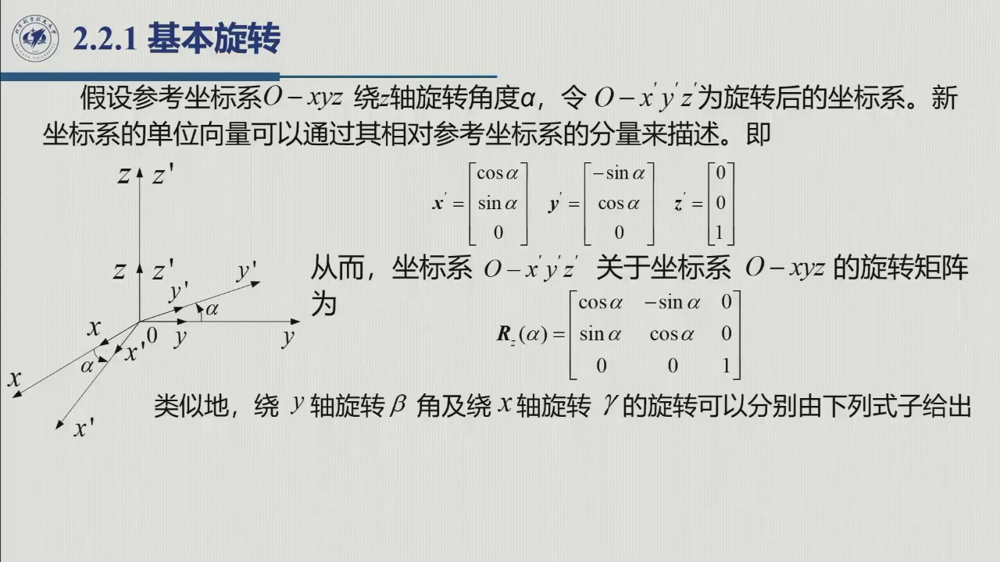
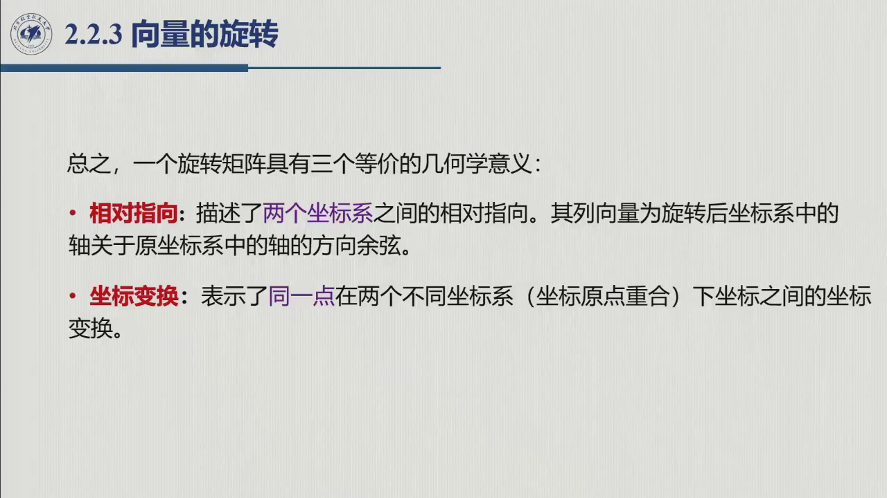

# 2.2 旋转矩阵

把 [2.1](sec2-1.md) 得到的 9 个方向余弦组织成一个矩阵，就得到机器人学最核心的工具——**旋转矩阵**。本节先给出它的定义与两条代数性质，再推导三个**基本旋转**（全章积木），最后用两个小例子兑现它的**三重几何身份**。本节内容对应第 1 周录播 2:05–2:18（幻灯片 07208 / 07715 / 08239）；第 2 周开篇 0:02:47–0:05:21 另有一段复习（下方两处「第 2 周」时间点即出自该段）。

## 2.2.1 定义与两条代数性质

::: def 定义 2.2.1 · 旋转矩阵 {#def-2.2.1}
把式 2.2 的 9 个方向余弦**按列**排成（3×3）矩阵

$$R=\begin{bmatrix}\boldsymbol x'&\boldsymbol y'&\boldsymbol z'\end{bmatrix}
=\begin{bmatrix}x'_x & y'_x & z'_x\\ x'_y & y'_y & z'_y\\ x'_z & y'_z & z'_z\end{bmatrix}\qquad(\text{原书式 }2.3)$$

称为**旋转矩阵**：每一列就是固连系对应轴在参考系中的表示，故又称**方向余弦阵**（第 2 周录播 0:03:23：「它的每一个值实际上就是一个余弦值」）。
:::

两条代数性质不必死记——从定义直接乘一遍就出来了（原书式 2.4–2.5）。注意 $R^{\mathrm T}$ 的第 $i$ **行**正是 $R$ 的第 $i$ **列**，于是 $R^{\mathrm T}R$ 的 $(i,j)$ 元恰是**第 $i$ 列与第 $j$ 列的点积**。记三列为 $\boldsymbol c_1=\boldsymbol x',\boldsymbol c_2=\boldsymbol y',\boldsymbol c_3=\boldsymbol z'$，则

$$(R^{\mathrm T}R)_{ij}=\boldsymbol c_i^{\mathrm T}\boldsymbol c_j=\boldsymbol c_i\cdot\boldsymbol c_j
=\begin{cases}\|\boldsymbol c_i\|^2=1,& i=j\\[1mm] 0,& i\ne j\end{cases}
\qquad\Longrightarrow\qquad
R^{\mathrm T}R=I_3,\qquad R^{-1}=R^{\mathrm T}.$$

对照上式逐项读：单位模长给对角线的 $1$，两两垂直给非对角的 $0$——所谓正交性，就是「三列构成标准正交组」的矩阵说法。

行列式也一步到位：对 $R^{\mathrm T}R=I_3$ 取行列式，得 $(\det R)^2=1$，故 $\det R=\pm1$。

两个符号各有归属。$\det R=-1$ 对应把某一根轴镜像翻转的「照镜子」坐标系（左手系）；而**右手系**的固连坐标系总可以连续转回与参考系重合，$\det$ 是元素的连续函数、途中不可能从 $+1$ 跳到 $-1$，故右手系必为 $\det R=+1$。据此定义：

::: def 定义 2.2.2 · 特殊正交群 SO(3) {#def-2.2.2}
$$SO(3)=\{R\in\mathbb{R}^{3\times3}:\ R^TR=I_3,\ \det(R)=1\}.$$

把维数推广一步：$SO(m)$ 的列是**标准正交**向量（单位长且两两正交），行列式也取 1；空间旋转取 $m=3$，平面旋转取 $m=2$（原书 orthonormal）。
:::

::: note 9 个量、6 个约束、3 个独立参数 {#note-2.2.2}
$R$ 表面上有 9 个元素，但三列模长为 1 给出 3 个约束，两两垂直再给出 3 个约束，**一共 6 个约束压掉 6 个自由度，独立参数只剩 3 个**（第 2 周录播 0:04:41「我们说它是九个量」→ 0:05:16「其实只有三个独立的元素」）。这本账是 [2.4](sec2-4.md) 欧拉角（3 参数）与 [2.5](sec2-5.md) 角和轴（4 参数）的出发点，也是 [2.10](sec2-10.md) 操作空间取最简表示的理由。
:::

::: note 为什么叫「群」——顺便预定的两个词：李群与李代数 {#note-2.2.group}
**群**（group）是带一种「乘法」的集合，满足四条公理：**封闭性**（任意两元之积仍在集合内）、**结合律**、**存在单位元**、**每个元存在逆元**。

$SO(3)$ 逐条兑现：两个旋转之积仍满足 $R^{\mathrm T}R=I$、$\det=+1$（封闭）；矩阵乘法天然结合；$I_3$ 是单位元；$R^{-1}=R^{\mathrm T}$ 仍是旋转矩阵（有逆）。

像 $SO(3)$ 这样元素还能**连续光滑变化**的群称为**李群**（Lie group，挪威数学家 Sophus Lie 的姓音译「李」）——直观图像：全体姿态构成一个 3 维的光滑「曲面」，机器人转动时 $R(t)$ 就在这张曲面上滑动。

这张曲面在单位元 $I_3$ 处的**切平面**（无穷小旋转的世界）称为 $SO(3)$ 的**李代数**，记作 $so(3)$（小写）。它是 [2.5.3](sec2-5.md#sec-2.5.3) 的主角——角和轴、Rodrigues 公式，以及第 3 章的角速度，都会在那里统一成「指数映射 / 对数映射」一对操作。此处只需先把名词立住：读到 $SO(3)$ 时，知道「它是一个元素可以连续变化的群」就够了。
:::

## 2.2.2 基本旋转

参考系 $O\text{-}xyz$ 绕某一根坐标轴转过一个角，就得到 $O'\text{-}x'y'z'$——这类单轴旋转是后面所有复合旋转的**积木**。约定**逆时针方向为正**（原书）。

先以绕 $z$ 轴转 $\alpha$ 为例（图 2.2），按定义逐列写出新轴在参考系中的投影：

$$\boldsymbol x'=\begin{bmatrix}c_\alpha\\ s_\alpha\\ 0\end{bmatrix},\quad
\boldsymbol y'=\begin{bmatrix}-s_\alpha\\ c_\alpha\\ 0\end{bmatrix},\quad
\boldsymbol z'=\begin{bmatrix}0\\0\\1\end{bmatrix}
\;\Longrightarrow\;
R_z(\alpha)=\begin{bmatrix}c_\alpha & -s_\alpha & 0\\ s_\alpha & c_\alpha & 0\\ 0&0&1\end{bmatrix}\qquad(\text{原书式 }2.6)$$

录播 2:07–2:08 老师逐列带推：「前三列就是这个单位向量在三个轴上的投影——在 $x$ 轴上投影是多少？就是 $\cos\alpha$；在 $y$ 轴上呢？就是 $\sin\alpha$；在 $z$ 轴上呢？是 $0$。」

看懂上图（本教程绘），$R_z(\alpha)$ 的每个元素就都有了出处：从 $+z$ 端往下看，$\boldsymbol x'$ 在 $x$ 轴上的投影是 $\cos\alpha$，在 $y$ 轴上的投影是 $\sin\alpha$——左图的三个彩色标注与右图矩阵里的彩色元素一一对应。

<figure>
<svg class="figure-svg" viewBox="0 0 920 300" xmlns="http://www.w3.org/2000/svg" role="img" aria-labelledby="fig-22-title fig-22-desc">
<title id="fig-22-title">绕 z 轴基本旋转的几何与矩阵</title>
<desc id="fig-22-desc">左图从 z 轴正端俯视：x′ 转过角 α，其在 x 轴投影为 cosα、在 y 轴投影为 sinα；y′ 的投影给出 −sα 与 cα。右图为 Rz(α) 矩阵，彩色元素与左图彩色标注一一对应，第三行第三列钉住为 0 0 1。</desc>
<defs>
<marker id="f22-m" markerWidth="9" markerHeight="9" refX="7" refY="3" orient="auto"><path d="M0,0 L7,3 L0,6 Z" fill="var(--muted)"/></marker>
<marker id="f22-b" markerWidth="9" markerHeight="9" refX="7" refY="3" orient="auto"><path d="M0,0 L7,3 L0,6 Z" fill="var(--fig-blue)"/></marker>
<marker id="f22-s" markerWidth="9" markerHeight="9" refX="7" refY="3" orient="auto"><path d="M0,0 L7,3 L0,6 Z" fill="var(--sage)"/></marker>
<marker id="f22-g" markerWidth="9" markerHeight="9" refX="7" refY="3" orient="auto"><path d="M0,0 L7,3 L0,6 Z" fill="var(--fig-gold)"/></marker>
</defs>
<text class="diagram-text" x="230" y="36" text-anchor="middle">绕 z 转 α：从 +z 端往下看</text>
<text class="diagram-text" x="674" y="36" text-anchor="middle">Rz(α) = 左图几何的矩阵化</text>
<circle cx="230" cy="180" r="95" fill="none" stroke="var(--line)" stroke-dasharray="3 5"/>
<line class="diagram-axis" x1="100" y1="180" x2="375" y2="180" marker-end="url(#f22-m)"/>
<line class="diagram-axis" x1="230" y1="305" x2="230" y2="55" marker-end="url(#f22-m)"/>
<text class="diagram-note" x="384" y="185">x</text>
<text class="diagram-note" x="222" y="50" text-anchor="end">y</text>
<line stroke="var(--fig-blue)" stroke-width="2.6" marker-end="url(#f22-b)" x1="230" y1="180" x2="284" y2="102"/>
<line stroke="var(--sage)" stroke-width="2.2" marker-end="url(#f22-s)" x1="230" y1="180" x2="152" y2="126"/>
<text class="diagram-text" fill="var(--fig-blue)" x="292" y="98">x′</text>
<text class="diagram-text" fill="var(--sage)" x="136" y="120" text-anchor="end">y′</text>
<g stroke="var(--line)" stroke-dasharray="4 4">
<line x1="284" y1="102" x2="284" y2="180"/><line x1="284" y1="102" x2="230" y2="102"/>
<line x1="152" y1="126" x2="152" y2="180"/><line x1="152" y1="126" x2="230" y2="126"/>
</g>
<text class="diagram-text" fill="var(--fig-blue)" x="257" y="197" text-anchor="middle">cα</text>
<text class="diagram-text" fill="var(--fig-green)" x="218" y="141" text-anchor="end">sα</text>
<text class="diagram-text" fill="var(--fig-gold)" x="176" y="197" text-anchor="middle">−sα</text>
<path d="M 341 170 A 112 112 0 0 0 277 79" fill="none" stroke="var(--fig-gold)" stroke-width="1.8" marker-end="url(#f22-g)"/>
<text class="diagram-note" x="352" y="122">α 逆时针为正</text>
<text class="diagram-note" x="230" y="291" text-anchor="middle">同一张图既给出 x′ 列、也给出 y′ 列——两列合起来就是 Rz(α)</text>
<g fill="none" stroke="var(--line)">
<rect x="590" y="88" width="168" height="120"/><line x1="646" y1="88" x2="646" y2="208"/><line x1="702" y1="88" x2="702" y2="208"/>
<line x1="590" y1="128" x2="758" y2="128"/><line x1="590" y1="168" x2="758" y2="168"/>
</g>
<rect x="586" y="84" width="120" height="88" rx="6" fill="none" stroke="var(--fig-blue)" stroke-width="1.4"/>
<text class="diagram-text" fill="var(--fig-blue)" x="618" y="113" text-anchor="middle">cα</text>
<text class="diagram-text" fill="var(--fig-gold)" x="674" y="113" text-anchor="middle">−sα</text>
<text class="diagram-note" x="730" y="113" text-anchor="middle">0</text>
<text class="diagram-text" fill="var(--fig-green)" x="618" y="153" text-anchor="middle">sα</text>
<text class="diagram-text" fill="var(--fig-blue)" x="674" y="153" text-anchor="middle">cα</text>
<text class="diagram-note" x="730" y="153" text-anchor="middle">0</text>
<text class="diagram-note" x="618" y="193" text-anchor="middle">0</text>
<text class="diagram-note" x="674" y="193" text-anchor="middle">0</text>
<text class="diagram-text" fill="var(--fig-purple)" x="730" y="193" text-anchor="middle">1</text>
<text class="diagram-note" x="674" y="238" text-anchor="middle">第 1 列 = x′ 的三轴投影，第 2 列 = y′ 的三轴投影</text>
<text class="diagram-note" x="674" y="260" text-anchor="middle">第 3 行 / 列 = [0 0 1]：绕谁转，谁不动（记忆钩子）</text>
</svg>
<figcaption>绕 z 基本旋转的几何 → 矩阵（本教程绘）：逐列投影给出 $R_z(\alpha)$ 的全部元素；蓝 / 绿 / 金三色把左图的 $c_\alpha,s_\alpha,-s_\alpha$ 与右图矩阵元素对应起来，第三行第三列的「钉住」结构对应「绕谁转谁不动」。</figcaption>
</figure>

同样方法可得绕 $y$ 轴转 $\beta$、绕 $x$ 轴转 $\gamma$ 的矩阵（原书式 2.7–2.8）：

$$R_y(\beta)=\begin{bmatrix}c_\beta & 0 & s_\beta\\ 0&1&0\\ -s_\beta & 0 & c_\beta\end{bmatrix},\qquad
R_x(\gamma)=\begin{bmatrix}1&0&0\\ 0&c_\gamma & -s_\gamma\\ 0&s_\gamma & c_\gamma\end{bmatrix}$$

另有一条常用关系——负角旋转等于转置（原书式 2.9）：

$$R_k(-\vartheta)=R_k^T(\vartheta),\qquad k=x,y,z .$$

::: intuition 几何意义与记忆法
$R_k(\vartheta)$ 描述「把参考系的三根轴调到与刚体坐标系一致，需要绕哪个单轴转多少」——这就是它作为**姿态描述**的含义（原书）。记忆：**绕谁转，谁那一行/列就是 $[0\ 0\ 1]$ 型的「钉住」结构**，其余 2×2 是平面内的 $c,s$ 旋转块（符号按右手准则）。
:::

::: method 为什么从基本旋转出发
任意复杂姿态都可由这三次基本旋转**复合**得到——这是 [2.4](sec2-4.md) 欧拉角表示的出发点（录播 2:09：「让这三个基本旋转转三次，就可以得到一个任意的指向」）。而「三次怎么乘」正是 [2.3](sec2-3.md) 要回答的合成规则。
:::

## 2.2.3 向量的表示：坐标变换

有了三个基本旋转，接着看旋转矩阵如何作用于向量。先从两系**原点重合**的最简情形说起（图 2.3）：空间中同一点 $P$ 在两个系中的坐标分别为 $\boldsymbol p$ 与 $\boldsymbol p'$。由式 2.3 可得（原书式 2.10）：

$$\boldsymbol p=R\,\boldsymbol p' .$$

::: thm 原理 2.2.A · 坐标变换与逆变换 {#thm-2.2.A}
$R$ 是「把同一点在**动系**中的坐标换算到**参考系**」的**变换矩阵**。由正交性，逆变换白送（原书式 2.11）：

$$\boldsymbol p'=R^T\boldsymbol p .$$
:::

::: ex 例 2.1（原书）· 绕 z 轴转动后的坐标关系 {#ex-book-2.1}
两系只相差一个绕 $z$ 轴的转角 $\alpha$。令 $\boldsymbol p=(\rho_x,\rho_y,\rho_z)$、$\boldsymbol p'=(\rho'_x,\rho'_y,\rho'_z)$，由平面上的简单几何关系直接写出：

$$\rho_x=\rho'_x\cos\alpha-\rho'_y\sin\alpha,\qquad
\rho_y=\rho'_x\sin\alpha+\rho'_y\cos\alpha,\qquad
\rho_z=\rho'_z .$$

即 $\boldsymbol p=R_z(\alpha)\boldsymbol p'$——**同一个式 2.6 的矩阵**既描述两系指向，又描述原点重合时的坐标换算（原书据此把「姿态描述」与「坐标变换」两种解释打通）。
:::

## 2.2.4 旋转算子与三重几何身份

同一个乘积 $\boldsymbol p=R\boldsymbol p'$，还有第二种读法：把 $R$ 当**算子**用，在同一坐标系内把向量「转过去」。因 $R$ 正交，乘积 $\boldsymbol p=R\boldsymbol p'$ 与 $\boldsymbol p'$ **模长相等**——证明只需一步（原书）：

$$\|\boldsymbol p\|^2=\boldsymbol p'^T R^TR\,\boldsymbol p'=\boldsymbol p'^T\boldsymbol p'=\|\boldsymbol p'\|^2 .$$

::: ex 例 2.2（原书）· xy 平面内的向量旋转 {#ex-book-2.2}
$xy$ 平面上的向量 $\boldsymbol p'$ 绕 $z$ 轴转 $\alpha$ 得 $\boldsymbol p$，其分量仍为

$$p_x=p'_x\cos\alpha-p'_y\sin\alpha,\qquad
p_y=p'_x\sin\alpha+p'_y\cos\alpha,\qquad
p_z=p'_z\;\Longrightarrow\;\boldsymbol p=R_z(\alpha)\boldsymbol p' .$$

形式上与例 2.1 完全相同，但语义不同：这里是**同一个系内**把向量旋转，那里是**两个系之间**换算坐标（原书特别区分了这两种用法）。
:::

::: thm 定理 2.2.B · 旋转矩阵的三重几何身份 {#thm-2.2.B}
同一个 $R$ 有三种等价解读：
1. **姿态描述**——两个坐标系之间的相对指向，列向量为动系轴在参考系中的方向余弦；
2. **坐标变换**——同一点在两系（原点重合）下坐标之间的变换，$\boldsymbol p=R\boldsymbol p'$；
3. **旋转算子**——同一坐标系内把一个向量旋转到新方向的算子。

录播 2:16–2:18 老师收束这三点时强调：「它本质上就是**固连坐标系的单位向量在参考坐标系里的三个投影，三个单位向量所以是九个投影**」——定义简单，但后面要大量使用。
:::

::: think 默写点 · 合上书再写（主动回忆）

不看正文与速查卡，先写出下面几条，再展开核对。写不出来就说明这一节还没「拿走」。

1. 默写 $R_x(\vartheta)$、$R_y(\vartheta)$、$R_z(\vartheta)$。
2. 写出旋转矩阵的三条性质（正交性、行列式、独立参数）。
3. 旋转矩阵的三重身份是什么？各举一例。

::: sol 核对

见[公式速查卡](../preface-formulas.md) A2 节——注意 $R_y$ 的 $\sin$ 项符号与 $R_x,R_z$ 相反。

$R^{\mathrm T}R=I$（即 $R^{-1}=R^{\mathrm T}$）、$\det R=+1$、独立参数 3 个。

姿态**描述**（说工具相对法兰的朝向）/ 坐标**变换**（把相机系坐标搬到基座系）/ 旋转**算子**（把刀尖向量绕刀轴转 $30°$）。

:::

:::

## 2.2 小结与常见错误

- **一条主线**：9 个方向余弦 → 按列成阵 $R$（式 2.3）→ 正交性给 $R^{-1}=R^T$ 与 3 个独立参数 → 基本旋转 $R_x,R_y,R_z$ 是积木 → 同一矩阵三重身份（姿态 / 变换 / 算子）。
- **两个数字**：$9-6=3$（独立参数，[@note-2.2.2]）；$\det R=+1$（右手系）。
- **一个打通**：例 2.1（[@ex-book-2.1]，坐标变换）与例 2.2（[@ex-book-2.2]，旋转算子）形式同、语义异——读公式先问「同一点还是同一个系」。

::: think 常见错误清单 · 自查三条
1. 把 $R^{-1}=R^T$ 当废话——它来自正交性（[@thm-2.2.A]），是「逆变换白送」的根源，务必能自己推；
2. 混淆「姿态描述」与「坐标变换」：$R_1^0$ 的**列**是系 1 的轴在系 0 中的像（把系 1 坐标搬到系 0），上下标读反就全错；
3. 认为 $\det R$ 取 $\pm1$ 无所谓——$\det=-1$ 是左手系（含镜像），不属于 $SO(3)$，用它会得到「照镜子」的假姿态。
:::
