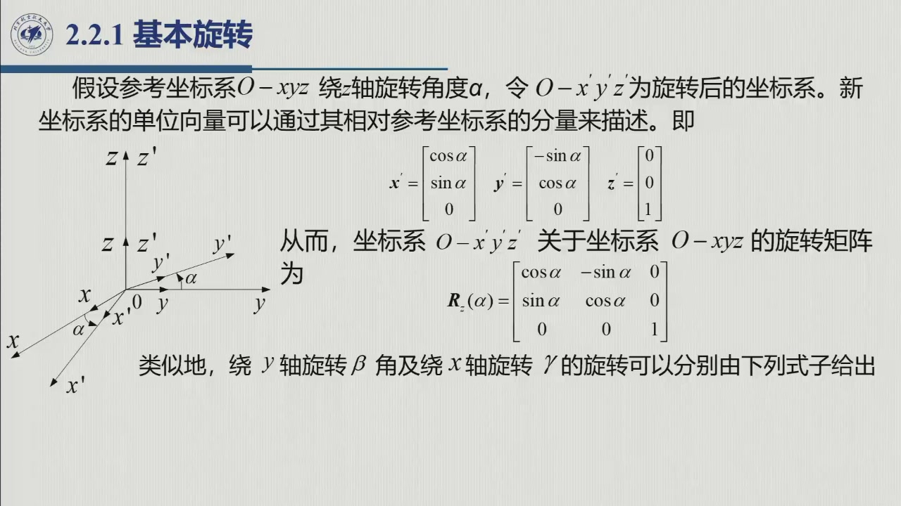
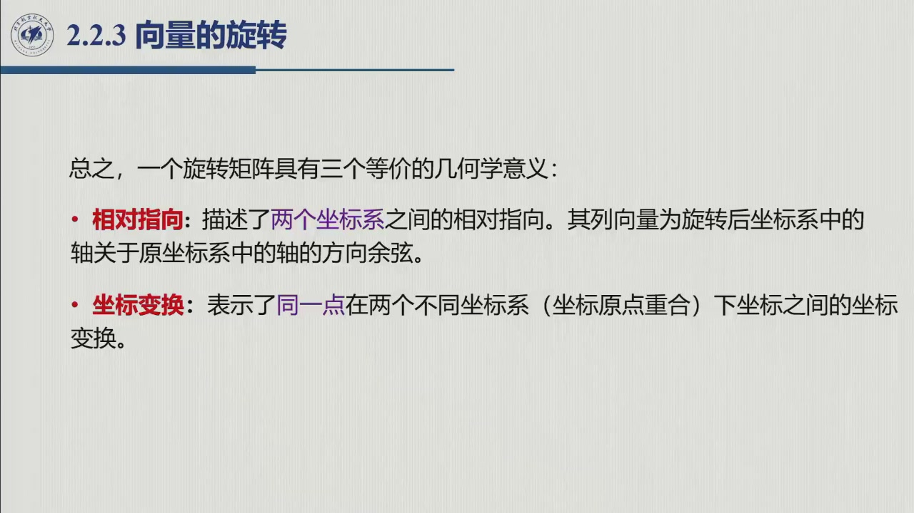

# 2.2 旋转矩阵

上一节已经能逐根写出刚体三轴的方向。把它们按列组成矩阵后，就能一次换算整列坐标。但同一个矩阵既能描述坐标系的朝向，也能旋转向量，符号相同并不代表物理过程相同。

本节先从三根轴推出正交性与右手条件，再写出三个基本旋转。最后用同一组数比较**向量真的转动**与**同一点改用另一套坐标**，通过读数判断该乘 $R$ 还是 $R^{\mathrm T}$。原书对应 §2.2，印刷页 40–45；本教程将其拆成下列四部分。

## 2.2.1 定义与两条代数性质

::: def 定义 2.2.1 · 旋转矩阵 {#def-2.2.1}
把式 2.2 的 9 个方向余弦**按列**排成（3×3）矩阵

$$R=\begin{bmatrix}\boldsymbol x'&\boldsymbol y'&\boldsymbol z'\end{bmatrix}
=\begin{bmatrix}x'_x & y'_x & z'_x\\ x'_y & y'_y & z'_y\\ x'_z & y'_z & z'_z\end{bmatrix}\qquad(\text{原书式 }2.3)$$

称为**[旋转矩阵](../recall.md#rotation)**，又称**方向余弦阵**。这里沿用两系均为右手正交系的约定；第 1、2、3 列依次表示本体系 $x'$、$y'$、$z'$ 轴在参考系中的坐标。
:::

两条代数性质不必死记——从定义直接乘一遍就出来了（原书式 2.4–2.5）。注意 $R^{\mathrm T}$ 的第 $i$ **行**正是 $R$ 的第 $i$ **列**，于是 $R^{\mathrm T}R$ 的 $(i,j)$ 元恰是**第 $i$ 列与第 $j$ 列的点积**。记三列为 $\boldsymbol c_1=\boldsymbol x',\boldsymbol c_2=\boldsymbol y',\boldsymbol c_3=\boldsymbol z'$，则

$$(R^{\mathrm T}R)_{ij}=\boldsymbol c_i^{\mathrm T}\boldsymbol c_j=\boldsymbol c_i\cdot\boldsymbol c_j
=\begin{cases}\|\boldsymbol c_i\|^2=1,& i=j\\[1mm] 0,& i\ne j\end{cases}
\qquad\Longrightarrow\qquad
R^{\mathrm T}R=I_3,\qquad R^{-1}=R^{\mathrm T}.$$

对照上式逐项读：单位模长给对角线的 $1$，两两垂直给非对角的 $0$——所谓正交性，就是「三列构成标准正交组」的矩阵说法。

行列式也一步到位：对 $R^{\mathrm T}R=I_3$ 取行列式，得 $(\det R)^2=1$，故 $\det R=\pm1$。

两个符号各有归属。$\det R=-1$ 对应把某一根轴镜像翻转的「照镜子」坐标系（左手系）；而**右手系**的固连坐标系总可以连续转回与参考系重合，$\det$ 是元素的连续函数、途中不可能从 $+1$ 跳到 $-1$，故右手系必为 $\det R=+1$。据此定义：

::: def 定义 2.2.2 · 特殊正交群 SO(3) {#def-2.2.2}
$$SO(3)=\{R\in\mathbb{R}^{3\times3}:\ R^TR=I_3,\ \det(R)=1\}.$$

把维数推广一步：$SO(m)$ 的列是**标准正交**向量（单位长且两两正交），行列式也取 1；空间旋转取 $m=3$，平面旋转取 $m=2$（原书 orthonormal）。
:::

::: note 9 个量、6 个约束、3 个独立参数 {#note-2.2.2}
$R$ 有 9 个元素，三列单位长度给 3 个约束、两两垂直再给 3 个约束，留下 **3 个连续独立参数**。$\det R=+1$ 选择右手性，不再扣一个连续自由度。

这是局部参数计数，不表示任意挑出三个矩阵元素就能唯一恢复姿态，也不保证一套三个角在所有姿态下都无奇异。[§2.4](sec2-4.md) 的欧拉角、[§2.5](sec2-5.md) 的角和轴及 [§2.10](sec2-10.md) 的操作空间表示都会用到这一区分。
:::

::: note 选读 · 群、李群与李代数 {#note-2.2.group}
**群**（group）是带一种「乘法」的集合，满足四条公理：**封闭性**（任意两元之积仍在集合内）、**结合律**、**存在单位元**、**每个元存在逆元**。

$SO(3)$ 逐条兑现：两个旋转之积仍满足 $R^{\mathrm T}R=I$、$\det=+1$（封闭）；矩阵乘法天然结合；$I_3$ 是单位元；$R^{-1}=R^{\mathrm T}$ 仍是旋转矩阵（有逆）。

$SO(3)$ 也构成一个光滑流形（可以局部用连续参数描述的空间），而且矩阵乘法与求逆都是光滑映射，因此它是**李群**（Lie group）。直观上，全体姿态构成嵌在九维矩阵空间中的三维“曲面”，机器人转动时 $R(t)$ 沿着这张“曲面”变化。

这张“曲面”在单位元 $I_3$ 处的**切空间**描述无穷小旋转，记作 $so(3)$（小写）；它由 $3\times3$ 反对称矩阵组成，并带有矩阵交换子运算，称为李代数。[§2.5.3](sec2-5.md#sec-2.5.3) 会说明它怎样连接角和轴、指数映射与角速度。这一段属于后续内容的预告；本节计算只需掌握群的四条性质与旋转矩阵判据。
:::

## 2.2.2 基本旋转

保持参考系不动，让与它最初同向、**共原点**的本体系绕一根参考轴转动，得到三个基本旋转。正方向用**右手定则**确定：右拇指指向转轴正方向，四指弯曲方向为正。等价地，**从转轴正端朝原点看**，逆时针为正；从另一端看，视觉方向相反。

下文用 $c_\alpha=\cos\alpha$、$s_\alpha=\sin\alpha$ 等缩写。矩阵元素无量纲，角度需采用一致的单位；编程时三角函数通常接收弧度。

先以绕 $z$ 轴转 $\alpha$ 为例（图 2.2），按定义逐列写出新轴在参考系中的投影：

$$\boldsymbol x'=\begin{bmatrix}c_\alpha\\ s_\alpha\\ 0\end{bmatrix},\quad
\boldsymbol y'=\begin{bmatrix}-s_\alpha\\ c_\alpha\\ 0\end{bmatrix},\quad
\boldsymbol z'=\begin{bmatrix}0\\0\\1\end{bmatrix}
\;\Longrightarrow\;
R_z(\alpha)=\begin{bmatrix}c_\alpha & -s_\alpha & 0\\ s_\alpha & c_\alpha & 0\\ 0&0&1\end{bmatrix}\qquad(\text{原书式 }2.6)$$

下面把同一推导画成从 $+z$ 朝原点看的平面图。$\boldsymbol x'$ 在 $x$、$y$ 上的投影分别是 $c_\alpha,s_\alpha$；与它垂直的 $\boldsymbol y'$ 则给出 $-s_\alpha,c_\alpha$。逐列读图，就不必孤立地背负号。

<figure>
<svg class="figure-svg" viewBox="0 0 920 300" xmlns="http://www.w3.org/2000/svg" role="img" aria-labelledby="fig-22-title fig-22-desc">
<title id="fig-22-title">绕 z 轴基本旋转的几何与矩阵</title>
<desc id="fig-22-desc">左图从 z 轴正端俯视：x′ 转过角 α，其在 x 轴投影为 cosα、在 y 轴投影为 sinα；y′ 的投影给出 −sα 与 cα。右图为 Rz(α) 矩阵，彩色元素与左图彩色标注一一对应，第三行第三列钉住为 0 0 1。</desc>
<defs>
<marker id="f22-m" markerWidth="9" markerHeight="9" refX="7" refY="3" orient="auto"><path d="M0,0 L7,3 L0,6 Z" fill="var(--muted)"/></marker>
<marker id="f22-b" markerWidth="9" markerHeight="9" refX="7" refY="3" orient="auto"><path d="M0,0 L7,3 L0,6 Z" fill="var(--fig-blue)"/></marker>
<marker id="f22-s" markerWidth="9" markerHeight="9" refX="7" refY="3" orient="auto"><path d="M0,0 L7,3 L0,6 Z" fill="var(--sage)"/></marker>
<marker id="f22-g" markerWidth="9" markerHeight="9" refX="7" refY="3" orient="auto"><path d="M0,0 L7,3 L0,6 Z" fill="var(--fig-gold)"/></marker>
</defs>
<text class="diagram-text" x="230" y="26" text-anchor="middle">绕 z 转 α：从 +z 端往下看</text>
<text class="diagram-text" x="674" y="26" text-anchor="middle">Rz(α) = 左图几何的矩阵化</text>
<circle cx="230" cy="180" r="95" fill="none" stroke="var(--line)" stroke-dasharray="3 5"/>
<line class="diagram-axis" x1="100" y1="180" x2="375" y2="180" marker-end="url(#f22-m)"/>
<line class="diagram-axis" x1="230" y1="277" x2="230" y2="55" marker-end="url(#f22-m)"/>
<text class="diagram-note" x="384" y="185">x</text>
<text class="diagram-note" x="222" y="50" text-anchor="end">y</text>
<line stroke="var(--fig-blue)" stroke-width="2.6" marker-end="url(#f22-b)" x1="230" y1="180" x2="284" y2="102"/>
<line stroke="var(--sage)" stroke-width="2.2" marker-end="url(#f22-s)" x1="230" y1="180" x2="152" y2="126"/>
<text class="diagram-text" fill="var(--fig-blue)" x="292" y="98">x′</text>
<text class="diagram-text" fill="var(--sage)" x="136" y="120" text-anchor="end">y′</text>
<g stroke="var(--line)" stroke-dasharray="4 4">
<line x1="284" y1="102" x2="284" y2="180"/><line x1="284" y1="102" x2="230" y2="102"/>
<line x1="152" y1="126" x2="152" y2="180"/><line x1="152" y1="126" x2="230" y2="126"/>
</g>
<text class="diagram-text" fill="var(--fig-blue)" x="257" y="197" text-anchor="middle">cα</text>
<text class="diagram-text" fill="var(--fig-green)" x="218" y="141" text-anchor="end">sα</text>
<text class="diagram-text" fill="var(--fig-gold)" x="176" y="197" text-anchor="middle">−sα</text>
<path d="M270 180 A40 40 0 0 0 252.77 147.11" fill="none" stroke="var(--fig-gold)" stroke-width="1.8" marker-end="url(#f22-g)"/>
<text class="diagram-note" x="277" y="157">α</text>
<text class="diagram-note" x="230" y="290" text-anchor="middle">先写 x′ 列，再写 y′ 列；z′ = z</text>
<g fill="none" stroke="var(--line)">
<rect x="590" y="88" width="168" height="120"/><line x1="646" y1="88" x2="646" y2="208"/><line x1="702" y1="88" x2="702" y2="208"/>
<line x1="590" y1="128" x2="758" y2="128"/><line x1="590" y1="168" x2="758" y2="168"/>
</g>
<rect x="586" y="84" width="120" height="88" rx="6" fill="none" stroke="var(--fig-blue)" stroke-width="1.4"/>
<text class="diagram-text" fill="var(--fig-blue)" x="618" y="113" text-anchor="middle">cα</text>
<text class="diagram-text" fill="var(--fig-gold)" x="674" y="113" text-anchor="middle">−sα</text>
<text class="diagram-note" x="730" y="113" text-anchor="middle">0</text>
<text class="diagram-text" fill="var(--fig-green)" x="618" y="153" text-anchor="middle">sα</text>
<text class="diagram-text" fill="var(--fig-blue)" x="674" y="153" text-anchor="middle">cα</text>
<text class="diagram-note" x="730" y="153" text-anchor="middle">0</text>
<text class="diagram-note" x="618" y="193" text-anchor="middle">0</text>
<text class="diagram-note" x="674" y="193" text-anchor="middle">0</text>
<text class="diagram-text" fill="var(--fig-purple)" x="730" y="193" text-anchor="middle">1</text>
<text class="diagram-note" x="674" y="238" text-anchor="middle">第 1、2 列分别对应 x′、y′</text>
<text class="diagram-note" x="674" y="260" text-anchor="middle">第 3 行为 [0 0 1]，第 3 列为其转置</text>
</svg>
<figcaption>绕 z 基本旋转的几何 → 矩阵（本教程绘）：逐列投影给出 $R_z(\alpha)$ 的全部元素；蓝 / 绿 / 金三色把左图的 $c_\alpha,s_\alpha,-s_\alpha$ 与右图矩阵元素对应起来，第三行第三列的「钉住」结构对应「绕谁转谁不动」。</figcaption>
</figure>

同样方法可得绕 $y$ 轴转 $\beta$、绕 $x$ 轴转 $\gamma$ 的矩阵（原书式 2.7–2.8）：

$$R_y(\beta)=\begin{bmatrix}c_\beta & 0 & s_\beta\\ 0&1&0\\ -s_\beta & 0 & c_\beta\end{bmatrix},\qquad
R_x(\gamma)=\begin{bmatrix}1&0&0\\ 0&c_\gamma & -s_\gamma\\ 0&s_\gamma & c_\gamma\end{bmatrix}$$

::: note 逐格读法 · 「钉住」的是哪一行、哪一列 {#note-2.2.Ry}
三个基本旋转矩阵的共同结构：**绕哪个轴转，哪个轴就被「钉住」不动**。

| 矩阵 | 被钉住的部分 | 剩下的是什么 |
|:--|:--|:--|
| $R_z(\alpha)$ | 第 3 列为 $(0,0,1)^{\mathrm T}$，第 3 行为 $(0,0,1)$ | $+90^\circ$ 时，$x\to+y$、$y\to-x$ |
| $R_y(\beta)$ | 第 2 列为 $(0,1,0)^{\mathrm T}$，第 2 行为 $(0,1,0)$ | $+90^\circ$ 时，$x\to-z$、$z\to+x$；因此 $(3,1)$ 元为 $-s_\beta$ |
| $R_x(\gamma)$ | 第 1 列为 $(1,0,0)^{\mathrm T}$，第 1 行为 $(1,0,0)$ | $+90^\circ$ 时，$y\to+z$、$z\to-y$ |

先写不动轴对应的列，再按右手定则写另外两列。比如 $R_y(90^\circ)$ 的第一列必须是 $(0,0,-1)^{\mathrm T}$，不能因为熟悉 $R_z$ 就把正弦符号直接照搬。
:::

另有一条常用关系——负角旋转等于转置（原书式 2.9）：

$$R_k(-\vartheta)=R_k^T(\vartheta),\qquad k=x,y,z .$$

::: intuition 几何意义与记忆法
$R_k(\vartheta)$ 的三列描述本体系经过单轴转动后的朝向。绕 $x,y,z$ 时，不动轴对应的列分别为 $(1,0,0)^{\mathrm T}$、$(0,1,0)^{\mathrm T}$、$(0,0,1)^{\mathrm T}$；相应行是它们的转置。只有绕 $z$ 时，才是第 3 行/列的 $001$ 结构。
:::

::: method 为什么从基本旋转出发
选取适当的三次基本旋转序列，可以表示任意空间姿态。例如绕当前轴的 $Z\!Y\!Z$ 序列是 [§2.4](sec2-4.md) 的一套欧拉角约定；并非任意选三次都能覆盖所有姿态，连续三次绕同一轴就不行。“三次怎么乘”由 [§2.3](sec2-3.md) 解释。
:::

## 2.2.3 向量的表示：坐标变换

有了三个基本旋转，接着看旋转矩阵如何作用于向量。先从两系**原点重合**的最简情形说起（图 2.3）：空间中同一点 $P$ 在两个系中的坐标分别为 $\boldsymbol p$ 与 $\boldsymbol p'$。由式 2.3 可得（原书式 2.10）：

$$\boldsymbol p=p'_x\boldsymbol x'+p'_y\boldsymbol y'+p'_z\boldsymbol z'=R\,\boldsymbol p' .$$

本节带撇号表示本体系坐标，不表示时间上的“转动之前”。点 $P$ 没有移动，只是两套基底给出不同读数。写成下一节的上下标，就是 $\boldsymbol p^0=R_1^0\boldsymbol p^1$；这里 $R=R_1^0$。

::: thm 原理 2.2.A · 坐标变换与逆变换 {#thm-2.2.A}
$R$ 是「把同一点在**动系**中的坐标换算到**参考系**」的**变换矩阵**。由正交性，逆变换白送（原书式 2.11）：

$$\boldsymbol p'=R^T\boldsymbol p .$$

若问“已知参考系坐标，求本体系坐标”，就用 $R^{\mathrm T}$。两系原点不重合时，点的位置变换还须加减平移；自由方向的坐标换算则不需要平移。
:::

::: ex 例 2.1（原书）· 绕 z 轴转动后的坐标关系 {#ex-book-2.1}
两系只相差一个绕 $z$ 轴的转角 $\alpha$。令 $\boldsymbol p=(\rho_x,\rho_y,\rho_z)$、$\boldsymbol p'=(\rho'_x,\rho'_y,\rho'_z)$，由平面上的简单几何关系直接写出：

$$\rho_x=\rho'_x\cos\alpha-\rho'_y\sin\alpha,\qquad
\rho_y=\rho'_x\sin\alpha+\rho'_y\cos\alpha,\qquad
\rho_z=\rho'_z .$$

即 $\boldsymbol p=R_z(\alpha)\boldsymbol p'$——**同一个式 2.6 的矩阵**既描述两系指向，又描述原点重合时的坐标换算（原书据此把「姿态描述」与「坐标变换」两种解释打通）。
:::

## 2.2.4 旋转算子与三重几何身份

同一个乘积 $\boldsymbol p=R\boldsymbol p'$，还可把 $R$ 当**旋转算子**：这时两列坐标都写在同一个固定参考系中，$\boldsymbol p'$ 表示转动前的向量，$\boldsymbol p$ 表示转动后的向量。为避免撇号的双重用途，下方数值对照与演示改用 $\boldsymbol v_{\rm before}$、$\boldsymbol v_{\rm after}$。因 $R$ 正交，转动保持模长（原书）：

$$\|\boldsymbol p\|^2=\boldsymbol p'^T R^TR\,\boldsymbol p'=\boldsymbol p'^T\boldsymbol p'=\|\boldsymbol p'\|^2 .$$

::: ex 例 2.2（原书）· xy 平面内的向量旋转 {#ex-book-2.2}
$xy$ 平面上的向量 $\boldsymbol p'$ 绕 $z$ 轴转 $\alpha$ 得 $\boldsymbol p$，其分量仍为

$$p_x=p'_x\cos\alpha-p'_y\sin\alpha,\qquad
p_y=p'_x\sin\alpha+p'_y\cos\alpha,\qquad
p_z=p'_z\;\Longrightarrow\;\boldsymbol p=R_z(\alpha)\boldsymbol p' .$$

形式上与例 2.1 完全相同，但语义不同：这里是**同一个系内**把向量旋转，那里是**两个系之间**换算坐标（原书特别区分了这两种用法）。
:::

::: thm 定理 2.2.B · 旋转矩阵的三重几何身份 {#thm-2.2.B}
同一个 $R$ 有三种等价解读：
1. **姿态描述**——两个坐标系之间的相对指向，列向量为动系轴在参考系中的方向余弦；
2. **坐标变换**——同一点在两系（原点重合）下坐标之间的变换，$\boldsymbol p=R\boldsymbol p'$；
3. **旋转算子**——同一坐标系内把一个向量旋转到新方向的算子。

计算前先写清楚：哪两列在比较、各用哪个坐标系、是否真的发生转动。几何解释相互对应，但求解方向决定使用 $R$ 还是 $R^{\mathrm T}$。
:::

### 同一组数，两种不同的问题

::: ex 数值对照 · 都是 +90°，为什么读数正负不同？ {#ex-2.2.compare}
取 $R=R_z(90^\circ)$，输入列 $\boldsymbol a=(1,0.5,0)^{\mathrm T}$。以下向量坐标为无量纲示例；若它们表示点的位置，则统一乘长度单位，并要求两系共原点。

| 情境 | 保持不变的是什么？ | 计算与结果 |
|---|---|---|
| 转向量 | 参考坐标系不动，向量从 $\boldsymbol a$ 真正正转 $90^\circ$ | $\boldsymbol v_{\rm after}=R\boldsymbol a=(-0.5,1,0)^{\mathrm T}$ |
| 换坐标 | 点 $P$ 不动，它的参考系坐标为 $\boldsymbol p^0=\boldsymbol a$；本体系相对参考系正转 $90^\circ$ | $\boldsymbol p^1=R^{\mathrm T}\boldsymbol p^0=(0.5,-1,0)^{\mathrm T}$ |

第二行得到的不是点向下移动，而是同一个点在旋转后基底中的新读数。两种情境都保持模长 $\sqrt{1.25}\approx1.118$，所以**只查模长不能判断你是否把 $R$ 与 $R^{\mathrm T}$ 用反**。
:::

先在纸上预测 $\alpha=90^\circ$ 时两种情境的输出，再操作下方演示。切换模式时观察：蓝色向量是否改变方向？虚线坐标轴是否转动？读数用的是哪一套坐标？角度控件可用方向键调整，“重置”恢复 $30^\circ$ 与“转向量”。

<noscript>
使用上面的数值表和下面的折叠练习，可以完成同样的判断。
</noscript>

::: think 练习 · 不看演示先判断 {#practice-2.2.rotation}
1. 令 $\alpha=-90^\circ$，仍用 $\boldsymbol a=(1,0.5,0)^{\mathrm T}$：转向量与换坐标分别得到什么？
2. 令 $\alpha=180^\circ$，为什么只做这一角度的测试不容易发现 $R$ 与 $R^{\mathrm T}$ 用反？
3. 对绕 $+y$ 轴正转 $90^\circ$ 的主动旋转，$(1,0,0)^{\mathrm T}$ 变成什么？请用右手定则验证。

::: sol 练习核对
1. 转向量用 $R_z(-90^\circ)$，得到 $(0.5,-1,0)^{\mathrm T}$；换坐标用它的转置，得到 $(-0.5,1,0)^{\mathrm T}$。与上表的两项恰好交换。
2. $R_z(180^\circ)=R_z^{\mathrm T}(180^\circ)=\operatorname{diag}(-1,-1,1)$，两项都得到 $(-1,-0.5,0)^{\mathrm T}$。还应测试 $\pm90^\circ$ 等能区分二者的角度。
3. 得到 $(0,0,-1)^{\mathrm T}$。右拇指沿 $+y$，正转把 $+x$ 带到 $-z$，这也检查了 $R_y$ 第一列正弦项的负号。
:::
:::

::: think 默写点 · 合上书再写（主动回忆）

不看正文与速查卡，先写再展开核对。

1. 默写 $R_x(\vartheta)$、$R_y(\vartheta)$、$R_z(\vartheta)$。
2. 写出旋转矩阵的三条性质（正交性、行列式、独立参数）。
3. 旋转矩阵的三重身份是什么？各举一例。

::: sol 核对

三个矩阵见[公式速查卡 A2](../preface-formulas.md#a2-基本旋转)。先检查不动轴那一列，再检查 $+90^\circ$ 时另外两轴的方向；例如 $R_y$ 必须把 $+x$ 带到 $-z$。

$R^{\mathrm T}R=I$（即 $R^{-1}=R^{\mathrm T}$）、$\det R=+1$、独立参数 3 个。

姿态描述：三列说明工具系相对法兰系的三轴朝向。坐标变换：共原点时，$\boldsymbol p^0=R_1^0\boldsymbol p^1$；若相机与基座原点不同，点坐标还需平移。旋转算子：同一固定系中，$\boldsymbol v_{\rm after}=R\boldsymbol v_{\rm before}$；若转轴不过原点，转动点的位置还需先减去轴上参考点再旋转、最后加回。

:::

:::

## 2.2 小结与常见错误

- **一条主线**：9 个方向余弦 → 按列成阵 $R$（式 2.3）→ 正交性给 $R^{-1}=R^T$ 与 3 个独立参数 → 基本旋转 $R_x,R_y,R_z$ 是积木 → 同一矩阵三重身份（姿态 / 变换 / 算子）。
- **两个数字**：$9-6=3$（独立参数，[@note-2.2.2]）；$\det R=+1$（右手系）。
- **一个打通**：例 2.1（[@ex-book-2.1]，坐标变换）与例 2.2（[@ex-book-2.2]，旋转算子）形式同、语义异——读公式先问「同一点还是同一个系」。

::: think 常见错误清单 · 自查三条
1. 只靠模长检查乘法方向：$R$ 与 $R^{\mathrm T}$ 都保持模长，仍须说明输入和输出分别在哪个系；
2. 混淆「姿态描述」与「坐标变换」：$R_1^0$ 的**列**是系 1 的轴在系 0 中的像（把系 1 坐标搬到系 0），上下标读反就全错；
3. 认为 $\det R$ 取 $\pm1$ 无所谓——$\det=-1$ 是左手系（含镜像），不属于 $SO(3)$，用它会得到「照镜子」的假姿态。
:::
