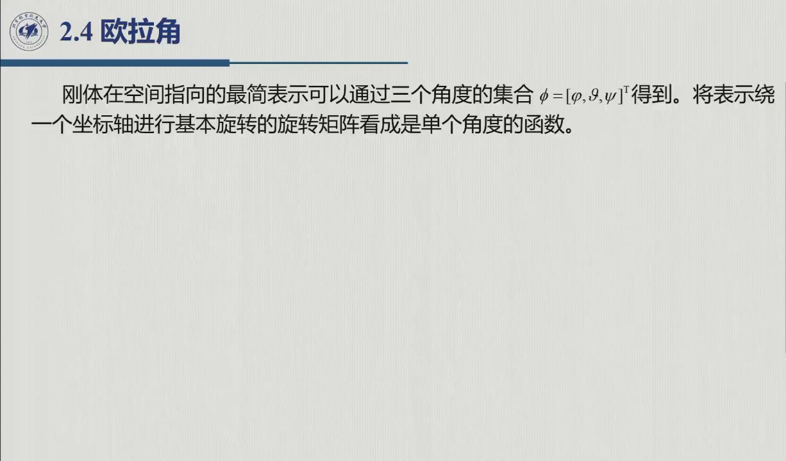
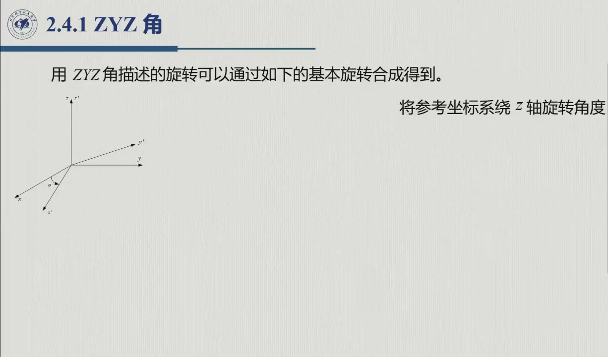
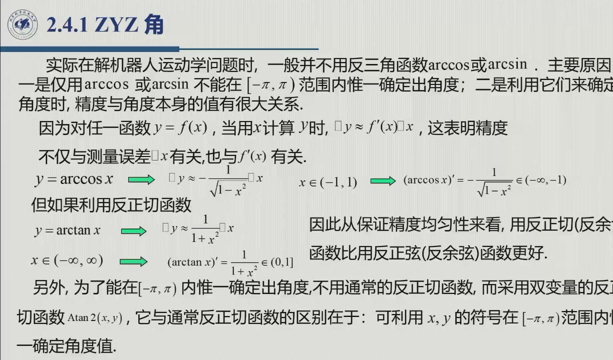
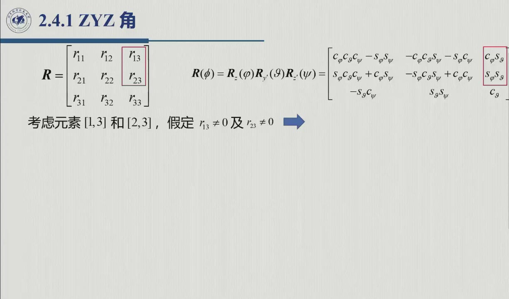
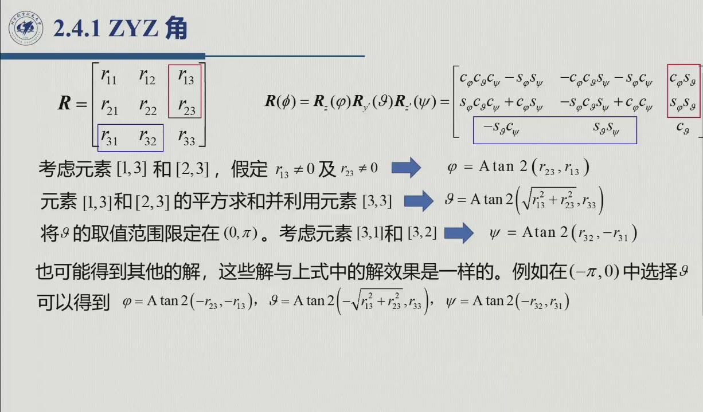
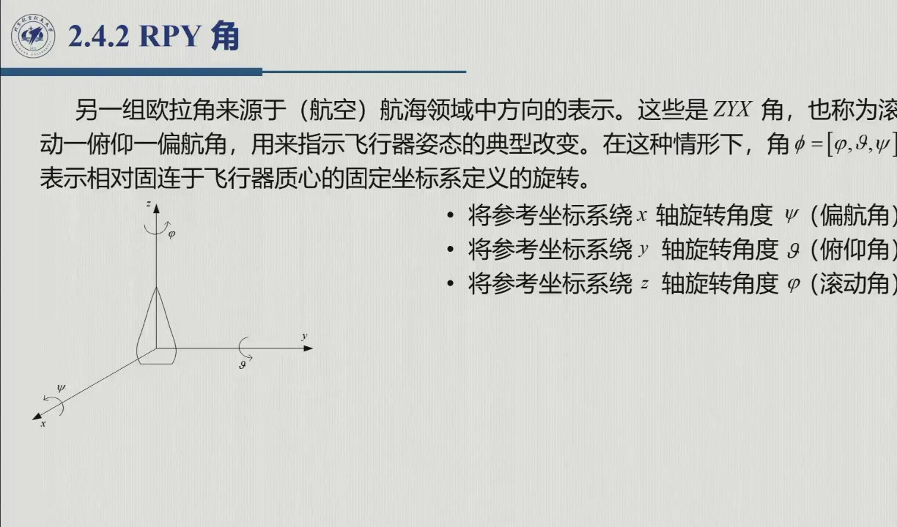
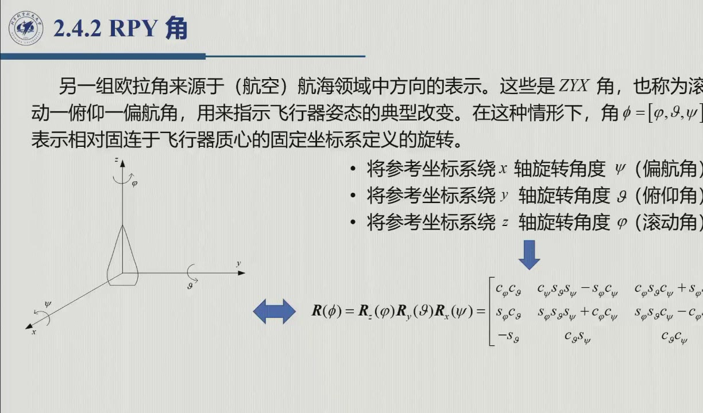

# 2.4 欧拉角：ZYZ 与 RPY

上一节用矩阵合成旋转。这一节反过来问：怎样用三个角记录一个姿态，又怎样从矩阵把角找回来？我们比较两套明确的约定：**ZYZ 当前轴旋转**与**RPY 固定轴旋转**。学习时要区分轴序列、角的取值范围和不能唯一反解的姿态。

{{#include ../assets/figures/robot-euler.md}}

## 2.4.1 最简表示与 12 种可行序列

旋转矩阵的 9 个元素受 6 个独立正交约束，因此姿态具有 3 个连续自由度（[@note-2.2.2]）。三个参数可以作**局部最简表示**；这不保证一套三个角在所有姿态处都唯一、连续、无奇异。

从 $I$ 出发，三个轴各可选 $X,Y,Z$，共有 $3^3=27$ 种序列。相邻同轴旋转可合并，例如 $ZXX$ 只剩两转，$XXX$ 只剩一个有效角，不能覆盖任意姿态。留下的 $3\times2\times2=12$ 种分为：

- 首末轴相同：$XYX,XZX,YXY,YZY,ZXZ,ZYZ$；
- 三轴互异：$XYZ,XZY,YXZ,YZX,ZXY,ZYX$。

每种序列都能覆盖全部姿态，但都有表示奇点。同一姿态也可能对应多组角，即使轴序列相同。**序列名本身没有说明固定轴还是当前轴**，还须声明轴的约定、角名及发生顺序。

## 2.4.2 ZYZ 角：右乘合成与正解

从 $I$ 出发，ZYZ 序列（原书图 2.8）的每一步都绕**当前轴**旋转，因此按 [@thm-2.3.A] 依次**右乘**：

1. 绕参考系 $z$ 轴转 $\varphi$：$R_z(\varphi)$；
2. 绕**新** $y'$ 轴转 $\vartheta$：$R_{y'}(\vartheta)$；
3. 绕**新** $z''$ 轴转 $\psi$：$R_{z''}(\psi)$。

三步过程中坐标架如何演化，看下图（灰虚 = 上一步的旧架）：每转一次，「当前轴」就换到刚转出来的新架上——这正是「右乘」的几何本体。

<figure>
<svg class="figure-svg" viewBox="0 0 920 350" xmlns="http://www.w3.org/2000/svg" role="img" aria-labelledby="fig-zyzs-t fig-zyzs-d">
<title id="fig-zyzs-t">ZYZ 三步旋转的坐标架演化</title>
<desc id="fig-zyzs-d">三个面板依次为：绕 z 转 φ 后、绕新 y′ 转 ϑ 后、绕新 z″ 转 ψ 后的坐标架；灰色虚线为上一步旧架，粗线与圆环标出本次转轴。三步全绕当前轴，依次右乘。</desc>
<defs>
<marker id="fzs-m" markerWidth="8" markerHeight="8" refX="6" refY="2.5" orient="auto"><path d="M0,0 L6,2.5 L0,5 Z" fill="var(--muted)"/></marker>
<marker id="fzs-b" markerWidth="8" markerHeight="8" refX="6" refY="2.5" orient="auto"><path d="M0,0 L6,2.5 L0,5 Z" fill="var(--fig-blue)"/></marker>
<marker id="fzs-n" markerWidth="8" markerHeight="8" refX="6" refY="2.5" orient="auto"><path d="M0,0 L6,2.5 L0,5 Z" fill="var(--fig-green)"/></marker>
<marker id="fzs-g" markerWidth="8" markerHeight="8" refX="6" refY="2.5" orient="auto"><path d="M0,0 L6,2.5 L0,5 Z" fill="var(--fig-gold)"/></marker>
<marker id="fzs-a" markerWidth="8" markerHeight="8" refX="6" refY="2.5" orient="auto"><path d="M0,0 L6,2.5 L0,5 Z" fill="var(--accent-text)"/></marker>
</defs>
<!-- panel 1 -->
<text class="diagram-text" x="155" y="34" text-anchor="middle">① Rz(φ)：绕 z 转 φ（方位）</text>
<g stroke="var(--muted)" stroke-width="1.1" stroke-dasharray="3 4" marker-end="url(#fzs-m)" opacity=".75">
<line x1="155" y1="215" x2="221.2" y2="233"/>
<line x1="155" y1="215" x2="123.9" y2="197.1"/>
<line x1="155" y1="215" x2="155" y2="146"/>
</g>
<line stroke="var(--accent-text)" stroke-width="3" x1="155" y1="215" x2="155" y2="130"/>
<text class="diagram-note" fill="var(--accent-text)" x="163" y="136">轴 z</text>
<path d="M 191 182 A 36 10 0 1 1 119 182 A 36 10 0 1 1 191 182" fill="none" stroke="var(--accent-text)" stroke-width="1.7" marker-end="url(#fzs-a)"/>
<g stroke-width="2.4">
<line stroke="var(--fig-blue)" marker-end="url(#fzs-b)" x1="155" y1="215" x2="185.8" y2="217.2"/>
<line stroke="var(--fig-green)" marker-end="url(#fzs-n)" x1="155" y1="215" x2="88.6" y2="189.7"/>
<line stroke="var(--fig-gold)" marker-end="url(#fzs-g)" x1="155" y1="215" x2="155" y2="146"/>
</g>
<text class="diagram-text" fill="var(--fig-blue)" x="192" y="226">x′</text>
<text class="diagram-text" fill="var(--fig-green)" x="82" y="188" text-anchor="end">y′</text>
<text class="diagram-text" fill="var(--fig-gold)" x="150" y="140" text-anchor="end">z′</text>
<!-- panel 2 -->
<text class="diagram-text" x="465" y="34" text-anchor="middle">② Ry′(ϑ)：绕新 y′ 转 ϑ（俯仰）</text>
<g stroke="var(--muted)" stroke-width="1.1" stroke-dasharray="3 4" marker-end="url(#fzs-m)" opacity=".75">
<line x1="465" y1="215" x2="495.8" y2="217.2"/>
<line x1="465" y1="215" x2="398.6" y2="189.7"/>
<line x1="465" y1="215" x2="465" y2="146"/>
</g>
<line stroke="var(--accent-text)" stroke-width="3" x1="465" y1="215" x2="407.3" y2="193"/>
<text class="diagram-note" fill="var(--accent-text)" x="400" y="162" text-anchor="end">轴 y′</text>
<path d="M 448.3 172.4 A 34 10 -69.1 1 1 424.1 236 A 34 10 -69.1 1 1 448.3 172.4" fill="none" stroke="var(--accent-text)" stroke-width="1.7" marker-end="url(#fzs-a)"/>
<g stroke-width="2.4">
<line stroke="var(--fig-blue)" marker-end="url(#fzs-b)" x1="465" y1="215" x2="482.7" y2="272.8"/>
<line stroke="var(--fig-green)" marker-end="url(#fzs-n)" x1="465" y1="215" x2="398.6" y2="189.7"/>
<line stroke="var(--fig-gold)" marker-end="url(#fzs-g)" x1="465" y1="215" x2="490.2" y2="177.2"/>
</g>
<text class="diagram-text" fill="var(--fig-blue)" x="492" y="284">x″</text>
<text class="diagram-text" fill="var(--fig-green)" x="392" y="186" text-anchor="end">y″</text>
<text class="diagram-text" fill="var(--fig-gold)" x="498" y="174">z″</text>
<!-- panel 3 -->
<text class="diagram-text" x="775" y="34" text-anchor="middle">③ Rz″(ψ)：绕新 z″ 转 ψ（自转）</text>
<g stroke="var(--muted)" stroke-width="1.1" stroke-dasharray="3 4" marker-end="url(#fzs-m)" opacity=".75">
<line x1="775" y1="215" x2="792.7" y2="272.8"/>
<line x1="775" y1="215" x2="708.7" y2="189.7"/>
<line x1="775" y1="215" x2="800.2" y2="177.2"/>
</g>
<line stroke="var(--accent-text)" stroke-width="3" x1="775" y1="215" x2="796.9" y2="182.2"/>
<text class="diagram-note" fill="var(--accent-text)" x="824" y="196">轴 z″</text>
<path d="M 816.4 207 A 30 9 33.7 1 1 766.4 173.8 A 30 9 33.7 1 1 816.4 207" fill="none" stroke="var(--accent-text)" stroke-width="1.7" marker-end="url(#fzs-a)"/>
<g stroke-width="2.4">
<line stroke="var(--fig-blue)" marker-end="url(#fzs-b)" x1="775" y1="215" x2="757.1" y2="252.4"/>
<line stroke="var(--fig-green)" marker-end="url(#fzs-n)" x1="775" y1="215" x2="708.7" y2="164.2"/>
<line stroke="var(--fig-gold)" marker-end="url(#fzs-g)" x1="775" y1="215" x2="800.2" y2="177.2"/>
</g>
<text class="diagram-text" fill="var(--fig-blue)" x="750" y="264" text-anchor="end">x′′′</text>
<text class="diagram-text" fill="var(--fig-green)" x="702" y="160" text-anchor="end">y′′′</text>
<text class="diagram-text" fill="var(--fig-gold)" x="790" y="163" text-anchor="end">z′′′</text>
<text class="diagram-note" x="460" y="304" text-anchor="middle">灰虚 = 上一步旧架；粗线与圆环 = 本次转轴（按当前坐标架选轴）</text>
<text class="diagram-note" x="460" y="326" text-anchor="middle">新因子依次往右追加：R = Rz(φ)·Ry′(ϑ)·Rz″(ψ)；ϑ → 0 时 z 与 z″ 平行，φ 与 ψ 不可分（ZYZ 表示奇点）</text>
</svg>
<figcaption>ZYZ 三步坐标架（取 $\varphi=40°,\vartheta=55°,\psi=30°$）。灰虚线是上一步坐标架；圆环箭头只示意转动，不用于量角。初始 $z_0$ 与终态 $z_3=z_2$ 的夹角为 $55°$；第三步绕 $z_2$ 转动，不改变这根轴的方向。</figcaption>
</figure>

$$R(\boldsymbol\phi)=R_z(\varphi)\,R_{y'}(\vartheta)\,R_{z''}(\psi)
=\begin{bmatrix}
c_\varphi c_\vartheta c_\psi-s_\varphi s_\psi & -c_\varphi c_\vartheta s_\psi-s_\varphi c_\psi & c_\varphi s_\vartheta\\
s_\varphi c_\vartheta c_\psi+c_\varphi s_\psi & -s_\varphi c_\vartheta s_\psi+c_\varphi c_\psi & s_\varphi s_\vartheta\\
-s_\vartheta c_\psi & s_\vartheta s_\psi & c_\vartheta
\end{bmatrix}$$

（原书式 2.18）。这里 $c_\alpha=\cos\alpha,s_\alpha=\sin\alpha$。正解就是代入三个角算矩阵；第三列是工具 $z$ 轴在固定系中的方向，不含最后自转角 $\psi$。

### 示例：一组可以手算的角

取 $(\varphi,\vartheta,\psi)=(90°,90°,0°)$：

$$R=R_z(90°)R_y(90°)=\begin{bmatrix}0&-1&0\\0&0&1\\-1&0&0\end{bmatrix}.$$

工具三轴因此分别指向固定系的 $-z_0,-x_0,+y_0$。这比只检查矩阵正交性多了一步方向核对。

## 2.4.3 Atan2：保留象限，也要检查输入半径

已知 $\cos\vartheta=r_{33}$，在预先选定 $\vartheta\in[0,\pi]$ 时，$\arccos r_{33}$ 可以给出该主支。问题在于：单个余弦不能判断完整圆周上的角度符号；而在 $r_{33}$ 接近 $\pm1$ 时，仅从余弦恢复角度也很敏感。

::: thm 原理 2.4.A · 双变量反正切的用途与边界 {#thm-2.4.A}
对 $(x,y)\ne(0,0)$，$\alpha=\operatorname{Atan2}(y,x)$ 返回向量 $(x,y)$ 的方向，利用两个符号区分象限。本文按 $(-\pi,\pi]$ 表示主值；软件在负实轴上也可能返回 $-\pi$，与 $+\pi$ 表示同方向。实参顺序为**先 $y$、后 $x$**。

Atan2 的微分为

$$d\alpha=\frac{x\,dy-y\,dx}{x^2+y^2},\qquad
\|\nabla\alpha\|=\frac{1}{\sqrt{x^2+y^2}}.$$

角度单位为弧度。输入半径越小，给定绝对输入扰动可能引起的角度误差越大；在原点，方向没有定义。软件即使给 $\operatorname{atan2}(0,0)$ 返回 0，也不能据此认定几何角是 0。
:::

当输入为 $(\cos\alpha,\sin\alpha)$ 时半径为 1，Atan2 对小的绝对输入误差比较稳定。对比只读余弦的 $\arccos$，其导数大小为 $1/\sqrt{1-x^2}$，在 $x\to\pm1$ 时增大。不能用 $\arctan x$ 的导数不超过 1 来断言双变量 Atan2 永远不放大误差：两者的输入并不相同。

| 要反解的角 | Atan2 使用的 $(x,y)$ | 输入半径 |
|---|---|---|
| ZYZ 的 $\vartheta$ 主支 | $(r_{33},\sqrt{r_{13}^2+r_{23}^2})$ | 1 |
| ZYZ 的 $\varphi$ | $(r_{13},r_{23})$ | $\lvert\sin\vartheta\rvert$ |
| ZYZ 的 $\psi$ | $(-r_{31},r_{32})$ | $\lvert\sin\vartheta\rvert$ |
| RPY 的 $\varphi,\psi$ 主支 | $(r_{11},r_{21})$、$(r_{33},r_{32})$ | $\lvert\cos\vartheta\rvert$ |

例如 ZYZ 在 $\vartheta=1°$ 时，后两个角的输入半径约为 0.01745，局部最坏角度敏感度约为 $57.3$；$\vartheta=0.01°$ 时约为 $5729.6$。它们**接近奇点但尚非精确奇点**。Atan2 保留象限信息，却消不掉表示本身的病态。

## 2.4.4 ZYZ 角的逆解

已知 $R=[r_{ij}]\in SO(3)$，与式 2.18 对比即可反求 $(\varphi,\vartheta,\psi)$。策略是**挑出能暴露单个角度的元素**：

求解分三步走：① 第三列的 $[1,3]$、$[2,3]$ 只含 $\varphi,\vartheta$（$r_{23}=s_\varphi s_\vartheta,\ r_{13}=c_\varphi s_\vartheta$），由此定出 $\varphi$；② 用平方和消去 $\varphi$，再配合 $[3,3]=c_\vartheta$ 定出 $\vartheta$（取 $s_\vartheta>0$ 即 $\vartheta\in(0,\pi)$）；③ 最后用 $[3,1]$、$[3,2]$ 定出 $\psi$。以下设 $s_\vartheta\ne0$（即 $r_{13},r_{23}$ 不全为零；$s_\vartheta=0$ 的退化情形见下方定理 2.4.B）。第一支解为（原书式 2.19）

$$\varphi=\operatorname{Atan2}(r_{23},r_{13}),\qquad
\vartheta=\operatorname{Atan2}\!\big(\sqrt{r_{13}^2+r_{23}^2},\ r_{33}\big),\qquad
\psi=\operatorname{Atan2}(r_{32},-r_{31});$$

若在 $(-\pi,0)$ 中选 $\vartheta$，则得到效果相同的第二支（原书式 2.20）

$$\varphi=\operatorname{Atan2}(-r_{23},-r_{13}),\qquad
\vartheta=\operatorname{Atan2}\!\big({-\sqrt{r_{13}^2+r_{23}^2}},\ r_{33}\big),\qquad
\psi=\operatorname{Atan2}(-r_{32},r_{31}).$$

注意 $\vartheta$ 式的第二个实参 $r_{33}$ **不变号**。等价角组可写为 $(\varphi+\pi,-\vartheta,\psi+\pi)$，首末角按 $2\pi$ 周期化到所选区间。

::: thm 定理 2.4.B · ZYZ 的表示奇点 {#thm-2.4.B}
当 $\vartheta=0$ 时，$R=R_z(\varphi+\psi)$，只能确定**和**。当 $\vartheta=\pi$ 时，

$$R=R_z(\varphi-\psi)R_y(\pi),$$

只能确定**差**。第一、第三转轴分别同向或反向共线，不能从矩阵把两个角独立分离。这是角度表示退化，不表示刚体的真实转动自由度消失。
:::

奇点处仍可选一组代表，例如令 $\psi=0$：$\vartheta=0$ 时取 $\varphi=\operatorname{Atan2}(r_{21},r_{11})$；$\vartheta=\pi$ 时取 $\varphi=\operatorname{Atan2}(-r_{21},-r_{11})$。这是一项选支约定，不是唯一解。

## 2.4.5 RPY 角：绕固定轴的左乘序列

航空航海领域常用**滚转（roll）—俯仰（pitch）—偏航（yaw）**角。本书三个角为 $\boldsymbol\phi=[\varphi\ \vartheta\ \psi]^T$：$\varphi$ 是偏航、$\vartheta$ 是俯仰、$\psi$ 是滚转（原书图 2.9）。从 $I$ 出发，实际发生顺序是绕固定 $x$ 轴转 $\psi$、固定 $y$ 轴转 $\vartheta$、固定 $z$ 轴转 $\varphi$。这里的参考轴方向保持不变，不是随飞行器转动的本体轴。按 [@thm-2.3.B] 逐次左乘，得到下式；同一个乘积也称当前轴 ZYX 序列：

$$R(\boldsymbol\phi)=R_z(\varphi)\,R_y(\vartheta)\,R_x(\psi)
=\begin{bmatrix}
c_\varphi c_\vartheta & c_\varphi s_\vartheta s_\psi-s_\varphi c_\psi & c_\varphi s_\vartheta c_\psi+s_\varphi s_\psi\\
s_\varphi c_\vartheta & s_\varphi s_\vartheta s_\psi+c_\varphi c_\psi & s_\varphi s_\vartheta c_\psi-c_\varphi s_\psi\\
-s_\vartheta & c_\vartheta s_\psi & c_\vartheta c_\psi
\end{bmatrix}$$

（原书式 2.21；英文原版与课件此页角名均标反，见[勘误 E2.1](errata.md#errata-2.1)）。

::: note 译注 · 两条等价说法（原书脚注）
从 $I$ 出发，「按 $x(\psi)\to y(\vartheta)\to z(\varphi)$ 绕固定轴」与「按 $z(\varphi)\to y(\vartheta)\to x(\psi)$ 绕当前轴」终态等价。轴与角须成对倒序；一般非单位初始姿态不能直接套用这一等价（[@thm-2.3.A]、[@thm-2.3.B]）。
:::

**逆解**与 ZYZ 同法（原书式 2.22–2.23）：$\vartheta\in(-\pi/2,\pi/2)$ 时

$$\varphi=\operatorname{Atan2}(r_{21},r_{11}),\qquad
\vartheta=\operatorname{Atan2}\!\Big(-r_{31},\sqrt{r_{11}^2+r_{21}^2}\Big),\qquad
\psi=\operatorname{Atan2}(r_{32},r_{33});$$

平方和也可用 $r_{32}^2+r_{33}^2$，对精确旋转矩阵二者都等于 $\cos^2\vartheta$。第二支为（原书式 2.23）：

$$\varphi=\operatorname{Atan2}(-r_{21},-r_{11}),\qquad
\vartheta=\operatorname{Atan2}\!\left(-r_{31},-\sqrt{r_{11}^2+r_{21}^2}\right),\qquad
\psi=\operatorname{Atan2}(-r_{32},-r_{33}).$$

这里 **$-r_{31}$ 保持不变**。第二支的 $\vartheta$ 可加 $2\pi$ 归到 $(\pi/2,3\pi/2)$；等价角组为 $(\varphi+\pi,\pi-\vartheta,\psi+\pi)$，再按周期选代表。

### 两端奇点要分清和与差

- $\vartheta=+\pi/2$ 时，$R=R_z(\varphi-\psi)R_y(\pi/2)$，只能确定**差**；
- $\vartheta=-\pi/2$ 时，$R=R_z(\varphi+\psi)R_y(-\pi/2)$，只能确定**和**。

两端均可令 $\psi=0$，取 $\varphi=\operatorname{Atan2}(-r_{12},r_{22})$ 作为代表。附近的角度可能剧烈变化，即使矩阵和真实姿态变化很小。

::: ex 例 2.4.C · 同一姿态的两套角 {#ex-2.4.C}
前面的矩阵 $\begin{bmatrix}0&-1&0\\0&0&1\\-1&0&0\end{bmatrix}$，ZYZ 第一支为 $(90°,90°,0°)$，第二支为 $(-90°,-90°,180°)$。两支代回均得原矩阵。

用 RPY 表示时，它恰处于 $\vartheta=90°$ 的奇点，只能确定 $\varphi-\psi=90°$。所以 $(90°,90°,0°)$ 与 $(120°,90°,30°)$ 均可。同一个矩阵在 ZYZ 中可正常分离三个角，在 RPY 中却退化：**奇点取决于表示**。
:::

::: preview 后续：单位四元数
§2.6 用 4 个参数加一个单位模长约束表示姿态，避免[欧拉角](../recall.md#euler)这种局部坐标奇点。但它仍有 $Q$ 与 $-Q$ 表示同一姿态的不唯一性；从角轴换成四元数也不能让所有表示歧义自动消失。
:::

::: intuition 动手实验 · 分步合成与同姿态转换
先预测，再操作：

1. 在 ZYZ 下设 $(90°,90°,0°)$，依次看第 0–3 步；核对三轴读数与上面的手算矩阵。
2. 点击普通「RPY」约定按钮：三个数保留，序列改变，姿态一般也改变。
3. 重置后点击「同一姿态换成另一套角」：对**当前显示矩阵**反解并更新全部角，跳到新序列第 3 步。核对转换前后矩阵与重建残差。
4. 试 ZYZ 的 $\vartheta=0°,180°$ 与 RPY 的 $\vartheta=\pm90°$。奇点处工具选 $\psi=0$ 的代表，指出只能确定哪个组合。再设 $1°$ 或 $89°$，比较接近奇点与精确奇点。

拖动画布只改变观察方向，滚轮缩放。矩阵、三轴方向、转轴与两套反解始终对应所选同一步，读数可替代画布阅读。内部以输入半径小于 $10^{-12}$ 判作数值奇点；转换角保留浮点精度，标签为四舍五入值。

无脚本时，请用本节手算矩阵、例 2.4.C 和下方练习完成相同核对。
:::

## 2.4.6 独立练习与闭卷检查

### 练习 1：符号、两支与重建

对 RPY 的 $(30°,30°,-30°)$，求第一列，写出第二支角组，并解释第二支 $\vartheta$ 的 Atan2 为什么不能连 $-r_{31}$ 一起变号。

::: sol 练习 1 核对
第一列为 $(3/4,\sqrt3/4,-1/2)^{\mathrm T}$。第二支可取 $(-150°,150°,150°)$。因为 $r_{31}=-\sin\vartheta$，第二支要求正弦仍为 $1/2$、余弦取负。若把 $-r_{31}$ 也变号，就得到正弦 $-1/2$，无法重建原姿态。
:::

### 练习 2：四个奇点与象限

不看正文，分别写出 ZYZ 在 $0,\pi$、RPY 在 $+\pi/2,-\pi/2$ 时能确定的组合。再算 $\operatorname{Atan2}(1,-1)$，并解释 $\operatorname{Atan2}(0,0)$ 能否给几何角。

::: sol 练习 2 核对
依次为 $\varphi+\psi,\varphi-\psi,\varphi-\psi,\varphi+\psi$。$\operatorname{Atan2}(1,-1)=135°$；不能只算 $\arctan(-1)=-45°$。原点没有方向，软件返回值不能充当唯一几何解。
:::

### 练习 3：近奇点是否已经无解？

ZYZ 的 $\vartheta=0.01°$，其 $\varphi$ 反解的输入半径是多少？若输入向量有模长 $10^{-8}$ 的微小扰动，角度误差的一阶最坏量级约是多少？

::: sol 练习 3 核对
半径为 $\sin0.01°\approx1.7453\times10^{-4}$。误差上界的一阶估计为 $10^{-8}/\rho\approx5.73\times10^{-5}$ 弧度，约 $0.00328°$。这里仍是非奇点，能够反解但比较敏感；精确奇点则不能把首末角唯一分开。
:::

## 2.4 小结与常见错误

- 正解先声明轴与时序，再按左乘或右乘逐步合成；三个角相同不保证不同序列的姿态相同。
- 逆解先选分支，检查输入半径，再用 Atan2 保留象限，最后把所得角代回原矩阵。
- ZYZ 的 $\sin\vartheta=0$、RPY 的 $\cos\vartheta=0$ 是表示奇点。要分清精确奇点、近奇点敏感和角度跨周期跳变。
- Atan2 不能消除表示奇点；$\arccos$ 在事先选定主支上可以使用，不能靠单个余弦判断完整象限。

下一节改用“绕哪根轴、转多少角”描述同一个旋转，并继续检查它的边界与不唯一性。
