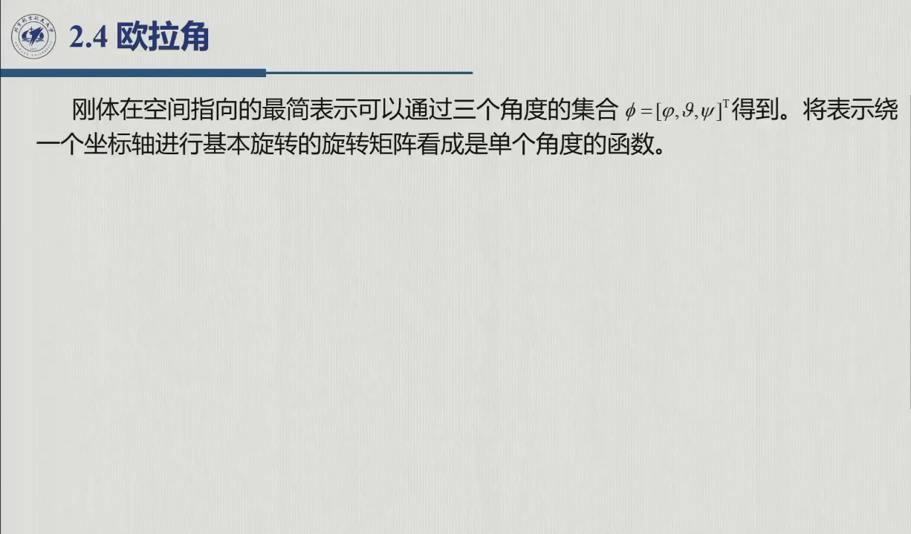
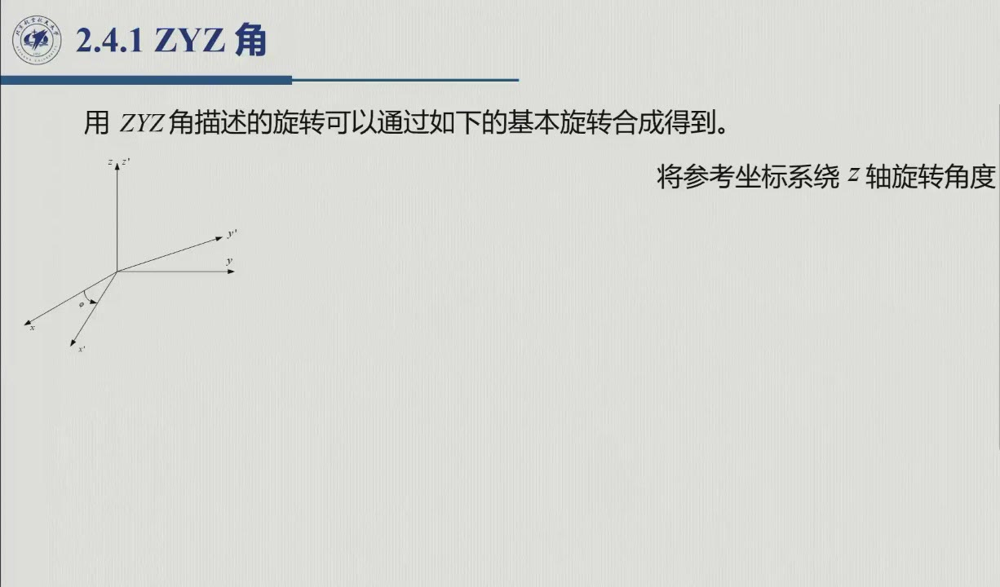
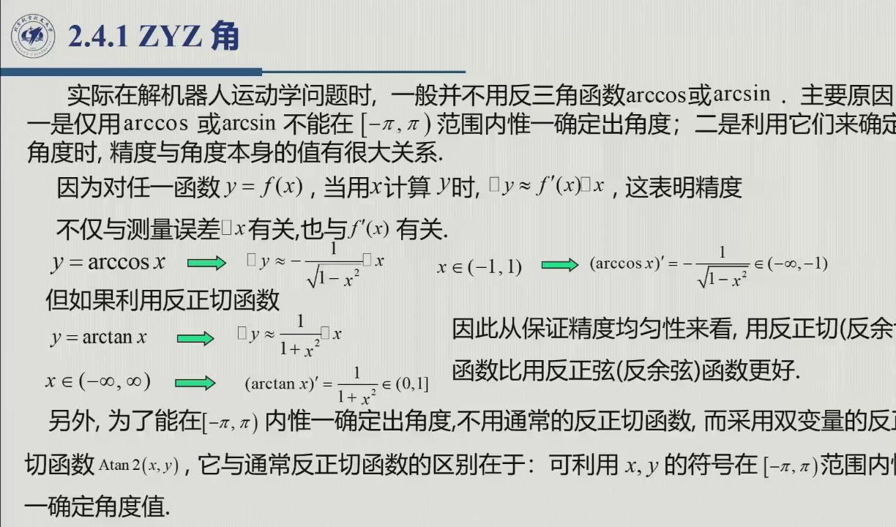
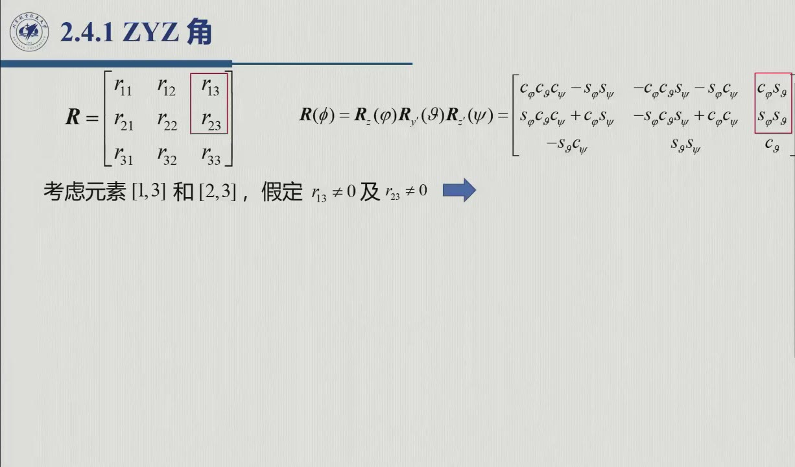
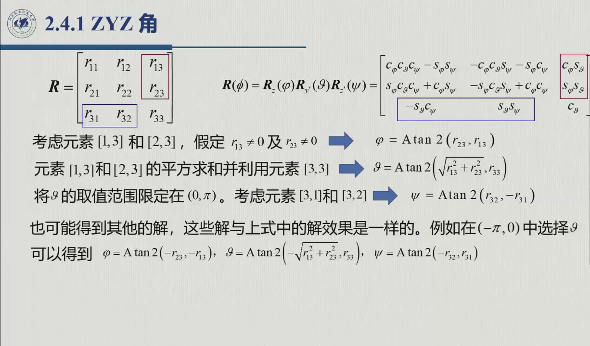
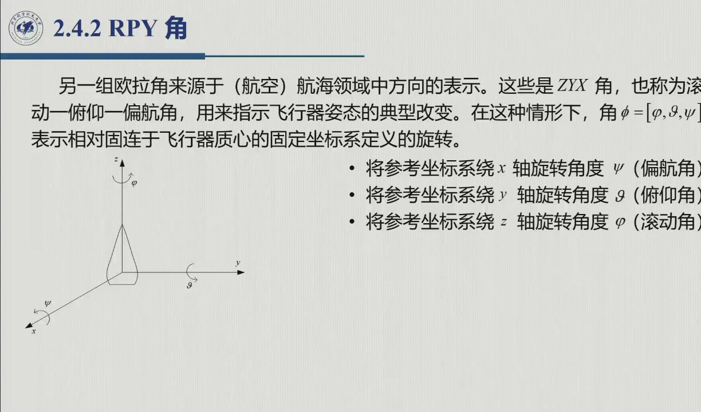
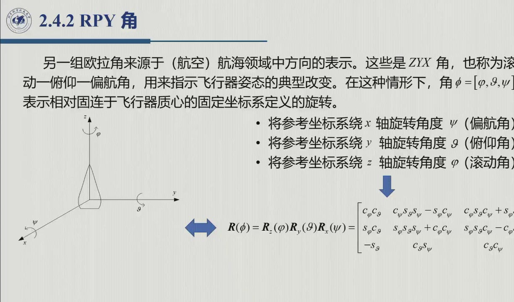

# 2.4 欧拉角：ZYZ 与 RPY

把 9 量的姿态矩阵压缩成 **3 个角度**，就得到两种最常用的欧拉角：机器人学惯用的 **ZYZ** 与航空航海惯用的 **RPY**。本节还收录了课堂的编外数值分析——**为什么反解一律用 `Atan2`**（录播 0:11:00–0:15:36）。全节对应录播 0:05:30–0:21:53。

{{#include ../assets/figures/robot-euler.md}}

## 2.4.1 最简表示与 12 种可行序列

旋转矩阵的 9 个元素受 6 个正交性约束，因此**3 个参数就足以描述姿态**（[@note-2.2.2]）：一般地，$SO(m)$ 的最简表示需要 $m(m-1)/2$ 个参数，$m=3$ 时恰为 3。于是把姿态写成三个角的集合 $\boldsymbol\phi=[\varphi\ \ \vartheta\ \ \psi]^T$，由 3 个绕坐标轴的基本旋转依次合成。问题在于：三个轴共有 27 种排列组合，其中只有 **12 种**可行（机制见下框）。

::: intuition 为什么砍掉 15 种（录播 0:07:57–0:08:28）
若序列中出现「连续绕同一轴」的情况，例如 $X\!X\!X$ 或 $Z\!X\!X$ 里的相邻同轴段，那么两次绕同轴的旋转可以合并成一次——三个角实际只贡献了两个独立的转动方向，任意的终态姿态就「转不出来」了。反过来说，只有 12 种「相邻不同轴」的组合能覆盖 $SO(3)$ 的每一个姿态；**每一组三个角就叫一组欧拉角，欧拉角不唯一**（12 种选法），本节只取课程与原书主推的两种。
:::

## 2.4.2 ZYZ 角：右乘合成与正解

ZYZ 序列（原书图 2.8）的每一步都绕**当前轴**旋转，因此按 [@thm-2.3.A] 依次**右乘**：

1. 绕参考系 $z$ 轴转 $\varphi$：$R_z(\varphi)$；
2. 绕**新** $y'$ 轴转 $\vartheta$：$R_{y'}(\vartheta)$；
3. 绕**新** $z''$ 轴转 $\psi$：$R_{z''}(\psi)$。

三步过程中坐标架如何演化，看下图（灰虚 = 上一步的旧架）：每转一次，「当前轴」就换到刚转出来的新架上——这正是「右乘」的几何本体。

<figure>
<svg class="figure-svg" viewBox="0 0 920 330" xmlns="http://www.w3.org/2000/svg" role="img" aria-labelledby="fig-zyzs-t fig-zyzs-d">
<title id="fig-zyzs-t">ZYZ 三步旋转的坐标架演化</title>
<desc id="fig-zyzs-d">三个面板依次为：绕 z 转 φ 后、绕新 y′ 转 ϑ 后、绕新 z″ 转 ψ 后的坐标架；每面板灰色虚线为上一步的旧架，金色为本次转动轴并配弧形箭头。三步全绕当前轴，依次右乘。</desc>
<defs>
<marker id="fzs-m" markerWidth="8" markerHeight="8" refX="6" refY="2.5" orient="auto"><path d="M0,0 L6,2.5 L0,5 Z" fill="var(--muted)"/></marker>
<marker id="fzs-b" markerWidth="8" markerHeight="8" refX="6" refY="2.5" orient="auto"><path d="M0,0 L6,2.5 L0,5 Z" fill="var(--fig-blue)"/></marker>
<marker id="fzs-n" markerWidth="8" markerHeight="8" refX="6" refY="2.5" orient="auto"><path d="M0,0 L6,2.5 L0,5 Z" fill="var(--fig-green)"/></marker>
<marker id="fzs-g" markerWidth="8" markerHeight="8" refX="6" refY="2.5" orient="auto"><path d="M0,0 L6,2.5 L0,5 Z" fill="var(--fig-gold)"/></marker>
<marker id="fzs-a" markerWidth="8" markerHeight="8" refX="6" refY="2.5" orient="auto"><path d="M0,0 L6,2.5 L0,5 Z" fill="var(--accent-text)"/></marker>
</defs>
<!-- panel 1 -->
<text class="diagram-text" x="155" y="34" text-anchor="middle">① Rz(φ)：绕 z 转 φ（方位）</text>
<g stroke="var(--muted)" stroke-width="1.1" stroke-dasharray="3 4" marker-end="url(#fzs-m)" opacity=".75">
<line x1="155" y1="215" x2="221.2" y2="233"/>
<line x1="155" y1="215" x2="123.9" y2="197.1"/>
<line x1="155" y1="215" x2="155" y2="146"/>
</g>
<line stroke="var(--accent-text)" stroke-width="3" x1="155" y1="215" x2="155" y2="130"/>
<text class="diagram-note" fill="var(--accent-text)" x="163" y="136">轴 z</text>
<path d="M 191 182 A 36 10 0 1 1 119 182 A 36 10 0 1 1 191 182" fill="none" stroke="var(--accent-text)" stroke-width="1.7" marker-end="url(#fzs-a)"/>
<g stroke-width="2.4">
<line stroke="var(--fig-blue)" marker-end="url(#fzs-b)" x1="155" y1="215" x2="185.8" y2="217.2"/>
<line stroke="var(--fig-green)" marker-end="url(#fzs-n)" x1="155" y1="215" x2="88.6" y2="189.7"/>
<line stroke="var(--fig-gold)" marker-end="url(#fzs-g)" x1="155" y1="215" x2="155" y2="146"/>
</g>
<text class="diagram-text" fill="var(--fig-blue)" x="192" y="226">x′</text>
<text class="diagram-text" fill="var(--fig-green)" x="82" y="188" text-anchor="end">y′</text>
<text class="diagram-text" fill="var(--fig-gold)" x="150" y="140" text-anchor="end">z′</text>
<!-- panel 2 -->
<text class="diagram-text" x="465" y="34" text-anchor="middle">② Ry′(ϑ)：绕新 y′ 转 ϑ（俯仰）</text>
<g stroke="var(--muted)" stroke-width="1.1" stroke-dasharray="3 4" marker-end="url(#fzs-m)" opacity=".75">
<line x1="465" y1="215" x2="495.8" y2="217.2"/>
<line x1="465" y1="215" x2="398.6" y2="189.7"/>
<line x1="465" y1="215" x2="465" y2="146"/>
</g>
<line stroke="var(--accent-text)" stroke-width="3" x1="465" y1="215" x2="407.3" y2="193"/>
<text class="diagram-note" fill="var(--accent-text)" x="400" y="188" text-anchor="end">轴 y′</text>
<path d="M 448.3 172.4 A 34 10 -69.1 1 1 424.1 236 A 34 10 -69.1 1 1 448.3 172.4" fill="none" stroke="var(--accent-text)" stroke-width="1.7" marker-end="url(#fzs-a)"/>
<g stroke-width="2.4">
<line stroke="var(--fig-blue)" marker-end="url(#fzs-b)" x1="465" y1="215" x2="482.7" y2="272.8"/>
<line stroke="var(--fig-green)" marker-end="url(#fzs-n)" x1="465" y1="215" x2="398.6" y2="189.7"/>
<line stroke="var(--fig-gold)" marker-end="url(#fzs-g)" x1="465" y1="215" x2="490.2" y2="177.2"/>
</g>
<text class="diagram-text" fill="var(--fig-blue)" x="492" y="284">x″</text>
<text class="diagram-text" fill="var(--fig-green)" x="392" y="186" text-anchor="end">y″</text>
<text class="diagram-text" fill="var(--fig-gold)" x="498" y="174">z″</text>
<!-- panel 3 -->
<text class="diagram-text" x="775" y="34" text-anchor="middle">③ Rz″(ψ)：绕新 z″ 转 ψ（自转）</text>
<g stroke="var(--muted)" stroke-width="1.1" stroke-dasharray="3 4" marker-end="url(#fzs-m)" opacity=".75">
<line x1="775" y1="215" x2="792.7" y2="272.8"/>
<line x1="775" y1="215" x2="708.7" y2="189.7"/>
<line x1="775" y1="215" x2="800.2" y2="177.2"/>
</g>
<line stroke="var(--accent-text)" stroke-width="3" x1="775" y1="215" x2="796.9" y2="182.2"/>
<text class="diagram-note" fill="var(--accent-text)" x="824" y="196">轴 z″</text>
<path d="M 816.4 207 A 30 9 33.7 1 1 766.4 173.8 A 30 9 33.7 1 1 816.4 207" fill="none" stroke="var(--accent-text)" stroke-width="1.7" marker-end="url(#fzs-a)"/>
<g stroke-width="2.4">
<line stroke="var(--fig-blue)" marker-end="url(#fzs-b)" x1="775" y1="215" x2="757.1" y2="252.4"/>
<line stroke="var(--fig-green)" marker-end="url(#fzs-n)" x1="775" y1="215" x2="708.7" y2="164.2"/>
<line stroke="var(--fig-gold)" marker-end="url(#fzs-g)" x1="775" y1="215" x2="800.2" y2="177.2"/>
</g>
<text class="diagram-text" fill="var(--fig-blue)" x="750" y="264" text-anchor="end">x′′′</text>
<text class="diagram-text" fill="var(--fig-green)" x="702" y="160" text-anchor="end">y′′′</text>
<text class="diagram-text" fill="var(--fig-gold)" x="790" y="163" text-anchor="end">z′′′</text>
<text class="diagram-note" x="460" y="296" text-anchor="middle">灰虚 = 上一步的旧架；金色 = 本次转轴（「当前轴」每步都换）</text>
<text class="diagram-note" x="460" y="318" text-anchor="middle">新因子依次往右追加：R = Rz(φ)·Ry′(ϑ)·Rz″(ψ)；ϑ → 0 时 z 与 z″ 平行，φ 与 ψ 不可分（ZYZ 表示奇点）</text>
</svg>
<figcaption>ZYZ 三步的坐标架演化（本教程绘，示例取 $\varphi=40°,\vartheta=55°,\psi=30°$）：轴随转动而变——第 2 步绕的是第 1 步转出来的 $y'$，第 3 步绕的是前两步转出来的 $z''$；这与 RPY 的「三副固定架」（见下文左 / 右乘对偶图）形成对照。第三步之后 $z$ 与 $z''$ 的夹角恰为 $\vartheta$——$\vartheta=0$ 即两轴共线，$\varphi$ 与 $\psi$ 的贡献合并、表示奇异（[@thm-2.4.B]）。</figcaption>
</figure>

$$R(\boldsymbol\phi)=R_z(\varphi)\,R_{y'}(\vartheta)\,R_{z''}(\psi)
=\begin{bmatrix}
c_\varphi c_\vartheta c_\psi-s_\varphi s_\psi & -c_\varphi c_\vartheta s_\psi-s_\varphi c_\psi & c_\varphi s_\vartheta\\
s_\varphi c_\vartheta c_\psi+c_\varphi s_\psi & -s_\varphi c_\vartheta s_\psi+c_\varphi c_\psi & s_\varphi s_\vartheta\\
-s_\vartheta c_\psi & s_\vartheta s_\psi & c_\vartheta
\end{bmatrix}$$

（原书式 2.18）。**正解**就是代入三个角、算出矩阵的 9 个量——录播 0:10:20 老师演示：「给你 $(40°,20°,\cdot)$ 的 ZYZ 角，代进这个矩阵就能算出旋转矩阵」。这条正向通道正是后续逆运动学的基础。

## 2.4.3 编外数值分析：为什么用 Atan2，不用 arccos（课堂补充）

反解（见下一小节）需要从三角函数值还原角度。最省事的选择似乎是 $c_\vartheta=r_{33}\Rightarrow\vartheta=\arccos r_{33}$（录播 0:11:22–0:11:56 老师先给出这条「简单做法」），但他随后当场否决：

::: thm 原理 2.4.A · 反三角函数选用准则（课堂补充整理） {#thm-2.4.A}
不用 $\arccos$/$\arcsin$，原因有两个：
1. **不唯一**：$\arccos$ 只在 $[0,\pi]$ 取值，无法覆盖 $(-\pi,\pi]$ 内的完整角度；
2. **精度不均匀**：对 $y=f(x)$ 有增量公式 $\Delta y\approx f'(x)\Delta x$，可见反解误差不仅取决于输入误差 $\Delta x$，还要被 $f'(x)$ 放大。而

$$(\arccos x)'=-\frac{1}{\sqrt{1-x^2}}\in(-\infty,-1],\qquad x\in(-1,1),$$

在 $x\to\pm1$（即角度接近 $0$ 或 $\pi$）处导数无界，微小输入误差被无限放大；相比之下

$$(\arctan x)'=\frac{1}{1+x^2}\in(0,1],\qquad x\in(-\infty,\infty),$$

导数处处**有界且不超过 1**，因此输入误差不会被放大。**结论：从保证精度看，用反正切（反余切）类比用反正弦（反余弦）类更好。**
:::

把原理 2.4.A 的两条理由画成曲线，就是下面这张图：横轴是反解时要「读数」的那个量 $x$（这里即 $r_{33}=c_\vartheta$），纵轴是输入误差被放大的倍数 $|f'(x)|$——红曲线在 $x\to\pm1$ 处冲天，绿曲线则处处不超过 1。

<figure>
<svg class="figure-svg" viewBox="0 0 920 330" xmlns="http://www.w3.org/2000/svg" role="img" aria-labelledby="fig-atn-t fig-atn-d">
<title id="fig-atn-t">arccos 与 arctan 的误差放大率对比</title>
<desc id="fig-atn-d">横轴 x 从负 1 到正 1，纵轴为反函数导数的绝对值。红色虚线是 arccos 的导数 1 除以根号下 1 减 x 平方，在两端趋于无穷；绿色实线是 arctan 的导数 1 除以 1 加 x 平方，处处不超过 1，在 x 等于 0 处取最大值 1。</desc>
<defs>
<marker id="fat-m" markerWidth="9" markerHeight="9" refX="7" refY="3" orient="auto"><path d="M0,0 L7,3 L0,6 Z" fill="var(--muted)"/></marker>
<marker id="fat-r" markerWidth="8" markerHeight="8" refX="6" refY="2.5" orient="auto"><path d="M0,0 L6,2.5 L0,5 Z" fill="var(--fig-red)"/></marker>
</defs>
<text class="diagram-text" x="460" y="30" text-anchor="middle">为什么反解一律 Atan2：两种反函数的误差放大率 |f′(x)|</text>
<rect x="88" y="44" width="24" height="246" fill="var(--fig-red)" fill-opacity=".06"/>
<rect x="818" y="44" width="24" height="246" fill="var(--fig-red)" fill-opacity=".06"/>
<line x1="70" y1="230" x2="830" y2="230" stroke="var(--line-strong)" stroke-width="1" stroke-dasharray="5 4"/>
<line class="diagram-axis" x1="70" y1="290" x2="855" y2="290" marker-end="url(#fat-m)"/>
<line class="diagram-axis" x1="70" y1="290" x2="70" y2="40" marker-end="url(#fat-m)"/>
<text class="diagram-note" x="60" y="36" text-anchor="middle">|f′(x)|</text>
<text class="diagram-text" x="842" y="308">x</text>
<g stroke="var(--line)"><line x1="282" y1="290" x2="282" y2="284"/><line x1="465" y1="290" x2="465" y2="284"/><line x1="647" y1="290" x2="647" y2="284"/></g>
<text class="diagram-mono" x="100" y="308" text-anchor="middle">−1</text>
<text class="diagram-mono" x="282" y="308" text-anchor="middle">−0.5</text>
<text class="diagram-mono" x="465" y="308" text-anchor="middle">0</text>
<text class="diagram-mono" x="647" y="308" text-anchor="middle">0.5</text>
<text class="diagram-mono" x="830" y="308" text-anchor="middle">+1</text>
<text class="diagram-mono" x="58" y="234" text-anchor="end">1</text>
<text class="diagram-text" fill="var(--fig-green)" x="150" y="222">arctan 的导数 ≤ 1：误差不被放大</text>
<polyline points="110,32 117,93 125,124 132,143 139,157 147,167 154,175 161,182 169,187 176,192 183,196 191,199 198,202 205,205 213,207 220,209 227,211 234,213 242,214 249,216 256,217 264,218 271,219 278,220 286,221 293,222 300,223 308,224 315,224 322,225 330,225 337,226 344,226 352,227 359,227 366,228 374,228 381,228 388,229 395,229 403,229 410,229 417,229 425,230 432,230 439,230 447,230 454,230 461,230 469,230 476,230 483,230 491,230 498,230 505,230 513,229 520,229 527,229 535,229 542,229 549,228 556,228 564,228 571,227 578,227 586,226 593,226 600,225 608,225 615,224 622,224 630,223 637,222 644,221 652,220 659,219 666,218 674,217 681,216 688,214 696,213 703,211 710,209 717,207 725,205 732,202 739,199 747,196 754,192 761,187 769,182 776,175 783,167 791,157 798,143 805,124 813,93 820,32" fill="none" stroke="var(--fig-red)" stroke-width="2.2" stroke-dasharray="7 5"/>
<polyline points="100,260 112,259 124,258 136,257 149,256 161,255 173,253 185,252 197,251 210,250 222,248 234,247 246,246 258,245 270,243 282,242 295,241 307,239 319,238 331,237 343,236 356,235 368,234 380,233 392,232 404,232 416,231 428,231 441,230 453,230 465,230 477,230 489,230 502,231 514,231 526,232 538,232 550,233 562,234 574,235 587,236 599,237 611,238 623,239 635,241 648,242 660,243 672,245 684,246 696,247 708,248 720,250 733,251 745,252 757,253 769,255 781,256 794,257 806,258 818,259 830,260" fill="none" stroke="var(--fig-green)" stroke-width="2.4"/>
<line x1="110" y1="60" x2="103" y2="30" stroke="var(--fig-red)" stroke-width="1.8" marker-end="url(#fat-r)"/>
<line x1="820" y1="60" x2="827" y2="30" stroke="var(--fig-red)" stroke-width="1.8" marker-end="url(#fat-r)"/>
<text class="diagram-text" fill="var(--fig-red)" x="200" y="70">|arccos′| = 1/√(1−x²) → ∞</text>
<text class="diagram-note" fill="var(--fig-red)" x="200" y="90">x → ±1（ϑ → 0 或 π）时微小误差被无限放大</text>
<text class="diagram-text" fill="var(--fig-green)" x="620" y="205">|arctan′| = 1/(1+x²) ≤ 1</text>
<text class="diagram-note" x="465" y="326" text-anchor="middle">横轴的 x 就是反解读的 r<tspan class="sb">33</tspan> = cos ϑ：ϑ → 0 或 π 时 x → ±1，arccos 路线崩溃——双变量 Atan2 同时解决象限与精度（[@thm-2.4.A]）</text>
</svg>
<figcaption>反解误差放大率的几何（本教程绘）：对 $y=f(x)$ 有 $\Delta y\approx f'(x)\Delta x$——arccos 的导数在 $x\to\pm1$（即 $\vartheta\to0,\pi$）处无界，输入端一点噪声输出端就爆炸；arctan 的导数处处 $\le1$。这也是数值实验里 $|\sin\vartheta|\le10^{-2}$ 的组别偏差放大 $10^5$ 倍的根源（见 <a href="../ch02/homework02.md">作业二</a> 易错点）。</figcaption>
</figure>

最后一步补齐「唯一性」：改用**双变量反正切**

$$\varphi=\operatorname{Atan2}(y,x),$$

它计算 $y/x$ 的反正切，但**用 $x,y$ 各自的符号判定象限**，从而在 $(-\pi,\pi]$ 内唯一确定角度（MATLAB / Python 的 `atan2` 即返回该区间）。录播 0:15:11 老师提醒：MATLAB 等工具里这个函数就是 `atan2`，后续章节「求角度更多用到它」——它是全书反解角度的标准动作。

## 2.4.4 ZYZ 角的逆解

已知 $R=[r_{ij}]_{3\times3}$，与式 2.18 对比即可反求 $(\varphi,\vartheta,\psi)$。策略是**挑出能暴露单个角度的元素**（录播 0:15:55–0:17:44 老师现场带推导：「这前四个太长不好求，比较好求的就是第三列这一排」）：

求解分三步走：① 第三列的 $[1,3]$、$[2,3]$ 只含 $\varphi,\vartheta$（$r_{23}=s_\varphi s_\vartheta,\ r_{13}=c_\varphi s_\vartheta$），由此定出 $\varphi$；② 用平方和消去 $\varphi$，再配合 $[3,3]=c_\vartheta$ 定出 $\vartheta$（取 $s_\vartheta>0$ 即 $\vartheta\in(0,\pi)$）；③ 最后用 $[3,1]$、$[3,2]$ 定出 $\psi$。以下设 $s_\vartheta\ne0$（即 $r_{13},r_{23}$ 不全为零；$s_\vartheta=0$ 的退化情形见下方定理 2.4.B）。第一支解为（原书式 2.19）

$$\varphi=\operatorname{Atan2}(r_{23},r_{13}),\qquad
\vartheta=\operatorname{Atan2}\!\big(\sqrt{r_{13}^2+r_{23}^2},\ r_{33}\big),\qquad
\psi=\operatorname{Atan2}(r_{32},-r_{31});$$

若在 $(-\pi,0)$ 中选 $\vartheta$，则得到效果相同的第二支（原书式 2.20）

$$\varphi=\operatorname{Atan2}(-r_{23},-r_{13}),\qquad
\vartheta=\operatorname{Atan2}\!\big({-\sqrt{r_{13}^2+r_{23}^2}},\ r_{33}\big),\qquad
\psi=\operatorname{Atan2}(-r_{32},r_{31}).$$

::: thm 定理 2.4.B · ZYZ 的表示奇点 {#thm-2.4.B}
当 $s_\vartheta=0$（即 $\vartheta=0$ 或 $\pi$）时，式 2.19–2.20 发生退化：两次绕 $z$ 类轴的旋转实际上绕**平行轴**进行、效果合并，于是只能确定 $\varphi\pm\psi$ 的**和或差**，无法把二者分离（原书；习题 2.2、本编习题 B3）。这种退化在后续章节里就是**欧拉角表示奇点**。
:::

<figure>
<svg class="figure-svg" viewBox="0 0 920 440" xmlns="http://www.w3.org/2000/svg" role="img" aria-labelledby="fig-zr-t fig-zr-d">
<title id="fig-zr-t">ZYZ 右乘（绕当前轴）与 RPY 左乘（绕固定轴）的对偶</title>
<desc id="fig-zr-d">上排 ZYZ：坐标架在每一步之后都改变朝向，旋转轴随之改变；下排 RPY：三个坐标架完全相同，旋转轴始终取自同一组固定轴。</desc>
<defs>
<marker id="ar-x" markerHeight="8" markerWidth="8" orient="auto" refX="6" refY="3"><path d="M0,0 L7,3 L0,6 Z" fill="context-stroke"/></marker>
<marker id="ar-xs" markerHeight="8" markerWidth="8" orient="auto-start-reverse" refX="6" refY="3"><path d="M0,0 L7,3 L0,6 Z" fill="context-stroke"/></marker>
</defs>
<g font-family="var(--sans)">
<text class="diagram-text" fill="var(--fig-blue)" x="24" y="34">ZYZ · 绕当前轴 · 右乘</text>
<text class="diagram-note" x="24" y="56">坐标架每转一次就换一副轴 —— 轴是「动」的</text>
<line stroke="var(--line-strong)" stroke-width="1.3" marker-end="url(#ar-x)" x1="120.0" x2="174.0" y1="190.0" y2="190.0"/>
<line stroke="var(--accent-text)" stroke-width="2.4" marker-end="url(#ar-x)" x1="120.0" x2="120.0" y1="190.0" y2="136.0"/>
<circle cx="120" cy="190" r="8" fill="none" stroke="var(--line-strong)" stroke-width="1.2"/>
<circle cx="120" cy="190" r="2.4" fill="var(--line-strong)"/>
<text class="diagram-note" fill="var(--accent-text)" text-anchor="end" x="112" y="122">轴 z</text>
<text class="diagram-text" text-anchor="middle" x="120" y="250">绕 z 转 φ</text>
<line stroke="var(--line-strong)" stroke-width="1.3" marker-end="url(#ar-x)" x1="290.0" x2="340.1" y1="190.0" y2="169.8"/>
<line stroke="var(--line-strong)" stroke-width="1.3" marker-end="url(#ar-x)" x1="290.0" x2="290.0" y1="190.0" y2="136.0"/>
<circle cx="290" cy="190" r="9" fill="none" stroke="var(--accent-text)" stroke-width="2.4"/>
<circle cx="290" cy="190" r="3" fill="var(--accent-text)"/>
<text class="diagram-note" fill="var(--accent-text)" x="300" y="200">轴 y′（出纸面）</text>
<text class="diagram-text" text-anchor="middle" x="290" y="250">绕 y′ 转 ϑ</text>
<line stroke="var(--line-strong)" stroke-width="1.3" marker-end="url(#ar-x)" x1="460.0" x2="498.8" y1="190.0" y2="152.5"/>
<line stroke="var(--accent-text)" stroke-width="2.4" marker-end="url(#ar-x)" x1="460.0" x2="460.0" y1="190.0" y2="136.0"/>
<circle cx="460" cy="190" r="8" fill="none" stroke="var(--line-strong)" stroke-width="1.2"/>
<circle cx="460" cy="190" r="2.4" fill="var(--line-strong)"/>
<text class="diagram-note" fill="var(--accent-text)" text-anchor="end" x="452" y="122">轴 z″</text>
<text class="diagram-text" text-anchor="middle" x="460" y="250">绕 z″ 转 ψ</text>
<text class="diagram-mono" x="640" y="150">R = Rz(φ) · Ry′(ϑ) · Rz″(ψ)</text>
<text class="diagram-note" x="640" y="176">新因子往右追加 → 右乘</text>
<text class="diagram-note" x="640" y="198">轴随转动而变（动系）</text>
<line stroke="var(--line)" stroke-dasharray="4 5" x1="24" x2="896" y1="286" y2="286"/>
<text class="diagram-text" fill="var(--fig-gold)" x="24" y="322">RPY · 绕固定轴 · 左乘</text>
<text class="diagram-note" x="24" y="344">三副坐标架完全一样 —— 轴是「定」的</text>
<line stroke="var(--line-strong)" stroke-width="1.3" marker-end="url(#ar-x)" x1="120.0" x2="174.0" y1="400.0" y2="400.0"/>
<line stroke="var(--fig-gold)" stroke-width="2.4" marker-end="url(#ar-x)" x1="120.0" x2="120.0" y1="400.0" y2="346.0"/>
<circle cx="120" cy="400" r="8" fill="none" stroke="var(--line-strong)" stroke-width="1.2"/>
<circle cx="120" cy="400" r="2.4" fill="var(--line-strong)"/>
<text class="diagram-text" text-anchor="middle" x="120" y="462">先绕 z 转 φ</text>
<line stroke="var(--line-strong)" stroke-width="1.3" marker-end="url(#ar-x)" x1="290.0" x2="344.0" y1="400.0" y2="400.0"/>
<line stroke="var(--line-strong)" stroke-width="1.3" marker-end="url(#ar-x)" x1="290.0" x2="290.0" y1="400.0" y2="346.0"/>
<circle cx="290" cy="400" r="9" fill="none" stroke="var(--fig-gold)" stroke-width="2.4"/>
<circle cx="290" cy="400" r="3" fill="var(--fig-gold)"/>
<text class="diagram-text" text-anchor="middle" x="290" y="462">再绕 y 转 ϑ</text>
<line stroke="var(--fig-gold)" stroke-width="2.4" marker-end="url(#ar-x)" x1="460.0" x2="514.0" y1="400.0" y2="400.0"/>
<line stroke="var(--line-strong)" stroke-width="1.3" marker-end="url(#ar-x)" x1="460.0" x2="460.0" y1="400.0" y2="346.0"/>
<circle cx="460" cy="400" r="8" fill="none" stroke="var(--line-strong)" stroke-width="1.2"/>
<circle cx="460" cy="400" r="2.4" fill="var(--line-strong)"/>
<text class="diagram-text" text-anchor="middle" x="460" y="462">最后绕 x 转 ψ</text>
</g></svg>
<figcaption>同一个乘积 $R_z(\varphi)R_y(\vartheta)R_x(\psi)$ 有两种读法（本教程绘）：「按 XYZ 顺序绕**固定**轴转」与「按 ZYX 顺序绕**当前**轴转」等价——这就是左乘 / 右乘对偶。上排 ZYZ 的坐标架每转一次就换一副轴（高亮轴依次为 $z$、$y'$、$z''$），新因子**追加在右**；下排 RPY 的三副坐标架完全相同（高亮轴依次为 $z$、$y$、$x$，都取自初始系），新因子**前插在左**。记不清方向时把序列复述成中文即可判断：「在转完的基础上再绕它的 $y'$ 转」= 右乘。</figcaption>
</figure>

正解、逆解与奇点，可以在这个操作台里一次拖个明白（下图）：滑杆做**正解**（三步当前轴转动，坐标架实时演化），读数区做**逆解**（从第三列用式 2.19 反解 φ′、ψ′——正常位形下应与滑杆一致）；把 ϑ 拖到 0 或 180°，就能看到 [@thm-2.4.B] 的奇点如何发生。

<figure class="arm-lab">
<svg id="zyz-svg" class="figure-svg" viewBox="0 0 920 430" xmlns="http://www.w3.org/2000/svg" role="img" aria-labelledby="zyz-t zyz-d">
<title id="zyz-t">ZYZ 欧拉角操作台</title>
<desc id="zyz-d">拖动 φ、ϑ、ψ 三个滑杆，观察绕当前轴的三次转动如何合成姿态；ϑ 接近 0 或 180 度时 z 轴与 z″ 轴共线，φ 与 ψ 不可分离，即欧拉角表示奇点。</desc>
<g stroke="var(--muted)" stroke-width="1.3" marker-end="url(#zyz-m)" opacity=".8">
<line x1="250" y1="252" x2="320.7" y2="271.1"/>
<line x1="250" y1="252" x2="216.9" y2="232.9"/>
<line x1="250" y1="252" x2="250" y2="178.4"/>
</g>
<text class="diagram-note" x="326" y="276">x<tspan class="sb">0</tspan></text>
<text class="diagram-note" x="210" y="230" text-anchor="end">y<tspan class="sb">0</tspan></text>
<text class="diagram-note" x="250" y="170" text-anchor="middle">z<tspan class="sb">0</tspan></text>
<line id="zyz-yp" x1="250" y1="252" x2="165.9" y2="220" stroke="var(--fig-green)" stroke-width="1.6" stroke-dasharray="5 4"/>
<line id="zyz-z2" x1="250" y1="252" x2="281.9" y2="204.2" stroke="var(--fig-gold)" stroke-width="1.6" stroke-dasharray="5 4"/>
<g stroke-width="2.8">
<line id="zyz-x3" x1="250" y1="252" x2="222.6" y2="309.4" stroke="var(--fig-blue)"/>
<line id="zyz-y3" x1="250" y1="252" x2="148.3" y2="174.1" stroke="var(--fig-green)"/>
<line id="zyz-z3" x1="250" y1="252" x2="288.7" y2="194.1" stroke="var(--fig-gold)"/>
</g>
<circle cx="250" cy="252" r="6" fill="var(--paper)" stroke="var(--ink-2)" stroke-width="1.5"/>
<text class="diagram-text" x="460" y="30" text-anchor="middle">ZYZ 欧拉角操作台：三步全绕当前轴 → 依次右乘</text>
<text class="diagram-text" x="560" y="90">第三列 (r<tspan class="sb">13</tspan>, r<tspan class="sb">23</tspan>, r<tspan class="sb">33</tspan>) = <tspan id="zyz-rcol" fill="var(--accent-text)">+</tspan></text>
<text class="diagram-text" x="560" y="122">反解 φ′ = Atan2(r<tspan class="sb">23</tspan>, r<tspan class="sb">13</tspan>) = <tspan id="zyz-rphi">+</tspan></text>
<text class="diagram-text" x="560" y="154">反解 ψ′ = Atan2(r<tspan class="sb">32</tspan>, −r<tspan class="sb">31</tspan>) = <tspan id="zyz-rpsi">+</tspan></text>
<text class="diagram-text" x="560" y="186">s<tspan class="sb">ϑ</tspan> = <tspan id="zyz-rs">+</tspan></text>
<text class="diagram-text" fill="var(--fig-red)" x="560" y="218"><tspan id="zyz-rw"> </tspan></text>
<text class="diagram-note" x="560" y="258">灰 = 参考系 x<tspan class="sb">0</tspan>y<tspan class="sb">0</tspan>z<tspan class="sb">0</tspan>；实线三色 = 末架 x‴y‴z‴</text>
<text class="diagram-note" x="560" y="282">绿虚 = 第 2 转轴 y′（Rz(φ) 转出来）；金虚 = 第 3 转轴 z″</text>
<text class="diagram-note" x="560" y="306">试一试：ϑ = 0 时金虚轴与灰色 z<tspan class="sb">0</tspan> 重合——</text>
<text class="diagram-note" x="560" y="330">φ 与 ψ 的贡献合并，只剩和（或差）可定</text>
<defs>
<marker id="zyz-m" markerWidth="8" markerHeight="8" refX="6" refY="2.5" orient="auto"><path d="M0,0 L6,2.5 L0,5 Z" fill="var(--muted)"/></marker>
</defs>
</svg>

<label>φ 方位 <input type="range" id="zyz-phi" min="-180" max="180" step="1" value="40" aria-label="ZYZ 角 φ">40°</label>
<label>ϑ 俯仰 <input type="range" id="zyz-th" min="0" max="180" step="1" value="55" aria-label="ZYZ 角 ϑ">55°</label>
<label>ψ 自转 <input type="range" id="zyz-psi" min="-180" max="180" step="1" value="30" aria-label="ZYZ 角 ψ">30°</label>

<figcaption>ZYZ 欧拉角操作台（本教程绘）：滑杆是**正解**（式 2.18 的三次右乘，坐标架逐步演化），读数区是**逆解**（式 2.19：第三列暴露 $\varphi$ 与 $\vartheta$，第三行暴露 $\psi$）——正常位形下反解角应与滑杆一致，这本身就是「正逆互检」。ϑ 拖到 0 或 180° 即 [@thm-2.4.B] 的表示奇点：$z_0$ 与 $z''$ 共线，第三列失去信息，$\varphi$ 与 $\psi$ 只剩和 / 差可定。</figcaption>
</figure>

## 2.4.5 RPY 角：绕固定轴的左乘序列

航空航海领域描述飞行器姿态，习惯用 **ZYX 角**，也就是**滚转（roll）—俯仰（pitch）—偏航（yaw）**角。三个角 $\boldsymbol\phi=[\varphi\ \ \vartheta\ \ \psi]^T$ 相对**固定于飞行器质心的参考系**定义（原书图 2.9）：绕固定 $z$ 轴转 $\varphi$（偏航）、绕固定 $y$ 轴转 $\vartheta$（俯仰）、绕固定 $x$ 轴转 $\psi$（滚转）。全程绕固定轴，因此按 [@thm-2.3.B] **左乘**：

$$R(\boldsymbol\phi)=R_z(\varphi)\,R_y(\vartheta)\,R_x(\psi)
=\begin{bmatrix}
c_\varphi c_\vartheta & c_\varphi s_\vartheta s_\psi-s_\varphi c_\psi & c_\varphi s_\vartheta c_\psi+s_\varphi s_\psi\\
s_\varphi c_\vartheta & s_\varphi s_\vartheta s_\psi+c_\varphi c_\psi & s_\varphi s_\vartheta c_\psi-c_\varphi s_\psi\\
-s_\vartheta & c_\vartheta s_\psi & c_\vartheta c_\psi
\end{bmatrix}$$

（原书式 2.21；英文原版与课件此页角名均标反，见[勘误 E2.1](errata.md#errata-2.1)）。

::: note 译注 · 两条等价说法（原书脚注）
「按 XYZ 顺序绕**固定**坐标系轴的旋转序列」与「按 ZYX 顺序绕**当前**坐标系轴的旋转序列」等价——左乘 / 右乘对偶（[@thm-2.3.A]、[@thm-2.3.B]）的直接推论。
:::

**逆解**与 ZYZ 同法（原书式 2.22–2.23）：$\vartheta\in(-\pi/2,\pi/2)$ 时

$$\varphi=\operatorname{Atan2}(r_{21},r_{11}),\qquad
\vartheta=\operatorname{Atan2}\!\Big(-r_{31},\sqrt{r_{11}^2+r_{21}^2}\Big),\qquad
\psi=\operatorname{Atan2}(r_{32},r_{33});$$

（$\vartheta$ 一式中 $\sqrt{r_{11}^2+r_{21}^2}$ 与原书 (2.22) 的 $\sqrt{r_{32}^2+r_{33}^2}$ 数值相同——二者都等于 $|c_\vartheta|$，本式改用第一、二行元素，便于与 $\varphi$ 的宗量保持同源。）$\vartheta\in(\pi/2,3\pi/2)$ 时取等价的第二支（各宗量整体变号）。$c_\vartheta=0$ 时同样退化：只能确定 $\varphi$ 与 $\psi$ 的和或差——这就是 RPY 的表示奇点。

::: ex 例 2.4.C · 无人机姿态控制的日常视角（新增） {#ex-2.4.C}
录播 0:18:52–0:21:53：**无人机动力学模型**里用的正是这个矩阵（「你后面如果做无人机控制，动力学模型里就有这个矩阵」）；但 RPY 在俯仰角 $\pm90°$ 处会碰上奇点，**卫星**等需要全姿态机动的平台因此改用四元数（录播 0:21:26，见下框；[@ex-2.4.C]）。
:::

::: preview 课程预告 · 单位四元数（原书 §2.6，课程略）
单位四元数 $Q=\{\eta,\boldsymbol\epsilon\}$ 用 4 个参数（满足 1 个模长约束）表示姿态：$\eta=\cos(\vartheta/2)$、$\boldsymbol\epsilon=\sin(\vartheta/2)\boldsymbol r$。半角打包使角和轴的 $(\vartheta,\boldsymbol r)\sim(-\vartheta,-\boldsymbol r)$ 不唯一性消失，逆解也无 $s_\vartheta=0$ 型奇点；逆与乘法有简洁的代数规则（原书式 2.36–2.37）。课程只点到「卫星姿态用四元数」这一应用背景，公式不考；需要时可按本框线索自查原书。
:::

::: intuition 动手实验 · ZYZ 与 RPY 是同一件事的两种读法
下面这个操作台把 2.4.2–2.4.5 的两套公式并排放在一起：拖动 φ、ϑ、ψ，先按当前约定合成 $R$，再把**同一个 $R$** 交给另一种约定的逆解公式反算角度。换约定不改变姿态，只改变「是哪三个角」；两套角在各自的奇点附近还会互相失效——这正是 [@thm-2.4.B] 与 RPY 万向节锁定。

:::

::: think 默写点 · 合上书再写（主动回忆）

不看正文与速查卡，先写出下面几条，再展开核对。写不出来，就说明这一节还没「拿走」。

1. 默写 ZYZ 逆解的第一支三式（用 $r_{ij}$ 与 Atan2）。
2. 为什么反解不用 $\arccos$？说出两个理由。
3. ZYZ 与 RPY 的奇点各在什么条件？

::: sol 核对

$\varphi=\operatorname{Atan2}(r_{23},r_{13})$、$\vartheta=\operatorname{Atan2}(\sqrt{r_{13}^2+r_{23}^2},r_{33})$、$\psi=\operatorname{Atan2}(r_{32},-r_{31})$。第二支三个宗量整体变号。

① **不唯一**：$\arccos$ 值域只有 $[0,\pi]$；② **精度不均匀**：$(\arccos x)'=-1/\sqrt{1-x^2}$ 在 $x\to\pm1$ 处无界，微小输入误差被无限放大；而 $(\arctan x)'=1/(1+x^2)\le1$ 处处有界。

ZYZ 在 $s_\vartheta=0$（$\vartheta=0,\pi$）；RPY 在 $c_\vartheta=0$（俯仰 $\pm90°$）。

:::

:::

## 2.4 小结与常见错误

- **一条主线**：9 量 6 约束 → 3 参数 → 27 组合砍到 12 → ZYZ（右乘）/ RPY（左乘）→ 正解代入、逆解挑元素 + `Atan2` → 奇点 $s_\vartheta=0$ / $c_\vartheta=0$。
- **口诀**：逆解「挑只含单角的元素，先 $\varphi$ 后 $\vartheta$ 再 $\psi$」；`Atan2` 在 $(-\pi,\pi]$ 唯一化角度。

::: think 常见错误清单 · 自查四条
1. 用 $\arccos$ 反解角度——精度在 $x\to\pm1$ 处崩溃且不唯一（[@thm-2.4.A]）；凡反解一律 `Atan2`；
2. 忘记 ZYZ / RPY 各有两支解——式 2.19/2.20、2.22/2.23 效果等价但角度值不同，编程时须固定取值区间；
3. 把 RPY 的「滚转」配给绕 $z$ 的角——滚转（roll）绕纵轴 $x$，偏航（yaw）绕竖轴 $z$（英文原书与课件此页标签均反，勘误 E2.1）；
4. 在 $s_\vartheta=0$ 附近强行分离 $\varphi,\psi$——数据上表现为两个角剧烈跳变，这是表示奇点，不是物理抖动。
:::