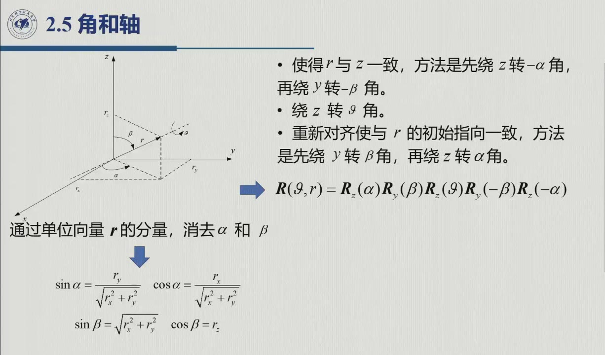
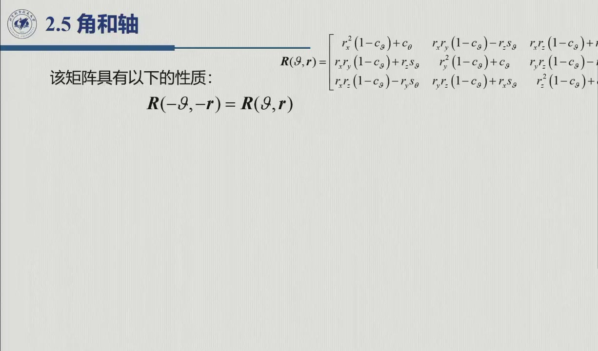

# 2.5 角和轴

欧拉角的代价是奇点与多支解。本节换一种 4 参数表示——**角和轴**：绕任意单位轴 $\boldsymbol r$ 转 $\vartheta$。它没有解析奇点（除 $\sin\vartheta=0$），而且对姿态轨迹规划很友好：轴固定、角单调，插值直观（[@ex-2.5.C]）。录播 0:21:53–0:30:07。

<aside class="lesson-brief" aria-label="2.5 学习简报">

PREREQUISITE<strong>你需要先会</strong>
绕固定轴左乘规则（[@thm-2.3.B]）。

TARGET<strong>本节要建立</strong>
$(\vartheta,\boldsymbol r)$ 四参数表示；五步变换消去 $\alpha,\beta$ 的**完整推导**（含叉乘算子 $S(\cdot)$ 与共轭恒等式）；Rodrigues 型矩阵（原书式 2.25）及其紧凑形式；表示不唯一性（式 2.26）与逆解（式 2.27–2.28）及其失效条件；李代数 $so(3)$ 与指数 / 对数映射（2.5.3，本编补充）。

CHECKPOINT<strong>学完的标准</strong>
能不看书写出五步合成序列；能由 $R$ 的迹求 $\cos\vartheta$、由反对称部分求 $\boldsymbol r$；能解释「绕 $-\boldsymbol r$ 转 $-\vartheta$ 与绕 $\boldsymbol r$ 转 $\vartheta$ 是同一个旋转」为何使表示不唯一。

</aside>

## 2.5.1 定义与五步合成

::: def 定义 2.5.1 · 角和轴表示 {#def-2.5.1}
任一旋转都可由**旋转轴的单位向量** $\boldsymbol r=[r_x\ r_y\ r_z]^T$（相对参考系 $O\text{-}xyz$）与**旋转角** $\vartheta$（绕 $\boldsymbol r$ 逆时针为正）共同表示，记作 $R(\vartheta,\boldsymbol r)$。两者合起来共 4 个参数（$1+3$），超出了最简表示的 3 个，故为**非最简表示**；但 $\boldsymbol r$ 受单位模长约束 $r_x^2+r_y^2+r_z^2=1$（原书式 2.29），扣掉这一约束后独立参数恰好仍是 3 个。
:::

困难在于：我们只会写**绕坐标轴**的基本旋转。思路（原书图 2.10）是先把 $\boldsymbol r$ 转到与 $z$ 轴重合，再绕 $z$ 转 $\vartheta$，最后转回原位。由于全部步骤都绕**固定坐标系**的轴进行，按 [@thm-2.3.B] 应一律**左乘**（录播 0:25:05–0:25:51 老师特别强调「这一次都是绕固定坐标转，是一次左乘」，与 ZYZ 的右乘形成对照）：

1. 绕 $z$ 转 $-\alpha$，再绕 $y$ 转 $-\beta$：把 $\boldsymbol r$ 转到与 $z$ 一致；
2. 绕 $z$ 转 $\vartheta$（此时就绕着原轴 $\boldsymbol r$ 转）；
3. 绕 $y$ 转 $\beta$，再绕 $z$ 转 $\alpha$：把轴转回 $\boldsymbol r$ 的初始指向。

$$R(\vartheta,\boldsymbol r)=R_z(\alpha)\,R_y(\beta)\,R_z(\vartheta)\,R_y(-\beta)\,R_z(-\alpha)\qquad(\text{原书式 }2.24)$$

其中 $\alpha,\beta$ 由 $\boldsymbol r$ 的分量决定（几何关系见图 2.10）：

$$\sin\alpha=\frac{r_y}{\sqrt{r_x^2+r_y^2}},\quad \cos\alpha=\frac{r_x}{\sqrt{r_x^2+r_y^2}},\qquad
\sin\beta=\sqrt{r_x^2+r_y^2},\quad \cos\beta=r_z .$$

下图左给出 $\alpha,\beta$ 的几何定义——$\alpha$ 是 $\boldsymbol r$ 在 $xy$ 面投影的方位角，$\beta$ 是仰角；下图右把五步序列画成一张流程图，说的就是「把轴借到 $z$ 上、转完再还回去」。

<figure>
<svg class="figure-svg" viewBox="0 0 920 348" xmlns="http://www.w3.org/2000/svg" role="img" aria-labelledby="fig-25-title fig-25-desc">
<title id="fig-25-title">角和轴表示的几何与五步合成</title>
<desc id="fig-25-desc">左图：单位轴 r 相对参考系的方位角 α（在 xy 面内从 x 轴量到 r 的投影）与仰角 β（r 离开 xy 面的角度），绕 r 的转角 ϑ 用环形箭头表示。右图：五步左乘序列 Rz(−α)、Ry(−β)、Rz(ϑ)、Ry(β)、Rz(α)，前三步把 r 转到 z 上并转 ϑ，后两步转回。</desc>
<defs>
<marker id="f25-m" markerWidth="9" markerHeight="9" refX="7" refY="3" orient="auto"><path d="M0,0 L7,3 L0,6 Z" fill="var(--muted)"/></marker>
<marker id="f25-b" markerWidth="9" markerHeight="9" refX="7" refY="3" orient="auto"><path d="M0,0 L7,3 L0,6 Z" fill="var(--fig-blue)"/></marker>
<marker id="f25-g" markerWidth="9" markerHeight="9" refX="7" refY="3" orient="auto"><path d="M0,0 L7,3 L0,6 Z" fill="var(--fig-gold)"/></marker>
<marker id="f25-n" markerWidth="9" markerHeight="9" refX="7" refY="3" orient="auto"><path d="M0,0 L7,3 L0,6 Z" fill="var(--fig-green)"/></marker>
<marker id="f25-p" markerWidth="9" markerHeight="9" refX="7" refY="3" orient="auto"><path d="M0,0 L7,3 L0,6 Z" fill="var(--fig-purple)"/></marker>
</defs>
<text class="diagram-text" x="240" y="36" text-anchor="middle">(ϑ, r) 的几何：一根轴 + 一个角</text>
<text class="diagram-text" x="660" y="36" text-anchor="middle">五步合成（原书式 2.24）</text>
<g stroke="var(--line-strong)" stroke-width="1.3" marker-end="url(#f25-m)">
<line x1="230" y1="262" x2="429" y2="325"/>
<line x1="230" y1="262" x2="163" y2="210"/>
<line x1="230" y1="262" x2="230" y2="78"/>
</g>
<text class="diagram-note" x="437" y="334">x</text>
<text class="diagram-note" x="155" y="206" text-anchor="end">y</text>
<text class="diagram-note" x="222" y="74" text-anchor="end">z</text>
<line stroke="var(--line)" stroke-dasharray="4 4" x1="259" y1="129" x2="259" y2="243"/>
<line stroke="var(--line)" stroke-dasharray="4 4" x1="259" y1="243" x2="230" y2="262"/>
<line stroke="var(--fig-blue)" stroke-width="2.8" marker-end="url(#f25-b)" x1="230" y1="262" x2="259" y2="129"/>
<text class="diagram-text" fill="var(--fig-blue)" x="268" y="122">r（单位轴）</text>
<path d="M 289 281 A 62 62 0 0 0 282 228" fill="none" stroke="var(--fig-green)" stroke-width="2" marker-end="url(#f25-n)"/>
<text class="diagram-text" fill="var(--fig-green)" x="304" y="260">α</text>
<path d="M 268 237 A 46 46 0 0 0 240 217" fill="none" stroke="var(--fig-purple)" stroke-width="2" marker-end="url(#f25-p)"/>
<text class="diagram-text" fill="var(--fig-purple)" x="270" y="222">β</text>
<path d="M 297 200 A 52 15 12.2 1 1 195 178 A 52 15 12.2 1 1 297 200" fill="none" stroke="var(--fig-gold)" stroke-width="2" marker-end="url(#f25-g)"/>
<text class="diagram-text" fill="var(--fig-gold)" x="308" y="182">ϑ</text>
<text class="diagram-note" x="240" y="338" text-anchor="middle">α：从 x 轴到 r 投影的方位角；β：r 的仰角；ϑ：绕 r 的转角</text>
<g>
<rect class="diagram-node" x="530" y="58" width="200" height="44" rx="8"/>
<text class="diagram-text" x="630" y="86" text-anchor="middle">① Rz(−α)</text>
<rect class="diagram-node" x="530" y="114" width="200" height="44" rx="8"/>
<text class="diagram-text" x="630" y="142" text-anchor="middle">② Ry(−β)</text>
<rect class="diagram-node" x="530" y="170" width="200" height="44" rx="8" stroke="var(--accent)"/>
<text class="diagram-text" fill="var(--accent-text)" x="630" y="198" text-anchor="middle">③ Rz(ϑ)</text>
<rect class="diagram-node" x="530" y="226" width="200" height="44" rx="8"/>
<text class="diagram-text" x="630" y="254" text-anchor="middle">④ Ry(β)</text>
<rect class="diagram-node" x="530" y="282" width="200" height="44" rx="8"/>
<text class="diagram-text" x="630" y="310" text-anchor="middle">⑤ Rz(α)</text>
</g>
<g stroke="var(--line-strong)" stroke-width="1.4" marker-end="url(#f25-m)">
<line x1="630" y1="102" x2="630" y2="112"/>
<line x1="630" y1="158" x2="630" y2="168"/>
<line x1="630" y1="214" x2="630" y2="224"/>
<line x1="630" y1="270" x2="630" y2="280"/>
</g>
<g stroke="var(--line-strong)" fill="none">
<path d="M736 80 h10 v52 h-10"/>
<path d="M736 192 h10 v0 h-10"/>
<path d="M736 248 h10 v56 h-10"/>
</g>
<text class="diagram-note" x="756" y="112">把 r 转到与 z 重合</text>
<text class="diagram-note" x="756" y="198">此刻绕 z = 绕原轴 r 转 ϑ</text>
<text class="diagram-note" x="756" y="280">把轴转回 r 的初始指向</text>
<text class="diagram-note" x="660" y="342" text-anchor="middle">五步全绕固定轴 → 依次左乘（对照 ZYZ 的右乘）</text>
</svg>
<figcaption>角和轴表示（本教程绘）：左图定义 $(\vartheta,\boldsymbol r)$ 的几何——$\alpha,\beta$ 定轴、$\vartheta$ 定角；右图给出「借轴—转角—还轴」的五步序列。因为每一步都绕**固定**轴，整条链按 [@thm-2.3.B] 依次**左乘**。</figcaption>
</figure>

把它们代入式 2.24，$\alpha,\beta$ 全部消去，便得到只依赖 $(\vartheta,\boldsymbol r)$ 的显式矩阵（原书式 2.25，即 **Rodrigues 公式**）。原书把这一步推导留作习题 2.4，本编在下方**直接给出完整推导**；[2.5.3](#sec-2.5.3) 还会交代它的泰勒级数来历。

$$R(\vartheta,\boldsymbol r)=\begin{bmatrix}
r_x^2(1-c_\vartheta)+c_\vartheta & r_xr_y(1-c_\vartheta)-r_zs_\vartheta & r_xr_z(1-c_\vartheta)+r_ys_\vartheta\\
r_xr_y(1-c_\vartheta)+r_zs_\vartheta & r_y^2(1-c_\vartheta)+c_\vartheta & r_yr_z(1-c_\vartheta)-r_xs_\vartheta\\
r_xr_z(1-c_\vartheta)-r_ys_\vartheta & r_yr_z(1-c_\vartheta)+r_xs_\vartheta & r_z^2(1-c_\vartheta)+c_\vartheta
\end{bmatrix}$$

::: intuition 结构记忆法
对角线 = $r_i^2(1-c_\vartheta)+c_\vartheta$；非对角 = $r_ir_j(1-c_\vartheta)\ \pm\ $「剩余那根轴的分量 × $s_\vartheta$」，反对称部分的符号由叉积 $\boldsymbol r\times$ 决定。校验两个特例：$\boldsymbol r=\boldsymbol z$ 时退化为 $R_z(\vartheta)$；$\vartheta=0$ 时退化为 $I_3$。
:::

推导这九个元素不必硬乘五个矩阵。先立一件工具，再走五步。

::: def 定义 2.5.2 · 叉乘算子 $S(\omega)$（反对称矩阵） {#def-2.5.2}
对任意三维向量 $\omega$，定义 $3\times3$ 矩阵

$$S(\omega)=\begin{bmatrix}0&-\omega_z&\omega_y\\ \omega_z&0&-\omega_x\\ -\omega_y&\omega_x&0\end{bmatrix},\qquad\text{满足 } S(\omega)\,p\equiv\omega\times p\ \ (\forall p\in\mathbb R^3).$$

（逐列验证：第 1 列 $S(\omega)\boldsymbol x=\omega\times\boldsymbol x=[0,\omega_z,-\omega_y]^{\mathrm T}$，恰为矩阵的第 1 列；其余两列同法。）$S(\omega)$ 满足 $S^{\mathrm T}(\omega)=-S(\omega)$，即**反对称矩阵**：对角线恒为零、非对角元素镜像反号；此外还有 $S(\omega)=-S(-\omega)$。第 3 章将证明 $S(\omega)$ 正是**角速度**的矩阵化身（[@def-3.1.2]）；本节先把它当作「把叉积装进矩阵代数」的纯工具。
:::

::: proof 证明 · 从五步合成到 Rodrigues 矩阵（本编补充，对应原书习题 2.4） {#pf-2.5.rodrigues}
**第 0 步（工具：旋转保持叉积）。** 对任意 $R\in SO(3)$ 与向量 $a,b,c$，混合积只差一个 $\det R=1$ 的因子：

$$(Ra\times Rb)\cdot(Rc)=\det\begin{bmatrix}Ra&Rb&Rc\end{bmatrix}=\det(R)\det\begin{bmatrix}a&b&c\end{bmatrix}=(a\times b)\cdot c .$$

令 $c$ 取遍全部向量（$Rc$ 随之取遍全部向量），两个关于 $c$ 的线性函数处处相等，只能有 $Ra\times Rb=R(a\times b)$。翻译成叉乘算子，即**共轭恒等式**：对任意 $\omega$，

$$R\,S(\omega)\,R^{\mathrm T}=S(R\omega).$$

（两边作用于同一任意向量 $p$ 核验：左 $=R\big(\omega\times R^{\mathrm T}p\big)=(R\omega)\times(RR^{\mathrm T}p)=(R\omega)\times p=$ 右。）

**第 1 步（后两步 = 转置）。** 记 $M\triangleq R_z(\alpha)R_y(\beta)$（前两步之逆）。由 $R_k(-\vartheta)=R_k^{\mathrm T}(\vartheta)$（式 2.9），五步乘积的后两个因子 $R_y(-\beta)R_z(-\alpha)=R_y^{\mathrm T}(\beta)R_z^{\mathrm T}(\alpha)=(R_z(\alpha)R_y(\beta))^{\mathrm T}=M^{\mathrm T}$，故

$$R(\vartheta,\boldsymbol r)=R_z(\alpha)R_y(\beta)\,R_z(\vartheta)\,R_y(-\beta)R_z(-\alpha)=M\,R_z(\vartheta)\,M^{\mathrm T}.$$

**第 2 步（$M$ 的第三列就是 $\boldsymbol r$）。** $R_y(\beta)\boldsymbol z=[s_\beta,0,c_\beta]^{\mathrm T}=[\rho,0,r_z]^{\mathrm T}$（$\rho\triangleq\sqrt{r_x^2+r_y^2}$），再左乘 $R_z(\alpha)$ 并用上面 $\alpha,\beta$ 的三角关系：

$$M\boldsymbol z=R_z(\alpha)\begin{bmatrix}\rho\\0\\r_z\end{bmatrix}=\begin{bmatrix}\rho c_\alpha\\ \rho s_\alpha\\ r_z\end{bmatrix}=\begin{bmatrix}r_x\\ r_y\\ r_z\end{bmatrix}=\boldsymbol r .$$

「把 $\boldsymbol r$ 借到 $z$ 上、转完再还回去」的矩阵语言就是：$M$ 把 $z$ 轴送到 $\boldsymbol r$ 上（因此也把绕 $z$ 的旋转共轭成绕 $\boldsymbol r$ 的旋转）。

**第 3 步（把 $R_z(\vartheta)$ 拆成三件套）。** 由式 2.6 直接展开：

$$R_z(\vartheta)=c_\vartheta I+s_\vartheta S(\boldsymbol z)+(1-c_\vartheta)\,\boldsymbol z\boldsymbol z^{\mathrm T}$$

（$c_\vartheta I$ 给对角、$s_\vartheta S(\boldsymbol z)$ 给左下 2×2 的反对称块、$(1-c_\vartheta)\boldsymbol z\boldsymbol z^{\mathrm T}$ 把右下角补成 $1$，逐块相加即还原式 2.6）。

**第 4 步（相似变换逐件搬运）。** 把第 3 步代入第 1 步：第一件 $MM^{\mathrm T}=I$ 原样；第三件用第 2 步 $M(\boldsymbol z\boldsymbol z^{\mathrm T})M^{\mathrm T}=(M\boldsymbol z)(M\boldsymbol z)^{\mathrm T}=\boldsymbol r\boldsymbol r^{\mathrm T}$；中间一件用共轭恒等式（取 $\omega=\boldsymbol z$）$MS(\boldsymbol z)M^{\mathrm T}=S(M\boldsymbol z)=S(\boldsymbol r)$。合并得**紧凑形式**

$$R(\vartheta,\boldsymbol r)=c_\vartheta I+(1-c_\vartheta)\,\boldsymbol r\boldsymbol r^{\mathrm T}+s_\vartheta\,S(\boldsymbol r).$$

**第 5 步（逐元素写出）。** $(\boldsymbol r\boldsymbol r^{\mathrm T})_{ij}=r_ir_j$ 给全部「$r_ir_j(1-c_\vartheta)$」项；$S(\boldsymbol r)$ 的非对角元素给 $\pm s_\vartheta$ 项（符号按 $S(\boldsymbol r)p=\boldsymbol r\times p$ 的约定）。逐元素展开即式 2.25。两个免费校验：$\boldsymbol r=\boldsymbol z$ 时三件套与第 3 步逐件相同，退化为 $R_z(\vartheta)$；$\vartheta=0$ 时 $c_\vartheta=1$、$s_\vartheta=0$，退化为 $I_3$。□
:::

紧凑形式 $c_\vartheta I+(1-c_\vartheta)\boldsymbol r\boldsymbol r^{\mathrm T}+s_\vartheta S(\boldsymbol r)$ 把式 2.25 的九个元素打包成三件「行李」——下节求逆解、下小节的指数映射都要用它。

## 2.5.2 表示不唯一与逆解

::: thm 定理 2.5.A · 表示不唯一（原书式 2.26） {#thm-2.5.A}
$$R(-\vartheta,-\boldsymbol r)=R(\vartheta,\boldsymbol r).$$
即「绕 $-\boldsymbol r$ 转 $-\vartheta$」与「绕 $\boldsymbol r$ 转 $\vartheta$」是同一旋转——四参数组 $(\vartheta,\boldsymbol r)$ 与 $(-\vartheta,-\boldsymbol r)$ 对应同一矩阵，**表示不唯一**。这也是后续单位四元数（把「半角 + 轴」打包）试图修复的缺陷之一（[2.4.5](sec2-4.md#sec-2.4.5) 预告框）。
:::

逆问题：已知 $R=[r_{ij}]$，反求 $(\vartheta,\boldsymbol r)$。只需对**紧凑形式**算两个量即可（推导直接可查，公式不必硬背）。

**取迹**——$S(\boldsymbol r)$ 对角线为零、$\operatorname{tr}(\boldsymbol r\boldsymbol r^{\mathrm T})=r_x^2+r_y^2+r_z^2=1$，轴被消去：

$$\operatorname{tr}R=3c_\vartheta+(1-c_\vartheta)\cdot 1=1+2c_\vartheta
\quad\Longrightarrow\quad
\cos\vartheta=\frac{r_{11}+r_{22}+r_{33}-1}{2}\qquad(\text{原书式 }2.27)$$

**取反对称部分**——$c_\vartheta I$ 与 $(1-c_\vartheta)\boldsymbol r\boldsymbol r^{\mathrm T}$ 都是对称矩阵，作差 $R-R^{\mathrm T}$ 后只剩反对称件：

$$R-R^{\mathrm T}=2s_\vartheta\,S(\boldsymbol r)
\quad\Longrightarrow\quad
\boldsymbol r=\frac{1}{2\sin\vartheta}\begin{bmatrix}r_{32}-r_{23}\\ r_{13}-r_{31}\\ r_{21}-r_{12}\end{bmatrix}\qquad(\sin\vartheta\neq 0,\ \text{原书式 }2.28)$$

（右端就是把 $S(\boldsymbol r)=\dfrac{R-R^{\mathrm T}}{2s_\vartheta}$ 的三个独立元素抄成向量。）

::: thm 定理 2.5.B · 逆解的失效情形 {#thm-2.5.B}
当 $\sin\vartheta=0$（即 $\vartheta=0$ 或 $\pi$）时式 2.28 失去意义，须直接从 $R$ 出发单独处理：
- $\vartheta=0$（不旋转）：$R=I_3$，任何单位向量都可充当 $\boldsymbol r$——**轴完全任意，表示奇异**；
- $\vartheta=\pi$：$\cos\vartheta=-1$、$s_\vartheta=0$，反对称部分消失（$R=R^{\mathrm T}$ 对称），须改从**对称部分**求解：紧凑形式此时为 $R=2\boldsymbol r\boldsymbol r^{\mathrm T}-I_3$，故 $r_i^2=(r_{ii}+1)/2$，轴由对角线恢复、只差整体符号（两组解 $\pm\boldsymbol r$ 都合法，公式见原书习题 2.5，本编习题 B4 给出推导）。
:::

::: ex 例 2.5.C · 规划视角的优劣账（新增；录播 0:22:56–0:23:06） {#ex-2.5.C}
老师：「这种方式在规划或者其他方面是有优（势）的」——姿态插值时 $\vartheta$ 线性增长、$\boldsymbol r$ 保持固定，末端就像「绕定轴匀速转身」，也不会有欧拉角奇点；代价则是 4 参数非最简、$(0,\pm\pi)$ 处逆解失效、表示不唯一。工程上的折中做法是：**规划用角和轴「想」，存储与控制用旋转矩阵或四元数「算」**。
:::

## 2.5.3 李代数 so(3)：指数映射与对数映射（本编补充）

[2.5.1](#sec-2.5.1) 用五步合成推出了 Rodrigues 公式，[2.5.2](#sec-2.5.2) 反解出了 $(\vartheta,\boldsymbol r)$。本小节换一副眼镜重看同一件事：把「绕 $\boldsymbol r$ 转 $\vartheta$」想象成「以恒定角速度转过 $\vartheta$ 这么多」，Rodrigues 公式就变成**矩阵指数**（指数映射），逆解公式则变成它的逆（对数映射）。这副眼镜的回报立刻就能看到——第 3 章的角速度 $\boldsymbol\omega$、四元数的「半角打包」（[2.6](sec2-6.md)）乃至 $SE(3)$ 的螺旋运动（[2.7](sec2-7.md) 末注），用的全都是同一套语言。

::: def 定义 2.5.3 · 李代数 so(3) {#def-2.5.3}
全体 $3\times3$ 反对称矩阵构成的集合

$$so(3)\triangleq\big\{S\in\mathbb R^{3\times3}:\ S^{\mathrm T}=-S\big\}$$

称为 $SO(3)$ 的**李代数**（Lie algebra）。由 [@def-2.5.2]，每个 $S\in so(3)$ 形如 $S(\omega)$ 且与 $\omega\in\mathbb R^3$ **一一对应**——这一对操作常记作**装帽 / 摘帽**（hat / vee）：

$$\hat\omega=S(\omega)\in so(3),\qquad \big(S(\omega)\big)^\vee=\omega\in\mathbb R^3,$$

（不少教材把 $S(\omega)$ 写成 $[\omega]_\times$ 或 $\hat\omega$。）因此 $so(3)$ 是一个 **3 维向量空间**——对加法与数乘封闭——一组自然基（**生成元**）是

$$S_x=S(\boldsymbol x)=\begin{bmatrix}0&0&0\\0&0&-1\\0&1&0\end{bmatrix},\quad
S_y=S(\boldsymbol y)=\begin{bmatrix}0&0&1\\0&0&0\\-1&0&0\end{bmatrix},\quad
S_z=S(\boldsymbol z)=\begin{bmatrix}0&-1&0\\1&0&0\\0&0&0\end{bmatrix},$$

任何 $S(\omega)=\omega_xS_x+\omega_yS_y+\omega_zS_z$——「绕三根坐标轴的无穷小旋转」按分量组合出任意方向的无穷小旋转。
:::

**为什么说 $so(3)$ 是 $SO(3)$ 的「微分版本」（切空间）？** 把紧凑形式按小角度 $\delta$ 展开（$c_\delta\approx1$、$s_\delta\approx\delta$）：

$$R(\delta,\boldsymbol r)=I+\delta S(\boldsymbol r)+O(\delta^2),$$

同理由式 2.6–2.8 逐个验证 $R_k(\delta)=I+\delta S_k+O(\delta^2)$。**无穷小旋转 = 单位阵 + 李代数元素**；反过来，任何可微姿态轨迹 $R(t)$ 的一阶差商 $\big(R(\delta)-I\big)/\delta$ 的极限必落在 $so(3)$ 里（第 3 章 [@thm-3.1.A] 把这件事做成 $\dot R=S(\omega)R$）。用 [2.2](sec2-2.md#note-2.2.group) 的图像说：$SO(3)$ 是一张 3 维曲面，$so(3)$ 就是它在单位元 $I$ 处的**切平面**——所有「一阶姿态变化」的居所。

::: thm 定理 2.5.D · 指数映射——Rodrigues 公式的第二来历 {#thm-2.5.D}
对单位轴 $\boldsymbol r$（$|\boldsymbol r|=1$）、任意角 $\vartheta$，矩阵指数

$$\exp\big(\vartheta S(\boldsymbol r)\big)\triangleq I+\vartheta S+\frac{\vartheta^2S^2}{2!}+\frac{\vartheta^3S^3}{3!}+\cdots,\qquad S=S(\boldsymbol r)$$

收敛且有闭式

$$\exp\big(\vartheta S(\boldsymbol r)\big)=I+\sin\vartheta\,S+(1-\cos\vartheta)\,S^2 .$$

代入 $S^2=\boldsymbol r\boldsymbol r^{\mathrm T}-I$，即紧凑形式 $c_\vartheta I+(1-c_\vartheta)\boldsymbol r\boldsymbol r^{\mathrm T}+s_\vartheta S(\boldsymbol r)$——与 [@pf-2.5.rodrigues] 五步合成的结果**逐元素相同**。于是

$$R(\vartheta,\boldsymbol r)=\exp\big(\vartheta S(\boldsymbol r)\big),$$

映射 $\exp:so(3)\to SO(3)$ 称为 **（$so(3)$ 的）指数映射**；$\vartheta S(\boldsymbol r)$ 称为 $R(\vartheta,\boldsymbol r)$ 的**指数坐标**。
:::

::: proof 证明 · 幂次三循环 + 正弦余弦级数
**幂次关系。** 对 $S=S(\boldsymbol r)$、$|\boldsymbol r|=1$，作用到任意向量 $p$ 上用二重叉积公式 $\boldsymbol r\times(\boldsymbol r\times p)=(\boldsymbol r\cdot p)\boldsymbol r-p$（*拉格朗日公式*）：

$$S^2p=\boldsymbol r\times(\boldsymbol r\times p)=(\boldsymbol r\boldsymbol r^{\mathrm T}-I)\,p
\quad\Longrightarrow\quad S^2=\boldsymbol r\boldsymbol r^{\mathrm T}-I,$$

再乘一次 $S$：$S^3p=\boldsymbol r\times\big((\boldsymbol r\cdot p)\boldsymbol r-p\big)=-\boldsymbol r\times p$（$\boldsymbol r$ 叉自己为零），故

$$S^3=-S .$$

幂次就此「三循环」：$S,\ S^2,\ -S,\ -S^2,\ S,\ \dots$

**级数按奇偶分家。** 把 $\exp(\vartheta S)$ 的各项按含 $S$ 还是 $S^2$ 归堆（$S^4=-S^2$、$S^5=S$，依此循环）：

$$\exp(\vartheta S)=I+\Big(\vartheta-\frac{\vartheta^3}{3!}+\frac{\vartheta^5}{5!}-\cdots\Big)S+\Big(\frac{\vartheta^2}{2!}-\frac{\vartheta^4}{4!}+\cdots\Big)S^2=I+\sin\vartheta\,S+(1-\cos\vartheta)\,S^2 ,$$

两个括号正是 $\sin\vartheta$ 与 $1-\cos\vartheta$ 的泰勒级数。□
:::

::: thm 定理 2.5.E · 对数映射——逆解公式的来历 {#thm-2.5.E}
设 $R\in SO(3)$ 且 $\sin\vartheta\neq0$（$\vartheta\neq0,\pi$）。则

$$\log R=\vartheta\,S(\boldsymbol r)=\frac{\vartheta}{2\sin\vartheta}\,\big(R-R^{\mathrm T}\big),\qquad
\vartheta=\arccos\frac{\operatorname{tr}R-1}{2},$$

称**对数映射** $\log:SO(3)\to so(3)$——就是 [2.5.2](#sec-2.5.2) 两条逆解公式（式 2.27–2.28）的打包写法：「帽子」$\vartheta S(\boldsymbol r)$ 的摘帽结果即 $(\vartheta,\boldsymbol r)$。

**失效点与 $\exp$ 的多值性一致**：$\vartheta=0$ 时 $\exp(\boldsymbol 0)=I$ 对**任意** $\boldsymbol r$ 成立（零元对应所有轴——对数不唯一，即 [@thm-2.5.B] 的表示奇异）；$\vartheta=\pi$ 时 $R=2\boldsymbol r\boldsymbol r^{\mathrm T}-I$ 对称，$\boldsymbol r$ 与 $-\boldsymbol r$ 同样合法（对数二值），须从对角线 $r_i^2=(r_{ii}+1)/2$ 恢复（习题 B4）。
:::

<figure>
<svg class="figure-svg" viewBox="0 0 920 384" xmlns="http://www.w3.org/2000/svg" role="img" aria-labelledby="fig-2la-t fig-2la-d">
<title id="fig-2la-t">指数映射与对数映射：so(3) 与 SO(3) 的关系</title>
<desc id="fig-2la-d">左图：SO(3) 示意为一块曲面，单位元 I 处的切平面是 so(3)；切平面中的向量 ϑS(r) 经指数映射（沿曲面转 ϑ）到达旋转矩阵 R，虚线箭头返回为对数映射。右图：管道图——角和轴 (ϑ, r) 装帽得 ϑS(r)，经指数映射得 R，反向为对数映射；角速度 ω 也住在 so(3)，第 3 章的 R′ = S(ω)R 即其动态版本。</desc>
<defs>
<marker id="f2la-m" markerWidth="9" markerHeight="9" refX="7" refY="3" orient="auto"><path d="M0,0 L7,3 L0,6 Z" fill="var(--muted)"/></marker>
<marker id="f2la-a" markerWidth="9" markerHeight="9" refX="7" refY="3" orient="auto"><path d="M0,0 L7,3 L0,6 Z" fill="var(--accent)"/></marker>
<marker id="f2la-b" markerWidth="9" markerHeight="9" refX="7" refY="3" orient="auto"><path d="M0,0 L7,3 L0,6 Z" fill="var(--fig-blue)"/></marker>
<marker id="f2la-s" markerWidth="9" markerHeight="9" refX="7" refY="3" orient="auto"><path d="M0,0 L7,3 L0,6 Z" fill="var(--sage)"/></marker>
</defs>
<text class="diagram-text" x="255" y="36" text-anchor="middle">SO(3) 与它的切空间 so(3)（示意）</text>
<text class="diagram-text" x="712" y="36" text-anchor="middle">一张图记全：hat / vee、exp / log</text>
<ellipse cx="255" cy="205" rx="175" ry="105" fill="none" stroke="var(--line-strong)" stroke-width="1.6"/>
<ellipse cx="255" cy="210" rx="145" ry="80" fill="none" stroke="var(--line)" stroke-dasharray="3 5"/>
<text class="diagram-note" x="255" y="334" text-anchor="middle">SO(3)：全体姿态（3 维曲面）</text>
<polygon points="82,200 196,152 252,208 138,258" fill="var(--paper-soft)" stroke="var(--fig-blue)" stroke-width="1.6"/>
<text class="diagram-note" x="140" y="284" text-anchor="middle">so(3)：I 处切平面（无穷小旋转）</text>
<circle class="diagram-fill-accent" cx="82" cy="200" r="6"/>
<text class="diagram-text" x="66" y="192" text-anchor="end">I</text>
<circle class="diagram-fill-sage" cx="378" cy="128" r="6"/>
<text class="diagram-text" x="390" y="122">R</text>
<line stroke="var(--fig-gold)" stroke-width="2.6" marker-end="url(#f2la-b)" x1="82" y1="200" x2="176" y2="172"/>
<text class="diagram-text" fill="var(--fig-gold)" x="128" y="162" text-anchor="middle">ϑS(r)</text>
<path d="M 96 184 C 170 100, 300 66, 374 122" fill="none" stroke="var(--accent)" stroke-width="2.4" marker-end="url(#f2la-a)"/>
<text class="diagram-note" fill="var(--accent-text)" x="235" y="76" text-anchor="middle">exp：绕 r 转 ϑ（式 2.25 / 定理 D）</text>
<path d="M 352 146 C 270 192, 168 212, 98 212" fill="none" stroke="var(--muted)" stroke-width="1.8" stroke-dasharray="6 4" marker-end="url(#f2la-m)"/>
<text class="diagram-note" fill="var(--muted)" x="318" y="262" text-anchor="middle">log：取迹求角 + 反对称求轴（定理 E）</text>
<rect class="diagram-node" x="525" y="88" width="150" height="52" rx="8"/>
<text class="diagram-mono" x="600" y="110" text-anchor="middle">(ϑ, r)</text>
<text class="diagram-note" x="600" y="130" text-anchor="middle">角和轴（4−1 参数）</text>
<rect class="diagram-node" x="745" y="88" width="155" height="52" rx="8" stroke="var(--fig-blue)"/>
<text class="diagram-mono" x="822" y="110" text-anchor="middle">ϑ·S(r)</text>
<text class="diagram-note" x="822" y="130" text-anchor="middle">so(3)（3 参数）</text>
<g stroke="var(--line-strong)" stroke-width="1.6">
<line x1="679" y1="102" x2="741" y2="102" marker-end="url(#f2la-m)"/>
<line x1="741" y1="126" x2="679" y2="126" marker-end="url(#f2la-m)"/>
</g>
<text class="diagram-note" x="710" y="94" text-anchor="middle">装帽</text>
<text class="diagram-note" x="710" y="146" text-anchor="middle">摘帽</text>
<rect class="diagram-node" x="745" y="216" width="155" height="52" rx="8" stroke="var(--accent)"/>
<text class="diagram-mono" x="822" y="238" text-anchor="middle">R(ϑ, r)</text>
<text class="diagram-note" x="822" y="258" text-anchor="middle">SO(3)（9−6 约束）</text>
<line x1="784" y1="146" x2="784" y2="212" stroke="var(--accent)" stroke-width="2" marker-end="url(#f2la-a)"/>
<text class="diagram-note" fill="var(--accent-text)" x="774" y="182" text-anchor="end">exp</text>
<line x1="858" y1="212" x2="858" y2="148" stroke="var(--muted)" stroke-width="1.6" stroke-dasharray="5 4" marker-end="url(#f2la-m)"/>
<text class="diagram-note" fill="var(--muted)" x="868" y="182">log</text>
<rect x="525" y="196" width="170" height="86" rx="8" fill="none" stroke="var(--sage)" stroke-dasharray="5 4"/>
<text class="diagram-note" x="610" y="220" text-anchor="middle">ω（角速度）也住在这里</text>
<text class="diagram-note" x="610" y="242" text-anchor="middle">第 3 章 R′ = S(ω)R</text>
<text class="diagram-note" x="610" y="264" text-anchor="middle">（运动中的李代数元素）</text>
<line x1="697" y1="212" x2="741" y2="138" stroke="var(--sage)" stroke-width="1.4" marker-end="url(#f2la-s)"/>
<text class="diagram-note" x="712" y="330" text-anchor="middle">幂次三循环 S³ = −S 把 exp 的级数折成 sin / cos（定理 D）</text>
<text class="diagram-note" x="712" y="352" text-anchor="middle">插值与求导在 so(3) 里做（线性、无奇点），算完再 exp 回 SO(3)</text>
</svg>
<figcaption>指数 / 对数映射（本教程绘）：左——$SO(3)$ 示意为曲面，$so(3)$ 是它在单位元 $I$ 处的切平面；$\vartheta S(\boldsymbol r)$ 是切平面内的向量，$\exp$「沿曲面转 $\vartheta$」把它送到 $R(\vartheta,\boldsymbol r)$，$\log$ 沿原路返回。右——$(\vartheta,\boldsymbol r)$ 装帽进 $so(3)$、经 $\exp$ 到 $SO(3)$；角速度 $\boldsymbol\omega$ 也住在 $so(3)$（第 3 章 $\dot R=S(\boldsymbol\omega)R$）。</figcaption>
</figure>

::: note 这套语言买了什么（与全书的接口） {#note-2.5.payoff}
1. **两条推导路合流**：五步合成（几何，[@pf-2.5.rodrigues]）与泰勒级数（分析，[@thm-2.5.D]）殊途同归到 $R(\vartheta,\boldsymbol r)=\exp(\vartheta S(\boldsymbol r))$。以后见「Rodrigues 公式」，两副眼镜随取随用。
2. **角速度住在 $so(3)$ 里**：第 3 章将证明 $\dot R=S(\boldsymbol\omega)R$（[@thm-3.1.A]）——姿态轨迹的一阶增量除以 $\mathrm dt$ 得到的正是李代数元素。「$\boldsymbol\omega$ 不是任何『角度向量』的导数」（[3.6.3](../ch03/sec3-6.md#sec-3.6.3) 的注意点）在这副眼镜里的解释：旋转不可交换（[2.3](sec2-3.md)），不同时刻的无穷小旋转不能简单累加出一条「角度坐标」。
3. **不可交换的残留物 = 李括号**：$so(3)$ 不止是向量空间，还自带一种乘法——**李括号** $[A,B]=AB-BA$。在 $so(3)$ 上：作用到任意 $p$，$S(a)S(b)p=a\times(b\times p)=b\,(a\cdot p)-(a\cdot b)\,p$，即 $S(a)S(b)=ba^{\mathrm T}-(a\cdot b)I$；与交换 $a,b$ 的结果相减，常数项抵消：

   $$[S(a),S(b)]=S(a)S(b)-S(b)S(a)=ba^{\mathrm T}-ab^{\mathrm T}=S(a\times b).$$

   **$so(3)$ 的李括号就是叉积**——「代数」二字的含义所在，也是 [2.3](sec2-3.md) 的旋转不可交换在无穷小层面留下的痕迹（括号不为零）。
4. **$SE(3)$ 有同款**：[2.7](sec2-7.md) 的齐次变换群 $SE(3)$ 有自己的李代数 $se(3)$（见该节末注），指数映射给出**螺旋运动**——后续章节的「空间速度 / 旋量」即源于此。
:::

::: think 默写点 · 合上书再写（主动回忆）

不看正文与速查卡，先写出下面几条，再展开核对。写不出来就说明这一节还没「拿走」。

1. 写出把任意轴 $\boldsymbol r$ 转到 $z$ 轴的五步左乘序列。
2. 由 $R$ 求 $\vartheta$ 与 $\boldsymbol r$ 的公式各是什么（各自用 $R$ 的哪部分）？
3. $\vartheta=0$ 与 $\vartheta=\pi$ 各出什么问题？
4. 写出 Rodrigues 紧凑形式与 $\exp\big(\vartheta S(\boldsymbol r)\big)$ 的闭式；$S(\boldsymbol r)$ 的幂次有何规律？

::: sol 核对

$R_z(\alpha)R_y(\beta)R_z(\vartheta)R_y(-\beta)R_z(-\alpha)$——全绕固定轴，左乘。

取**迹**求角：$\cos\vartheta=(r_{11}+r_{22}+r_{33}-1)/2$；取**反对称部分**求轴：$\boldsymbol r=\frac{1}{2s_\vartheta}[r_{32}-r_{23},\ r_{13}-r_{31},\ r_{21}-r_{12}]^{\mathrm T}$。

$\vartheta=0$：$R=I$，**轴完全任意**（表示奇异）；$\vartheta=\pi$：$R=R^{\mathrm T}$、反对称部分为零，**轴无法由该式恢复**，须用对称部分（$r_i^2=(r_{ii}+1)/2$）另解。

紧凑形式 $c_\vartheta I+(1-c_\vartheta)\boldsymbol r\boldsymbol r^{\mathrm T}+s_\vartheta S(\boldsymbol r)$；$\exp(\vartheta S)=I+\sin\vartheta\,S+(1-\cos\vartheta)\,S^2$；幂次三循环 $S^2=\boldsymbol r\boldsymbol r^{\mathrm T}-I$、$S^3=-S$——级数因此折成 $\sin$ / $\cos$。

:::

:::

## 2.5 小结与常见错误

- **一条主线**：任意旋转 = 一根轴 + 一个角 → 借 $z$ 轴五步左乘合成 → 消去 $\alpha,\beta$ 得 Rodrigues 矩阵（紧凑形式 $cI+(1-c)\boldsymbol r\boldsymbol r^{\mathrm T}+sS(\boldsymbol r)$）→ 迹求角、反对称部分求轴。
- **李代数一句话**：$R(\vartheta,\boldsymbol r)=\exp(\vartheta S(\boldsymbol r))$，逆解 = $\log$；角速度 $\boldsymbol\omega$ 也住在 $so(3)$（第 3 章 $\dot R=S(\boldsymbol\omega)R$）。
- **失效点**：$\vartheta=0$ 轴任意（$\exp$ 零元多值）；$\vartheta=\pi$ 反对称部分为零（$\log$ 二值，从对角线恢复）；$(\vartheta,\boldsymbol r)\equiv(-\vartheta,-\boldsymbol r)$ 不唯一。

::: think 常见错误清单 · 自查三条
1. 把五步序列写成右乘——每一步都绕**固定**轴，必须左乘（对照 ZYZ 的右乘，录播 0:25:40 专门对比过）；
2. 由式 2.28 求 $\boldsymbol r$ 后忘记归一化校验 $|\boldsymbol r|=1$——它是检验 $R$ 是否为合法旋转矩阵的免费手段；
3. 认为 4 个参数「比欧拉角多所以更差」——多 1 个参数换来的是无奇点（$\vartheta\neq0,\pi$ 时）与规划友好性，参数个数与表示质量不是一回事。
:::
