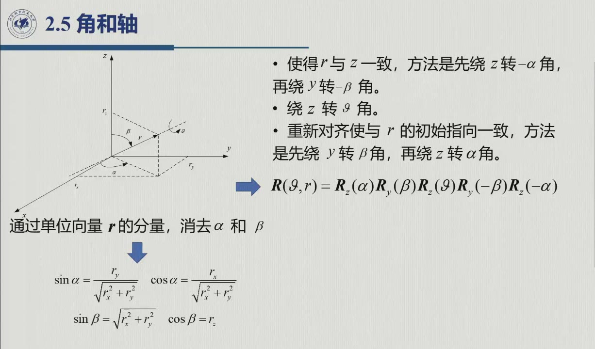
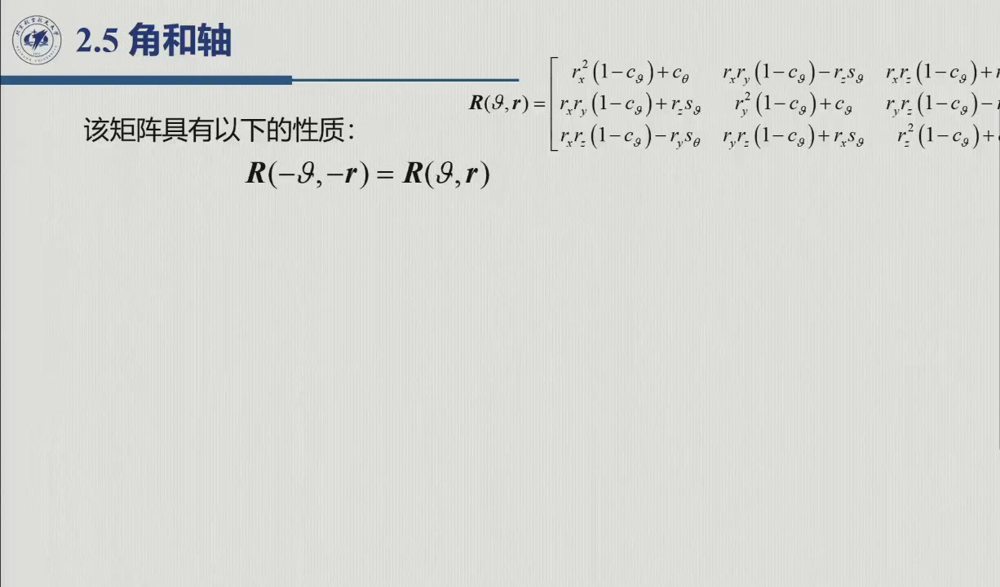

# 2.5 角和轴

如果只需描述工具从一个姿态转到另一个姿态，可以直接问：**绕哪根轴，转多少角？** 本节用单位轴 $\boldsymbol r$ 和转角 $\vartheta$ 表示旋转，先从五次基本旋转推出 Rodrigues 公式，再反求轴与角，最后把同一公式写成矩阵指数。

先区分三件事：**正解**对任意角都有效；**参数表示**可能不唯一；**逆解算法**在零角和半圈处需要换公式。这里的零角与半圈都不会使机器人失去实际运动能力。学完后应能算出一个完整矩阵、解释两端退化，并用演示核对每一步。

## 2.5.1 定义与五步合成

::: def 定义 2.5.1 · 角和轴表示 {#def-2.5.1}
任一旋转都可由**旋转轴的单位向量** $\boldsymbol r=[r_x\ r_y\ r_z]^T$（相对参考系 $O\text{-}xyz$）与**旋转角** $\vartheta$共同表示，记作 $R(\vartheta,\boldsymbol r)$。采用右手定则：右手拇指沿 $\boldsymbol r$，其余四指弯曲方向为正；从轴的正端朝原点看是逆时针。本文用主动旋转 $p_{\rm new}=Rp$，公式内角度均为弧度，带 $^\circ$ 的数值与演示输入除外。

两者共 4 个数（$1+3$），故为**非最简表示**；但轴受单位约束 $r_x^2+r_y^2+r_z^2=1$（原书式 2.29），局部独立参数仍为 3。单位约束不保证表示全局唯一。
:::

我们已经会写绕坐标轴的基本旋转。原书图 2.10 给出一种**辅助构造**：先把轴与整个待转物体一起转到辅助姿态，使轴对齐 $z$；绕固定 $z$ 转所需角度；再撤销前两次对齐动作。每一步都绕固定坐标轴，按 [@thm-2.3.B] 逐次左乘。

1. 绕 $z$ 转 $-\alpha$，再绕 $y$ 转 $-\beta$：把 $\boldsymbol r$ 转到与 $z$ 一致；
2. 在已对齐的辅助姿态中绕**固定 $z$** 转 $\vartheta$；
3. 绕 $y$ 转 $\beta$，再绕 $z$ 转 $\alpha$：把轴转回 $\boldsymbol r$ 的初始指向。

$$R(\vartheta,\boldsymbol r)=R_z(\alpha)\,R_y(\beta)\,R_z(\vartheta)\,R_y(-\beta)\,R_z(-\alpha)\qquad(\text{原书式 }2.24)$$

时序从矩阵的**最右端**开始读。第 3 步单独看是绕固定 $z$，只有五步的净效果才是绕原轴 $\boldsymbol r$。其中 $\rho=\sqrt{r_x^2+r_y^2}$，$\alpha$ 是 $xy$ 面的方位角，$\beta$ 是**从正 $z$ 轴量到 $\boldsymbol r$ 的极角**，不是离开 $xy$ 面的仰角：

$$\sin\alpha=\frac{r_y}{\sqrt{r_x^2+r_y^2}},\quad \cos\alpha=\frac{r_x}{\sqrt{r_x^2+r_y^2}},\qquad
\sin\beta=\sqrt{r_x^2+r_y^2},\quad \cos\beta=r_z .$$

当 $\rho>0$ 时可取 $\alpha=\operatorname{atan2}(r_y,r_x)$、$\beta=\operatorname{atan2}(\rho,r_z)\in[0,\pi]$。当 $\boldsymbol r=\pm\boldsymbol z$ 时，方位角无定义；约定 $\alpha=0$，分别取 $\beta=0,\pi$，仍满足五步公式。下图分两幅平面图量角，避免把投影角与空间角混读。

<figure>
<svg class="figure-svg" viewBox="0 0 920 380" xmlns="http://www.w3.org/2000/svg" role="img" aria-labelledby="fig-25-title fig-25-desc">
<title id="fig-25-title">方位角 α、极角 β 与五步固定轴合成</title>
<desc id="fig-25-desc">左侧俯视 xy 面，α 从正 x 轴量到 r 的投影；中间在包含 z 与 r 的竖直平面内，β 从正 z 轴量到 r。右侧按发生顺序列出五次固定轴旋转；仅第 5 步的净效果等于绕原轴旋转。</desc>
<defs><marker id="f25-m" markerWidth="8" markerHeight="8" refX="7" refY="3" orient="auto"><path d="M0,0 L7,3 L0,6 Z" fill="var(--muted)"/></marker></defs>
<text class="diagram-text" x="150" y="34" text-anchor="middle">① xy 面俯视：方位角 α</text>
<text class="diagram-text" x="444" y="34" text-anchor="middle">② 竖直截面：极角 β</text>
<g fill="none" stroke="var(--line-strong)" stroke-width="1.5" marker-end="url(#f25-m)">
<path d="M65 238 H264"/><path d="M65 238 V70"/>
<path d="M360 238 H554"/><path d="M360 238 V70"/>
</g>
<text class="diagram-note" x="267" y="255">x</text><text class="diagram-note" x="50" y="67">y</text>
<text class="diagram-note" x="343" y="67">z</text><text class="diagram-note" x="545" y="261">ρ 方向</text>
<path d="M65 238 L205 118" stroke="var(--fig-blue)" stroke-width="2.8" marker-end="url(#f25-m)"/>
<text class="diagram-note" x="162" y="97">r 在 xy 面的投影</text>
<path d="M111 238 A46 46 0 0 0 100 208" fill="none" stroke="var(--fig-green)" stroke-width="2"/>
<text class="diagram-text" x="124" y="216">α</text>
<path d="M360 238 L474 104" stroke="var(--fig-blue)" stroke-width="2.8" marker-end="url(#f25-m)"/>
<path d="M474 104 V238" stroke="var(--line)" stroke-dasharray="5 4"/>
<path d="M360 188 A50 50 0 0 1 392 200" fill="none" stroke="var(--fig-purple)" stroke-width="2"/>
<text class="diagram-text" x="375" y="176">β</text><text class="diagram-text" x="484" y="100">r</text>
<text class="diagram-note" x="149" y="291" text-anchor="middle">α = atan2(ry, rx)</text>
<text class="diagram-note" x="444" y="291" text-anchor="middle">β = atan2(ρ, rz)</text>
<text class="diagram-note" x="298" y="328" text-anchor="middle">ρ = √(rx² + ry²)；β 从 +z 量起，范围 0 到 π</text>
<text class="diagram-note" x="298" y="354" text-anchor="middle">r = ±z 时约定 α = 0，β 分别为 0、π</text>
<text class="diagram-text" x="752" y="34" text-anchor="middle">③ 五步时序：每次左乘</text>
<g>
<rect class="diagram-node" x="619" y="58" width="265" height="44" rx="7"/>
<text class="diagram-text" x="752" y="85" text-anchor="middle">1 · Rz(−α)：投影对齐 x</text>
<rect class="diagram-node" x="619" y="113" width="265" height="44" rx="7"/>
<text class="diagram-text" x="752" y="140" text-anchor="middle">2 · Ry(−β)：轴对齐 z</text>
<rect class="diagram-node" x="619" y="168" width="265" height="44" rx="7"/>
<text class="diagram-text" x="752" y="195" text-anchor="middle">3 · Rz(ϑ)：辅助姿态旋转</text>
<rect class="diagram-node" x="619" y="223" width="265" height="44" rx="7"/>
<text class="diagram-text" x="752" y="250" text-anchor="middle">4 · Ry(β)：撤销倾斜</text>
<rect class="diagram-node" x="619" y="278" width="265" height="44" rx="7"/>
<text class="diagram-text" x="752" y="305" text-anchor="middle">5 · Rz(α)：撤销方位变化</text>
</g>
<g stroke="var(--line-strong)" marker-end="url(#f25-m)"><path d="M752 102 V111"/><path d="M752 157 V166"/><path d="M752 212 V221"/><path d="M752 267 V276"/></g>
<text class="diagram-note" x="752" y="352" text-anchor="middle">最终净效果：绕原轴 r 转 ϑ</text>
</svg>
<figcaption>本教程绘。左、中两图分别在对应平面内量 α、β；右图按时间向下读，最终乘积按最右因子先作用。图中轴取一般方向，极点另用上面的约定。</figcaption>
</figure>

把它们代入式 2.24，$\alpha,\beta$ 全部消去，便得到只依赖 $(\vartheta,\boldsymbol r)$ 的显式矩阵（原书式 2.25，即 **Rodrigues 公式**）。原书把这一步推导留作习题 2.4，本编在下方**直接给出完整推导**；[2.5.3](#sec-2.5.3) 还会交代它的泰勒级数来历。

$$R(\vartheta,\boldsymbol r)=\begin{bmatrix}
r_x^2(1-c_\vartheta)+c_\vartheta & r_xr_y(1-c_\vartheta)-r_zs_\vartheta & r_xr_z(1-c_\vartheta)+r_ys_\vartheta\\
r_xr_y(1-c_\vartheta)+r_zs_\vartheta & r_y^2(1-c_\vartheta)+c_\vartheta & r_yr_z(1-c_\vartheta)-r_xs_\vartheta\\
r_xr_z(1-c_\vartheta)-r_ys_\vartheta & r_yr_z(1-c_\vartheta)+r_xs_\vartheta & r_z^2(1-c_\vartheta)+c_\vartheta
\end{bmatrix}$$

::: intuition 结构记忆法
对角线 = $r_i^2(1-c_\vartheta)+c_\vartheta$；非对角 = $r_ir_j(1-c_\vartheta)\ \pm\ $「剩余那根轴的分量 × $s_\vartheta$」，反对称部分的符号由叉积 $\boldsymbol r\times$ 决定。校验两个特例：$\boldsymbol r=\boldsymbol z$ 时退化为 $R_z(\vartheta)$；$\vartheta=0$ 时退化为 $I_3$。
:::

推导这九个元素不必硬乘五个矩阵。先立一件工具，再走五步。

::: def 定义 2.5.2 · 叉乘算子 $S(\omega)$（反对称矩阵） {#def-2.5.2}
对任意三维向量 $\omega$，定义 $3\times3$ 矩阵

$$S(\omega)=\begin{bmatrix}0&-\omega_z&\omega_y\\ \omega_z&0&-\omega_x\\ -\omega_y&\omega_x&0\end{bmatrix},\qquad\text{满足 } S(\omega)\,p\equiv\omega\times p\ \ (\forall p\in\mathbb R^3).$$

（逐列验证：第 1 列 $S(\omega)\boldsymbol x=\omega\times\boldsymbol x=[0,\omega_z,-\omega_y]^{\mathrm T}$，恰为矩阵的第 1 列；其余两列同法。）$S(\omega)$ 满足 $S^{\mathrm T}(\omega)=-S(\omega)$，即**反对称矩阵**：对角线恒为零、非对角元素镜像反号；此外还有 $S(\omega)=-S(-\omega)$。第 3 章将证明 $S(\omega)$ 正是**角速度**的矩阵化身（[@def-3.1.2]）；本节先把它当作「把叉积装进矩阵代数」的纯工具。
:::

::: proof 证明 · 从五步合成到 Rodrigues 矩阵（本编补充，对应原书习题 2.4） {#pf-2.5.rodrigues}
**第 0 步（工具：旋转保持叉积）。** 对任意 $R\in SO(3)$ 与向量 $a,b,c$，混合积只差一个 $\det R=1$ 的因子：

$$(Ra\times Rb)\cdot(Rc)=\det\begin{bmatrix}Ra&Rb&Rc\end{bmatrix}=\det(R)\det\begin{bmatrix}a&b&c\end{bmatrix}=(a\times b)\cdot c .$$

令 $c$ 取遍全部向量（$Rc$ 随之取遍全部向量），两个关于 $c$ 的线性函数处处相等，只能有 $Ra\times Rb=R(a\times b)$。翻译成叉乘算子，即**共轭恒等式**：对任意 $\omega$，

$$R\,S(\omega)\,R^{\mathrm T}=S(R\omega).$$

（两边作用于同一任意向量 $p$ 核验：左 $=R\big(\omega\times R^{\mathrm T}p\big)=(R\omega)\times(RR^{\mathrm T}p)=(R\omega)\times p=$ 右。）

**第 1 步（把对齐与撤销写成转置）。** 记 $M\triangleq R_z(\alpha)R_y(\beta)$。时序中的前两次对齐对应乘积**右侧**的 $R_y(-\beta)R_z(-\alpha)=M^{\mathrm T}$；最后两次撤销对应乘积**左侧**的 $M$。由 $R_k(-\vartheta)=R_k^{\mathrm T}(\vartheta)$（式 2.9），

$$R(\vartheta,\boldsymbol r)=R_z(\alpha)R_y(\beta)\,R_z(\vartheta)\,R_y(-\beta)R_z(-\alpha)=M\,R_z(\vartheta)\,M^{\mathrm T}.$$

**第 2 步（$M$ 的第三列就是 $\boldsymbol r$）。** $R_y(\beta)\boldsymbol z=[s_\beta,0,c_\beta]^{\mathrm T}=[\rho,0,r_z]^{\mathrm T}$（$\rho\triangleq\sqrt{r_x^2+r_y^2}$），再左乘 $R_z(\alpha)$ 并用上面 $\alpha,\beta$ 的三角关系：

$$M\boldsymbol z=R_z(\alpha)\begin{bmatrix}\rho\\0\\r_z\end{bmatrix}=\begin{bmatrix}\rho c_\alpha\\ \rho s_\alpha\\ r_z\end{bmatrix}=\begin{bmatrix}r_x\\ r_y\\ r_z\end{bmatrix}=\boldsymbol r .$$

「把 $\boldsymbol r$ 借到 $z$ 上、转完再还回去」的矩阵语言就是：$M$ 把 $z$ 轴送到 $\boldsymbol r$ 上（因此也把绕 $z$ 的旋转共轭成绕 $\boldsymbol r$ 的旋转）。

**第 3 步（把 $R_z(\vartheta)$ 拆成三件套）。** 由式 2.6 直接展开：

$$R_z(\vartheta)=c_\vartheta I+s_\vartheta S(\boldsymbol z)+(1-c_\vartheta)\,\boldsymbol z\boldsymbol z^{\mathrm T}$$

（$c_\vartheta I$ 给对角、$s_\vartheta S(\boldsymbol z)$ 给左上 $xy$ 的 2×2 反对称块、$(1-c_\vartheta)\boldsymbol z\boldsymbol z^{\mathrm T}$ 把右下角补成 $1$，逐块相加即还原式 2.6）。

**第 4 步（相似变换逐件搬运）。** 把第 3 步代入第 1 步：第一件 $MM^{\mathrm T}=I$ 原样；第三件用第 2 步 $M(\boldsymbol z\boldsymbol z^{\mathrm T})M^{\mathrm T}=(M\boldsymbol z)(M\boldsymbol z)^{\mathrm T}=\boldsymbol r\boldsymbol r^{\mathrm T}$；中间一件用共轭恒等式（取 $\omega=\boldsymbol z$）$MS(\boldsymbol z)M^{\mathrm T}=S(M\boldsymbol z)=S(\boldsymbol r)$。合并得**紧凑形式**

$$R(\vartheta,\boldsymbol r)=c_\vartheta I+(1-c_\vartheta)\,\boldsymbol r\boldsymbol r^{\mathrm T}+s_\vartheta\,S(\boldsymbol r).$$

**第 5 步（逐元素写出）。** $(\boldsymbol r\boldsymbol r^{\mathrm T})_{ij}=r_ir_j$ 给全部「$r_ir_j(1-c_\vartheta)$」项；$S(\boldsymbol r)$ 的非对角元素给 $\pm s_\vartheta$ 项（符号按 $S(\boldsymbol r)p=\boldsymbol r\times p$ 的约定）。逐元素展开即式 2.25。两个免费校验：$\boldsymbol r=\boldsymbol z$ 时三件套与第 3 步逐件相同，退化为 $R_z(\vartheta)$；$\vartheta=0$ 时 $c_\vartheta=1$、$s_\vartheta=0$，退化为 $I_3$。□
:::

这个紧凑形式也有直接几何意义：令 $p_\parallel=(\boldsymbol r\cdot p)\boldsymbol r$、$p_\perp=p-p_\parallel$，则

$$Rp=p_\parallel+\cos\vartheta\,p_\perp+\sin\vartheta\,(\boldsymbol r\times p_\perp).$$

平行分量保持不变；垂直分量在轴的法平面内旋转。取 $p=\boldsymbol r$ 得到 **$R\boldsymbol r=\boldsymbol r$**，这是后面演示的检查项。[2.5.2](#sec-2.5.2) 用紧凑形式求逆解，[2.5.3](#sec-2.5.3) 再推指数表达。

## 2.5.2 表示不唯一与逆解

::: thm 定理 2.5.A · 表示不唯一（原书式 2.26） {#thm-2.5.A}
$$R(-\vartheta,-\boldsymbol r)=R(\vartheta,\boldsymbol r).$$
同步反号给同一旋转，另有周期性 $R(\vartheta+2k\pi,\boldsymbol r)=R(\vartheta,\boldsymbol r)$。通常约定**主角** $\vartheta\in[0,\pi]$：在 $0<\vartheta<\pi$ 时轴唯一；$\vartheta=0$ 时任意轴都给 $I$；$\vartheta=\pi$ 时只有轴的正负仍无法区分。

[2.6](sec2-6.md) 的半角打包会把同步反号的两组参数映到同一四元数，但仍保留 $Q$ 与 $-Q$ 表示同一姿态的双重覆盖，不能声称不唯一性全部消失。
:::

逆问题：已知 $R=[r_{ij}]$，反求 $(\vartheta,\boldsymbol r)$。先确认输入确实属于 $SO(3)$：数值计算要独立检查 $R^{\mathrm T}R\approx I$、$\det R\approx1$。**不能用归一化轴来掩盖坏矩阵**。下面的推导都假设 $R$ 合法。

**取迹**——$S(\boldsymbol r)$ 对角线为零、$\operatorname{tr}(\boldsymbol r\boldsymbol r^{\mathrm T})=r_x^2+r_y^2+r_z^2=1$，轴被消去：

$$\operatorname{tr}R=3c_\vartheta+(1-c_\vartheta)\cdot 1=1+2c_\vartheta
\quad\Longrightarrow\quad
\cos\vartheta=\frac{r_{11}+r_{22}+r_{33}-1}{2}\qquad(\text{原书式 }2.27)$$

**取反对称部分**——$c_\vartheta I$ 与 $(1-c_\vartheta)\boldsymbol r\boldsymbol r^{\mathrm T}$ 都是对称矩阵，作差 $R-R^{\mathrm T}$ 后只剩反对称件：

$$R-R^{\mathrm T}=2s_\vartheta\,S(\boldsymbol r)
\quad\Longrightarrow\quad
\boldsymbol r=\frac{1}{2\sin\vartheta}\begin{bmatrix}r_{32}-r_{23}\\ r_{13}-r_{31}\\ r_{21}-r_{12}\end{bmatrix}\qquad(\sin\vartheta\neq 0,\ \text{原书式 }2.28)$$

令 $v=\tfrac12[r_{32}-r_{23},\,r_{13}-r_{31},\,r_{21}-r_{12}]^{\mathrm T}=\sin\vartheta\,\boldsymbol r$。在主角范围内，$\|v\|=\sin\vartheta\ge0$，因而也可用

$$\vartheta=\operatorname{atan2}\!\left(\|v\|,\frac{\operatorname{tr}R-1}{2}\right)\in[0,\pi],\qquad
\boldsymbol r=\frac{v}{\|v\|}\quad(0<\vartheta<\pi).$$

这同时利用了正弦与余弦；原书的 $\arccos$ 在选定主支内也正确。Atan2 并不使接近零角、半圈时的轴恢复自动稳定：此时 $\|v\|$ 很小，方向读数仍可能受噪声影响。

::: thm 定理 2.5.B · 逆解的失效情形 {#thm-2.5.B}
取主角 $\vartheta\in[0,\pi]$，式 2.28 在两个端点不能直接除以 $\sin\vartheta$：

- **零角**：$R=I_3$，轴任意；但选定主旋转向量 $\phi=\vartheta\boldsymbol r$ 就是唯一的零向量。
- **半圈**：$R=2\boldsymbol r\boldsymbol r^{\mathrm T}-I_3$。令 $B=(R+I)/2=\boldsymbol r\boldsymbol r^{\mathrm T}$，取最大对角元 $B_{kk}$，设 $r_k=\sqrt{B_{kk}}$，再取 $r_i=B_{ik}/r_k$。因 $\sum B_{ii}=1$，最大项至少 $1/3$，不会除以零。**对角线只给绝对值，非对角项给相对符号**；最后整体反号也合法。

近半圈但尚未到端点时，可从

$$B=\frac{(R+R^{\mathrm T})/2-\cos\vartheta I}{1-\cos\vartheta}=\boldsymbol r\boldsymbol r^{\mathrm T}$$

用同一主元法恢复轴，再用 $\boldsymbol r\cdot v$ 的符号确定整体方向。精确半圈时 $v=0$，只能选约定代表；带噪数据不能要求跨越半圈边界的主轴方向连续。零角附近则应优先读旋转向量，不强调几乎没有意义的单位轴。
:::

::: ex 例 2.5.C · 一次转动，把三根坐标轴循环换位 {#ex-2.5.C}
取 $\boldsymbol r=(1,1,1)^{\mathrm T}/\sqrt3$、$\vartheta=120^\circ=2\pi/3$。此时 $c=-1/2$、$s=\sqrt3/2$，紧凑式的每个对角元为 $-1/2+(3/2)/3=0$；非对角元为 $1/2\pm1/2$，得到

$$R=\begin{bmatrix}0&0&1\\1&0&0\\0&1&0\end{bmatrix},\qquad
R(1,0,0)^{\mathrm T}=(0,1,0)^{\mathrm T},\qquad
R(1,2,3)^{\mathrm T}=(3,1,2)^{\mathrm T}.$$

读列可知 $x\to y\to z\to x$，且 $R\boldsymbol r=\boldsymbol r$。反算时 $\operatorname{tr}R=0$、$v=(1,1,1)^{\mathrm T}/2$，所以 $\vartheta=\operatorname{atan2}(\sqrt3/2,-1/2)=120^\circ$，轴恢复为原轴。工具默认就用这组数。
:::

### 操作：净旋转与五步辅助构造

先预测：若把角度改为 $0^\circ$，无论轴指向哪里，最终矩阵都应是什么？再操作：

1. 保持默认的轴与 $120^\circ$，核对例 2.5.C 的矩阵、$Rp$ 和不变轴。
2. 切到“五步构造”，从第 0 步走到第 5 步。第 2 步观察 $P\boldsymbol r=\boldsymbol z$；第 3 步仍绕固定 $z$；第 5 步再检查 $P=R$、$P\boldsymbol r=\boldsymbol r$。中间矩阵 $P$ 不能当成最终 $R$。
3. 选择“混合符号半圈”，核对相对符号与 $\pm\boldsymbol r$；再改成 $179.99^\circ$ 和 $180.01^\circ$，解释主角为何不超过 $180^\circ$、轴为何反向。
4. 把三个轴输入都设为 0，观察错误提示；它不代表合法旋转轴。按“重置角轴与视角”恢复所有参数、模式和相机。

没有脚本时，以上例题、两幅静态图和下方三份折叠练习仍可完成本节学习。

::: think 练习 1 · 半圈的相对符号 {#practice-2.5.halfturn}
给定 $R=\begin{bmatrix}0&-1&0\\-1&0&0\\0&0&-1\end{bmatrix}$。只对对角线开正平方根会得到什么轴？它能重建 $R$ 吗？用主元法求正确的轴。

::: sol 核对
$B=(R+I)/2$ 的对角为 $(1/2,1/2,0)$。全部取正会给 $(1,1,0)/\sqrt2$，其重建矩阵的 $(1,2)$ 元为 $+1$，与题目相反。取 $k=1$、$r_x=1/\sqrt2$，用 $B_{21}=-1/2$ 得 $r_y=-1/\sqrt2$、$r_z=0$。答案为 $\pm(1,-1,0)/\sqrt2$，整体反号不改变半圈旋转。
:::
:::

## 2.5.3 李代数 so(3)：指数映射与对数映射（本编补充）

[2.5.1](#sec-2.5.1) 用五步合成推出了 Rodrigues 公式，[2.5.2](#sec-2.5.2) 反解出了 $(\vartheta,\boldsymbol r)$。本小节把同一旋转写成**矩阵指数**，并在选定分支后反求旋转对数。第 3 章的角速度、[2.6](sec2-6.md) 的四元数半角、[2.7](sec2-7.md) 的螺旋运动都将复用这套语言。

::: def 定义 2.5.3 · 李代数 so(3) {#def-2.5.3}
全体 $3\times3$ 反对称矩阵构成的集合

$$so(3)\triangleq\big\{S\in\mathbb R^{3\times3}:\ S^{\mathrm T}=-S\big\}$$

称为 $SO(3)$ 的**李代数**（Lie algebra）。由 [@def-2.5.2]，每个 $S\in so(3)$ 形如 $S(\omega)$ 且与 $\omega\in\mathbb R^3$ **一一对应**——这一对操作常记作**装帽 / 摘帽**（hat / vee）：

$$\hat\omega=S(\omega)\in so(3),\qquad \big(S(\omega)\big)^\vee=\omega\in\mathbb R^3,$$

（不少教材把 $S(\omega)$ 写成 $[\omega]_\times$ 或 $\hat\omega$。）因此 $so(3)$ 是一个 **3 维向量空间**——对加法与数乘封闭——一组自然基（**生成元**）是

$$S_x=S(\boldsymbol x)=\begin{bmatrix}0&0&0\\0&0&-1\\0&1&0\end{bmatrix},\quad
S_y=S(\boldsymbol y)=\begin{bmatrix}0&0&1\\0&0&0\\-1&0&0\end{bmatrix},\quad
S_z=S(\boldsymbol z)=\begin{bmatrix}0&-1&0\\1&0&0\\0&0&0\end{bmatrix},$$

任何 $S(\omega)=\omega_xS_x+\omega_yS_y+\omega_zS_z$——「绕三根坐标轴的无穷小旋转」按分量组合出任意方向的无穷小旋转。
:::

**为什么说 $so(3)$ 是 $SO(3)$ 的「微分版本」（切空间）？** 把紧凑形式按小角度 $\delta$ 展开（$c_\delta\approx1$、$s_\delta\approx\delta$）：

$$R(\delta,\boldsymbol r)=I+\delta S(\boldsymbol r)+O(\delta^2),$$

同理由式 2.6–2.8 逐个验证 $R_k(\delta)=I+\delta S_k+O(\delta^2)$。对满足 **$R(0)=I$** 的可微旋转轨迹，$\lim_{\delta\to0}(R(\delta)-I)/\delta=\dot R(0)\in so(3)$；由 $RR^{\mathrm T}=I$ 在零时刻求导即可得到反对称性。

在一般姿态 $R$ 处，$\dot R$ 通常不反对称，**$\dot R R^{\mathrm T}$** 才是 $so(3)$ 元素。第 3 章写成 $\dot R=S(\boldsymbol\omega)R$，其中 $\boldsymbol\omega\in\mathbb R^3$，而 $S(\boldsymbol\omega)\in so(3)$。所以 $so(3)$ 特指单位元 $I$ 处的切空间；其他位置的切向量要先移回单位元再比较。

::: thm 定理 2.5.D · 指数映射——Rodrigues 公式的第二来历 {#thm-2.5.D}
对单位轴 $\boldsymbol r$（$|\boldsymbol r|=1$）、任意角 $\vartheta$，矩阵指数

$$\exp\big(\vartheta S(\boldsymbol r)\big)\triangleq I+\vartheta S+\frac{\vartheta^2S^2}{2!}+\frac{\vartheta^3S^3}{3!}+\cdots,\qquad S=S(\boldsymbol r)$$

收敛且有闭式

$$\exp\big(\vartheta S(\boldsymbol r)\big)=I+\sin\vartheta\,S+(1-\cos\vartheta)\,S^2 .$$

代入 $S^2=\boldsymbol r\boldsymbol r^{\mathrm T}-I$，即紧凑形式 $c_\vartheta I+(1-c_\vartheta)\boldsymbol r\boldsymbol r^{\mathrm T}+s_\vartheta S(\boldsymbol r)$——与 [@pf-2.5.rodrigues] 五步合成的结果**逐元素相同**。于是

$$R(\vartheta,\boldsymbol r)=\exp\big(\vartheta S(\boldsymbol r)\big),$$

映射 $\exp:so(3)\to SO(3)$ 称为**指数映射**。通常把三维向量 $\phi=\vartheta\boldsymbol r$ 称为**旋转向量或指数坐标**，而 $\hat\phi=S(\phi)=\vartheta S(\boldsymbol r)$ 是对应的李代数矩阵。指数的输入是该矩阵，输出是旋转矩阵；每个输入只有一个输出，但不同输入可以映到同一个旋转。
:::

::: proof 证明 · 幂次化简与正弦余弦级数
**幂次关系。** 对 $S=S(\boldsymbol r)$、$|\boldsymbol r|=1$，作用到任意向量 $p$ 上用二重叉积公式 $\boldsymbol r\times(\boldsymbol r\times p)=(\boldsymbol r\cdot p)\boldsymbol r-p$（*拉格朗日公式*）：

$$S^2p=\boldsymbol r\times(\boldsymbol r\times p)=(\boldsymbol r\boldsymbol r^{\mathrm T}-I)\,p
\quad\Longrightarrow\quad S^2=\boldsymbol r\boldsymbol r^{\mathrm T}-I,$$

再乘一次 $S$：$S^3p=\boldsymbol r\times\big((\boldsymbol r\cdot p)\boldsymbol r-p\big)=-\boldsymbol r\times p$（$\boldsymbol r$ 叉自己为零），故

$$S^3=-S .$$

由三次关系 $S^3=-S$，非零幂按**四项周期**排列：$S,\ S^2,\ -S,\ -S^2,\ S,\ \dots$。这里不能把“三次关系”称为“三循环”。

**级数按奇偶分家。** 把 $\exp(\vartheta S)$ 的各项按含 $S$ 还是 $S^2$ 归堆（$S^4=-S^2$、$S^5=S$，依此循环）：

$$\exp(\vartheta S)=I+\Big(\vartheta-\frac{\vartheta^3}{3!}+\frac{\vartheta^5}{5!}-\cdots\Big)S+\Big(\frac{\vartheta^2}{2!}-\frac{\vartheta^4}{4!}+\cdots\Big)S^2=I+\sin\vartheta\,S+(1-\cos\vartheta)\,S^2 ,$$

两个括号正是 $\sin\vartheta$ 与 $1-\cos\vartheta$ 的泰勒级数。□
:::

::: thm 定理 2.5.E · 对数映射——逆解公式的来历 {#thm-2.5.E}
设 $R\in SO(3)$，选主角 $0<\vartheta<\pi$。这一区间的旋转对数分支为

$$\operatorname{Log} R=\vartheta\,S(\boldsymbol r)=\frac{\vartheta}{2\sin\vartheta}\,\big(R-R^{\mathrm T}\big),\qquad
\vartheta=\arccos\frac{\operatorname{tr}R-1}{2},$$

这里的 $\operatorname{Log}$ 表示**已选定的旋转对数分支**，不是在所有姿态上都光滑且唯一的全局逆。摘帽结果为三维旋转向量

$$\phi=(\operatorname{Log}R)^\vee=\vartheta\boldsymbol r,$$

不是四参数组 $(\vartheta,\boldsymbol r)$。零角处取 $\operatorname{Log}I=0$；因 $\vartheta/\sin\vartheta\to1$，上述公式可平滑延拓，$\operatorname{Log}R\approx(R-R^{\mathrm T})/2$。此时轴任意，**主旋转向量仍唯一为零**。

半圈边界处可选 $\pm\pi S(\boldsymbol r)$，两者指数相同；轴须按 [@thm-2.5.B] 用对称部分与交叉项恢复。不能要求该主支跨边界连续。这里讨论的是实反对称旋转对数的代表，不能直接套用“无负实特征值”条件下的主矩阵对数结论。

**$\exp$ 是单值、非单射的映射。** 若不限制分支，同一旋转有无限多个实反对称对数；例如 $I$ 除零对数外还有 $2k\pi S(\boldsymbol r)$。这与取定主旋转向量后 $\operatorname{Log}I=0$ 不矛盾。
:::

<figure>
<svg class="figure-svg" viewBox="0 0 920 300" xmlns="http://www.w3.org/2000/svg" role="img" aria-labelledby="fig-2la-t fig-2la-d">
<title id="fig-2la-t">旋转向量、李代数矩阵与旋转矩阵</title>
<desc id="fig-2la-d">先将角与单位轴相乘得到三维旋转向量 φ，再装帽得到反对称矩阵 S(φ)，经指数映射得到 R。摘帽只返回三维向量。反向 Log 需要选择分支，零点主向量为零，半圈有正负两个边界代表。</desc>
<defs><marker id="f2la-m" markerWidth="8" markerHeight="8" refX="7" refY="3" orient="auto"><path d="M0,0 L7,3 L0,6 Z" fill="var(--muted)"/></marker></defs>
<text class="diagram-text" x="460" y="32" text-anchor="middle">先乘成三维向量，再装帽；反解必须声明分支</text>
<g>
<rect class="diagram-node" x="30" y="75" width="230" height="85" rx="8"/>
<text class="diagram-text" x="145" y="107" text-anchor="middle">φ = ϑr ∈ ℝ³</text>
<text class="diagram-note" x="145" y="139" text-anchor="middle">旋转向量（指数坐标）</text>
<rect class="diagram-node" x="345" y="75" width="230" height="85" rx="8"/>
<text class="diagram-text" x="460" y="107" text-anchor="middle">S(φ) = ϑS(r) ∈ so(3)</text>
<text class="diagram-note" x="460" y="139" text-anchor="middle">反对称矩阵（I 处切空间）</text>
<rect class="diagram-node" x="660" y="75" width="230" height="85" rx="8"/>
<text class="diagram-text" x="775" y="107" text-anchor="middle">R = exp(S(φ)) ∈ SO(3)</text>
<text class="diagram-note" x="775" y="139" text-anchor="middle">旋转矩阵（完整姿态）</text>
</g>
<g fill="none" stroke="var(--line-strong)" stroke-width="1.5" marker-end="url(#f2la-m)">
<path d="M264 95 H339"/><path d="M339 150 H264"/><path d="M579 95 H654"/><path d="M654 150 H579"/>
</g>
<text class="diagram-note" x="302" y="80" text-anchor="middle">hat</text><text class="diagram-note" x="302" y="174" text-anchor="middle">vee</text>
<text class="diagram-note" x="617" y="80" text-anchor="middle">exp</text><text class="diagram-note" x="617" y="174" text-anchor="middle">Log</text>
<text class="diagram-note" x="460" y="210" text-anchor="middle">exp 单值但非单射；0 ≤ ϑ &lt; π 的主旋转向量唯一，ϑ = π 时选 ±πr 代表</text>
<text class="diagram-note" x="460" y="242" text-anchor="middle">角速度 ω ∈ ℝ³；S(ω) = ṘRᵀ ∈ so(3)，一般 Ṙ 本身不反对称</text>
<text class="diagram-note" x="460" y="274" text-anchor="middle">so(3) 对加法封闭，但 exp(A+B) 一般不等于 exp(A)exp(B)</text>
</svg>
<figcaption>本教程绘。hat/vee 是向量与反对称矩阵的一一对应，exp/Log 则必须区分映射与选支。箭头表示运算，不能把角轴四参数直接当成 hat 的输入。</figcaption>
</figure>

::: note 这套语言买了什么（与全书的接口） {#note-2.5.payoff}
1. **两条推导路合流**：五步合成（几何，[@pf-2.5.rodrigues]）与泰勒级数（分析，[@thm-2.5.D]）殊途同归到 $R(\vartheta,\boldsymbol r)=\exp(\vartheta S(\boldsymbol r))$。以后见「Rodrigues 公式」，两副眼镜随取随用。
2. **角速度的反对称矩阵属于 $so(3)$**：第 3 章将证明 $\dot R=S(\boldsymbol\omega)R$（[@thm-3.1.A]），即 $S(\boldsymbol\omega)=\dot R R^{\mathrm T}$。一般情况下 $\boldsymbol\omega$ 不等于欧拉角向量或旋转向量的逐项导数（[3.6.3](../ch03/sec3-6.md#sec-3.6.3)）；固定轴的 $\phi(t)=\vartheta(t)\boldsymbol r$ 则有 $\boldsymbol\omega=\dot\vartheta\boldsymbol r$，要保留这个特例。
3. **不可交换的残留物 = 李括号**：$so(3)$ 不止是向量空间，还自带一种乘法——**李括号** $[A,B]=AB-BA$。在 $so(3)$ 上：作用到任意 $p$，$S(a)S(b)p=a\times(b\times p)=b\,(a\cdot p)-(a\cdot b)\,p$，即 $S(a)S(b)=ba^{\mathrm T}-(a\cdot b)I$；与交换 $a,b$ 的结果相减，常数项抵消：

   $$[S(a),S(b)]=S(a)S(b)-S(b)S(a)=ba^{\mathrm T}-ab^{\mathrm T}=S(a\times b).$$

   **$so(3)$ 的李括号就是叉积**——「代数」二字的含义所在，也是 [2.3](sec2-3.md) 的旋转不可交换在无穷小层面留下的痕迹（括号不为零）。
4. **$SE(3)$ 的对应结构**：[2.7](sec2-7.md#note-2.7.se3) 给出李代数 $se(3)$；恒定刚体速度可通过指数生成有限运动。空间速度中的 v 一般不等于动系原点的线速度，须按其定义换算。
:::

::: think 练习 2 · 轴任意，是否意味着主对数任意？ {#practice-2.5.log}
$R=I$ 时主旋转向量是多少？再取 $R(t)=R_z(t+\pi/2)$，计算 $\dot R(0)$ 与 $\dot R(0)R(0)^{\mathrm T}$，判断哪一个属于 $so(3)$。

::: sol 核对
主旋转向量为 $\phi=0$；轴任意不会产生不同的零向量。若允许非主分支，$2k\pi\boldsymbol r$ 也可指数回到 $I$。

$$R(0)=\begin{bmatrix}0&-1&0\\1&0&0\\0&0&1\end{bmatrix},\quad
\dot R(0)=\begin{bmatrix}-1&0&0\\0&-1&0\\0&0&0\end{bmatrix},\quad
\dot R(0)R(0)^{\mathrm T}=\begin{bmatrix}0&-1&0\\1&0&0\\0&0&0\end{bmatrix}.$$

$\dot R(0)$ 是非零对称矩阵，后一个矩阵才反对称。原差商 $(R(\delta)-I)/\delta$ 在这个起点不会收敛为 $\dot R(0)$，因为 $R(0)\ne I$。
:::
:::

### 应用：从任意首姿态到末姿态

给定 $R_0,R_1\in SO(3)$，先在**初始工具系**表达相对旋转 $\Delta=R_0^{\mathrm T}R_1$，选一个对数 $A=\operatorname{Log}\Delta=\vartheta S(\boldsymbol r)$，再令

$$R(s)=R_0\exp(sA),\qquad 0\le s\le1.$$

这样 $R(0)=R_0$、$R(1)=R_1$，每个中间矩阵仍是合法旋转。若 $s=t/T$，即以固定角速度 $\vartheta/T$ 绕固定的物理轴转；$\boldsymbol r$ 是该轴在初始工具系的分量，固定系方向为 $R_0\boldsymbol r$。主角小于 $\pi$ 时选到最短转动，等于 $\pi$ 时两条方向相反的等长路径都合法，必须明确选路。直接把两个任意旋转向量逐项插值不自动等于这条相对旋转路径。

::: think 练习 3 · 插值一半是否仍从单位阵出发？ {#practice-2.5.interpolate}
取 $R_0=R_z(90^\circ)$、$R_1=R_z(180^\circ)$。求 $\Delta$、$R(1/2)$ 和固定系中的转轴；解释为什么 $\exp(\tfrac12\operatorname{Log}R_1)$ 不是本题的一半姿态。

::: sol 核对
$\Delta=R_z(90^\circ)$、$A=(\pi/2)S(\boldsymbol z)$，所以 $R(1/2)=R_z(135^\circ)$，转轴固定系方向仍为 $\boldsymbol z$。单独计算 $\exp(\tfrac12\operatorname{Log}R_1)$ 得 $R_z(90^\circ)$（选正向半圈），它从 $I$ 出发，遗漏了初始姿态 $R_0$。
:::
:::

::: think 默写点 · 合上书再写（主动回忆）

不看正文与速查卡，先写出下面几条，再展开核对。写不出来就说明这一节还没「拿走」。

1. 写出绕任意轴 $\boldsymbol r$ 转 $\vartheta$ 的五步固定轴构造；其中哪两步先把轴对齐 $z$？
2. 由 $R$ 求 $\vartheta$ 与 $\boldsymbol r$ 的公式各是什么（各自用 $R$ 的哪部分）？
3. $\vartheta=0$ 与 $\vartheta=\pi$ 各出什么问题？
4. 写出 Rodrigues 紧凑形式与 $\exp\big(\vartheta S(\boldsymbol r)\big)$ 的闭式；$S(\boldsymbol r)$ 的幂次有何规律？

::: sol 核对

$R_z(\alpha)R_y(\beta)R_z(\vartheta)R_y(-\beta)R_z(-\alpha)$，时序从右向左读、全绕固定轴依次左乘。只有最先发生的 $z(-\alpha)$、$y(-\beta)$ 两步负责对齐 $z$；五步结束时轴已回到原指向。

取**迹**求角：$\cos\vartheta=(r_{11}+r_{22}+r_{33}-1)/2$；取**反对称部分**求轴：$\boldsymbol r=\frac{1}{2s_\vartheta}[r_{32}-r_{23},\ r_{13}-r_{31},\ r_{21}-r_{12}]^{\mathrm T}$。

$\vartheta=0$：$R=I$，轴任意而主旋转向量为零。$\vartheta=\pi$：反对称部分为零，须用 $B=(R+I)/2=\boldsymbol r\boldsymbol r^{\mathrm T}$ 的最大对角主元及交叉项求轴；对角线单独不足以恢复相对符号。

紧凑形式 $c_\vartheta I+(1-c_\vartheta)\boldsymbol r\boldsymbol r^{\mathrm T}+s_\vartheta S(\boldsymbol r)$；$\exp(\vartheta S)=I+\sin\vartheta\,S+(1-\cos\vartheta)\,S^2$。$S^2=\boldsymbol r\boldsymbol r^{\mathrm T}-I$、$S^3=-S$ 将非零幂化成四项周期，级数因此合成 $\sin$ 与 $\cos$。$\exp$ 单值但非单射，选定主旋转向量还必须说明半圈边界。

:::

:::

## 2.5 小结与常见错误

- **一条主线**：任意旋转 = 一根轴 + 一个角 → 借 $z$ 轴五步左乘合成 → 消去 $\alpha,\beta$ 得 Rodrigues 矩阵（紧凑形式 $cI+(1-c)\boldsymbol r\boldsymbol r^{\mathrm T}+sS(\boldsymbol r)$）→ 迹求角、反对称部分求轴。
- **李代数**：$\phi=\vartheta\boldsymbol r\in\mathbb R^3$，$S(\phi)\in so(3)$，$\exp(S(\phi))=R$。$\boldsymbol\omega$ 是向量，$S(\boldsymbol\omega)=\dot R R^{\mathrm T}$ 才是李代数矩阵。
- **边界**：零角的轴任意但主旋转向量为零；半圈轴有整体正负两选，交叉项决定相对符号；任意角的正解都有效。不限制分支时有无限多种等价对数。

::: think 常见错误清单 · 自查三条
1. 五步时序应逐次左乘；$\beta$ 从 $+z$ 量起。第 3 步只是辅助状态的固定 $z$ 旋转，不能与五步净效果混为一谈。
2. 先查 $R^{\mathrm T}R\approx I$ 与 $\det R\approx1$；单位轴只是附加自检。半圈时不能对三个对角项各取正平方根就结束。
3. 参数数目不能代替边界分析：角轴有单位约束及零角/半圈退化，四元数也有 $Q\sim-Q$；任何一种都不能被称作“全局唯一无奇异的三维坐标”。
:::

下一节 [2.6 单位四元数](sec2-6.md) 将把半角与单位轴打包。先记住：打包会消去同步反号的重复参数，却仍需处理四元数整体正负号。
