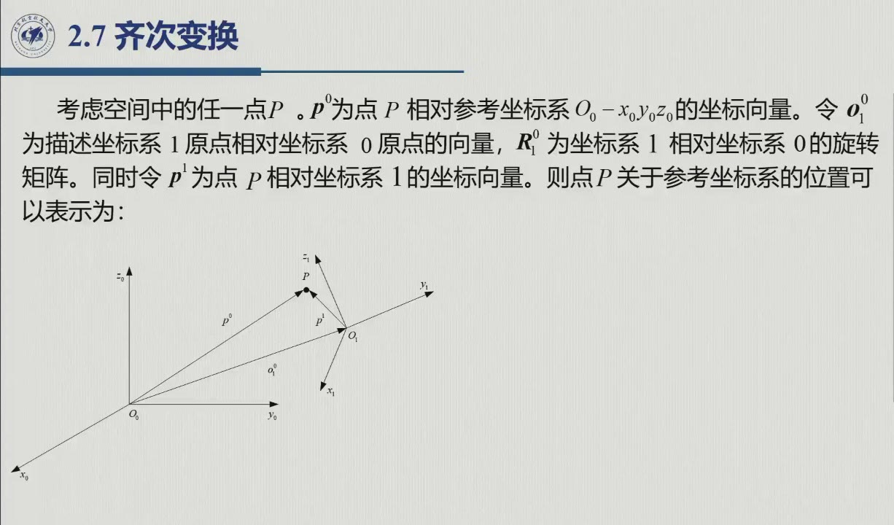
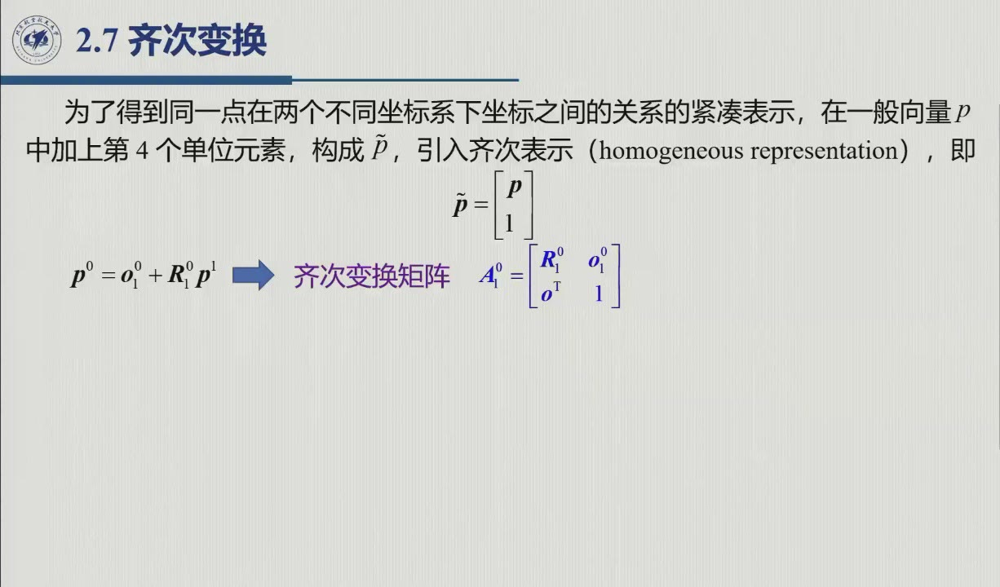

# 2.7 齐次变换

位姿 = 位置 + 指向，而「先加平移、再乘旋转」的写法在链式变换中会越写越长。本节用**齐次坐标**把两者打包进一个 4×4 矩阵，为 DH 法的连乘打好地基。录播 0:30:54–0:39:43。

<aside class="lesson-brief" aria-label="2.7 学习简报">

PREREQUISITE<strong>你需要先会</strong>
旋转矩阵及其合成（[@thm-2.3.A]）；分块乘法。

TARGET<strong>本节要建立</strong>
齐次坐标 $\tilde{\boldsymbol p}$；齐次变换矩阵 $A$ 与 $SE(3)$；逆变换的分块公式（原书式 2.45，附直接验证）；「连乘代替展开式」的工程动机；末注：李代数 $se(3)$ 与螺旋运动。

CHECKPOINT<strong>学完的标准</strong>
能写出 $A_1^0$ 的分块结构并说明每块含义；能手算 $A_1^0$ 的逆；能解释「$A$ 不再正交、$A^{-1}\neq A^T$」。

</aside>

## 2.7.1 动机：平移 + 旋转的写法太长

设点 $P$ 在参考系 $0$ 与动系 $1$ 中的坐标分别为 $\boldsymbol p^0,\boldsymbol p^1$，动系原点在系 $0$ 中的位置为 $\boldsymbol o_1^0$、姿态为 $R_1^0$（原书图 2.11）。由三角关系可得（录播 0:32:08 老师：「看这个三角关系就对了」）：

$$\boldsymbol p^0=\boldsymbol o_1^0+R_1^0\boldsymbol p^1\qquad(\text{原书式 }2.38)$$

这里有两个要点。其一，$\boldsymbol o_1^0$ 与 $R_1^0\boldsymbol p^1$ 必须先表示在同一坐标系里，才能相加（录播 0:32:27：「把所有的量都描述在同一个坐标系」）；其二，逆变换只要左乘 $(R_1^0)^T$，即得 $\boldsymbol p^1=-R_0^1\boldsymbol o_1^0+R_0^1\boldsymbol p^0$（式 2.39–2.40）。

链式场景把问题暴露得更清楚：引入坐标系 2、消去中间量之后（录播 0:34:03 板书），

$$\boldsymbol p^0=\boldsymbol o_1^0+R_1^0\boldsymbol o_2^1+R_1^0R_2^1\boldsymbol p^2$$

每多加一个坐标系，式子就长一层：旋转部分要连乘、平移部分要累加，两种运算形式并不统一，没法直接合并——这正是要把它们打包的原因。

## 2.7.2 齐次坐标与齐次变换矩阵

::: def 定义 2.7.1 · 齐次表示与齐次变换矩阵 {#def-2.7.1}
给一般向量 $\boldsymbol p$ 添上第 4 个单位元素，就构成**齐次坐标**（homogeneous representation，原书式 2.41）：

$$\tilde{\boldsymbol p}=\begin{bmatrix}\boldsymbol p\\ 1\end{bmatrix},$$

则式 2.38 可写成（4×4）矩阵乘法（原书式 2.42–2.43）

$$\tilde{\boldsymbol p}^0=A_1^0\,\tilde{\boldsymbol p}^1,\qquad
A_1^0=\begin{bmatrix}R_1^0 & \boldsymbol o_1^0\\ \boldsymbol 0^T & 1\end{bmatrix},$$

称 $A_1^0$ 为**齐次变换矩阵**。因 $\boldsymbol o_1^0\in\mathbb{R}^3$、$R_1^0\in SO(3)$，$A$ 属于**特殊欧几里得群** $SE(3)=\mathbb{R}^3\times SO(3)$。
:::

把矩阵乘开验算一下：前 3 行恰好是 $R_1^0\boldsymbol p^1+\boldsymbol o_1^0$，第 4 行是 $1$（录播 0:34:53 老师提醒这东西「实际上很简单」，0:36:17 又现场带着算了一遍）。各块的含义也就一目了然（录播 0:39:19）：**左上 $3\times3$ 管指向，右上 $3\times1$ 管位置，底行占位**；当两系原点重合时，$A$ 退化为纯旋转。

## 2.7.3 逆变换与非正交性

齐次变换矩阵**不再保持正交性**（原书式 2.46）：一般地 $A^{-1}\neq A^T$。逆变换其实不必另起炉灶——式 2.39–2.40 已经把它算出来了：

$$\boldsymbol p^1=\big(R_1^0\big)^{\mathrm T}\boldsymbol p^0-\big(R_1^0\big)^{\mathrm T}\boldsymbol o_1^0 ,$$

这是一次「旋转 $R^{\mathrm T}$ + 平移 $-R^{\mathrm T}\boldsymbol o$」的仿射映射，按定义 2.7.1 的打包规则，立刻就能写成矩阵形式（原书式 2.44–2.45）：

$$A_0^1=(A_1^0)^{-1}=\begin{bmatrix}R_1^{0\mathrm T} & -R_1^{0\mathrm T}\boldsymbol o_1^0\\ \boldsymbol 0^T & 1\end{bmatrix}
=\begin{bmatrix}R_0^1 & -R_0^1\,\boldsymbol o_1^0\\ \boldsymbol 0^T & 1\end{bmatrix}$$

::: proof 验证 · 分块乘一次即知（本编补充）
$$\begin{bmatrix}R^{\mathrm T}&-R^{\mathrm T}\boldsymbol o\\ \boldsymbol 0^{\mathrm T}&1\end{bmatrix}
\begin{bmatrix}R&\boldsymbol o\\ \boldsymbol 0^{\mathrm T}&1\end{bmatrix}
=\begin{bmatrix}R^{\mathrm T}R&\ R^{\mathrm T}\boldsymbol o-R^{\mathrm T}\boldsymbol o\\ \boldsymbol 0^{\mathrm T}&1\end{bmatrix}
=\begin{bmatrix}I_3&\boldsymbol 0\\ \boldsymbol 0^{\mathrm T}&1\end{bmatrix} .$$

（左上块用正交性 $R^{\mathrm T}R=I$；右上块两项恰好相消。）既左逆又右逆（同法右乘一遍），故确为 $A^{-1}$。□
:::

这与式 2.39–2.40 的结论恰好一致：旋转块取转置，平移块先反向、再左乘转置。要注意**旋转部分仍是正交的**——求逆之所以「不便宜」，只在于不能整体转置了事，而必须按分块公式重新装配。

## 2.7.4 连乘：为什么机器人学离不开它

::: thm 原理 2.7.A · 链式变换的连乘（原书式 2.47） {#thm-2.7.A}
一串坐标变换可以合成单一矩阵：

$$\tilde{\boldsymbol p}^0=A_1^0A_2^1\cdots A_n^{n-1}\,\tilde{\boldsymbol p}^n,$$

其中 $A_i^{i-1}$ 是「点在系 $i$ 的表示 → 系 $i-1$ 的表示」的齐次变换。
:::

公式只有一行，但含义值得看清：下图把「连乘」画了出来。左图是一条机械链，每根连杆上都固连一个坐标系，点 $P$ 的坐标从系 2 传回系 0，恰好是两次矩阵乘法；右图是单个 $A$ 的分块职责——一个矩阵同时管指向与位置。

<figure>
<svg class="figure-svg" viewBox="0 0 920 334" xmlns="http://www.w3.org/2000/svg" role="img" aria-labelledby="fig-27-title fig-27-desc">
<title id="fig-27-title">链式变换的连乘与 A 的分块结构</title>
<desc id="fig-27-desc">左图：基座系 0、连杆上的系 1 与系 2，点 P 的齐次坐标沿运动链乘两次变换矩阵（系 1 相对系 0、系 2 相对系 1）传回系 0。右图：4×4 齐次变换矩阵的分块——左上 3×3 旋转块管指向，右上 3×1 管位置，底行 0 0 0 1 占位。</desc>
<defs>
<marker id="f27-m" markerWidth="9" markerHeight="9" refX="7" refY="3" orient="auto"><path d="M0,0 L7,3 L0,6 Z" fill="var(--muted)"/></marker>
<marker id="f27-b" markerWidth="8" markerHeight="8" refX="6" refY="2.5" orient="auto"><path d="M0,0 L6,2.5 L0,5 Z" fill="var(--fig-blue)"/></marker>
</defs>
<text class="diagram-text" x="280" y="36" text-anchor="middle">一串坐标系 → 一串矩阵连乘</text>
<text class="diagram-text" x="730" y="36" text-anchor="middle">A 的分块结构：一个矩阵管两件事</text>
<g stroke="var(--fig-blue)" stroke-width="1.6" marker-end="url(#f27-b)">
<line x1="150" y1="250" x2="222" y2="250"/>
<line x1="150" y1="250" x2="150" y2="186"/>
<line x1="280" y1="160" x2="342" y2="160"/>
<line x1="280" y1="160" x2="280" y2="106"/>
<line x1="410" y1="120" x2="468" y2="120"/>
<line x1="410" y1="120" x2="410" y2="66"/>
</g>
<text class="diagram-text" fill="var(--fig-blue)" x="228" y="264">x<tspan class="sb">0</tspan></text>
<text class="diagram-text" fill="var(--fig-blue)" x="140" y="180" text-anchor="end">z<tspan class="sb">0</tspan></text>
<text class="diagram-text" fill="var(--fig-blue)" x="348" y="156">x<tspan class="sb">1</tspan></text>
<text class="diagram-text" fill="var(--fig-blue)" x="272" y="100" text-anchor="end">z<tspan class="sb">1</tspan></text>
<text class="diagram-text" fill="var(--fig-blue)" x="474" y="116">x<tspan class="sb">2</tspan></text>
<text class="diagram-text" fill="var(--fig-blue)" x="402" y="60" text-anchor="end">z<tspan class="sb">2</tspan></text>
<line stroke="var(--accent)" stroke-width="5" x1="150" y1="250" x2="280" y2="160"/>
<line stroke="var(--accent)" stroke-width="5" x1="280" y1="160" x2="410" y2="120"/>
<circle class="diagram-node" cx="150" cy="250" r="7"/>
<circle class="diagram-node" cx="280" cy="160" r="7"/>
<circle class="diagram-fill-accent" cx="410" cy="120" r="6"/>
<text class="diagram-note" x="140" y="272" text-anchor="end">基座系 0</text>
<text class="diagram-text" fill="var(--accent-text)" x="424" y="112">P（p²，系 2 中坐标）</text>
<g fill="none" stroke="var(--muted)" stroke-width="1.5" stroke-dasharray="5 4" marker-end="url(#f27-m)">
<path d="M 262 178 C 220 214 190 224 168 236"/>
<path d="M 388 136 C 350 158 322 162 300 158"/>
</g>
<text class="diagram-text" x="196" y="216">A<tspan class="sb">1</tspan><tspan class="sp">0</tspan></text>
<text class="diagram-text" x="336" y="172">A<tspan class="sb">2</tspan><tspan class="sp">1</tspan></text>
<text class="diagram-mono" x="280" y="304" text-anchor="middle">p<tspan class="sp">0</tspan> = A<tspan class="sb">1</tspan><tspan class="sp">0</tspan> · A<tspan class="sb">2</tspan><tspan class="sp">1</tspan> · p<tspan class="sp">2</tspan>　（各 p 为齐次坐标 [p; 1]）</text>
<rect x="570" y="80" width="240" height="120" class="diagram-fill-accent"/>
<rect x="810" y="80" width="80" height="120" class="diagram-fill-sage"/>
<rect x="570" y="200" width="320" height="40" fill="var(--paper-soft)" stroke="var(--line-strong)" stroke-width="1"/>
<g fill="none" stroke="var(--line)">
<rect x="570" y="80" width="320" height="160"/>
<line x1="650" y1="80" x2="650" y2="240"/><line x1="730" y1="80" x2="730" y2="240"/><line x1="810" y1="80" x2="810" y2="240"/>
<line x1="570" y1="120" x2="890" y2="120"/><line x1="570" y1="160" x2="890" y2="160"/><line x1="570" y1="200" x2="890" y2="200"/>
</g>
<text class="diagram-text" fill="var(--accent-text)" x="690" y="147" text-anchor="middle" font-size="19">R</text>
<text class="diagram-text" fill="var(--sage)" x="850" y="147" text-anchor="middle" font-size="19">o</text>
<text class="diagram-note" x="610" y="225">0</text><text class="diagram-note" x="690" y="225">0</text>
<text class="diagram-note" x="770" y="225">0</text><text class="diagram-note" x="850" y="225">1</text>
<circle fill="var(--accent)" cx="580" cy="266" r="4"/><text class="diagram-note" x="592" y="271">左上 3×3：指向（原点重合时 = 纯旋转）</text>
<circle fill="var(--sage)" cx="580" cy="290" r="4"/><text class="diagram-note" x="592" y="295">右上 3×1：位置（动系原点用固定系的话说）</text>
<circle fill="var(--line-strong)" cx="580" cy="314" r="4"/><text class="diagram-note" x="592" y="319">底行 0 0 0 1：占位，让 4×4 乘法封闭、链条可连乘</text>
</svg>
<figcaption>齐次变换的链式合成（本教程绘）：左图——点 P 的坐标沿运动链「逐系外推」，每跨一系乘一个 $A$，这就是 [@thm-2.7.A] 的连乘；右图——$A$ 的分块职责，底行占位使「平移 + 旋转」统一为矩阵乘法。</figcaption>
</figure>

这正是把式 2.38 的链条「写简单点」得到的答案。录播 0:38:53 老师还留了一道验证作业：自己展开，验证 $\tilde{\boldsymbol p}^0=A_1^0A_2^1\tilde{\boldsymbol p}^2$ 与冗长的写法一致。连乘的工程意义（录播 0:39:01–0:39:15）在于：机器人要处理**连续**的多坐标系变换，而「式子太长不方便，先写成矩阵的形式，去矩阵重上重去（做矩阵乘法）」——2.8 节的正运动学方程 $T_n^0(q)=A_1^0(q_1)A_2^1(q_2)\cdots A_n^{n-1}(q_n)$ 就是本原理的直接套用。

::: note se(3)：SE(3) 的李代数（本编补充，与 2.5.3 对照） {#note-2.7.se3}
$so(3)$ 的故事在 $SE(3)$ 上原样重演一遍。$SE(3)$ 在单位元（$I_4$）处的「无穷小版本」是

$$se(3)=\Big\{\begin{bmatrix}S(\omega)&\boldsymbol v\\ \boldsymbol 0^{\mathrm T}&0\end{bmatrix}:\ \omega,\boldsymbol v\in\mathbb R^3\Big\},$$

它由「角速度 $\omega$ + 线速度 $\boldsymbol v$」共 **6 个参数**描述，装帽 / 摘帽的做法与 $so(3)$ 完全相同。它的元素称为**空间速度 / 旋量**（twist）。指数映射 $\exp\big(\begin{bmatrix}S(\omega)&\boldsymbol v\\\boldsymbol 0^{\mathrm T}&0\end{bmatrix}\big)$ 给出**螺旋运动**——绕一根不过原点的轴「边转边走」：当 $\omega=0$ 时退化为纯平移，当 $\boldsymbol v$ 平行于 $\omega$ 时则是真正的螺钉运动（第 4 章以后的螺旋理论与空间速度即源于此）。本课程按原书路线，用分块的 $(\dot{\boldsymbol p},\omega)$ 处理（第 3 章 3.1.2）；$se(3)$ 这套语言，则留给对照现代教材（如 Lynch & Park《Modern Robotics》）时使用。

**为什么值得知道**：$SE(3)$ 和 $so(3)$ 一样「不可交换、不能整体求逆转置」，但它的李代数 $se(3)$ 只是一个普通的 6 维线性空间。于是做插值、求导、优化时，可以先到李代数里去算，算完再通过指数映射回到群上（「角速度不是角度向量的导数」这一注意点，在 $se(3)$ 上同样成立，见 [3.6.3](../ch03/sec3-6.md#sec-3.6.3)）。
:::

::: think 默写点 · 合上书再写（主动回忆）

不要翻正文与速查卡，先把下面几条默写出来，再展开核对。写不出来，就说明这一节还没有真正「拿走」。

1. 写出齐次变换矩阵 $A$ 的分块结构与它的逆。
2. 为什么 $A^{-1}\neq A^{\mathrm T}$？
3. 方向向量（自由向量）的变换用 $A$ 的哪一块？

::: sol 核对

$A=\begin{bmatrix}R&\boldsymbol o\\ \boldsymbol 0^{\mathrm T}&1\end{bmatrix}$，$A^{-1}=\begin{bmatrix}R^{\mathrm T}&-R^{\mathrm T}\boldsymbol o\\ \boldsymbol 0^{\mathrm T}&1\end{bmatrix}$。

正交性只在**旋转块**内成立；平移块使整个 $4\times4$ 矩阵不再正交。

只用左上块 $R$——自由向量不吃平移。

:::

:::

## 2.7 小结与常见错误

- **一个打包**：$\tilde{\boldsymbol p}=[\boldsymbol p;1]$ 把「平移 + 旋转」压缩成一个 $SE(3)$ 矩阵，加法项随之消失，链条变成连乘；求逆则按分块公式 $A^{-1}=\begin{bmatrix}R^T & -R^T\boldsymbol o\\ \boldsymbol 0^T & 1\end{bmatrix}$（最快的推导：设出逆的分块形式，再解方程）。
- **一条边界**：方向向量（自由向量）的变换只用左上块 $R$，不吃平移。

::: think 常见错误清单 · 自查三条
1. 把 $A^T$ 当成 $A$ 的逆——正交性只在旋转块内成立（原书式 2.46）；
2. 齐次坐标乘完后忘记「除以第 4 分量归一化」——本课程恒取第 4 分量为 1，所以这一步可以省略，但读其他教材（透视 / 缩放变换，原书脚注）时会遇到一般情形；
3. 把 $\boldsymbol o_1^0$ 读成「系 0 原点在系 1 中的坐标」——上下标读反了；记住这句顺口令：**右上块 = 「动系原点用固定系的话说」**。
:::
