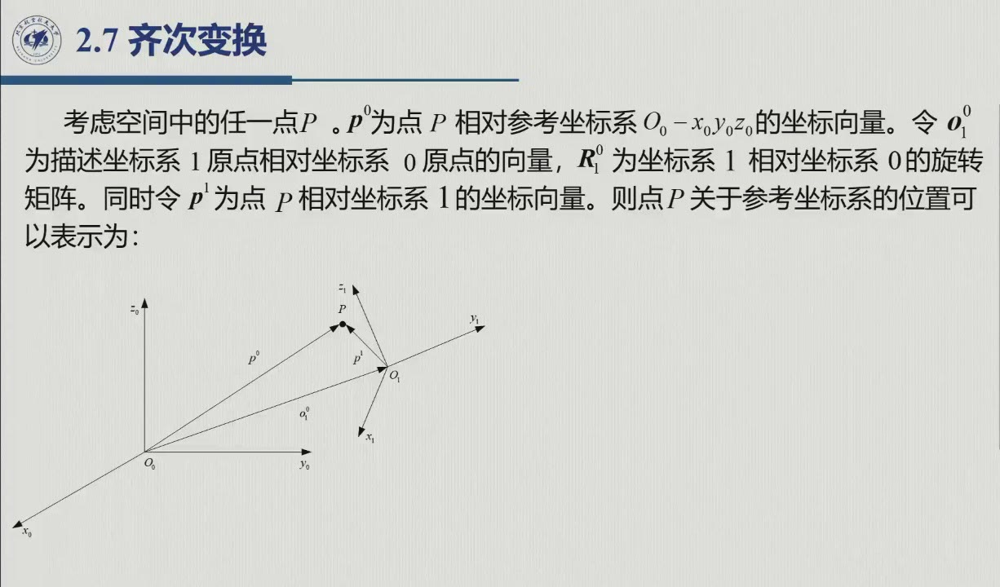
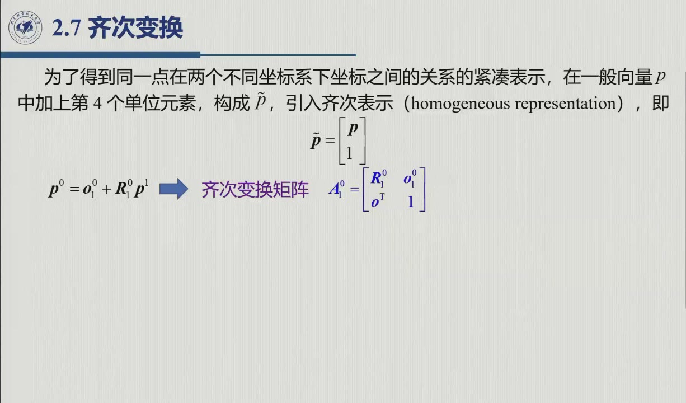

# 2.7 齐次变换

一个点在两套坐标系中的数值可以不同，物理位置却相同。前面用[旋转矩阵](../recall.md#rotation)换算方向；两系原点不重合时，还要加上平移。本节把 $\boldsymbol p^0=R_1^0\boldsymbol p^1+\boldsymbol o_1^0$ 写成一个矩阵乘法，依次检查点与方向、逆变换、连续换系，为下一节 DH 法准备计算方法。

## 2.7.1 动机：让平移与旋转使用同一种运算

设同一个物理点 $P$ 在系 0、系 1 中的坐标为 $\boldsymbol p^0,\boldsymbol p^1$。$R_1^0$ 的列是系 1 三根轴在系 0 中的方向，$\boldsymbol o_1^0$ 是系 1 原点在系 0 中的位置。三角关系给出（原书图 2.11、式 2.38）

$$\boldsymbol p^0=\boldsymbol o_1^0+R_1^0\boldsymbol p^1.$$

**读图顺序**：从 $O_0$ 沿原点偏移走到 $O_1$，再沿 $O_1P$ 走到 $P$。计算时先用 $R_1^0$ 把后一个向量的分量换成系 0 的表示，再与同样用系 0 表示的 $\boldsymbol o_1^0$ 相加。这是在换坐标，并没有把点搬走；若把同一矩阵当作主动运动，必须另外声明固定坐标系和施加对象。

反过来，先减去原点偏移，再用转置旋转：

$$\boldsymbol p^1=(R_1^0)^{\mathrm T}(\boldsymbol p^0-\boldsymbol o_1^0)
=R_0^1\boldsymbol p^0-R_0^1\boldsymbol o_1^0\qquad(\text{原书式 }2.39\text{–}2.40).$$

引入系 2，代入 $\boldsymbol p^1=\boldsymbol o_2^1+R_2^1\boldsymbol p^2$，便得

$$\boldsymbol p^0=\boldsymbol o_1^0+R_1^0\boldsymbol o_2^1+R_1^0R_2^1\boldsymbol p^2.$$

第二段平移也要先旋转到系 0，不能直接把 $\boldsymbol o_1^0$ 与 $\boldsymbol o_2^1$ 相加。下面用多一个分量，把这层嵌套统一成[连乘](../recall.md#homogeneous)。

## 2.7.2 齐次坐标与齐次变换矩阵

::: def 定义 2.7.1 · 点、方向与刚体齐次变换 {#def-2.7.1}
为点的位置坐标添上第 4 分量 1；为自由方向向量添上 0：

$$\tilde{\boldsymbol p}=\begin{bmatrix}\boldsymbol p\\1\end{bmatrix},\qquad
\tilde{\boldsymbol d}=\begin{bmatrix}\boldsymbol d\\0\end{bmatrix}.$$

定义 $4\times4$ **齐次变换矩阵**（homogeneous transformation matrix，原书式 2.41–2.43）

$$A_1^0=\begin{bmatrix}R_1^0&\boldsymbol o_1^0\\\boldsymbol0^{\mathrm T}&1\end{bmatrix},\qquad
\tilde{\boldsymbol p}^0=A_1^0\tilde{\boldsymbol p}^1.$$

这些刚体变换组成**特殊欧几里得群**

$$SE(3)=\left\{\begin{bmatrix}R&\boldsymbol o\\\boldsymbol0^{\mathrm T}&1\end{bmatrix}:R\in SO(3),\ \boldsymbol o\in\mathbb R^3\right\}.$$

它有 3 个旋转自由度和 3 个平移自由度，但不是任意 $4\times4$ 矩阵；必须检验旋转块与底行。
:::

### 底行为什么是 0 0 0 1？

对前三项为 $\boldsymbol x$、第 4 分量为 $w$ 的列向量，直接分块相乘：

$$\begin{bmatrix}R&\boldsymbol o\\\boldsymbol0^{\mathrm T}&1\end{bmatrix}
\begin{bmatrix}\boldsymbol x\\w\end{bmatrix}
=\begin{bmatrix}R\boldsymbol x+w\boldsymbol o\\w\end{bmatrix}.$$

因此点取 $w=1$，位置会受平移影响；自由方向取 $w=0$，只受旋转影响。底行使 $w$ 保持原值，并非随意的占位。这里采用刚体变换，点的末分量恒为 1，方向恒为 0；**方向不能除以末分量**。一般投影坐标在末分量非零时才可除回 1，属于另一种变换，不能与这里的刚体变换混用。

原书把 $SE(3)$ 写成 $\mathbb R^3\times SO(3)$，可以理解为每个姿态由平移和旋转两部分组成；**合成并非分别相加、相乘**。从矩阵乘法可得

$$(R,\boldsymbol o)(S,\boldsymbol t)=(RS,\ \boldsymbol o+R\boldsymbol t).$$

第二段平移会受前一旋转影响，数学上称为半直积结构。做题时记住这个分块结果即可，不必先学群论。

## 2.7.3 逆变换与正交性的边界

由 $\boldsymbol p^1=(R_1^0)^{\mathrm T}(\boldsymbol p^0-\boldsymbol o_1^0)$，直接打包出逆（原书式 2.44–2.45）：

$$A_0^1=(A_1^0)^{-1}=\begin{bmatrix}(R_1^0)^{\mathrm T}&-(R_1^0)^{\mathrm T}\boldsymbol o_1^0\\\boldsymbol0^{\mathrm T}&1\end{bmatrix}.$$

逆的平移是 $-R^{\mathrm T}\boldsymbol o$，它用**系 1** 表示，通常不等于用系 0 表示的 $-\boldsymbol o$。这不是完整矩阵转置；利用旋转块的正交性，求逆仍然很便于计算。

::: proof 验证 · 分块相乘与正交性的充要条件（本编补充）
令 $B=\begin{bmatrix}R^{\mathrm T}&-R^{\mathrm T}\boldsymbol o\\\boldsymbol0^{\mathrm T}&1\end{bmatrix}$。有

$$BA=\begin{bmatrix}R^{\mathrm T}R&R^{\mathrm T}\boldsymbol o-R^{\mathrm T}\boldsymbol o\\\boldsymbol0^{\mathrm T}&1\end{bmatrix}=I_4,$$

同样 $AB=I_4$，所以 $B=A^{-1}$。而

$$A^{\mathrm T}A=\begin{bmatrix}I_3&R^{\mathrm T}\boldsymbol o\\\boldsymbol o^{\mathrm T}R&1+\boldsymbol o^{\mathrm T}\boldsymbol o\end{bmatrix}.$$

因此 $A^{-1}=A^{\mathrm T}$ **当且仅当 $\boldsymbol o=0$**。纯旋转的 $\operatorname{diag}(R,1)$ 仍正交；有非零平移时才不正交。$\det A=\det R=1$ 对所有刚体变换成立，单凭行列式为 1 不能判断整体正交。□
:::

## 2.7.4 连乘：同一个点逐系换算

::: thm 原理 2.7.A · 链式变换的连乘（原书式 2.47） {#thm-2.7.A}

$$\tilde{\boldsymbol p}^0=A_1^0A_2^1\cdots A_n^{n-1}\tilde{\boldsymbol p}^n.$$

右侧先作用：$A_2^1$ 将系 2 坐标换成系 1，$A_1^0$ 再换成系 0；相接的坐标系必须一致。两段合成为

$$A_2^0=A_1^0A_2^1=\begin{bmatrix}R_1^0R_2^1&\boldsymbol o_1^0+R_1^0\boldsymbol o_2^1\\\boldsymbol0^{\mathrm T}&1\end{bmatrix}.$$

旋转与平移都由这一次矩阵乘法得到。交换次序通常改变数值，而且 $A_2^1A_1^0$ 的坐标系接口不相接，不能把它解释成同一个 $2\to0$ 换系链。
:::

<figure>
<svg class="figure-svg" viewBox="0 0 920 310" xmlns="http://www.w3.org/2000/svg" role="img" aria-labelledby="fig-27-title fig-27-desc">
<title id="fig-27-title">同一点逐系换坐标与齐次矩阵分块</title>
<desc id="fig-27-desc">左侧三个框依次是同一物理点的系2、系1、系0坐标，箭头先乘系2到系1的矩阵，再乘系1到系0的矩阵。右侧旋转块、平移列与底行展示矩阵结构。点的位置不因换坐标而移动。</desc>
<defs><marker id="f27-m" markerWidth="9" markerHeight="9" refX="7" refY="3" orient="auto"><path d="M0,0 L7,3 L0,6 Z" fill="var(--muted)"/></marker></defs>
<text class="diagram-text" x="280" y="35" text-anchor="middle">同一个物理点 P，三组坐标</text>
<g class="diagram-node"><rect x="30" y="105" width="110" height="60" rx="8"/><rect x="220" y="105" width="110" height="60" rx="8"/><rect x="410" y="105" width="110" height="60" rx="8"/></g>
<g class="diagram-text" text-anchor="middle"><text x="85" y="141">p̃²</text><text x="275" y="141">p̃¹</text><text x="465" y="141">p̃⁰</text><text x="180" y="90">A₂¹</text><text x="370" y="90">A₁⁰</text></g>
<g stroke="var(--line-strong)" stroke-width="1.6" marker-end="url(#f27-m)"><line x1="140" y1="135" x2="216" y2="135"/><line x1="330" y1="135" x2="406" y2="135"/></g>
<text class="diagram-note" x="275" y="208" text-anchor="middle">先 2→1，再 1→0；点没有移动</text>
<text class="diagram-text" x="275" y="251" text-anchor="middle">p̃⁰ = A₁⁰ A₂¹ p̃²</text>
<text class="diagram-text" x="735" y="35" text-anchor="middle">A 的分块结构</text>
<rect class="diagram-fill-accent" x="595" y="65" width="210" height="140"/><rect class="diagram-fill-sage" x="805" y="65" width="70" height="140"/>
<rect class="diagram-node" x="595" y="205" width="280" height="40"/>
<g class="diagram-text" text-anchor="middle"><text x="700" y="143">R</text><text x="840" y="143">o</text><text x="630" y="232">0</text><text x="700" y="232">0</text><text x="770" y="232">0</text><text x="840" y="232">1</text></g>
<text class="diagram-note" x="735" y="280" text-anchor="middle">末分量保持：点 1，方向 0</text>
</svg>
<figcaption>本教程绘：箭头表示坐标换算的先后；乘积从右向左作用。右图的底行保持点与方向各自的末分量。</figcaption>
</figure>

::: ex 例 2.7.B · 同一变换，点与方向为什么算出不同结果 {#ex-2.7.B}
取 $R_1^0=R_z(90^\circ)$、$\boldsymbol o_1^0=(2,1,0)^{\mathrm T}$。系 1 中有点 $\boldsymbol p^1=(1,0,0)^{\mathrm T}$ 和自由方向 $\boldsymbol d^1=(1,0,0)^{\mathrm T}$。求在系 0 中的表示，再把点换回去。点和原点的长度单位为 m，方向取单位向量。

::: sol 解与逐步核对

$$A_1^0=\begin{bmatrix}0&-1&0&2\\1&0&0&1\\0&0&1&0\\0&0&0&1\end{bmatrix}.$$

点取末分量 1，得 $\boldsymbol p^0=R_1^0\boldsymbol p^1+\boldsymbol o_1^0=(2,2,0)^{\mathrm T}$；方向取末分量 0，得 $\boldsymbol d^0=R_1^0\boldsymbol d^1=(0,1,0)^{\mathrm T}$。输入的前三项相同，语义与第四项不同，结果也不同。

逆矩阵为

$$A_0^1=\begin{bmatrix}0&1&0&-1\\-1&0&0&2\\0&0&1&0\\0&0&0&1\end{bmatrix}.$$

其中 $-R_1^{0\mathrm T}\boldsymbol o_1^0=(-1,2,0)^{\mathrm T}$。逆作用到 $[2,2,0,1]^{\mathrm T}$ 后，回到 $[1,0,0,1]^{\mathrm T}$。若误用 $-\boldsymbol o_1^0$ 作逆的平移块，得到 $(0,-3,0)^{\mathrm T}$，无法返回原坐标。
:::
:::

::: think 练习 1 · 逆矩阵与纯平移边界 {#practice-2.7.inverse}
取 $R=I_3$、$\boldsymbol o=(2,-1,3)^{\mathrm T}$，点 $\boldsymbol p=(1,2,0)^{\mathrm T}$、方向 $\boldsymbol d=(1,2,0)^{\mathrm T}$。分别变换，再用正确的逆返回。$A$ 的行列式为 1，能否据此判断它正交？若平移改成 0 呢？

::: sol 核对
点变成 $(3,1,3)^{\mathrm T}$，方向仍是 $(1,2,0)^{\mathrm T}$。逆的平移为 $(-2,1,-3)^{\mathrm T}$，分别返回原点坐标与方向；底行不会把方向的 0 变成 1。$\det A=1$，但非零平移使 $A^{\mathrm T}A\ne I_4$；平移为 0 时，$A=I_4$，整体正交。
:::
:::

::: ex 例 2.7.C · 两段旋转和平移都参与合成 {#ex-2.7.C}
接例 2.7.B 的系 1，再令 $R_2^1=R_x(90^\circ)$、$\boldsymbol o_2^1=(1,0,0)^{\mathrm T}$，点 $\boldsymbol p^2=(0,1,0)^{\mathrm T}$。先预测：第二段原点偏移在系 0 中沿哪根方向？

$$A_2^1=\begin{bmatrix}1&0&0&1\\0&0&-1&0\\0&1&0&0\\0&0&0&1\end{bmatrix},\qquad
A_2^0=\begin{bmatrix}0&0&1&2\\1&0&0&2\\0&1&0&0\\0&0&0&1\end{bmatrix}.$$

$\boldsymbol o_2^0=(2,1,0)^{\mathrm T}+R_z(90^\circ)(1,0,0)^{\mathrm T}=(2,2,0)^{\mathrm T}$；第二段偏移沿系 0 的 +y。逐级算 $\boldsymbol p^1=(1,0,1)^{\mathrm T}$，再得 $\boldsymbol p^0=(2,2,1)^{\mathrm T}$，与直接用 $A_2^0$ 一致。

若只交换两矩阵进行数值运算，$(A_2^1A_1^0)[\boldsymbol p^2;1]$ 得到前三项 $(2,0,1)^{\mathrm T}$；它既不同于正确结果，也没有所需的坐标系接口。矩阵可相乘不代表物理标签可省。
:::

### 操作：同一点不动，切换它的坐标表示

演示默认采用例 2.7.B 的第一段变换，第二段先取无相对旋转、沿系 1 的 +x 平移 1 m。输入前三项固定为 $(0,1,0)$，可选择它表示点或自由方向。

1. 先预测系 2 原点在系 0 中的位置，再读下方原点与合成矩阵的平移列。
2. 逐级查看系 2、系 1、系 0 的坐标。**画面中的同一个点 P 保持不动**；改变的是当前读取的坐标系与从该原点到 P 的线段。切到直接合成，核对最终坐标完全相同。
3. 切换点/方向，观察末分量 1/0 与平移项；自由方向箭头可以移到各系原点，方向不变。
4. 载入“两段转动例题”，核对例 2.7.C、逆变换返回值与错误顺序的数值对照。
5. 把两段平移都置零，观察整体正交误差变成约 0；再加平移，检查 det A 仍约为 1。按“重置齐次变换与视角”恢复所有控件与相机。

没有脚本时，可用例 2.7.B/C 与下面两份练习完成相同核对。

::: think 练习 2 · 第二段平移究竟沿谁的轴 {#practice-2.7.chain}
仍取例 2.7.B 的系 1，但 $R_2^1=I$、$\boldsymbol o_2^1=(1,0,0)^{\mathrm T}$。不展开 $4\times4$ 连乘，求系 2 原点在系 0 中的位置、点 $\boldsymbol p^2=(0,1,0)^{\mathrm T}$ 的像，以及自由方向 $\boldsymbol d^2=(0,1,0)^{\mathrm T}$ 的像。

::: sol 核对
$\boldsymbol o_2^0=(2,2,0)^{\mathrm T}$、$R_2^0=R_z(90^\circ)$；点变成 $(1,2,0)^{\mathrm T}$，方向变成 $(-1,0,0)^{\mathrm T}$。若原点算成 $(3,1,0)$，说明漏了旋转第二段平移；若方向也加上 $(2,2,0)$，说明把末分量错取成 1。
:::
:::

::: think 练习 3 · 坐标长度变了，刚体距离还保持吗？ {#practice-2.7.distance}
在练习 2 中另取点 $\boldsymbol q^2=(1,1,0)^{\mathrm T}$。求 $\boldsymbol q^0$，比较两点间距离；再看 $\|\boldsymbol p^2\|$ 与 $\|\boldsymbol p^0\|$ 是否必须相等。为什么两点之差的齐次末分量为 0？

::: sol 核对
$\boldsymbol q^0=(1,3,0)^{\mathrm T}$，两点间距在两系中均为 1 m。点到各自坐标原点的距离不必相等：此处 $\|\boldsymbol p^2\|=1$、$\|\boldsymbol p^0\|=\sqrt5$。两点之差为 $[\boldsymbol q;1]-[\boldsymbol p;1]=[\boldsymbol q-\boldsymbol p;0]$，平移相消，只受旋转；所以刚体运动保距离，与整个 A 一般不正交并不矛盾。
:::
:::

::: note se(3)：有限位姿与瞬时速度要区分（本编补充） {#note-2.7.se3}

$SE(3)$ 是有限刚体变换组成的群；它在单位元 $I_4$ 处的切空间是六维线性空间

$$se(3)=\left\{\begin{bmatrix}S(\omega)&\boldsymbol v\\\boldsymbol0^{\mathrm T}&0\end{bmatrix}:\omega,\boldsymbol v\in\mathbb R^3\right\}.$$

这里的底行全零，所以这些 $4\times4$ 矩阵始终不可逆，不能对它们套用刚体逆公式。$so(3)$ 与 $se(3)$ 都是李代数，须与有限旋转/位姿组成的群区分。装帽把六个数装成这个矩阵，摘帽取回六个数；使用前还要说明六元组的排列约定。

若 $A(t)=[R(t),\boldsymbol o(t);0,1]$，**空间速度矩阵**为

$$\widehat\xi_s=\dot A A^{-1}=\begin{bmatrix}\dot R R^{\mathrm T}&\dot{\boldsymbol o}-\dot R R^{\mathrm T}\boldsymbol o\\\boldsymbol0^{\mathrm T}&0\end{bmatrix}
=\begin{bmatrix}S(\omega_s)&\boldsymbol v_s\\\boldsymbol0^{\mathrm T}&0\end{bmatrix}.$$

因此 $\boldsymbol v_s=\dot{\boldsymbol o}-\omega_s\times\boldsymbol o$，**一般不等于动系原点的线速度** $\dot{\boldsymbol o}$。本体系速度则用 $A^{-1}\dot A$，其右上块为 $R^{\mathrm T}\dot{\boldsymbol o}$，两种表达不能混用。若 $\widehat\xi_s$ 表示恒定速度，时间为 t，则 $A(t)=\exp(t\widehat\xi_s)A(0)$；指数中须用与速度相配的时间，使参数量纲一致。

举例：以 1 rad/s 绕经过 $(1,0,0)$、平行 z 的固定轴纯转。位置以 m 计，t 为以秒计的时间数值；取 $A(0)=I_4$，有 $\omega_s=(0,0,1)$ rad/s、$\boldsymbol v_s=(0,-1,0)$ m/s，而

$$A(t)=\begin{bmatrix}\cos t&-\sin t&0&1-\cos t\\\sin t&\cos t&0&-\sin t\\0&0&1&0\\0&0&0&1\end{bmatrix}.$$

在 $t=\pi/2$ 时原点位置 $(1,-1,0)$、速度 $(1,0,0)$，与 $\boldsymbol v_s$ 不同。它仍是纯转，非零的 v 来自旋转轴偏离原点；若再沿轴以恒定速度平移，才得到有轴向进给的螺旋运动。$\omega=0$ 时则是纯平移。本节先掌握有限变换；第 3 章讨论的 $(\dot{\boldsymbol p},\omega)$ 与这里的 twist 须按定义换算，不能仅因为都是六个数就等同。
:::

::: think 默写点 · 合上书再写

1. 点与方向的末分量分别是多少？为什么平移只影响前者？
2. 写出 A 的逆；整体转置求逆何时成立？
3. 写出两段合成的旋转块和平移块；谁先作用？
4. 为什么刚体保持两点距离，却一般不保持点坐标的长度？

::: sol 核对
点取 1、方向取 0，分块式给出 $R\boldsymbol x+w\boldsymbol o$。逆为 $[R^{\mathrm T},-R^{\mathrm T}\boldsymbol o;0,1]$；整体转置等于逆当且仅当平移为 0。$A_1^0A_2^1$ 右侧先作用，块分别为 $R_1^0R_2^1$、$\boldsymbol o_1^0+R_1^0\boldsymbol o_2^1$。两点相减后平移消失；点到不同坐标系原点的距离不必相同。
:::
:::

## 2.7 小结与常见错误

- 点用 $[p;1]$，自由方向用 $[d;0]$；底行保持末分量，方向不做除零归一化。
- 逆的平移是 $-R^{\mathrm T}o$；非零平移时整个 A 不正交，零平移的纯旋转是例外。
- 连乘要对上坐标系接口；第二段平移先转到前一坐标系才能相加。相同的数值维度不保证标签一致。
- 补充的 se(3) 是瞬时速度的矩阵空间，空间速度中的 v 一般不是动系原点的线速度。

常见错误：把换坐标画成点在运动；把逆平移直接写成 −o；给方向末分量 1；对方向除以末分量 0；只用 det A=1 判断合法性；交换矩阵后仍沿用原换系标签。

下一节 [2.8 正运动学与 DH 法](sec2-8.md) 为相邻连杆建立坐标系，把这里的两段连乘推广到 n 个关节。先独立完成练习 2，再进入建系与参数表。
