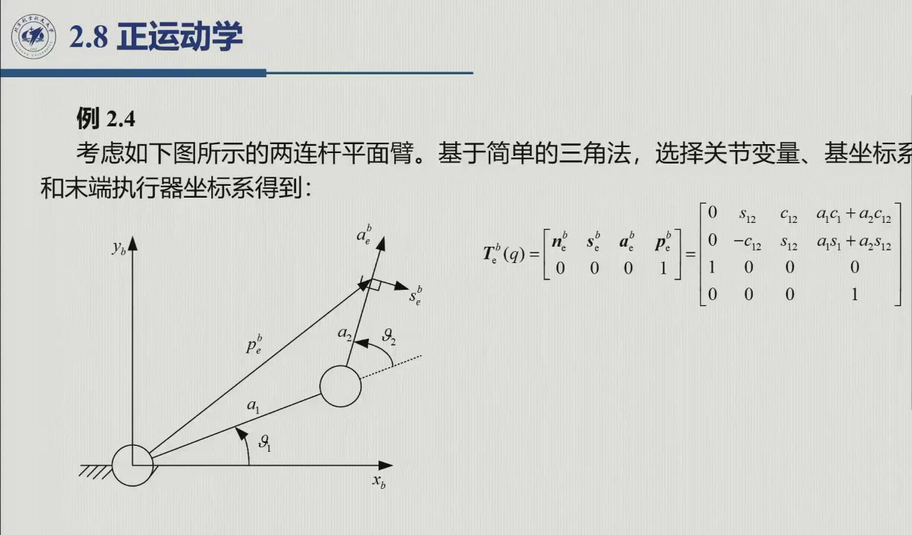
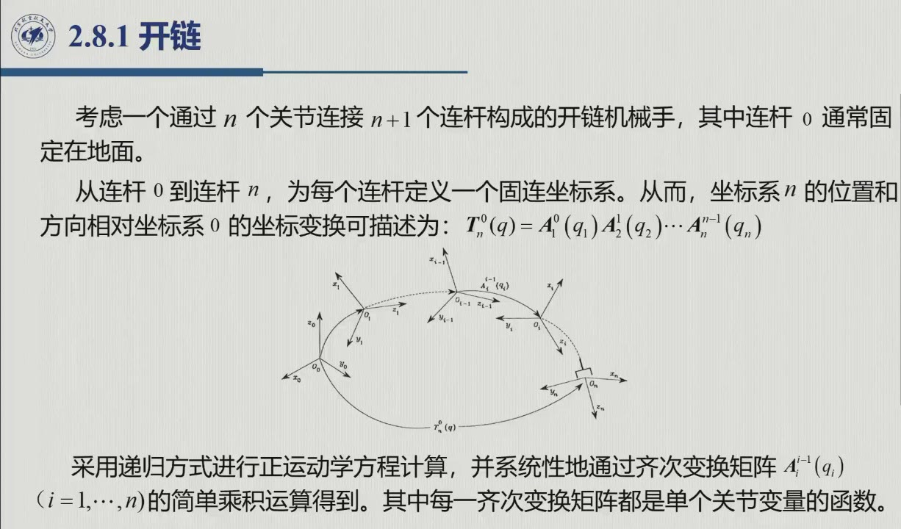
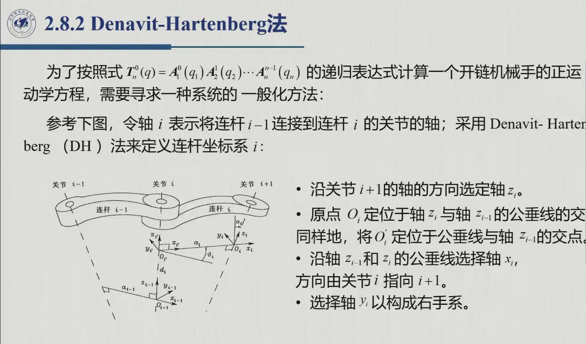
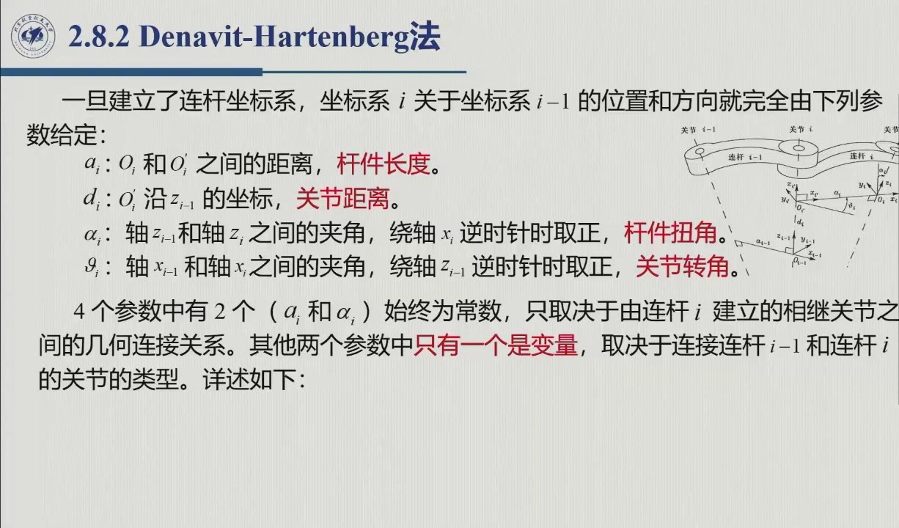
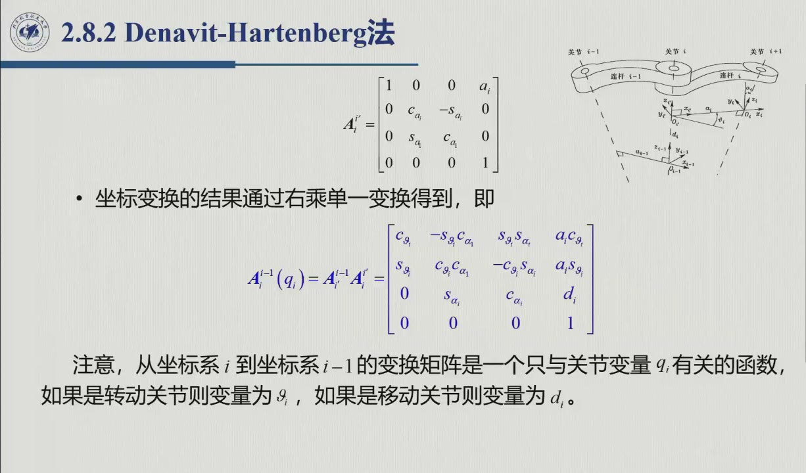

# 2.8 正运动学与 Denavit–Hartenberg 法

两根长为 1 的杆，第一根朝右，第二根相对第一根逆时针转 $90^\circ$，末端就在 $(1,1)$。如果把第一关节也转过一个角度，第二根杆相对固定坐标系的角度会跟着改变。先画图，把两个关节角各自从哪里量标出来。

上一节的齐次变换可以把这件事写成矩阵连乘。本节用 Denavit–Hartenberg（DH）法统一相邻连杆的建系与参数，让同样的计算步骤能够用于更多关节。读完后做[两连杆第一关](../training/two-link.md#mission-reach)，先用几何法算，再检查矩阵结果是否一致。

本节按原书 §2.8（印刷 59–68 页）讲开链、标准 DH 与闭链补充。先掌握建系与矩阵，闭链可在完成开链练习后阅读；课程与考试范围见[范围声明](../preface-scope.md)。

{{#include ../assets/figures/robot-dh.md}}

## 2.8.1 开链：编号约定、正运动学方程与递归

### 连杆—关节编号

::: def 定义 2.8.1 · 开链机械手的编号 {#def-2.8.1}
本节考虑无额外耦合的理想开链：$n+1$ 个刚性连杆由 $n$ 个单自由度关节串联。**连杆 0 固定在基座上，关节 $i$ 连接连杆 $i-1$ 与连杆 $i$**。各关节取**转动型 R**（revolute，绕轴转）或**移动型 P**（prismatic，沿轴移），因此有 n 个独立关节变量。球铰等多自由度关节不在这一假设中。
:::

先画“杆 0—关节 1—杆 1—关节 2—杆 2”。基座也计作一根杆，关节数比杆数少一；坐标系 i 固连杆 i，关节 i 则位于系 i−1 与系 i 所在的两杆之间。

### 正运动学问题与末端执行器坐标系

::: def 定义 2.8.2 · 正运动学方程 {#def-2.8.2}
**正运动学**（direct/forward kinematics）回答：已知关节变量 $\boldsymbol q=[q_1\ \cdots\ q_n]^{\mathrm T}$，求末端执行器位姿。本节先以 DH 转角或距离本身作变量：R 关节取 $q_i=\vartheta_i$（rad），P 关节取 $q_i=d_i$（m）。若输入来自编码器，须先按约定换算，如 $\vartheta_i=s_iq_i^{\rm enc}+\vartheta_{i0}$，不能默认机械零位等于 DH 零位。取物理基坐标系 b 与工具系 e，有（原书式 2.48）

$$T_e^b(\boldsymbol q)=\begin{bmatrix}\boldsymbol n_e(\boldsymbol q) & \boldsymbol s_e(\boldsymbol q) & \boldsymbol a_e(\boldsymbol q) & \boldsymbol p_e(\boldsymbol q)\\ 0&0&0&1\end{bmatrix},$$

四列均用系 b 表示。$\boldsymbol p_e$ 是工具原点位置，前三列是工具系三根单位轴。对原书的夹爪选系，$\boldsymbol a_e$ 为**接近向量**（approach，朝工作方向），$\boldsymbol s_e$ 在钳口滑动平面内且垂直于它，$\boldsymbol n_e=\boldsymbol s_e\times\boldsymbol a_e$ 补成右手系。这是夹爪的选系方法，其他工具可有不同轴约定。
:::

（图中同时给出了原书例 2.4：两连杆平面臂用三角法直接写出 $T_e^b$，其中 $s_{12}=\sin(\vartheta_1+\vartheta_2)$，其余依此类推。）

::: ex 例 2.4（原书）· 从两段投影求位姿 {#ex-book-2.4}
两连杆平面臂的第二关节角相对第一杆量取，第二杆相对基座的角度为 $\vartheta_1+\vartheta_2$。按图中工具约定，$\boldsymbol n_e$ 指出臂平面，$\boldsymbol a_e$ 沿第二杆；位置由两段投影相加，得（原书式 2.49）

$$T_e^b=\begin{bmatrix}0 & s_{12} & c_{12} & a_1c_1+a_2c_{12}\\ 0 & -c_{12} & s_{12} & a_1s_1+a_2s_{12}\\ 1&0&0&0\\ 0&0&0&1\end{bmatrix}.$$

取 $a_1=a_2=1$ m、$\vartheta_1=0$、$\vartheta_2=90^\circ$，则 $\boldsymbol p_e=(1,1,0)^{\mathrm T}$，$\boldsymbol n_e=(0,0,1)^{\mathrm T}$、$\boldsymbol s_e=(1,0,0)^{\mathrm T}$、$\boldsymbol a_e=(0,1,0)^{\mathrm T}$。位置与入口画图一致，三列也满足右手关系。多关节时逐图找投影容易漏项，下面用统一连乘代替逐次猜式。
:::

### 开链的递归结构

::: thm 原理 2.8.A · 正运动学的连乘（原书式 2.50–2.51） {#thm-2.8.A}
从连杆 0 到连杆 $n$，给每一根杆都固连一个坐标系，则坐标系 $n$ 相对坐标系 $0$ 的位姿为

$$T_n^0(\boldsymbol q)=A_1^0(q_1)\,A_2^1(q_2)\cdots A_n^{n-1}(q_n),$$

其中每个 $A_i^{i-1}(q_i)$ 都只是**单个关节变量**的函数。至于末端执行器的位姿，只需再串接两个（典型情况下的）常值变换：

$$T_e^b(\boldsymbol q)=T_0^b\,T_n^0(\boldsymbol q)\,T_e^n .$$

从右向左核对接口：$e\to n\to0\to b$。$T_0^b$ 描述 DH 系 0 在物理基座系 b 中的位姿，$T_e^n$ 描述工具系在末杆系中的位姿；固定安装时两者为常值。$T_b^0$ 是前者的逆，不能放在同一位置。
:::

结构决定算法：先描述相邻两杆的相对关系，再沿链递归合成（原书）。于是问题只剩一个——**相邻坐标系究竟怎么建才算规范**？

## 2.8.2 Denavit–Hartenberg 法：动机与建系规则

::: intuition 为什么四个参数够用
一般刚体位姿局部需要六个独立量；**DH 通过选择坐标轴与原点，把相邻系变换限制到特定形式**，用四个参数表示。这不改变 $SE(3)$ 的六维性质，也没有给机械结构减少两个自由度。系 i−1 与系 i 固连在关节两侧的不同连杆上；对几何尺寸已定的理想 R/P 关节，四个参数中只有一个随运动变化。
:::

::: method 先把「系到底挂在哪」说透：看守模型（本编补充） {#method-2.8.watch}
四条规则里最容易卡住读者的，是「$z_i$ 沿**关节 $i+1$** 的轴」这个**编号错位**——下标 $i$ 配不上关节 $i$，对着图找半天才发觉配错了对。这里把挂靠关系一次说透，之后再看四条规则就只是操作细节。

对 $i<n$，**杆 $i$ 上固连坐标系 $i$，其 $z$ 轴放在关节 $i+1$ 的轴线上**；末杆没有关节 $n+1$，末杆系另选。把下标换个方向读——

**坐标系 $i-1$ 是「看守关节 $i$」的坐标系：它的 $z$ 轴 $z_{i-1}$ 与关节 $i$ 的轴线重合。**

| 要找的东西 | 去哪里找 |
|:--|:--|
| 关节 $i$ 的轴线 | 就是 $z_{i-1}$（看守它的那根轴） |
| 杆 $i$ 的固连系 | 系 $i$；$i<n$ 时原点在关节 $i+1$ 轴线上，末杆系另行选取 |
| 关节 $i$ 的运动 | 绕 / 沿 $z_{i-1}$：转 $\vartheta_i$ 或移 $d_i$ |
| $A_i^{i-1}$ 里的变量 | 只有关节 $i$ 的那一个（「3 常 1 变」的出处） |

**为什么这样挂**：轴对齐后，关节 i 的活动量只进入绕或沿 $z_{i-1}$ 的那一个参数，其他参数描述固定几何。随手建系时，同一个关节变量可能同时出现在多个矩阵元素或多种位姿参数中，独立活动量仍只有一个。

本教程用**标准 DH**。读其他约定时，要一起核对轴的编号、参数下标与四因子次序；不能只凭“DH”这个名字套表，辨析见[补注 E2.4](errata.md#errata-2.4)。
:::

::: method DH 建系四规则（原书 §2.8.2） {#method-2.8.dh}
约定：**轴 $i$** 指关节 $i$ 的轴线。操作永远从「定轴」开始——先把所有轴线画成贯穿直线，看清它们**两两之间的关系**（相交？平行？还是异面？），再逐系落位。给系 $i$ 落位时依次回答三问（$z$ 放哪、原点放哪、$x$ 指哪），$y$ 自动补齐：

1. **$z_i$ 放哪**：$i<n$ 时沿**轴 $i+1$**；末杆系另选（系 $i-1$ 看守关节 $i$）；
2. **原点 $o_i$ 放哪**：取 $z_{i-1}$ 与 $z_i$ 的**公垂线**和 $z_i$ 的交点（垂足 $o_i'$ 则是公垂线与 $z_{i-1}$ 的交点）；
3. **$x_i$ 指哪**：沿公垂线，**由关节 $i$ 指向关节 $i+1$**；
4. **$y_i$**：右手系补齐（不引入参数）。

特殊轴对的处理：

- **不同的平行轴线**：公垂线不唯一。R 关节可取经过 $o_{i-1}$ 的那条，使 $d_i=0$；P 关节须在一个参考行程选定固连原点，运动后 $d_i$ 随行程改变，不能每帧重选原点把它消掉。同向时 $\alpha_i=0$，反向时可取 $\alpha_i=\pi$。
- **不平行但相交**：$a_i=0$；$x_i$ 必须垂直两轴，只有正负两个方向可选，不是任意空间方向。
- **两轴重合**：$a_i=0$，原点可沿共轴选取，$x_i$ 可在垂直轴的平面内选取；选好后仍须固连各杆。
:::

下面在三转动拟人臂上建系：肩回转、肩俯仰、肘俯仰，能同时检查相交轴与平行轴。随后再用平面两杆快检：此时公垂线就是杆的方向，参数更简单，但规则仍然适用。

::: method 例解 · 在拟人臂上四步建系（本编补充，逐格对照下图） {#method-2.8.anthro}
**结构与正方向**：系 0 的 +z 竖直，零位两杆沿 +x。取零位关节 2、3 的正轴都沿 $-y_0$；关节 1 正轴为 $+z_0$。运动时用右手正角。这些方向约定与下表的 $\alpha_1=+\pi/2$ 配套，不能只从“水平”判断扭角正负。

**① 定轴线（格一）。** 先不建坐标系，画出三根贯穿轴线：轴1 与轴2 在肩点相交且正交；轴2 与轴3 平行。这给出部分几何关系，完整参数还须结合杆长、正方向、原点与零位。

**② 放系 0（格二）。** $z_0$ 沿关节1轴线（竖直；沿轴的正方向任选，定下不再变）；$o_0$ 本可取在轴线上任一点，按「能零则零」取在轴1与轴2的**交点**（肩心），垂足 $o_1'=o_0$，下一行 $d_1$ 直接为 0；$x_0$ 水平任选（习惯取零位时上臂的指向）。系 0 从此固连在基座上。

**③ 放系 1（格三）。** 取 $z_1$ 沿关节 2 正轴；相交给 $a_1=0$，肩心给 $d_1=0$。$x_1$ 水平且同时垂直两轴，零位取 $+x_0$，运动后随肩回转。零位有 $R_x(+\pi/2)e_z=-e_y$，因此绕 $x_1$ 从 $z_0$ 转到 $z_1$ 的有向角为 $+\pi/2$。$y_1$ 补成右手系后恰为 $+z_0$；转肩俯仰时系 1 仍固连在肩回转连杆上。

**④ 放系 2、3（格四）。** $z_2$ 沿关节3轴线，与 $z_1$ **平行** $\Rightarrow\alpha_2=0$；这对平行轴的公垂线**就是上臂本身** $\Rightarrow a_2=$ 上臂长，$x_2$ 沿上臂指向肘部，$o_2$ 取垂足（肘点，穿过 $o_1$ 的那条公垂线）$\Rightarrow d_2=0$。系 3 同理：$z_3$ 取与 $z_2$ 平行（末端系约定），公垂线 $=$ 前臂 $\Rightarrow a_3=$ 前臂长，$d_3=0$。剩下的 $\vartheta_1,\vartheta_2,\vartheta_3$ 就是三个关节变量——分别是 $x_0$ 到 $x_1$ 绕 $z_0$、$x_1$ 到 $x_2$ 绕 $z_1$、$x_2$ 到 $x_3$ 绕 $z_2$ 的转角。

填表时逐格「问一句」，每个数都有来历：

| 连杆 $i$ | $a_i$ | $\alpha_i$ | $d_i$ | $\vartheta_i$ | 填这格时问自己 |
|:--:|:--:|:--:|:--:|:--:|:--|
| 1 | 0 | $\pi/2$ | 0 | $\vartheta_1$ | 轴1、轴2 相交 $\Rightarrow a_1=0$；从 $z_0$ 绕 $x_1$ 转到 $z_1$ 是 $+\pi/2$ |
| 2 | $a_2$ | 0 | 0 | $\vartheta_2$ | 轴2、轴3 平行 $\Rightarrow\alpha_2=0$；公垂线 $=$ 上臂 $\Rightarrow a_2$ |
| 3 | $a_3$ | 0 | 0 | $\vartheta_3$ | $z_2\parallel z_3\Rightarrow\alpha_3=0$；公垂线 $=$ 前臂 $\Rightarrow a_3$ |

这张表采用 [2.9.4](sec2-9.md#sec-2.9.4) 的选系与参数。[2.9](sec2-9.md) 将在不同骨架上复用建系、填表、连乘与核对流程。
:::

<figure>
<svg class="figure-svg" viewBox="0 0 920 692" xmlns="http://www.w3.org/2000/svg" role="img" aria-labelledby="fig-dhsteps-t fig-dhsteps-d">
<title id="fig-dhsteps-t">拟人臂 DH 建系四步分镜</title>
<desc id="fig-dhsteps-d">四个等轴测分镜展示拟人机械臂的 DH 建系过程：格一只画机械臂与三根关节轴线；格二在肩点加坐标系0，z0 沿竖直的关节1轴；格三加坐标系1，标出两轴相交故 a1=0、z0 绕 x1 转到 z1 为 90 度；格四在肘与腕加坐标系2、3，红色标出公垂线即上臂与前臂，长度即 a2、a3。</desc>
<defs>
<marker id="fdh3-m" markerWidth="8" markerHeight="8" refX="6" refY="2.5" orient="auto"><path d="M0,0 L6,2.5 L0,5 Z" fill="var(--muted)"/></marker>
<marker id="fdh3-b" markerWidth="8" markerHeight="8" refX="6" refY="2.5" orient="auto"><path d="M0,0 L6,2.5 L0,5 Z" fill="var(--fig-blue)"/></marker>
<marker id="fdh3-g" markerWidth="8" markerHeight="8" refX="6" refY="2.5" orient="auto"><path d="M0,0 L6,2.5 L0,5 Z" fill="var(--fig-green)"/></marker>
<marker id="fdh3-y" markerWidth="8" markerHeight="8" refX="6" refY="2.5" orient="auto"><path d="M0,0 L6,2.5 L0,5 Z" fill="var(--fig-gold)"/></marker>
<marker id="fdh3-p" markerWidth="8" markerHeight="8" refX="6" refY="2.5" orient="auto"><path d="M0,0 L6,2.5 L0,5 Z" fill="var(--fig-purple)"/></marker>
</defs>
<!-- 格一 · 定轴线 -->
<text class="diagram-text" x="236" y="38" text-anchor="middle">① 定轴线：关节1 竖直，关节2、3 平行</text>
<line x1="131" y1="248" x2="131" y2="235" stroke="var(--line-strong)" stroke-width="7" stroke-linecap="round"/>
<line x1="131" y1="252" x2="131" y2="110" stroke="var(--muted)" stroke-width="1.4" stroke-dasharray="5 4" marker-end="url(#fdh3-m)"/>
<line x1="107" y1="223" x2="154" y2="134" stroke="var(--muted)" stroke-width="1.4" stroke-dasharray="5 4" marker-end="url(#fdh3-m)"/>
<line x1="251" y1="177" x2="298" y2="89" stroke="var(--muted)" stroke-width="1.4" stroke-dasharray="5 4" marker-end="url(#fdh3-m)"/>
<text class="diagram-note" x="139" y="114">关节1轴（竖直）</text>
<text class="diagram-note" x="162" y="132">关节2轴</text>
<text class="diagram-note" x="302" y="80">关节3轴</text>
<line x1="131" y1="179" x2="275" y2="133" stroke="var(--accent)" stroke-width="6" stroke-linecap="round"/>
<line x1="275" y1="133" x2="299" y2="256" stroke="var(--accent)" stroke-width="5" stroke-linecap="round"/>
<circle cx="131" cy="179" r="8" fill="var(--paper)" stroke="var(--line-strong)" stroke-width="1.6"/>
<circle cx="275" cy="133" r="7" fill="var(--paper)" stroke="var(--line-strong)" stroke-width="1.6"/>
<circle cx="299" cy="256" r="4.5" fill="var(--accent)"/>
<text class="diagram-note" x="118" y="170" text-anchor="end">肩</text>
<text class="diagram-note" x="284" y="128">肘</text>
<text class="diagram-note" x="308" y="264">腕</text>
<!-- 格二 · 放系0 -->
<text class="diagram-text" x="688" y="38" text-anchor="middle">② 放系 0：z<tspan class="sb">0</tspan> 沿关节1轴，原点取在两轴交点</text>
<line x1="583" y1="248" x2="583" y2="235" stroke="var(--line-strong)" stroke-width="7" stroke-linecap="round"/>
<line x1="583" y1="252" x2="583" y2="130" stroke="var(--muted)" stroke-width="1.4" stroke-dasharray="5 4" marker-end="url(#fdh3-m)"/>
<line x1="559" y1="223" x2="606" y2="134" stroke="var(--muted)" stroke-width="1.4" stroke-dasharray="5 4" marker-end="url(#fdh3-m)"/>
<line x1="703" y1="177" x2="750" y2="89" stroke="var(--muted)" stroke-width="1.4" stroke-dasharray="5 4" marker-end="url(#fdh3-m)"/>
<line x1="583" y1="179" x2="727" y2="133" stroke="var(--accent)" stroke-width="6" stroke-linecap="round"/>
<line x1="727" y1="133" x2="751" y2="256" stroke="var(--accent)" stroke-width="5" stroke-linecap="round"/>
<circle cx="583" cy="179" r="8" fill="var(--paper)" stroke="var(--line-strong)" stroke-width="1.6"/>
<circle cx="727" cy="133" r="7" fill="var(--paper)" stroke="var(--line-strong)" stroke-width="1.6"/>
<line x1="583" y1="179" x2="649" y2="190" stroke="var(--fig-blue)" stroke-width="2.6" marker-end="url(#fdh3-b)"/>
<line x1="583" y1="179" x2="562" y2="217" stroke="var(--fig-green)" stroke-width="2.2" marker-end="url(#fdh3-g)"/>
<line x1="583" y1="179" x2="583" y2="122" stroke="var(--fig-gold)" stroke-width="2.6" marker-end="url(#fdh3-y)"/>
<text class="diagram-text" fill="var(--fig-blue)" x="657" y="198">x<tspan class="sb">0</tspan></text>
<text class="diagram-text" fill="var(--fig-green)" x="552" y="228" text-anchor="end">y<tspan class="sb">0</tspan></text>
<text class="diagram-text" fill="var(--fig-gold)" x="571" y="112" text-anchor="middle">z<tspan class="sb">0</tspan></text>
<text class="diagram-note" x="571" y="174" text-anchor="end">o<tspan class="sb">0</tspan></text>
<!-- 格三 · 放系1（轴1与轴2相交） -->
<text class="diagram-text" x="236" y="368" text-anchor="middle">③ 放系 1：z<tspan class="sb">1</tspan> 沿关节2轴；两轴相交，a<tspan class="sb">1</tspan> = 0</text>
<line x1="131" y1="568" x2="131" y2="555" stroke="var(--line-strong)" stroke-width="7" stroke-linecap="round"/>
<line x1="131" y1="572" x2="131" y2="430" stroke="var(--ink-2)" stroke-width="1.9" stroke-dasharray="7 5" marker-end="url(#fdh3-m)"/>
<line x1="107" y1="543" x2="154" y2="454" stroke="var(--ink-2)" stroke-width="1.9" stroke-dasharray="7 5" marker-end="url(#fdh3-m)"/>
<line x1="251" y1="497" x2="298" y2="409" stroke="var(--muted)" stroke-width="1.2" stroke-dasharray="4 4"/>
<line x1="131" y1="499" x2="275" y2="453" stroke="var(--accent)" stroke-width="6" stroke-linecap="round"/>
<line x1="275" y1="453" x2="299" y2="576" stroke="var(--accent)" stroke-width="5" stroke-linecap="round"/>
<circle cx="131" cy="499" r="8" fill="var(--paper)" stroke="var(--line-strong)" stroke-width="1.6"/>
<circle cx="275" cy="453" r="7" fill="var(--paper)" stroke="var(--line-strong)" stroke-width="1.6"/>
<line x1="131" y1="499" x2="197" y2="510" stroke="var(--muted)" stroke-width="1.1" marker-end="url(#fdh3-m)"/>
<line x1="131" y1="499" x2="110" y2="537" stroke="var(--muted)" stroke-width="1.1" marker-end="url(#fdh3-m)"/>
<line x1="131" y1="499" x2="197" y2="510" stroke="var(--fig-blue)" stroke-width="2.6" marker-end="url(#fdh3-b)"/>
<line x1="131" y1="499" x2="131" y2="435" stroke="var(--fig-green)" stroke-width="2.6" marker-end="url(#fdh3-g)"/>
<line x1="131" y1="499" x2="151" y2="460" stroke="var(--fig-gold)" stroke-width="2.6" marker-end="url(#fdh3-y)"/>
<text class="diagram-text" fill="var(--fig-blue)" x="203" y="520">x<tspan class="sb">1</tspan></text>
<text class="diagram-text" fill="var(--fig-green)" x="139" y="434">y<tspan class="sb">1</tspan></text>
<text class="diagram-text" fill="var(--fig-gold)" x="158" y="452">z<tspan class="sb">1</tspan></text>
<text class="diagram-note" x="119" y="493" text-anchor="end">o<tspan class="sb">1</tspan></text>
<text class="diagram-note" x="119" y="422" text-anchor="end">z<tspan class="sb">0</tspan></text>
<text class="diagram-text" fill="var(--fig-red)" x="215" y="551">a<tspan class="sb">1</tspan> = 0</text>
<path d="M 131 462 L 133 458 L 135 456 L 137 454 L 139 454 L 140 455 L 141 457 L 143 460 L 143 463 L 144 468 L 144 472" fill="none" stroke="var(--fig-purple)" stroke-width="1.8" marker-end="url(#fdh3-p)"/>
<text class="diagram-text" fill="var(--fig-purple)" x="152" y="478">α<tspan class="sb">1</tspan> = 90°</text>
<!-- 格四 · 放系2、3（平行轴对） -->
<text class="diagram-text" x="688" y="368" text-anchor="middle">④ 放系 2、3：平行轴对的公垂线 = 连杆本身</text>
<line x1="583" y1="568" x2="583" y2="555" stroke="var(--line-strong)" stroke-width="7" stroke-linecap="round"/>
<line x1="583" y1="572" x2="583" y2="438" stroke="var(--muted)" stroke-width="1.2" stroke-dasharray="4 4"/>
<line x1="559" y1="543" x2="606" y2="454" stroke="var(--muted)" stroke-width="1.2" stroke-dasharray="4 4"/>
<line x1="703" y1="497" x2="750" y2="409" stroke="var(--muted)" stroke-width="1.2" stroke-dasharray="4 4"/>
<line x1="583" y1="499" x2="727" y2="453" stroke="var(--accent)" stroke-width="6" stroke-linecap="round"/>
<line x1="727" y1="453" x2="751" y2="576" stroke="var(--accent)" stroke-width="5" stroke-linecap="round"/>
<circle cx="583" cy="499" r="8" fill="var(--paper)" stroke="var(--line-strong)" stroke-width="1.6"/>
<circle cx="727" cy="453" r="7" fill="var(--paper)" stroke="var(--line-strong)" stroke-width="1.6"/>
<line x1="583" y1="499" x2="649" y2="510" stroke="var(--muted)" stroke-width="1.1" marker-end="url(#fdh3-m)"/>
<line x1="583" y1="499" x2="562" y2="537" stroke="var(--muted)" stroke-width="1.1" marker-end="url(#fdh3-m)"/>
<line x1="583" y1="499" x2="603" y2="460" stroke="var(--muted)" stroke-width="1.1" marker-end="url(#fdh3-m)"/>
<text class="diagram-note" x="610" y="447">z<tspan class="sb">1</tspan></text>
<line x1="727" y1="453" x2="784" y2="435" stroke="var(--fig-blue)" stroke-width="2.6" marker-end="url(#fdh3-b)"/>
<line x1="727" y1="453" x2="693" y2="398" stroke="var(--fig-green)" stroke-width="2.6" marker-end="url(#fdh3-g)"/>
<line x1="727" y1="453" x2="747" y2="415" stroke="var(--fig-gold)" stroke-width="2.6" marker-end="url(#fdh3-y)"/>
<text class="diagram-text" fill="var(--fig-blue)" x="790" y="441">x<tspan class="sb">2</tspan></text>
<text class="diagram-text" fill="var(--fig-green)" x="685" y="396" text-anchor="end">y<tspan class="sb">2</tspan></text>
<text class="diagram-text" fill="var(--fig-gold)" x="753" y="412">z<tspan class="sb">2</tspan></text>
<text class="diagram-note" x="715" y="472" text-anchor="end">o<tspan class="sb">2</tspan></text>
<line x1="751" y1="576" x2="763" y2="634" stroke="var(--fig-blue)" stroke-width="2.6" marker-end="url(#fdh3-b)"/>
<line x1="751" y1="576" x2="817" y2="578" stroke="var(--fig-green)" stroke-width="2.6" marker-end="url(#fdh3-g)"/>
<line x1="751" y1="576" x2="771" y2="538" stroke="var(--fig-gold)" stroke-width="2.6" marker-end="url(#fdh3-y)"/>
<text class="diagram-text" fill="var(--fig-blue)" x="769" y="644">x<tspan class="sb">3</tspan></text>
<text class="diagram-text" fill="var(--fig-green)" x="825" y="586">y<tspan class="sb">3</tspan></text>
<text class="diagram-text" fill="var(--fig-gold)" x="777" y="534">z<tspan class="sb">3</tspan></text>
<text class="diagram-note" x="741" y="570" text-anchor="end">o<tspan class="sb">3</tspan></text>
<line x1="583" y1="527" x2="727" y2="481" stroke="var(--fig-red)" stroke-width="1.8"/>
<line x1="756" y1="454" x2="781" y2="577" stroke="var(--fig-red)" stroke-width="1.8"/>
<text class="diagram-text" fill="var(--fig-red)" x="655" y="544" text-anchor="middle">公垂线，长 = a<tspan class="sb">2</tspan></text>
<text class="diagram-text" fill="var(--fig-red)" x="789" y="523">a<tspan class="sb">3</tspan></text>
</svg>
<figcaption>拟人臂的 DH 建系全过程（本教程绘，等轴测投影）。格一先画轴线：相交 / 平行给出部分几何约束，完整参数表还需杆长、正方向、原点与零位；格二放系 0（$z_0$ = 关节1轴，原点取在两轴交点，$d_1=0$）；格三放系 1（相交轴对：$a_1=0$，从 $z_0$ 绕 $x_1$ 转到 $z_1$ 为 $+90^\circ$，故 $\alpha_1=\pi/2$；注意 $y_1$ 恰与 $z_0$ 同向）；格四放系 2、3（平行轴对：公垂线就是连杆本身，$a_2$、$a_3$ 即杆长）。拖动下方实验的角度滑杆，可以看到这套坐标系如何随关节运动。</figcaption>
</figure>

::: intuition 动手实验 · 把四个坐标系亲手拖出来（3D）
先预测再操作：① 载入 DH 零位，预测腕心为 $(a_2+a_3,0,0)$，核对坐标和矩阵；② 只改 $\vartheta_1$，核对系 0 不动、整条臂绕 $z_0$ 转；③ 只改 $\vartheta_2$ 或 $\vartheta_3$，比较肘与腕谁移动；④ 用“几何高亮”按钮定位轴线、杆长与扭角，比较长度和轴点积是否保持。下方可以展开各行矩阵，独立乘回 $T_3^0$。按“重置 DH 模型与视角”恢复所有角度、阶段、高亮、矩阵折叠与相机。无脚本时用静态图和本节例题完成相同核对。

:::

::: note 不唯一的五种情形与坐标变换的一致性 {#note-2.8.dh-cases}
① 系 0：$o_0$ 可在关节 1 轴线上取，$x_0$ 必须垂直 $z_0$；② 末杆系：没有关节 n+1，可选 $z_n$，但 $x_n$ 仍须满足 DH 条件；③ 平行轴：公垂线不唯一；④ 不平行相交轴：公垂线长度为零，$x_i$ 可选两种法向；⑤ P 关节：其轴方向已由移动方向确定，而固连原点的参考位置有自由度。原书“only the direction … is specified”说的是只固定轴的方向，并非方向任意。

选择不同 DH 系，中间的 $A_i^{i-1}$ 以及 $T_n^0$ 数值都可能改变；统一物理基座、工具和关节零位，并同步 $T_0^b,T_e^n$ 后，描述同一物理位姿的 $T_e^b$ 才相同。例如仅把系 0 的原点沿 +z 抬高 h，就有 $T_0^b=\operatorname{Trans}_z(h)$，而末端在系 0 中的 z 坐标减 h，两者乘回后不变。
:::

再用**平面两连杆**快检（见下图）：三个 $z$ 轴同向指出纸面，给出 $\alpha_i=0$；三个原点取在同一平面，给出 $d_i=0$。两个 R 关节分别以转角为变量。先遮住右表，按四步流程建系，再核对每个数的依据。

<figure>
<svg class="figure-svg" viewBox="0 0 920 340" xmlns="http://www.w3.org/2000/svg" role="img" aria-labelledby="fig-dhw-t fig-dhw-d">
<title id="fig-dhw-t">两连杆平面臂的 DH 建系实例</title>
<desc id="fig-dhw-d">左图俯视：三个坐标系的 z 轴全部指出纸面，x0 沿基座水平参考，x1、x2 分别沿第一、第二杆，相邻 x 的有向角是关节变量。右图两行参数表中 a 为杆长，ϑ 为变量，α 与 d 为零。</desc>
<defs>
<marker id="fdh-m" markerWidth="9" markerHeight="9" refX="7" refY="3" orient="auto"><path d="M0,0 L7,3 L0,6 Z" fill="var(--muted)"/></marker>
<marker id="fdh-b" markerWidth="8" markerHeight="8" refX="6" refY="2.5" orient="auto"><path d="M0,0 L6,2.5 L0,5 Z" fill="var(--fig-blue)"/></marker>
<marker id="fdh-n" markerWidth="8" markerHeight="8" refX="6" refY="2.5" orient="auto"><path d="M0,0 L6,2.5 L0,5 Z" fill="var(--fig-green)"/></marker>
<marker id="fdh-g" markerWidth="8" markerHeight="8" refX="6" refY="2.5" orient="auto"><path d="M0,0 L6,2.5 L0,5 Z" fill="var(--fig-gold)"/></marker>
</defs>
<text class="diagram-text" x="240" y="30" text-anchor="middle">建系结果（俯视，z 全部指出纸面 ⊙）</text>
<text class="diagram-text" x="710" y="30" text-anchor="middle">DH 参数表：每个 0 都有来历</text>
<g stroke="var(--line-strong)" stroke-width="1.2" marker-end="url(#fdh-m)">
<line x1="240" y1="262" x2="330" y2="262"/>
<line x1="240" y1="262" x2="240" y2="192"/>
</g>
<text class="diagram-note" x="234" y="186" text-anchor="end">y</text>
<line stroke="var(--accent)" stroke-width="5" x1="240" y1="262" x2="317.1" y2="170.1"/>
<line stroke="var(--accent)" stroke-width="5" x1="317.1" y1="170.1" x2="279.1" y2="88.5"/>
<line x1="317.1" y1="170.1" x2="342.8" y2="139.5" stroke="var(--line-strong)" stroke-width="1" stroke-dasharray="4 4"/>
<path d="M 280 262 A 40 40 0 0 0 265.7 231.4" fill="none" stroke="var(--fig-gold)" stroke-width="1.8" marker-end="url(#fdh-g)"/>
<text class="diagram-text" fill="var(--fig-gold)" x="292" y="252">ϑ<tspan class="sb">1</tspan></text>
<path d="M 339 144 A 34 34 0 0 0 302.7 139.3" fill="none" stroke="var(--fig-gold)" stroke-width="1.8" marker-end="url(#fdh-g)"/>
<text class="diagram-text" fill="var(--fig-gold)" x="346" y="140">ϑ<tspan class="sb">2</tspan></text>
<g stroke-width="2.2">
<line stroke="var(--fig-blue)" marker-end="url(#fdh-b)" x1="240" y1="262" x2="330" y2="262"/>
<line stroke="var(--fig-green)" stroke-width="1.6" marker-end="url(#fdh-n)" x1="240" y1="262" x2="240" y2="207"/>
<line stroke="var(--fig-blue)" marker-end="url(#fdh-b)" x1="317.1" y1="170.1" x2="352.5" y2="128"/>
<line stroke="var(--fig-green)" stroke-width="1.6" marker-end="url(#fdh-n)" x1="317.1" y1="170.1" x2="275" y2="134.7"/>
<line stroke="var(--fig-blue)" marker-end="url(#fdh-b)" x1="279.1" y1="88.5" x2="261.2" y2="50.1"/>
<line stroke="var(--fig-green)" stroke-width="1.6" marker-end="url(#fdh-n)" x1="279.1" y1="88.5" x2="240.7" y2="106.4"/>
</g>
<g>
<circle cx="240" cy="262" r="9" fill="var(--paper)" stroke="var(--ink-2)" stroke-width="1.4"/><circle cx="240" cy="262" r="2.2" fill="var(--ink-2)"/>
<circle cx="317.1" cy="170.1" r="9" fill="var(--paper)" stroke="var(--ink-2)" stroke-width="1.4"/><circle cx="317.1" cy="170.1" r="2.2" fill="var(--ink-2)"/>
<circle cx="279.1" cy="88.5" r="9" fill="var(--paper)" stroke="var(--ink-2)" stroke-width="1.4"/><circle cx="279.1" cy="88.5" r="2.2" fill="var(--ink-2)"/>
</g>
<text class="diagram-text" fill="var(--fig-blue)" x="336" y="278">x<tspan class="sb">0</tspan></text>
<text class="diagram-text" fill="var(--fig-blue)" x="352" y="120">x<tspan class="sb">1</tspan></text>
<text class="diagram-text" fill="var(--fig-blue)" x="250" y="48" text-anchor="end">x<tspan class="sb">2</tspan></text>
<text class="diagram-note" x="224" y="280" text-anchor="end">o<tspan class="sb">0</tspan></text>
<text class="diagram-note" x="330" y="180">o<tspan class="sb">1</tspan></text>
<text class="diagram-note" x="292" y="84">o<tspan class="sb">2</tspan></text>
<text class="diagram-text" fill="var(--accent-text)" x="300" y="234">a<tspan class="sb">1</tspan></text>
<text class="diagram-text" fill="var(--accent-text)" x="262" y="142" text-anchor="end">a<tspan class="sb">2</tspan></text>
<text class="diagram-note" x="300" y="322" text-anchor="middle">z 全平行 → α = 0；原点同面 → d = 0；x 沿连杆方向 → a 恰为杆长</text>
<g fill="none" stroke="var(--line)">
<rect x="540" y="60" width="330" height="135"/>
<line x1="540" y1="105" x2="870" y2="105"/><line x1="540" y1="150" x2="870" y2="150"/><line x1="615" y1="60" x2="615" y2="195"/><line x1="690" y1="60" x2="690" y2="195"/><line x1="765" y1="60" x2="765" y2="195"/><line x1="840" y1="60" x2="840" y2="195"/>
</g>
<text class="diagram-text" x="577" y="89" text-anchor="middle">连杆 i</text>
<text class="diagram-text" x="652" y="89" text-anchor="middle">a</text>
<text class="diagram-text" x="727" y="89" text-anchor="middle">α</text>
<text class="diagram-text" x="802" y="89" text-anchor="middle">d</text>
<text class="diagram-text" x="855" y="89" text-anchor="middle">ϑ</text>
<text class="diagram-text" x="577" y="134" text-anchor="middle">1</text>
<text class="diagram-text" fill="var(--fig-blue)" x="652" y="134" text-anchor="middle">a<tspan class="sb">1</tspan></text>
<text class="diagram-note" x="727" y="134" text-anchor="middle">0</text>
<text class="diagram-note" x="802" y="134" text-anchor="middle">0</text>
<text class="diagram-text" fill="var(--fig-gold)" x="855" y="134" text-anchor="middle">ϑ<tspan class="sb">1</tspan></text>
<text class="diagram-text" x="577" y="179" text-anchor="middle">2</text>
<text class="diagram-text" fill="var(--fig-blue)" x="652" y="179" text-anchor="middle">a<tspan class="sb">2</tspan></text>
<text class="diagram-note" x="727" y="179" text-anchor="middle">0</text>
<text class="diagram-note" x="802" y="179" text-anchor="middle">0</text>
<text class="diagram-text" fill="var(--fig-gold)" x="855" y="179" text-anchor="middle">ϑ<tspan class="sb">2</tspan></text>
<circle fill="var(--fig-gold)" cx="556" cy="238" r="4"/><text class="diagram-note" x="566" y="243">变量（每行恰一个：z 规则决定）</text>
<circle fill="var(--fig-blue)" cx="556" cy="262" r="4"/><text class="diagram-note" x="566" y="267">常数（杆长 / 扭角：公垂线与两轴夹角）</text>
<circle fill="var(--muted)" cx="556" cy="286" r="4"/><text class="diagram-note" x="566" y="291">0（z 平行 → α=0；原点共面 → d=0）</text>
<text class="diagram-note" x="710" y="322" text-anchor="middle">参数选得好 = 让 0 尽量多；2.9 节全部算例照此办理</text>
</svg>
<figcaption>DH 建系的第一个完整实例（本教程绘）：俯视下三个 $z$ 轴全部指出纸面且互相平行，于是 $\alpha_i=0$；原点取在同一平面，$d_i=0$；$x_i$ 沿连杆方向，$a_i$ 恰为杆长；相邻 $x$ 轴的夹角就是仅有的两个变量 $\vartheta_1,\vartheta_2$。把左图的几何逐条「翻译」成右表——这是这台平面臂的建系结果；「让 0 尽量多」的选系原则见下文（[@method-2.8.zero]）。</figcaption>
</figure>

::: method 总原则：在合法选系中简化常数 {#method-2.8.zero}
利用建系自由度让固定参数尽量简单，同时保持坐标系固连、轴向与零位清楚。不能为了填零而改机构几何或消掉 P 关节的活动距离；一次选定的常值偏置也要在后续计算中保留。
:::

### DH 四参数与 $A_i^{i-1}$

上面两例的轴线两两「相交 / 平行」，是教学里的乖巧情形；一般情形下相邻两轴**异面**（既不相交也不平行，工业臂的肩部偏置很常见），此时公垂线唯一。四个参数在这种一般位置下的几何定义如下图——例解里的每一步，都是这张图在特殊轴对上的退化版本：

<figure>
<svg class="figure-svg" viewBox="0 0 920 486" xmlns="http://www.w3.org/2000/svg" role="img" aria-labelledby="fig-dh-t fig-dh-d">
<title id="fig-dh-t">DH 建系四规则与四参数的几何来源</title>
<desc id="fig-dh-d">左图画出相邻两根关节轴、公垂线、两个坐标系原点与 x 轴，并标出杆件长度 a 与关节距离 d；右图沿 x 轴方向看，说明扭角 α 是两轴的夹角。</desc>
<defs>
<marker id="ar-x" markerHeight="8" markerWidth="8" orient="auto" refX="6" refY="3"><path d="M0,0 L7,3 L0,6 Z" fill="context-stroke"/></marker>
<marker id="ar-xs" markerHeight="8" markerWidth="8" orient="auto-start-reverse" refX="6" refY="3"><path d="M0,0 L7,3 L0,6 Z" fill="context-stroke"/></marker>
</defs>
<g font-family="var(--sans)">
<line class="diagram-axis" x1="170" x2="170" y1="80" y2="380"/>
<line class="diagram-axis" x1="420" x2="520" y1="85" y2="385"/>
<text class="diagram-text" text-anchor="middle" x="170" y="70">z<tspan class="sb">i−1</tspan></text>
<text class="diagram-text" text-anchor="middle" x="414" y="73">z<tspan class="sb">i</tspan></text>
<line stroke="var(--fig-blue)" stroke-width="1.6" marker-end="url(#ar-x)" x1="170.0" x2="496.0" y1="175.0" y2="175.0"/>
<text class="diagram-text" fill="var(--fig-blue)" x="506" y="180">x<tspan class="sb">i</tspan></text>
<circle class="diagram-node" cx="170" cy="175" r="5"/>
<circle class="diagram-fill-accent" cx="450" cy="175" r="6"/>
<circle class="diagram-fill-accent" cx="170" cy="310" r="6"/>
<text class="diagram-note" text-anchor="end" x="158" y="172">o<tspan class="sb">i</tspan>′</text>
<text class="diagram-note" x="464" y="172">o<tspan class="sb">i</tspan></text>
<text class="diagram-note" text-anchor="end" x="158" y="316">o<tspan class="sb">i−1</tspan></text>
<line stroke="var(--fig-blue)" stroke-width="1.1" marker-end="url(#ar-x)" marker-start="url(#ar-xs)" x1="176.0" x2="444.0" y1="212.0" y2="212.0"/>
<text class="diagram-text" fill="var(--fig-blue)" text-anchor="middle" x="310" y="234">a<tspan class="sb">i</tspan> 杆件长度</text>
<line stroke="var(--fig-gold)" stroke-width="1.1" marker-end="url(#ar-x)" marker-start="url(#ar-xs)" x1="118.0" x2="118.0" y1="181.0" y2="304.0"/>
<text class="diagram-text" fill="var(--fig-gold)" text-anchor="end" x="108" y="246">d<tspan class="sb">i</tspan></text>
<text class="diagram-note" text-anchor="end" x="108" y="264">关节距离</text>
<text class="diagram-note" text-anchor="middle" x="310" y="404">z<tspan class="sb">i−1</tspan> 沿关节 i 的轴；z<tspan class="sb">i</tspan> 沿关节 i+1 的轴</text>
<text class="diagram-note" text-anchor="middle" x="310" y="426">x<tspan class="sb">i</tspan> 沿公垂线（由关节 i 指向关节 i+1）</text>
<line stroke="var(--line)" stroke-dasharray="3 5" x1="580" x2="580" y1="60" y2="440"/>
<line class="diagram-axis" x1="760.0" x2="760.0" y1="210.0" y2="102.0"/>
<line class="diagram-axis" x1="760.0" x2="826.5" y1="210.0" y2="124.9"/>
<circle class="diagram-fill-accent" cx="760" cy="210" r="6"/>
<path d="M 760 153.8 A 56.2 56.2 0 0 1 794.6 165.7" fill="none" stroke="var(--fig-green)" stroke-width="2"/>
<text class="diagram-text" fill="var(--fig-green)" x="790" y="143">α<tspan class="sb">i</tspan></text>
<text class="diagram-note" text-anchor="end" x="750" y="94">z<tspan class="sb">i−1</tspan></text>
<text class="diagram-note" x="836" y="121">z<tspan class="sb">i</tspan></text>
<text class="diagram-note" text-anchor="middle" x="760" y="254">从 +x<tspan class="sb">i</tspan> 端朝原点看</text>
<text class="diagram-note" text-anchor="middle" x="760" y="276">图示顺时针：α<tspan class="sb">i</tspan> 为负</text>
<text class="diagram-note" text-anchor="middle" x="760" y="404">转动关节：ϑ<tspan class="sb">i</tspan> 是变量</text>
<text class="diagram-note" text-anchor="middle" x="760" y="426">移动关节：d<tspan class="sb">i</tspan> 是变量；a<tspan class="sb">i</tspan>、α<tspan class="sb">i</tspan> 恒为常数</text>
</g></svg>
<figcaption>DH 建系四规则不是并列的口诀（本教程绘）：轴向、原点和公垂线共同确定四参数——$z$ 轴规则管变量（$\vartheta_i$ 或 $d_i$），公垂线规则管常数（$a_i$），两轴的方向关系管 $\alpha_i$，右手系补 $y_i$ 不引入参数。左图中 $o_i$ 取在公垂线与 $z_i$ 的交点、$x_i$ 沿公垂线——这两条决定了 $A_i^{i-1}$ 第 4 列的 $(a_ic_{\vartheta_i},\ a_is_{\vartheta_i},\ d_i)$。</figcaption>
</figure>

::: def 定义 2.8.3 · DH 参数 {#def-2.8.3}
建立连杆坐标系后，系 $i$ 相对系 $i-1$ 的位姿就由 4 个参数完全确定：

| 参数 | 名称（课堂助记） | 几何含义 | 属性 |
|:--|:--|:--|:--|
| $a_i$ | **杆件长度** | $o_i'$ 与 $o_i$ 间距离（公垂线长度，沿 $x_i$） | 恒为常数 |
| $d_i$ | **关节距离** | 从 $o_{i-1}$ 到 $o_i'$ 沿 $z_{i-1}$ 的有向距离（m） | P 时为变量，R 时为常数 |
| $\alpha_i$ | **杆件扭角** | 绕 $x_i$ 从 $z_{i-1}$ 到 $z_i$ 的右手有向角（rad） | 恒为常数 |
| $\vartheta_i$ | **关节转角** | 绕 $z_{i-1}$ 从 $x_{i-1}$ 到 $x_i$ 的右手有向角（rad） | R 时为变量，P 时为常数 |

**3 常 1 变**适用于本节固定几何、固定选系的理想单自由度 R/P 模型。$a_i,\alpha_i$ 恒定，另两项中恰有一项活动。三个常数与约定已知后，才只需一个变量确定该段变换；单给一个角并不能确定任意两系关系。
:::

::: method 规则 → 参数：每条建系规则「为谁服务」 {#method-2.8.map}
轴向、原点和公垂线共同确定四参数。下表用于查找每个参数的几何依据；规则与参数并非一一对应：

| 规则 | 服务的参数 | 为什么恰好是它 |
|:--|:--|:--|
| $z_{i-1}$ 沿**关节 $i$** 的轴 | $\vartheta_i$ 或 $d_i$ 为变量 | 关节 $i$ 的运动是绕或沿自己的轴；轴对齐后，R 关节的活动量进入 $\vartheta_i$，P 关节的活动量进入 $d_i$ |
| 原点 $o_i$ 取在**公垂线**上、$x_i$ 沿公垂线 | $a_i$（**常数**） | $a_i$ 是沿 $x_i$ 度量的公垂线长；垂足相对 $o_{i-1}$ 的位置还须用 $d_i$ 描述。第 4 列的 $(a_ic_{\vartheta_i},\ a_is_{\vartheta_i})$ 来自公垂线在旧系中的投影 |
| 同一对 $z$ 轴的方向关系 | $\alpha_i$（**常数**） | 两轴的**方向差**只剩绕公垂线 $x_i$ 的一个转角：$\alpha_i$ = 从 $z_{i-1}$ 绕 $x_i$ 转到 $z_i$——旋转块里「绕 $x$ 转 $\alpha$」那一块由此而来 |
| $y_i$ 右手系补齐 | 无 | 只保证 $R\in SO(3)$ 且唯一，不引入参数 |

填表时，还须给出原点、轴正方向和关节零位。[2.9](sec2-9.md) 中常见的 $0$ 与 $\pm\pi/2$，来自具体机构的平行、相交、正交关系及选系约定；一般机构的扭角与偏置不必取这些值。
:::

::: method $A_i^{i-1}$：从建系几何读出两步分解（原书式 2.52） {#method-2.8.A}
建系规则不仅告诉我们坐标系放在哪，还把「从系 $i-1$ 走到系 $i$」的路线规定成了**四段各含一个参数的路程**。站在 $o_{i-1}$、以系 $i-1$ 的姿态起步，依次做四个动作（每个都绕 / 沿**当前**轴）：

1. **绕 $z_{i-1}$ 转 $\vartheta_i$**——把 $x$ 轴从 $x_{i-1}$ 方向转到公垂线方向 $x_i$（$\vartheta_i$ 的定义）；
2. **沿 $z_{i-1}$ 移 $d_i$**——原点落到垂足 $o_i'$（$d_i$ 的定义；与动作 1 都在 $z_{i-1}$ 上、互不干扰，可并成一步）；
3. **沿新 $x$（已对准 $x_i$）移 $a_i$**——原点从 $o_i'$ 走到新轴线上的 $o_i$（$a_i$ 的定义）；
4. **绕 $x_i$ 转 $\alpha_i$**——把 $z$ 轴从 $z_{i-1}$ 方向拧到 $z_i$ 方向（$\alpha_i$ 的定义）。

四段走完，恰好到达系 $i$；不多不少，每段恰好消费一个参数。按「当前轴右乘」（[@thm-2.3.A]）把这段路线记成矩阵，就得到原书的两步分解：

1. 动作 1+2 合并为**绕 $z_{i-1}$ 转 $\vartheta_i$、沿 $z_{i-1}$ 移 $d_i$** → 中间系 $i'$（原点 $o_i'$，$z$ 轴仍沿 $z_{i-1}$，$x$ 轴已对准 $x_i$）：

$$A_{i'}^{i-1}=\begin{bmatrix}c_{\vartheta_i} & -s_{\vartheta_i} & 0 & 0\\ s_{\vartheta_i} & c_{\vartheta_i} & 0 & 0\\ 0&0&1&d_i\\ 0&0&0&1\end{bmatrix}$$

2. 动作 3+4 合并为**沿 $x_{i'}$ 移 $a_i$、绕 $x_{i'}$ 转 $\alpha_i$** → 系 $i$：

$$A_i^{i'}=\begin{bmatrix}1&0&0&a_i\\ 0&c_{\alpha_i} & -s_{\alpha_i} & 0\\ 0&s_{\alpha_i} & c_{\alpha_i} & 0\\ 0&0&0&1\end{bmatrix}$$

**右乘**合成（先发生的在左边——[@thm-2.3.A]）：

$$A_i^{i-1}(q_i)=A_{i'}^{i-1}A_i^{i'}=\begin{bmatrix}
c_{\vartheta_i} & -s_{\vartheta_i}c_{\alpha_i} & s_{\vartheta_i}s_{\alpha_i} & a_ic_{\vartheta_i}\\
s_{\vartheta_i} & c_{\vartheta_i}c_{\alpha_i} & -c_{\vartheta_i}s_{\alpha_i} & a_is_{\vartheta_i}\\
0 & s_{\alpha_i} & c_{\alpha_i} & d_i\\
0&0&0&1
\end{bmatrix}$$

::: note 旋转块的三列各是谁 {#note-2.8.A.cols}
旋转块为 $R_i^{i-1}=R_z(\vartheta_i)R_x(\alpha_i)$；完整的 $4\times4$ 矩阵则为 $\operatorname{Rot}_z(\vartheta_i)\operatorname{Trans}_z(d_i)\operatorname{Trans}_x(a_i)\operatorname{Rot}_x(\alpha_i)$。于是

- **第 1 列** $=R_z(\vartheta_i)R_x(\alpha_i)\boldsymbol e_x$：先被 $R_x$ 转成 $[1,0,0]^T$（不变，因为 $x$ 轴是转轴），再被 $R_z$ 转 $\vartheta_i$ ⇒ $[c_{\vartheta_i},s_{\vartheta_i},0]^T$。**所以第 1 列与 $\alpha_i$ 无关**；
- **第 2、3 列** $=$ $R_z(\vartheta_i)$ 作用在 $R_x(\alpha_i)$ 的第 2、3 列上：$R_x(\alpha_i)$ 把 $y,z$ 混成 $[0,c_\alpha,s_\alpha]^T$ 与 $[0,-s_\alpha,c_\alpha]^T$，随后的 $R_z$ 只转它们的 $x,y$ 分量、$z$ 分量原样保留——这正是第 3 行为 $[0,s_\alpha,c_\alpha]$ 的原因。

一句话：**第 1 列来自「转 $\vartheta_i$」，第 2、3 列来自「先扭 $\alpha_i$ 再转 $\vartheta_i$」**，第 4 列则是三个参数的位置化身（$a_ic_\vartheta,a_is_\vartheta,d$）。
:::
:::

::: proof 验算 · 逐列读回几何 + 两个退化自检（本编补充）
**第 4 列（位置）**：追踪原点的齐次坐标 $[0,0,0,1]^{\mathrm T}$ 在乘积下的像（矩阵作用在列向量上时**从最右因子往左读**，与上面建系时序互为镜像，正是 [@thm-2.3.A]/[@thm-2.3.B] 的左 / 右乘对偶）。绕 $x$ 转 $\alpha_i$ 不动原点 → 沿 $x$ 移 $a_i$ 得 $[a_i,0,0,1]^{\mathrm T}$ → 沿 $z$ 移 $d_i$ 得 $[a_i,0,d_i,1]^{\mathrm T}$ → 绕 $z$ 转 $\vartheta_i$ 只旋转前两个分量：

$$\boldsymbol p=\big[\,a_ic_{\vartheta_i}\ \ \ a_is_{\vartheta_i}\ \ \ d_i\,\big]^{\mathrm T}$$

$d_i$ 躺在转轴上原样保留；$a_i$ 的方向被 $\vartheta_i$ 旋转——第 4 列三个元素各自的来历，一目了然。

**第 3 行（姿态）**：$A_{i'}^{i-1}$ 的旋转块是 $xy$ 平面内的事，第 3 行为 $[0,0,1]$，作用在 $A_i^{i'}$ 上不动它的第 3 行；而 $A_i^{i'}$ 的第 3 行是 $[0,s_{\alpha_i},c_{\alpha_i}]$——故乘积第 3 行就是 $[0\ \ s_{\alpha_i}\ \ c_{\alpha_i}]$。其余两行由平面旋转 $R_z(\vartheta_i)$ 作用到 $R_x(\alpha_i)$ 的前两行得出，逐项乘开即得完整矩阵。

**自检一（退化为纯转动）**：令 $a_i=\alpha_i=d_i=0$（两系原点重合且 z 轴同向），矩阵只剩 $\mathrm{Rot}_z(\vartheta_i)$。这不是上面拟人肩的第一行：该行 $\alpha_1=\pi/2$，仍含固定扭转。
**自检二（退化为纯移动关节）**：令 $\vartheta_i=\alpha_i=a_i=0$，$A_i^{i-1}=\mathrm{Trans}_z(d_i)$（变量换成 $d_i$ 沿 $z_{i-1}$ 伸缩，如球形臂的第三关节）。
两个退化情形都对得上物理直觉，说明四个参数各就各位、没有放错地方。□
:::

记矩阵时先检查第 4 列的 $a_ic_{\vartheta_i},\ a_is_{\vartheta_i},\ d_i$：它表示新系原点在旧系中的位置；旋转块是 $R_z(\vartheta_i)R_x(\alpha_i)$。沿链依次连乘各 $A_i^{i-1}$，得到末杆相对系 0 的位姿（[@thm-2.8.A]）。

::: method DH 十步操作流程（原书） {#method-2.8.steps}
1. 给关节轴编号，定出 $z_0,\dots,z_{n-1}$ 的方向；
2. 选取系 0（$o_0$ 在轴 $z_0$ 上；可行时与基坐标系重合）；
3. 对 $i=1,\dots,n-1$ 逐个处理：把 $o_i$ 放到 $z_i$ 与公垂线的交点（平行轴 + 转动关节取 $d_i=0$；移动关节取机械参考点）；
4. 沿公垂线取 $x_i$（方向由关节 $i$ 指向关节 $i+1$）；
5. 右手系补 $y_i$；
6. 在 DH 条件内选取末杆系 $n$：转动关节可取 $z_n\parallel z_{n-1}$；移动关节可另选 $z_n$，但原点与 $x_n$ 仍须满足公垂线规则，且整套系固连末杆；
7. 列出 $4n$ 个参数的参数表；
8. 逐个算出 $A_i^{i-1}(q_i)$；
9. 连乘得到 $T_n^0(q)$；
10. 串接常值变换 $T_0^b,T_e^n$，得到 $T_e^b(q)$，并用零位、直角位形与独立几何结果核对。
:::

::: note 计算方面（原书 §2.8 末）
原书提醒关注 sin/cos 求值与连乘中的重复运算；可先合并常值变换、复用相同三角项，实际开销须结合实现测量。若已知两根准确正交的工具单位轴，可用叉积求第三根；这不能修复任意带噪、非正交的输入轴。
:::

::: ex 例 2.8.B · 一个有扭角的 DH 行 {#ex-2.8.B}
取 $a=2$ m、$d=1$ m、$\vartheta=\alpha=90^\circ$。先预测：平移 a 最终沿旧系哪根轴？把新系点 $\boldsymbol p^i=(0,1,0)^{\mathrm T}$ 换到旧系，结果是多少？

::: sol 分块核对
令 $c_\vartheta=c_\alpha=0$、$s_\vartheta=s_\alpha=1$，得

$$A_i^{i-1}=\begin{bmatrix}0&0&1&0\\1&0&0&2\\0&1&0&1\\0&0&0&1\end{bmatrix}.$$

第四列前三项为 $(0,2,1)^{\mathrm T}$，所以 a 沿旧系 +y，d 沿旧系 +z。第二列为新系 y 轴在旧系中的表示 $(0,0,1)^{\mathrm T}$，加到原点后，点坐标为 $(0,2,2)^{\mathrm T}$。把第二列当作位置、或先沿旧 x 移 a，都会与这里不同。
:::
:::

::: think 练习 1 · R/P 混合链与非单位基座、工具 {#practice-2.8.chain}
各行按 $(a_i,\alpha_i,d_i,\vartheta_i)$ 排列，长度 m、角度 rad：

| i | 类型 | $a_i$ | $\alpha_i$ | $d_i$ | $\vartheta_i$ |
|---|---|---|---|---|---|
| 1 | R | 1 | 0 | 0.2 | $q_1$ |
| 2 | P | 0.5 | 0 | $q_2$ | $-\pi/2$ |

取 $q_1=\pi/2$、$q_2=0.3$，先求 $T_2^0$。再给 $T_0^b=[R_z(\pi/2),(2,0,0)^{\mathrm T};0,1]$、$T_e^2=[R_x(\pi/2),(0.2,0,0.1)^{\mathrm T};0,1]$，求 $T_e^b$。把 $q_2$ 增加 0.1 后，工具在系 b 中沿哪根轴移动？改用 $T_b^0$ 为什么错？

::: sol 核对与定位错误

$$A_1^0=\begin{bmatrix}0&-1&0&0\\1&0&0&1\\0&0&1&0.2\\0&0&0&1\end{bmatrix},\qquad
A_2^1=\begin{bmatrix}0&1&0&0\\-1&0&0&-0.5\\0&0&1&0.3\\0&0&0&1\end{bmatrix}.$$

$$T_2^0=\begin{bmatrix}1&0&0&0.5\\0&1&0&1\\0&0&1&0.5\\0&0&0&1\end{bmatrix},\qquad
T_e^b=\begin{bmatrix}0&0&1&1\\1&0&0&0.7\\0&1&0&0.6\\0&0&0&1\end{bmatrix}.$$

工具原点先在系 0 中变为 $(0.7,1,0.6)$，再经基座旋转与平移得到 $(1,0.7,0.6)$。$q_2$ 增 0.1，只使该位置的 z 增 0.1 m，工具朝向不变。若第二行又让角度随 $q_2$ 变，便混淆了关节类型；若用 $T_b^0$ 左乘，输入/输出接口从一开始就错了。
:::
:::

::: think 练习 2 · 平行、相交与固连条件 {#practice-2.8.axes}
判断并说明理由：① 平行 P 关节可在每个行程重放原点，使 d 恒为 0；② 不平行相交两轴的 x 可指任意空间方向；③ 两 z 轴反向平行仍有 $\alpha=0$；④ 换一套合法 DH 系，$T_n^0$ 的每个元素必不变；⑤ 有固定扭角 $\alpha=\pi/2$、a=d=0 的 R 关节矩阵等于 $\operatorname{Rot}_z(q)$。

::: sol 核对
五句均错。① 每次改原点就不再固连连杆，P 的位移信息被人为消掉；② x 须垂直两轴，只剩正负法向；③ 可取扭角 $\pi$；④ 需要统一物理基座/工具并补偿常值变换，才保持同一 $T_e^b$；⑤ 还有固定的 $\operatorname{Rot}_x(\pi/2)$ 因子。每题同时说明假设和反例，不能只写“错”。
:::
:::

::: intuition 动手实验 · 把 DH 表连乘成一条手臂
平面 3R 的关节轴都指出纸面；末杆 $z_3$ 也取同向。原点共面给 $d_i=0$，$x_i$ 沿连杆给 $a_i=l_i$。本演示取杆长 $(0.5,0.4,0.3)$ m。先预测零位末端位置，再把三角调成 0，读数应为 $(1.2,0)$ m；随后只把第二角调成 $90^\circ$，检查是否为 $(0.5,0.7)$ m、朝向 $90^\circ$。这能检验你是否把后两杆的方向都累计了第二角。最后重置，核对默认角 $(40,-35,25)^\circ$。无脚本时可直接用 $x=l_1c_1+l_2c_{12}+l_3c_{123}$、$y=l_1s_1+l_2s_{12}+l_3s_{123}$ 复算。

:::

## 2.8.3 闭链（教材补充 · 课程未授）

::: note 本节定位
本节补充原书 §2.8.3 的闭链处理，为 [2.9.2](sec2-9.md#sec-2.9.2) 平行四边形臂作准备。课程与考试范围以[范围声明](../preface-scope.md)及教师要求为准。
:::

上面这套 DH 法利用的是**开链**的递归特性。面对含闭运动链的机械手，思路是把它**化归为开链**：

::: method 闭链的 DH 处理（原书 §2.8.3） {#method-2.8.closed}
设闭链有 $n+1$ 个连杆、关节数 $l>n$（于是闭环数 = $l-n$）。
1. **虚拟断开**：在一个非驱动关节处剪开一个闭环；有多个独立环时须选择足够的切口得到树。原书例中切口连接杆 j、k，两分支从共同系 i 出发。公共上游与闭环外的下游可暂不参与闭合约束分析，但没有从机构中删除；
2. **按 DH 建系**：对树上各分支分别建连杆坐标系（开链流程照用）；
3. **写约束**：断点两侧坐标系 $j$ 与 $k$ 必须满足原闭环的几何一致条件。当关节 $j+1$ 为**转动型**时约束为

$$\boldsymbol z_j^i(\boldsymbol q')=\boldsymbol z_k^i(\boldsymbol q''),\qquad
R_i^j(\boldsymbol q')\big(\boldsymbol p_j^i(\boldsymbol q')-\boldsymbol p_k^i(\boldsymbol q'')\big)=\begin{bmatrix}0&0&d_{jk}\end{bmatrix}^T$$

（$R_i^j=(R_j^i)^{\mathrm T}$；原书式 2.55、2.57、2.59）。这里 d 的正号按式中的 $\boldsymbol p_j-\boldsymbol p_k$ 定义。若切口为 P，位置约束只取上式前两个分量，并另加 $\boldsymbol x_j^{i\mathrm T}\boldsymbol x_k^i=\cos\vartheta_{jk}$（式 2.56、2.58、2.60）。**原书列出六个标量等式，不代表六个独立约束**：单位轴向量相等的三个式子只有两个独立方向条件。单自由度空间 R/P 连接在一般构型限制五个相对自由度；特殊几何或奇异位形还须另查秩。P 的固定转角若仅以 cos 表示可能有分支，须用原约定的完整相对姿态检查候选解；
4. **选独立量、求被动量**：选取合适的驱动变量，以闭合方程求其余被动关节变量，保留装配分支并回代检查。解的存在性、唯一性和局部可解性均不能由方程条数直接保证；
5. **沿树的实际路径连乘**：将求得的被动量代入各段变换。原书约定的路径为 $T_n^0=A_i^0A_j^iA_n^j$（式 2.61），再串接 $T_e^b=T_0^bT_n^0T_e^n$。另一条路径应给出相同物理位姿，这是闭合检查的一部分。
:::

::: note 何时能解出闭式约束
这里的“闭式解”指有限步解析表达式，不是“机构能够闭合”。约束可能无解、多解或只能数值求解；平面等特殊几何可减少独立约束数量，但仍要检查退化与装配分支。
:::

::: think 练习 3 · 平面四杆：两条路径闭合 {#practice-2.8.closed}
固定铰 A=(0,0)、D=(2,0)，长度 AB=DC=1 m、BC=AD=2 m。取平行四边形装配分支，AB 与 DC 都从 +x 量角 q。写出 A→B→C 与 A→D→C 两条位置路径；取 $q=30^\circ$ 算 B、C，验证闭合。只看到四个 R 关节，能否断言有四个自由度？

::: sol 核对
令 $\boldsymbol u(q)=(\cos q,\sin q)$。第一路径给 $B=\boldsymbol u(q)$、$C=B+(2,0)$；第二路径给 $C=(2,0)+\boldsymbol u(q)$。因此

$$B=(\sqrt3/2,1/2),\qquad C=(2+\sqrt3/2,1/2)\quad{\rm m}.$$

两条路径一致，且 $C-B=(2,0)$、$C-D=\boldsymbol u(q)$ 均满足杆长。该分支通常只需一个独立角，其他关节角受闭合关系约束；一般平面四杆还可能有另一装配分支。共线等奇异位形的局部秩须另查，不能仅用关节数或原书列出的六个标量式计自由度。
:::
:::

::: think 默写点 · 合上书再写（主动回忆）

不要翻正文与速查卡，先独立写出下面几条，再展开核对。写不出来，就说明这一节还没真正「拿走」。

1. 默写 $A_i^{i-1}(q_i)$ 的完整矩阵，并指出第 4 列各元素对应哪个参数。
2. 看守模型怎么说？——「关节 $i$ 的轴线」是哪根 $z$？杆 $i$ 固连哪个系？
3. DH 四规则各是什么？每条规则「为哪个参数服务」？平行轴对、相交轴对分别怎么处理？
4. 四个参数中哪两个永远是常数？变量怎么定？

::: sol 核对

$A_i^{i-1}$ 见[公式速查卡](../preface-formulas.md) B1。第 4 列 = $(a_ic_{\vartheta_i},\ a_is_{\vartheta_i},\ d_i,\ 1)^{\mathrm T}$，前三项是新系原点在旧系中的位置。

系 $i-1$ 看守关节 $i$：其轴为 $z_{i-1}$；杆 i 固连系 i，只有 i<n 时才有“关节 i+1 轴上”的规定。

$i<n$ 时 $z_i$ 沿关节 $i+1$ 轴，末杆系另选。原点取公垂线与 $z_i$ 的交点，$x_i$ 沿公垂线，$y_i=z_i\times x_i$。相交但不平行时 $a_i=0$、x 只可选正负法向；平行 R 可取 $d_i=0$，平行 P 的 d 仍随行程变。两轴反向时扭角可取 $\pi$，不能只看“平行”就填零。

$a_i$（杆件长度）与 $\alpha_i$（杆件扭角）恒为常数；$d_i$ 与 $\vartheta_i$ 中恰有一个是变量，由**关节类型**决定（转动 $q_i=\vartheta_i$、移动 $q_i=d_i$）——这就是「3 常 1 变」。

:::

:::

## 2.8 小结与常见错误

- **一条流程**：编号、定轴向与零位 → 合法建系 → 填表 → 求 A → 沿链连乘 → 串物理基座与工具 → 独立几何复核。四参数来自 DH 选系，机构活动量仍由关节与独立约束决定。
- **一个验证器**：填完表先扫一遍——转动关节那一行的 $d_i$ 应当是常数，移动关节那一行的 $\vartheta_i$ 应当是常数；谁在变量位置上摇摆，谁的关节类型就读错了。

::: think 常见错误清单 · 自查四条
1. 把 $z_i$ 配错了关节——记住 $z_{i-1}$ 沿**关节 $i$** 的轴（看守模型见 [@method-2.8.watch]；「坐标系 $i$ 挂在关节 $i+1$ 上」最容易和「改进 DH」记法混淆，见[勘误 E2.4](errata.md#errata-2.4)）；
2. 丢掉扭角符号——用右手定则，或从 +x 端朝原点看判断逆时针；不要只说“沿 x 看”；
3. 移动关节却让 $\vartheta_i$ 当变量——变量只能有一个，判定关节类型的唯一依据是关节本身，而不是杆的形状；
4. 漏掉或写反基座/工具——$T_e^b=T_0^bT_n^0T_e^n$，接口须从 e 一路接到 b。
:::

下一节 [2.9 典型结构运动学](sec2-9.md) 复用这套建系、填表和验证流程。进入前，先完成本节带数练习，并能解释每个非零常数与关节零位。
