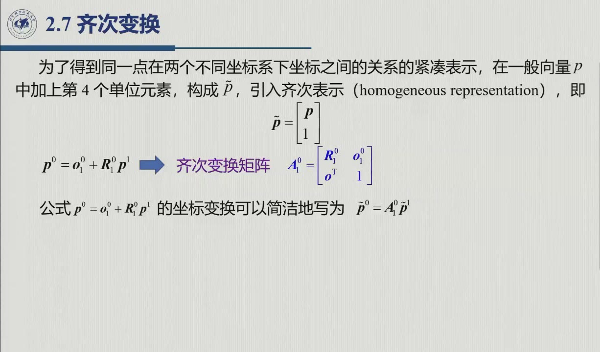
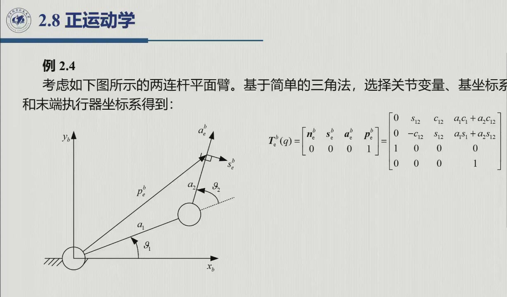
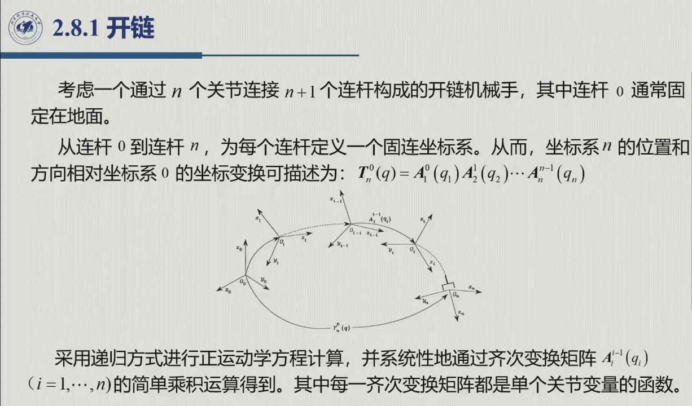
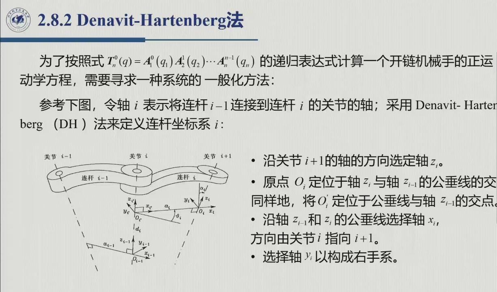
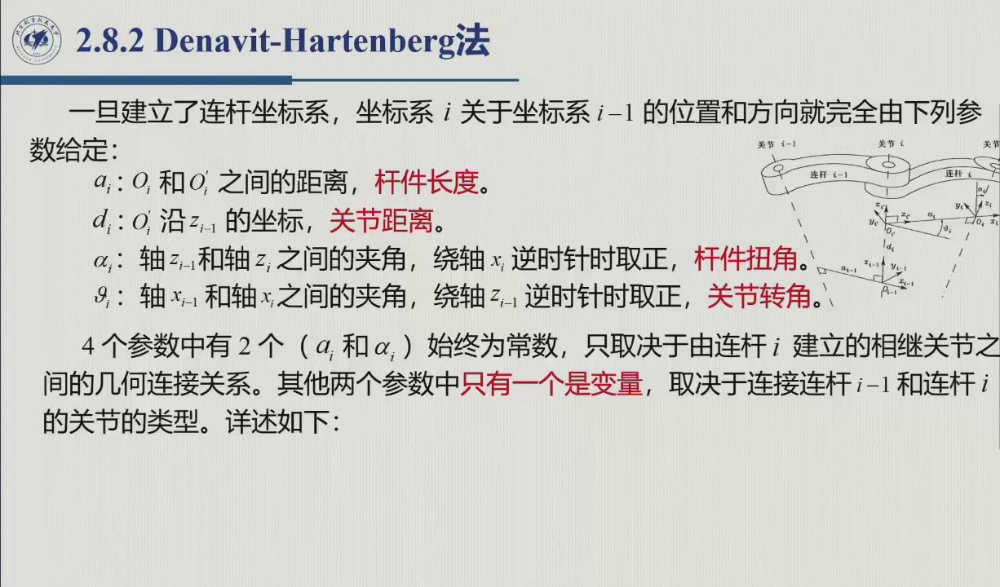
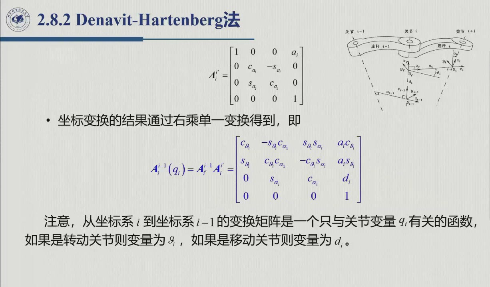

# 2.8 正运动学与 Denavit–Hartenberg 法

旋转、合成、角度表示、齐次变换——这些积木已经备齐，本节就来回答运动学的第一个主问题：**给定关节变量，求末端位姿**。两连杆的情形靠几何直觉就能算出来（原书例 2.4）；可一旦面对真实机械手，我们需要的是一套系统化、参数最少的算法，这就是 **Denavit–Hartenberg（DH）法**。本节对应录播 0:39:43–1:13:00（其中 0:47:16–0:52:47 为课间）。

<aside class="lesson-brief" aria-label="2.8 学习简报">

PREREQUISITE<strong>你需要先会</strong>
齐次变换及其连乘（[@thm-2.7.A]）；开链 / 关节自由度语言（[@def-1.2.1]、[@def-1.2.2]）。

TARGET<strong>本节要建立</strong>
连杆 / 关节编号约定；正运动学方程 $T_e^b(q)$（式 2.48）与末端执行器坐标系 $(\boldsymbol n_e,\boldsymbol s_e,\boldsymbol a_e)$；DH 建系四规则与不唯一情形；四参数 $(a_i,\alpha_i,d_i,\vartheta_i)$「3 常 1 变」；$A_i^{i-1}$ 的两步分解（式 2.52）；DH 十步操作流程。

CHECKPOINT<strong>学完的标准</strong>
拿到任意开链结构图能独立建出 DH 坐标系、填出 4n 参数表并写出 $T_n^0(q)$；能说出每条建系规则「为哪个参数服务」（[@method-2.8.map]）。

</aside>

## 2.8.1 开链：编号约定、正运动学方程与递归

### 连杆—关节编号

::: def 定义 2.8.1 · 开链机械手的编号 {#def-2.8.1}
开链机械手由 $n+1$ 个连杆（刚体）经 $n$ 个关节串联而成：**连杆 0 固定在基座上**，末端连杆上装有末端执行器；**关节 $i$ 则把连杆 $i-1$ 与连杆 $i$ 连接起来**。关节只有两类（原书图 2.12）：**转动型**（revolute，符号 →圆柱铰）和**移动型**（prismatic，符号 →方块滑轨）。
:::

录播 0:40:51 老师用讲台打比方：杆 0 就是基座（「讲台就是固定的」），从它开始依次长出关节 1、杆 1……直到关节 $n$、杆 $n$。换句话说，关节 $i$ 的前一根是杆 $i-1$，后一根是杆 $i$；于是 $n$ 自由度开链 = $n$ 个关节 + $n+1$ 根杆。

### 正运动学问题与末端执行器坐标系

::: def 定义 2.8.2 · 正运动学方程 {#def-2.8.2}
**正运动学**（direct kinematics）回答的是：已知关节变量向量 $\boldsymbol q=[q_1\ \cdots\ q_n]^T$（转动关节 $q_i=\vartheta_i$，移动关节 $q_i=d_i$），求末端执行器的位姿。取基坐标系 $O_b\text{-}x_by_bz_b$ 与末端执行器坐标系，这一位姿可以写成齐次变换（原书式 2.48）

$$T_e^b(\boldsymbol q)=\begin{bmatrix}\boldsymbol n_e(\boldsymbol q) & \boldsymbol s_e(\boldsymbol q) & \boldsymbol a_e(\boldsymbol q) & \boldsymbol p_e(\boldsymbol q)\\ 0&0&0&1\end{bmatrix},$$

式中 $\boldsymbol p_e$ 是末端坐标系原点的位置；$\boldsymbol a_e$ 为**接近向量**（approach，指向抓取 / 工作方向），$\boldsymbol s_e$ 落在钳口滑动平面内、且与 $\boldsymbol a_e$ 垂直；$\boldsymbol n_e=\boldsymbol s_e\times\boldsymbol a_e$ 则保证 $(\boldsymbol n_e,\boldsymbol s_e,\boldsymbol a_e)$ 构成右手系。
:::

（图中同时给出了原书例 2.4：两连杆平面臂用三角法直接写出 $T_e^b$，其中 $s_{12}=\sin(\vartheta_1+\vartheta_2)$，其余依此类推。）

::: ex 例 2.4（原书）· 几何法与它的天花板 {#ex-book-2.4}
对两连杆平面臂（关节角 $\vartheta_1,\vartheta_2$，杆长 $a_1,a_2$），末端位置可以看成两段投影之和：先是 $a_1$ 的投影，再加上 $a_2$ 在「已抬起 $\vartheta_1$ 的方向」上的投影（录播 0:44:00–0:44:57，老师逐项指认「$\boldsymbol n_e$ 垂直于臂平面所以是 $[0,0,1]$、$\boldsymbol p_e$ 就是 $[a_1c_1+a_2c_{12},\ a_1s_1+a_2s_{12},\ 0]^T$」），于是得

$$T_e^b=\begin{bmatrix}0 & s_{12} & c_{12} & a_1c_1+a_2c_{12}\\ 0 & -c_{12} & s_{12} & a_1s_1+a_2s_{12}\\ 1&0&0&0\\ 0&0&0&1\end{bmatrix}.$$

**几何法的天花板**（原书 + 录播 0:45:03：「如果多了之后……那就不好算了」）：这类算法依赖变量的选取和几何直觉，结构一复杂、关节一多就不再直观。
:::

### 开链的递归结构

::: thm 原理 2.8.A · 正运动学的连乘（原书式 2.50–2.51） {#thm-2.8.A}
从连杆 0 到连杆 $n$，给每一根杆都固连一个坐标系，则坐标系 $n$ 相对坐标系 $0$ 的位姿为

$$T_n^0(\boldsymbol q)=A_1^0(q_1)\,A_2^1(q_2)\cdots A_n^{n-1}(q_n),$$

其中每个 $A_i^{i-1}(q_i)$ 都只是**单个关节变量**的函数。至于末端执行器的位姿，只需再串接两个（典型情况下的）常值变换：

$$T_e^b(\boldsymbol q)=T_b^0\,T_n^0(\boldsymbol q)\,T_e^n .$$
:::

结构决定算法：先描述相邻两杆的相对关系，再沿链递归合成（原书）。于是问题只剩一个——**相邻坐标系究竟怎么建才算规范**？

## 2.8.2 Denavit–Hartenberg 法：动机与建系规则

::: intuition 为什么需要 DH：6 → 4 的账（录播 0:46:41–0:47:16、0:53:22–0:53:59）
随意建两个坐标系、再去描述它们的相对位姿，需要 $3+3=6$ 个量（原点 3 个 + 姿态 3 个）。但相邻两坐标系**被同一根刚性杆钉死**，彼此并不独立——「你可能直观想象可能有 5 个参数」；DH 建系法则证明，只要 **4 个参数**就足以完整描述任意相邻关系，「参数是最少，而且最方便、很直观」。省下来的那部分自由度，全部来自建系规则对坐标系的「对齐」。
:::

::: method DH 建系四规则（原书 §2.8.2，录播 0:54:05–0:58:00） {#method-2.8.dh}
先约定：轴 $i$ 指关节 $i$ 的轴线。第一步先把所有关节的轴线一次定好，再逐系落位：
1. **$z_i$ 轴**：沿**关节 $i+1$** 的轴线方向；
2. **原点 $o_i$**：取轴 $z_i$ 与轴 $z_{i-1}$ 的**公垂线**交点（$o_i'$ 则是该公垂线与 $z_{i-1}$ 的交点）；
3. **$x_i$ 轴**：沿 $z_{i-1}$ 与 $z_i$ 的公垂线方向，**由关节 $i$ 指向关节 $i+1$**；
4. **$y_i$ 轴**：右手系补齐。
:::

::: note 不唯一的五种情形（原书；录播 0:58:06–0:59:21 老师逐条点名） {#note-2.8.dh-cases}
① 系 0：$o_0$、$x_0$ 均可任选（前面没有公垂线），工程上尽量与基坐标系重合；② 系 $n$：后面没有关节 $n+1$，$z_n$ 不唯一，典型做法是取与 $z_{n-1}$ 同向；③ 相邻两轴**平行**：公垂线不唯一；④ 相邻两轴**相交**：无公垂线，$x_i$ 方向任意；⑤ 关节 $i$ 为**移动型**：$z_{i-1}$ 方向任意。
:::

<figure>
<svg class="figure-svg" viewBox="0 0 920 486" xmlns="http://www.w3.org/2000/svg" role="img" aria-labelledby="fig-dh-t fig-dh-d">
<title id="fig-dh-t">DH 建系四规则与四参数的几何来源</title>
<desc id="fig-dh-d">左图画出相邻两根关节轴、公垂线、两个坐标系原点与 x 轴，并标出杆件长度 a 与关节距离 d；右图沿 x 轴方向看，说明扭角 α 是两轴的夹角。</desc>
<defs>
<marker id="ar-x" markerHeight="8" markerWidth="8" orient="auto" refX="6" refY="3"><path d="M0,0 L7,3 L0,6 Z" fill="context-stroke"/></marker>
<marker id="ar-xs" markerHeight="8" markerWidth="8" orient="auto-start-reverse" refX="6" refY="3"><path d="M0,0 L7,3 L0,6 Z" fill="context-stroke"/></marker>
</defs>
<g font-family="var(--sans)">
<line class="diagram-axis" x1="170" x2="170" y1="80" y2="380"/>
<line class="diagram-axis" x1="450" x2="450" y1="115" y2="390"/>
<text class="diagram-text" text-anchor="middle" x="170" y="70">z<tspan class="sb">i−1</tspan></text>
<text class="diagram-text" text-anchor="middle" x="450" y="105">z<tspan class="sb">i</tspan></text>
<line stroke="var(--fig-blue)" stroke-width="1.6" marker-end="url(#ar-x)" x1="170.0" x2="496.0" y1="175.0" y2="175.0"/>
<text class="diagram-text" fill="var(--fig-blue)" x="506" y="180">x<tspan class="sb">i</tspan></text>
<circle class="diagram-node" cx="170" cy="175" r="5"/>
<circle class="diagram-fill-accent" cx="450" cy="175" r="6"/>
<circle class="diagram-fill-accent" cx="170" cy="310" r="6"/>
<text class="diagram-note" text-anchor="end" x="158" y="172">o<tspan class="sb">i</tspan>′</text>
<text class="diagram-note" x="464" y="172">o<tspan class="sb">i</tspan></text>
<text class="diagram-note" text-anchor="end" x="158" y="316">o<tspan class="sb">i−1</tspan></text>
<line stroke="var(--fig-blue)" stroke-width="1.1" marker-end="url(#ar-x)" marker-start="url(#ar-xs)" x1="176.0" x2="444.0" y1="212.0" y2="212.0"/>
<text class="diagram-text" fill="var(--fig-blue)" text-anchor="middle" x="310" y="234">a<tspan class="sb">i</tspan> 杆件长度</text>
<line stroke="var(--fig-gold)" stroke-width="1.1" marker-end="url(#ar-x)" marker-start="url(#ar-xs)" x1="118.0" x2="118.0" y1="181.0" y2="304.0"/>
<text class="diagram-text" fill="var(--fig-gold)" text-anchor="end" x="108" y="246">d<tspan class="sb">i</tspan></text>
<text class="diagram-note" text-anchor="end" x="108" y="264">关节距离</text>
<text class="diagram-note" text-anchor="middle" x="310" y="404">z<tspan class="sb">i−1</tspan> 沿关节 i 的轴；z<tspan class="sb">i</tspan> 沿关节 i+1 的轴</text>
<text class="diagram-note" text-anchor="middle" x="310" y="426">x<tspan class="sb">i</tspan> 沿公垂线（由关节 i 指向关节 i+1）</text>
<line stroke="var(--line)" stroke-dasharray="3 5" x1="580" x2="580" y1="60" y2="440"/>
<line class="diagram-axis" x1="760.0" x2="760.0" y1="210.0" y2="102.0"/>
<line class="diagram-axis" x1="760.0" x2="826.5" y1="210.0" y2="124.9"/>
<circle class="diagram-fill-accent" cx="760" cy="210" r="6"/>
<path d="M 760 153.8 A 56.2 56.2 0 0 1 794.6 165.7" fill="none" stroke="var(--fig-green)" stroke-width="2"/>
<text class="diagram-text" fill="var(--fig-green)" x="790" y="143">α<tspan class="sb">i</tspan></text>
<text class="diagram-note" text-anchor="end" x="750" y="94">z<tspan class="sb">i−1</tspan></text>
<text class="diagram-note" x="836" y="121">z<tspan class="sb">i</tspan></text>
<text class="diagram-note" text-anchor="middle" x="760" y="254">沿 x<tspan class="sb">i</tspan> 方向看：两轴夹角即扭角 α<tspan class="sb">i</tspan></text>
<text class="diagram-note" text-anchor="middle" x="760" y="276">（绕 x<tspan class="sb">i</tspan> 逆时针为正）</text>
<text class="diagram-note" text-anchor="middle" x="760" y="404">转动关节：ϑ<tspan class="sb">i</tspan> 是变量</text>
<text class="diagram-note" text-anchor="middle" x="760" y="426">移动关节：d<tspan class="sb">i</tspan> 是变量；a<tspan class="sb">i</tspan>、α<tspan class="sb">i</tspan> 恒为常数</text>
</g></svg>
<figcaption>DH 建系四规则不是并列的口诀（本教程绘）：**每条规则各管一个参数**——$z$ 轴规则管变量（$\vartheta_i$ 或 $d_i$），公垂线规则管常数（$a_i$），两轴的方向关系管 $\alpha_i$，右手系补 $y_i$ 不引入参数。左图中 $o_i$ 取在公垂线与 $z_i$ 的交点、$x_i$ 沿公垂线——这两条决定了 $A_i^{i-1}$ 第 4 列的 $(a_ic_{\vartheta_i},\ a_is_{\vartheta_i},\ d_i)$。</figcaption>
</figure>

下面把四条规则用到最简单的臂上（见下图）：两连杆平面臂的三个 $z$ 轴全部指出纸面、互相平行。正是「平行」这一个几何事实，一次性解释了参数表里成片的 $0$ 与仅有的两个变量。

<figure>
<svg class="figure-svg" viewBox="0 0 920 340" xmlns="http://www.w3.org/2000/svg" role="img" aria-labelledby="fig-dhw-t fig-dhw-d">
<title id="fig-dhw-t">两连杆平面臂的 DH 建系实例</title>
<desc id="fig-dhw-d">左图俯视：基座与肘部两个关节加末端共三个坐标系，z 轴全部垂直纸面向外（圆点符号），x 轴沿连杆方向，相邻 x 的夹角即关节变量 ϑ。右图给出两行 DH 参数表：a 列为杆长常数，ϑ 列为变量，α 与 d 全为零。</desc>
<defs>
<marker id="fdh-m" markerWidth="9" markerHeight="9" refX="7" refY="3" orient="auto"><path d="M0,0 L7,3 L0,6 Z" fill="var(--muted)"/></marker>
<marker id="fdh-b" markerWidth="8" markerHeight="8" refX="6" refY="2.5" orient="auto"><path d="M0,0 L6,2.5 L0,5 Z" fill="var(--fig-blue)"/></marker>
<marker id="fdh-n" markerWidth="8" markerHeight="8" refX="6" refY="2.5" orient="auto"><path d="M0,0 L6,2.5 L0,5 Z" fill="var(--fig-green)"/></marker>
<marker id="fdh-g" markerWidth="8" markerHeight="8" refX="6" refY="2.5" orient="auto"><path d="M0,0 L6,2.5 L0,5 Z" fill="var(--fig-gold)"/></marker>
</defs>
<text class="diagram-text" x="240" y="30" text-anchor="middle">建系结果（俯视，z 全部指出纸面 ⊙）</text>
<text class="diagram-text" x="710" y="30" text-anchor="middle">DH 参数表：每个 0 都有来历</text>
<g stroke="var(--line-strong)" stroke-width="1.2" marker-end="url(#fdh-m)">
<line x1="240" y1="262" x2="330" y2="262"/>
<line x1="240" y1="262" x2="240" y2="192"/>
</g>
<text class="diagram-note" x="336" y="266">x</text>
<text class="diagram-note" x="234" y="186" text-anchor="end">y</text>
<line stroke="var(--accent)" stroke-width="5" x1="240" y1="262" x2="317.1" y2="170.1"/>
<line stroke="var(--accent)" stroke-width="5" x1="317.1" y1="170.1" x2="279.1" y2="88.5"/>
<line x1="317.1" y1="170.1" x2="342.8" y2="139.5" stroke="var(--line-strong)" stroke-width="1" stroke-dasharray="4 4"/>
<path d="M 280 262 A 40 40 0 0 0 265.7 231.4" fill="none" stroke="var(--fig-gold)" stroke-width="1.8" marker-end="url(#fdh-g)"/>
<text class="diagram-text" fill="var(--fig-gold)" x="292" y="252">ϑ<tspan class="sb">1</tspan></text>
<path d="M 339 144 A 34 34 0 0 0 302.7 139.3" fill="none" stroke="var(--fig-gold)" stroke-width="1.8" marker-end="url(#fdh-g)"/>
<text class="diagram-text" fill="var(--fig-gold)" x="346" y="140">ϑ<tspan class="sb">2</tspan></text>
<g stroke-width="2.2">
<line stroke="var(--fig-blue)" marker-end="url(#fdh-b)" x1="240" y1="262" x2="275.4" y2="219.9"/>
<line stroke="var(--fig-green)" stroke-width="1.6" marker-end="url(#fdh-n)" x1="240" y1="262" x2="197.9" y2="226.6"/>
<line stroke="var(--fig-blue)" marker-end="url(#fdh-b)" x1="317.1" y1="170.1" x2="293.8" y2="120.3"/>
<line stroke="var(--fig-green)" stroke-width="1.6" marker-end="url(#fdh-n)" x1="317.1" y1="170.1" x2="267.3" y2="193.4"/>
<line stroke="var(--fig-blue)" marker-end="url(#fdh-b)" x1="279.1" y1="88.5" x2="257.9" y2="51.3"/>
<line stroke="var(--fig-green)" stroke-width="1.6" marker-end="url(#fdh-n)" x1="279.1" y1="88.5" x2="240.7" y2="106.4"/>
</g>
<g>
<circle cx="240" cy="262" r="9" fill="var(--paper)" stroke="var(--ink-2)" stroke-width="1.4"/><circle cx="240" cy="262" r="2.2" fill="var(--ink-2)"/>
<circle cx="317.1" cy="170.1" r="9" fill="var(--paper)" stroke="var(--ink-2)" stroke-width="1.4"/><circle cx="317.1" cy="170.1" r="2.2" fill="var(--ink-2)"/>
<circle cx="279.1" cy="88.5" r="9" fill="var(--paper)" stroke="var(--ink-2)" stroke-width="1.4"/><circle cx="279.1" cy="88.5" r="2.2" fill="var(--ink-2)"/>
</g>
<text class="diagram-text" fill="var(--fig-blue)" x="282" y="216">x<tspan class="sb">0</tspan></text>
<text class="diagram-text" fill="var(--fig-blue)" x="288" y="116">x<tspan class="sb">1</tspan></text>
<text class="diagram-text" fill="var(--fig-blue)" x="250" y="48" text-anchor="end">x<tspan class="sb">2</tspan></text>
<text class="diagram-note" x="224" y="280" text-anchor="end">o<tspan class="sb">0</tspan></text>
<text class="diagram-note" x="330" y="180">o<tspan class="sb">1</tspan></text>
<text class="diagram-note" x="292" y="84">o<tspan class="sb">2</tspan></text>
<text class="diagram-text" fill="var(--accent-text)" x="300" y="234">a<tspan class="sb">1</tspan></text>
<text class="diagram-text" fill="var(--accent-text)" x="262" y="142" text-anchor="end">a<tspan class="sb">2</tspan></text>
<text class="diagram-note" x="300" y="322" text-anchor="middle">z 全平行 → α = 0；原点同面 → d = 0；x 沿连杆方向 → a 恰为杆长</text>
<g fill="none" stroke="var(--line)">
<rect x="540" y="60" width="330" height="135"/>
<line x1="540" y1="105" x2="870" y2="105"/><line x1="540" y1="150" x2="870" y2="150"/><line x1="615" y1="60" x2="615" y2="210"/><line x1="690" y1="60" x2="690" y2="210"/><line x1="765" y1="60" x2="765" y2="210"/><line x1="840" y1="60" x2="840" y2="210"/>
</g>
<text class="diagram-text" x="577" y="89" text-anchor="middle">连杆 i</text>
<text class="diagram-text" x="652" y="89" text-anchor="middle">a</text>
<text class="diagram-text" x="727" y="89" text-anchor="middle">α</text>
<text class="diagram-text" x="802" y="89" text-anchor="middle">d</text>
<text class="diagram-text" x="855" y="89" text-anchor="middle">ϑ</text>
<text class="diagram-text" x="577" y="134" text-anchor="middle">1</text>
<text class="diagram-text" fill="var(--fig-blue)" x="652" y="134" text-anchor="middle">a<tspan class="sb">1</tspan></text>
<text class="diagram-note" x="727" y="134" text-anchor="middle">0</text>
<text class="diagram-note" x="802" y="134" text-anchor="middle">0</text>
<text class="diagram-text" fill="var(--fig-gold)" x="855" y="134" text-anchor="middle">ϑ<tspan class="sb">1</tspan></text>
<text class="diagram-text" x="577" y="179" text-anchor="middle">2</text>
<text class="diagram-text" fill="var(--fig-blue)" x="652" y="179" text-anchor="middle">a<tspan class="sb">2</tspan></text>
<text class="diagram-note" x="727" y="179" text-anchor="middle">0</text>
<text class="diagram-note" x="802" y="179" text-anchor="middle">0</text>
<text class="diagram-text" fill="var(--fig-gold)" x="855" y="179" text-anchor="middle">ϑ<tspan class="sb">2</tspan></text>
<circle fill="var(--fig-gold)" cx="556" cy="238" r="4"/><text class="diagram-note" x="566" y="243">变量（每行恰一个：z 规则决定）</text>
<circle fill="var(--fig-blue)" cx="556" cy="262" r="4"/><text class="diagram-note" x="566" y="267">常数（杆长 / 扭角：公垂线与两轴夹角）</text>
<circle fill="var(--muted)" cx="556" cy="286" r="4"/><text class="diagram-note" x="566" y="291">0（z 平行 → α=0；原点共面 → d=0）</text>
<text class="diagram-note" x="710" y="322" text-anchor="middle">参数选得好 = 让 0 尽量多；2.9 节全部算例照此办理</text>
</svg>
<figcaption>DH 建系的第一个完整实例（本教程绘）：俯视下三个 $z$ 轴全部指出纸面且互相平行，于是 $\alpha_i=0$；原点取在同一平面，$d_i=0$；$x_i$ 沿连杆方向，$a_i$ 恰为杆长；相邻 $x$ 轴的夹角就是仅有的两个变量 $\vartheta_1,\vartheta_2$。把左图的几何逐条「翻译」成右表——这就是 DH 法的全部动作；「让 0 尽量多」的选系原则见下文（[@method-2.8.zero]）。</figcaption>
</figure>

::: method 总原则：让参数尽量为零（录播 0:59:31–1:00:04，课堂提炼） {#method-2.8.zero}
凡是可自由选取之处，都「选择让参数尽量为零的方案」。道理很简单：参数本身是常数，选得好就能让一大批参数为 0，代入 $A$ 矩阵时「都是零的乘来乘去」，计算量骤减。2.9 节每个算例的参数表里成片的 0，正是这条原则的兑现。
:::

### DH 四参数与 $A_i^{i-1}$

::: def 定义 2.8.3 · DH 参数 {#def-2.8.3}
建立连杆坐标系后，系 $i$ 相对系 $i-1$ 的位姿就由 4 个参数完全确定：

| 参数 | 名称（课堂助记） | 几何含义 | 属性 |
|:--|:--|:--|:--|
| $a_i$ | **杆件长度** | $o_i'$ 与 $o_i$ 间距离（公垂线长度，沿 $x_i$） | 恒为常数 |
| $d_i$ | **关节距离** | $o_i'$ 沿 $z_{i-1}$ 的坐标 | 移动关节时为变量 |
| $\alpha_i$ | **杆件扭角** | 轴 $z_{i-1}$ 与 $z_i$ 的夹角（绕 $x_i$ 逆时针为正） | 恒为常数 |
| $\vartheta_i$ | **关节转角** | 轴 $x_{i-1}$ 与 $x_i$ 的夹角（绕 $z_{i-1}$ 逆时针为正） | 转动关节时为变量 |

**3 常 1 变**：$a_i,\alpha_i$ 永远是常数（由杆的几何决定）；$d_i,\vartheta_i$ 中恰有一个是关节变量，统一记作 $q_i$（录播 1:04:31–1:05:04：「后面用的最多的是叫 Q……转动关节就是 $\vartheta$，移动关节就是 $d$」）。换言之，相邻两坐标系之间只需要一个量就能描述。
:::

::: method 规则 → 参数：每条建系规则「为谁服务」 {#method-2.8.map}
四条规则不是并列的口诀，而是**每条各管一个参数**——这既是「建系为什么这样建」的答案，也是填表时自查的依据：

| 规则 | 服务的参数 | 为什么恰好是它 |
|:--|:--|:--|
| $z_{i-1}$ 沿**关节 $i$** 的轴 | $\vartheta_i$、$d_i$（**变量**） | 关节 $i$ 的运动物理上就是「绕 / 沿自己的轴」；$z_{i-1}$ 与该轴重合后，这场运动在 $A_i^{i-1}$ 里恰好表现为绕 $z_{i-1}$ 的转角 $\vartheta_i$（旋转块）或沿 $z_{i-1}$ 的位移 $d_i$（第 4 列）——这就是「转动 $\vartheta$ 当变量、移动 $d$ 当变量」的全部出处 |
| 原点 $o_i$ 取在**公垂线**上、$x_i$ 沿公垂线 | $a_i$（**常数**） | 两根 $z$ 轴的**相对位置**被这段公垂线一锤定音：$a_i$ = 公垂线长，沿 $x_i$ 度量——第 4 列的 $(a_ic_{\vartheta_i},\ a_is_{\vartheta_i})$ 由此而来 |
| 同一对 $z$ 轴的方向关系 | $\alpha_i$（**常数**） | 两轴的**方向差**只剩绕公垂线 $x_i$ 的一个转角：$\alpha_i$ = 从 $z_{i-1}$ 绕 $x_i$ 转到 $z_i$——旋转块里「绕 $x$ 转 $\alpha$」那一块由此而来 |
| $y_i$ 右手系补齐 | 无 | 只保证 $R\in SO(3)$ 且唯一，不引入参数 |

一句话总结：**$z$ 轴规则管变量（$\vartheta,d$），公垂线规则管常数（$a,\alpha$）**。[2.9](sec2-9.md) 各参数表里成片的 $0$ 与 $\pm\pi/2$，全部来自这两条规则对齐之后的「自然归零 / 自然成直角」——不是巧合，而是设计。
:::

::: method $A_i^{i-1}$ 的两步分解（原书式 2.52；录播 1:05:42–1:09:01） {#method-2.8.A}
把「系 $i-1$ → 系 $i$」这一步拆成两段各自都很简单的变换：
1. **沿 $z_{i-1}$ 平移 $d_i$，再绕 $z_{i-1}$ 转 $\vartheta_i$** → 中间系 $i'$：

$$A_{i'}^{i-1}=\begin{bmatrix}c_{\vartheta_i} & -s_{\vartheta_i} & 0 & 0\\ s_{\vartheta_i} & c_{\vartheta_i} & 0 & 0\\ 0&0&1&d_i\\ 0&0&0&1\end{bmatrix}$$

2. **沿 $x_{i'}$ 平移 $a_i$，再绕 $x_{i'}$ 转 $\alpha_i$** → 系 $i$：

$$A_i^{i'}=\begin{bmatrix}1&0&0&a_i\\ 0&c_{\alpha_i} & -s_{\alpha_i} & 0\\ 0&s_{\alpha_i} & c_{\alpha_i} & 0\\ 0&0&0&1\end{bmatrix}$$

**右乘**合成（[@thm-2.3.A]）：

$$A_i^{i-1}(q_i)=A_{i'}^{i-1}A_i^{i'}=\begin{bmatrix}
c_{\vartheta_i} & -s_{\vartheta_i}c_{\alpha_i} & s_{\vartheta_i}s_{\alpha_i} & a_ic_{\vartheta_i}\\
s_{\vartheta_i} & c_{\vartheta_i}c_{\alpha_i} & -c_{\vartheta_i}s_{\alpha_i} & a_is_{\vartheta_i}\\
0 & s_{\alpha_i} & c_{\alpha_i} & d_i\\
0&0&0&1
\end{bmatrix}$$
:::

这个矩阵值得默写：**第 4 列的 $a_ic_{\vartheta_i},\ a_is_{\vartheta_i},\ d_i$ 就是三个参数的「肉身」**，旋转块则是「绕 $z$ 转 $\vartheta$ $\oplus$ 绕 $x$ 转 $\alpha$」的复合。整条链的正运动学，无非是把各 $A_i^{i-1}$ 依次连乘（[@thm-2.8.A]）。

::: method DH 十步操作流程（原书） {#method-2.8.steps}
1. 给关节轴编号，定出 $z_0,\dots,z_{n-1}$ 的方向；
2. 选取系 0（$o_0$ 在轴 $z_0$ 上；可行时与基坐标系重合）；
3. 对 $i=1,\dots,n-1$ 逐个处理：把 $o_i$ 放到 $z_i$ 与公垂线的交点（平行轴 + 转动关节取 $d_i=0$；移动关节取机械参考点）；
4. 沿公垂线取 $x_i$（方向由关节 $i$ 指向关节 $i+1$）；
5. 右手系补 $y_i$；
6. 选取系 $n$（转动关节取 $z_n\parallel z_{n-1}$；移动关节 $z_n$ 任意；$x_n$ 按步骤 4）；
7. 列出 $4n$ 个参数的参数表；
8. 逐个算出 $A_i^{i-1}(q_i)$；
9. 连乘得到 $T_n^0(q)$；
10. 串接常值变换 $T_b^0,T_e^n$，得到 $T_e^b(q)$。
录播 1:11:13 的口诀：「编号、建系（能零则零）、列参数表、代入、连乘」——参数表写对，剩下的就是机械代入。
:::

::: note 计算方面（原书 §2.8 末）
正运动学的主要计算开销，来自 $A_i^{i-1}$ 连乘中**超越函数**（sin / cos）的求值；做因式化处理可以减少乘加次数（flops）。另外，末端坐标系的三个单位向量不必都从矩阵里读——第三个用叉积导出即可（$\boldsymbol n_e=\boldsymbol s_e\times\boldsymbol a_e$，见 [定义 2.8.2](#def-2.8.2)）。
:::

::: intuition 动手实验 · 把 DH 表连乘成一条手臂
平面 3R 是 DH 法的最小实例：三个 $z$ 轴都指出纸面且互相平行（$\alpha_i=0$），原点共面（$d_i=0$），$x_i$ 沿连杆（$a_i=l_i$），于是 DH 表里只剩下三个变量 $\vartheta_1,\vartheta_2,\vartheta_3$。拖动它们，观察末端轨迹与闭式 $x=l_1c_1+l_2c_{12}+l_3c_{123}$ 如何同步变化——这就是 [@method-2.8.zero]「让 0 尽量多」带来的收益。

:::

## 2.8.3 闭链（教材补充 · 课程未授）

::: note 本节定位
录播 0:41:58 老师明确讲过「闭链我们不讲」，所以这一节属于教材补充（原书 §2.8.3），考试不作要求；但它是 [2.9.2](sec2-9.md#sec-2.9.2) 平行四边形臂与并联机构的建模基础，故存此备查。
:::

上面这套 DH 法利用的是**开链**的递归特性。面对含闭运动链的机械手，思路是把它**化归为开链**：

::: method 闭链的 DH 处理（原书 §2.8.3） {#method-2.8.closed}
设闭链有 $n+1$ 个连杆、关节数 $l>n$（于是闭环数 = $l-n$）。
1. **虚拟断开**：在某个非驱动关节处把闭环「剪开」（设为连接连杆 $j$ 与 $k$ 的关节 $j+1$），得到一个**树状开链**；连杆 $0\cdots i$ 位于两分支之前（公共段），连杆 $j+1\cdots n$ 则被排除；
2. **按 DH 建系**：对树上各分支分别建连杆坐标系（开链流程照用）；
3. **写约束**：断点两侧坐标系 $j$ 与 $k$ 必须满足原闭环的几何一致条件。当关节 $j+1$ 为**转动型**时约束为

$$\boldsymbol z_j^i(\boldsymbol q')=\boldsymbol z_k^i(\boldsymbol q''),\qquad
R_i^j(\boldsymbol q')\big(\boldsymbol p_j^i(\boldsymbol q')-\boldsymbol p_k^i(\boldsymbol q'')\big)=\begin{bmatrix}0&0&d_{jk}\end{bmatrix}^T$$

（$R_i^j=(R_j^i)^T$，把系 $i$ 中表达的向量投到系 $j$；原书式 2.55–2.57）——它说的就是「两 $z$ 轴共线 + 相对位置只剩沿轴向的固定偏移」。若关节 $j+1$ 为**移动型**，则 $d_{jk}$ 变为变量，位置约束只保留前两个分量，并追加方向约束 $\boldsymbol x_j^{iT}\boldsymbol x_k^i=\cos\vartheta_{jk}$（原书式 2.58–2.60）；两种情形下都**恰有 6 个约束方程**；
4. **求独立变量**：由这 6 个方程解出数目较少的独立关节变量——它们就是驱动关节的自然候选，链中其余关节（含断开关节）通常不作为驱动关节；
5. **连乘出正运动学**：$T_e^b(\boldsymbol q)=A_1^0A_2^1\cdots A_n^{n-1}$，链路闭合后，变换序列通常从坐标系 $j$ 重新开始（原书式 2.61）。
:::

::: note 何时能解出闭式约束
除结构简单的情形（如平面机构）外，约束方程**不保证**有闭合解；不过若机械手具有特殊几何构形，部分方程会变得不独立、独立方程数少于 6，求解反而更容易（原书）。
:::

::: think 默写点 · 合上书再写（主动回忆）

不要翻正文与速查卡，先独立写出下面几条，再展开核对。写不出来，就说明这一节还没真正「拿走」。

1. 默写 $A_i^{i-1}(q_i)$ 的完整矩阵，并指出第 4 列各元素对应哪个参数。
2. DH 四规则各是什么？每条规则「为哪个参数服务」？
3. 四个参数中哪两个永远是常数？变量怎么定？

::: sol 核对

$A_i^{i-1}$ 见[公式速查卡](../preface-formulas.md) B1。第 4 列 = $(a_ic_{\vartheta_i},\ a_is_{\vartheta_i},\ d_i,\ 1)^{\mathrm T}$——三个参数的「肉身」。

$z_i$ 沿关节 $i+1$ 的轴（服务变量 $\vartheta_i,d_i$）；原点取公垂线交点、$x_i$ 沿公垂线（服务 $a_i$）；两 $z$ 轴的方向关系给 $\alpha_i$；$y_i$ 右手系补齐（不引入参数）。

$a_i$（杆件长度）与 $\alpha_i$（杆件扭角）恒为常数；$d_i$ 与 $\vartheta_i$ 中恰有一个是变量，由**关节类型**决定（转动 $q_i=\vartheta_i$、移动 $q_i=d_i$）——这就是「3 常 1 变」。

:::

:::

## 2.8 小结与常见错误

- **一条流水线**：编号 → 建系（四规则 + 能零则零）→ 填 4n 参数表（3 常 1 变）→ 逐个写 $A_i^{i-1}$ → 连乘 $T_n^0$ → 串常值变换。相邻坐标系的 6 个自由度，被杆约束压缩到 4 个参数。
- **一个验证器**：填完表先扫一遍——转动关节那一行的 $d_i$ 应当是常数，移动关节那一行的 $\vartheta_i$ 应当是常数；谁在变量位置上摇摆，谁的关节类型就读错了。

::: think 常见错误清单 · 自查四条
1. 把 $z_i$ 配错了关节——记住 $z_{i-1}$ 沿**关节 $i$** 的轴（DH 约定下坐标系 $i$ 挂在关节 $i+1$ 上，最容易和「改进 DH」记法混淆，见[勘误 E2.4](errata.md#errata-2.4)）；
2. 丢掉 $\alpha_i$ 的符号——绕 $x_i$ 逆时针为正，2.9 节球形臂的 $-\pi/2$ 就是在这里翻的车（录播 1:19:38 老师：「正负号容易错」）；
3. 移动关节却让 $\vartheta_i$ 当变量——变量只能有一个，判定关节类型的唯一依据是关节本身，而不是杆的形状；
4. 把 $T_e^n,T_b^0$ 忘在门外——$T_n^0$ 给出的只是「杆 $n$ 坐标系」的位姿，末端执行器坐标系的常值串接（原书式 2.51）不可省。
:::
