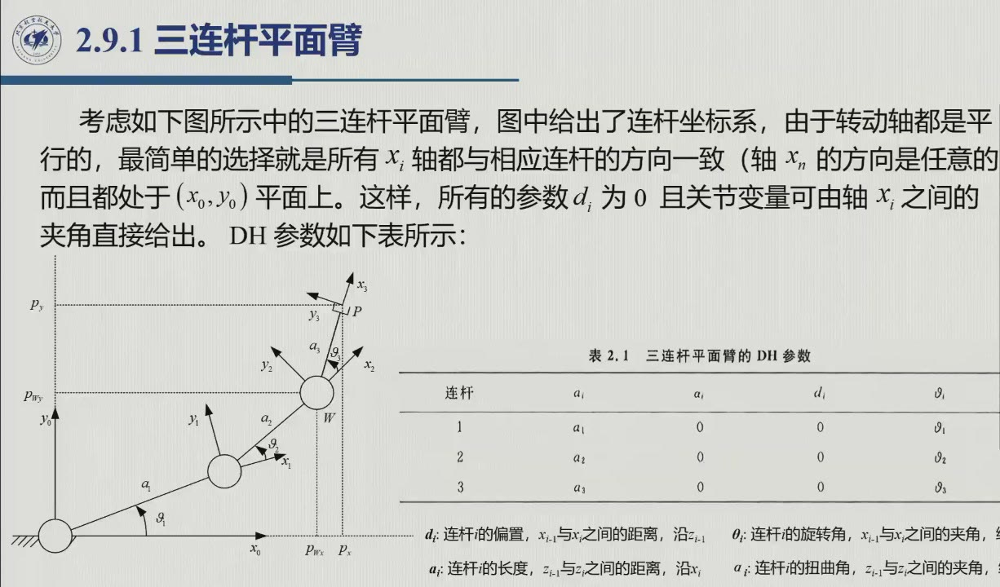
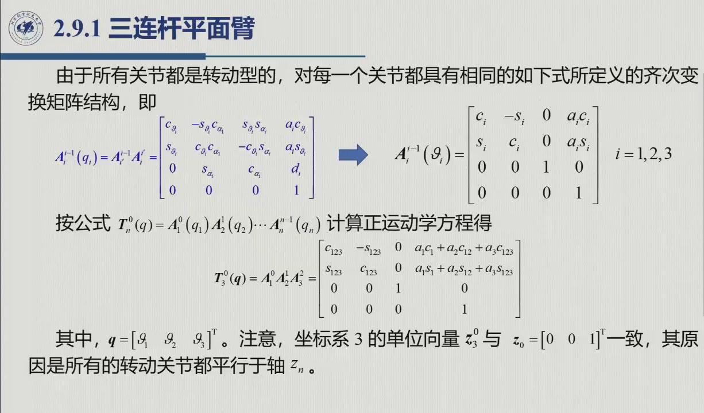
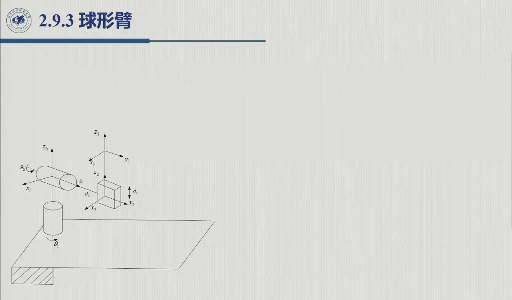
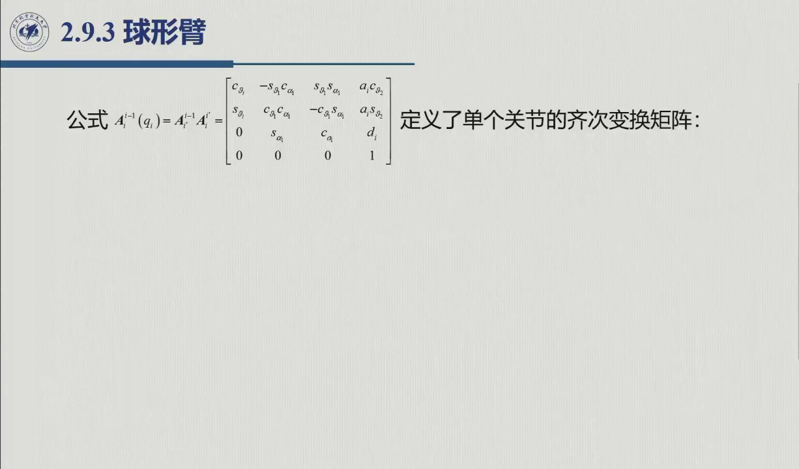
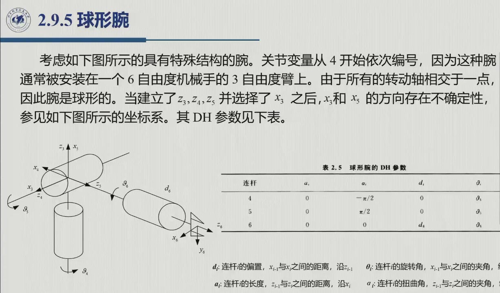
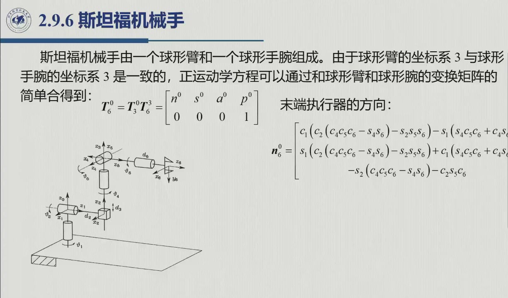

# 2.9 典型机械手结构运动学

本节把 DH 流水线放到工业机器人最常见的结构上跑一遍，一共九种——七种是课程重点，两种是教材补充（2.9.2、2.9.9）。目标不是背结果，而是看清两件事：参数表里的 0 从哪来；「球形腕旋转块 = ZYZ 欧拉角」这类结构性发现，又是如何为逆运动学铺路的。对应的录播片段为 1:13:00–1:35:10。

<aside class="lesson-brief" aria-label="2.9 学习简报">

PREREQUISITE<strong>你需要先会</strong>
DH 全流程（[@def-2.8.3]、[@method-2.8.A]）；ZYZ 合成矩阵（<a href="sec2-4.html#sec-2.4.2">2.4.2</a>）。

TARGET<strong>本节要建立</strong>
九种结构的 DH 表与正运动学；「零位约定 vs 编程零位」；球形腕旋转块 = ZYZ 矩阵的解耦预兆；斯坦福 = 球臂 $\oplus$ 球腕的直接连乘条件；闭链化归开链（平行四边形臂）。

CHECKPOINT<strong>学完的标准</strong>
遮住参数表能独立重建任意一臂；能说出每臂「哪些参数为零、为什么」；能解释斯坦福可以连乘而带腕拟人臂必须插常值变换的原因。

</aside>

::: note 零位约定（原书开篇） {#note-2.9.zero}
各结构的正运动学，都以「DH 建图下关节变量全为零」的那个**位姿**作为参考。它与机器人实际编程中使用的零参考值（零位标定值）可以不同；要让两者对上，就得对传感器读数加一个**常值漂移**。录播 1:12:51，老师结合「每个关节转多少、它会到哪」强调了这一点。
:::

开始逐节填表之前，先看下面这张总览图：本节各位主角的「关节签名」一目了然。只要看清每种构形的 R / P 排列，从 2.9.1 起的 DH 表就不再是一堆数字，而是对这幅骨架的逐段描述。

<figure>
<svg class="figure-svg" viewBox="0 0 920 330" xmlns="http://www.w3.org/2000/svg" role="img" aria-labelledby="fig-29-title fig-29-desc">
<title id="fig-29-title">五种典型构形的关节配置</title>
<desc id="fig-29-desc">五个侧视简图：笛卡儿型三移动关节的正交导轨；圆柱型底座回转加立柱升降与横臂伸缩；球型底座回转加俯仰与伸缩；SCARA 两节水平台臂加竖直移动 quill；拟人型肩肘两个转动关节加立柱回转。转动关节画成圆，移动关节画成双箭头。</desc>
<defs>
<marker id="f29-b" markerWidth="8" markerHeight="8" refX="6" refY="2.5" orient="auto"><path d="M0,0 L6,2.5 L0,5 Z" fill="var(--fig-blue)"/></marker>
<marker id="f29-bs" markerWidth="8" markerHeight="8" refX="1" refY="2.5" orient="auto"><path d="M6,0 L0,2.5 L6,5 Z" fill="var(--fig-blue)"/></marker>
<marker id="f29-a" markerWidth="8" markerHeight="8" refX="6" refY="2.5" orient="auto"><path d="M0,0 L6,2.5 L0,5 Z" fill="var(--accent-text)"/></marker>
</defs>
<text class="diagram-text" x="460" y="30" text-anchor="middle">五种典型构形的关节配置（侧视示意）</text>
<circle cx="652" cy="56" r="5" fill="none" stroke="var(--accent-text)" stroke-width="1.6"/>
<text class="diagram-note" x="664" y="60">转动关节 R（圆）</text>
<line x1="646" y1="76" x2="662" y2="76" stroke="var(--fig-blue)" stroke-width="1.6" marker-end="url(#f29-b)" marker-start="url(#f29-bs)"/>
<text class="diagram-note" x="670" y="80">移动关节 P（双箭头）</text>
<g stroke="var(--line)" stroke-width="1.5"><line x1="30" y1="240" x2="165" y2="240"/><line x1="195" y1="240" x2="360" y2="240"/><line x1="380" y1="240" x2="545" y2="240"/><line x1="560" y1="240" x2="730" y2="240"/><line x1="745" y1="240" x2="915" y2="240"/></g>
<!-- 1 笛卡儿 PPP -->
<g>
<rect x="42" y="225" width="100" height="15" class="diagram-node"/>
<rect x="78" y="110" width="16" height="115" class="diagram-node"/>
<rect x="94" y="110" width="70" height="14" class="diagram-node"/>
<rect x="128" y="124" width="12" height="60" class="diagram-node"/>
<line x1="64" y1="130" x2="64" y2="210" stroke="var(--fig-blue)" stroke-width="1.6" marker-end="url(#f29-b)" marker-start="url(#f29-bs)"/>
<line x1="104" y1="94" x2="152" y2="94" stroke="var(--fig-blue)" stroke-width="1.6" marker-end="url(#f29-b)" marker-start="url(#f29-bs)"/>
<line x1="152" y1="134" x2="152" y2="176" stroke="var(--fig-blue)" stroke-width="1.6" marker-end="url(#f29-b)" marker-start="url(#f29-bs)"/>
<text class="diagram-text" x="92" y="272" text-anchor="middle">笛卡儿</text>
<text class="diagram-mono" x="92" y="291" text-anchor="middle">P P P</text>
<text class="diagram-note" x="92" y="309" text-anchor="middle">三移 · 箱内作业</text>
</g>
<!-- 2 圆柱 RPP -->
<g>
<ellipse cx="276" cy="196" rx="40" ry="9" class="diagram-node"/>
<line x1="236" y1="196" x2="236" y2="232" stroke="var(--line-strong)"/>
<line x1="316" y1="196" x2="316" y2="232" stroke="var(--line-strong)"/>
<path d="M 232 226 A 44 11 0 1 0 320 226" fill="none" stroke="var(--accent-text)" stroke-width="1.6" marker-end="url(#f29-a)"/>
<rect x="268" y="90" width="16" height="106" class="diagram-node"/>
<rect x="284" y="104" width="62" height="13" class="diagram-node"/>
<line x1="332" y1="196" x2="332" y2="110" stroke="var(--fig-blue)" stroke-width="1.6" marker-end="url(#f29-b)" marker-start="url(#f29-bs)"/>
<line x1="296" y1="130" x2="338" y2="130" stroke="var(--fig-blue)" stroke-width="1.6" marker-end="url(#f29-b)" marker-start="url(#f29-bs)"/>
<text class="diagram-text" x="276" y="272" text-anchor="middle">圆柱形</text>
<text class="diagram-mono" x="276" y="291" text-anchor="middle">R P P</text>
<text class="diagram-note" x="276" y="309" text-anchor="middle">回转 + 升降 + 伸缩</text>
</g>
<!-- 3 球形 RRP -->
<g>
<ellipse cx="424" cy="216" rx="28" ry="7" class="diagram-node"/>
<line x1="396" y1="216" x2="396" y2="238" stroke="var(--line-strong)"/>
<line x1="452" y1="216" x2="452" y2="238" stroke="var(--line-strong)"/>
<path d="M 390 228 A 36 9 0 1 0 458 228" fill="none" stroke="var(--accent-text)" stroke-width="1.6" marker-end="url(#f29-a)"/>
<circle cx="424" cy="206" r="7" class="diagram-node"/>
<line stroke="var(--accent)" stroke-width="5" x1="424" y1="206" x2="470" y2="124"/>
<line stroke="var(--fig-blue)" stroke-width="2.4" x1="470" y1="124" x2="502" y2="70"/>
<line x1="480" y1="118" x2="506" y2="82" stroke="var(--fig-blue)" stroke-width="1.4" marker-end="url(#f29-b)" marker-start="url(#f29-bs)"/>
<text class="diagram-text" x="460" y="272" text-anchor="middle">球形</text>
<text class="diagram-mono" x="460" y="291" text-anchor="middle">R R P</text>
<text class="diagram-note" x="460" y="309" text-anchor="middle">两转 + 径向伸缩</text>
</g>
<!-- 4 SCARA -->
<g>
<rect x="596" y="150" width="14" height="90" class="diagram-node"/>
<rect x="610" y="144" width="64" height="13" class="diagram-node"/>
<rect x="674" y="144" width="52" height="13" class="diagram-node"/>
<circle cx="610" cy="150" r="6" class="diagram-node"/>
<circle cx="674" cy="150" r="6" class="diagram-node"/>
<path d="M 598 150 A 12 12 0 0 1 610 138" fill="none" stroke="var(--accent-text)" stroke-width="1.4" marker-end="url(#f29-a)"/>
<path d="M 662 150 A 12 12 0 0 1 674 138" fill="none" stroke="var(--accent-text)" stroke-width="1.4" marker-end="url(#f29-a)"/>
<rect x="694" y="157" width="12" height="48" class="diagram-node"/>
<line x1="714" y1="162" x2="714" y2="200" stroke="var(--fig-blue)" stroke-width="1.6" marker-end="url(#f29-b)" marker-start="url(#f29-bs)"/>
<text class="diagram-text" x="644" y="272" text-anchor="middle">SCARA</text>
<text class="diagram-mono" x="644" y="291" text-anchor="middle">R R P（水平臂 + 竖直 quill）</text>
<text class="diagram-note" x="644" y="309" text-anchor="middle">水平柔性、竖直刚性 → 装配</text>
</g>
<!-- 5 拟人 RRR -->
<g>
<rect x="810" y="205" width="36" height="35" class="diagram-node"/>
<path d="M 802 200 A 26 8 0 1 0 854 200" fill="none" stroke="var(--accent-text)" stroke-width="1.6" marker-end="url(#f29-a)"/>
<circle cx="828" cy="190" r="7" class="diagram-node"/>
<line stroke="var(--accent)" stroke-width="5" x1="828" y1="190" x2="796" y2="120"/>
<circle cx="796" cy="120" r="6" class="diagram-node"/>
<line stroke="var(--accent)" stroke-width="4" x1="796" y1="120" x2="852" y2="78"/>
<circle cx="852" cy="78" r="4" class="diagram-node"/>
<text class="diagram-text" x="828" y="272" text-anchor="middle">拟人</text>
<text class="diagram-mono" x="828" y="291" text-anchor="middle">R R R（+ 球形腕）</text>
<text class="diagram-note" x="828" y="309" text-anchor="middle">肩回转 + 肩俯仰 + 肘</text>
</g>
</svg>
<figcaption>五种常见构形的关节配置（本教程绘，对照原书图 1.9–1.13 与 2.9 节各 DH 表）：圆 = 转动关节、双箭头 = 移动关节。关节签名 R / P 的排列决定了<a href="../ch01/sec1-2.md">1.2 节</a>的五种工作空间轮廓，也决定了 DH 表里哪些列是变量。</figcaption>
</figure>

## 2.9.1 三连杆平面臂

这是最简单的构形：三个关节的转轴全部**平行**，都沿 $z_0$。把所有 $x_i$ 都取在连杆方向上，整个机构便落在 $(x_0,y_0)$ 平面内；于是 $d_i=\alpha_i=0$ 对全表成立，而关节变量就是相邻两条 $x_i$ 轴之间的夹角。录播 1:13:43 逐列填出了这张表。

| 连杆 $i$ | $a_i$ | $\alpha_i$ | $d_i$ | $\vartheta_i$ |
|:--:|:--:|:--:|:--:|:--:|
| 1 | $a_1$ | 0 | 0 | $\vartheta_1$ |
| 2 | $a_2$ | 0 | 0 | $\vartheta_2$ |
| 3 | $a_3$ | 0 | 0 | $\vartheta_3$ |

三行参数完全同构；代入 [@method-2.8.A] 的通式（取 $\alpha_i=0,d_i=0$），得到的关节变换自然也完全相同（原书式 2.62）：

$$A_i^{i-1}(\vartheta_i)=\begin{bmatrix}c_i & -s_i & 0 & a_ic_i\\ s_i & c_i & 0 & a_is_i\\ 0&0&1&0\\ 0&0&0&1\end{bmatrix},\qquad i=1,2,3,$$

三者依次连乘，得（原书式 2.63）：

$$T_3^0(\boldsymbol q)=A_1^0A_2^1A_3^2=\begin{bmatrix}
c_{123} & -s_{123} & 0 & a_1c_1+a_2c_{12}+a_3c_{123}\\
s_{123} & c_{123} & 0 & a_1s_1+a_2s_{12}+a_3s_{123}\\
0&0&1&0\\ 0&0&0&1
\end{bmatrix}$$

（其中 $s_{12}=\sin(\vartheta_1+\vartheta_2)$，其余类推。）**结构性观察**（原书）有两点：其一，$z_3^0=[0\ 0\ 1]^T$ 与 $z_0$ 一致（三轴全平行），所以三个关节只决定末端在平面内的位置；其二，$x_3^0$ 的方向（接近向量）与末端执行器的约定不一致，需要补一个常值变换

$$T_e^3=\begin{bmatrix}0&0&1&0\\ 0&1&0&0\\ -1&0&0&0\\ 0&0&0&1\end{bmatrix}.$$

这个例子也为 [2.12.2](sec2-12.md#sec-2.12.2) 的逆解（取 $\boldsymbol x_e=[p_x\ p_y\ \phi]^T$）预先铺好了路。

## 2.9.2 平行四边形臂（教材补充 · 课程未授）

这一节做一个变化：把平面臂的第二、三杆改成**平行四边形**。前两个关节分别把连杆 $1'$ 与连杆 $1''$ 接到连杆 0 上，由此构成一个闭链——正好用 [2.8.3](sec2-8.md#sec-2.8.3) 讲过的方法（[@method-2.8.closed]）来处理：选关节 4 为断开关节，建系后即得下面的 DH 参数表（原书表 2.2）：

| 连杆 $i$ | $a_i$ | $\alpha_i$ | $d_i$ | $\vartheta_i$ |
|:--:|:--:|:--:|:--:|:--:|
| $1'$ | $a_1'$ | 0 | 0 | $\vartheta_1'$ |
| $2'$ | $a_2'$ | 0 | 0 | $\vartheta_2'$ |
| $3'$ | $a_3'$ | 0 | 0 | $\vartheta_3'$ |
| $1''$ | $a_1''$ | 0 | 0 | $\vartheta_1''$ |
| 4 | $a_4$ | 0 | 0 | 0 |

由平行四边形的几何关系可得 $a_1'=a_3'$、$a_2'=a_1''$。约束方程进一步给出（原书式 2.64 前）：

$$\vartheta_2'=\vartheta_1''-\vartheta_1',\qquad \vartheta_3'=\pi-\vartheta_2'=\pi-\vartheta_1''+\vartheta_1' .$$

于是关节变量向量只剩 $\boldsymbol q=[\vartheta_1'\ \ \vartheta_1'']^T$——注意，**两个驱动关节都装在基座**上。把 $\vartheta_2',\vartheta_3'$ 的两式代入后，沿 $1'2'3'$ 分支连乘，再补上末杆的常值变换 $A_4^{3'}$，就得到正运动学（原书式 2.64）：

$$T_4^0(\boldsymbol q)=A_{3'}^0(\boldsymbol q)\,A_4^{3'}=\begin{bmatrix}
-c_1' & s_1' & 0 & a_1''c_1''-a_4c_1'\\
-s_1' & -c_1' & 0 & a_1''s_1''-a_4s_1'\\
0&0&1&0\\ 0&0&0&1
\end{bmatrix}$$

这里有一个值得注意的细节：$a_1'$ 的两项贡献 $a_1'[c_1'\ \ s_1']^T$ 与 $a_3'[c_{123}'\ \ s_{123}']^T$ **恰好相消**（后者 $=-a_1'[c_1'\ \ s_1']^T$，因为 $a_3'=a_1'$、$\vartheta_1'+\vartheta_2'+\vartheta_3'=\pi+\vartheta_1'$）。也就是说，连杆 $1'$ 的长度根本不进末端位置——位置只由 $a_1''$ 与 $a_4$ 决定。

::: thm 观察 2.9.2.A · 与两连杆平面臂等价 {#thm-2.9.2.A}
把上式与 [2.9.1](sec2-9.md#sec-2.9.1) 的两连杆结果一比即可看出：**平行四边形臂与两连杆平面臂在运动学意义上等价**（原书）。但两者有一个本质区别——平行四边形的**两个驱动关节都安装在基座上**（执行器不必随臂运动），这极大简化了动力学模型（原书 §7.3.3）；[1.4.2](../ch01/sec1-4.md#sec-1.4.2) 的 ABB IRB 4400 正是用这种结构来提高刚度与承载的。
:::

（注：约束方程不能分别反解出 $\vartheta_2'$ 与 $\vartheta_3'$ 的值——两者被同一条约束绑定在一起，真正的独立变量只有 $\boldsymbol q=[\vartheta_1'\ \ \vartheta_1'']^T$ 这两个。）

## 2.9.3 球形臂

这是第一个引入移动关节的结构：两转动 + 一移动（伸缩）。三个 $a_i$ 全为零，原因就在轴间关系里——$z_0$ 与 $z_1$ 相交（$a_1=0$）、$z_1$ 与 $z_2$ 相交（$a_2=0$）、$z_2\parallel z_3$（$a_3=0$）。接下来要留意符号：$z_0\to z_1$ 沿 $x_0$ 转的是**负**向 $\pi/2$，故 $\alpha_1=-\pi/2$——录播 1:21:17 演示了这个判号过程，并提醒「正负号容易错」。

| 连杆 $i$ | $a_i$ | $\alpha_i$ | $d_i$ | $\vartheta_i$ |
|:--:|:--:|:--:|:--:|:--:|
| 1 | 0 | $-\pi/2$ | 0 | $\vartheta_1$ |
| 2 | 0 | $\pi/2$ | $d_2$ | $\vartheta_2$ |
| 3 | 0 | 0 | $d_3$ | 0 |

注意第三关节是移动型：它的变量 $d_3$ 进 $d$ 列，而 $\vartheta_3=0$（常数）。代入通式得三个 $A_i$（原书 §2.9.3），再连乘（原书式 2.65）：

$$T_3^0=\begin{bmatrix}
c_1c_2 & -s_1 & c_1s_2 & c_1s_2d_3-s_1d_2\\
s_1c_2 & c_1 & s_1s_2 & s_1s_2d_3+c_1d_2\\
-s_2 & 0 & c_2 & c_2d_3\\ 0&0&0&1
\end{bmatrix},\qquad \boldsymbol q=[\vartheta_1\ \vartheta_2\ d_3]^T .$$

结构性观察（录播 1:23:34；原书）：**移动关节 $d_3$ 不影响旋转块**——伸缩不改变姿态；单位向量 $\boldsymbol y_3^0=[-s_1\ \ c_1\ \ 0]^T$ 的方向**仅由第一关节**决定——第二关节的转轴 $z_1$ 恰与 $y_3$ **平行**，绕它转动不会改变 $y_3$ 的指向。作为对比，$\boldsymbol z_3^0=[c_1s_2\ \ s_1s_2\ \ c_2]^T$ 就同时依赖两个转角。另外，与平面臂不同，此结构 $T_e^3=I$，无需补常值变换。

## 2.9.4 拟人臂

三个都是转动关节，几何上相当于「把两连杆平面臂绕肩轴转出平面」：$o_0$ 取在 $z_0\cap z_1$（$d_1=0$），$z_1\parallel z_2$，$x$、$y$ 的取法与平面臂一致（录播 1:26:52 带着填表）。

| 连杆 $i$ | $a_i$ | $\alpha_i$ | $d_i$ | $\vartheta_i$ |
|:--:|:--:|:--:|:--:|:--:|
| 1 | 0 | $\pi/2$ | 0 | $\vartheta_1$ |
| 2 | $a_2$ | 0 | 0 | $\vartheta_2$ |
| 3 | $a_3$ | 0 | 0 | $\vartheta_3$ |

连乘（原书式 2.66）：

$$T_3^0=\begin{bmatrix}
c_1c_{23} & -c_1s_{23} & s_1 & c_1(a_2c_2+a_3c_{23})\\
s_1c_{23} & -s_1s_{23} & -c_1 & s_1(a_2c_2+a_3c_{23})\\
s_{23} & c_{23} & 0 & a_2s_2+a_3s_{23}\\
0&0&0&1
\end{bmatrix}.$$

这里 $z_3$ 与 $z_2$ 一致，坐标系 3 与末端执行器的约定不一致，同样需要补一个适当的常值变换（与平面臂是同一类收尾）。拟人臂的逆运动学（[2.12.5](sec2-12.md#sec-2.12.5)）将给出 **4 组解**——肩左 / 右 × 肘上 / 下。

## 2.9.5 球形腕

这是一种三转动轴**交于一点**的腕，正是 [1.2.3](../ch01/sec1-2.md#sec-1.2.3) 解耦原理的运动学落点。它的关节变量**从 4 开始编号**——因为腕要装在 3 自由度臂之后（录播 1:29:06：「腕从四开始，四五六」）。三轴共点，所以 $a_4=a_5=d_5=0$，只留下工具长度 $d_6$：

| 连杆 $i$ | $a_i$ | $\alpha_i$ | $d_i$ | $\vartheta_i$ |
|:--:|:--:|:--:|:--:|:--:|
| 4 | 0 | $-\pi/2$ | 0 | $\vartheta_4$ |
| 5 | 0 | $\pi/2$ | 0 | $\vartheta_5$ |
| 6 | 0 | 0 | $d_6$ | $\vartheta_6$ |

把三个 $A_i$ 连乘（原书式 2.67）。**本节最重要的发现**就在结果里：旋转块 $R_6^3$ 与 ZYZ 合成矩阵（式 2.18）**完全一致**——$(\vartheta_4,\vartheta_5,\vartheta_6)$ 恰是相对系 3 的 ZYZ 角。这正是 [2.12.6](sec2-12.md#sec-2.12.6)「腕逆解 = ZYZ 反解」的全部伏笔。

## 2.9.6 斯坦福机械手

斯坦福机械手就是球形臂 + 球形腕，而且两者的坐标系 3 一致——**接口对齐，可以直接连乘**（原书式 2.68–2.69；录播 1:30:39：「把这两个乘起来」）：

$$T_6^0=T_3^0\,T_6^3=\begin{bmatrix}\boldsymbol n_6^0 & \boldsymbol s_6^0 & \boldsymbol a_6^0 & \boldsymbol p_6^0\\ 0&0&0&1\end{bmatrix},$$

其中位置部分

$$\boldsymbol p_6^0=\begin{bmatrix}
c_1s_2d_3-s_1d_2+\big(c_1(c_2c_4s_5+s_2c_5)-s_1s_4s_5\big)d_6\\
s_1s_2d_3+c_1d_2+\big(s_1(c_2c_4s_5+s_2c_5)+c_1s_4s_5\big)d_6\\
c_2d_3+(-s_2c_4s_5+c_2c_5)d_6
\end{bmatrix}.$$

把上式与单一球形臂的位置比较：多出的项全部来自「末端原点沿 $\boldsymbol a_6^0$ 方向外移 $d_6$」——**若 $d_6=0$，两者位置向量相同**（原书）。这一点对 2.12.2 节的解耦逆解至关重要。

方向部分见原书式 2.69。下面 $\boldsymbol n_6^0$ 的转录以英文原版为准——课堂幻灯片右缘被平台工具栏遮挡，被挡住的下标已与原书逐项核对补齐：

$$\boldsymbol n_6^0=\begin{bmatrix}
c_1\big(c_2(c_4c_5c_6-s_4s_6)-s_2s_5c_6\big)-s_1(s_4c_5c_6+c_4s_6)\\
s_1\big(c_2(c_4c_5c_6-s_4s_6)-s_2s_5c_6\big)+c_1(s_4c_5c_6+c_4s_6)\\
-s_2(c_4c_5c_6-s_4s_6)-c_2s_5c_6
\end{bmatrix}$$

（此式可以由 $\boldsymbol n_6^0=R_3^0\cdot$[ZYZ 矩阵](sec2-4.md#sec-2.4.2)的首列直接复核：ZYZ 首列第三分量为 $-s_5c_6$；$\boldsymbol s_6^0$ 与 $\boldsymbol a_6^0$ 的对应表达式见原书式 2.69。）

## 2.9.7 带球形腕的拟人臂

拟人臂的坐标系 3 与球形腕的坐标系 3 **不一致**（$x_3$ 相差 $\pi/2$、原点相差 $a_3$），因此不能直接连乘。出路有两条：插入常值变换把接口对齐，或者**整体重建系**（原书走的是这条路）。按后者重建，参数表为

| 连杆 $i$ | $a_i$ | $\alpha_i$ | $d_i$ | $\vartheta_i$ |
|:--:|:--:|:--:|:--:|:--:|
| 1 | 0 | $\pi/2$ | 0 | $\vartheta_1$ |
| 2 | $a_2$ | 0 | 0 | $\vartheta_2$ |
| 3 | 0 | $\pi/2$ | 0 | $\vartheta_3$ |
| 4 | 0 | $-\pi/2$ | $d_4$ | $\vartheta_4$ |
| 5 | 0 | $\pi/2$ | 0 | $\vartheta_5$ |
| 6 | 0 | 0 | $d_6$ | $\vartheta_6$ |

（注意第 3、4 行与前面两个单一结构的表都不同：原拟人臂的 $a_3$ 消失了，它化入 $d_4$ 的参考方向；$\alpha_3$ 也变为 $\pi/2$。）连乘得到位置（原书式 2.70–2.71）

$$\boldsymbol p_6^0=\begin{bmatrix}
a_2c_1c_2+d_4c_1s_{23}+d_6\big(c_1(c_{23}c_4s_5+s_{23}c_5)+s_1s_4s_5\big)\\
a_2s_1c_2+d_4s_1s_{23}+d_6\big(s_1(c_{23}c_4s_5+s_{23}c_5)-c_1s_4s_5\big)\\
a_2s_2-d_4c_{23}+d_6(s_{23}c_4s_5-c_{23}c_5)
\end{bmatrix}$$

令 $d_6=0$，就得到**腕心**位置——它是 [2.12.3](sec2-12.md#sec-2.12.3) 解耦求逆的抓手。录播 1:32:25 有一句忠告：「这里有很多正负号……不复杂，但要细心」。

## 2.9.8 DLR 机械手

这是一台七自由度机械手，属于**本质冗余**（见 [2.10.3](sec2-10.md#sec-2.10.3)），腕部有两种构型。它的 DH 参数表如下（原书表 2.7）——$\alpha_i=\pi/2$（$i=1,\dots,6$）、$\alpha_7=0$，全表 $a_i=0$：

| 连杆 $i$ | $a_i$ | $\alpha_i$ | $d_i$ | $\vartheta_i$ |
|:--:|:--:|:--:|:--:|:--:|
| 1 | 0 | $\pi/2$ | 0 | $\vartheta_1$ |
| 2 | 0 | $\pi/2$ | 0 | $\vartheta_2$ |
| 3 | 0 | $\pi/2$ | $d_3$ | $\vartheta_3$ |
| 4 | 0 | $\pi/2$ | 0 | $\vartheta_4$ |
| 5 | 0 | $\pi/2$ | $d_5$ | $\vartheta_5$ |
| 6 | 0 | $\pi/2$ | 0 | $\vartheta_6$ |
| 7 | 0 | 0 | $d_7$ | $\vartheta_7$ |

通用关节变换

$$A_i^{i-1}=\begin{bmatrix}c_i & 0 & s_i & 0\\ s_i & 0 & -c_i & 0\\ 0 & 1 & 0 & d_i\\ 0&0&0&1\end{bmatrix}\quad(i=1,\dots,6),\qquad
A_7^6=\begin{bmatrix}c_7 & -s_7 & 0 & 0\\ s_7 & c_7 & 0 & 0\\ 0&0&1&d_7\\ 0&0&0&1\end{bmatrix}.$$

连乘结果（原书式 2.72–2.76）冗长，但没有新东西——录播 1:33:52 的说法是：「多少个关节都能算……就比较长而已，方法是一样的」。若换上另一种腕，即 $\alpha_7=\pi/2$ 型（原书），参数表**第 7 行**随之改变——特别地，此时 $d_7=0$、$a_7\ne0$——而且还要补一个常值变换（接近向量与 $x_7$ 共线）。

## 2.9.9 类人机械手（教材补充 · 课程未授）

所谓「类人」，指运动学结构与人体上半身相似：躯干 + 双臂 + 类人手 + 头部（甚至还包括视觉系统）。以原书图 1.33 的类人机器人为例：双臂各由一台 7 自由度的 [DLR 机械手](sec2-9.md#sec-2.9.8) 构成，躯干按拟人臂（3 自由度）建模，**共约 17 个自由度**。

两条结构性要点（原书）：

1. **有一个「非自由度」的可变关节**：在躯干末端执行器与两臂基座之间，有一个保持「胸部」始终竖直的连接装置，它用躯干末端更远处的一个关节来表示；其参数 $\vartheta_4$ **不构成自由度**，而是由躯干关节补偿

$$\vartheta_4=-\vartheta_2-\vartheta_3\quad\Longrightarrow\quad
T_t^3=\begin{bmatrix}c_{23} & s_{23} & 0 & 0\\ -s_{23} & c_{23} & 0 & 0\\ 0&0&1&0\\ 0&0&0&1\end{bmatrix};$$

2. **左右臂是两个并行的树状分支**（图 2.28）：两条链的正运动学分别建立（原书式 2.78–2.79）

$$T_{rh}^0=T_3^0\,T_t^3\,T_r^t\,T_{rh}^r,\qquad T_{lh}^0=T_3^0\,T_t^3\,T_l^t\,T_{lh}^l$$

式中 $T_t^3$ 就是上面的关节 4 补偿变换（系 4 与躯干系 $t$ 重合）；$T_r^t,T_l^t$ 是把躯干末端接到两臂基座的**常值**变换，其元素取决于安装角 $\beta$ 与原点间距；$T_{rh}^r,T_{lh}^l$ 则是 DLR 机械手的正运动学。若手腕换成另一种构型，需相应修改 DH 参数表第 7 行（原书习题 2.14）。

::: intuition 为什么类人结构如此建模
躯干与双臂构成**两个独立的树**，而不是一条长链。这样一来，左右臂的运动学就可以**分别**计算——各自与躯干链首尾相接即可，无需对 17 个关节做统一连乘。这也是多臂 / 双臂机器人正运动学的通用做法：把结构画成树，在每个分支上跑 DH 流水线，再用常值变换把分支接到主干上。
:::

::: think 默写点 · 合上书再写（主动回忆）

不看正文与速查卡，先自己写出下面几条，再展开核对。写不出来，就说明这一节还没「拿走」。

1. 平面臂的 DH 表为什么几乎全是 0？
2. 球形腕的旋转块为什么等于 ZYZ 矩阵？
3. 什么情况下不能把两个 DH 表直接连乘？

::: sol 核对

三轴平行 ⇒ 所有 $\alpha_i=0$；把坐标系原点选在关节轴上 ⇒ 多数 $d_i=0$、$a_i$ 只剩杆长。这不是巧合，而是「能零则零」原则的兑现。

球腕三个转动关节依次绕 $z$、$y'$、$z''$（当前轴），正是 ZYZ 的定义；所以腕的姿态部分可以直接套 ZYZ 反解——这是读正运动学结果时要留下的「结构红利」。

**接口不齐**时不能直接连乘：前一段的输出坐标系必须与后一段的输入坐标系定义一致（如带腕拟人臂的臂系与腕系），否则要整体重建系或插入常值变换。

:::

:::

## 2.9 小结与常见错误

九种结构排在一起看，差异与共性都更清楚。表中每一行都来自前面某一小节，可以对照回读。

| 结构 | 自由度 | 关节类型序列 | 一句话特征 |
|:--|:--:|:--|:--|
| 三连杆平面臂 | 3 | R–R–R | 全平行轴 → $d_i,\alpha_i$ 全零；$z_3\parallel z_0$ |
| 平行四边形臂（补充） | 2 | 闭链（$1'2'3'$ + $4$） | 化归开链后与两连杆平面臂等价；两驱动关节都在基座 |
| 球形臂 | 3 | R–R–P | $z$ 轴两两相交 → $a_i$ 全零；$d_3$ 不进旋转块 |
| 拟人臂 | 3 | R–R–R | 平面臂立起来；$\alpha_1=\pi/2$；逆解有 4 支 |
| 球形腕 | 3 | R–R–R | 三轴共点；旋转块 = ZYZ 矩阵 |
| 斯坦福 | 6 | R–R–P $\oplus$ R–R–R | 接口一致 → 直接连乘 |
| 带腕拟人臂 | 6 | R–R–R $\oplus$ R–R–R | 接口不一致 → 整体重建系 |
| DLR | 7 | R×7 | 本质冗余；$\alpha_i$ 高度统一 |
| 类人机械手（补充） | ~17 | 躯干 3 + 双臂各 7 | 两个树状分支并行；躯干含一个「非自由度」补偿关节 |

整节的内容可以压成两句：

- **一个发现**：球形腕的 $(\vartheta_4,\vartheta_5,\vartheta_6)$ 就是 ZYZ 欧拉角——正运动学里的一次结构观察，直接变成了逆运动学算法。
- **一条纪律**：先判接口（两段的坐标系 3 是否一致），再决定是「连乘」还是「重建系」。

::: think 常见错误清单 · 自查三条
1. $\alpha$ 的正负凭感觉——必须做「从 $z_{i-1}$ 绕 $x_i$ 转到 $z_i$」的动作，用手比划方向（球形臂 $\alpha_1=-\pi/2$ 的教训，录播 1:21:17）；
2. 忘记零位约定与编程零位之间的常值漂移（[@note-2.9.zero]，就在本节开头）；
3. 对带腕拟人臂强行做 $T_{\text{臂}}\,T_{\text{腕}}$ 相乘——接口不齐，结果错了还很难察觉；正确的动作是整体重建系，或插入常值变换。
:::
