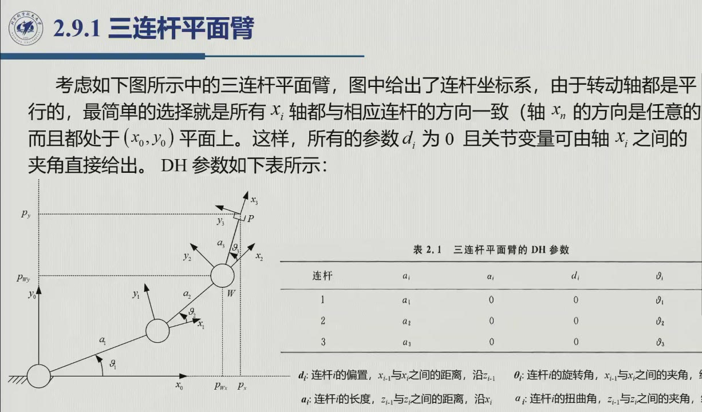
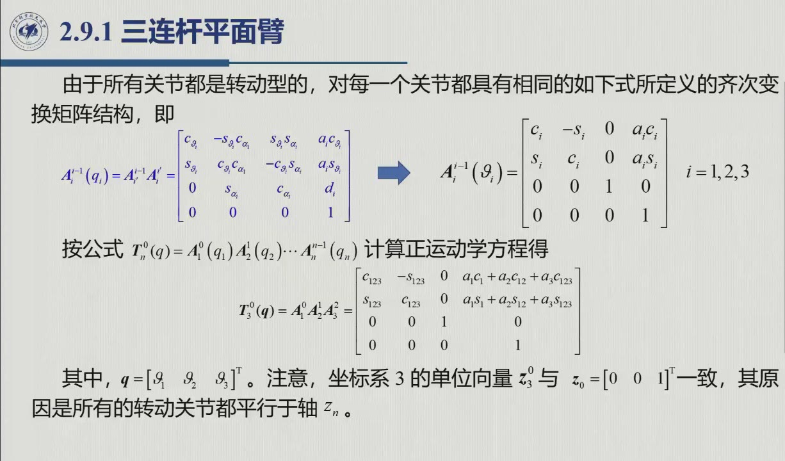
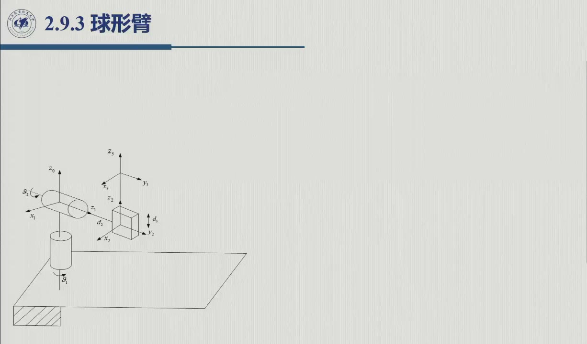
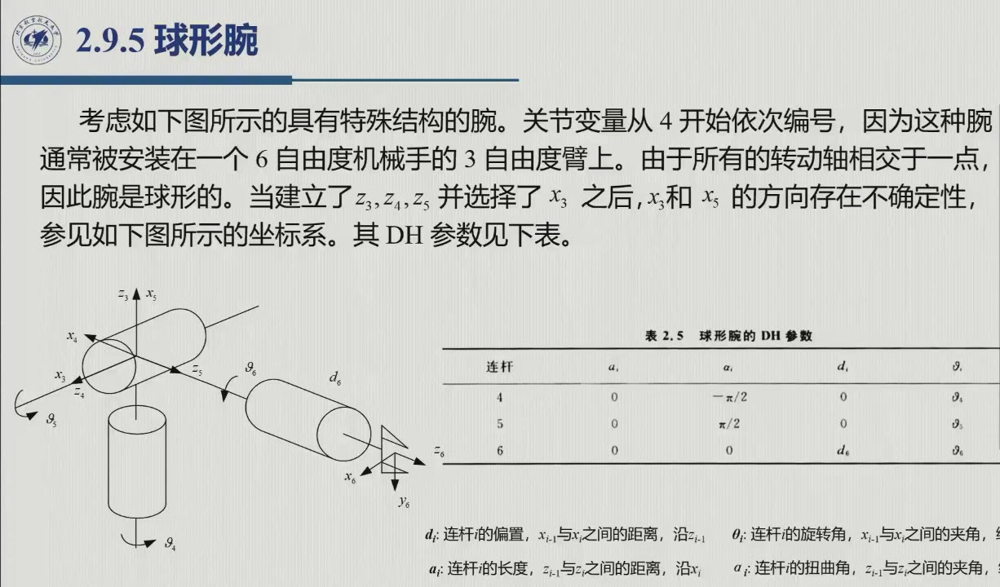
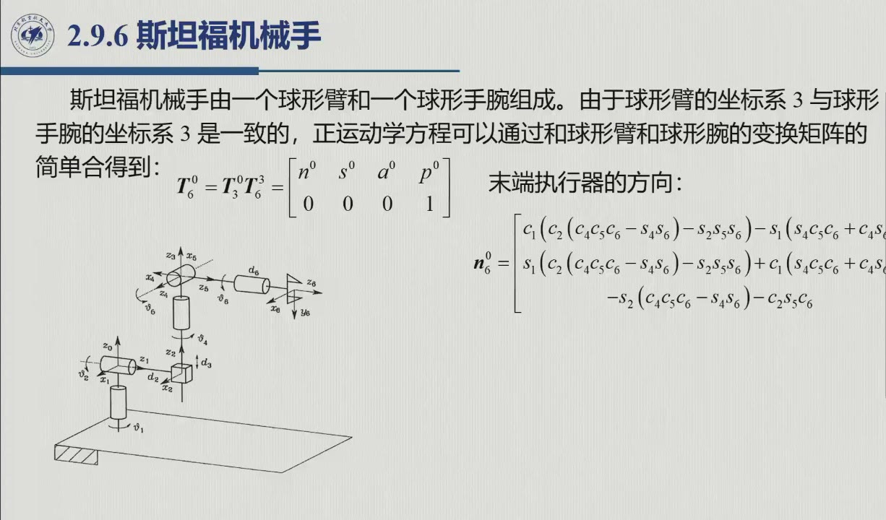

# 2.9 典型机械手结构运动学

同样是三个关节，为什么有的机械手只能在一个平面运动，有的却能向空间伸出？本节沿原书 §2.9 的九个模型使用 [DH 法](../recall.md#dh)：先读轴线与原点，再连乘，最后从结果里读出位置、方向和约束。球形腕只是腕部，类人结构包含共享躯干；这里的九个模型并非九种互斥的整机分类。

**怎么读这一节**：各参数表都是 [2.8.2](sec2-8.md#sec-2.8.2) 四步流水线（定轴线 → 放系 → 判关系 → 填表）在不同骨架上的应用；斯坦福臂与类人结构则展示如何接合已有模型。建议先遮住表格，问三个问题：**轴线两两什么关系？原点放在哪？$\alpha$ 怎么判号？** 再填表并用带数例检查。能解释每个零项的条件，比只对上符号更可靠。

::: note 零位约定（原书开篇） {#note-2.9.zero}
各表按自己的建系与关节零位定义变量。编码器读数 $r_i$ 与模型变量可能满足 $q_i=\sigma_i r_i+q_{i0}$，其中 $\sigma_i=\pm1$ 表示正方向，$q_{i0}$ 是常值零位偏置。模型全零位可能超出实际限位；移动量为零时也可能出现几何退化。以下长度用米、公式中的角用弧度；演示滑杆用度显示转角。演示中的数值尺寸与角度范围是教学示例，不作为实际机型规格。
:::

先用下图回顾第一章的五类定位结构。它帮助区分 R（转动）与 P（移动），不是后面九个模型的目录；本节并不逐一列出笛卡儿型、圆柱型和 SCARA 的参数表。R/P 决定活动变量进哪一列，轴线方向、尺寸、原点与零位共同决定表中其余参数。

<figure>
<svg class="figure-svg" viewBox="0 0 920 330" xmlns="http://www.w3.org/2000/svg" role="img" aria-labelledby="fig-29-title fig-29-desc">
<title id="fig-29-title">五种典型构形的关节配置</title>
<desc id="fig-29-desc">五个构形简图。笛卡儿型的三条正交导轨用水平、竖直和斜向投影表示；圆柱型回转、升降、伸缩；球形两转一移；SCARA 仅画定位的 RRP 部分，省略常见的末端回转轴；拟人型只画腰肩肘。圆表示转动关节，双箭头表示移动关节。</desc>
<defs>
<marker id="f29-b" markerWidth="8" markerHeight="8" refX="6" refY="2.5" orient="auto"><path d="M0,0 L6,2.5 L0,5 Z" fill="var(--fig-blue)"/></marker>
<marker id="f29-bs" markerWidth="8" markerHeight="8" refX="1" refY="2.5" orient="auto"><path d="M6,0 L0,2.5 L6,5 Z" fill="var(--fig-blue)"/></marker>
<marker id="f29-a" markerWidth="8" markerHeight="8" refX="6" refY="2.5" orient="auto"><path d="M0,0 L6,2.5 L0,5 Z" fill="var(--accent-text)"/></marker>
</defs>
<text class="diagram-text" x="460" y="30" text-anchor="middle">五类定位结构回顾（投影简图，非尺寸图）</text>
<circle cx="652" cy="56" r="5" fill="none" stroke="var(--accent-text)" stroke-width="1.6"/>
<text class="diagram-note" x="664" y="60">转动关节 R（圆）</text>
<line x1="646" y1="76" x2="662" y2="76" stroke="var(--fig-blue)" stroke-width="1.6" marker-end="url(#f29-b)" marker-start="url(#f29-bs)"/>
<text class="diagram-note" x="670" y="80">移动关节 P（双箭头）</text>
<g stroke="var(--line)" stroke-width="1.5"><line x1="30" y1="240" x2="165" y2="240"/><line x1="195" y1="240" x2="360" y2="240"/><line x1="380" y1="240" x2="545" y2="240"/><line x1="560" y1="240" x2="730" y2="240"/><line x1="745" y1="240" x2="915" y2="240"/></g>
<!-- 1 笛卡儿 PPP -->
<g>
<rect x="42" y="225" width="100" height="15" class="diagram-node"/>
<rect x="78" y="110" width="16" height="115" class="diagram-node"/>
<rect x="94" y="110" width="70" height="14" class="diagram-node"/>
<path d="M128 124 L140 128 L116 166 L104 162 Z" class="diagram-node"/>
<line x1="64" y1="130" x2="64" y2="210" stroke="var(--fig-blue)" stroke-width="1.6" marker-end="url(#f29-b)" marker-start="url(#f29-bs)"/>
<line x1="104" y1="94" x2="152" y2="94" stroke="var(--fig-blue)" stroke-width="1.6" marker-end="url(#f29-b)" marker-start="url(#f29-bs)"/>
<line x1="153" y1="133" x2="129" y2="171" stroke="var(--fig-blue)" stroke-width="1.6" marker-end="url(#f29-b)" marker-start="url(#f29-bs)"/>
<text class="diagram-text" x="92" y="272" text-anchor="middle">笛卡儿</text>
<text class="diagram-mono" x="92" y="291" text-anchor="middle">P P P</text>
<text class="diagram-note" x="92" y="309" text-anchor="middle">三移 · 箱内作业</text>
</g>
<!-- 2 圆柱 RPP -->
<g>
<ellipse cx="276" cy="196" rx="40" ry="9" class="diagram-node"/>
<line x1="236" y1="196" x2="236" y2="232" stroke="var(--line-strong)"/>
<line x1="316" y1="196" x2="316" y2="232" stroke="var(--line-strong)"/>
<path d="M 232 226 A 44 11 0 1 0 320 226" fill="none" stroke="var(--accent-text)" stroke-width="1.6" marker-end="url(#f29-a)"/>
<rect x="268" y="90" width="16" height="106" class="diagram-node"/>
<rect x="284" y="104" width="62" height="13" class="diagram-node"/>
<line x1="332" y1="196" x2="332" y2="110" stroke="var(--fig-blue)" stroke-width="1.6" marker-end="url(#f29-b)" marker-start="url(#f29-bs)"/>
<line x1="296" y1="130" x2="338" y2="130" stroke="var(--fig-blue)" stroke-width="1.6" marker-end="url(#f29-b)" marker-start="url(#f29-bs)"/>
<text class="diagram-text" x="276" y="272" text-anchor="middle">圆柱形</text>
<text class="diagram-mono" x="276" y="291" text-anchor="middle">R P P</text>
<text class="diagram-note" x="276" y="309" text-anchor="middle">回转 + 升降 + 伸缩</text>
</g>
<!-- 3 球形 RRP -->
<g>
<ellipse cx="424" cy="216" rx="28" ry="7" class="diagram-node"/>
<line x1="396" y1="216" x2="396" y2="238" stroke="var(--line-strong)"/>
<line x1="452" y1="216" x2="452" y2="238" stroke="var(--line-strong)"/>
<path d="M 390 228 A 36 9 0 1 0 458 228" fill="none" stroke="var(--accent-text)" stroke-width="1.6" marker-end="url(#f29-a)"/>
<circle cx="424" cy="206" r="7" class="diagram-node"/>
<line stroke="var(--accent)" stroke-width="5" x1="424" y1="206" x2="470" y2="124"/>
<line stroke="var(--fig-blue)" stroke-width="2.4" x1="470" y1="124" x2="502" y2="70"/>
<line x1="480" y1="118" x2="506" y2="82" stroke="var(--fig-blue)" stroke-width="1.4" marker-end="url(#f29-b)" marker-start="url(#f29-bs)"/>
<text class="diagram-text" x="460" y="272" text-anchor="middle">球形</text>
<text class="diagram-mono" x="460" y="291" text-anchor="middle">R R P</text>
<text class="diagram-note" x="460" y="309" text-anchor="middle">两转 + 径向伸缩</text>
</g>
<!-- 4 SCARA -->
<g>
<rect x="596" y="150" width="14" height="90" class="diagram-node"/>
<rect x="610" y="144" width="64" height="13" class="diagram-node"/>
<rect x="674" y="144" width="52" height="13" class="diagram-node"/>
<circle cx="610" cy="150" r="6" class="diagram-node"/>
<circle cx="674" cy="150" r="6" class="diagram-node"/>
<path d="M 598 150 A 12 12 0 0 1 610 138" fill="none" stroke="var(--accent-text)" stroke-width="1.4" marker-end="url(#f29-a)"/>
<path d="M 662 150 A 12 12 0 0 1 674 138" fill="none" stroke="var(--accent-text)" stroke-width="1.4" marker-end="url(#f29-a)"/>
<rect x="694" y="157" width="12" height="48" class="diagram-node"/>
<line x1="714" y1="162" x2="714" y2="200" stroke="var(--fig-blue)" stroke-width="1.6" marker-end="url(#f29-b)" marker-start="url(#f29-bs)"/>
<text class="diagram-text" x="644" y="272" text-anchor="middle">SCARA</text>
<text class="diagram-mono" x="644" y="291" text-anchor="middle">R R P（定位部分）</text>
<text class="diagram-note" x="644" y="309" text-anchor="middle">末端回转轴省略</text>
</g>
<!-- 5 拟人 RRR -->
<g>
<rect x="810" y="205" width="36" height="35" class="diagram-node"/>
<path d="M 802 200 A 26 8 0 1 0 854 200" fill="none" stroke="var(--accent-text)" stroke-width="1.6" marker-end="url(#f29-a)"/>
<circle cx="828" cy="190" r="7" class="diagram-node"/>
<line stroke="var(--accent)" stroke-width="5" x1="828" y1="190" x2="796" y2="120"/>
<circle cx="796" cy="120" r="6" class="diagram-node"/>
<line stroke="var(--accent)" stroke-width="4" x1="796" y1="120" x2="852" y2="78"/>
<circle cx="852" cy="78" r="4" class="diagram-node"/>
<text class="diagram-text" x="828" y="272" text-anchor="middle">拟人</text>
<text class="diagram-mono" x="828" y="291" text-anchor="middle">R R R（未画腕）</text>
<text class="diagram-note" x="828" y="309" text-anchor="middle">肩回转 + 肩俯仰 + 肘</text>
</g>
</svg>
<figcaption>五类定位结构（本教程绘，对照原书图 1.9–1.13）：圆表示 R，双箭头表示 P；斜线也可能是空间轴的投影。工作空间还取决于轴线几何、杆长与关节限位，不能只由 R/P 序列判断。SCARA 与拟人型均作了图中注明的简化，回顾见<a href="../ch01/sec1-2.md">1.2 节</a>。</figcaption>
</figure>

## 2.9.1 三连杆平面臂

三个关节的有向转轴全部**同向平行**，故取 $\alpha_i=0$；再把各原点选在同一运动平面内，才得到 $d_i=0$。令 $x_1,x_2,x_3$ 沿各自连杆，$x_0$ 是基座中固定的角度参考，关节角就是从 $x_{i-1}$ 绕 $z_{i-1}$ 到 $x_i$ 的有向角。不能只凭“轴平行”同时断定扭角与偏距都为零。

| 连杆 $i$ | $a_i$ | $\alpha_i$ | $d_i$ | $\vartheta_i$ |
|:--:|:--:|:--:|:--:|:--:|
| 1 | $a_1$ | 0 | 0 | $\vartheta_1$ |
| 2 | $a_2$ | 0 | 0 | $\vartheta_2$ |
| 3 | $a_3$ | 0 | 0 | $\vartheta_3$ |

三行参数完全同构；代入 [@method-2.8.A] 的通式（取 $\alpha_i=0,d_i=0$），得到的关节变换自然也完全相同（原书式 2.62）：

$$A_i^{i-1}(\vartheta_i)=\begin{bmatrix}c_i & -s_i & 0 & a_ic_i\\ s_i & c_i & 0 & a_is_i\\ 0&0&1&0\\ 0&0&0&1\end{bmatrix},\qquad i=1,2,3,$$

三者依次连乘，得（原书式 2.63）：

$$T_3^0(\boldsymbol q)=A_1^0A_2^1A_3^2=\begin{bmatrix}
c_{123} & -s_{123} & 0 & a_1c_1+a_2c_{12}+a_3c_{123}\\
s_{123} & c_{123} & 0 & a_1s_1+a_2s_{12}+a_3s_{123}\\
0&0&1&0\\ 0&0&0&1
\end{bmatrix}$$

其中 $s_{12}=\sin(\vartheta_1+\vartheta_2)$，其余类推。位置满足 $p_z=0$，但姿态也在变：平面朝向 $\phi=\vartheta_1+\vartheta_2+\vartheta_3$，因此任务变量可取 $(p_x,p_y,\phi)$。$z_3^0=[0\ 0\ 1]^T$ 只表示法向不变，不能据此说姿态不变。

若工具的接近方向 $a_e=z_e$ 约定沿末杆 $x_3$、$s_e=y_e$ 沿 $y_3$，且工具原点与 $o_3$ 重合，则 $n_e=x_e=-z_3$，应补[常值变换](../recall.md#homogeneous)

$$T_e^3=\begin{bmatrix}0&0&1&0\\ 0&1&0&0\\ -1&0&0&0\\ 0&0&0&1\end{bmatrix}.$$

此时 $T_e^0=T_3^0T_e^3$，位置相同而旋转块不同。若工具定义直接取系 3，则 $T_e^3=I$；补偿由工具约定决定。这个例子也为 [2.12.2](sec2-12.md#sec-2.12.2) 的平面逆解铺路。

::: ex 带数核对 · 零位与直角 {#ex-2.9.A}
取 $a_1=0.45,a_2=0.36,a_3=0.26$。全零时 $p=(1.07,0,0)^T$、$R=I$。把 $\vartheta_2$ 改为 $\pi/2$，其余仍为零：

$$T_3^0=\begin{bmatrix}0&-1&0&0.45\\1&0&0&0.62\\0&0&1&0\\0&0&0&1\end{bmatrix},\qquad\phi=\pi/2.$$

第一杆仍朝 $x_0$，后两杆一起朝 $y_0$，所以 $p_y=0.36+0.26$。这个几何核对同时检验了累计角与位置，不能只核杆长之和。
:::
::: intuition 动手实验 · 三连杆平面臂：DH 表连乘成一条手臂（3D）
先按“DH 零位”，预测再把第二关节调为 90°，用上面的带数结果核对位置与朝向。矩阵报告系 3，画布以“工具接近 aₑ=x₃”标出上述工具方向；没有另加工具长度。用高亮按钮逐列读矩阵，最后重置检查角度与视角都恢复。

:::

## 2.9.2 平行四边形臂（闭链补充）

这一节做一个变化：把平面臂的第二、三杆改成**平行四边形**。前两个关节分别把连杆 $1'$ 与连杆 $1''$ 接到连杆 0 上，由此构成一个闭链——正好用 [2.8.3](sec2-8.md#sec-2.8.3) 讲过的方法（[@method-2.8.closed]）来处理：选关节 4 为断开关节，建系后即得下面的 DH 参数表（原书表 2.2）：

| 连杆 $i$ | $a_i$ | $\alpha_i$ | $d_i$ | $\vartheta_i$ |
|:--:|:--:|:--:|:--:|:--:|
| $1'$ | $a_1'$ | 0 | 0 | $\vartheta_1'$ |
| $2'$ | $a_2'$ | 0 | 0 | $\vartheta_2'$ |
| $3'$ | $a_3'$ | 0 | 0 | $\vartheta_3'$ |
| $1''$ | $a_1''$ | 0 | 0 | $\vartheta_1''$ |
| 4 | $a_4$ | 0 | 0 | 0 |

由平行四边形的几何关系可得 $a_1'=a_3'$、$a_2'=a_1''$。约束方程进一步给出（原书式 2.64 前）：

$$\vartheta_2'=\vartheta_1''-\vartheta_1',\qquad \vartheta_3'=\pi-\vartheta_2'=\pi-\vartheta_1''+\vartheta_1' .$$

于是关节变量向量只剩 $\boldsymbol q=[\vartheta_1'\ \ \vartheta_1'']^T$——注意，**两个驱动关节都装在基座**上。把 $\vartheta_2',\vartheta_3'$ 的两式代入后，沿 $1'2'3'$ 分支连乘，再补上末杆的常值变换 $A_4^{3'}$，就得到正运动学（原书式 2.64）：

$$T_4^0(\boldsymbol q)=A_{3'}^0(\boldsymbol q)\,A_4^{3'}=\begin{bmatrix}
-c_1' & s_1' & 0 & a_1''c_1''-a_4c_1'\\
-s_1' & -c_1' & 0 & a_1''s_1''-a_4s_1'\\
0&0&1&0\\ 0&0&0&1
\end{bmatrix}$$

这里有一个值得注意的细节：$a_1'$ 的两项贡献 $a_1'[c_1'\ \ s_1']^T$ 与 $a_3'[c_{123}'\ \ s_{123}']^T$ **恰好相消**（后者 $=-a_1'[c_1'\ \ s_1']^T$，因为 $a_3'=a_1'$、$\vartheta_1'+\vartheta_2'+\vartheta_3'=\pi+\vartheta_1'$）。也就是说，连杆 $1'$ 的长度根本不进末端位置——位置只由 $a_1''$ 与 $a_4$ 决定。

::: thm 观察 2.9.2.A · 与两连杆平面臂等价 {#thm-2.9.2.A}
本装配分支的位置写成 $p=a_1''u(\vartheta_1'')+a_4u(\vartheta_1'+\pi)$，其中 $u(\gamma)=(\cos\gamma,\sin\gamma)^T$。与两连杆平面臂对应的相对关节角是 $\beta_1=\vartheta_1''$、$\beta_2=\vartheta_1'+\pi-\vartheta_1''$，末杆朝向也为 $\beta_1+\beta_2$。这就是这里“运动学等价”的具体含义；并不保证实际限位和所有装配分支相同。两驱动关节可装在基座上，执行器不必随臂运动；动力学收益还取决于质量与传动设计。
:::

上面的两式**已经能由驱动角算出被动角**。不能把 $\vartheta_2',\vartheta_3'$ 当成两个独立驱动量，因为它们满足 $\vartheta_2'+\vartheta_3'=\pi$。这里选定非交叉的平行四边形装配分支，角度按模 $2\pi$ 理解；共线时需另查驱动映射与约束的奇异性。
::: intuition 动手实验 · 平行四边形臂：闭链与那两条约束（3D）
先预测：$\vartheta_1'=0,\vartheta_1''=90°$ 时，$p_4=(-0.30,0.50,0)^T$、末杆朝向 180°。再调滑杆核对。图中 O–A–B–C 闭合，沿 O→A→B→C 后，末杆从 C 延伸；下方同时给被动角、闭合误差与完整五行表，不能将两驱动支路直接当成串联的两行 DH 表。

:::

## 2.9.3 球形臂

此模型是两转动加一移动（伸缩）。$z_0$ 与 $z_1$ 相交给出 $a_1=0$，$z_1$ 与 $z_2$ 相交给出 $a_2=0$，末端 $z_3$ 与伸缩轴 $z_2$ **同轴**给出 $a_3=0$。绕 $x_1$ 从 $z_0$ 到 $z_1$ 的扭角是 $-\pi/2$；只有第一关节零位时 $x_1=x_0$，才可用 $x_0$ 来判这一角度。

::: method $\alpha$ 判号的固定动作：右手拧螺丝（本编补充，配 [2.8.2](sec2-8.md#sec-2.8.2) 例解③）
1. 找到 $x_i$（公垂线方向，已由建系规则定好）；
2. 右手握住这根「螺丝刀」，**拇指指向 $x_i$ 正方向**；
3. 看四指卷曲的方向：$z_{i-1}$ 拧向 $z_i$ 顺着四指为正，逆着为负。

在 $\vartheta_1=0$ 的参考位形，拟人臂表取 $z_1=-y_0$，故 $\alpha_1=+\pi/2$；球形臂表取 $z_1=+y_0$，故为 $-\pi/2$。这里比较的是第一对轴的建系，不是说 RRR 与 RRP 是同一机构。改变轴正向时还须同步关节符号、零位及基座/工具变换，不能孤立改一个扭角。
:::

| 连杆 $i$ | $a_i$ | $\alpha_i$ | $d_i$ | $\vartheta_i$ |
|:--:|:--:|:--:|:--:|:--:|
| 1 | 0 | $-\pi/2$ | 0 | $\vartheta_1$ |
| 2 | 0 | $\pi/2$ | $d_2$ | $\vartheta_2$ |
| 3 | 0 | 0 | $d_3$ | 0 |

注意第三关节是移动型：它的变量 $d_3$ 进 $d$ 列，而 $\vartheta_3=0$（常数）。代入通式得三个 $A_i$（原书 §2.9.3），再连乘（原书式 2.65）：

$$T_3^0=\begin{bmatrix}
c_1c_2 & -s_1 & c_1s_2 & c_1s_2d_3-s_1d_2\\
s_1c_2 & c_1 & s_1s_2 & s_1s_2d_3+c_1d_2\\
-s_2 & 0 & c_2 & c_2d_3\\ 0&0&0&1
\end{bmatrix},\qquad \boldsymbol q=[\vartheta_1\ \vartheta_2\ d_3]^T .$$

**移动关节 $d_3$ 不影响旋转块**，位置沿 $z_2^0=z_3^0=(c_1s_2,s_1s_2,c_2)^T$ 移动。$y_3^0=(-s_1,c_1,0)^T=z_1^0$ 仅由第一转角决定；绕第二关节轴转动不会改变它。按原书所选工具约定可取 $T_e^3=I$；若另装有偏置的工具，仍须补变换。
::: intuition 动手实验 · 球形臂：伸缩为什么不改变姿态（3D）
令两转角为零，读到 $p=(0,0.18,d_3)^T$、$R=I$。先预测 $d_3$ 增加 0.10 m 会改哪一项，再操作；然后把第二关节调为 90°，再增同样的伸缩量，检查位移改沿 $x_0$、$y_3$ 仍不变。

:::

## 2.9.4 拟人臂

三个都是转动关节，相当于让两连杆平面臂绕竖直腰轴改变运动平面。$o_0$ 取在 $z_0\cap z_1$，故 $d_1=0$；肩肘轴 $z_1\parallel z_2$。这就是 [2.8.2](sec2-8.md#method-2.8.anthro) 已分步建系的模型，区别只在本节把矩阵完整连乘出来。

| 连杆 $i$ | $a_i$ | $\alpha_i$ | $d_i$ | $\vartheta_i$ |
|:--:|:--:|:--:|:--:|:--:|
| 1 | 0 | $\pi/2$ | 0 | $\vartheta_1$ |
| 2 | $a_2$ | 0 | 0 | $\vartheta_2$ |
| 3 | $a_3$ | 0 | 0 | $\vartheta_3$ |

连乘（原书式 2.66）：

$$T_3^0=\begin{bmatrix}
c_1c_{23} & -c_1s_{23} & s_1 & c_1(a_2c_2+a_3c_{23})\\
s_1c_{23} & -s_1s_{23} & -c_1 & s_1(a_2c_2+a_3c_{23})\\
s_{23} & c_{23} & 0 & a_2s_2+a_3s_{23}\\
0&0&0&1
\end{bmatrix}.$$

旋转块第 3 列 $z_3^0=(s_1,-c_1,0)^T$ 只含 $\vartheta_1$：肩肘运动不改变其方向。其水平性来自第一行 $\alpha_1=\pi/2$ 把肩轴转到水平，以及后两行零扭角保持该方向。$\alpha_3=0$ 说明 $z_2,z_3$ **方向相同**；当 $a_3>0$ 时两轴相隔 $a_3$，并不重合。第二列的竖直分量是 $c_{23}$，一般不为零，所以不能把第 2、3 列都说成水平向量。

第 4 列是定位点位置 $p_3^0=[c_1(a_2c_2+a_3c_{23}),s_1(a_2c_2+a_3c_{23}),a_2s_2+a_3s_{23}]^T$。在 [2.12.5](sec2-12.md#sec-2.12.5) 的解耦模型里，该点作为腕心，三个分量就是腕心方程：前两式平方相加得 $a_2c_2+a_3c_{23}=\pm\sqrt{p_{wx}^2+p_{wy}^2}$，第三式给出高度。求正解时由角算它，求逆解时由目标位置解同一组方程。

这里先把 $o_3$ 当作定位点；用于球腕解耦时才把它认作腕心。若工具约定与系 3 不同，应补适当常值变换。[2.12.5](sec2-12.md#sec-2.12.5) 对这个无偏置理想定位模型，忽略关节限位，在一般可达、非奇异位置通常得到肩左/右与肘上/下的四支解；边界会合并，轴线上还可能出现连续族，不能处处保证四支。

::: intuition 动手实验 · 把 T₃⁰ 的每一列对到几何上（3D）
先固定腰角，只动肩肘，预测矩阵哪一列不变，再用按钮高亮该轴并读数核对。零位时 $p_3=(1.14,0,0)^T$、$z_3=(0,-1,0)^T$。画布里 $z_2,z_3$ 是隔着末杆的两条平行线。矩阵前三列表示方向，第四列才是位置。

:::

## 2.9.5 球形腕

球形腕的三条实际关节轴 $z_3,z_4,z_5$ **交于一点**，交点称腕心。编号从 4 开始是为了接在三自由度臂后。把系 3、4、5 原点都放在交点，取下表的轴向、扭角与零位；系 6 沿末轴外移工具长度 $d_6$。共点本身并不规定扭角或角度符号。

| 连杆 $i$ | $a_i$ | $\alpha_i$ | $d_i$ | $\vartheta_i$ |
|:--:|:--:|:--:|:--:|:--:|
| 4 | 0 | $-\pi/2$ | 0 | $\vartheta_4$ |
| 5 | 0 | $\pi/2$ | 0 | $\vartheta_5$ |
| 6 | 0 | 0 | $d_6$ | $\vartheta_6$ |

把三个 $A_i$ 连乘（原书式 2.67）。**本节最重要的发现**就在结果里：旋转块 $R_6^3$ 与 ZYZ 合成矩阵（式 2.18）**完全一致**——$(\vartheta_4,\vartheta_5,\vartheta_6)$ 恰是相对系 3 的 ZYZ 角。这正是 [2.12.6](sec2-12.md#sec-2.12.6)「腕逆解 = ZYZ 反解」的全部伏笔。

具体地，上述表给出 $R_6^3=R_z(\vartheta_4)R_x(-\pi/2)R_z(\vartheta_5)R_x(\pi/2)R_z(\vartheta_6)$。令 $Q=R_x(-\pi/2)$，则 $Qz=y$、$Q^{-1}=R_x(\pi/2)$，所以

$$Q R_z(\vartheta_5)Q^{-1}=R_y(\vartheta_5),\qquad R_6^3=R_z(\vartheta_4)R_y(\vartheta_5)R_z(\vartheta_6).$$

ZYZ 结论依赖这张表的选系；不能由“三轴共点”直接推成所有球腕的关节读数都等于 ZYZ。工具位置为 $p_6^3=d_6(c_4s_5,s_4s_5,c_5)^T$，腕心不动时工具尖端仍可能移动。$\vartheta_5=0$ 或 $\pi$ 时首末轴共线，是腕部姿态奇异，三个转角不能独立产生三维角速度。

::: intuition 动手实验 · 球形腕：三轴交于一点，腕心不动（3D）
先令 $\vartheta_4=0,\vartheta_5=90°,\vartheta_6=0,d_6=0.20$，预测尖端为 $(0.20,0,0)^T$，再操作核对。转第一腕角时，腕心不动而尖端绕它走；只转最后一角时，尖端位置不变。对比两矩阵并用按钮高亮同一列，再设第二角为零观察首末轴共线。

:::

## 2.9.6 斯坦福机械手

斯坦福机械手由球形臂与球形腕组成。这里两段的系 3 原点与三根轴都一致，故可直接连乘（原书式 2.68–2.69）：

$$T_6^0=T_3^0\,T_6^3=\begin{bmatrix}\boldsymbol n_6^0 & \boldsymbol s_6^0 & \boldsymbol a_6^0 & \boldsymbol p_6^0\\ 0&0&0&1\end{bmatrix},$$

其中位置部分

$$\boldsymbol p_6^0=\begin{bmatrix}
c_1s_2d_3-s_1d_2+\big(c_1(c_2c_4s_5+s_2c_5)-s_1s_4s_5\big)d_6\\
s_1s_2d_3+c_1d_2+\big(s_1(c_2c_4s_5+s_2c_5)+c_1s_4s_5\big)d_6\\
c_2d_3+(-s_2c_4s_5+c_2c_5)d_6
\end{bmatrix}.$$

它满足 $p_6^0=p_w^0+d_6a_6^0$，其中 $p_w^0=p_3^0$。保持前三级不变，只转腕不会移动腕心，但通常会移动有长度的工具尖端；设 $d_6=0$ 才使两点重合。解耦逆解应先算 $p_w^0=p_6^0-d_6a_6^0$，再解定位臂。

方向可由 $R_6^0=R_3^0R_6^3$ 计算；例如首列（原书式 2.69）：

$$\boldsymbol n_6^0=\begin{bmatrix}
c_1\big(c_2(c_4c_5c_6-s_4s_6)-s_2s_5c_6\big)-s_1(s_4c_5c_6+c_4s_6)\\
s_1\big(c_2(c_4c_5c_6-s_4s_6)-s_2s_5c_6\big)+c_1(s_4c_5c_6+c_4s_6)\\
-s_2(c_4c_5c_6-s_4s_6)-c_2s_5c_6
\end{bmatrix}$$

（此式可以由 $\boldsymbol n_6^0=R_3^0\cdot$[ZYZ 矩阵](sec2-4.md#sec-2.4.2)的首列直接复核：ZYZ 首列第三分量为 $-s_5c_6$；$\boldsymbol s_6^0$ 与 $\boldsymbol a_6^0$ 的对应表达式见原书式 2.69。）
::: intuition 动手实验 · 斯坦福臂：球形臂 + 球形腕（3D）
先按“转角归零（行程 0.20 m）”，令 $d_6=0.10$：应得腕心 $(0,0.16,0.20)^T$、尖端 $(0,0.16,0.30)^T$。只转腕角检查两点的区别，再把工具长度调为零。矩阵报告尖端，另列腕心和距离核对。

:::

## 2.9.7 带球形腕的拟人臂

不能把前面两张表中同名的“系 3”直接认作同一接口。单独拟人臂的 $z_3$ 沿肘轴方向，球形腕输入系的 $z_3$ 则沿第一腕轴；原点与轴向都必须按安装关系核对。可插入接口常值变换，或像原书一样对整臂重建系，得到下表。重建后系 3 位于肘部，腕心在沿其 $z_3$ 外移 $d_4$ 处。

| 连杆 $i$ | $a_i$ | $\alpha_i$ | $d_i$ | $\vartheta_i$ |
|:--:|:--:|:--:|:--:|:--:|
| 1 | 0 | $\pi/2$ | 0 | $\vartheta_1$ |
| 2 | $a_2$ | 0 | 0 | $\vartheta_2$ |
| 3 | 0 | $\pi/2$ | 0 | $\vartheta_3$ |
| 4 | 0 | $-\pi/2$ | $d_4$ | $\vartheta_4$ |
| 5 | 0 | $\pi/2$ | 0 | $\vartheta_5$ |
| 6 | 0 | 0 | $d_6$ | $\vartheta_6$ |

第 3 行改为 $a_3=0,\alpha_3=\pi/2$；第 4 行的 $d_4$ 表示前臂长度，$\alpha_4$ 仍是 $-\pi/2$。这不只改杆长所在列，也改变肘角参考：若前臂长度同为 $L$，与 §2.9.4 对应的角满足 $\vartheta_{3,\mathrm{旧}}=\vartheta_{3,\mathrm{新}}-\pi/2$。因此不能在两表中填相同三个角后要求腕心位置一致。连乘得到位置（原书式 2.70–2.71）：

$$\boldsymbol p_6^0=\begin{bmatrix}
a_2c_1c_2+d_4c_1s_{23}+d_6\big(c_1(c_{23}c_4s_5+s_{23}c_5)+s_1s_4s_5\big)\\
a_2s_1c_2+d_4s_1s_{23}+d_6\big(s_1(c_{23}c_4s_5+s_{23}c_5)-c_1s_4s_5\big)\\
a_2s_2-d_4c_{23}+d_6(s_{23}c_4s_5-c_{23}c_5)
\end{bmatrix}$$

一般仍有 $p_w^0=p_6^0-d_6a_6^0$，其值等于表中 $o_4$ 的位置，且与三个腕角无关。$d_6=0$ 时尖端才落在腕心。利用上面的肘角换算，可将此位置与 §2.9.4 的结果独立核对，随后再做 [2.12.3](sec2-12.md#sec-2.12.3) 的解耦求逆。
::: intuition 动手实验 · 带球形腕的拟人臂：整体重建系（3D）
先载入零位：腕心应为 $(0.55,0,-0.30)^T$；令 $d_6=0.10$，尖端为 $(0.55,0,-0.40)^T$。读表确认 $\alpha_3=+\pi/2$、$\alpha_4=-\pi/2$。只转腕角，检查腕心不变及尖端到腕心的距离恒为 $d_6$；最后把工具长度调为零核对两点重合。

:::

## 2.9.8 DLR 机械手

这是一台七自由度机械手，属于**本质冗余**（见 [2.10.3](sec2-10.md#sec-2.10.3)），腕部有两种构型。它的 DH 参数表如下（原书表 2.7）——$\alpha_i=\pi/2$（$i=1,\dots,6$）、$\alpha_7=0$，全表 $a_i=0$：

| 连杆 $i$ | $a_i$ | $\alpha_i$ | $d_i$ | $\vartheta_i$ |
|:--:|:--:|:--:|:--:|:--:|
| 1 | 0 | $\pi/2$ | 0 | $\vartheta_1$ |
| 2 | 0 | $\pi/2$ | 0 | $\vartheta_2$ |
| 3 | 0 | $\pi/2$ | $d_3$ | $\vartheta_3$ |
| 4 | 0 | $\pi/2$ | 0 | $\vartheta_4$ |
| 5 | 0 | $\pi/2$ | $d_5$ | $\vartheta_5$ |
| 6 | 0 | $\pi/2$ | 0 | $\vartheta_6$ |
| 7 | 0 | 0 | $d_7$ | $\vartheta_7$ |

通用关节变换

$$A_i^{i-1}=\begin{bmatrix}c_i & 0 & s_i & 0\\ s_i & 0 & -c_i & 0\\ 0 & 1 & 0 & d_i\\ 0&0&0&1\end{bmatrix}\quad(i=1,\dots,6),\qquad
A_7^6=\begin{bmatrix}c_7 & -s_7 & 0 & 0\\ s_7 & c_7 & 0 & 0\\ 0&0&1&d_7\\ 0&0&0&1\end{bmatrix}.$$

对 $i=1,\dots,6$，$c_\alpha=0,s_\alpha=1$ 给出旋转块第 2 列 $(0,0,1)^T$、第 3 行 $(0,1,0)$，两者都不是零。$\alpha_i=\pi/2$ 表示相邻有向 $z$ 轴正交，不能据此说每根轴都在基座水平面。最后一行是 $R_z(\vartheta_7)T_z(d_7)$，旋转块为绕 $z$ 的转动，完整变换还含固定平移 $d_7$。

连乘仍用相同流水线（原书式 2.72–2.76），不用背七轴展开式。可用两个小核对：全零时 $R_7^0=R_x(3\pi)$，$p_7^0=(0,0,-d_3+d_5-d_7)^T$；只动最后一角时，位置与末轴方向不变。若换成原书另一种腕，最后行改为 $\alpha_7=\pi/2,d_7=0,a_7\ne0$，再按工具接近方向补常值变换，不可只改扭角。
::: intuition 动手实验 · DLR 机械手：七自由度的交替结构（3D）
拖动七个转角 θ₁…θ₇；七个关节均为转动关节。表中的 d₃、d₅、d₇ 是固定几何尺寸，不是移动量。全表 aᵢ=0、αᵢ=π/2（i=1…6）、α₇=0；七自由度相对一般六维位姿任务具有运动学冗余，在可达且满秩的位形附近，同一末端位姿通常有一族关节解。

:::

## 2.9.9 类人机械手（分支补充）

这里建模人体上半身式的躯干与双臂。原书示例将躯干按三自由度拟人臂、每臂按七自由度 [DLR 机械手](sec2-9.md#sec-2.9.8) 处理，合计 $3+7+7=17$ 个独立变量；未计头部、手指与移动底座，不能把 17 当作所有类人机器人的自由度。

两条结构性要点（原书）：

1. **有一个受约束的补偿角**：在本模型中，连接躯干末端与两臂基座的装置用 $\vartheta_4$ 表示，其值由躯干肩肘角决定，所以不增加独立自由度：

$$\vartheta_4=-\vartheta_2-\vartheta_3\quad\Longrightarrow\quad
T_t^3=\begin{bmatrix}c_{23} & s_{23} & 0 & 0\\ -s_{23} & c_{23} & 0 & 0\\ 0&0&1&0\\ 0&0&0&1\end{bmatrix};$$

把 §2.9.4 的旋转块右乘该补偿，得到 $R_t^0=R_z(\vartheta_1)R_x(\pi/2)$，不再含 $\vartheta_2,\vartheta_3$，但仍随腰角转动。该选系下 $y_t$ 竖直，不能误认胸系一定有 $z_t=z_0$。

2. **左右臂共享躯干，是同一棵树的两个分支**（图 2.28）：分别沿根到左右手的路径连乘（原书式 2.78–2.79）：

$$T_{rh}^0=T_3^0\,T_t^3\,T_r^t\,T_{rh}^r,\qquad T_{lh}^0=T_3^0\,T_t^3\,T_l^t\,T_{lh}^l$$

式中 $T_t^3$ 就是上面的关节 4 补偿变换（系 4 与躯干系 $t$ 重合）；$T_r^t,T_l^t$ 是把躯干末端接到两臂基座的**常值**变换，其元素取决于安装角 $\beta$ 与原点间距；$T_{rh}^r,T_{lh}^l$ 则是 DLR 机械手的正运动学。若手腕换成另一种构型，需相应修改 DH 参数表第 7 行（原书习题 2.14）。

::: intuition 为什么类人结构如此建模
先算一次共享前缀 $T_t^0=T_3^0T_t^3$，再接左臂或右臂的常值安装变换及各自关节链。只动左臂关节，右手的正运动学不变；动躯干则两手通常一起变。双手共同抓住同一刚性物体时，还会新增两手之间的闭环约束，不能再任意独立指定两臂。
:::

::: think 默写点 · 合上书再写（主动回忆）

1. 平面臂的 DH 表为什么几乎全是 0？
2. 球形腕的旋转块为什么等于 ZYZ 矩阵？
3. 什么情况下不能把两个 DH 表直接连乘？

::: sol 核对

本模型的有向轴同向平行，故 $\alpha_i=0$；各原点在同一运动平面内，故 $d_i=0$。仅仅把原点放在关节轴上，不足以推出 $d_i=0$。位置在平面内，朝向仍为 $\phi=\vartheta_1+\vartheta_2+\vartheta_3$。

对本节的扭角与零位，令 $Q=R_x(-\pi/2)$，有 $QR_z(\vartheta_5)Q^{-1}=R_y(\vartheta_5)$，故旋转积为 ZYZ。一般球腕仍须核对选系；$\vartheta_5=0,\pi$ 时还要处理奇异分支。腕心固定不等于工具尖端固定。

**接口不齐**时不能直接连乘：前一段的输出坐标系必须与后一段的输入坐标系定义一致（如带腕拟人臂的臂系与腕系），否则要整体重建系或插入常值变换。

:::

:::

## 2.9 小结与常见错误

九种结构排在一起看，差异与共性都更清楚。表中每一行都来自前面某一小节，可以对照回读。

| 结构 | 自由度 | 关节类型序列 | 一句话特征 |
|:--|:--:|:--|:--|
| 三连杆平面臂 | 3 | R–R–R | 同向平行轴且原点共面 → $\alpha_i=d_i=0$；平面位置与朝向都可变 |
| 平行四边形臂（补充） | 2 | 闭链（$1'2'3'$ + $4$） | 化归开链后与两连杆平面臂等价；两驱动关节都在基座 |
| 球形臂 | 3 | R–R–P | 前两对轴相交、末对同轴 → $a_i=0$；$d_3$ 不进旋转块 |
| 拟人臂 | 3 | R–R–R | 腰转改变运动平面；$z_2,z_3$ 同向但不重合；一般位置逆解四支 |
| 球形腕 | 3 | R–R–R | 三轴共点；本表选系下旋转块为 ZYZ；尖端可绕腕心移动 |
| 斯坦福 | 6 | R–R–P $\oplus$ R–R–R | 接口一致 → 直接连乘 |
| 带腕拟人臂 | 6 | R–R–R $\oplus$ R–R–R | 接口不一致 → 整体重建系 |
| DLR | 7 | R×7 | 本质冗余；$\alpha_i$ 高度统一 |
| 类人机械手（补充） | 17（本模型） | 躯干 3 + 双臂各 7 | 一棵树共享躯干；补偿角受约束，不另增自由度 |

整节的内容可以压成两句：

- **一个发现**：本表球形腕的三个角对应 ZYZ，正运动学中的结构可用于姿态逆解，但须保留选系与奇异条件。
- **一条纪律**：先判接口（两段的坐标系 3 是否一致），再决定是「连乘」还是「重建系」。

::: think 常见错误清单 · 自查三条
1. $\alpha$ 的正负凭感觉——必须从 $z_{i-1}$ 绕正 $x_i$ 转到 $z_i$，不要在非零关节角时仍拿固定 $x_0$ 判号；
2. 忘记零位约定与编程零位之间的常值漂移（[@note-2.9.zero]，就在本节开头）；
3. 对带腕拟人臂强行做 $T_{\text{臂}}\,T_{\text{腕}}$ 相乘——接口不齐，结果错了还很难察觉；正确的动作是整体重建系，或插入常值变换。
:::

::: ex 练习 2.9.B · 三次计算与两次判断 {#ex-2.9.B}
先独立计算，再展开答案；未运行演示也能完成。

1. 沿用前面带数核对的三杆长度，令三个转角为 $(90°,-90°,90°)$，求 $p_3^0$ 与平面朝向。
2. 球形臂取 $d_2=0.18$、$(\vartheta_1,\vartheta_2,d_3)=(90°,90°,0.30)$。伸缩增加 0.10 m 时，位置与旋转块各如何变化？
3. 平行四边形臂取 $a_1'=a_3'=0.45,a_1''=a_2'=0.50,a_4=0.30$，驱动角为 $(0°,90°)$。求两个被动角及末端位置，用两条路径核闭合。
4. 球腕的腕心不动，工具尖端也一定不动吗？若 $d_6=0.20$、腕角为 $(0°,90°,0°)$，求尖端位置；只改变最后一角时如何？
5. DLR 的前六行旋转块第二列是零吗？类人结构只改左臂角时，右手位姿是否改变？

::: sol 逐项核对
1. 累计角为 $90°,0°,90°$，所以 $p_3^0=(0.36,0.71,0)^T$，$\phi=90°$。第三根轴仍竖直，但平面朝向并非零。
2. 初始位置 $(-0.18,0.30,0)^T$；$z_3^0=(0,1,0)^T$，增加伸缩后位置 $(-0.18,0.40,0)^T$，旋转块逐元素不变。
3. $\vartheta_2'=90°$、$\vartheta_3'=90°$。令基座为 O，沿 $1',2',3'$ 的端点为 $A=(0.45,0)$、$B=(0.45,0.50)$、$C=(0,0.50)$；另一支 O→C 直接得到 $(0,0.50)$。末杆朝负 $x_0$，故 $p_4^0=(-0.30,0.50,0)^T$。共线时的驱动奇异不由本数例排除。
4. 不一定。此例 $p_6^3=(0.20,0,0)^T$，改变第一或第二腕角通常移动尖端；最后一角绕末轴转动，尖端位置不变。只有工具原点在腕心等特殊情形才始终重合。
5. 第二列是 $(0,0,1)^T$，长度为 1。无双手闭环约束且躯干不动时，左臂变量不进入右手路径，所以右手位姿不变；改躯干则两条路径都受影响。
:::
:::

下一节把这些结构里的独立关节变量与任务变量分开：同样三个关节，平面位姿 $(p_x,p_y,\phi)$ 与空间位置 $(p_x,p_y,p_z)$ 是不同任务，不能只比较向量长度。
