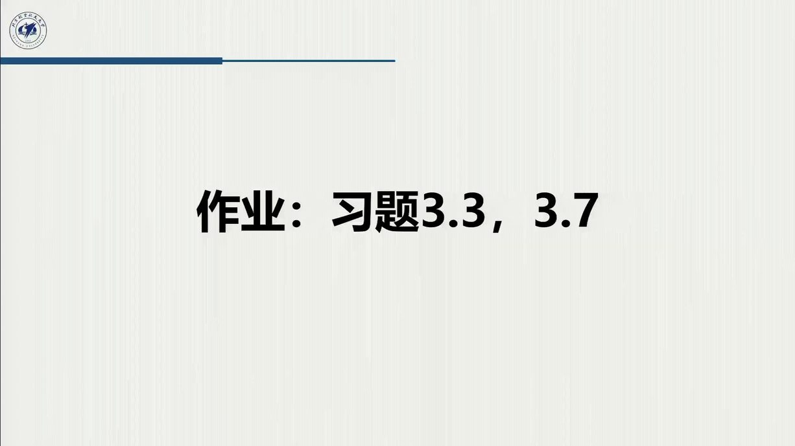

# 作业三：教材习题 3-3 / 3-7（附详细解答与验算）

::: note 作业信息（据录播）
- **题号**：教材第 3 章习题 **3.3、3.7**（录播 2:28:00「最后咱们有两道作业的习题，就是一周的时间，3.3 和 3.7」；课件末页同为「作业：习题 3.3，3.7」）；
- **原文**（教材 p.159）：
  > **3.3** Compute the Jacobian of the SCARA manipulator in Fig. 2.36.
  > **3.7** Find the singularities of the SCARA manipulator in Fig. 2.36.
- **提交**：一周内。
:::

两题是同一条链的两环：**3.3 求雅可比 → 3.7 让它退化**（$\det J=0$ 解奇点位形）。SCARA 是四轴全平行（$\alpha_i\equiv0$）的「平面臂 + 竖直伸缩 + 腕转」结构，正好把 [3.1](sec3-1.md) 的绿框公式、[3.2](sec3-2.md) 的流水线与 [3.3](sec3-3.md) 的判据一次串完。

## 准备：DH 表与正运动学（第 2 章 C3 已建）

| 连杆 $i$ | $a_i$ | $\alpha_i$ | $d_i$ | $\vartheta_i$ |
|:--:|:--:|:--:|:--:|:--:|
| 1 | $a_1$ | 0 | 0 | $\vartheta_1$ |
| 2 | $a_2$ | 0 | 0 | $\vartheta_2$ |
| 3 | 0 | 0 | $d_3$（移动） | 0 |
| 4 | 0 | 0 | 0 | $\vartheta_4$ |

（本作业按教材 Fig. 2.36 的标准 SCARA：4 关节 = 2 转动臂 + 1 移动 + 1 腕转。教材 2.13 用同一张图。）

$$A_i^{i-1}=\begin{bmatrix}c_i&-s_i&0&a_ic_i\\ s_i&c_i&0&a_is_i\\ 0&0&1&0\\ 0&0&0&1\end{bmatrix}\ (i=1,2),\qquad
A_3^2=\begin{bmatrix}1&0&0&0\\ 0&1&0&0\\ 0&0&1&d_3\\ 0&0&0&1\end{bmatrix},\qquad
A_4^3=\begin{bmatrix}c_4&-s_4&0&0\\ s_4&c_4&0&0\\ 0&0&1&0\\ 0&0&0&1\end{bmatrix}$$

连乘得（$c_{12}=\cos(\vartheta_1+\vartheta_2)$；高度坐标符号随 $z$ 轴向上 / 向下约定，本编取 $z$ 向上、$d_3$ 向下伸缩）：

$$T_4^0=\begin{bmatrix}c_{124}&-s_{124}&0&a_1c_1+a_2c_{12}\\
s_{124}&c_{124}&0&a_1s_1+a_2s_{12}\\
0&0&1&-d_3\\
0&0&0&1\end{bmatrix}$$

动笔前先看一眼这道题的**全部几何**（下图）：四根轴竖直平行意味着雅可比没有「空间项」，四个列在俯视图里就能画出来——右下的两个小图就是 3.7 要解的两个奇异位形。

<figure>
<svg class="figure-svg" viewBox="0 0 920 380" xmlns="http://www.w3.org/2000/svg" role="img" aria-labelledby="fig-hw3-t fig-hw3-d">
<title id="fig-hw3-t">SCARA 的雅可比几何与两个奇异位形</title>
<desc id="fig-hw3-d">左图俯视：两节臂加竖直伸缩与腕转，四根 z 轴全部指出纸面；第一、二列速度垂直于各自矢径，第三列沿竖直方向，第四列位置贡献为零。右侧两个小图：臂伸直与臂折回时两列共线，行列式为零。</desc>
<defs>
<marker id="fh3-m" markerWidth="9" markerHeight="9" refX="7" refY="3" orient="auto"><path d="M0,0 L7,3 L0,6 Z" fill="var(--muted)"/></marker>
<marker id="fh3-b" markerWidth="8" markerHeight="8" refX="6" refY="2.5" orient="auto"><path d="M0,0 L6,2.5 L0,5 Z" fill="var(--fig-blue)"/></marker>
<marker id="fh3-n" markerWidth="8" markerHeight="8" refX="6" refY="2.5" orient="auto"><path d="M0,0 L6,2.5 L0,5 Z" fill="var(--fig-green)"/></marker>
</defs>
<text class="diagram-text" x="230" y="30" text-anchor="middle">俯视：四轴全平行（z 全部 ⊙）</text>
<g stroke="var(--line-strong)" stroke-width="1.1" marker-end="url(#fh3-m)">
<line x1="200" y1="275" x2="285" y2="275"/>
<line x1="200" y1="275" x2="200" y2="200"/>
</g>
<line stroke="var(--line)" stroke-dasharray="4 4" x1="200" y1="275" x2="269.5" y2="120.6"/>
<line stroke="var(--line)" stroke-dasharray="4 4" x1="284.3" y1="204.3" x2="269.5" y2="120.6"/>
<line stroke="var(--accent)" stroke-width="5" x1="200" y1="275" x2="284.3" y2="204.3"/>
<line stroke="var(--accent)" stroke-width="5" x1="284.3" y1="204.3" x2="269.5" y2="120.6"/>
<line stroke="var(--fig-green)" stroke-width="2.8" marker-end="url(#fh3-n)" x1="269.5" y1="120.6" x2="214.8" y2="96"/>
<line stroke="var(--fig-green)" stroke-width="2.8" marker-end="url(#fh3-n)" x1="269.5" y1="120.6" x2="222.2" y2="128.9"/>
<text class="diagram-text" fill="var(--fig-green)" x="206" y="90">J<tspan class="sb">1</tspan> = z×r<tspan class="sb">1</tspan></text>
<text class="diagram-text" fill="var(--fig-green)" x="214" y="146">J<tspan class="sb">2</tspan> = z×r<tspan class="sb">2</tspan></text>
<text class="diagram-note" x="236" y="216">r<tspan class="sb">1</tspan></text>
<text class="diagram-note" x="288" y="164">r<tspan class="sb">2</tspan></text>
<text class="diagram-text" fill="var(--accent-text)" x="236" y="252">a<tspan class="sb">1</tspan></text>
<text class="diagram-text" fill="var(--accent-text)" x="290" y="158">a<tspan class="sb">2</tspan></text>
<g>
<circle cx="200" cy="275" r="9" fill="var(--paper)" stroke="var(--ink-2)" stroke-width="1.4"/><circle cx="200" cy="275" r="2.2" fill="var(--ink-2)"/>
<circle cx="284.3" cy="204.3" r="9" fill="var(--paper)" stroke="var(--ink-2)" stroke-width="1.4"/><circle cx="284.3" cy="204.3" r="2.2" fill="var(--ink-2)"/>
<circle cx="269.5" cy="120.6" r="9" fill="var(--paper)" stroke="var(--ink-2)" stroke-width="1.4"/><circle cx="269.5" cy="120.6" r="2.2" fill="var(--ink-2)"/>
</g>
<text class="diagram-text" x="184" y="296" text-anchor="end">z<tspan class="sb">0</tspan> ⊙</text>
<text class="diagram-text" x="302" y="210">z<tspan class="sb">1</tspan> ⊙</text>
<text class="diagram-text" x="288" y="106">z<tspan class="sb">2</tspan> z<tspan class="sb">3</tspan> ⊙</text>
<text class="diagram-note" x="300" y="330" text-anchor="middle">四列读法：J<tspan class="sb">1</tspan>、J<tspan class="sb">2</tspan> = 竖直叉乘（⊥ 各自矢径）；J<tspan class="sb">3</tspan> = [0,0,1]</text>
<text class="diagram-note" x="300" y="352" text-anchor="middle">第 4 列位置部分 = 0：腕转不改位置，只给末行一个 1</text>
<text class="diagram-text" x="690" y="52" text-anchor="middle">伸直 ϑ<tspan class="sb">2</tspan> = 0：外边界</text>
<g stroke="var(--line)" stroke-dasharray="4 4"><line x1="520" y1="150" x2="700" y2="106"/></g>
<line stroke="var(--accent)" stroke-width="4.5" x1="520" y1="150" x2="595.3" y2="129.8"/>
<line stroke="var(--accent)" stroke-width="4.5" x1="595.3" y1="129.8" x2="651.4" y2="114.8"/>
<circle cx="520" cy="150" r="7" fill="var(--paper)" stroke="var(--ink-2)" stroke-width="1.3"/><circle cx="520" cy="150" r="1.8" fill="var(--ink-2)"/>
<circle cx="595.3" cy="129.8" r="7" fill="var(--paper)" stroke="var(--ink-2)" stroke-width="1.3"/><circle cx="595.3" cy="129.8" r="1.8" fill="var(--ink-2)"/>
<circle cx="651.4" cy="114.8" r="4.5" fill="var(--accent)"/>
<line stroke="var(--fig-green)" stroke-width="2.4" marker-end="url(#fh3-n)" x1="651.4" y1="114.8" x2="639.7" y2="71.3"/>
<line stroke="var(--fig-green)" stroke-width="2.4" marker-end="url(#fh3-n)" x1="655" y1="113.7" x2="647.7" y2="92.3"/>
<text class="diagram-text" fill="var(--fig-green)" x="600" y="98" text-anchor="end">J<tspan class="sb">1</tspan> ∥ J<tspan class="sb">2</tspan></text>
<text class="diagram-mono" x="600" y="180" text-anchor="middle">det = a<tspan class="sb">1</tspan>a<tspan class="sb">2</tspan>s<tspan class="sb">2</tspan> = 0</text>
<text class="diagram-text" x="690" y="225" text-anchor="middle">折回 ϑ<tspan class="sb">2</tspan> = π：内边界</text>
<g stroke="var(--line)" stroke-dasharray="4 4"><line x1="595.3" y1="269.8" x2="525" y2="288"/></g>
<line stroke="var(--accent)" stroke-width="4.5" x1="520" y1="290" x2="595.3" y2="269.8"/>
<line stroke="var(--accent)" stroke-width="4.5" x1="595.3" y1="269.8" x2="539.3" y2="284.8"/>
<circle cx="520" cy="290" r="7" fill="var(--paper)" stroke="var(--ink-2)" stroke-width="1.3"/><circle cx="520" cy="290" r="1.8" fill="var(--ink-2)"/>
<circle cx="595.3" cy="269.8" r="7" fill="var(--paper)" stroke="var(--ink-2)" stroke-width="1.3"/><circle cx="595.3" cy="269.8" r="1.8" fill="var(--ink-2)"/>
<circle cx="539.3" cy="284.8" r="4.5" fill="var(--accent)"/>
<line stroke="var(--fig-green)" stroke-width="2.4" marker-end="url(#fh3-n)" x1="539.3" y1="284.8" x2="549.7" y2="246.2"/>
<line stroke="var(--fig-green)" stroke-width="2.4" marker-end="url(#fh3-n)" x1="543" y1="290" x2="528.9" y2="323.4"/>
<text class="diagram-text" fill="var(--fig-green)" x="556" y="242">两列仍共线（反号）</text>
<text class="diagram-mono" x="700" y="300" text-anchor="middle">det = 0；末端落在 r = |a<tspan class="sb">1</tspan>−a<tspan class="sb">2</tspan>| 处</text>
<text class="diagram-note" x="690" y="352" text-anchor="middle">两个奇点都与 ϑ<tspan class="sb">1</tspan>、d<tspan class="sb">3</tspan>、ϑ<tspan class="sb">4</tspan> 无关——边界奇点，规划时避开臂展极限即可</text>
</svg>
<figcaption>SCARA 雅可比与奇点的全部几何（本教程绘，对照原书图 2.36）：左——四轴平行使每一列都能在俯视图中画出，第 4 列位置部分为零是「腕轴过腕点」的直接结果；右——伸直与折回两支 $\vartheta_2$ 使 $\det J^{(2)}=a_1a_2\sin\vartheta_2=0$，两列共线、径向速度不可产生（[@ex-book-3.2] 的 SCARA 版）。</figcaption>
</figure>

## 3.3 · 求 SCARA 机械手的雅可比

### 思路

按「五步流水线」（[@method-3.2.A]）：四轴全平行 $\Rightarrow$ 所有 $z_{i-1}$ 相同、所有转动列都是竖直叉乘；只需从各中间 $T$ 读出 $p_{i-1}$，逐列套绿框（[@thm-3.1.C]）。

### 关键中间量（全部由 $T_i^0$ 读取）

$$z_0=z_1=z_2=z_3=z_0^{\text{base}}=[0,0,1]^{\mathrm T}\qquad(\text{四轴竖直平行})$$

$$p_0=p_1=[0,0,0]^{\mathrm T},\qquad
p_2=[a_1c_1,\ a_1s_1,\ 0]^{\mathrm T},\qquad
p_3=p_4=[a_1c_1+a_2c_{12},\ a_1s_1+a_2s_{12},\ -d_3]^{\mathrm T}$$

（$p_4=p_3$：腕转不改变腕心位置。）末端 $p_e=p_4$。

### 逐列组装

转动列 $J_{P_i}=z_{i-1}\times(p_e-p_{i-1})$，用 $[0,0,1]\times[X,Y,Z]=[-Y,X,0]$：

- **第 1 列**（$\vartheta_1$，转动）：$p_e-p_1=[a_1c_1+a_2c_{12},\ a_1s_1+a_2s_{12},\ -d_3]^{\mathrm T}$，
  $z_0\times(p_e-p_1)=[-(a_1s_1+a_2s_{12}),\ a_1c_1+a_2c_{12},\ 0]^{\mathrm T}$；
- **第 2 列**（$\vartheta_2$，转动）：$z_1\times(p_e-p_2)=[-a_2s_{12},\ a_2c_{12},\ 0]^{\mathrm T}$；
- **第 3 列**（$d_3$，移动）：$z_2=[0,0,1]^{\mathrm T}$，角速度行取 $0$；
- **第 4 列**（$\vartheta_4$，转动）：$p_e-p_3=0$ ⇒ $J_{P_4}=z_3\times 0=0$，$J_{O_4}=z_3=[0,0,1]^{\mathrm T}$。

（第 4 列提示结构真相：腕转**不移动末端点**——它只改姿态。这正是图 2.36 上腕轴与末端点重合的几何事实。）

### 结果

$$J(q)=\begin{bmatrix}
-a_1s_1-a_2s_{12} & -a_2s_{12} & 0 & 0\\
a_1c_1+a_2c_{12} & a_2c_{12} & 0 & 0\\
0 & 0 & 1 & 0\\
0 & 0 & 0 & 0\\
0 & 0 & 0 & 0\\
1 & 1 & 0 & 1
\end{bmatrix}\in\mathbb R^{6\times4}$$

（第 3 行记号：若取 $z$ 向上、$d_3$ 向下，则 $d_3$ 增大末端沿 $-z$ 走，第 3 行第 3 列为 $-1$，其余不变——**符号随约定，结构不变**。）

### 验算

`tools/verify_ch03_jac.py` 用中心差分（位置差分 + $S=\dot RR^{\mathrm T}$ 差分）对随机 20 组 $(q,a)$ 复核全部 24 个元素，最大绝对偏差 $\sim 4\times10^{-10}$；秩恒为 4（当 $s_2\neq0$）；$\det(\text{前两行 }2\times2\text{ 块})=a_1a_2s_2$。

::: note 与教材答案的一致性
教材官方解答（Solution Manual, Problem 3.3）给出的 SCARA 雅可比与本编逐列结果一致（差异仅在 $z$ 轴方向的整体符号约定）。SCARA 是「**四轴全平行**」的极端情形：$\alpha_i\equiv0$ 使绿框公式退化为「$2\times2$ 位置块 + 竖直行 + 腕行」的稀疏结构——**参数表越整齐，雅可比越稀疏**，这是 [2.9](../ch02/sec2-9.md#sec-2.9.1) 结构知识在微分层的回报。
:::

## 3.7 · 求 SCARA 机械手的奇异位形

### 思路

「$J$ 不满秩」在 $6\times4$ 上不好直接判，但 SCARA 结构只给了**受限的任务空间**：第 4、5 行恒零，第 3、6 行是「竖直平移 / 绕竖轴转」。因此分别看两块：

1. **臂块**（第 1、2 行 $\times$ 第 1、2 列）——决定水平定位能力；
2. **竖直 / 腕块**（第 3、6 行）——$[1,0]$ 与 $[0,1]$ 恒满秩。

### 判定

$$J^{(2)}=\begin{bmatrix}-a_1s_1-a_2s_{12} & -a_2s_{12}\\ a_1c_1+a_2c_{12} & a_2c_{12}\end{bmatrix},
\qquad \det J^{(2)}=a_1a_2\,s_2
$$

奇点条件

$$\det J^{(2)}=0\iff s_2=0\iff \vartheta_2=0\ \text{或}\ \pi .$$

（竖直 / 腕部分永不退化：第 3 列 $z_2$、第 4 列 $z_3$ 与第 1、2 列张成的方向整体互补，$\operatorname{rank}J$ 从 4 降到 3。）

### 物理解释

- $\vartheta_2=0$：**臂伸直**，工作空间外边界（竖直平面内的圆环外缘）；两列共线，比例系数 $(a_1+a_2)/a_2$——末端沿**径向**的速度分量不可产生；
- $\vartheta_2=\pi$：**臂折回**，内边界；同理共线（系数 $(a_1-a_2)/a_2$，若 $a_1=a_2$ 则两列反号相加为零，末端退到基座轴线上）；
- **与 $\vartheta_1,\vartheta_3,\vartheta_4$ 无关**——转肩、升降、转腕都不改变奇异性；
- 类型：**边界奇点**（[3.3.1](sec3-3.md#sec-3.3.1)）——「不表示真正的缺陷」，使用中避开臂展极限即可；SCARA 无球形腕、无内部奇点（竖直轴与水平轴从不共线）。

### 验算

`tools/verify_ch03_jac.py` 对 $s_2=0$ 的两支（$\vartheta_2=0,\pi$）及随机非奇异位形做奇异值分解：非奇异位形最小奇异值 $\ge a_1a_2|s_2|/\lVert J^{(2)}\rVert$ 型下界；$\vartheta_2=0,\pi$ 时 rank$(J^{(2)})=1$、rank$(J)=3$。

::: note 与教材答案的一致性
教材官方解答（Problem 3.7）的结论为 SCARA 的奇点在 $\vartheta_2=0,\pi$（臂伸出 / 折叠），与本编一致；教材指出这些是**肩 / 肘型边界奇点**、可在轨迹规划阶段规避（对应 [3.3.3](sec3-3.md#sec-3.3.3) 末尾「臂奇点在操作空间中被很好地识别、可在规划阶段避开」）。
:::

## 两题一图的心智模型

> **3.3 把「关节速度 → 末端六维速度」写成一张稀疏矩阵：四轴平行使它只有 4 列非零、2 行有效；3.7 只需让那张矩阵的「臂块」退化——$\det J^{(2)}=a_1a_2s_2=0$ 的两个根，就是 SCARA 手臂伸直与折回的两个位形。**

**易错点清单**：① 把第 3 列当转动列（$d_3$ 是移动关节）；② 第 4 列忘了 $p_e-p_3=0$（腕转不改位置）；③ 奇点判定漏掉「与 $\vartheta_1$ 无关」这一结构特征（对比两连杆 [@ex-book-3.2] 的 $\det J=a_1a_2s_2$，公式形式相同、含义随结构）。
