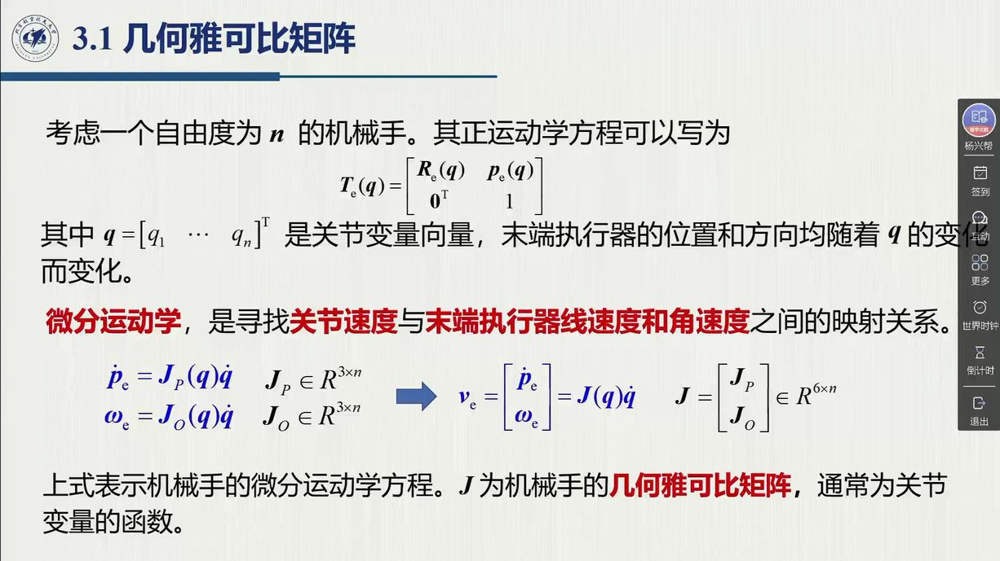
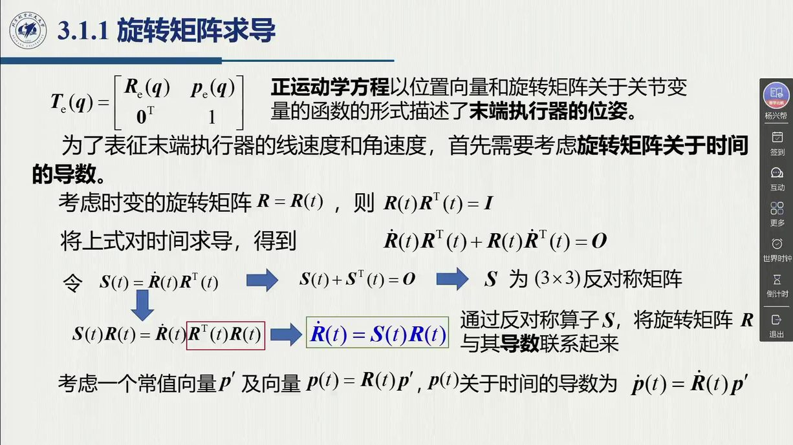
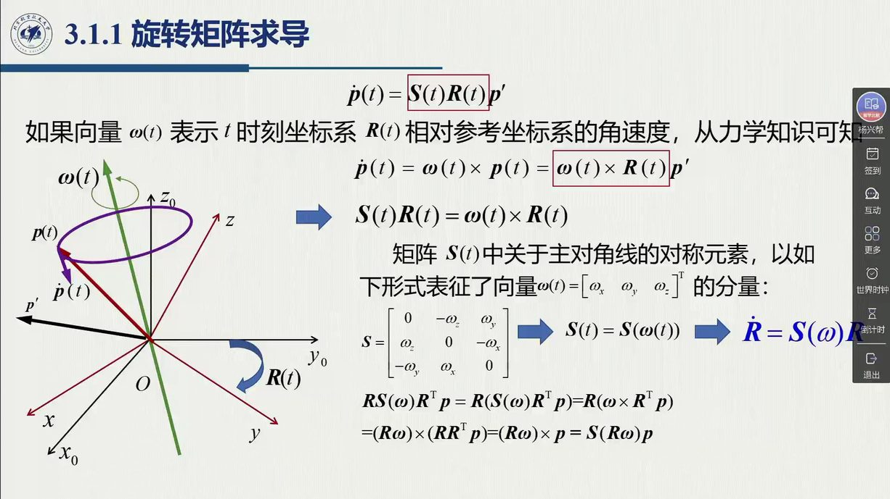
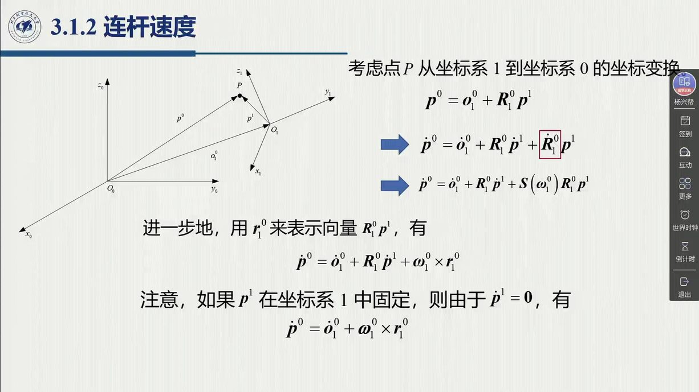
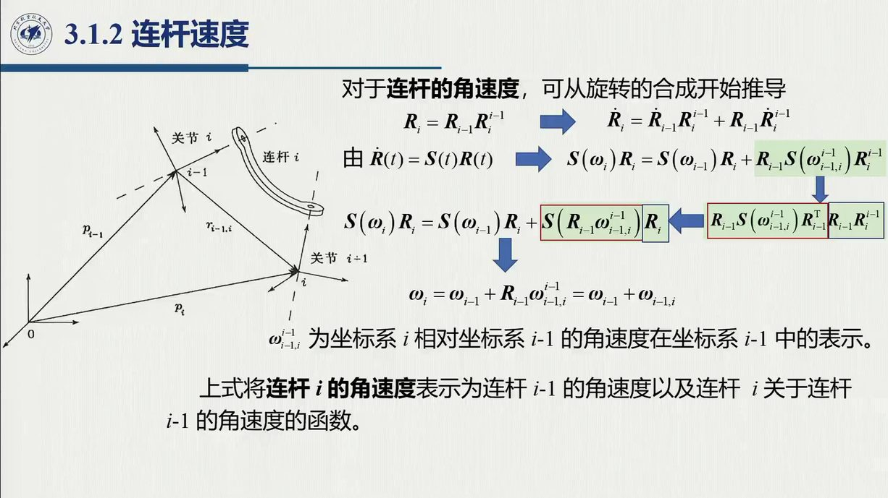
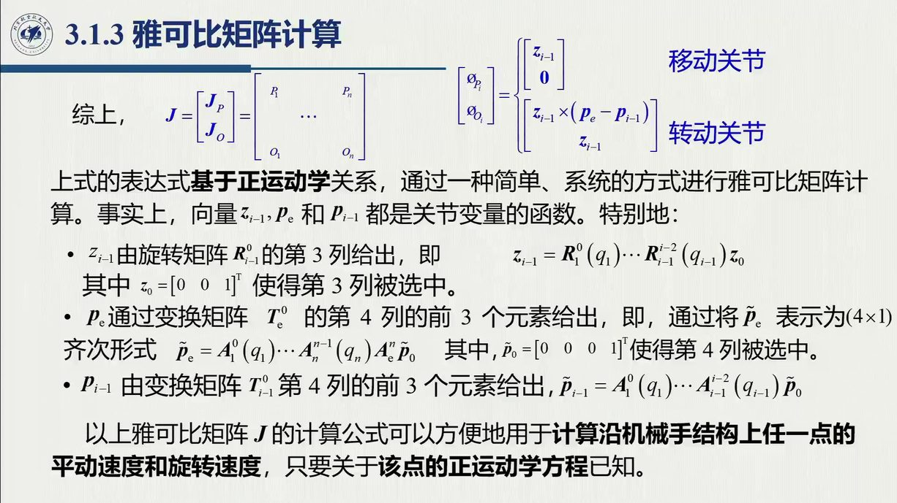
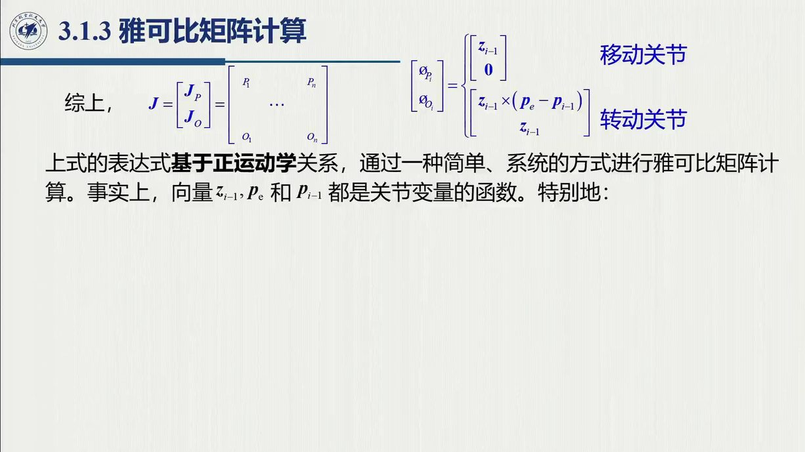
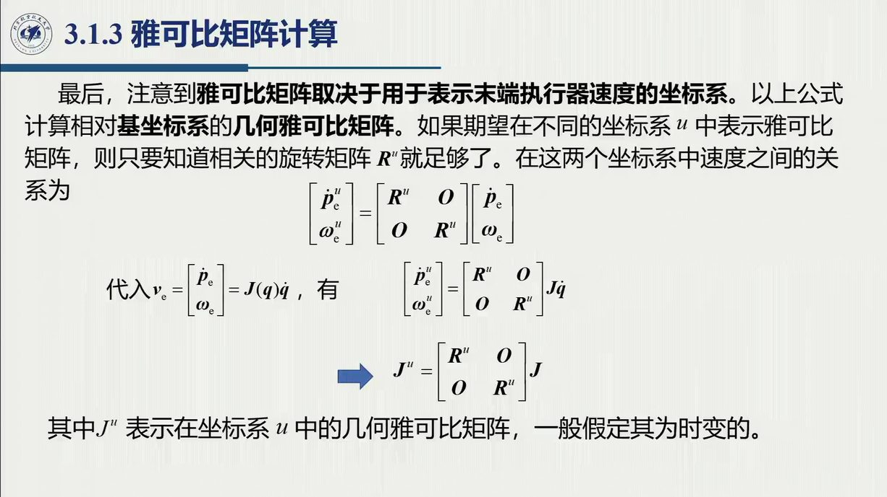

# 3.1 几何雅可比矩阵

位姿运动学 $x_e=k(q)$ 是高度非线性的；但对时间求导之后，非线性问题就在**速度层面**线性化了——线性化后的映射正是雅可比矩阵。本节从几何角度（矢量传递）把它推出来：先解决「旋转矩阵怎么求导」（3.1.1），再沿关节链递推连杆速度（3.1.2），最后把每个关节的贡献拼成矩阵（3.1.3）。录播 0:27:00–1:12:12。

{{#include ../assets/figures/robot-jacobian.md}}

## 3.1.1 旋转矩阵求导：反对称算子登场

考虑 $n$ 自由度机械手，DH 法给出的正运动学

$$T_e(q)=\begin{bmatrix}n_e(q)&s_e(q)&a_e(q)&p_e(q)\\0&0&0&1\end{bmatrix},
\qquad R_e=\begin{bmatrix}n_e&s_e&a_e\end{bmatrix},\qquad T=\begin{bmatrix}R&P\\0&1\end{bmatrix}$$

$R$ 与 $P$ 都是位形 $q$ 的函数（$R_e$ 的三列 $n_e,s_e,a_e$ 是末端坐标系三根轴的单位向量——法向 / 滑动 / 接近向量，见 [@def-2.8.2]）。**微分运动学**要找的是：关节速度与末端执行器线速度、角速度之间的关系。

::: def 定义 3.1.1 · 微分运动学方程与几何雅可比 {#def-3.1.1}
末端执行器速度取六维堆叠 $v_e=\begin{bmatrix}\dot p_e\\\omega_e\end{bmatrix}$（$3$ 平动 $+3$ 转动），微分运动学方程为

$$\begin{bmatrix}\dot p_e\\ \omega_e\end{bmatrix}=J(q)\,\dot q=\begin{bmatrix}J_P\\ J_O\end{bmatrix}\dot q,\qquad J\in\mathbb R^{6\times n}$$

$J$ 称**几何雅可比矩阵**，是位形 $q$ 的函数；$J_P$（position）对应线速度、$J_O$（orientation）对应角速度，各 $3\times n$。$\omega_e$ 的三个分量是末端角速度在**基坐标系**三根轴上的投影（录播 0:29:11——这句话是几何/分析雅可比分歧的根源，见 [3.6](sec3-6.md)）。
:::

位置部分好办——位移求导就是速度；关键在姿态部分：**旋转矩阵怎么对时间求导？**

::: thm 定理 3.1.A · 旋转矩阵的导数与反对称算子 {#thm-3.1.A}
设 $R=R(t)$ 为时变旋转矩阵。由正交性 $RR^{\mathrm T}=I$，两边求导并用乘积法则：

$$\dot RR^{\mathrm T}+R\dot R^{\mathrm T}=0 .$$

记 $S\triangleq\dot RR^{\mathrm T}$，则 $S+S^{\mathrm T}=0$——$S$ **反对称**（对角线为零、非对角元素反对称）。上式两边右乘 $R$ 得

$$\dot R=S\,R .$$
:::

::: proof 证明的三个落点（老师逐步口述，0:30:55–0:32:30）
① $RR^{\mathrm T}=I$ 是旋转矩阵正交性的直接结果（[@def-2.2.2]）；② 求导用乘积法则，注意 $\dot{(R^{\mathrm T})}=(\dot R)^{\mathrm T}$；③ 「上式两边右乘 $R$」的动机：$\dot RR^{\mathrm T}\cdot R=\dot R$（把 $\dot R$ 单独解出来），$R\dot R^{\mathrm T}R=-S$ 保持反对称。于是**一个反对称算子 $S$ 把 $R$ 和 $\dot R$ 联系起来**。
:::

**$S$ 里装的是什么？——角速度。** 考虑常模向量 $p'$（在刚体系下不动），$p(t)=R(t)p'$：它的模长始终不变，方向却在变。求导并代入 $\dot R=SR$：

$$\dot p(t)=S(t)\,R(t)\,p' .$$

另一方面，从力学角度（大学物理）：随坐标系 $R(t)$ 一起转动的点，线速度是角速度叉乘矢径：

$$\dot p(t)=\omega(t)\times p(t)=\omega\times R(t)p' .$$

两式对**任意** $p'$ 成立，比较即得 $S(t)R(t)=S(\omega)R(t)$，即

::: def 定义 3.1.2 · 叉乘算子 / 反对称矩阵 $S(\omega)$ {#def-3.1.2}
（此算子已在 [@def-2.5.2] 作为「把叉积装进矩阵代数」的工具引入；本定义补上它的**物理身份**——角速度。用 [2.5.3](../ch02/sec2-5.md#sec-2.5.3) 的语言：$S(\omega)$ 是李代数 $so(3)$ 的元素，$\omega$ 是它的摘帽。）

$$S(\omega)=\begin{bmatrix}0&-\omega_z&\omega_y\\ \omega_z&0&-\omega_x\\ -\omega_y&\omega_x&0\end{bmatrix},\qquad \omega=\begin{bmatrix}\omega_x\\\omega_y\\\omega_z\end{bmatrix},\qquad S(\omega)p\equiv\omega\times p$$

$S$ 的 $3$ 个独立元素与 $\omega$ 的 $3$ 个分量**一一对应**。老师在这个点上补了一句（0:36:16）：「一对一的映射关系，可以类比，但不完全一样」——数一数就明白：$S$ 有 $9$ 个元素、$6$ 个约束，独立数恰为 $3$，与 $R$ 同构，同样是「省参数」的表示。最终：

$$\dot R=S(\omega)\,R$$

（有的教材记 $S(\omega)=[\omega]_\times$ 或 $\hat\omega$，本编与原书统一用 $S(\cdot)$。）
:::

::: thm 定理 3.1.B · 旋转共轭保持叉乘 {#thm-3.1.B}
对任意旋转矩阵 $R$ 与向量 $\omega$：

$$R\,S(\omega)\,R^{\mathrm T}=S(R\omega).$$

即「先叉乘再旋转」等于「先旋转再叉乘」。**证明**：由「旋转保持叉积」（[@pf-2.5.rodrigues] 第 0 步已证：$R(a\times b)=(Ra)\times(Rb)$），对任意向量 $p$：

$$R\,S(\omega)\,R^{\mathrm T}p=R\big(\omega\times R^{\mathrm T}p\big)=(R\omega)\times\big(RR^{\mathrm T}p\big)=(R\omega)\times p=S(R\omega)\,p,$$

两边矩阵对一切 $p$ 给出相同向量，故相等。□ **这个关系后面会用很多次**（0:37:05 老师预告，连杆角速度递推 3.1.2 立刻用到）。
:::

::: ex 例 3.1（原书）· 绕 $z$ 轴的时变旋转 {#ex-book-3.1}
$$R_z(\alpha(t))=\begin{bmatrix}c_\alpha&-s_\alpha&0\\ s_\alpha&c_\alpha&0\\ 0&0&1\end{bmatrix},\qquad \omega=[0,0,\dot\alpha]^{\mathrm T},\qquad
S(\omega)=\begin{bmatrix}0&-\dot\alpha&0\\ \dot\alpha&0&0\\ 0&0&0\end{bmatrix},\qquad \dot R_z=S(\omega)R_z .$$

「比较简单，不详细讲，目的是给大家更感性的认识——反对称矩阵元素与坐标系旋转角速度之间的关系」（0:38:43）：$\omega$ 的 $x,y$ 分量为零、$z$ 分量恰为 $\dot\alpha$——对着元素读一遍，反对称矩阵与坐标系角速度的对应关系就一目了然。该例在 [3.2.1](sec3-2.md#sec-3.2.1) 与 [3.7](sec3-7.md) 都会以「$R_z$ 的 $\dot R$」身份复用（[@ex-book-3.1]）。
:::

::: note 李代数视角：$\dot RR^{\mathrm T}$ 与 $R^{\mathrm T}\dot R$ 各读出谁的角速度（本编补充） {#note-3.1.lie}
同一个 $\dot R=S(\omega)R$，左乘还是右乘 $R^{\mathrm T}$，读出来的是两套角速度。两边**右乘** $R^{\mathrm T}$ 得 $S(\omega)=\dot RR^{\mathrm T}$；两边**左乘** $R^{\mathrm T}$、再用 [@thm-3.1.B] 把 $R^{\mathrm T}$ 「拿进」算子，则得 $R^{\mathrm T}\dot R=S(R^{\mathrm T}\omega)$——**也是**反对称阵。两个摘帽结果：

$$\omega=\big(\dot RR^{\mathrm T}\big)^\vee\quad\text{（基系读数——本课程用的就是它）},\qquad
\omega'=R^{\mathrm T}\omega=\big(R^{\mathrm T}\dot R\big)^\vee\quad\text{（刚体系读数）}.$$

同一段旋转、两套坐标读法——「角速度住在李代数 $so(3)$ 里，但读数要问在哪套坐标」（[2.5.3](../ch02/sec2-5.md#sec-2.5.3)）。这正是 [3.1.3](#sec-3.1.3) 末「雅可比的坐标变换 $J^u$」在角速度层面的版本；姿态控制文献里的空间速度 / 物体速度之别即源于此。
:::

## 3.1.2 连杆速度：三项合成与两条递推

这一小节的（a）–（e）五步层层递进：先看单个点如何做速度合成（a），再用 DH 记号把它搬到相邻连杆之间（b–c），接着推出角速度递推（d），最后落到单个关节的特例（e）——这些结论稍后组装雅可比时都要用。

**（a）点的速度合成。** 设点 $P$ 在坐标系 $1$ 中的位置为 $p^1$，坐标系 $1$ 的原点在基系 $0$ 中为 $o_1^0$、姿态为 $R_1^0$：

$$p^0=o_1^0+R_1^0\,p^1 .$$

老师强调（0:40:13）：「**不能直接加**——能直接相加的量都必须在同一空间。要先把 $p^1$ 转到基坐标系，计算才是正确的、有意义的。」两边求时间导数，记 $r_1^0\triangleq R_1^0p^1$（$p^1$ 在基系中的表示），姿态项用 [@thm-3.1.A]：

$$\dot p^0=\dot o_1^0+\dot R_1^0p^1+R_1^0\dot p^1
=\underbrace{\dot o_1^0}_{\text{原点速度}}+\underbrace{\omega_1\times r_1^0}_{\text{牵连转动}}+\underbrace{R_1^0\dot p^1}_{\text{相对速度}}$$

三项合起来，正是大学物理里的「绝对速度 = 牵连速度 + 相对速度」；若 $P$ 与刚体固联（$\dot p^1=0$），它就进一步退化为定轴转动公式 $\dot p=\dot o+\omega\times r$。相对速度项仍带 $R_1^0$——同样是「先转到同一坐标系再相加」。

**（b）DH 建系回顾与记号。** 要把（a）用到相邻连杆之间，先得把记号交代清楚——沿用第 2 章约定：连杆 $i$ 连接关节 $i$（近端）与关节 $i+1$（远端），坐标系 $i$ 建在**远端**（原点在关节 $i+1$ 轴上）。老师特意警告（0:43:04）：「也有 modified DH 建在近端的，咱们整本教材都按远端建，**去年有同学搞混了这个问题，作业怎么做都不对**。」记 $p_{i-1},p_i$ 为两坐标系原点在基系中的位置，$r_{i-1,i}^{i-1}$ 为坐标系 $i$ 的原点相对 $i-1$ 的位置在 $i-1$ 系中的表示，则

$$p_i=p_{i-1}+R_{i-1}\,r_{i-1,i}^{i-1}.$$

**（c）连杆线速度递推。** 对上式求时间导数（即把（a）的公式套到两连杆之间），记基系表示 $r_{i-1,i}=R_{i-1}r_{i-1,i}^{i-1}$：

$$\dot p_i=\dot p_{i-1}+R_{i-1}\dot r_{i-1,i}^{i-1}+\omega_{i-1}\times R_{i-1}\,r_{i-1,i}^{i-1}$$

连杆 $i$ 的线速度 = 前一连杆线速度 $+$ 相对速度 $+$ 前一连杆转动的牵连速度——又是三项合成（0:47:23）。

**（d）连杆角速度递推。** 从旋转合成 $R_i=R_{i-1}R_i^{i-1}$ 出发，两边求导并用 $\dot R=SR$：

$$S(\omega_i)R_i=S(\omega_{i-1})\,R_{i-1}R_i^{i-1}+R_{i-1}S(\omega_{i-1,i}^{i-1})R_i^{i-1}$$

第二项用 [@thm-3.1.B] 把 $R_{i-1}$ 「拿进」算子（$R_{i-1}S(\omega_{i-1,i}^{i-1})=S(R_{i-1}\omega_{i-1,i}^{i-1})R_{i-1}$），三个算子便对同一矩阵 $R_i=R_{i-1}R_i^{i-1}$ 作用，比较得

$$\omega_i=\omega_{i-1}+R_{i-1}\,\omega_{i-1,i}^{i-1}$$

其中 $\omega_{i-1,i}^{i-1}$ 是坐标系 $i$ 相对 $i-1$ 的角速度在 $i-1$ 系中的表示。「坐标系 $i$ 的角速度 = 前一坐标系的角速度 $+$ 相对角速度」。至于为什么角速度可以直接叠加（0:55:46），老师给的理由是：「两刚体传动相连、牵连到一起就可以叠加——大学物理讲转动合成时思考过的问题，从这里自己看出来。」

**（e）单个关节的特例（组装雅可比的零件）。** 相邻坐标系之间只有一个关节变量：

- 关节 $i$ 为**转动关节**（变量 $\vartheta_i$）：$\omega_{i-1,i}=\dot\vartheta_i\,z_{i-1}$，且 $r_{i-1,i}^{i-1}$ 不变（$\dot r=0$）；
- 关节 $i$ 为**移动关节**（变量 $d_i$）：$\omega_{i-1,i}=0$，$r_{i-1,i}^{i-1}$ 沿轴伸缩，$\dot r_{i-1,i}^{i-1}=\dot d_i\,z_{i-1}^{i-1}$。

其中 $z_{i-1}$ 是关节 $i$ 轴向的单位向量（基系表示）。

## 3.1.3 雅可比矩阵的计算：逐列构造（绿框）

3.1.2 的两条递推都是沿链累加的形式；下面把它按「单关节贡献」拆开——每一项正好对应 $J$ 的一列。

**线速度。** $p_e(q)$ 是 $q$ 的函数、$q$ 又是时间的函数，复合求导：

$$\dot p_e=\sum_{i=1}^{n}\frac{\partial p_e(q)}{\partial q_i}\,\dot q_i=J_P\,\dot q .$$

（投影仪常年显示不出这个 $\sum$ 符号，老师每年都要口头补，0:59:58。）**关键物理解读**（1:00:52）：每一项表示**其余关节全部锁死时，单个关节的速度对末端线速度的贡献**——研究第 $i$ 项时，其他系数全为零。于是逐项用 3.1.2(e)：

- 关节 $i$ **移动**：纯平移，$\dfrac{\partial p_e}{\partial q_i}=z_{i-1}$；
- 关节 $i$ **转动**：$i\sim n$ 段连成刚体绕轴 $z_{i-1}$ 定轴转动，$\omega=\dot\vartheta_i z_{i-1}$，矢径 $p_e-p_{i-1}$，故 $\dfrac{\partial p_e}{\partial q_i}=z_{i-1}\times(p_e-p_{i-1})$。

**角速度。** 沿链累加（末端执行器与连杆 $n$ 之间只有**固定**齐次变换、无关节变量，故 $\omega_e=\omega_n$，1:04:05）：

$$\omega_e=\omega_n=\sum_{i=1}^{n}\omega_{i-1,i}=\sum_{i=1}^{n}J_{O_i}\,\dot q_i .$$

**逐列取法与绿框公式。** 把线速度与角速度两部分的结论合起来，就得到逐列的取法：

::: thm 定理 3.1.C · 几何雅可比的逐列构造（绿框，1:05:52「这部分内容肯定是要考的」）{#thm-3.1.C}

$$J=\begin{bmatrix}J_1&\cdots&J_i&\cdots&J_n\end{bmatrix},\qquad
J_i=\begin{bmatrix}J_{P_i}\\ J_{O_i}\end{bmatrix},\qquad
\begin{cases}\text{关节 } i \text{ 转动：}\ J_{P_i}=z_{i-1}\times(p_e-p_{i-1}),\ J_{O_i}=z_{i-1}\\[2mm] \text{关节 } i \text{ 移动：}\ J_{P_i}=z_{i-1},\ J_{O_i}=0\end{cases}$$

（课件用关节标志 $\sigma_i$ 区分两类关节：转动 $\sigma_i=0$、移动 $\sigma_i=1$，上式两列取法据此二选一。）
:::

<figure>
<svg class="figure-svg" viewBox="0 0 920 478" xmlns="http://www.w3.org/2000/svg" role="img" aria-labelledby="fig-jc-t fig-jc-d">
<title id="fig-jc-t">雅可比逐列构造的物理含义</title>
<desc id="fig-jc-d">左侧三连杆平面臂只驱动第二个关节、其余关节锁死，末端沿垂直于矢径的方向产生速度；右侧给出转动列与移动列两种取法。</desc>
<defs>
<marker id="ar-x" markerHeight="8" markerWidth="8" orient="auto" refX="6" refY="3"><path d="M0,0 L7,3 L0,6 Z" fill="context-stroke"/></marker>
<marker id="ar-xs" markerHeight="8" markerWidth="8" orient="auto-start-reverse" refX="6" refY="3"><path d="M0,0 L7,3 L0,6 Z" fill="context-stroke"/></marker>
</defs>
<g font-family="var(--sans)">
<line class="diagram-axis" x1="120" x2="120" y1="330" y2="212"/>
<line class="diagram-axis" x1="120" x2="252" y1="330" y2="330"/>
<text class="diagram-note" x="112" y="206">y<tspan class="sb">0</tspan></text>
<text class="diagram-note" x="258" y="335">x<tspan class="sb">0</tspan></text>
<line stroke="var(--ink-2)" stroke-width="5" x1="120" x2="288" y1="330" y2="300"/>
<line stroke="var(--ink-2)" stroke-width="5" x1="288" x2="430" y1="300" y2="176"/>
<line stroke="var(--ink-2)" stroke-width="5" x1="430" x2="546" y1="176" y2="118"/>
<circle class="diagram-fill-sage" cx="120" cy="330" r="8"/>
<circle class="diagram-fill-accent" cx="288" cy="300" r="9"/>
<circle class="diagram-fill-sage" cx="430" cy="176" r="8"/>
<circle cx="546" cy="118" r="6" fill="var(--paper)" stroke="var(--line-strong)" stroke-width="1.2"/>
<text class="diagram-text" x="560" y="116">p<tspan class="sb">e</tspan></text>
<text class="diagram-note" text-anchor="end" x="106" y="350">关节 1（锁死）</text>
<text class="diagram-text" fill="var(--accent-text)" text-anchor="middle" x="268" y="278">关节 2（只动它）</text>
<text class="diagram-note" text-anchor="start" x="444" y="198">关节 3（锁死）</text>
<circle cx="288" cy="300" r="17" fill="none" stroke="var(--accent-text)" stroke-width="1.4"/>
<circle cx="288" cy="300" r="3.5" fill="var(--accent-text)"/>
<text class="diagram-note" fill="var(--accent-text)" x="312" y="344">z<tspan class="sb">1</tspan> 出纸面（关节 2 的转动轴）</text>
<line stroke="var(--fig-red)" stroke-dasharray="6 4" stroke-width="1.6" x1="288" x2="546" y1="300" y2="118"/>
<text class="diagram-note" fill="var(--fig-red)" text-anchor="end" x="430" y="252">r = p<tspan class="sb">e</tspan> − p<tspan class="sb">1</tspan></text>
<line stroke="var(--fig-green)" stroke-width="2.6" marker-end="url(#ar-x)" x1="546.0" x2="622.0" y1="118.0" y2="210.0"/>
<text class="diagram-text" fill="var(--fig-green)" x="630" y="192">J<tspan class="sb">2</tspan> q′<tspan class="sb">2</tspan> = z<tspan class="sb">1</tspan> × r · q′<tspan class="sb">2</tspan></text>
<text class="diagram-note" fill="var(--fig-green)" x="630" y="214">垂直于 r</text>
<line stroke="var(--line)" stroke-dasharray="4 5" x1="24" x2="896" y1="396" y2="396"/>
<text class="diagram-text" x="24" y="424">转动关节 i：</text>
<text class="diagram-mono" x="152" y="424">J<tspan class="sb">i</tspan> = [ z<tspan class="sb">i−1</tspan> × (p<tspan class="sb">e</tspan> − p<tspan class="sb">i−1</tspan>) ; z<tspan class="sb">i−1</tspan> ]</text>
<text class="diagram-text" x="486" y="424">移动关节 i：</text>
<text class="diagram-mono" x="612" y="424">J<tspan class="sb">i</tspan> = [ z<tspan class="sb">i−1</tspan> ; 0 ]</text>
<text class="diagram-note" x="24" y="448">z<tspan class="sb">i−1</tspan> = T<tspan class="sb">i−1</tspan><tspan class="sp">0</tspan> 左上 3×3 块的第三列（基系表示）；p<tspan class="sb">i−1</tspan>、p<tspan class="sb">e</tspan> = 相应 T 的第四列前三行</text>
</g></svg>
<figcaption>逐列构造的物理图像（本教程绘）：**其余关节全部锁死、只以单位速度驱动第 $i$ 个关节**，末端产生的速度就是第 $i$ 列。左图锁死关节 1 与 3、只驱动关节 2：$i\sim n$ 段（杆 2、杆 3）连成一个刚体绕轴 $z_1$ 定轴转动，末端速度方向垂直于矢径 $\boldsymbol p_e-\boldsymbol p_{i-1}$——这正是 $z_{i-1}\times(\boldsymbol p_e-\boldsymbol p_{i-1})$ 的几何内容。移动关节不转，故角速度行取零。</figcaption>
</figure>

**所需量全部来自正运动学**（1:07:26–1:09:52，本节最重要的工程结论）：

- $z_{i-1}$ = 旋转矩阵 $R_{i-1}$（即 $T_{i-1}^0$ 的左上 $3\times3$ 块）的**第三列**；
- $p_{i-1}$ = $T_{i-1}^0$ 第四列前三行；$p_e$ = $T_n^0$ 第四列前三行。

此外，在求 $T_n^0=A_1^0\cdots A_n^{n-1}$ 的过程中，中间的 $T_1^0,\dots,T_{n-1}^0$ 本来就要逐个算出来——「**只要正运动学得到（对每个关节的），几何雅可比矩阵就都得到了**」，中间任意关节的雅可比也能顺带求出（1:10:22）。

::: think 常见错误 · $z_{i-1}$ 不是 $[0,0,1]^{\mathrm T}$
「$z_{i-1}$ 表示在**基坐标系**下。它肯定不是 $[0,0,1]^{\mathrm T}$！只有表示在它自己的坐标系下才是 $[0,0,1]$，表示在基坐标系下要乘很复杂的旋转矩阵」（1:06:52）。一般应取 $z_{i-1}=R_{i-1}$ 第三列，不能预设数值；平面臂各转轴平行时，它们可以都等于 $[0,0,1]^{\mathrm T}$。
:::

::: ex 例 3.1.D · 用叉乘与偏导独立算出同一个雅可比 {#ex-3.1.D}
平面 2R 臂取 $l_1=l_2=1\ \mathrm m$，$q_1=0$、$q_2=\pi/2$；两转轴都沿基系 $+z$。
关节速度为 $\dot q=(1,-1)^{\mathrm T}\ \mathrm{rad/s}$。求末端线速度与角速度。

::: sol 解
由正运动学，$p_0=(0,0,0)^{\mathrm T}$、$p_1=(1,0,0)^{\mathrm T}$、$p_e=(1,1,0)^{\mathrm T}$。
按 [@thm-3.1.C]，两列的线速度部分为

$$z_0\times(p_e-p_0)=(-1,1,0)^{\mathrm T},\qquad
z_1\times(p_e-p_1)=(-1,0,0)^{\mathrm T}.$$

所以

$$J=\begin{bmatrix}-1&-1\\1&0\\0&0\\0&0\\0&0\\1&1\end{bmatrix},\qquad
J\dot q=(0,1,0,0,0,0)^{\mathrm T}.$$

前三项给 $v_e=(0,1,0)^{\mathrm T}\ \mathrm{m/s}$，后三项给 $\omega_e=0$。
**末端指向不变，不等于末端位置不动**：两关节角速度抵消，但两个关节的力臂不同，线速度贡献没有完全抵消。

再走一条独立路径：
$p_e=(\cos q_1+\cos(q_1+q_2),\ \sin q_1+\sin(q_1+q_2),\ 0)^{\mathrm T}$，
分别对 $q_1,q_2$ 求偏导，在该位形代入，恰好得到上述 $J$ 的前三行。
若叉乘法与偏导法差一个负号，应先检查叉乘顺序，而不是改关节速度符号。
:::
:::

::: think 迁移练习 · 改变位形，哪些列会一起变
仍取两杆长为 1 m，改成 $q_1=q_2=0$，保持 $\dot q=(1,-1)^{\mathrm T}$。
求 $J_P\dot q$ 与 $\omega_e$，并判断此时是否能通过任意关节速度实现沿 $x$ 的瞬时速度。

::: sol 核对
此时 $p_e=(2,0,0)^{\mathrm T}$，$J_P=\begin{bmatrix}0&0\\2&1\\0&0\end{bmatrix}$，
故 $v_e=(0,1,0)^{\mathrm T}$、$\omega_e=0$。$J_P$ 的 $x$ 行全为零，任何有限关节速度都无法产生非零 $x$ 向瞬时速度。
这说的是**该位形的一阶速度能力**，并不等于末端永远不能改变 $x$ 坐标；有限位移与瞬时速度的差别将在 [奇点](sec3-3.md) 中继续讨论。
若列的长度不对，回到本节「所需量全部来自正运动学」重取 $p_e,p_{i-1}$；若角速度求错，先锁住一个关节、分别判断两列贡献。
:::
:::

**雅可比的坐标变换。** 上述 $J$ 是相对**基坐标系**建立的。下面只改变**同一末端点的速度向量所用的表达基**，不改变取速度的点，也不求相对于运动参考系的速度（后两种情形还需要额外项）。若要在其他坐标系 $u$（约束坐标系、传感器系——「传感器得到的结果都是相对它本身坐标系的」，1:11:30）中表示，由 $\dot p_e^u=R^u\dot p_e$、$\omega_e^u=R^u\omega_e$：

$$\begin{bmatrix}\dot p_e^u\\ \omega_e^u\end{bmatrix}=\begin{bmatrix}R^u&0\\0&R^u\end{bmatrix}\begin{bmatrix}\dot p_e\\ \omega_e\end{bmatrix}
\qquad\Longrightarrow\qquad
J^u=\begin{bmatrix}R^u&0\\0&R^u\end{bmatrix}J .$$

「写代码开发的时候如果不考虑这个因素，结果肯定是错的」（1:12:01）。

::: think 默写点 · 合上书再写（主动回忆）

不看正文、不查速查卡，先把下面几条独立默写出来，再展开核对。写不出来，就说明这一节还没真正「拿走」。

1. 重推 $RR^{\mathrm T}=I\Rightarrow\dot R=S(\boldsymbol\omega)R$。
2. 默写逐列构造的绿框公式（转动 / 移动两式）。
3. $z_{i-1}$ 从 $T_{i-1}^0$ 的哪一部分读？它是不是 $[0,0,1]^{\mathrm T}$？

::: sol 核对

$RR^{\mathrm T}=I$ 两边求导 ⇒ $\dot RR^{\mathrm T}+R\dot R^{\mathrm T}=0$，记 $S=\dot RR^{\mathrm T}$ 则 $S+S^{\mathrm T}=0$（反对称）；两边右乘 $R$ 得 $\dot R=SR$。再用常模向量 $p=Rp'$ 求导与 $\dot p=\boldsymbol\omega\times p$ 比对，认出 $S=S(\boldsymbol\omega)$。

转动：$J_{P_i}=z_{i-1}\times(\boldsymbol p_e-\boldsymbol p_{i-1})$、$J_{O_i}=z_{i-1}$；移动：$J_{P_i}=z_{i-1}$、$J_{O_i}=\boldsymbol 0$。

$z_{i-1}=R_{i-1}$（即 $T_{i-1}^0$ 左上 $3\times3$ 块）的**第三列**，表示在**基坐标系**下。它**不一定是** $[0,0,1]^{\mathrm T}$；平面臂的平行轴是恰好相等的特例，一般情况必须从旋转矩阵读出。

:::

:::

## 3.1 小结与常见错误

- **一条主线**：正交性求导 → $\dot R=SR$（$S$ 反对称）→ 常模向量识别出 $S=S(\omega)$ → 点速度三项合成 → 连杆两条递推（$\dot p_i$、$\omega_i$）→ 复合求导拆成单关节贡献 → 绿框逐列公式。
- **两个免费校验**：$J$ 的每一列要么是 $\begin{bmatrix}z_{i-1}\times(\cdot)\\ z_{i-1}\end{bmatrix}$（转动），要么是 $\begin{bmatrix}z_{i-1}\\ 0\end{bmatrix}$（移动），形状不对就说明组装错了；数值上则可以用 $\dot p_e\approx\big(p_e(q+\delta q)-p_e(q-\delta q)\big)/2\delta$ 抽查任一列。

::: think 常见错误清单 · 自查三条
1. 把 $\dot p_i$ 递推里的牵连项写成 $\omega_i\times(\cdot)$——牵连的是**前一连杆**的角速度 $\omega_{i-1}$，不是本连杆的 $\omega_i$；
2. 转动关节列忘了叉乘方向：$J_{P_i}=z_{i-1}\times(p_e-p_{i-1})$，矢径从**关节轴上的点**指向末端，写反顺序差一个负号；
3. 误以为 $\omega_e\neq\omega_n$——末端执行器与连杆 $n$ 之间没有关节变量，两者角速度必定相同；即便末端带工具偏置，那也只是**固连**变换。
:::
