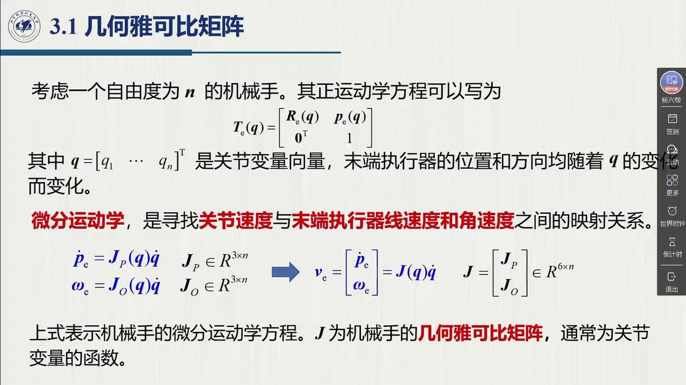
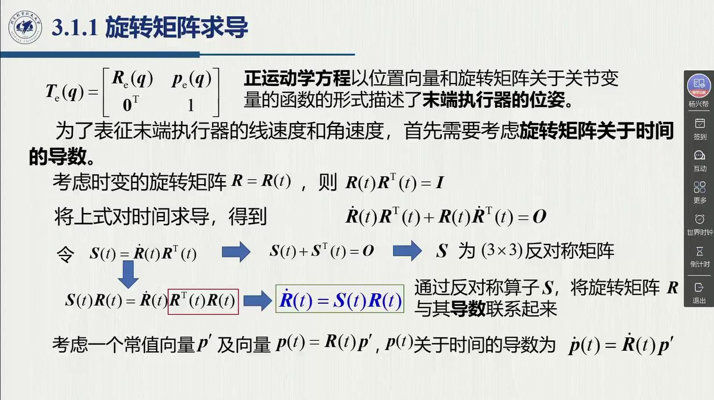
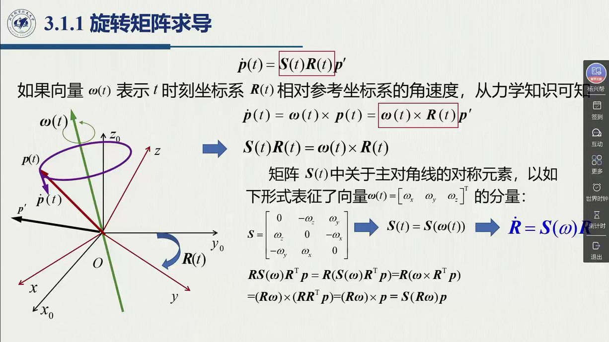
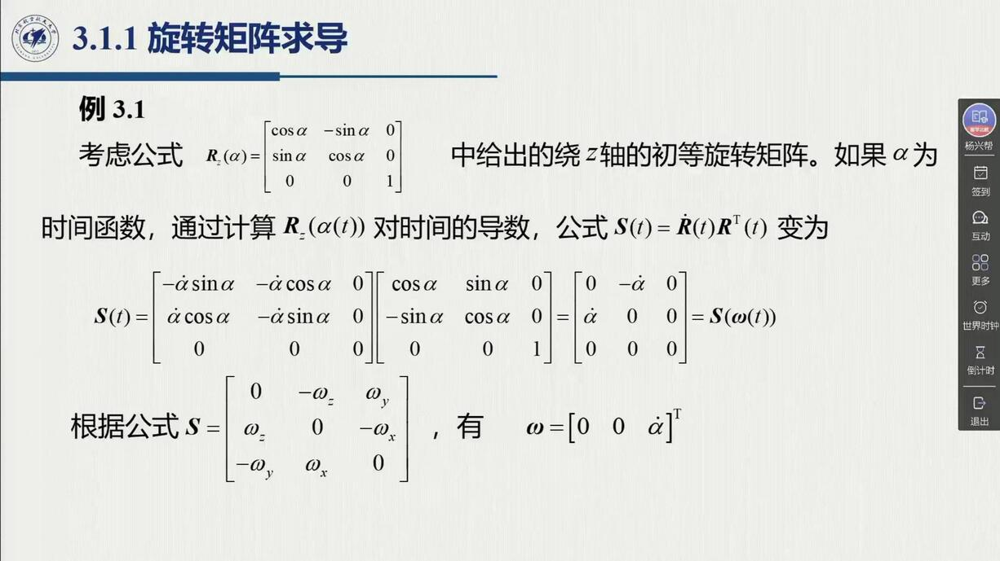
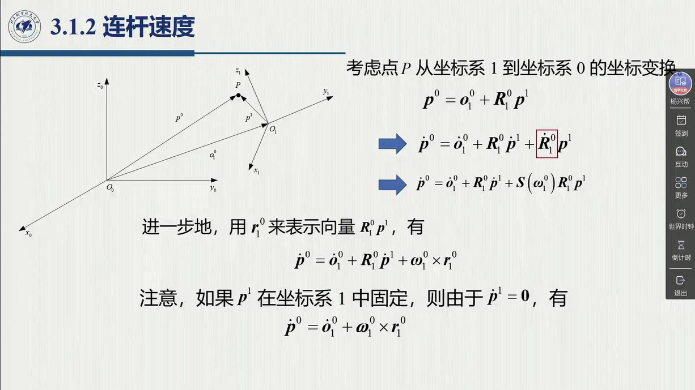
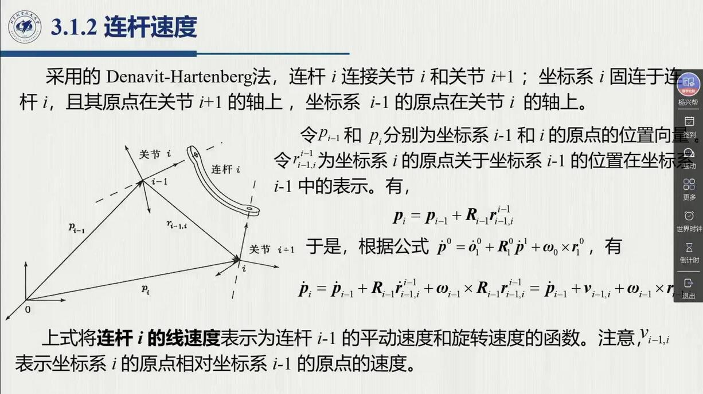
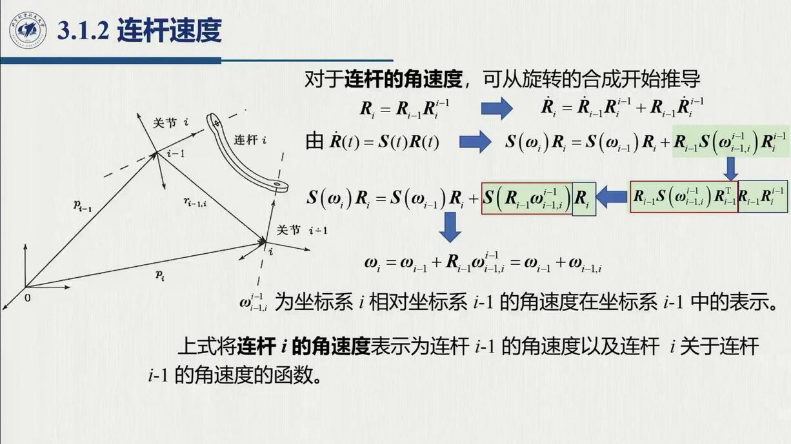
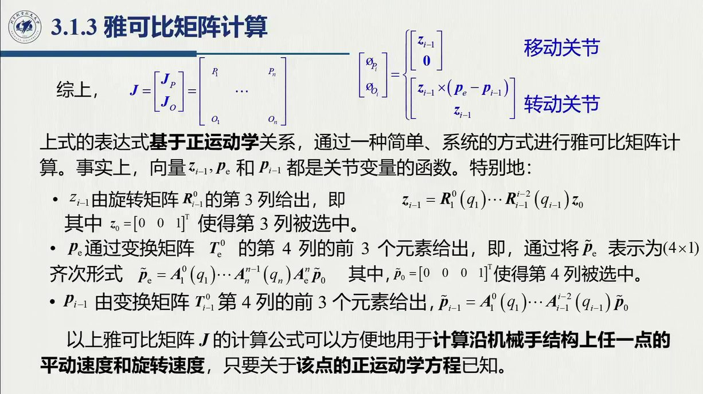
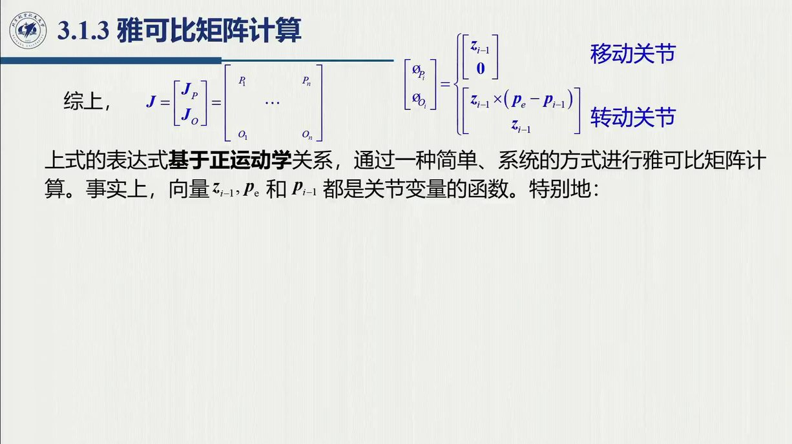
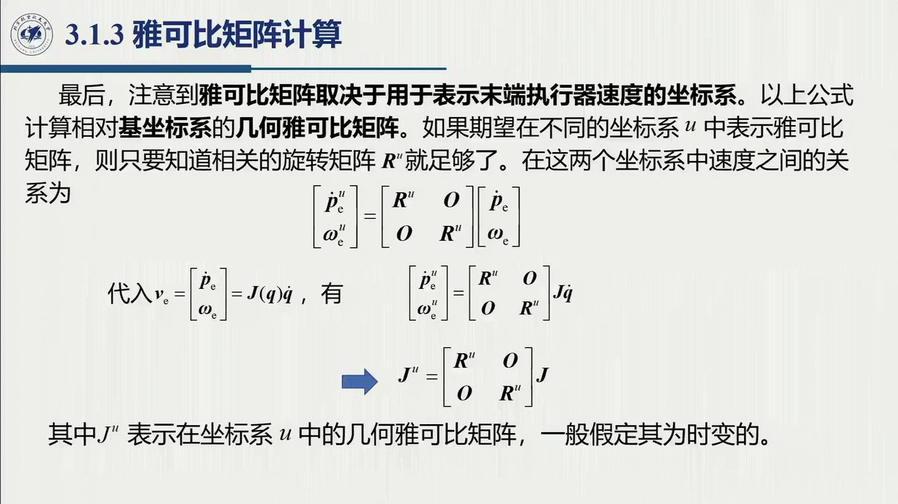

# 3.1 几何雅可比矩阵

把两连杆臂摆成第一杆朝右、第二杆朝上的姿势。锁住第一关节，只让第二关节逆时针转动一点，末端最先往哪边走？不必计算，画出第二根杆端点的小圆弧，就能判断它此刻向左运动。

第二章已经给出位置函数 $p(q)$。对它求导，可以算出刚才那段瞬时运动；用关节轴与力臂的叉乘，也能得到同一结果。本节会把各关节的速度贡献收进雅可比矩阵。在给定位形下，它对关节速度是线性映射，矩阵本身仍随位形变化。

先用两杆位置求导认识雅可比，再处理旋转和连杆速度，最后推导空间机构的逐列公式。例题与[两连杆第二关](../training/two-link.md#mission-velocity)使用同一类构形，可互相核对。课堂对应第3周课件第6–19页，截图供回看使用。

本节约定基座固定，关节为单自由度转动关节（R）或移动关节（P），工具与末杆固连。除显式上标外，向量均在基坐标系 $0$ 中表达。$R=R_e^0$ 把工具系分量变为基系分量，$p_e$ 是指定工具点的位置；关节变量可同时含弧度和米，不能把整列 $q$ 都当作角度。

### 先把位置变化算成一条速度方程

两杆长度分别为 $a_1,a_2$，末端位置是第二章已知的

$$p=\begin{bmatrix}a_1\cos q_1+a_2\cos(q_1+q_2)\\a_1\sin q_1+a_2\sin(q_1+q_2)\end{bmatrix}.$$

先只求横坐标的时间导数。第一段随 $q_1$ 转，第二段随 $q_1+q_2$ 转，因此

$$\dot p_x=-a_1\sin q_1\dot q_1-a_2\sin(q_1+q_2)(\dot q_1+\dot q_2).$$

把同一个关节速度的系数收在一起，再对纵坐标做相同处理：

$$\dot p=\begin{bmatrix}
-a_1\sin q_1-a_2\sin(q_1+q_2)&-a_2\sin(q_1+q_2)\\
a_1\cos q_1+a_2\cos(q_1+q_2)&a_2\cos(q_1+q_2)
\end{bmatrix}\begin{bmatrix}\dot q_1\\\dot q_2\end{bmatrix}.$$

这就是位置雅可比：每一列给一个关节速度的贡献，两列相加得到实际线速度。在开头的单位杆长位形 $q=(0,\pi/2)$，第二列为 $(-1,0)^{\mathrm T}$，所以只让第二关节以1 rad/s正转时，工具点向左运动1 m/s。

位置求导已经给出线速度。要描述工具刚体的完整运动，还需计算角速度；下面通过旋转矩阵求导建立这个关系，再把两部分合成空间机构的速度方程。

### 阅读前先会这三件事

1. **矩阵按元素求导，乘积保留次序。** 若 $A(t),B(t)$ 可微，则 $\frac{d}{dt}(AB)=\dot AB+A\dot B$。原因是 $(AB)_{ij}=\sum_k A_{ik}B_{kj}$，逐项用标量[乘积法则](../recall.md#chain-rule)即可。$\frac{d}{dt}(A^{\mathrm T})=\dot A^{\mathrm T}$；一般不能把 $A\dot B$ 改写成 $\dot BA$。
2. **偏导对应“只改一个输入”。** $p(q_1,\ldots,q_n)$ 的第 $i$ 个偏导是其他关节固定时的位置变化率；当所有 $q_i=q_i(t)$ 同时变化，链式法则把这些贡献相加。它正是雅可比按列构造的依据。
3. **叉乘给切向方向。** $a\times b=(a_yb_z-a_zb_y,\ a_zb_x-a_xb_z,\ a_xb_y-a_yb_x)^{\mathrm T}$，交换次序会反号。特别是 $e_z\times(x,y,z)^{\mathrm T}=(-y,x,0)^{\mathrm T}$：绕 $+z$ 正转时，朝右的力臂产生向上的瞬时速度。

主体推导只使用乘积求导、正交性与叉乘。后面的李群和李代数放在选读部分，说明这些矩阵关系如何统一描述；第一次学习可先完成逐列构造。

{{#include ../assets/figures/robot-jacobian.md}}

## 3.1.1 旋转矩阵求导：反对称算子登场

考虑 $n$ 自由度机械手，DH 法给出的正运动学

$$T_e^0(q)=\begin{bmatrix}R_e^0(q)&p_e(q)\\0^{\mathrm T}&1\end{bmatrix},
\qquad R_e^0=\begin{bmatrix}n_e&s_e&a_e\end{bmatrix}.$$

$R_e^0$ 与 $p_e$ 都是位形 $q$ 的函数。$n_e,s_e,a_e$ 是工具系三根轴在基系中的单位向量——也称法向、滑动、接近向量，见 [@def-2.8.2]。**微分运动学**要找的是：关节速度与这个工具点的线速度、工具刚体角速度之间的关系。

::: def 定义 3.1.1 · 微分运动学方程与几何雅可比 {#def-3.1.1}
末端执行器速度取六维堆叠 $v_e=\begin{bmatrix}\dot p_e\\\omega_e\end{bmatrix}$（$3$ 平动 $+3$ 转动），微分运动学方程为

$$\begin{bmatrix}\dot p_e\\ \omega_e\end{bmatrix}=J(q)\,\dot q=\begin{bmatrix}J_P\\ J_O\end{bmatrix}\dot q,\qquad J\in\mathbb R^{6\times n}$$

$J$ 称**几何雅可比矩阵**，是位形 $q$ 的函数；$J_P$（position）对应线速度、$J_O$（orientation）对应角速度，各 $3\times n$。$\omega_e$ 的三个分量是同一角速度向量在**基坐标系**三根轴上的分量，一般不等于三个欧拉角各自的导数，二者关系在 [§3.6](sec3-6.md) 推导。

这里的 $v_e$ 是按“线速度在前、角速度在后”堆叠的六维向量，前三项单位为 $\mathrm{m/s}$，后三项为 $\mathrm{rad/s}$。它不是任意六个姿态参数的导数，也不能与采用不同排列或不同参考点的空间速度直接混用。
:::

位置对时间的导数就是线速度。姿态由旋转矩阵描述，因此还需弄清矩阵的时间导数怎样对应物理角速度。

::: thm 定理 3.1.A · 旋转矩阵的导数与反对称算子 {#thm-3.1.A}
设 $R=R(t)$ 为时变旋转矩阵。由正交性 $RR^{\mathrm T}=I$，两边求导并用乘积法则：

$$\dot RR^{\mathrm T}+R\dot R^{\mathrm T}=0 .$$

记 $S\triangleq\dot RR^{\mathrm T}$，则 $S+S^{\mathrm T}=0$——$S$ **反对称**（对角线为零、非对角元素反对称）。将定义式两边右乘 $R$ 得

$$\dot R=S\,R .$$
:::

::: proof 把每次变形写清楚
旋转矩阵的三列始终正交且为单位向量，所以 $RR^{\mathrm T}=I$（[@def-2.2.2]）。对时间求导时右边为零，左边保留两个因子的先后次序：

$$\frac{d}{dt}(RR^{\mathrm T})=\dot RR^{\mathrm T}+R\dot R^{\mathrm T}=0.$$

定义 $S=\dot RR^{\mathrm T}$ 后，先算它的转置：

$$S^{\mathrm T}=(\dot RR^{\mathrm T})^{\mathrm T}=R\dot R^{\mathrm T}=-\dot RR^{\mathrm T}=-S.$$

最后用 $R^{\mathrm T}R=I$，在定义式**右边**乘 $R$：

$$SR=(\dot RR^{\mathrm T})R=\dot R(R^{\mathrm T}R)=\dot R.$$

这一步用结合律约去了相邻的旋转矩阵与转置，没有交换矩阵次序。得到“$S$ 反对称、$\dot R=SR$”后，还需确定 $S$ 与物理角速度的关系。
:::

**$S$ 里装的是什么？** 取与刚体固连的位移向量 $p'$，它在刚体系中的分量恒定，在基系中写成 $p(t)=R(t)p'$。向量从同一刚体基点指向目标点；这里先只考虑转动，不加入基点平移。对时间求导并代入 $\dot R=SR$：

$$\dot p(t)=S(t)\,R(t)\,p' .$$

另一方面，在短时间 $h$ 内，刚体绕瞬时单位轴 $u$ 转过 $\delta\theta=\|\omega\|h+O(h^2)$。位移向量在轴上的投影不变，垂直分量沿圆的切线移动，一阶位移为 $\delta\theta(u\times p)$。除以 $h$ 并令 $h\to0$，得到

$$\dot p(t)=\omega(t)\times p(t)=\omega\times R(t)p' .$$

于是 $Sp=\omega\times p$ 对刚体的**所有**位移向量都成立。只看一个点，通常无法唯一确定角速度：轴上的点即使速度为零，刚体仍可能绕轴转动。将三根独立基向量分别代入，便能确定下面的矩阵。

::: def 定义 3.1.2 · 叉乘算子 / 反对称矩阵 $S(\omega)$ {#def-3.1.2}
把叉乘逐分量展开，并把 $p_x,p_y,p_z$ 的系数按列收集（也可回看 [@def-2.5.2]）：

$$S(\omega)=\begin{bmatrix}0&-\omega_z&\omega_y\\ \omega_z&0&-\omega_x\\ -\omega_y&\omega_x&0\end{bmatrix},\qquad \omega=\begin{bmatrix}\omega_x\\\omega_y\\\omega_z\end{bmatrix},\qquad S(\omega)p\equiv\omega\times p$$

$S$ 的三个对角元素为零，另一侧由反对称性确定，所以只需三个独立数。它们与角速度分量的对应位置是 $\omega_x=S_{32}$、$\omega_y=S_{13}$、$\omega_z=S_{21}$。因而 $S$ 是角速度的**线性矩阵表示**，最终有

$$\dot R=S(\omega)\,R$$

（有的教材记 $S(\omega)=[\omega]_\times$ 或 $\hat\omega$，本编与原书统一用 $S(\cdot)$。）
:::

::: thm 定理 3.1.B · 旋转共轭保持叉乘 {#thm-3.1.B}
对任意旋转矩阵 $R$ 与向量 $\omega$：

$$R\,S(\omega)\,R^{\mathrm T}=S(R\omega).$$

即「先叉乘再旋转」等于「先旋转再叉乘」。**证明**：由「旋转保持叉积」（[@pf-2.5.rodrigues] 第 0 步已证：$R(a\times b)=(Ra)\times(Rb)$），对任意向量 $p$：

$$R\,S(\omega)\,R^{\mathrm T}p=R\big(\omega\times R^{\mathrm T}p\big)=(R\omega)\times\big(RR^{\mathrm T}p\big)=(R\omega)\times p=S(R\omega)\,p,$$

两边矩阵对一切 $p$ 给出相同向量，故相等。后面的角速度递推用它把局部角速度转换到基系。
:::

::: ex 例 3.1（原书）· 绕 $z$ 轴的时变旋转 {#ex-book-3.1}
已知 $\alpha=\alpha(t)$，记 $c_\alpha=\cos\alpha$、$s_\alpha=\sin\alpha$。先写姿态，再逐元素用链式法则：

$$R_z=\begin{bmatrix}c_\alpha&-s_\alpha&0\\s_\alpha&c_\alpha&0\\0&0&1\end{bmatrix},\qquad
\dot R_z=\dot\alpha\begin{bmatrix}-s_\alpha&-c_\alpha&0\\c_\alpha&-s_\alpha&0\\0&0&0\end{bmatrix}.$$

例如 $d(\cos\alpha)/dt=-\dot\alpha\sin\alpha$，固定的第三列导数为零。接着右乘当前姿态的转置：

$$\dot R_zR_z^{\mathrm T}=\dot\alpha
\begin{bmatrix}
-s_\alpha c_\alpha+c_\alpha s_\alpha&-s_\alpha^2-c_\alpha^2&0\\
c_\alpha^2+s_\alpha^2&c_\alpha s_\alpha-s_\alpha c_\alpha&0\\
0&0&0
\end{bmatrix}
=\begin{bmatrix}0&-\dot\alpha&0\\\dot\alpha&0&0\\0&0&0\end{bmatrix}.$$

这才是[反对称矩阵](../recall.md#skew) $S(\omega)$。按 $(S_{32},S_{13},S_{21})$ 摘出三个分量，得 $\omega=(0,0,\dot\alpha)^{\mathrm T}$。它与几何预测一致：始终绕基系 $+z$ 转，正速度对应逆时针。

**代入数字看三个对象的差别。** 当 $\alpha=\pi/2$、$\dot\alpha=2\ \mathrm{rad/s}$ 时，

$$R_z=\begin{bmatrix}0&-1&0\\1&0&0\\0&0&1\end{bmatrix},\qquad
\dot R_z=\begin{bmatrix}-2&0&0\\0&-2&0\\0&0&0\end{bmatrix},\qquad
S(\omega)=\begin{bmatrix}0&-2&0\\2&0&0\\0&0&0\end{bmatrix}.$$

$\dot R_z$ 此刻是对称矩阵，显然不能直接当作 $S(\omega)$。取随刚体转动的单位方向 $b=R_ze_x=(0,1,0)^{\mathrm T}$，则 $\dot b=\dot R_ze_x=(-2,0,0)^{\mathrm T}=\omega\times b$，方向向左。这里 $b$ 无长度单位，$\dot b$ 的单位为 $\mathrm{s^{-1}}$；若改为长 1 m 的位移向量，才得到数值相同、单位为 m/s 的点速度。

该例后续用于 [§3.2.1](sec3-2.md#sec-3.2.1) 和 [§3.7](sec3-7.md)。

:::

选读：旋转的切空间、李括号与指数映射

::: note 数学补充 · 从旋转集合到李代数 {#note-3.1.lie}
本段解释四个容易混淆的对象：姿态 $R$、沿姿态运动的导数 $\dot R$、反对称矩阵 $S(\omega)$ 和三维角速度 $\omega$。只用矩阵求导、级数与叉乘即可跟完。
:::

### 旋转为什么构成群，反对称矩阵为什么有三个自由量

三维旋转的集合记作

$$SO(3)=\{R\in\mathbb R^{3\times3}\mid R^{\mathrm T}R=I,\ \det R=1\}.$$

正交性保持长度和夹角，$\det R=1$ 排除镜像反射。这里的“群”表示旋转可依次合成：两个旋转相乘仍是旋转，单位元为 $I$，逆为 $R^{\mathrm T}$，乘法满足结合律。例如 $(R_1R_2)^{\mathrm T}(R_1R_2)=R_2^{\mathrm T}IR_2=I$，行列式也是 $1\cdot1=1$。但旋转不能任意线性相加：$I+I=2I$ 的列长度是 2，所以 $SO(3)$ 不是向量空间。

把所有 $3\times3$ 反对称矩阵组成的集合记作

$$so(3)=\{A\in\mathbb R^{3\times3}\mid A^{\mathrm T}=-A\}.
\qquad A=\begin{bmatrix}0&-a_z&a_y\\a_z&0&-a_x\\-a_y&a_x&0\end{bmatrix}.$$

这样的矩阵相加或乘实数仍反对称。每个矩阵又都能唯一写成 $a_xS(e_x)+a_yS(e_y)+a_zS(e_z)$，因此它是三维向量空间。$S:\mathbb R^3\to so(3)$ 又叫“戴帽”，逆操作 $A^\vee=(A_{32},A_{13},A_{21})^{\mathrm T}$ 叫“摘帽”。它们只改写同一组三个数；**戴帽不等于矩阵指数**。$S(\omega)$ 的元素随角速度有 $\mathrm{s^{-1}}$ 的单位，$hS(\omega)$ 才是用于有限增量的无量纲矩阵（弧度按无量纲处理）。

### 切空间：为什么求导后还要乘一次 $R^{\mathrm T}$

先考虑经过单位姿态的可微旋转曲线 $Q(s)$，满足 $Q(0)=I$。对 $QQ^{\mathrm T}=I$ 求导，在 $s=0$ 得 $Q'(0)+Q'(0)^{\mathrm T}=0$。所以曲线从单位姿态出发的瞬时方向一定反对称。

反过来，给任意反对称矩阵 $A$，用级数定义 $\exp(sA)=I+sA+s^2A^2/2!+\cdots$。因 $A$ 与 $-A$ 可交换，

$$\exp(sA)^{\mathrm T}\exp(sA)=\exp(-sA)\exp(sA)=I.$$

正交矩阵的行列式只能是 $\pm1$；该连续曲线在 $s=0$ 取 $I$，故行列式始终是 $+1$。又有 $\left.\frac{d}{ds}\exp(sA)\right|_{s=0}=A$。因此每个反对称矩阵都能作为这种瞬时方向；这些方向组成单位姿态处的**切空间** $T_I SO(3)=so(3)$。切空间描述“此刻能往哪里走”，不是另一组有限姿态。

在一般姿态 $R$ 处，可沿曲线 $\exp(sA)R$ 运动，导数为 $AR$；由前面的正交性求导，所有允许导数也都有这种形式：

$$T_R SO(3)=\{AR\mid A\in so(3)\}.$$

所以 $\dot R$ 属于当前 $R$ 处的切空间，一般不反对称。右乘 $R^{\mathrm T}$ 才把它变为单位姿态处的反对称矩阵。上例 $\alpha=\pi/2$ 时的对角阵 $\dot R_z$ 就是具体反例。

### 同一个角速度，为什么有基系和刚体系两套读数

假设 $R(t)$ 二次连续可微，对一个短时间 $h$，$R(t+h)=R+h\dot R+O(h^2)$。将两个姿态组成相对旋转，分别得到

$$\begin{aligned}
R(t+h)R(t)^{\mathrm T}&=I+h\underbrace{\dot RR^{\mathrm T}}_{\Omega_0}+O(h^2),\\
R(t)^{\mathrm T}R(t+h)&=I+h\underbrace{R^{\mathrm T}\dot R}_{\Omega_e}+O(h^2).
\end{aligned}$$

第一种增量从左作用在当前 $R$ 上，按固定基系表达；第二种从右作用，按当前刚体系表达。它们满足

$$\Omega_e=R^{\mathrm T}\Omega_0R=S(R^{\mathrm T}\omega^0),\qquad
\omega^0=(\dot RR^{\mathrm T})^\vee,\qquad
\omega^e=(R^{\mathrm T}\dot R)^\vee=R^{\mathrm T}\omega^0.$$

两套读数描述同一物理角速度，只是分量采用的坐标系不同。因此也可写 $\dot R=S(\omega^0)R=RS(\omega^e)$。本节其他位置省略上标时，$\omega$ 默认指 $\omega^0$。

### 李括号：它比普通的向量空间多了什么

李代数是带有**李括号**的向量空间；括号须对两个输入分别线性、满足 $[A,B]=-[B,A]$ 和 Jacobi 恒等式 $[A,[B,C]]+[B,[C,A]]+[C,[A,B]]=0$。矩阵李代数中取 $[A,B]=AB-BA$。分别线性与反对称性可以直接展开验证；把 Jacobi 恒等式的三个双重括号展开，$ABC,ACB,BAC,BCA,CAB,CBA$ 各出现一次正号和一次负号，也全部抵消。若 $A,B$ 反对称，还须验证结果仍在同一空间：

$$[A,B]^{\mathrm T}=B^{\mathrm T}A^{\mathrm T}-A^{\mathrm T}B^{\mathrm T}=BA-AB=-[A,B],$$

因此括号运算仍留在 $so(3)$ 中。普通乘法却没有这个性质，例如 $S(e_x)^2=\operatorname{diag}(0,-1,-1)$ 并不反对称。

对 $A=S(a)$、$B=S(b)$，用向量三重积恒等式作用于任意 $x$：

$$\begin{aligned}
[S(a),S(b)]x
&=a\times(b\times x)-b\times(a\times x)\\
&=b(a^{\mathrm T}x)-a(b^{\mathrm T}x)=(a\times b)\times x.
\end{aligned}$$

所以 $[S(a),S(b)]=S(a\times b)$。叉乘正对应这里的李括号；“三维向量与反对称矩阵同构”既可指戴帽的线性对应，也可在明确配上这两种括号后指李代数对应，不能说成有限姿态与角速度一一对应。括号衡量次序的差异。将 $\exp(hA)=I+hA+h^2A^2/2+O(h^3)$ 与 $\exp(hB)$ 相乘，两种次序的一次项和平方项相同，只剩交叉项之差：

$$\exp(hA)\exp(hB)-\exp(hB)\exp(hA)=h^2(AB-BA)+O(h^3).$$

### 指数映射：从瞬时方向走到有限旋转

当基系角速度 $\omega^0$ 在整个时间段恒定时，$\dot R=S(\omega^0)R$ 的解为

$$R(t+h)=\exp\!\big(hS(\omega^0)\big)R(t).$$

直接求导可核对该式满足微分方程与初值。若角速度随时间改变，把当前角速度放入这个指数只是一种局部近似，不能当作整段精确解。一次欧拉更新 $R+h\dot R=(I+hS)R$ 沿切线走，通常偏离旋转集合；其正交误差为

$$(I+hS)^{\mathrm T}(I+hS)-I=-h^2S^2.$$

对单位轴 $u$，令 $U=S(u)$。向量三重积给 $U^2=uu^{\mathrm T}-I$，再左乘 $U$，利用 $Uu=u\times u=0$ 得 $U^3=-U$。因此指数级数的奇次幂合成 $(\theta-\theta^3/3!+\cdots)U=\sin\theta U$，非零偶次幂合成 $(\theta^2/2!-\theta^4/4!+\cdots)U^2=(1-\cos\theta)U^2$，得到第二章的 Rodrigues 公式：

$$\exp(\theta U)=I+\sin\theta U+(1-\cos\theta)U^2.$$

它把有限旋转向量 $\phi=\theta u$ 映为姿态，却不是全局一一对应：绕同轴多转 $2\pi$ 会得到相同姿态。不同轴的矩阵一般不交换，所以也不能任意用 $\exp(A+B)=\exp(A)\exp(B)$。有限旋转向量的导数 $\dot\phi$ 一般不等于角速度；绕固定单轴是相等的特例。

::: think 操作实验 · 圆弧、切线和旋转导数
一根长 1 m 的杆绕固定 $+z$ 轴匀速转动。先预测：在 $\alpha=90^\circ$、$\dot\alpha=2\ \mathrm{rad/s}$ 时，杆端切线朝哪边？再把步长 $h$ 从 0.5 s 缩小到 0.01 s，比较圆弧终点和切线预测。哪些量随步长变，哪些是当前时刻的导数？

图上实线表示当前杆，圆上的点表示精确旋转后的位置，切线上的点表示 $p+h\dot p$。精确点来自 $\exp(hS)R$，切线预测来自 $(I+hS)R$。本实验只模拟恒定单轴角速度；下例再处理两根不平行轴。无脚本时可按下面的数字纸笔核对。

::: sol 数字核对
取 $\alpha=\pi/2$、$\dot\alpha=2$、$h=0.5$，当前杆端 $p=(0,1)$ m，$\dot p=(-2,0)$ m/s。精确点为 $(-\sin1,\cos1)\approx(-0.841471,0.540302)$ m，切线预测为 $(-1,1)$ m。后者距原点 $\sqrt2$ m，已经不在单位圆上；正交误差矩阵的最大绝对元素为 $(h\dot\alpha)^2=1$。若 $h=0.01$ s，该误差降到 $0.0004$，但导数仍是 $(-2,0)$ m/s。
:::
:::

::: ex 补充例 · 两轴组合旋转的角速度必须换基 {#ex-3.1.two-axes}
设 $R=R_z(\alpha)R_x(\beta)$，两角都随时间变化。记 $Z=R_z(\alpha)$、$X=R_x(\beta)$。乘积求导后分别求两种角速度矩阵：

$$\begin{aligned}
\dot R R^{\mathrm T}
&=(\dot ZX+Z\dot X)X^{\mathrm T}Z^{\mathrm T}\\
&=\dot ZZ^{\mathrm T}+Z(\dot XX^{\mathrm T})Z^{\mathrm T}\\
&=S(\dot\alpha e_z)+S(\dot\beta Ze_x).
\end{aligned}$$

因 $Ze_x=(\cos\alpha,\sin\alpha,0)^{\mathrm T}$，基系分量为

$$\omega^0=(\dot\beta\cos\alpha,\ \dot\beta\sin\alpha,\ \dot\alpha)^{\mathrm T}.$$

第二个转动轴随第一个转动转向，不能一直当作基系 $e_x$。换到刚体系，也可直接从乘积求导算：

$$\begin{aligned}
R^{\mathrm T}\dot R
&=X^{\mathrm T}(Z^{\mathrm T}\dot Z)X+X^{\mathrm T}\dot X\\
&=S(\dot\alpha X^{\mathrm T}e_z)+S(\dot\beta e_x),\\
\omega^e&=(\dot\beta,\ \dot\alpha\sin\beta,\ \dot\alpha\cos\beta)^{\mathrm T}.
\end{aligned}$$

取 $\alpha=\beta=\pi/2$、$\dot\alpha=1$、$\dot\beta=2$，得到 $\omega^0=(0,2,1)^{\mathrm T}$、$\omega^e=(2,1,0)^{\mathrm T}$，单位均为 rad/s。这时

$$R=\begin{bmatrix}0&0&1\\1&0&0\\0&1&0\end{bmatrix},\qquad
R^{\mathrm T}\begin{bmatrix}0\\2\\1\end{bmatrix}=\begin{bmatrix}2\\1\\0\end{bmatrix}.$$

两套分量不同，长度都为 $\sqrt5$；这也是换基结果的独立检查。直接把两个角的导数拼成基系角速度 $(2,0,1)$ 会错，原因是漏掉第二根轴的转向。
:::

::: think 理解自检 · 四个对象放在哪个集合里 {#practice-3.1.lie}
仍取例 3.1 的 $\alpha=\pi/2$、$\dot\alpha=2$，回答：$R$、$\dot R$、$\dot RR^{\mathrm T}$ 各属于什么集合？$I+0.5S(\omega)$ 是旋转吗？把 $S(\omega)$ 摘帽和对它取指数，分别得到什么类型的对象？

::: sol 核对
$R\in SO(3)$；$\dot R\in T_RSO(3)$，本例它是对角阵 $\operatorname{diag}(-2,-2,0)$，不在 $so(3)$；$\dot RR^{\mathrm T}\in so(3)$。$I+0.5S(\omega)$ 的前两列长度都是 $\sqrt2$，不是旋转矩阵。摘帽得到角速度向量 $(0,0,2)$ rad/s；指数须先乘时间 $h$，$\exp(hS(\omega))$ 得到恒定角速度在这段时间积累的有限旋转。补一问：为什么只测一个轴上点的速度不够？因为该点速度可为零，不能据此排除绕该轴转动。
:::
:::

## 3.1.2 连杆速度：三项合成与两条递推

有了单个刚体的角速度关系，就可以沿关节链计算各连杆的运动。先对移动坐标系中的点求导，区分原点平移、坐标轴转动和点的相对运动；再把这个点取为下一连杆的原点，便得到递推式。

**（a）点的速度合成。** 设点 $P$ 在坐标系 $1$ 中的位置为 $p^1$，坐标系 $1$ 的原点在基系 $0$ 中为 $o_1^0$、姿态为 $R_1^0$：

$$p^0=o_1^0+R_1^0\,p^1 .$$

两个加数必须采用同一表达基：$p^1$ 先乘 $R_1^0$，才能与 $o_1^0$ 相加。两边求时间导数，记 $r_1^0\triangleq R_1^0p^1$（从原点 $o_1$ 指向 $P$ 的位移在基系中的表示），姿态项用 [@thm-3.1.A]：

$$\dot p^0=\dot o_1^0+\dot R_1^0p^1+R_1^0\dot p^1
=\underbrace{\dot o_1^0}_{\text{原点速度}}+\underbrace{\omega_1\times r_1^0}_{\text{牵连转动}}+\underbrace{R_1^0\dot p^1}_{\text{相对速度}}$$

三项合起来，正是大学物理里的「绝对速度 = 牵连速度 + 相对速度」；若 $P$ 与刚体固联（$\dot p^1=0$），就得到刚体两点速度关系 $\dot p=\dot o+\omega\times r$，基点 $o$ 仍可平移。相对速度项仍带 $R_1^0$——同样是「先转到同一坐标系再相加」。

**把三项分别算一次。** 在某时刻取 $R_1^0=R_z(\pi/2)$、$p^1=(1,0,0)^{\mathrm T}$ m、$\dot p^1=(0.2,0,0)^{\mathrm T}$ m/s，同时 $\dot o_1^0=(1,0,0)^{\mathrm T}$ m/s、$\omega_1=(0,0,2)^{\mathrm T}$ rad/s。于是

$$r_1^0=(0,1,0)^{\mathrm T},\quad
\omega_1\times r_1^0=(-2,0,0)^{\mathrm T},\quad
R_1^0\dot p^1=(0,0.2,0)^{\mathrm T}.$$

最后把三个基系速度相加：$\dot p^0=(1,0,0)+(-2,0,0)+(0,0.2,0)=(-1,0.2,0)$ m/s。局部的 $+x_1$ 此刻正好朝基系 $+y_0$，所以相对速度贡献在基系第二分量上；不旋转它就会算错方向。

**（b）DH 建系回顾与记号。** 沿用第 2 章的标准 DH：关节 $i$ 的轴为 $z_{i-1}$，$T_i^0=T_{i-1}^0A_i^{i-1}$，其中 $A_i^{i-1}=R_z(\vartheta_i)T_z(d_i)T_x(a_i)R_x(\alpha_i)$。不要与修改 DH 的变换次序和参数下标混用。记 $p_{i-1},p_i$ 为两坐标系原点在基系中的位置，$r_{i-1,i}^{i-1}$ 为坐标系 $i$ 原点相对 $i-1$ 原点的位移、采用 $i-1$ 系表达，则

$$p_i=p_{i-1}+R_{i-1}\,r_{i-1,i}^{i-1}.$$

下面省略的向量上标均指基系表达，相对量仍保留上标 $^{i-1}$。例如 $R_{i-1}$ 是 $R_{i-1}^0$ 的简写，而 $r_{i-1,i}^{i-1}$ 的三个分量仍沿第 $i-1$ 系的轴给出。相加前需把它转到基系。

**（c）连杆线速度递推。** 对上式求时间导数（即把（a）的公式套到两连杆之间），记基系表示 $r_{i-1,i}=R_{i-1}r_{i-1,i}^{i-1}$：

$$\begin{aligned}
\dot p_i
&=\dot p_{i-1}+\dot R_{i-1}r_{i-1,i}^{i-1}+R_{i-1}\dot r_{i-1,i}^{i-1}\\
&=\dot p_{i-1}+S(\omega_{i-1})R_{i-1}r_{i-1,i}^{i-1}+R_{i-1}\dot r_{i-1,i}^{i-1}\\
&=\dot p_{i-1}+\omega_{i-1}\times r_{i-1,i}+R_{i-1}\dot r_{i-1,i}^{i-1}.
\end{aligned}$$

三个加数依次是前一原点速度、前一坐标系旋转造成的牵连速度，以及局部位移分量改变造成的相对速度。固定基座给初值 $\dot p_0=0$、$\omega_0=0$。

**（d）连杆角速度递推。** 从旋转合成 $R_i=R_{i-1}R_i^{i-1}$ 出发，两边求导并用 $\dot R=SR$：

$$S(\omega_i)R_i=S(\omega_{i-1})\,R_{i-1}R_i^{i-1}+R_{i-1}S(\omega_{i-1,i}^{i-1})R_i^{i-1}$$

右乘 $R_i^{\mathrm T}=(R_i^{i-1})^{\mathrm T}R_{i-1}^{\mathrm T}$，将各项完整约去：

$$\begin{aligned}
S(\omega_i)
&=S(\omega_{i-1})R_iR_i^{\mathrm T}
+R_{i-1}S(\omega_{i-1,i}^{i-1})R_i^{i-1}(R_i^{i-1})^{\mathrm T}R_{i-1}^{\mathrm T}\\
&=S(\omega_{i-1})+R_{i-1}S(\omega_{i-1,i}^{i-1})R_{i-1}^{\mathrm T}\\
&=S(\omega_{i-1})+S(R_{i-1}\omega_{i-1,i}^{i-1})\\
&=S\!\left(\omega_{i-1}+R_{i-1}\omega_{i-1,i}^{i-1}\right).
\end{aligned}$$

第二行到第三行用旋转共轭公式 [@thm-3.1.B]，最后用 $S$ 的线性。由于摘帽能唯一还原向量，得到

$$\omega_i=\omega_{i-1}+R_{i-1}\,\omega_{i-1,i}^{i-1}$$

其中 $\omega_{i-1,i}^{i-1}$ 是坐标系 $i$ 相对 $i-1$ 的角速度在 $i-1$ 系中的表示。相对角速度先换成基系分量，再与 $\omega_{i-1}$ 相加；上面的矩阵推导说明了角速度合成的来源，不能用有限旋转角直接相加来代替。

**（e）单个关节的特例（组装雅可比的零件）。** 标准 DH 变换的平移列为

$$r_{i-1,i}^{i-1}=\begin{bmatrix}a_i\cos\vartheta_i\\a_i\sin\vartheta_i\\d_i\end{bmatrix}.$$

相邻坐标系之间只有一个关节变量，其余 DH 参数固定：

- 关节 $i$ 为**转动关节**（变量 $\vartheta_i$）：$\omega_{i-1,i}^{i-1}=\dot\vartheta_i\,z_{i-1}^{i-1}$，$\dot r_{i-1,i}^{i-1}=\dot\vartheta_i(z_{i-1}^{i-1}\times r_{i-1,i}^{i-1})$，一般不为零。变到基系后 $R_{i-1}\omega_{i-1,i}^{i-1}=\dot\vartheta_i z_{i-1}$；
- 关节 $i$ 为**移动关节**（变量 $d_i$）：$\omega_{i-1,i}^{i-1}=0$，$r_{i-1,i}^{i-1}$ 沿轴伸缩，$\dot r_{i-1,i}^{i-1}=\dot d_i\,z_{i-1}^{i-1}$。

其中 $z_{i-1}^{i-1}=[0,0,1]^{\mathrm T}$ 是该轴在局部坐标系中的表示，$z_{i-1}=R_{i-1}z_{i-1}^{i-1}$ 是同一轴在基系中的表示。

把局部导数展开，就能看出转动关节为什么还有相对平移项：

$$\dot r_{i-1,i}^{i-1}
=\dot\vartheta_i\begin{bmatrix}-a_i\sin\vartheta_i\\a_i\cos\vartheta_i\\0\end{bmatrix}
=\dot\vartheta_i\left(\begin{bmatrix}0\\0\\1\end{bmatrix}\times
\begin{bmatrix}a_i\cos\vartheta_i\\a_i\sin\vartheta_i\\d_i\end{bmatrix}\right).$$

转到基系，$R_{i-1}\dot r=\dot\vartheta_i z_{i-1}\times r_{i-1,i}$，与牵连项合起来是 $(\omega_{i-1}+\dot\vartheta_i z_{i-1})\times r=\omega_i\times r$。移动关节则只改变第三个分量，直接得 $R_{i-1}\dot r=\dot d_i z_{i-1}$。

转动关节的距离参数 $a_i,d_i$ 固定，**不代表平移列的三个分量固定**。把上面的 $\dot r$ 代入（c），两类关节的递推分别成为

$$\begin{aligned}
\text{转动：}\quad &\omega_i=\omega_{i-1}+\dot\vartheta_i z_{i-1},\qquad
\dot p_i=\dot p_{i-1}+\omega_i\times r_{i-1,i},\\
\text{移动：}\quad &\omega_i=\omega_{i-1},\qquad
\dot p_i=\dot p_{i-1}+\omega_{i-1}\times r_{i-1,i}+\dot d_i z_{i-1}.
\end{aligned}$$

注意：通用三项式中的牵连项用 $\omega_{i-1}$；转动关节将相对项合并后，才可以写成 $\omega_i\times r$。

::: think 递推练习 · 固定杆长为什么仍有相对速度 {#practice-3.1.recursion}
取单个转动关节，基座固定，$a_1=0.8\ \mathrm m$、$d_1=0.2\ \mathrm m$、$\vartheta_1=\pi/2$、$\dot\vartheta_1=0.5\ \mathrm{rad/s}$。求 $r_{0,1}^0$、$\dot r_{0,1}^0$、$\dot p_1$ 和 $\omega_1$。若把 $\dot r$ 错设为零，会预测出什么运动？

::: sol 核对
$r_{0,1}^0=(0,0.8,0.2)^{\mathrm T}\ \mathrm m$，$\dot r_{0,1}^0=(-0.4,0,0)^{\mathrm T}\ \mathrm{m/s}$。基座的 $\dot p_0=0,\omega_0=0$，所以三项式给 $\dot p_1=(-0.4,0,0)^{\mathrm T}\ \mathrm{m/s}$，角速度递推给 $\omega_1=(0,0,0.5)^{\mathrm T}\ \mathrm{rad/s}$。漏掉相对项就会错误预测末端静止；画出绕 $z$ 轴的圆周即可排除它。
:::
:::

## 3.1.3 雅可比矩阵的计算：逐列构造（绿框）

§3.1.2沿关节链累加速度。现在把累加结果按关节拆开：固定其余关节，只保留一个关节的运动贡献，就能得到雅可比 $J$ 的一列。

**线速度。** $p_e(q)$ 是 $q$ 的函数、$q$ 又是时间的函数，复合求导：

$$\dot p_e=\sum_{i=1}^{n}\frac{\partial p_e(q)}{\partial q_i}\,\dot q_i=J_P\,\dot q .$$

每一项表示**其余关节全部锁死时，单个关节的速度对末端线速度的贡献**。只放开关节 $i$ 时，下游所有杆与工具连成一个刚体：

- 关节 $i$ **移动**：纯平移，$\dfrac{\partial p_e}{\partial q_i}=z_{i-1}$；
- 关节 $i$ **转动**：$i\sim n$ 段连成刚体绕轴 $z_{i-1}$ 定轴转动，$\omega=\dot\vartheta_i z_{i-1}$，矢径 $p_e-p_{i-1}$，故 $\dfrac{\partial p_e}{\partial q_i}=z_{i-1}\times(p_e-p_{i-1})$。

具体说，转动时刚体两点速度式给 $\dot p_e=\dot\vartheta_i z_{i-1}\times(p_e-p_{i-1})$；链式法则在同一条件下给 $\dot p_e=(\partial p_e/\partial\vartheta_i)\dot\vartheta_i$。两式对任意 $\dot\vartheta_i$ 成立，所以系数相等。$p_{i-1}$ 是轴上的一个点；若换成同轴另一点 $p_{i-1}+\lambda z_{i-1}$，额外叉乘 $z_{i-1}\times\lambda z_{i-1}=0$，结果不变。移动关节则整个下游刚体平移 $\delta d_i z_{i-1}$，除以 $\delta d_i$ 即得位置偏导 $z_{i-1}$。

**角速度。** 由固定基座的 $\omega_0=0$ 出发，对每个关节重复应用角速度递推。R 关节增加 $\dot q_i z_{i-1}$，P 关节增加零。工具固连变换的旋转部分为常量，$R_e=R_nR_e^n$ 给 $\dot R_eR_e^{\mathrm T}=\dot R_nR_n^{\mathrm T}$，所以 $\omega_e=\omega_n$，最终

$$\omega_e=\omega_n=\sum_{i=1}^{n}R_{i-1}\,\omega_{i-1,i}^{i-1}=\sum_{i=1}^{n}J_{O_i}\,\dot q_i .$$

**逐列取法与绿框公式。** 把线速度与角速度两部分的结论合起来，就得到逐列的取法：

::: thm 定理 3.1.C · 几何雅可比的逐列构造 {#thm-3.1.C}

$$J=\begin{bmatrix}J_1&\cdots&J_i&\cdots&J_n\end{bmatrix},\qquad
J_i=\begin{bmatrix}J_{P_i}\\ J_{O_i}\end{bmatrix}.$$

转动关节的列为

$$J_i^{(R)}=\begin{bmatrix}z_{i-1}\times(p_e-p_{i-1})\\z_{i-1}\end{bmatrix},$$

移动关节的列为

$$J_i^{(P)}=\begin{bmatrix}z_{i-1}\\\boldsymbol 0\end{bmatrix}.$$

（课件用关节标志 $\sigma_i$ 区分两类关节：转动 $\sigma_i=0$、移动 $\sigma_i=1$，上式两列取法据此二选一。）
:::

**单位也能帮助检查列。** 转动列的 $J_{P_i}$ 是“米／弧度”，乘 rad/s 后成为 m/s；$J_{O_i}$ 是单位轴，乘关节角速度后成为 rad/s。移动列的 $J_{P_i}$ 无量纲，乘 m/s 得线速度，角速度贡献为零。混合 R/P 机构的不同列不能一律按角度单位解释；六维速度的上下三行也不能直接相加比较大小。

<figure>
<svg class="figure-svg" viewBox="0 0 920 478" xmlns="http://www.w3.org/2000/svg" role="img" aria-labelledby="fig-jc-t fig-jc-d">
<title id="fig-jc-t">雅可比逐列构造的物理含义</title>
<desc id="fig-jc-d">左侧三连杆平面臂只驱动第二个关节、其余关节锁死，末端沿垂直于矢径的方向产生速度；右侧给出转动列与移动列两种取法。</desc>
<defs>
<marker id="ar-x" markerHeight="8" markerWidth="8" orient="auto" refX="6" refY="3"><path d="M0,0 L7,3 L0,6 Z" fill="context-stroke"/></marker>
<marker id="ar-xs" markerHeight="8" markerWidth="8" orient="auto-start-reverse" refX="6" refY="3"><path d="M0,0 L7,3 L0,6 Z" fill="context-stroke"/></marker>
</defs>
<g font-family="var(--sans)">
<line class="diagram-axis" x1="120" x2="120" y1="330" y2="212"/>
<line class="diagram-axis" x1="120" x2="252" y1="330" y2="330"/>
<text class="diagram-note" x="112" y="206">y<tspan class="sb">0</tspan></text>
<text class="diagram-note" x="258" y="335">x<tspan class="sb">0</tspan></text>
<line stroke="var(--ink-2)" stroke-width="5" x1="120" x2="288" y1="330" y2="300"/>
<line stroke="var(--ink-2)" stroke-width="5" x1="288" x2="430" y1="300" y2="176"/>
<line stroke="var(--ink-2)" stroke-width="5" x1="430" x2="546" y1="176" y2="118"/>
<circle class="diagram-fill-sage" cx="120" cy="330" r="8"/>
<circle class="diagram-fill-accent" cx="288" cy="300" r="9"/>
<circle class="diagram-fill-sage" cx="430" cy="176" r="8"/>
<circle cx="546" cy="118" r="6" fill="var(--paper)" stroke="var(--line-strong)" stroke-width="1.2"/>
<text class="diagram-text" x="560" y="116">p<tspan class="sb">e</tspan></text>
<text class="diagram-note" text-anchor="end" x="106" y="350">关节 1（锁死）</text>
<text class="diagram-text" fill="var(--accent-text)" text-anchor="middle" x="268" y="278">关节 2（只动它）</text>
<text class="diagram-note" text-anchor="start" x="444" y="198">关节 3（锁死）</text>
<circle cx="288" cy="300" r="17" fill="none" stroke="var(--accent-text)" stroke-width="1.4"/>
<circle cx="288" cy="300" r="3.5" fill="var(--accent-text)"/>
<text class="diagram-note" fill="var(--accent-text)" x="312" y="344">z<tspan class="sb">1</tspan> 出纸面（关节 2 的转动轴）</text>
<line stroke="var(--fig-red)" stroke-dasharray="6 4" stroke-width="1.6" x1="288" x2="546" y1="300" y2="118"/>
<text class="diagram-note" fill="var(--fig-red)" text-anchor="end" x="430" y="252">r = p<tspan class="sb">e</tspan> − p<tspan class="sb">1</tspan></text>
<line data-jacobian-tangent="positive" stroke="var(--fig-green)" stroke-width="2.6" marker-end="url(#ar-x)" x1="546" x2="491.4" y1="118" y2="40.6"/>
<text class="diagram-text" fill="var(--fig-green)" x="590" y="156">J<tspan class="sb">P₂</tspan> q′<tspan class="sb">2</tspan> = (z<tspan class="sb">1</tspan> × r) q′<tspan class="sb">2</tspan></text>
<text class="diagram-note" fill="var(--fig-green)" x="590" y="180">q′₂ &gt; 0：向左上，垂直于 r</text>
<line stroke="var(--line)" stroke-dasharray="4 5" x1="24" x2="896" y1="396" y2="396"/>
<text class="diagram-text" x="24" y="424">转动关节 i：</text>
<text class="diagram-mono" x="152" y="424">J<tspan class="sb">i</tspan> = [ z<tspan class="sb">i−1</tspan> × (p<tspan class="sb">e</tspan> − p<tspan class="sb">i−1</tspan>) ; z<tspan class="sb">i−1</tspan> ]</text>
<text class="diagram-text" x="486" y="424">移动关节 i：</text>
<text class="diagram-mono" x="612" y="424">J<tspan class="sb">i</tspan> = [ z<tspan class="sb">i−1</tspan> ; 0 ]</text>
<text class="diagram-note" x="24" y="448">z<tspan class="sb">i−1</tspan> 取 T<tspan class="sb">i−1</tspan><tspan class="sp">0</tspan> 的第三列前三行；p<tspan class="sb">i−1</tspan>、p<tspan class="sb">e</tspan> 分别取 T<tspan class="sb">i−1</tspan><tspan class="sp">0</tspan>、T<tspan class="sb">e</tspan><tspan class="sp">0</tspan> 的第四列前三行</text>
</g></svg>
<figcaption>逐列构造的物理图像（本教程绘）：**其余关节全部锁死、只以单位速度驱动第 $i$ 个关节**，末端产生的速度就是第 $i$ 列。左图锁死关节 1 与 3、只驱动关节 2：$i\sim n$ 段（杆 2、杆 3）连成一个刚体绕轴 $z_1$ 定轴转动，末端速度方向垂直于矢径 $\boldsymbol p_e-\boldsymbol p_{i-1}$——这正是 $z_{i-1}\times(\boldsymbol p_e-\boldsymbol p_{i-1})$ 的几何内容。移动关节不转，故角速度行取零。</figcaption>
</figure>

**所需量全部来自正运动学**：

- $z_{i-1}$ = 旋转矩阵 $R_{i-1}$（即 $T_{i-1}^0$ 的左上 $3\times3$ 块）的**第三列**；
- $p_{i-1}$ = $T_{i-1}^0$ 第四列前三行；$p_e$ = $T_e^0=T_n^0T_e^n$ 第四列前三行。这里 $T_e^n$ 是工具的固连变换；若末端点就是第 $n$ 系原点，才可直接取 $T_n^0$ 的平移列。

工具偏置改变转动列的力臂，因而通常改变 $J_P$；固连工具与末杆角速度相同，$J_O$ 不变。移动列的 $J_P=z_{i-1}$ 也不受固连工具偏置影响。

连乘 $T_n^0=A_1^0\cdots A_n^{n-1}$ 时，保存中间结果 $T_1^0,\dots,T_{n-1}^0$。组装每列时，从中读取关节轴和原点，结合工具位置计算叉乘，再将线速度与角速度部分上下排列。若目标点位于中间连杆，只保留上游关节的贡献，下游关节对应列取零。

::: think 常见错误 · 不能预设 $z_{i-1}=[0,0,1]^{\mathrm T}$
一般应取 $z_{i-1}=R_{i-1}$ 第三列，不能预设数值。例如 $R_{i-1}=R_x(\pi/2)$ 时，第三列为 $(0,-1,0)^{\mathrm T}$，该关节实际绕基系 $-y$ 轴转。平面臂各转轴平行时，它们可以都等于 $[0,0,1]^{\mathrm T}$，那是特殊结构。
:::

::: ex 例 3.1.D · 用叉乘与偏导独立算出同一个雅可比 {#ex-3.1.D}
平面 2R 臂取 $l_1=l_2=1\ \mathrm m$，$q_1=0$、$q_2=\pi/2$；两转轴都沿基系 $+z$。
关节速度为 $\dot q=(1,-1)^{\mathrm T}\ \mathrm{rad/s}$。求末端线速度与角速度。

::: sol 解
由正运动学，$p_0=(0,0,0)^{\mathrm T}$、$p_1=(1,0,0)^{\mathrm T}$、$p_e=(1,1,0)^{\mathrm T}$。
按 [@thm-3.1.C]，两列的线速度部分为

$$z_0\times(p_e-p_0)=(-1,1,0)^{\mathrm T},\qquad
z_1\times(p_e-p_1)=(-1,0,0)^{\mathrm T}.$$

所以

$$J=\begin{bmatrix}-1&-1\\1&0\\0&0\\0&0\\0&0\\1&1\end{bmatrix},\qquad
J\dot q=(0,1,0,0,0,0)^{\mathrm T}.$$

前三项给 $\dot p_e=(0,1,0)^{\mathrm T}\ \mathrm{m/s}$，后三项给 $\omega_e=0$。这里 $v_e$ 按定义 3.1.1 表示完整的六维速度，线速度单独写作 $\dot p_e$。
**末端指向不变，不等于末端位置不动**：两关节角速度抵消，但两个关节的力臂不同，线速度贡献没有完全抵消。

再走一条独立路径。先对一般杆长写出位置：

$$p_e=\begin{bmatrix}l_1\cos q_1+l_2\cos(q_1+q_2)\\l_1\sin q_1+l_2\sin(q_1+q_2)\\0\end{bmatrix}.$$

求 $q_1$ 偏导时，两项中的角度都变化；求 $q_2$ 偏导时，第一杆项不变。因此

$$\frac{\partial p_e}{\partial q_1}=\begin{bmatrix}-l_1\sin q_1-l_2\sin(q_1+q_2)\\l_1\cos q_1+l_2\cos(q_1+q_2)\\0\end{bmatrix},\qquad
\frac{\partial p_e}{\partial q_2}=\begin{bmatrix}-l_2\sin(q_1+q_2)\\l_2\cos(q_1+q_2)\\0\end{bmatrix}.$$

代入 $l_1=l_2=1$、$\sin q_1=0$、$\cos q_1=1$、$\sin(q_1+q_2)=1$、$\cos(q_1+q_2)=0$，分别得到 $(-1,1,0)^{\mathrm T}$ 和 $(-1,0,0)^{\mathrm T}$，与叉乘法一致。两列乘速度后的贡献为 $(-1,1,0)$ 与 $(1,0,0)$ m/s，相加得到 $(0,1,0)$ m/s。姿态是 $R_z(q_1+q_2)$，其角速度为 $(0,0,\dot q_1+\dot q_2)^{\mathrm T}=0$，也与雅可比后半块相符。
若叉乘法与偏导法差一个负号，应先检查叉乘顺序，而不是改关节速度符号。
:::
:::

::: think 操作实验 · 把每一列变成速度箭头
先预测，再选「只动关节 2」：末端是否向左？选择「角速度抵消」，观察两支线速度贡献为何仍留下向上的总速度。随后把工具加长到 0.5 m：哪些列改变？在 $\dot q=(1,-1)$ 时，总速度是否也一定改变？最后切到「伸直位形」，核对下一题的 $x$ 向瞬时速度结论。

两根杆各 1 m；工具沿第二杆方向固连。角度输入用度，计算和关节速度用弧度。画布箭头使用统一的速度比例，与杆长比例分开标注；表格展示 $6\times2$ 几何雅可比的有效三行，另三行恒为零。无脚本时可用例 3.1.D 和下方练习完成核对。

::: sol 工具偏置核对
在 $q=(0,\pi/2)$、工具长 0.5 m 时，位置块两列变为 $(-1.5,1,0)^{\mathrm T}$、$(-1.5,0,0)^{\mathrm T}$；角速度列仍都是 $(0,0,1)^{\mathrm T}$。只动第二关节 $1\ \mathrm{rad/s}$ 时，$v=(-1.5,0,0)^{\mathrm T}\ \mathrm{m/s}$；若 $\dot q=(1,-1)$，工具偏置的额外速度恰好抵消，总速度仍为 $(0,1,0)^{\mathrm T}\ \mathrm{m/s}$。所以「矩阵改变」不保证某一组输入对应的输出改变。
:::
:::

::: think 迁移练习 · 改变位形，哪些列会一起变
仍取两杆长为 1 m，改成 $q_1=q_2=0$，保持 $\dot q=(1,-1)^{\mathrm T}$。
求 $J_P\dot q$ 与 $\omega_e$，并判断此时是否能通过任意关节速度实现沿 $x$ 的瞬时速度。

::: sol 核对
此时 $p_e=(2,0,0)^{\mathrm T}$，$J_P=\begin{bmatrix}0&0\\2&1\\0&0\end{bmatrix}$，
故 $\dot p_e=(0,1,0)^{\mathrm T}\ \mathrm{m/s}$、$\omega_e=0$。$J_P$ 的 $x$ 行全为零，任何有限关节速度都无法产生非零 $x$ 向瞬时速度。
这说的是**该位形的一阶速度能力**，并不等于末端永远不能改变 $x$ 坐标；有限位移与瞬时速度的差别将在 [奇点](sec3-3.md) 中继续讨论。
若列的长度不对，回到本节「所需量全部来自正运动学」重取 $p_e,p_{i-1}$；若角速度求错，先锁住一个关节、分别判断两列贡献。
:::
:::

**雅可比的坐标变换。** 上述 $J$ 是相对**基坐标系**建立的。下面只改变**同一末端点的速度向量所用的表达基**，不改变取速度的点，也不求相对于运动参考系的速度（后两种情形还需要额外项）。设 $R^u$ 表示把基系分量转换为 $u$ 系分量，即 $v^u=R^u v^0$。用 $v_{P,e}=\dot p_e$ 单指线速度，则在其他坐标系 $u$ 中读同一个速度向量时，$v_{P,e}^u=R^u\dot p_e$、$\omega_e^u=R^u\omega_e$：

$$\begin{bmatrix}v_{P,e}^u\\ \omega_e^u\end{bmatrix}=\begin{bmatrix}R^u&0\\0&R^u\end{bmatrix}\begin{bmatrix}\dot p_e\\ \omega_e\end{bmatrix}
\qquad\Longrightarrow\qquad
J^u=\begin{bmatrix}R^u&0\\0&R^u\end{bmatrix}J .$$

这里的 $v_{P,e}^u$ 不能直接当作运动坐标系下位置坐标 $p_e^u$ 的时间导数：后者还要对坐标系本身的运动求导。

用前面那根 1 m 旋转杆就能区分：令 $u$ 系与杆固连且原点固定，$p^u=(1,0,0)^{\mathrm T}$，故 $\dot p^u=0$。在 $\alpha=\pi/2$、$\dot\alpha=2$ 时，基系速度是 $(-2,0,0)^{\mathrm T}$ m/s；把同一速度换成杆系分量得 $R^{\mathrm T}\dot p^0=(0,2,0)^{\mathrm T}$ m/s，并不等于零。对 $p^u=R^{\mathrm T}p^0$ 求导可直接看见抵消项：

$$\dot p^u=\dot R^{\mathrm T}p^0+R^{\mathrm T}\dot p^0
=-R^{\mathrm T}S(\omega)p^0+R^{\mathrm T}\dot p^0=0.$$

若 $u$ 系原点也移动，位置坐标还含原点差，求导时同样不能漏掉它的速度。因此块对角换基公式只负责本段明确约定的“同一点、同一物理速度、换一套分量”。

## 3.1 小结与常见错误

几何雅可比把当前关节速度映为指定工具点的线速度与刚体角速度。转动列由轴方向和到工具点的力臂决定，移动列只贡献线速度。计算时先把轴和位置写在同一坐标系，再逐列核对；旋转矩阵求导则提供另一种检查角速度的方法。
