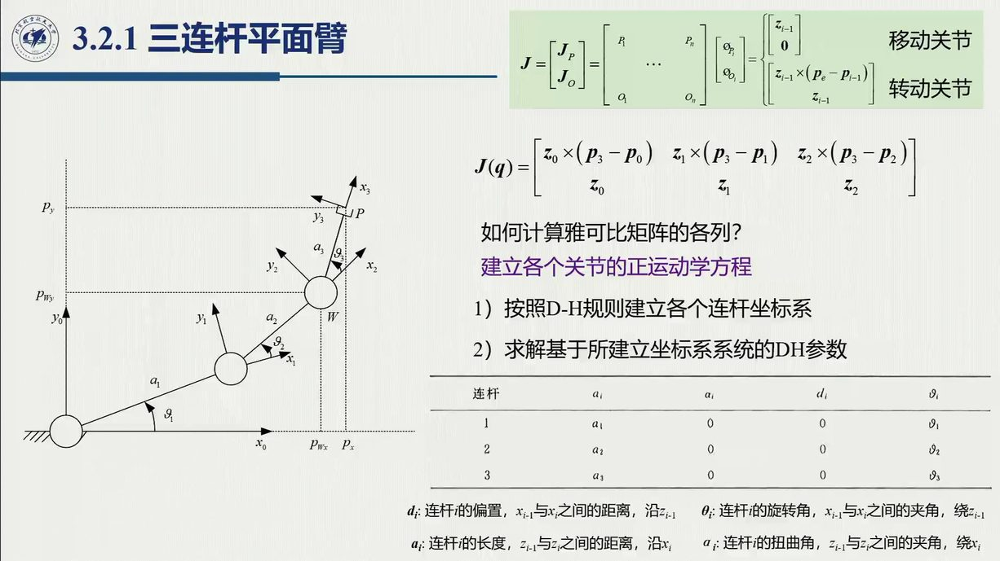
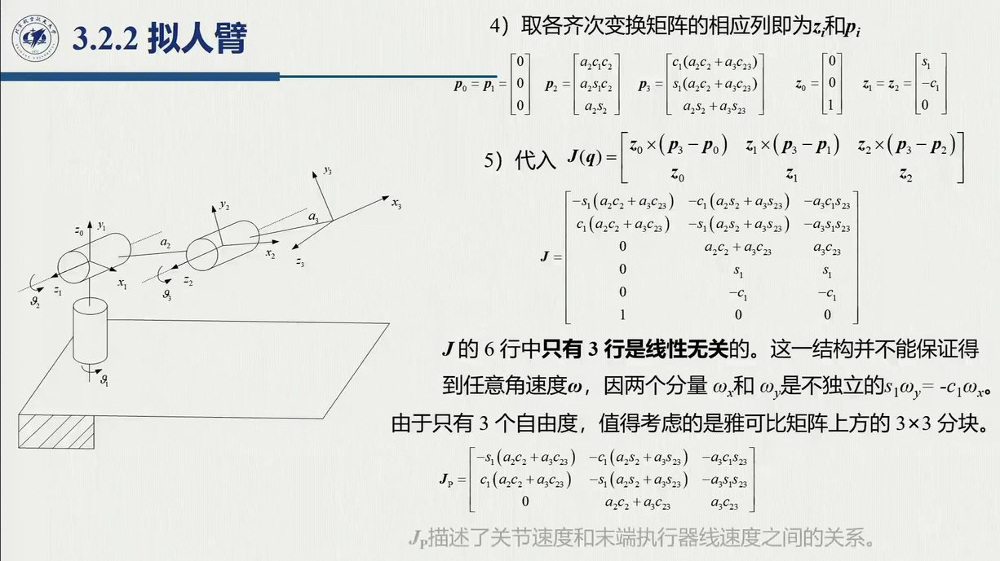
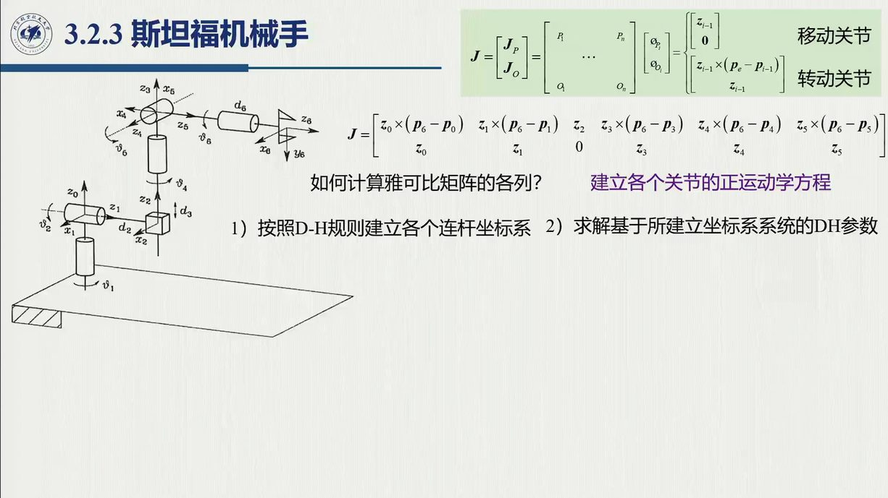
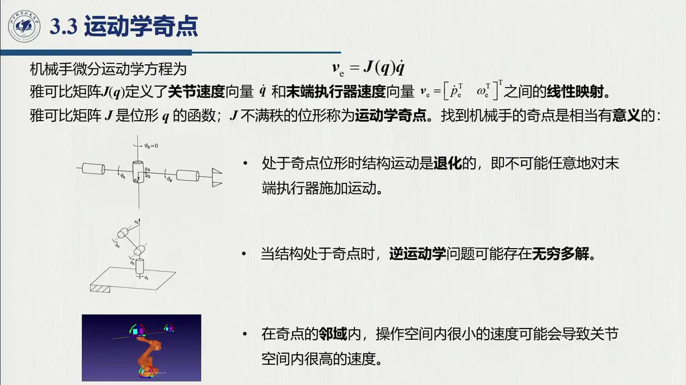

# 3.2 典型机械手结构的雅可比

几何雅可比的构造是一条**流水线**；这一节把这条流水线放到三种结构上试跑：三连杆平面臂（全转动、平面）、拟人臂（三转动、空间）和斯坦福机械手（五转一移、六自由度）。结构越复杂，越能显出「从 $T$ 矩阵读取 $z,p$」的威力——斯坦福机械手的雅可比没有人愿意手推，实际全部由符号计算完成。录播 1:12:12–1:23:42（1:23:39「**以上是重点中的重点**」）。

::: method 方法 3.2.A · 雅可比计算的五步流程（三种结构共用）{#method-3.2.A}
1. 按 DH 规则建立各连杆坐标系（第 2 章已练）；
2. 求解 DH 参数 $a_i,\alpha_i,d_i,\vartheta_i$（每行 3 常 1 变，[@def-2.8.3]）；
3. 求 $A_i^{i-1}$ 与 $T_i^0=A_1^0\cdots A_i^{i-1}$（**每个中间 $T$ 都要保留**）；
4. 从 $T_{i-1}^0$ 读 $z_{i-1}$（$R_{i-1}$ 第三列）与 $p_{i-1}$（第四列前三行）；
5. 按移动 / 转动列公式（[@thm-3.1.C]）逐列组装 $J$。
:::

在逐列组装 $J$ 之前，值得先单独看一眼这两种「积木列」的几何（下图）：转动列的速度来自**叉乘**，方向天然垂直于矢径；移动列的速度就是轴本身，不产生转动——所有结构的雅可比都由这两类列拼装而成。

<figure>
<svg class="figure-svg" viewBox="0 0 920 340" xmlns="http://www.w3.org/2000/svg" role="img" aria-labelledby="fig-jcol-t fig-jcol-d">
<title id="fig-jcol-t">几何雅可比的两类列：转动关节与移动关节</title>
<desc id="fig-jcol-d">左图俯视：转动关节绕指出纸面的 z 轴旋转，末端速度等于角速度叉乘矢径，方向在平面内垂直于矢径。右图侧视：移动关节沿轴平移，速度沿轴方向，角速度为零。</desc>
<defs>
<marker id="fjc-m" markerWidth="9" markerHeight="9" refX="7" refY="3" orient="auto"><path d="M0,0 L7,3 L0,6 Z" fill="var(--muted)"/></marker>
<marker id="fjc-b" markerWidth="8" markerHeight="8" refX="6" refY="2.5" orient="auto"><path d="M0,0 L6,2.5 L0,5 Z" fill="var(--fig-blue)"/></marker>
<marker id="fjc-n" markerWidth="8" markerHeight="8" refX="6" refY="2.5" orient="auto"><path d="M0,0 L6,2.5 L0,5 Z" fill="var(--fig-green)"/></marker>
<marker id="fjc-a" markerWidth="8" markerHeight="8" refX="6" refY="2.5" orient="auto"><path d="M0,0 L6,2.5 L0,5 Z" fill="var(--accent-text)"/></marker>
</defs>
<text class="diagram-text" x="460" y="30" text-anchor="middle">逐列组装的两类积木</text>
<text class="diagram-text" x="240" y="60" text-anchor="middle">转动关节 i（俯视，z<tspan class="sb">i−1</tspan> 指出纸面 ⊙）</text>
<text class="diagram-text" x="680" y="60" text-anchor="middle">移动关节 i（侧视）</text>
<circle cx="240" cy="185" r="100" fill="none" stroke="var(--line)" stroke-dasharray="3 5"/>
<circle cx="240" cy="185" r="9" fill="var(--paper)" stroke="var(--ink-2)" stroke-width="1.4"/><circle cx="240" cy="185" r="2.2" fill="var(--ink-2)"/>
<text class="diagram-note" x="222" y="212" text-anchor="end">p<tspan class="sb">i−1</tspan>，z<tspan class="sb">i−1</tspan> ⊙</text>
<path d="M 284 168 A 52 52 0 0 0 268 147" fill="none" stroke="var(--accent-text)" stroke-width="1.7" marker-end="url(#fjc-a)"/>
<text class="diagram-text" fill="var(--accent-text)" x="292" y="156">ϑ′<tspan class="sb">i</tspan></text>
<line stroke="var(--fig-blue)" stroke-width="2.6" marker-end="url(#fjc-b)" x1="240" y1="185" x2="340.6" y2="212.3"/>
<text class="diagram-text" fill="var(--fig-blue)" x="268" y="212">r = p<tspan class="sb">e</tspan>−p<tspan class="sb">i−1</tspan></text>
<line stroke="var(--fig-green)" stroke-width="3" marker-end="url(#fjc-n)" x1="340.6" y1="212.3" x2="370.2" y2="148.9"/>
<text class="diagram-text" fill="var(--fig-green)" x="378" y="142">v = z<tspan class="sb">i−1</tspan>×r</text>
<path d="M 327.9 206.4 L 334.4 193.7 L 346.5 199.6" fill="none" stroke="var(--ink-2)" stroke-width="1.2"/>
<text class="diagram-note" x="240" y="316" text-anchor="middle">转动列 = [ z<tspan class="sb">i−1</tspan>×(p<tspan class="sb">e</tspan>−p<tspan class="sb">i−1</tspan>) ; z<tspan class="sb">i−1</tspan> ]：速度 ⊥ 矢径（平面内），随 r 增大而增大</text>
<line class="diagram-axis" x1="680" y1="270" x2="680" y2="75"/>
<text class="diagram-text" x="680" y="88" text-anchor="middle">z<tspan class="sb">i−1</tspan></text>
<rect class="diagram-node" x="664" y="180" width="32" height="42" rx="4"/>
<line stroke="var(--fig-green)" stroke-width="3" marker-end="url(#fjc-n)" x1="712" y1="222" x2="712" y2="112"/>
<text class="diagram-text" fill="var(--fig-green)" x="720" y="162">v = z<tspan class="sb">i−1</tspan>·d′<tspan class="sb">i</tspan></text>
<text class="diagram-note" x="660" y="172" text-anchor="end">滑鞍沿轴平移</text>
<text class="diagram-mono" x="680" y="308" text-anchor="middle">移动列 = [ z<tspan class="sb">i−1</tspan> ; 0 ]：只平移、不转动（ω = 0）</text>
<text class="diagram-note" x="460" y="332" text-anchor="middle">「锁死其余关节、单位速度驱动第 i 关节」：全部雅可比列都由这两类积木拼成</text>
</svg>
<figcaption>两类雅可比列的几何（本教程绘）：**转动列**的速度项 $z_{i-1}\times(p_e-p_{i-1})$ 在俯视图里一目了然——永远垂直于矢径，离轴越远越大；**移动列**则只有平移项 $z_{i-1}$，角速度行恒为零。「锁死其余关节、单位速度驱动第 i 关节」的逐列物理图像，见 3.1 的绿框图（[@thm-3.1.C]）；2.9 节中，各结构的 $z_{i-1},p_{i-1}$ 都能从中间 $T$ 矩阵直接读出，读出后逐列套用即可。</figcaption>
</figure>

## 3.2.1 三连杆平面臂

三个转动关节，四个轴全部竖直且互相平行（平面结构）；$a_i$ 即三根杆长，$\alpha_i=d_i=0$：

$$A_i^{i-1}(\vartheta_i)=\begin{bmatrix}c_i&-s_i&0&a_ic_i\\ s_i&c_i&0&a_is_i\\ 0&0&1&0\\ 0&0&0&1\end{bmatrix},\qquad
T_i^0=A_1^0\cdots A_i^{i-1}$$

这几个量可以直读结构得到（不必乘出矩阵也能看出来）：所有 $z$ 轴竖直平行，

$$z_0=z_1=z_2=[0,0,1]^{\mathrm T};\qquad
p_0=[0,0,0]^{\mathrm T},\ p_1=[a_1c_1,a_1s_1,0]^{\mathrm T},\ p_2=[a_1c_1+a_2c_{12},\ a_1s_1+a_2s_{12},\ 0]^{\mathrm T}$$

（$c_{12}=\cos(\vartheta_1+\vartheta_2)$，下同）。三列全部取**转动列**，叉乘按 $[0,0,1]\times[x,y,0]=[-y,x,0]$ 逐列算出：

$$J=\begin{bmatrix}
-a_1s_1-a_2s_{12}-a_3s_{123}&-a_2s_{12}-a_3s_{123}&-a_3s_{123}\\
a_1c_1+a_2c_{12}+a_3c_{123}&a_2c_{12}+a_3c_{123}&a_3c_{123}\\
0&0&0\\
0&0&0\\
0&0&0\\
1&1&1
\end{bmatrix}$$

平面任务既不涉及 $z$ 向平动，也不涉及 $x,y$ 向转动，因此**只取有效行**（前两行 + 末行），得到 $3\times3$ 任务雅可比（1:15:50「平面情形只取前两行；如需 $\omega_z$ 再加末行」）：

$$\bar J=\begin{bmatrix}
-a_1s_1-a_2s_{12}-a_3s_{123}&-a_2s_{12}-a_3s_{123}&-a_3s_{123}\\
a_1c_1+a_2c_{12}+a_3c_{123}&a_2c_{12}+a_3c_{123}&a_3c_{123}\\
1&1&1
\end{bmatrix}$$

## 3.2.2 拟人臂

同样是三个转动关节，区别在于第一个关节带 $\pi/2$ 扭转（肩部），后两个关节的轴水平且互相平行：

| $i$ | $a_i$ | $\alpha_i$ | $d_i$ | $\vartheta_i$ |
|:--:|:--:|:--:|:--:|:--:|
| 1 | 0 | $\pi/2$ | 0 | $\vartheta_1$ |
| 2 | $a_2$ | 0 | 0 | $\vartheta_2$ |
| 3 | $a_3$ | 0 | 0 | $\vartheta_3$ |

$$A_1^0=\begin{bmatrix}c_1&0&s_1&0\\ s_1&0&-c_1&0\\ 0&1&0&0\\ 0&0&0&1\end{bmatrix},\qquad
A_i^{i-1}=\begin{bmatrix}c_i&-s_i&0&a_ic_i\\ s_i&c_i&0&a_is_i\\ 0&0&1&0\\ 0&0&0&1\end{bmatrix}\ (i=2,3)$$

把三个变换连乘起来，逐一读出：

$$z_0=[0,0,1]^{\mathrm T},\qquad z_1=z_2=[s_1,-c_1,0]^{\mathrm T}\ (\text{水平，随肩转动})$$

$$p_0=p_1=[0,0,0]^{\mathrm T},\quad
p_2=[a_2c_1c_2,\ a_2s_1c_2,\ a_2s_2]^{\mathrm T},\quad
p_3=p_2+a_3\,[c_1c_{23},\ s_1c_{23},\ s_{23}]^{\mathrm T}$$

「$z_1$ 跟 $z_0$ 就不一样了——$z_1,z_2$ 平行、都是水平的」（1:18:27）。逐列组装时，叉乘按 $[s_1,-c_1,0]\times[X,Y,Z]=[-c_1Z,\,-s_1Z,\,s_1Y+c_1X]$ 进行；组装完成后会发现，六行中**只有三行线性无关**——秩最多等于列数 3，而 $\omega_x,\omega_y$ 两个分量经由 $\dot\vartheta_2,\dot\vartheta_3$ 耦合在一起，并不独立。于是经行变换取出「关节速度 → 末端**线速度**」的 $3\times3$ 块：

$$\bar J=\begin{bmatrix}
-s_1(a_2c_2+a_3c_{23})&-c_1(a_2s_2+a_3s_{23})&-c_1a_3s_{23}\\
c_1(a_2c_2+a_3c_{23})&-s_1(a_2s_2+a_3s_{23})&-s_1a_3s_{23}\\
0&a_2c_2+a_3c_{23}&a_3c_{23}
\end{bmatrix}$$

（注意第三行是**余弦**组合——该行在转写中一度被误读成正弦，本编按课件绿框、教材式 (3.37)–(3.38) 与数值差分三源核对后，采用余弦，见[勘误 E3.1](errata.md#errata-3.1)。）取行列式，并按第一列展开（$c_1^2+s_1^2=1$ 三次消去）：

$$\det\bar J=-a_2a_3\,s_3\,(a_2c_2+a_3c_{23})$$

两个因子各自为零，正对应拟人臂的两类奇点：$s_3=0$（肘伸直 / 折回，边界奇点）与 $a_2c_2+a_3c_{23}=0$（腕点落到 $z_0$ 轴上，肩奇点）——与 [3.3](sec3-3.md) 的解耦分析逐条对应（习题 B2）。

::: note 为什么敢「丢三行」
雅可比的**行**对应操作空间的速度分量，**列**对应关节（0:21:46）。拟人臂只有 3 个自由度，在 6 维操作空间里至多张出 3 维子空间；因此丢掉相关的行并不损失信息，保留下来的三行（$v_x,v_y,v_z$）恰好构成「臂部」的有效映射。这一「按任务取行」的思想，到 [3.4](sec3-4.md) 的冗余分析里就是正式工具了。
:::

## 3.2.3 斯坦福机械手

**六个关节中只有关节 3 是移动关节**，其余五个都是转动关节（臂部：肩摆 + 肘转 + 伸缩；腕部：三轴汇交）：

| $i$ | $a_i$ | $\alpha_i$ | $d_i$ | $\vartheta_i$ |
|:--:|:--:|:--:|:--:|:--:|
| 1 | 0 | $-\pi/2$ | 0 | $\vartheta_1$ |
| 2 | 0 | $\pi/2$ | $d_2$ | $\vartheta_2$ |
| 3 | 0 | 0 | $d_3$ | —（移动） |
| 4 | 0 | $-\pi/2$ | 0 | $\vartheta_4$ |
| 5 | 0 | $\pi/2$ | 0 | $\vartheta_5$ |
| 6 | 0 | 0 | $d_6$ | $\vartheta_6$ |

要注意，六个相邻变换**各不相同**——「每个都不一样，不能用通式」（1:21:25）：

$$A_1^0=\begin{bmatrix}c_1&0&-s_1&0\\ s_1&0&c_1&0\\ 0&-1&0&0\\ 0&0&0&1\end{bmatrix},\
A_2^1=\begin{bmatrix}c_2&0&s_2&0\\ s_2&0&-c_2&0\\ 0&1&0&d_2\\ 0&0&0&1\end{bmatrix},\
A_3^2=\begin{bmatrix}1&0&0&0\\ 0&1&0&0\\ 0&0&1&d_3\\ 0&0&0&1\end{bmatrix},$$

$$A_4^3=\begin{bmatrix}c_4&0&-s_4&0\\ s_4&0&c_4&0\\ 0&-1&0&0\\ 0&0&0&1\end{bmatrix},\
A_5^4=\begin{bmatrix}c_5&0&s_5&0\\ s_5&0&-c_5&0\\ 0&1&0&0\\ 0&0&0&1\end{bmatrix},\
A_6^5=\begin{bmatrix}c_6&-s_6&0&0\\ s_6&c_6&0&0\\ 0&0&1&d_6\\ 0&0&0&1\end{bmatrix}$$

连乘 $T_1^0=A_1^0,\ T_2^0=A_1^0A_2^1,\ \dots,\ T_6^0=A_1^0\cdots A_6^5$，然后逐个读取；读取时优先利用结构特征，而不是硬算：

- $p_0=p_1=[0,0,0]^{\mathrm T}$；$p_3=p_4=p_5$（**腕中心**，三腕轴汇交，与 [2.12](../ch02/sec2-12.md) 解耦点同一位置）；$p_6$ 最复杂（含 $d_6$ 工具偏置）；
- $z_0=[0,0,1]^{\mathrm T}$；$z_1$ 沿肩轴水平；$z_2=z_3=[c_1s_2,\ s_1s_2,\ c_2]^{\mathrm T}$（伸缩方向）；$z_4,z_5$ 表达式最长。

组装时，第 3 列取**移动列**，其余各列取**转动列**，得到 $6\times6$ 几何雅可比：

$$J=\begin{bmatrix}
z_0\times(p_6-p_0)&z_1\times(p_6-p_1)&z_2&z_3\times(p_6-p_3)&z_4\times(p_6-p_4)&z_5\times(p_6-p_5)\\
z_0&z_1&0&z_3&z_4&z_5
\end{bmatrix}$$

::: note 「这个计算过程不是手推的」（1:20:13）
符号推导「都是 MATLAB 来写的，表达式非常复杂，很多 sin、cos 在合成，计算量很大；实际应用中都是写代码。人手推也能做出来，但非常花时间。」本编已把三个结构的雅可比全部做了**中心差分数值验证**并入库（`tools/verify_ch03_jac.py`，`make verify`）——这也是读者自查任何雅可比的通用手段（习题 C1）。
:::

**[1:23:39] 「以上是重点中的重点。」**——几何雅可比的推导与构造到此收束；接下来要看的，是它的「病理学」（奇点）与「超定 / 欠定学」（冗余）。

::: think 默写点 · 合上书再写（主动回忆）

不看正文与速查卡，先把下面几条写出来，再展开核对。写不出来，就说明这一节还没有真正「拿走」。

1. 默写雅可比计算五步。
2. 斯坦福机械手的第 3 列为什么取移动列，而不取转动列？
3. 平面臂的雅可比哪几行恒为零？为什么？

::: sol 核对

建系 → 填 DH 表 → 连乘得 $T_i^0$ → 读 $z_{i-1}$ 与 $\boldsymbol p_{i-1}$ → 逐列组装。

$q_3=d_3$ 是**移动**关节，故 $J_3=[z_2;\ \boldsymbol 0]$——角速度行是零。把这一列错写成转动列，是本节最常见的错误。

第三、四、五行恒为零（平面运动没有 $z$ 向线速度、$x$/$y$ 向角速度）；讨论行列式与秩之前，应先把**有效行**选出来。

:::

:::

## 3.2 小结与常见错误

- **一条主线**：五步流水线（建系 → 填表 → 连乘 → 读取 → 组装）。平面臂完全可以看结构直读 $z,p$，空间臂要老老实实走流水线，斯坦福机械手则交给符号计算。
- **两个结构规律**：腕三轴汇交 ⇒ $p_3=p_4=p_5$（腕中心）；平行轴族 ⇒ 对应的 $z$ 相等，经行变换后可以降维。

::: think 常见错误清单 · 自查三条
1. 斯坦福第 3 列误取转动列——$q_3=d_3$ 是**移动**关节，$J_3=\begin{bmatrix}z_2\\0\end{bmatrix}$，角速度行是零；
2. 拟人臂忘了 $z_1\neq z_0$——肩部 $\pi/2$ 扭转后，关节 2、3 的轴水平（$[s_1,-c_1,0]^{\mathrm T}$），不随 $\vartheta_2,\vartheta_3$ 改变，却随 $\vartheta_1$ 改变；
3. 平面臂保留全部六行去做运算——第三、四、五行恒为零，应当先选出**有效行**，再谈行列式与秩。
:::
