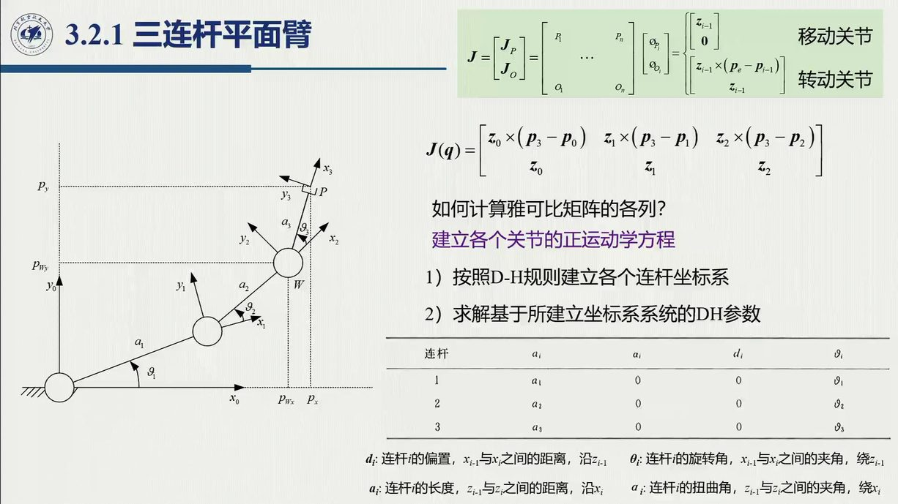
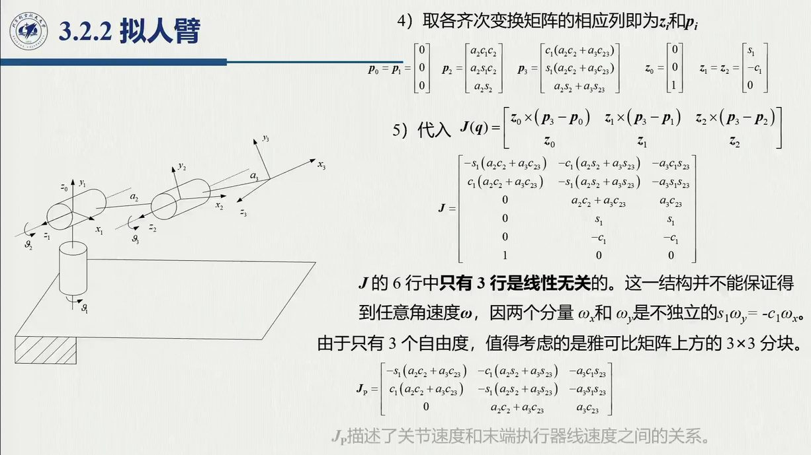
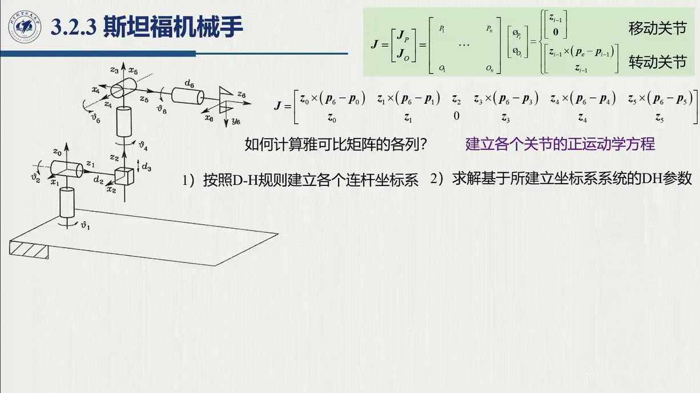
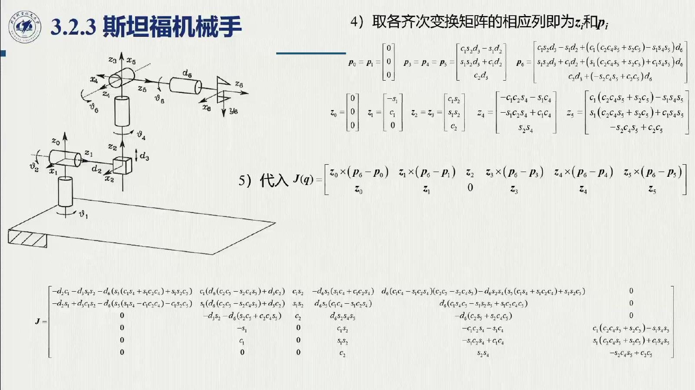

# 3.2 典型机械手结构的雅可比

几何雅可比的构造是一条**流水线**；这一节把这条流水线放到三种结构上试跑：三连杆平面臂（全转动、平面）、拟人臂（三转动、空间）和斯坦福机械手（五转一移、六自由度）。本节的目标是：能从中间变换读取各关节轴，逐列计算速度贡献，并说明所选任务保留了哪些速度分量。复杂结构可以用程序辅助计算，但每一列仍须能解释。所有轴、位置与速度均在基坐标系表达；杆长用米、转动关节速度用 rad/s、移动关节速度用 m/s。录播 1:12:12–1:23:42（1:23:39「**以上是重点中的重点**」）。

::: method 方法 3.2.A · 雅可比计算的五步流程（三种结构共用）{#method-3.2.A}
1. 按 DH 规则建立各连杆坐标系（第 2 章已练）；
2. 求解 DH 参数 $a_i,\alpha_i,d_i,\vartheta_i$（每行 3 常 1 变，[@def-2.8.3]）；
3. 求 $A_i^{i-1}$ 与 $T_i^0=A_1^0\cdots A_i^{i-1}$（**每个中间 $T$ 都要保留**）；
4. 从 $T_{i-1}^0$ 读 $z_{i-1}$（$R_{i-1}$ 第三列）与 $p_{i-1}$（第四列前三行）；
5. 按移动 / 转动列公式（[@thm-3.1.C]）逐列组装 $J$。
:::

在逐列组装 $J$ 之前，值得先单独看一眼这两种「积木列」的几何（下图）：转动列的速度来自**叉乘**，方向天然垂直于矢径；移动列的速度就是轴本身，不产生转动——所有结构的雅可比都由这两类列拼装而成。

<figure>
<svg class="figure-svg" viewBox="0 0 920 340" xmlns="http://www.w3.org/2000/svg" role="img" aria-labelledby="fig-jcol-t fig-jcol-d">
<title id="fig-jcol-t">几何雅可比的两类列：转动关节与移动关节</title>
<desc id="fig-jcol-d">左图俯视：转动关节绕指出纸面的 z 轴旋转，末端速度等于角速度叉乘矢径，方向在平面内垂直于矢径。右图侧视：移动关节沿轴平移，速度沿轴方向，角速度为零。</desc>
<defs>
<marker id="fjc-m" markerWidth="9" markerHeight="9" refX="7" refY="3" orient="auto"><path d="M0,0 L7,3 L0,6 Z" fill="var(--muted)"/></marker>
<marker id="fjc-b" markerWidth="8" markerHeight="8" refX="6" refY="2.5" orient="auto"><path d="M0,0 L6,2.5 L0,5 Z" fill="var(--fig-blue)"/></marker>
<marker id="fjc-n" markerWidth="8" markerHeight="8" refX="6" refY="2.5" orient="auto"><path d="M0,0 L6,2.5 L0,5 Z" fill="var(--fig-green)"/></marker>
<marker id="fjc-a" markerWidth="8" markerHeight="8" refX="6" refY="2.5" orient="auto"><path d="M0,0 L6,2.5 L0,5 Z" fill="var(--accent-text)"/></marker>
</defs>
<text class="diagram-text" x="460" y="30" text-anchor="middle">逐列组装的两类积木</text>
<text class="diagram-text" x="240" y="60" text-anchor="middle">转动关节 i（俯视，z<tspan class="sb">i−1</tspan> 指出纸面 ⊙）</text>
<text class="diagram-text" x="680" y="60" text-anchor="middle">移动关节 i（侧视）</text>
<circle cx="240" cy="185" r="100" fill="none" stroke="var(--line)" stroke-dasharray="3 5"/>
<circle cx="240" cy="185" r="9" fill="var(--paper)" stroke="var(--ink-2)" stroke-width="1.4"/><circle cx="240" cy="185" r="2.2" fill="var(--ink-2)"/>
<text class="diagram-note" x="222" y="212" text-anchor="end">p<tspan class="sb">i−1</tspan>，z<tspan class="sb">i−1</tspan> ⊙</text>
<path d="M 284 168 A 52 52 0 0 0 268 147" fill="none" stroke="var(--accent-text)" stroke-width="1.7" marker-end="url(#fjc-a)"/>
<text class="diagram-text" fill="var(--accent-text)" x="292" y="156">ϑ′<tspan class="sb">i</tspan></text>
<line stroke="var(--fig-blue)" stroke-width="2.6" marker-end="url(#fjc-b)" x1="240" y1="185" x2="340.6" y2="212.3"/>
<text class="diagram-text" fill="var(--fig-blue)" x="268" y="212">r = p<tspan class="sb">e</tspan>−p<tspan class="sb">i−1</tspan></text>
<line stroke="var(--fig-green)" stroke-width="3" marker-end="url(#fjc-n)" x1="340.6" y1="212.3" x2="358.9" y2="144.8"/>
<text class="diagram-text" fill="var(--fig-green)" x="270" y="117">v = (z<tspan class="sb">i−1</tspan>×r)ϑ′<tspan class="sb">i</tspan></text>
<path d="M 329.0 209.2 L 332.1 197.6 L 343.7 200.7" fill="none" stroke="var(--ink-2)" stroke-width="1.2"/>
<text class="diagram-note" x="240" y="316" text-anchor="middle">转动列 = [ z<tspan class="sb">i−1</tspan>×(p<tspan class="sb">e</tspan>−p<tspan class="sb">i−1</tspan>) ; z<tspan class="sb">i−1</tspan> ]：速度 ⊥ 矢径（平面内），随 r 增大而增大</text>
<line class="diagram-axis" x1="680" y1="270" x2="680" y2="75"/>
<text class="diagram-text" x="680" y="88" text-anchor="middle">z<tspan class="sb">i−1</tspan></text>
<rect class="diagram-node" x="664" y="180" width="32" height="42" rx="4"/>
<line stroke="var(--fig-green)" stroke-width="3" marker-end="url(#fjc-n)" x1="712" y1="222" x2="712" y2="112"/>
<text class="diagram-text" fill="var(--fig-green)" x="720" y="162">v = z<tspan class="sb">i−1</tspan>·d′<tspan class="sb">i</tspan></text>
<text class="diagram-note" x="660" y="172" text-anchor="end">滑鞍沿轴平移</text>
<text class="diagram-mono" x="680" y="308" text-anchor="middle">移动列 = [ z<tspan class="sb">i−1</tspan> ; 0 ]：只平移、不转动（ω = 0）</text>
<text class="diagram-note" x="460" y="332" text-anchor="middle">「锁死其余关节、单位速度驱动第 i 关节」：全部雅可比列都由这两类积木拼成</text>
</svg>
<figcaption>两类雅可比列的几何（本教程绘）：**转动列**的速度项 $z_{i-1}\times(p_e-p_{i-1})$ 在俯视图里一目了然——永远垂直于矢径，离轴越远越大；**移动列**则只有平移项 $z_{i-1}$，角速度行恒为零。「锁死其余关节、单位速度驱动第 i 关节」的逐列物理图像，见 3.1 的绿框图（[@thm-3.1.C]）；2.9 节中，各结构的 $z_{i-1},p_{i-1}$ 都能从中间 $T$ 矩阵直接读出，读出后逐列套用即可。</figcaption>
</figure>

## 3.2.1 三连杆平面臂

三个转动关节，三个关节轴 $z_0,z_1,z_2$ 全部竖直且互相平行（末端架 $z_3$ 也竖直）（平面结构）；$a_i$ 即三根杆长，$\alpha_i=d_i=0$：

$$A_i^{i-1}(\vartheta_i)=\begin{bmatrix}c_i&-s_i&0&a_ic_i\\ s_i&c_i&0&a_is_i\\ 0&0&1&0\\ 0&0&0&1\end{bmatrix},\qquad
T_i^0=A_1^0\cdots A_i^{i-1}$$

这几个量可以直读结构得到（不必乘出矩阵也能看出来）：所有 $z$ 轴竖直平行，

$$z_0=z_1=z_2=[0,0,1]^{\mathrm T};\qquad
p_0=[0,0,0]^{\mathrm T},\ p_1=[a_1c_1,a_1s_1,0]^{\mathrm T},\ p_2=[a_1c_1+a_2c_{12},\ a_1s_1+a_2s_{12},\ 0]^{\mathrm T}$$

（$c_{12}=\cos(\vartheta_1+\vartheta_2)$，下同）。三列全部取**转动列**，叉乘按 $[0,0,1]\times[x,y,0]=[-y,x,0]$ 逐列算出：

$$J=\begin{bmatrix}
-a_1s_1-a_2s_{12}-a_3s_{123}&-a_2s_{12}-a_3s_{123}&-a_3s_{123}\\
a_1c_1+a_2c_{12}+a_3c_{123}&a_2c_{12}+a_3c_{123}&a_3c_{123}\\
0&0&0\\
0&0&0\\
0&0&0\\
1&1&1
\end{bmatrix}$$

平面任务既不涉及 $z$ 向平动，也不涉及 $x,y$ 向转动，因此**只取有效行**（前两行 + 末行），得到 $3\times3$ 任务雅可比（1:15:50「平面情形只取前两行；如需 $\omega_z$ 再加末行」）：

$$\bar J=\begin{bmatrix}
-a_1s_1-a_2s_{12}-a_3s_{123}&-a_2s_{12}-a_3s_{123}&-a_3s_{123}\\
a_1c_1+a_2c_{12}+a_3c_{123}&a_2c_{12}+a_3c_{123}&a_3c_{123}\\
1&1&1
\end{bmatrix}$$

::: note 逐列读法 · 每一列是谁在出力 {#note-3.2.1.cols}
矩阵的**行**对应操作空间的速度分量（第一行 $v_x$、第二行 $v_y$、第三行 $\omega_z$），**列**对应关节（3.1 的分工）。于是这三列可以逐列念：

| 列 | 对应关节 | 读法 | 为什么长这样 |
|:--:|:--:|:--|:--|
| 第 1 列 | $\vartheta_1$（腰） | $[-a_1s_1-a_2s_{12}-a_3s_{123}\ \ \ a_1c_1+a_2c_{12}+a_3c_{123}\ \ \ 1]^T$ | 腰以 1 rad/s 转动，**整条臂（含前臂末端）绕 $z_0$ 转**：所以第 1 行第 1 列是 $-(\text{末端}y\text{ 坐标})$、第 2 行第 1 列是 $(\text{末端}x\text{ 坐标})$——正是绕原点转的切向速度 $[-y,\ x]^T$ |
| 第 2 列 | $\vartheta_2$（肩） | $[-a_2s_{12}-a_3s_{123}\ \ \ a_2c_{12}+a_3c_{123}\ \ \ 1]^T$ | 肩以 1 rad/s 转动，只有**肘以上**的两段动：所以 $a_1$ 不出现，改成 $a_2,a_3$ 从肩心起算 |
| 第 3 列 | $\vartheta_3$（肘） | $[-a_3s_{123}\ \ \ a_3c_{123}\ \ \ 1]^T$ | 肘以 1 rad/s 转动，**只有前臂**（长 $a_3$）动：矩阵里只剩 $a_3$ 与合成角 $\vartheta_{123}$ |

第三行全为 $1$ 同样有说法：平面臂绕 $z$ 转时，每个转动关节贡献的角速度都是 $+1$（右手系下 $\omega_z=\dot\vartheta_1+\dot\vartheta_2+\dot\vartheta_3$）。**一句话：第 $i$ 列就是「只动关节 $i$、其余锁死时末端的贡献」**（[@thm-3.1.C]），逐列看比整块背省力得多。
:::

## 3.2.2 拟人臂

同样是三个转动关节，区别在于第一个关节带 $\pi/2$ 扭转（肩部），后两个关节的轴水平且互相平行：

| $i$ | $a_i$ | $\alpha_i$ | $d_i$ | $\vartheta_i$ |
|:--:|:--:|:--:|:--:|:--:|
| 1 | 0 | $\pi/2$ | 0 | $\vartheta_1$ |
| 2 | $a_2$ | 0 | 0 | $\vartheta_2$ |
| 3 | $a_3$ | 0 | 0 | $\vartheta_3$ |

$$A_1^0=\begin{bmatrix}c_1&0&s_1&0\\ s_1&0&-c_1&0\\ 0&1&0&0\\ 0&0&0&1\end{bmatrix},\qquad
A_i^{i-1}=\begin{bmatrix}c_i&-s_i&0&a_ic_i\\ s_i&c_i&0&a_is_i\\ 0&0&1&0\\ 0&0&0&1\end{bmatrix}\ (i=2,3)$$

把三个变换连乘起来，逐一读出：

$$z_0=[0,0,1]^{\mathrm T},\qquad z_1=z_2=[s_1,-c_1,0]^{\mathrm T}$$

后两个关节轴水平，随腰角 $\vartheta_1$ 改变。

$$p_0=p_1=[0,0,0]^{\mathrm T},\quad
p_2=[a_2c_1c_2,\ a_2s_1c_2,\ a_2s_2]^{\mathrm T},\quad
p_3=p_2+a_3\,[c_1c_{23},\ s_1c_{23},\ s_{23}]^{\mathrm T}$$

下面逐列展开，而不省略叉乘的中间量。记

$$A=a_2c_2+a_3c_{23},\quad B=a_2s_2+a_3s_{23},\quad p_e=[c_1A,s_1A,B]^{\mathrm T}.$$

第一列为 $z_0\times p_e=[-s_1A,c_1A,0]^{\mathrm T}$。第二列用 $p_e-p_1=p_e$，代入
$[s_1,-c_1,0]\times[X,Y,Z]=[-c_1Z,-s_1Z,s_1Y+c_1X]$，得到
$[-c_1B,-s_1B,(s_1^2+c_1^2)A]^{\mathrm T}=[-c_1B,-s_1B,A]^{\mathrm T}$。
第三列先减去 $p_2$，只剩 $a_3[c_1c_{23},s_1c_{23},s_{23}]^{\mathrm T}$，再做同一个叉乘。

本段选择**末端位置任务** $[x,y,z]$，因此直接取几何雅可比的前三行 $J_P$，记为 $\bar J$；这是选择输出量，不是行变换：

$$\bar J=\begin{bmatrix}
-s_1(a_2c_2+a_3c_{23})&-c_1(a_2s_2+a_3s_{23})&-c_1a_3s_{23}\\
c_1(a_2c_2+a_3c_{23})&-s_1(a_2s_2+a_3s_{23})&-s_1a_3s_{23}\\
0&a_2c_2+a_3c_{23}&a_3c_{23}
\end{bmatrix}$$

（注意第三行是**余弦**组合——该行在转写中一度被误读成正弦，本编按课件绿框、教材式 (3.37)–(3.38) 与数值差分三源核对后，采用余弦，见[勘误 E3.1](errata.md#errata-3.1)。）为求行列式，再记 $C=a_3c_{23},D=a_3s_{23}$。将输出坐标绕 $z_0$ 旋转 $-\vartheta_1$，对应左乘行列式为 1 的旋转矩阵，得到

$$R_z(-\vartheta_1)\bar J=\begin{bmatrix}0&-B&-D\\A&0&0\\0&A&C\end{bmatrix}.$$

沿第一列展开：$\det\bar J=A(BC-AD)$。其中
$BC-AD=a_2a_3(s_2c_{23}-c_2s_{23})=-a_2a_3\sin\vartheta_3$，故

$$\det\bar J=-a_2a_3\,s_3\,(a_2c_2+a_3c_{23})$$

两个因子各自为零，正对应拟人臂的两类奇点：$s_3=0$（肘伸直 / 折回，边界奇点）与 $a_2c_2+a_3c_{23}=0$（腕点落到 $z_0$ 轴上，肩奇点）——与 [3.3](sec3-3.md) 的解耦分析逐条对应（习题 B2）。

::: note 逐列读法 · 三列各自在出力 {#note-3.2.2.cols}
与平面臂同样按「行 = 操作空间分量、列 = 关节」读，但这里**每列的物理内容更直白**——因为 $z_1=z_2=[s_1,-c_1,0]^T$ 是水平轴：

| 列 | 对应关节 | 读法 | 一句话物理含义 |
|:--:|:--:|:--|:--|
| 第 1 列 | $\vartheta_1$（腰） | $[-s_1A\ \ c_1A\ \ 0]^T$，其中 $A=a_2c_2+a_3c_{23}$ | 腰以 1 rad/s 转动 → 末端以腰心为轴在水平面内转：速度是 $[-y,x,0]^T$，**竖直分量恒为 0**（第 3 行第 1 列是 0）——腰动不了高度 |
| 第 2 列 | $\vartheta_2$（肩） | $[-c_1B\ \ -s_1B\ \ A]^T$，其中 $B=a_2s_2+a_3s_{23}$ | 肩以 1 rad/s 转动 → 肘与腕同时升降：前两行是水平径向的分量，**第 3 行第 2 列是 $A$**——正是「肩以 1 rad/s 转动，末端的瞬时竖直速度」的那一数 |
| 第 3 列 | $\vartheta_3$（肘） | $[-c_1a_3s_{23}\ \ -s_1a_3s_{23}\ \ a_3c_{23}]^T$ | 肘以 1 rad/s 转动 → **只有前臂**动：竖直分量 $a_3c_{23}$ 是前臂在肘部切向的投影 |

行列式中的因子来自三列的组合，不能把 $s_3$ 归到某一列的单个元素。$A=0$ 时，$J_P$ 的**第一列为零**：末端在腰轴上，转腰不改变末端位置，但仍改变姿态。$s_3=0$ 时，肩、肘两列的线速度贡献共线。两者都使位置任务失去一个或更多瞬时运动方向。
:::

::: note 选择位置任务，会舍去什么？
完整几何雅可比仍是 $J=[J_P;J_O]$，其中

$$J_O=\begin{bmatrix}0&s_1&s_1\\0&-c_1&-c_1\\1&0&0\end{bmatrix}.$$

取 $J_P$ 后，不再输出角速度。只有在 $J_P$ 可逆且已知位形时，才能由位置速度恢复关节速度，再计算角速度；不能把这一条件推广到奇点。

例如 $\vartheta_1=0,\vartheta_2=90^\circ,\vartheta_3=0$，末端位于腰轴上。令 $\dot q=[1,0,0]^{\mathrm T}$ rad/s，便有 $J_P\dot q=0$，却有 $J_O\dot q=[0,0,1]^{\mathrm T}$ rad/s。位置没有变化不等于刚体没有运动。
:::

::: intuition 动手实验 · 雅可比的列：各关节怎样贡献末端速度（3D）
先选择一种机构，再拖动三个<b>关节速度</b>滑杆 $\dot\vartheta_i$：画布里三根彩箭头是**每一列单独贡献**的速度 $J_{P,i}\dot\vartheta_i$，粗红箭头是它们的和 $v_e$。悬停下方 $\bar J$ 的某一列，对应箭头加粗、其余变淡——「第 $i$ 列 = 只动关节 $i$、其余锁死时末端的贡献」这句话，在这里是看得见的。

按以下顺序使用实验，先在纸上预测，再看读数：

1. 平面臂设三个角为 0°、速度为 $[1,0,0]$ rad/s。杆长为 $0.45,0.36,0.26$ m，预测 $v_e=[0,1.07,0]$ m/s、$\omega_z=1$ rad/s。
2. 保持角度，速度改为 $[0,0,1]$：只有末杆贡献，$v_y=0.26$ m/s。再改为 $[1,0,-1]$，得到 $v_y=0.81$ m/s，但 $\omega_z=0$。角速度抵消不意味着线速度抵消。
3. 切换拟人臂，设角度 $[0,90,0]$°、速度 $[1,0,0]$ rad/s。末端线速度为零；结合上方 $J_O$ 判断它为什么仍在转动。

画布箭头只画**线速度贡献**；平面任务矩阵的第三行是角速度系数，不能画成空间的竖直速度。不能运行脚本时，也可用上述三组数据完成纸笔核算。

:::

## 3.2.3 斯坦福机械手

**六个关节中只有关节 3 是移动关节**，其余五个都是转动关节（臂部：肩摆 + 肘转 + 伸缩；腕部：三轴汇交）：

| $i$ | $a_i$ | $\alpha_i$ | $d_i$ | $\vartheta_i$ |
|:--:|:--:|:--:|:--:|:--:|
| 1 | 0 | $-\pi/2$ | 0 | $\vartheta_1$ |
| 2 | 0 | $\pi/2$ | $d_2$ | $\vartheta_2$ |
| 3 | 0 | 0 | $d_3$（变量） | $0$（常量） |
| 4 | 0 | $-\pi/2$ | 0 | $\vartheta_4$ |
| 5 | 0 | $\pi/2$ | 0 | $\vartheta_5$ |
| 6 | 0 | 0 | $d_6$ | $\vartheta_6$ |

六个相邻变换使用不同的 DH 参数，但都由同一个标准 DH 通式计算。第 3 行固定角为零、以 $d_3$ 为变量，不能把转动关节的参数表达原样套用：

$$A_1^0=\begin{bmatrix}c_1&0&-s_1&0\\ s_1&0&c_1&0\\ 0&-1&0&0\\ 0&0&0&1\end{bmatrix},\
A_2^1=\begin{bmatrix}c_2&0&s_2&0\\ s_2&0&-c_2&0\\ 0&1&0&d_2\\ 0&0&0&1\end{bmatrix},\
A_3^2=\begin{bmatrix}1&0&0&0\\ 0&1&0&0\\ 0&0&1&d_3\\ 0&0&0&1\end{bmatrix},$$

$$A_4^3=\begin{bmatrix}c_4&0&-s_4&0\\ s_4&0&c_4&0\\ 0&-1&0&0\\ 0&0&0&1\end{bmatrix},\
A_5^4=\begin{bmatrix}c_5&0&s_5&0\\ s_5&0&-c_5&0\\ 0&1&0&0\\ 0&0&0&1\end{bmatrix},\
A_6^5=\begin{bmatrix}c_6&-s_6&0&0\\ s_6&c_6&0&0\\ 0&0&1&d_6\\ 0&0&0&1\end{bmatrix}$$

连乘 $T_1^0=A_1^0,\ T_2^0=A_1^0A_2^1,\ \dots,\ T_6^0=A_1^0\cdots A_6^5$，然后逐个读取；读取时优先利用结构特征，而不是硬算：

- $p_0=p_1=[0,0,0]^{\mathrm T}$；$p_3=p_4=p_5$（**腕中心**，三腕轴汇交，与 [2.12](../ch02/sec2-12.md) 解耦点同一位置）；$p_6$ 最复杂（含 $d_6$ 工具偏置）；
- $z_0=[0,0,1]^{\mathrm T}$；$z_1$ 沿肩轴水平；$z_2=z_3=[c_1s_2,\ s_1s_2,\ c_2]^{\mathrm T}$（伸缩方向）；$z_4,z_5$ 表达式最长。

这些位置也能沿平移项逐步得到：$p_2=d_2z_1$，$p_3=p_2+d_3z_2$，而第 4、5 行没有平移，所以 $p_4=p_5=p_3$。工具点为 $p_6=p_3+d_6z_5$。例如第 6 列的线速度部分为 $z_5\times(d_6z_5)=0$：绕工具自身轴旋转改变指向架的姿态，却不移动位于该轴上的工具点。

组装时，第 3 列取**移动列**，其余各列取**转动列**，得到 $6\times6$ 几何雅可比：

$$J=\begin{bmatrix}
z_0\times(p_6-p_0)&z_1\times(p_6-p_1)&z_2&z_3\times(p_6-p_3)&z_4\times(p_6-p_4)&z_5\times(p_6-p_5)\\
z_0&z_1&0&z_3&z_4&z_5
\end{bmatrix}$$

::: note 「这个计算过程不是手推的」（1:20:13）
符号推导「都是 MATLAB 来写的，表达式非常复杂，很多 sin、cos 在合成，计算量很大；实际应用中都是写代码。人手推也能做出来，但非常花时间。」本编已把三个结构的雅可比全部做了**中心差分数值验证**并入库（`tools/verify_ch03_jac.py`，`make verify`）——这也是读者自查任何雅可比的通用手段（习题 C1）。
:::

**[1:23:39] 「以上是重点中的重点。」**——几何雅可比的推导与构造到此收束；接下来要看的，是它的「病理学」（奇点）与「超定 / 欠定学」（冗余）。

::: think 默写点 · 合上书再写（主动回忆）

不看正文与速查卡，先把下面几条写出来，再展开核对。写不出来，就说明这一节还没有真正「拿走」。

1. 默写雅可比计算五步。
2. 斯坦福机械手的第 3 列为什么取移动列，而不取转动列？
3. 平面臂的雅可比哪几行恒为零？为什么？

::: sol 核对

建系 → 填 DH 表 → 连乘得 $T_i^0$ → 读 $z_{i-1}$ 与 $\boldsymbol p_{i-1}$ → 逐列组装。

$q_3=d_3$ 是**移动**关节，故 $J_3=[z_2;\ \boldsymbol 0]$——角速度行是零。把这一列错写成转动列，是本节最常见的错误。

第三、四、五行恒为零（平面运动没有 $z$ 向线速度、$x$/$y$ 向角速度）；讨论行列式与秩之前，应先把**有效行**选出来。

:::

:::

## 3.2 小结与常见错误

- **一条主线**：五步流水线（建系 → 填表 → 连乘 → 读取 → 组装）。平面臂完全可以看结构直读 $z,p$，空间臂要老老实实走流水线，斯坦福机械手可用符号或数值程序辅助，但须检查移动列和输出点。
- **两个结构规律**：腕三轴汇交 ⇒ $p_3=p_4=p_5$（腕中心）；平行轴族 ⇒ 对应的 $z$ 相等，但选择位置或位姿任务必须另行说明。

::: think 常见错误清单 · 自查三条
1. 斯坦福第 3 列误取转动列——$q_3=d_3$ 是**移动**关节，$J_3=\begin{bmatrix}z_2\\0\end{bmatrix}$，角速度行是零；
2. 拟人臂忘了 $z_1\neq z_0$——肩部 $\pi/2$ 扭转后，关节 2、3 的轴水平（$[s_1,-c_1,0]^{\mathrm T}$），不随 $\vartheta_2,\vartheta_3$ 改变，却随 $\vartheta_1$ 改变；
3. 平面臂保留全部六行去做运算——第三、四、五行恒为零，应当先选出**有效行**，再求方阵行列式；完整矩形雅可比仍然可以讨论秩。
:::
