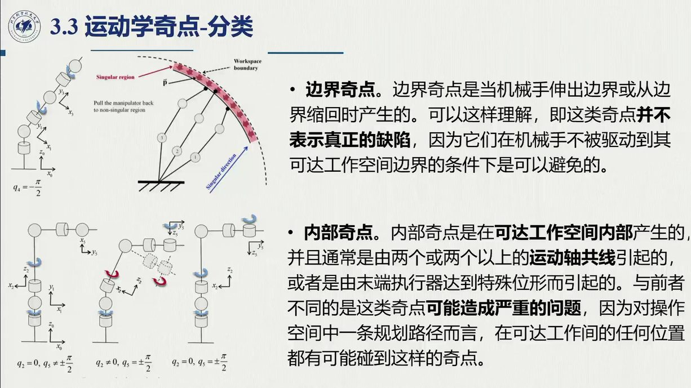
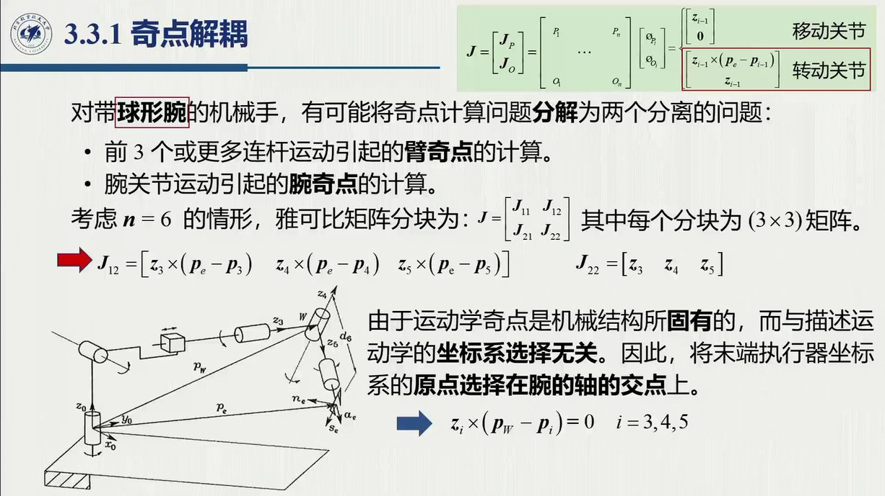
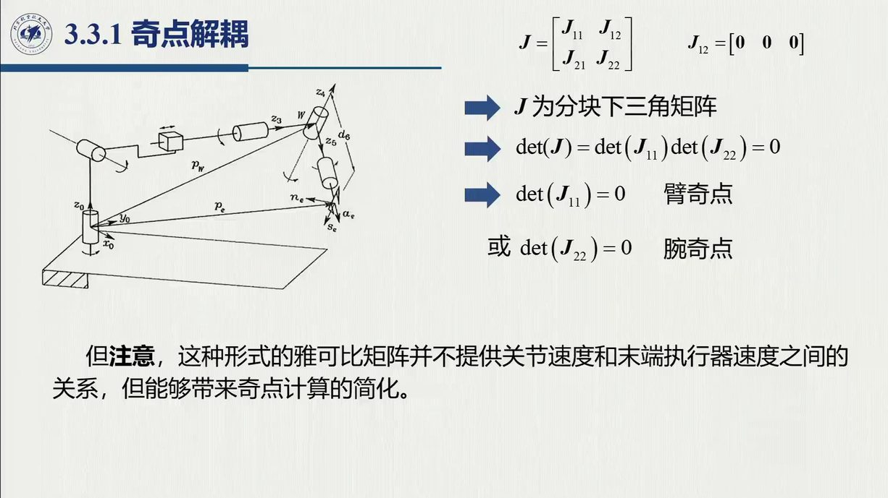
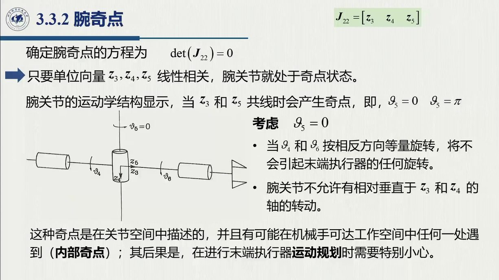
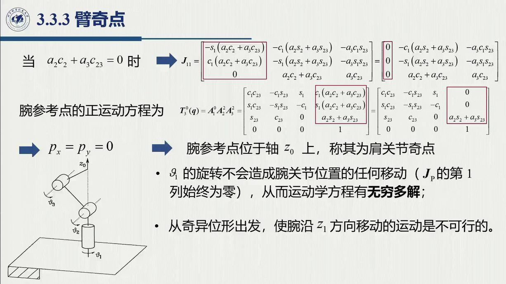

# 3.3 运动学奇点

雅可比把「速度层面」的问题变成了线性代数，而线性代数最典型的病症——**矩阵退化**——也随之显形：某些位形下 $J$ 不满秩，末端在特定方向上「给不出速度」、「解不出关节速度」，甚至「解出无穷多」。这些位形就是**运动学奇点**。本节对应录播 1:23:42–1:48:42（含四段工业机器人奇异规避视频）。

<aside class="lesson-brief" aria-label="3.3 学习简报">

PREREQUISITE<strong>你需要先会</strong>
逐列构造（[@thm-3.1.C]）；秩与线性相关的几何含义；球形腕解耦（[@thm-2.12.B]）。

TARGET<strong>本节要建立</strong>
奇点定义与三类后果；边界 / 内部奇点分类；两连杆平面臂的完整判据（原书例 3.2）；球腕解耦 $\det J=\det J_{11}\det J_{22}$；腕奇点 $s_5=0$ 与臂奇点（肘 / 肩）。

CHECKPOINT<strong>学完的标准</strong>
能说出奇点的三类后果并各举一例；能独立完成两连杆判据推导；能解释「解耦建系为什么只能用于奇点分析」。

</aside>

## 3.3.1 定义、后果与分类

::: def 定义 3.3.1 · 运动学奇点 {#def-3.3.1}
使雅可比矩阵 $J(q)$ **不满秩**的位形 $q$ 称为**运动学奇点**（kinematic singularity）；方阵情形判据为

$$\det J(q)=0 .$$
:::

奇点值得认真研究，理由可以归为三类（1:24:45–1:26:06）：

1. **运动退化**：处于奇点时，无法让末端执行器朝任意方向运动——两关节轴平行（即两列线性相关）时，垂直于该平面方向的速度分量「造不出来」；
2. **解不唯一**：逆解可能存在无穷多组——拟人臂的腕点落在肩轴线上时，无论肩关节角怎么转，该点都不动；
3. **邻域放大**（三类中最危险）：奇点**邻域内**，操作空间里很小的速度可能要求关节空间给出**极高的速度**（课堂视频：机械臂翻越奇异位形时关节瞬间加速）。

**开课引子**（0:19:28–0:23:40）：「雅可比矩阵其中有两列**线性相关**——一列可以用另一列线性表出——那么雅可比矩阵就退化了，秩肯定是降秩的，就奇异了。对机器人来说，两列线性相关就说明**这两个关节轴平行了**。」行与列的分工：**行对应操作空间速度分量，列对应关节**（0:21:46）。

**按出现位置分类**（1:26:24–1:28:02）：

::: note 边界奇点 vs 内部奇点
- **边界奇点**（boundary）：机械手完全伸出或缩回、抵达工作空间边界时产生，「不表示真正的缺陷」，使用时避开边界即可；
- **内部奇点**（interior）：出现在可达工作空间**内部**，「比较严重」，轨迹规划时**一定要避开**。它的产生条件是**两个或两个以上运动轴线共线**——共线即对应两列线性相关，这正是它不同于边界奇点、可能引起严重问题的原因。
:::

## 3.3.2 例 3.2（原书）：两连杆平面臂

腕点位置可以直接由几何写出（结构简单就不走 DH 通式——只有复杂的三维结构才必须用通用方法，1:28:19）：

$$p_w=\begin{bmatrix}a_1c_1+a_2c_{12}\\ a_1s_1+a_2s_{12}\end{bmatrix}
\qquad\Longrightarrow\qquad
J=\begin{bmatrix}\dfrac{\partial p_w}{\partial\vartheta_1}&\dfrac{\partial p_w}{\partial\vartheta_2}\end{bmatrix}
=\begin{bmatrix}-a_1s_1-a_2s_{12}&-a_2s_{12}\\ a_1c_1+a_2c_{12}&a_2c_{12}\end{bmatrix}$$

$$\det J=(-a_1s_1-a_2s_{12})(a_2c_{12})-(-a_2s_{12})(a_1c_1+a_2c_{12})
=a_1a_2(s_{12}c_1-s_1c_{12})=a_1a_2\sin\vartheta_2 .$$

::: ex 例 3.2（原书）· 两连杆臂的奇点 {#ex-book-3.2}
$$\det J=a_1a_2\,s_2=0\iff s_2=0\iff\vartheta_2=0\ \text{或}\ \pi$$

- **与 $\vartheta_1$ 无关**：转肩不改变奇异性（1:29:35）；
- $\vartheta_2=0$：臂**伸直**（工作空间边界）；$\vartheta_2=\pi$：臂**折回**——都是边界奇点；
- 代入 $\vartheta_2=0$ 验证（1:29:58）：两列分别变为 $\begin{bmatrix}-(a_1+a_2)s_1\\ (a_1+a_2)c_1\end{bmatrix}$ 与 $\begin{bmatrix}-a_2s_1\\ a_2c_1\end{bmatrix}$——二者**共线**，比例系数为 $(a_1+a_2)/a_2$；秩由 2 降为 1，末端沿径向的速度分量不可产生（该方向「不可控制」）。
:::

$\det J$ 的形状值得直接看图：它只依赖肘角 $\vartheta_2$，按正弦振荡，在伸直与折回两处过零——「离奇点多远」一眼可读。

<figure>
<svg class="figure-svg" viewBox="0 0 920 340" xmlns="http://www.w3.org/2000/svg" role="img" aria-labelledby="fig-detj-t fig-detj-d">
<title id="fig-detj-t">两连杆臂 det J 随肘角的变化</title>
<desc id="fig-detj-d">横轴为肘角 ϑ2 从 0 到 2π，纵轴为 det J 除以 a1a2（即 sin ϑ2）的正弦曲线；在 0、π、2π 三处过零对应臂伸直与折回的边界奇点，在 π/2 处取最大值对应最灵活位形。</desc>
<defs>
<marker id="fdj-m" markerWidth="9" markerHeight="9" refX="7" refY="3" orient="auto"><path d="M0,0 L7,3 L0,6 Z" fill="var(--muted)"/></marker>
</defs>
<text class="diagram-text" x="460" y="30" text-anchor="middle">det J = a<tspan class="sb">1</tspan>a<tspan class="sb">2</tspan> sin ϑ<tspan class="sb">2</tspan>：只看肘角（与肩角 ϑ<tspan class="sb">1</tspan> 无关）</text>
<rect x="60" y="66" width="60" height="220" fill="var(--fig-red)" fill-opacity=".05"/>
<rect x="425" y="66" width="80" height="220" fill="var(--fig-red)" fill-opacity=".05"/>
<rect x="790" y="66" width="60" height="220" fill="var(--fig-red)" fill-opacity=".05"/>
<line x1="100" y1="175" x2="830" y2="175" stroke="var(--line-strong)" stroke-width="1.2"/>
<line class="diagram-axis" x1="60" y1="175" x2="860" y2="175" marker-end="url(#fdj-m)"/>
<line class="diagram-axis" x1="60" y1="300" x2="60" y2="50" marker-end="url(#fdj-m)"/>
<text class="diagram-text" x="845" y="200">ϑ<tspan class="sb">2</tspan></text>
<text class="diagram-note" x="60" y="40" text-anchor="middle">det J/(a<tspan class="sb">1</tspan>a<tspan class="sb">2</tspan>)</text>
<g stroke="var(--line)" stroke-dasharray="4 4">
<line x1="282" y1="175" x2="282" y2="70"/><line x1="647" y1="175" x2="647" y2="280"/>
</g>
<polyline points="100,175 110,166 120,157 130,148 141,139 151,131 161,122 171,115 181,108 191,101 201,95 212,89 222,84 232,80 242,76 252,74 262,72 272,70 282,70 293,70 303,72 313,74 323,76 333,80 343,84 353,89 364,95 374,101 384,108 394,115 404,122 414,131 424,139 435,148 445,157 455,166 465,175 475,184 485,193 495,202 506,211 516,219 526,228 536,235 546,242 556,249 566,255 577,261 587,266 597,270 607,274 617,276 627,278 637,280 648,280 658,280 668,278 678,276 688,274 698,270 708,266 718,261 729,255 739,249 749,242 759,235 769,227 779,219 789,211 800,202 810,193 820,184 830,175" fill="none" stroke="var(--fig-green)" stroke-width="2.4"/>
<circle class="diagram-fill-accent" cx="282" cy="70" r="5"/>
<circle class="diagram-fill-sage" cx="647" cy="280" r="5"/>
<text class="diagram-text" fill="var(--fig-green)" x="282" y="56" text-anchor="middle">π/2：最灵活（det 最大）</text>
<text class="diagram-note" x="647" y="304" text-anchor="middle">3π/2：反向最灵活</text>
<text class="diagram-text" fill="var(--fig-red)" x="90" y="100">ϑ<tspan class="sb">2</tspan> = 0：伸直</text>
<text class="diagram-text" fill="var(--fig-red)" x="465" y="100" text-anchor="middle">ϑ<tspan class="sb">2</tspan> = π：折回</text>
<text class="diagram-text" fill="var(--fig-red)" x="822" y="100">2π：伸直</text>
<text class="diagram-note" x="90" y="120">外边界</text>
<text class="diagram-note" x="465" y="120" text-anchor="middle">内边界</text>
<text class="diagram-mono" x="730" y="120" text-anchor="middle">红区：两列近共线，径向速度不可产生</text>
<text class="diagram-note" x="460" y="332" text-anchor="middle">曲线对任何肩角 ϑ<tspan class="sb">1</tspan> 都一样——「转肩不改变奇异性」（1:29:35）；正弦过零即两列共线（[@ex-book-3.2]）</text>
</svg>
<figcaption>例 3.2 的行列式曲线（本教程绘）：$\det J=a_1a_2\sin\vartheta_2$ 与肩角无关、随肘角正弦振荡；零点在伸直（$\vartheta_2=0,2\pi$，外边界）与折回（$\vartheta_2=\pi$，内边界），峰值在 $\vartheta_2=\pm\pi/2$——「离奇点多远」就是 $|\sin\vartheta_2|$ 离 0 多远，这正是 3.5 节可操作度 $w(q)=\sqrt{\det(JJ^T)}$ 的平面特例。</figcaption>
</figure>

上一张图是一条静态曲线；「离奇点多远」还能看得更立体。下面的操作台把 $\|v_e\|=J\dot q,\ \|\dot q\|\le1$ 的**末端速度集**（一个椭圆）叠加在速度平面上：拖动肘角 $\vartheta_2$，看椭圆如何随 $\det J$ 缩水、在奇异位形压扁成线段；再拖转肩角 $\vartheta_1$，验证「转肩只把整幅图旋转」。

<figure class="arm-lab">
<svg id="ell-svg" class="figure-svg" viewBox="0 0 920 470" xmlns="http://www.w3.org/2000/svg" role="img" aria-labelledby="ell-t ell-d">
<title id="ell-t">两连杆臂可操作度椭圆操作台</title>
<desc id="ell-d">左图为俯视的两连杆臂与可达工作空间圆环；右图为末端速度集椭圆，随关节角实时变形，接近奇异位形时沿径向压扁成线段。</desc>
<text class="diagram-text" x="200" y="30" text-anchor="middle">臂（俯视，a<tspan class="sb">1</tspan> = 1，a<tspan class="sb">2</tspan> = 0.8）</text>
<text class="diagram-text" x="640" y="30" text-anchor="middle">末端速度集 { J·q′ ：‖q′‖ ≤ 1 }</text>
<path d="M 322.4 240 A 122.4 122.4 0 1 1 77.6 240 A 122.4 122.4 0 1 1 322.4 240 Z M 213.6 240 A 13.6 13.6 0 1 0 186.4 240 A 13.6 13.6 0 1 0 213.6 240 Z" fill="var(--accent)" fill-opacity=".07" stroke="var(--accent)" stroke-width="1" fill-rule="evenodd"/>
<g stroke="var(--line)" stroke-dasharray="3 5">
<line x1="120" y1="240" x2="280" y2="240"/><line x1="200" y1="160" x2="200" y2="320"/>
</g>
<g stroke="var(--line-strong)" stroke-width="1.1" marker-end="url(#ell-m)">
<line x1="200" y1="240" x2="255" y2="240"/>
<line x1="200" y1="240" x2="200" y2="192"/>
</g>
<text class="diagram-note" x="260" y="244">x</text>
<text class="diagram-note" x="194" y="186" text-anchor="end">y</text>
<line id="ell-m1" x1="200" y1="240" x2="252.2" y2="201" stroke="var(--fig-blue)" stroke-width="4"/>
<line id="ell-m2" x1="252.2" y1="201" x2="289.6" y2="145.4" stroke="var(--fig-blue)" stroke-width="4"/>
<circle cx="200" cy="240" r="6.5" fill="var(--paper)" stroke="var(--ink-2)" stroke-width="1.5"/>
<circle id="ell-me" cx="252.2" cy="201" r="5" fill="var(--paper)" stroke="var(--fig-blue)" stroke-width="2"/>
<circle id="ell-mt" cx="289.6" cy="145.4" r="5.5" fill="var(--accent-text)" stroke="var(--paper)" stroke-width="2"/>
<path id="ell-ell" d="" fill="var(--accent)" fill-opacity=".12" stroke="var(--accent)" stroke-width="1.8"/>
<g stroke="var(--line)">
<line x1="450" y1="235" x2="830" y2="235"/><line x1="640" y1="45" x2="640" y2="425"/>
</g>
<line id="ell-rad" x1="640" y1="235" x2="800" y2="235" stroke="var(--fig-red)" stroke-width="1.4" stroke-dasharray="6 4"/>
<text id="ell-radlbl" class="diagram-note" fill="var(--fig-red)" x="806" y="239">径向</text>
<text class="diagram-mono" x="646" y="418">v<tspan class="sb">x</tspan></text>
<text class="diagram-mono" x="646" y="56">v<tspan class="sb">y</tspan></text>
<text class="diagram-text" fill="var(--fig-red)" x="460" y="392" text-anchor="middle"><tspan id="ell-warn"> </tspan></text>
<text class="diagram-mono" x="460" y="424" text-anchor="middle">σ<tspan class="sb">1</tspan> = <tspan id="ell-s1">+</tspan>　σ<tspan class="sb">2</tspan> = <tspan id="ell-s2">+</tspan>　det J = <tspan id="ell-rd">+</tspan>　扁率 σ<tspan class="sb">2</tspan>/σ<tspan class="sb">1</tspan> = <tspan id="ell-rf">+</tspan></text>
<text class="diagram-note" x="460" y="452" text-anchor="middle">σ 与扁率只依赖肘角 ϑ<tspan class="sb">2</tspan>——转肩 ϑ<tspan class="sb">1</tspan> 只把整幅图旋转（对照上图 det J 曲线）；w = σ<tspan class="sb">1</tspan>σ<tspan class="sb">2</tspan> = |det J| 即 3.5 节的可操作度</text>
<defs>
<marker id="ell-m" markerWidth="8" markerHeight="8" refX="6" refY="2.5" orient="auto"><path d="M0,0 L6,2.5 L0,5 Z" fill="var(--muted)"/></marker>
</defs>
</svg>

<label>θ<tspan>1</tspan>（转肩） <input type="range" id="ell-t1" min="-180" max="180" step="1" value="35" aria-label="关节角 1">35°</label>
<label>θ<tspan>2</tspan>（肘） <input type="range" id="ell-t2" min="-180" max="180" step="1" value="60" aria-label="关节角 2">60°</label>

<figcaption>可操作度椭圆操作台（本教程绘）：右图是把关节空间单位球 $\|\dot q\|\le1$ 经 $J$ 映到速度平面的像——半轴即奇异值 $\sigma_1,\sigma_2$，$w=\sigma_1\sigma_2=|\det J|=a_1a_2|\sin\vartheta_2|$（[@ex-book-3.2] 与 <a href="sec3-5.md#sec-3.5.1">3.5.1</a> 可操作度的平面实例）。$\vartheta_2\to0,\pi$ 时 $\sigma_2\to0$：椭圆沿径向压扁成线段，「径向速度不可产生」从一句话变成看得见的形状。</figcaption>
</figure>

平面两连杆只是最简单的特例。更一般的六轴机械手，奇点按结构分成三类——腕奇点、肘奇点、肩奇点；下图把它们各自「坏」在哪里一次看清，也提前为 3.3.3 的解耦判定做铺垫。

<figure>
<svg class="figure-svg" viewBox="0 0 920 412" xmlns="http://www.w3.org/2000/svg" role="img" aria-labelledby="fig-sg-t fig-sg-d">
<title id="fig-sg-t">三类奇点的几何图像：腕、肘、肩</title>
<desc id="fig-sg-d">左图两个腕关节轴共线导致自由度丢失；中图臂完全伸直使腕心落在可达边界；右图腕心落在第一关节轴上使第一关节失去作用。</desc>
<defs>
<marker id="ar-x" markerHeight="8" markerWidth="8" orient="auto" refX="6" refY="3"><path d="M0,0 L7,3 L0,6 Z" fill="context-stroke"/></marker>
<marker id="ar-xs" markerHeight="8" markerWidth="8" orient="auto-start-reverse" refX="6" refY="3"><path d="M0,0 L7,3 L0,6 Z" fill="context-stroke"/></marker>
</defs>
<g font-family="var(--sans)">
<rect fill="none" height="300" rx="10" stroke="var(--line)" width="272" x="24" y="34"/>
<text class="diagram-text" fill="var(--fig-red)" text-anchor="middle" x="160" y="62">① 腕奇点　ϑ<tspan class="sb">5</tspan> = 0 或 π</text>
<line class="diagram-axis" x1="160" x2="160" y1="250" y2="118"/>
<text class="diagram-note" text-anchor="end" x="150" y="128">轴 4</text>
<text class="diagram-note" text-anchor="start" x="170" y="128">轴 6（与之共线）</text>
<circle class="diagram-fill-accent" cx="160" cy="250" r="7"/>
<circle cx="160" cy="250" r="16" fill="none" stroke="var(--line-strong)" stroke-width="1.2"/>
<text class="diagram-note" text-anchor="middle" x="160" y="290">关节 4 与关节 6 的轴重合</text>
<text class="diagram-note" text-anchor="middle" x="160" y="310">绕它们的转动效果等价 ⇒ 少一个定向自由度</text>
<text class="diagram-note" text-anchor="middle" x="160" y="330">det J<tspan class="sb">22</tspan> ∝ s<tspan class="sb">5</tspan> = 0</text>
<rect fill="none" height="300" rx="10" stroke="var(--line)" width="272" x="324" y="34"/>
<text class="diagram-text" fill="var(--fig-red)" text-anchor="middle" x="460" y="62">② 肘奇点　ϑ<tspan class="sb">3</tspan> = 0 或 π</text>
<line stroke="var(--ink-2)" stroke-width="5" x1="356" x2="452" y1="262" y2="186"/>
<line stroke="var(--ink-2)" stroke-width="5" x1="452" x2="548" y1="186" y2="110"/>
<circle class="diagram-fill-accent" cx="356" cy="262" r="7"/>
<circle class="diagram-fill-sage" cx="452" cy="186" r="7"/>
<circle cx="548" cy="110" r="6" fill="var(--paper)" stroke="var(--line-strong)" stroke-width="1.2"/>
<text class="diagram-note" x="558" y="106">腕心</text>
<line stroke="var(--fig-red)" stroke-dasharray="5 4" stroke-width="1.5" x1="356" x2="592" y1="262" y2="72"/>
<text class="diagram-note" text-anchor="middle" x="460" y="290">臂完全伸直（或折回）：肩—肘—腕共线</text>
<text class="diagram-note" text-anchor="middle" x="460" y="310">腕心落在可达工作空间边界上</text>
<text class="diagram-note" text-anchor="middle" x="460" y="330">径向只能向里、不能向外（s<tspan class="sb">3</tspan> = 0）</text>
<rect fill="none" height="300" rx="10" stroke="var(--line)" width="272" x="624" y="34"/>
<text class="diagram-text" fill="var(--fig-red)" text-anchor="middle" x="760" y="62">③ 肩奇点　a<tspan class="sb">2</tspan>c<tspan class="sb">2</tspan> + a<tspan class="sb">3</tspan>c<tspan class="sb">23</tspan> = 0</text>
<line class="diagram-axis" x1="760" x2="760" y1="268" y2="96"/>
<text class="diagram-note" text-anchor="end" x="750" y="106">轴 1</text>
<line stroke="var(--ink-2)" stroke-width="5" x1="760" x2="700" y1="268" y2="178"/>
<line stroke="var(--ink-2)" stroke-width="5" x1="700" x2="760" y1="178" y2="128"/>
<circle class="diagram-fill-accent" cx="760" cy="268" r="7"/>
<circle class="diagram-fill-sage" cx="700" cy="178" r="7"/>
<circle cx="760" cy="128" r="9" fill="var(--fig-green)" fill-opacity=".35" stroke="var(--fig-red)" stroke-width="1.6"/>
<text class="diagram-note" fill="var(--fig-red)" x="776" y="132">腕心</text>
<text class="diagram-note" text-anchor="middle" x="760" y="290">腕心落在第一关节的轴上</text>
<text class="diagram-note" text-anchor="middle" x="760" y="310">绕轴 1 转不改变腕心位置</text>
<text class="diagram-note" text-anchor="middle" x="760" y="330">第一关节暂时失去作用</text>
<text class="diagram-note" x="24" y="374">三类奇点都是结构的几何属性：换算法、换精度都躲不掉，只能靠规划绕开或在结构上避免。</text>
</g></svg>
<figcaption>三类奇点都是**结构的几何属性**，不是数值问题（本教程绘）：① **腕奇点**——两个腕关节轴共线，绕它们的转动等价，丢掉一个定向自由度；② **肘奇点**——臂完全伸直（或折回），腕心落在可达工作空间边界，径向只能向里；③ **肩奇点**——腕心落在第一关节轴上，绕该轴转不改变腕心位置。三者分别对应 $\det J_{22}\propto s_5$、$\det J_{11}$ 的 $s_3$ 因子、$(a_2c_2+a_3c_{23})$ 因子（[@thm-3.3.A]）。</figcaption>
</figure>

## 3.3.3 奇点解耦：腕 + 臂分开判

六自由度机械手的 $6\times6$ 行列式直接展开并不现实，于是又一次请出与逆运动学闭合解同源的技巧——**球形腕解耦**（[@thm-2.12.B] 的前提在这里复用）。

::: thm 定理 3.3.A · 奇点解耦 {#thm-3.3.A}
对「臂（关节 $1\dots n-3$）+ 球形腕（关节 $n-2\dots n$）」构型，把微分运动学的**参考点从末端挪到腕中心** $p_w$，雅可比分块化为**下三角**：

$$\begin{bmatrix}\dot p_w\\ \omega_e\end{bmatrix}=\begin{bmatrix}J_{11}&0\\ J_{21}&J_{22}\end{bmatrix}\begin{bmatrix}\dot q_a\\ \dot q_w\end{bmatrix},
\qquad\det J=\det J_{11}\cdot\det J_{22}$$

$J_{11}$（$3\times3$）只含**臂**关节，$J_{22}$（$3\times3$）只含**腕**关节。奇点判定拆成两个三阶行列式。
:::

::: think 为什么可以挪参考点（课堂问答的核心，1:32:40、1:38:15–1:43:03）
**运动学奇点是机械结构固有的特性，与坐标系建在哪里无关**——所以完全可以为了简化计算而重新选参考系（取在腕中心），使 $J_{12}=0$。但代价是：这个下三角矩阵**不再提供关节速度与末端执行器速度之间的关系**（参考点已经不是末端了）。因此这种建法**只能用于奇点分析**，不能用来表示末端的位姿与速度，也不能拿去做逆解。整个技巧的合法性来源，正是这一条：「结构上的奇点与参考点选取无关」。
:::

分块之后，腕与臂的奇点可以分开判定：腕的问题只涉及 $J_{22}$，臂的问题只涉及 $J_{11}$。**腕奇点**（1:35:29）：三个腕关节全是转动关节，$J_{22}$ 的三列形如 $z_{n-2}\times(\cdot)\to$ 角速度行恰为 $z_{n-2},z_{n-1},z_n$，故

$$\det J_{22}=(z_{n-2}\times z_{n-1})\cdot z_n\propto s_5
\qquad\Longrightarrow\qquad s_5=0\iff\vartheta_5=0\ \text{或}\ \pi$$

$\vartheta_5=0$ 时，腕关节 4 与 6 的**轴共线**：转 $\vartheta_4$ 与转 $\vartheta_6$ 效果相同，绕垂直于该轴方向的角速度自由度**丢失**（1:35:55）——这是典型的内部奇点，轨迹规划时必须避开。

再看臂：**臂奇点**即 $\det J_{11}=0$。以拟人臂 + 球形腕为例，沿用 [3.2.2](sec3-2.md#sec-3.2.2) 的 DH 约定，可写出腕中心线速度块的行列式（该式在 [3.2.2](sec3-2.md#sec-3.2.2) 已推、`make verify` 已验）：

$$\det J_{11}=\det J_P=-a_2a_3\,s_3\,(a_2c_2+a_3c_{23})\qquad(\text{与}\ \vartheta_1\ \text{无关；教材未编号式，见 3.3.3 节})$$

- **肘奇点** $s_3=0$（$\vartheta_3=0$ 伸直 / $\pi$ 折回）：属于**边界奇点**，与两连杆平面臂（[@ex-book-3.2]）在概念上完全一样——臂展达到极限，径向速度造不出来（1:43:11）；
- **肩奇点** $a_2c_2+a_3c_{23}=0$：腕中心**恰好落在 $z_0$ 轴上**（$p_w$ 的 $x,y$ 分量同时为零）。此时 $J$ 的第一列 $z_0\times(p_w-p_0)=z_0\times p_w=\theta$ **整列为零**——无论肩关节转多快，腕点纹丝不动；相应地，逆运动学**无穷多解**（$\vartheta_1$ 任取），沿该方向的运动不可行（1:44:31–1:46:03）。

::: note 工程规避（课堂视频，1:46:24–1:48:42）
大族机器人演示了腕 / 肩 / 肘三类奇异点，其自研力控算法「可阻止机械臂进入奇异点位置」。Doosan 协作机器人则给出两种方式：**变速度**（Variable Velocity，在奇点附近自动降速）与**自动规避**（Auto Avoidance——不严格遵循设定轨迹，在奇点附近容忍较大的轨迹跟踪误差）。
:::

::: think 默写点 · 合上书再写（主动回忆）

先不看正文与速查卡，默写下面几条，再展开核对；写不出来，就说明这一节还没真正「拿走」。

1. 奇点的定义是什么？三类后果各是什么？
2. 写出 $\det J=\det J_{11}\det J_{22}$ 的成立条件与适用边界。
3. 球腕奇点、肘奇点、肩奇点各对应哪个条件？

::: sol 核对

$\det J(\boldsymbol q)=0$。三类后果：① 末端在某些方向**失去运动能力**；② 逆解**无解**或**无穷多解**；③ 邻域内关节速度**趋于无穷**（$J^{-1}=\operatorname{adj}J/\det J$）。

条件是**带球形腕**（三轴交一点）的机械手，$J$ 呈 $[J_{11}\ 0;\ J_{21}\ J_{22}]$ 的块三角。边界：它**只保行列式**，用于奇点分析——**不能**拿去做逆解或速度控制（不保「末端」语义）。

球腕 $s_5=0$（$\vartheta_5=0,\pi$）；肘 $s_3=0$；肩 $a_2c_2+a_3c_{23}=0$（腕点落在第一关节轴上）。

:::

:::

## 3.3 小结与常见错误

- **一条主线**：$\det J=0$（列退化 ⇔ 轴共线）→ 三类后果（退化 / 无穷解 / 邻域放大）→ 方阵直接算（两连杆 $a_1a_2s_2$）→ 六轴球腕解耦（$\det J_{11}\det J_{22}$）→ 腕 $s_5$、臂（肘 $s_3$ / 肩「腕点落轴」）。
- **解耦只管奇点**：参考点挪到腕中心后矩阵不再是「末端速度映射」，做速度传递必须换回末端参考。

::: think 常见错误清单 · 自查三条
1. 把奇点当「数值 bug」——奇点是**结构的几何属性**（轴共线 / 腕点落轴），换算法、换精度都躲不掉，只有规划绕开或结构上避免；
2. 用解耦矩阵做逆解 / 速度控制——它只保行列式，不保「末端」语义（定理 3.3.A 的适用边界）；
3. 忘了「邻域」二字——$\det J\neq0$ 但很小时 $J^{-1}$ 元素已经巨大，边界奇点附近的关节速度放大同样要规划规避。
:::
