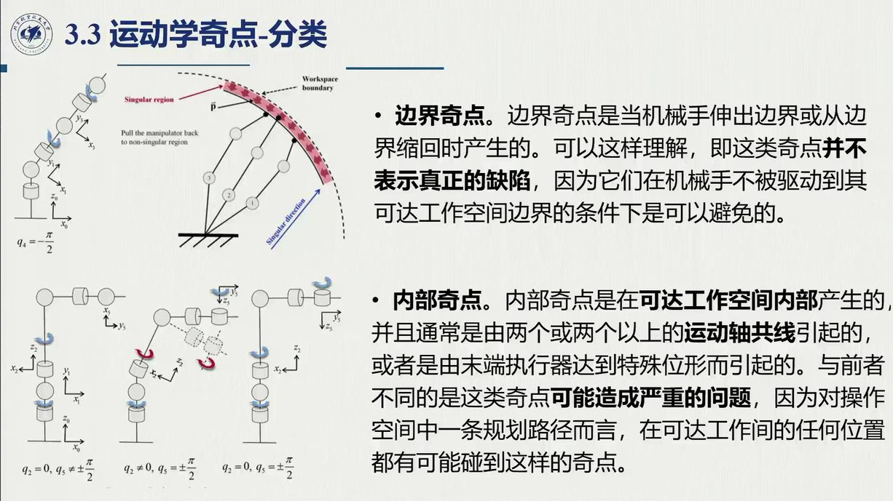
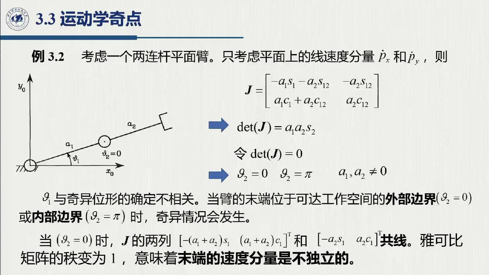
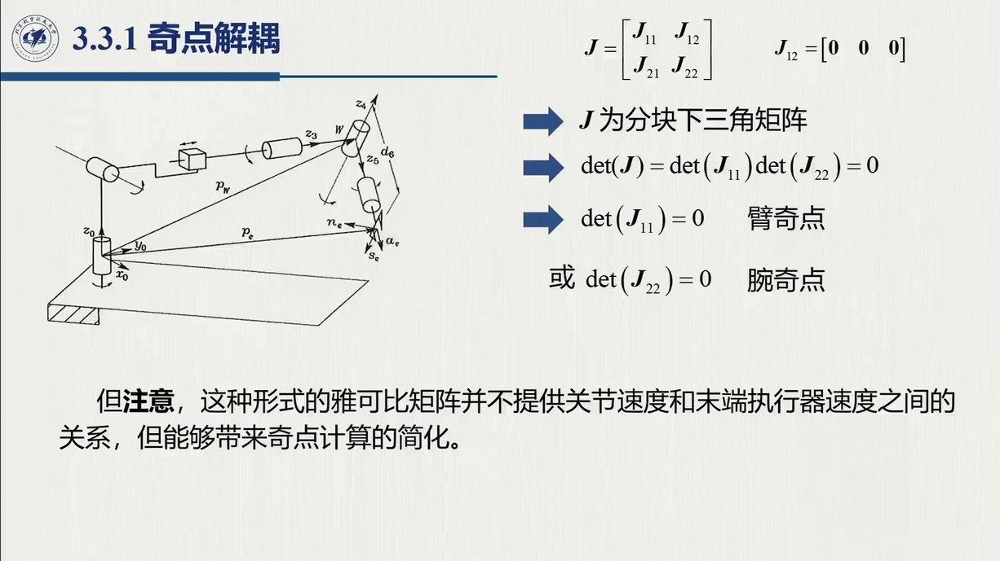
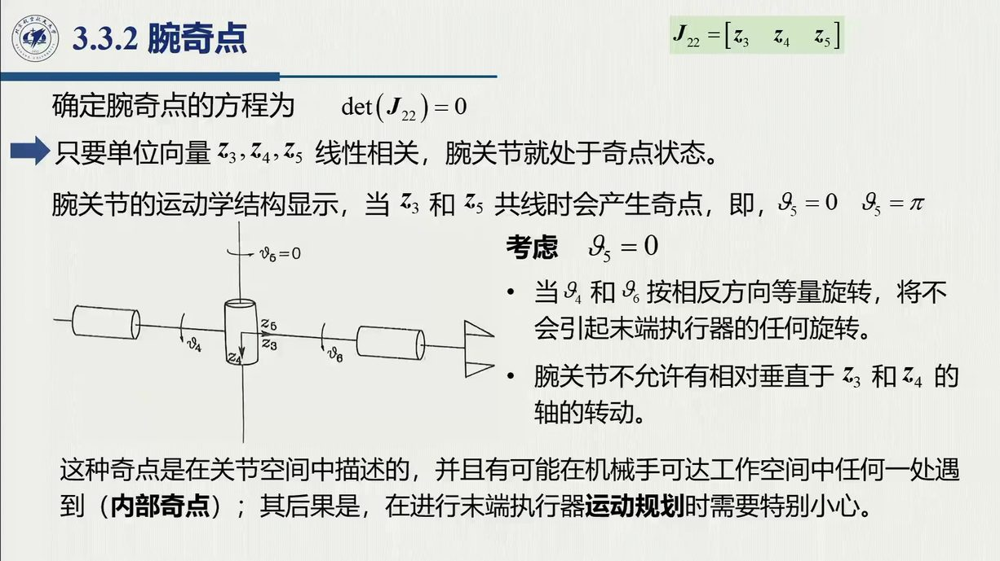
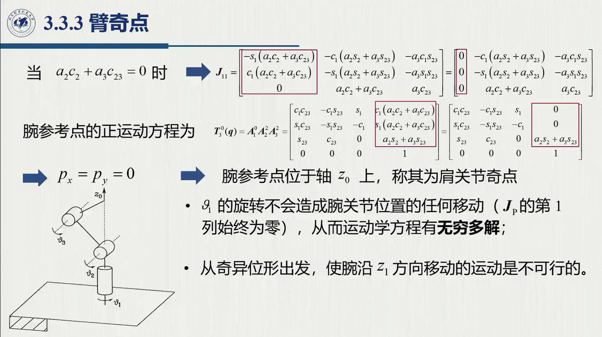

# 3.3 运动学奇点

上一节说明了怎样在给定位形计算[雅可比](../recall.md#jacobian)。给定末端速度后，还要判断关节能否实现它，以及所需关节速度是否过大。本节从两连杆速度方程出发，解释奇点与速度椭圆，再讨论六轴球腕的解耦判据。录播对应1:23:42–1:48:42。

## 3.3.1 定义、后果与分类

::: def 定义 3.3.1 · 运动学奇点 {#def-3.3.1}
先固定所研究的任务、速度分量和单位。令 $r_{\max}$ 为该机构在这一任务下能达到的最大雅可比秩；满足 $\operatorname{rank}J(q)<r_{\max}$ 的位形 $q$ 称为**运动学奇点**（kinematic singularity）；对于通常可逆的方阵雅可比，判据为

$$\det J(q)=0 .$$
:::

奇点对速度求解有三种直接影响（1:24:45–1:26:06）：

1. **运动退化**：处于奇点时，无法让末端执行器朝任意方向运动——期望速度不在 $J$ 的[列空间](../recall.md#rank)中时，没有关节速度能实现它；
2. **解不唯一**：一个可实现的速度可能对应无穷多组关节速度；若只定位拟人臂的腕心，腕心落在腰轴上时还会出现腰角任取的位置逆解；
3. **邻域放大**：奇点邻域内，操作空间里很小的速度可能要求关节空间给出很高的速度。风险取决于指令方向与关节限速，后面用两连杆臂具体计算。

判断时要分清三个层次：关节轴的几何关系、雅可比列的线性关系、所选任务的秩。**轴平行不等于完整雅可比列相关**。例如两连杆平面臂的两条转轴始终平行，但 $\vartheta_2=90^\circ$ 时，位置雅可比的行列式为 $a_1a_2\ne0$。此外，冗余机构有多于任务维数的列，列相关也未必意味着秩低于通常值。

再把“无解”和“无穷多解”放回速度方程。若 $v_d\notin\operatorname{Im}J$，方程 $J\dot q=v_d$ 无解；若存在特解且零空间非零，则 $\dot q=\dot q^*+n$（$Jn=0$）给出无穷多组瞬时速度。**瞬时速度解不唯一，不自动证明某个固定末端位姿有连续无穷多个逆运动学解**；后者要另查位置方程。

**按出现位置分类**（1:26:24–1:28:02）：

::: note 边界奇点 vs 内部奇点
- **边界奇点**（boundary）：机械手完全伸出或缩回、抵达工作空间边界时产生，需结合轨迹检查，接近边界时同样可能出现速度放大；
- **内部奇点**（interior）：出现在可达工作空间**内部**，「比较严重」，要检查计划轨迹是否经过它。某些结构由运动轴重合引起，也可能由其他特殊位形引起，不能把轴共线写成所有内部奇点的充要条件。
:::

## 3.3.2 例 3.2（原书）：两连杆平面臂

本例只研究末端位置 $[x,y]$，假定 $a_1,a_2>0$，关节速度用 rad/s、末端速度用 m/s。记 $c_i=\cos\vartheta_i$、$s_i=\sin\vartheta_i$，$c_{12},s_{12}$ 表示角度和 $\vartheta_1+\vartheta_2$ 的余弦、正弦。第一杆的绝对角为 $\vartheta_1$，第二杆为 $\vartheta_1+\vartheta_2$，将两杆在 $x,y$ 轴上的投影相加就得到位置。对 $\vartheta_1$ 求导时两杆都贡献速度，对 $\vartheta_2$ 求导时只有第二杆贡献；由链式法则得到：

$$p_w=\begin{bmatrix}a_1c_1+a_2c_{12}\\ a_1s_1+a_2s_{12}\end{bmatrix}
\qquad\Longrightarrow\qquad
J=\begin{bmatrix}\dfrac{\partial p_w}{\partial\vartheta_1}&\dfrac{\partial p_w}{\partial\vartheta_2}\end{bmatrix}
=\begin{bmatrix}-a_1s_1-a_2s_{12}&-a_2s_{12}\\ a_1c_1+a_2c_{12}&a_2c_{12}\end{bmatrix}$$

$$\det J=(-a_1s_1-a_2s_{12})(a_2c_{12})-(-a_2s_{12})(a_1c_1+a_2c_{12})
=a_1a_2(s_{12}c_1-s_1c_{12})=a_1a_2\sin\vartheta_2 .$$

::: ex 例 3.2（原书）· 两连杆臂的奇点 {#ex-book-3.2}
$$\det J=a_1a_2\,s_2=0\iff s_2=0\iff\vartheta_2=0\ \text{或}\ \pi$$

- **与 $\vartheta_1$ 无关**：转肩不改变奇异性（1:29:35）；
- $\vartheta_2=0$：臂**伸直**，在外边界；$\vartheta_2=\pi$：臂**折回**，当 $a_1\ne a_2$ 时位于内边界。若两杆等长，内半径为零，折回的原点在位置工作空间圆盘内部；奇点判据仍然成立，不能只靠“边界”标签判定；
- 代入 $\vartheta_2=0$ 验证（1:29:58）：两列分别变为 $\begin{bmatrix}-(a_1+a_2)s_1\\ (a_1+a_2)c_1\end{bmatrix}$ 与 $\begin{bmatrix}-a_2s_1\\ a_2c_1\end{bmatrix}$——二者**共线**，比例系数为 $(a_1+a_2)/a_2$；秩由 2 降为 1，末端沿径向的速度分量不可产生（该方向「不可控制」）。
:::

$\det J$ 只随肘角 $\vartheta_2$ 按正弦变化，在伸直与折回处为零。下图据此标出奇异肘角；要衡量速度放大，还需看后面推导的方向与半轴，不能把行列式直接当成距离或通用放大指标。

<figure>
<svg class="figure-svg" viewBox="0 0 920 340" xmlns="http://www.w3.org/2000/svg" role="img" aria-labelledby="fig-detj-t fig-detj-d">
<title id="fig-detj-t">两连杆臂 det J 随肘角的变化</title>
<desc id="fig-detj-d">横轴为肘角 ϑ2 从 0 到 2π，纵轴为 det J 除以 a1a2（即 sin ϑ2）的正弦曲线；在 0、π、2π 三处过零对应伸直与折回；两杆不等长时分别位于外边界与内边界。绝对值反映速度椭圆的面积比例。</desc>
<defs>
<marker id="fdj-m" markerWidth="9" markerHeight="9" refX="7" refY="3" orient="auto"><path d="M0,0 L7,3 L0,6 Z" fill="var(--muted)"/></marker>
</defs>
<text class="diagram-text" x="460" y="30" text-anchor="middle">det J = a<tspan class="sb">1</tspan>a<tspan class="sb">2</tspan> sin ϑ<tspan class="sb">2</tspan>：只看肘角（与肩角 ϑ<tspan class="sb">1</tspan> 无关）</text>
<rect x="60" y="66" width="60" height="220" fill="var(--fig-red)" fill-opacity=".05"/>
<rect x="425" y="66" width="80" height="220" fill="var(--fig-red)" fill-opacity=".05"/>
<rect x="790" y="66" width="60" height="220" fill="var(--fig-red)" fill-opacity=".05"/>
<line x1="100" y1="175" x2="830" y2="175" stroke="var(--line-strong)" stroke-width="1.2"/>
<line class="diagram-axis" x1="60" y1="175" x2="860" y2="175" marker-end="url(#fdj-m)"/>
<line class="diagram-axis" x1="60" y1="300" x2="60" y2="50" marker-end="url(#fdj-m)"/>
<text class="diagram-text" x="845" y="200">ϑ<tspan class="sb">2</tspan></text>
<text class="diagram-note" x="60" y="40" text-anchor="middle">det J/(a<tspan class="sb">1</tspan>a<tspan class="sb">2</tspan>)</text>
<g stroke="var(--line)" stroke-dasharray="4 4">
<line x1="282" y1="175" x2="282" y2="70"/><line x1="647" y1="175" x2="647" y2="280"/>
</g>
<polyline points="100,175 110,166 120,157 130,148 141,139 151,131 161,122 171,115 181,108 191,101 201,95 212,89 222,84 232,80 242,76 252,74 262,72 272,70 282,70 293,70 303,72 313,74 323,76 333,80 343,84 353,89 364,95 374,101 384,108 394,115 404,122 414,131 424,139 435,148 445,157 455,166 465,175 475,184 485,193 495,202 506,211 516,219 526,228 536,235 546,242 556,249 566,255 577,261 587,266 597,270 607,274 617,276 627,278 637,280 648,280 658,280 668,278 678,276 688,274 698,270 708,266 718,261 729,255 739,249 749,242 759,235 769,227 779,219 789,211 800,202 810,193 820,184 830,175" fill="none" stroke="var(--fig-green)" stroke-width="2.4"/>
<circle class="diagram-fill-accent" cx="282" cy="70" r="5"/>
<circle class="diagram-fill-sage" cx="647" cy="280" r="5"/>
<text class="diagram-text" fill="var(--fig-green)" x="282" y="56" text-anchor="middle">π/2：面积最大（det = a₁a₂）</text>
<text class="diagram-note" x="647" y="304" text-anchor="middle">3π/2：面积同样最大（det &lt; 0）</text>
<text class="diagram-text" fill="var(--fig-red)" x="90" y="100">ϑ<tspan class="sb">2</tspan> = 0：伸直</text>
<text class="diagram-text" fill="var(--fig-red)" x="465" y="100" text-anchor="middle">ϑ<tspan class="sb">2</tspan> = π：折回</text>
<text class="diagram-text" fill="var(--fig-red)" x="822" y="100">2π：伸直</text>
<text class="diagram-note" x="90" y="120">外边界</text>
<text class="diagram-note" x="465" y="120" text-anchor="middle">不等长时：内边界</text>
<text class="diagram-mono" x="730" y="120" text-anchor="middle">红区附近：径向速度需要更大关节速度</text>
<text class="diagram-note" x="460" y="332" text-anchor="middle">曲线对任何肩角 ϑ<tspan class="sb">1</tspan> 都一样——「转肩不改变奇异性」（1:29:35）；正弦过零即两列共线（[@ex-book-3.2]）</text>
</svg>
<figcaption>例 3.2 的行列式曲线（本教程绘）：$\det J=a_1a_2\sin\vartheta_2$ 与肩角无关。伸直时位于外边界；折回时，不等长两杆位于内边界，等长两杆则在工作空间内部的原点。$|\det J|$ 表示速度椭圆的面积比例，不能代替最小奇异值对困难方向的判断。</figcaption>
</figure>

### 先算一个速度指令，再看椭圆

取实验杆长 $a_1=1,a_2=0.8$ m，令 $\vartheta_1=\vartheta_2=0$，则

$$J=\begin{bmatrix}0&0\\1.8&0.8\end{bmatrix}.$$

对指令 $v_d=[0,0.1]^T$ m/s，$\dot q=[1/18,0]^T$ rad/s 是一个解，且加上任意倍的 $[0.8,-1.8]^T$ 仍是解。对 $v_d=[0.1,0]^T$ 则无解：第一行恒为零。

在邻近位形 $\vartheta_1=0,\vartheta_2=\varepsilon$，若要求 $v_d=[u,0]^T$，速度方程的两行分别是

$$-a_2\sin\varepsilon\,(\dot q_1+\dot q_2)=u,\qquad
a_1\dot q_1+a_2\cos\varepsilon\,(\dot q_1+\dot q_2)=0.$$

第一式在 $\sin\varepsilon\ne0$ 时给出 $\dot q_1+\dot q_2=-u/(a_2\sin\varepsilon)$。代入第二式，得到 $a_1\dot q_1-u\cos\varepsilon/\sin\varepsilon=0$，所以

$$\dot q_1=\frac{u\cos\varepsilon}{a_1\sin\varepsilon},\qquad
\dot q_2=-\frac{u}{a_2\sin\varepsilon}-\dot q_1.$$

上面的消元先求两个关节速度之和，再回代其中一个速度。固定 $u\ne0$ 时，随着 $\varepsilon\to0$，分母趋零，两个关节需要高速反向运动，才能合成指定的小水平速度。若 $u=0$，零关节速度仍是解；放大发生在困难方向的非零指令上，并非所有指令都会发散。

### 把“很大的关节速度”换成限速检查

仍取 $a_1=1,a_2=0.8$ m，要求水平速度 $u=0.1$ m/s。在 $\varepsilon=1^\circ$ 时，先按上式求和，再求各关节：

$$\dot q_1=0.1\cot1^\circ\approx5.7290,\qquad
\dot q_1+\dot q_2=-\frac{0.1}{0.8\sin1^\circ}\approx-7.1623,$$

所以 $\dot q_2\approx-12.8913$ rad/s。末端速度只有0.1 m/s，但若每个关节最多2 rad/s，这个瞬时指令就不可执行。

对同一水平运动方向，两项都与 $u$ 成正比。第二关节限制最紧，因此允许的 $|u|$ 至多约为 $0.1\times2/12.8913=0.01551$ m/s。这是当前位形和当前方向的限速结果，不是机械臂所有方向都只能这么慢。

### 速度椭圆的半轴为什么是奇异值？

把关节速度限制为 $\|\dot q\|_2\le Q$，其中本实验 $Q=1\ \mathrm{rad/s}$。两关节都是转动关节，因此这个约束是关节速度平面上的圆盘。它经 $v=J\dot q$ 线性映射后成为末端速度平面中的椭圆；图上画的是椭圆边界。下面从特征向量推导它的轴，不先要求读者会[奇异值](../recall.md#svd)分解。

令 $A=JJ^{\mathrm T}$。它对称，且对任意向量 $u$ 有 $u^{\mathrm T}Au=\|J^{\mathrm T}u\|^2\ge0$。由线性代数中的实对称矩阵谱定理，能取两条互相垂直的单位特征向量 $u_1,u_2$；前面的非负性说明特征值非负。记特征值为 $\sigma_i^2$，即

$$JJ^{\mathrm T}u_i=\sigma_i^2u_i,\qquad \|u_i\|=1.$$

对 $\sigma_i>0$，在关节速度空间中构造 $b_i=J^{\mathrm T}u_i/\sigma_i$。直接检查其长度和像：

$$\|b_i\|^2=\frac{u_i^{\mathrm T}JJ^{\mathrm T}u_i}{\sigma_i^2}=1,
\qquad Jb_i=\frac{JJ^{\mathrm T}u_i}{\sigma_i}=\sigma_i u_i.$$

同样，$b_1^{\mathrm T}b_2=0$。因此用 $\dot q=\alpha_1b_1+\alpha_2b_2$ 表示关节速度时，速度上限成为 $\alpha_1^2+\alpha_2^2\le Q^2$，输出则是

$$v=\sigma_1\alpha_1u_1+\sigma_2\alpha_2u_2.$$

这正是以 $u_i$ 为轴、以 $Q\sigma_i$ 为半轴长度的椭圆。$u_i$ 是**末端速度方向**，$b_i$ 是产生该方向的**关节速度配比**，$\sigma_i$ 则是这对方向的速度倍率；$\sigma_i$ 称为雅可比的奇异值。某个 $\sigma_i=0$ 时，$J^{\mathrm T}u_i=0$，所有可实现速度都满足 $u_i^{\mathrm T}v=0$，于是这个方向消失，椭圆退化成线段。

在非奇异位形，若指令只沿 $u_i$，即 $v_d=c\,u_i$，取 $\alpha_i=c/\sigma_i$，其余系数为零。因此所需关节速度模为 $|c|/\sigma_i$。最短半轴对应最小奇异值，正是反解最吃力的方向。另一方面，椭圆面积为 $\pi Q^2\sigma_1\sigma_2$，而

$$\sigma_1^2\sigma_2^2=\det(JJ^{\mathrm T})=(\det J)^2
\quad\Longrightarrow\quad \sigma_1\sigma_2=|\det J|.$$

椭圆面积只反映两条半轴的乘积。长轴增大时，即使短轴已经很小，面积仍可能较大。因此判断某个方向是否难以实现，应看该方向的半轴，而不能只比较面积。

现在操作下面的实验：先预测 $\vartheta_2=0$ 时会剩哪种速度，再拖到 $0^\circ$ 核对线段方向；调到 $1^\circ$，短轴虽很小却尚未为零。最后只改变肩角，观察两根轴一起旋转，半轴长度保持不变。

<figure class="arm-lab">
<svg id="ell-svg" class="figure-svg" viewBox="0 0 920 470" xmlns="http://www.w3.org/2000/svg" role="img" aria-labelledby="ell-t ell-d">
<title id="ell-t">两连杆臂可操作度椭圆操作台</title>
<desc id="ell-d">左图为俯视的两连杆臂与可达工作空间圆环；右图为末端速度集椭圆，随关节角实时变形，接近奇异位形时沿径向压扁成线段。</desc>
<text class="diagram-text" x="200" y="30" text-anchor="middle">臂（俯视，a<tspan class="sb">1</tspan> = 1，a<tspan class="sb">2</tspan> = 0.8）</text>
<text class="diagram-text" x="640" y="30" text-anchor="middle">末端速度集 { J·q′ ：‖q′‖ ≤ 1 }</text>
<path d="M 322.4 240 A 122.4 122.4 0 1 1 77.6 240 A 122.4 122.4 0 1 1 322.4 240 Z M 213.6 240 A 13.6 13.6 0 1 0 186.4 240 A 13.6 13.6 0 1 0 213.6 240 Z" fill="var(--accent)" fill-opacity=".07" stroke="var(--accent)" stroke-width="1" fill-rule="evenodd"/>
<g stroke="var(--line)" stroke-dasharray="3 5">
<line x1="120" y1="240" x2="280" y2="240"/><line x1="200" y1="160" x2="200" y2="320"/>
</g>
<g stroke="var(--line-strong)" stroke-width="1.1" marker-end="url(#ell-m)">
<line x1="200" y1="240" x2="255" y2="240"/>
<line x1="200" y1="240" x2="200" y2="192"/>
</g>
<text class="diagram-note" x="260" y="244">x</text>
<text class="diagram-note" x="194" y="186" text-anchor="end">y</text>
<line id="ell-m1" x1="200" y1="240" x2="252.2" y2="201" stroke="var(--fig-blue)" stroke-width="4"/>
<line id="ell-m2" x1="252.2" y1="201" x2="289.6" y2="145.4" stroke="var(--fig-blue)" stroke-width="4"/>
<circle cx="200" cy="240" r="6.5" fill="var(--paper)" stroke="var(--ink-2)" stroke-width="1.5"/>
<circle id="ell-me" cx="252.2" cy="201" r="5" fill="var(--paper)" stroke="var(--fig-blue)" stroke-width="2"/>
<circle id="ell-mt" cx="289.6" cy="145.4" r="5.5" fill="var(--accent-text)" stroke="var(--paper)" stroke-width="2"/>
<path id="ell-ell" d="" fill="var(--accent)" fill-opacity=".12" stroke="var(--accent)" stroke-width="1.8"/>
<g stroke="var(--line)">
<line x1="450" y1="235" x2="830" y2="235"/><line x1="640" y1="45" x2="640" y2="425"/>
</g>
<line id="ell-rad" x1="640" y1="235" x2="800" y2="235" stroke="var(--fig-red)" stroke-width="1.4" stroke-dasharray="6 4"/>
<text id="ell-radlbl" class="diagram-note" fill="var(--fig-red)" x="806" y="239">径向</text>
<text class="diagram-mono" x="838" y="230">v<tspan class="sb">x</tspan></text>
<text class="diagram-mono" x="646" y="56">v<tspan class="sb">y</tspan></text>
<text class="diagram-text" fill="var(--fig-red)" x="460" y="392" text-anchor="middle"><tspan id="ell-warn"> </tspan></text>
<text class="diagram-mono" x="460" y="424" text-anchor="middle">σ<tspan class="sb">1</tspan> = <tspan id="ell-s1">+</tspan>　σ<tspan class="sb">2</tspan> = <tspan id="ell-s2">+</tspan>　det J = <tspan id="ell-rd">+</tspan>　扁率 σ<tspan class="sb">2</tspan>/σ<tspan class="sb">1</tspan> = <tspan id="ell-rf">+</tspan></text>
<text class="diagram-note" x="460" y="452" text-anchor="middle">σ 与扁率只依赖肘角 ϑ<tspan class="sb">2</tspan>——转肩 ϑ<tspan class="sb">1</tspan> 只把整幅图旋转（对照上图 det J 曲线）；w = σ<tspan class="sb">1</tspan>σ<tspan class="sb">2</tspan> = |det J| 即 3.5 节的可操作度</text>
<defs>
<marker id="ell-m" markerWidth="8" markerHeight="8" refX="6" refY="2.5" orient="auto"><path d="M0,0 L6,2.5 L0,5 Z" fill="var(--muted)"/></marker>
</defs>
</svg>

<button type="button" id="ell-reset">重置肩肘角</button>
<label>θ₁（转肩） <input type="range" id="ell-t1" min="-180" max="180" step="1" value="35" aria-label="关节角 1">35°</label>
<label>θ₂（肘） <input type="range" id="ell-t2" min="-180" max="180" step="1" value="60" aria-label="关节角 2">60°</label>

<figcaption>可操作度椭圆操作台（本教程绘）：右图是把关节空间单位球 $\|\dot q\|\le1$ 经 $J$ 映到速度平面的像——半轴即奇异值 $\sigma_1,\sigma_2$，$w=\sigma_1\sigma_2=|\det J|=a_1a_2|\sin\vartheta_2|$（[@ex-book-3.2] 与 <a href="sec3-5.md#sec-3.5.1">3.5.1</a> 可操作度的平面实例）。$\vartheta_2\to0,\pi$ 时 $\sigma_2\to0$：椭圆沿径向压扁成线段，「径向速度不可产生」从一句话变成看得见的形状。</figcaption>
</figure>

接下来研究本节的三关节拟人臂加球形腕。下图先画出它的腕、肘、肩三类奇点；再分别从腕部角速度和腕心位置的雅可比，推导对应的判据。

<figure>
<svg class="figure-svg" viewBox="0 0 920 412" xmlns="http://www.w3.org/2000/svg" role="img" aria-labelledby="fig-sg-t fig-sg-d">
<title id="fig-sg-t">三类奇点的几何图像：腕、肘、肩</title>
<desc id="fig-sg-d">左图两个腕关节轴共线导致自由度丢失；中图臂完全伸直使腕心落在可达边界；右图腕心落在第一关节轴上使第一关节失去作用。</desc>
<defs>
<marker id="ar-x" markerHeight="8" markerWidth="8" orient="auto" refX="6" refY="3"><path d="M0,0 L7,3 L0,6 Z" fill="context-stroke"/></marker>
<marker id="ar-xs" markerHeight="8" markerWidth="8" orient="auto-start-reverse" refX="6" refY="3"><path d="M0,0 L7,3 L0,6 Z" fill="context-stroke"/></marker>
</defs>
<g font-family="var(--sans)">
<rect fill="none" height="300" rx="10" stroke="var(--line)" width="272" x="24" y="34"/>
<text class="diagram-text" fill="var(--fig-red)" text-anchor="middle" x="160" y="62">① 腕奇点　ϑ<tspan class="sb">5</tspan> = 0 或 π</text>
<line class="diagram-axis" x1="160" x2="160" y1="250" y2="118"/>
<text class="diagram-note" text-anchor="end" x="150" y="128">轴 4</text>
<text class="diagram-note" text-anchor="start" x="170" y="128">轴 6（与之共线）</text>
<circle class="diagram-fill-accent" cx="160" cy="250" r="7"/>
<circle cx="160" cy="250" r="16" fill="none" stroke="var(--line-strong)" stroke-width="1.2"/>
<text class="diagram-note" text-anchor="middle" x="160" y="290">关节 4 与关节 6 的轴重合</text>
<text class="diagram-note" text-anchor="middle" x="160" y="310">绕它们的转动效果等价 ⇒ 少一个定向自由度</text>
<text class="diagram-note" text-anchor="middle" x="160" y="330">det J<tspan class="sb">22</tspan> ∝ s<tspan class="sb">5</tspan> = 0</text>
<rect fill="none" height="300" rx="10" stroke="var(--line)" width="272" x="324" y="34"/>
<text class="diagram-text" fill="var(--fig-red)" text-anchor="middle" x="460" y="62">② 肘奇点　ϑ<tspan class="sb">3</tspan> = 0 或 π</text>
<line stroke="var(--ink-2)" stroke-width="5" x1="356" x2="452" y1="262" y2="186"/>
<line stroke="var(--ink-2)" stroke-width="5" x1="452" x2="548" y1="186" y2="110"/>
<circle class="diagram-fill-accent" cx="356" cy="262" r="7"/>
<circle class="diagram-fill-sage" cx="452" cy="186" r="7"/>
<circle cx="548" cy="110" r="6" fill="var(--paper)" stroke="var(--line-strong)" stroke-width="1.2"/>
<text class="diagram-note" x="558" y="106">腕心</text>
<line stroke="var(--fig-red)" stroke-dasharray="5 4" stroke-width="1.5" x1="356" x2="592" y1="262" y2="72"/>
<text class="diagram-note" text-anchor="middle" x="460" y="290">臂完全伸直（或折回）：肩—肘—腕共线</text>
<text class="diagram-note" text-anchor="middle" x="460" y="310">腕心落在可达工作空间边界上</text>
<text class="diagram-note" text-anchor="middle" x="460" y="330">瞬时径向速度为零（s<tspan class="sb">3</tspan> = 0）</text>
<rect fill="none" height="300" rx="10" stroke="var(--line)" width="272" x="624" y="34"/>
<text class="diagram-text" fill="var(--fig-red)" text-anchor="middle" x="760" y="62">③ 肩奇点　a<tspan class="sb">2</tspan>c<tspan class="sb">2</tspan> + a<tspan class="sb">3</tspan>c<tspan class="sb">23</tspan> = 0</text>
<line class="diagram-axis" x1="760" x2="760" y1="268" y2="96"/>
<text class="diagram-note" text-anchor="end" x="750" y="106">轴 1</text>
<line stroke="var(--ink-2)" stroke-width="5" x1="760" x2="700" y1="268" y2="178"/>
<line stroke="var(--ink-2)" stroke-width="5" x1="700" x2="760" y1="178" y2="128"/>
<circle class="diagram-fill-accent" cx="760" cy="268" r="7"/>
<circle class="diagram-fill-sage" cx="700" cy="178" r="7"/>
<circle cx="760" cy="128" r="9" fill="var(--fig-green)" fill-opacity=".35" stroke="var(--fig-red)" stroke-width="1.6"/>
<text class="diagram-note" fill="var(--fig-red)" x="776" y="132">腕心</text>
<text class="diagram-note" text-anchor="middle" x="760" y="290">腕心落在第一关节的轴上</text>
<text class="diagram-note" text-anchor="middle" x="760" y="310">绕轴 1 转不改变腕心位置</text>
<text class="diagram-note" text-anchor="middle" x="760" y="330">腰关节对腕心位置的瞬时贡献为零</text>
<text class="diagram-note" x="24" y="374">图示对应本节拟人臂与球形腕；其他机构需重新计算任务雅可比。</text>
</g></svg>
<figcaption>三类奇点都是**结构的几何属性**，不是数值问题（本教程绘）：① **腕奇点**——两个腕关节轴共线，绕它们的转动等价，丢掉一个定向自由度；② **肘奇点**——臂完全伸直（或折回），腕心落在可达工作空间边界，瞬时径向速度为零；③ **肩奇点**——腕心落在第一关节轴上，绕该轴转不改变腕心位置。三者分别对应 $\det J_{22}\propto s_5$、$\det J_{11}$ 的 $s_3$ 因子、$(a_2c_2+a_3c_{23})$ 因子（[@thm-3.3.A]）。</figcaption>
</figure>

## 3.3.3 奇点解耦：腕 + 臂分开判

直接展开六自由度机械手的 $6\times6$ 行列式较繁琐。若机构具有球形腕，可像求逆运动学闭合解时一样，将腕与臂分开处理；这里复用 [@thm-2.12.B] 的结构前提。

课件中的分块矩阵把线速度参考点换成了腕心，因此不能直接代入原工具点的速度。下面先推导参考点变换，再说明为什么它保留奇点判据，以及速度指令应怎样一起换算。

::: thm 定理 3.3.A · 奇点解耦 {#thm-3.3.A}
对本节的六关节「三关节臂 + 三转动关节球形腕」构型，把微分运动学的**参考点从末端挪到腕中心** $p_w$，雅可比分块化为**下三角**：

$$\begin{bmatrix}\dot p_w\\ \omega_e\end{bmatrix}=\begin{bmatrix}J_{11}&0\\ J_{21}&J_{22}\end{bmatrix}\begin{bmatrix}\dot q_a\\ \dot q_w\end{bmatrix},
\qquad\det J=\det J_{11}\cdot\det J_{22}$$

$J_{11}$（$3\times3$）把臂关节速度映到腕心线速度；$J_{22}$（$3\times3$）把腕关节速度映到角速度。后者在基系表达时，轴方向也随臂的整体转动而变，但共同的旋转不改变其行列式。奇点判定由一个六阶行列式拆成两个三阶行列式。
:::

::: proof 为什么可以挪参考点？
令 $r=p_e-p_w$ 为腕心到工具点的向量，均在基系表达。刚体点速度关系为

$$\dot p_e=\dot p_w+\omega\times r=\dot p_w-S(r)\omega.$$

所以 $\dot p_w=\dot p_e+S(r)\omega$，于是

$$J_w=\begin{bmatrix}I&S(r)\\0&I\end{bmatrix}J_e=MJ_e.$$

$M$ 为可逆块三角矩阵，$\det M=1$；其逆矩阵只需将 $S(r)$ 换成 $-S(r)$。因此 $\operatorname{rank}J_w=\operatorname{rank}J_e$，且六阶方阵时行列式相等。腕部转动不移动三轴交点，故 $J_w$ 的右上块为零。

为什么右上块为零后就能拆行列式？沿前三行展开时，它们在后三列全部为零，非零项只能从前三列选取三个元素；剩余三行只能从后三列选取，分别得到 $\det J_{11}$ 和 $\det J_{22}$。左下的 $J_{21}$ 不影响乘积，却仍会影响臂关节对角速度的贡献，不能在速度控制时把它随意删除。

$J_w$ 是真实的“关节速度 → 腕心线速度及刚体角速度”映射，可以用于腕心任务的速度控制。若任务指定工具点速度，须先按上述式子转换，不能把工具点速度原样代入 $J_w$。**这里保留了完整六维速度信息；仅取位置三行则不同**，见上一节反例。
:::

### 腕侧：三个轴方向怎样失去一个维度？

三个腕关节全是转动关节，所以 $J_{22}$ 的三列是轴 4、5、6 的方向 $z_3,z_4,z_5$。行列式等于三个列向量的标量三重积：

$$\det J_{22}=(z_3\times z_4)\cdot z_5.$$

叉积 $z_3\times z_4$ 垂直于前两轴，点积再取第三轴在该法向上的分量；只有第三轴不落在前两轴的平面里，三列才张成三维。对本节相邻腕轴互相垂直的球腕，在随腕基座一起转动的正交坐标系中，可把三个方向写成

$$z_3=\begin{bmatrix}0\\0\\1\end{bmatrix},\qquad
z_4=\begin{bmatrix}0\\1\\0\end{bmatrix},\qquad
z_5=\begin{bmatrix}\sin\vartheta_5\\0\\\cos\vartheta_5\end{bmatrix}.$$

共同转动三个向量不改变行列式，因此可在这个坐标系计算：$(z_3\times z_4)\cdot z_5=[-1,0,0]\cdot z_5=-\sin\vartheta_5$。轴的正向和角度零点采用别的 DH 约定时，表达式可能相差符号；本节约定下的零点仍是

$$s_5=0\iff\vartheta_5=0\ \text{或}\ \pi\pmod{2\pi}.$$

$\vartheta_5=0$ 时，腕关节 4 与 6 的轴共线：它们的角速度列相同，腕部只能提供两种独立的角速度方向。若臂块 $J_{11}$ 可逆，要保持腕心不动就必须有 $\dot q_a=0$，因此不能指望靠臂关节补出缺失的腕部方向。若允许腕心移动，臂关节仍可能贡献该方向的角速度，但那已改变了原来的任务要求。

### 臂侧：肘与肩为什么分别给出两个因子？

沿用 [3.2.2](sec3-2.md#sec-3.2.2) 的拟人臂约定，基座原点取在肩部，令 $R=a_2c_2+a_3c_{23}$ 为腕心到腰轴的有符号水平距离，$H=a_2s_2+a_3s_{23}$ 为腕心相对肩部的竖直坐标。把位置写成 $p_w=R e_r+H e_z$，其中

$$e_r=[c_1,s_1,0]^{\mathrm T},\quad
e_\phi=[-s_1,c_1,0]^{\mathrm T},\quad e_z=[0,0,1]^{\mathrm T}.$$

腰角变化只转动 $e_r$，$\partial e_r/\partial\vartheta_1=e_\phi$；肩角变化给出 $\partial R/\partial\vartheta_2=-H$、$\partial H/\partial\vartheta_2=R$；肘角则给出 $\partial R/\partial\vartheta_3=-a_3s_{23}$、$\partial H/\partial\vartheta_3=a_3c_{23}$。因此三列分别是

$$J_{11}=[\,R e_\phi,\;-H e_r+R e_z,\;-a_3s_{23}e_r+a_3c_{23}e_z\,].$$

在右手正交基 $[e_r,e_\phi,e_z]$ 中，矩阵变为 $\begin{bmatrix}0&-H&-a_3s_{23}\\R&0&0\\0&R&a_3c_{23}\end{bmatrix}$。基变换的行列式为 1，不改变结果。沿第一列展开：

$$\begin{aligned}
\det J_{11}
&=-R\big[(-H)a_3c_{23}-(-a_3s_{23})R\big]\\
&=Ra_3(Hc_{23}-Rs_{23})\\
&=Ra_2a_3(s_2c_{23}-c_2s_{23})\\
&=-Ra_2a_3\sin\vartheta_3.
\end{aligned}$$

第三行中两个 $a_3s_{23}c_{23}$ 项抵消，最后一步使用 $\sin(\vartheta_2-\vartheta_{23})=-\sin\vartheta_3$。代回 $R$ 就得到

$$\det J_{11}=-a_2a_3\,s_3\,(a_2c_2+a_3c_{23}).$$

- **肘奇点** $s_3=0$（$\vartheta_3=0$ 伸直 / $\pi$ 折回）：属于**边界奇点**，与两连杆平面臂（[@ex-book-3.2]）在概念上完全一样——臂展达到极限，径向速度造不出来（1:43:11）；
- **肩奇点** $a_2c_2+a_3c_{23}=0$：腕中心**恰好落在 $z_0$ 轴上**（$p_w$ 的 $x,y$ 分量同时为零）。此时 $J_{11}$ 的第一列 $z_0\times(p_w-p_0)=z_0\times p_w=\boldsymbol0$ **为零**——无论腰关节转多快，腕点纹丝不动；若任务只定位腕心，相应的位置逆运动学有**无穷多解**（$\vartheta_1$ 任取），完整六维雅可比第一列的角速度部分仍不为零（1:44:31–1:46:03）。

::: note 工程规避（课堂视频，1:46:24–1:48:42）
大族机器人演示了腕 / 肩 / 肘三类奇异点，其自研力控算法「可阻止机械臂进入奇异点位置」。Doosan 协作机器人则给出两种方式：**变速度**（Variable Velocity，在奇点附近自动降速）与**自动规避**（Auto Avoidance——不严格遵循设定轨迹，在奇点附近容忍较大的轨迹跟踪误差）。
:::

::: intuition 动手实验 · 可操作度椭球：奇点就是它被压扁的那一刻（3D）
本实验只研究拟人臂的**位置任务**。对总关节速度约束 $\|\dot q\|_2\le1$ rad/s，速度集 $\{J_P\dot q\}$ 的主轴方向为 $J_PJ_P^T$ 的单位特征向量，半轴长度是奇异值 $\sigma_i=\sqrt{\lambda_i}$ 乘以该速度上限——**半轴越长 = 末端在该方向上能出的速度越大**。拖 $\vartheta_2,\vartheta_3$ 逼近两类奇点：<b>肘伸直 / 折回</b>（$s_3=0$，边界奇点）与 <b>腕点落到肩轴上</b>（$a_2c_2+a_3c_{23}=0$，内部奇点），看椭球如何先压扁为面；若同时失去两个方向，再退化为线——那一刻起，末端在某个方向上「给不出速度」，此时方阵逆不存在，应先判断期望速度是否在列空间内。表格里两个因子各自归零的位形与上面的判据一一对应。

先用纸笔预测，再在实验中核对以下两组位形。杆长为 $a_2=0.62$ m、$a_3=0.52$ m，实验角度依次为腰、肩、肘。

1. **设为 $(0^\circ,0^\circ,0^\circ)$**：$R=1.14,H=0$，故 $J_P=\begin{bmatrix}0&0&0\\1.14&0&0\\0&1.14&0.52\end{bmatrix}$。能产生 $y,z$ 两种速度，无法产生 $x$ 速度；秩为 2，速度椭球退化为一个面。这里腰关节的作用没有消失。
2. **设为 $(0^\circ,90^\circ,0^\circ)$**：$R=0,H=1.14$，故 $J_P=\begin{bmatrix}0&-1.14&-0.52\\0&0&0\\0&0&0\end{bmatrix}$。腰轴经过腕心，腰关节不移动腕心；肩肘又伸直，只剩一个水平速度方向，秩为 1，椭球退化为线段。数值显示可能有舍入量，应按这组解析矩阵理解零奇异值。

最后按“重置关节与视角”返回默认位形。读数中的 $w$ 是 $|\det J_P|$，不是它的平方根；三根半轴与前面的二维推导相同，只是增加了第三个正交方向。
:::

::: ex 独立练习 · 能算出速度，才算理解奇点

1. 仍取 $a_1=1,a_2=0.8$ m，$\vartheta_1=0$。令 $\vartheta_2=30^\circ$，要求末端速度 $[0.1,0]^{\mathrm T}$ m/s。先写两行方程，再求两个关节速度。若每个关节限速为 $0.3$ rad/s，能否实现？
2. 同样单位与关节速度上限下，两组局部位置雅可比分别为 $J_A=\operatorname{diag}(10,0.2)$、$J_B=\operatorname{diag}(1,1)$。谁的速度椭圆面积大？谁实现 $[0,0.1]^{\mathrm T}$ m/s 更省关节速度？
3. 工具点距腕心 $r=[0.1,0,0]^{\mathrm T}$ m。希望工具点线速度为零、角速度为 $[0,0,1]^{\mathrm T}$ rad/s，应给腕心什么线速度？

::: sol 展开核对与解释

1. 第一行是 $-0.4(\dot q_1+\dot q_2)=0.1$，故和为 $-0.25$ rad/s。第二行是 $\dot q_1+0.4\sqrt3(\dot q_1+\dot q_2)=0$，故 $\dot q_1=\sqrt3/10\approx0.1732$、$\dot q_2=-0.25-\sqrt3/10\approx-0.4232$ rad/s。第二关节超限，所以几何上有解，却不能按当前速度执行。可减慢指令或改变位形；不能把“行列式不为零”等同于满足驱动器限速。
2. 单位输入圆盘映射后的面积分别是 $2\pi$ 与 $\pi$，所以 A 大。给定竖直速度时，A 需要 $\dot q=[0,0.5]^{\mathrm T}$，B 只需 $[0,0.1]^{\mathrm T}$ rad/s，B 更省。A 的长轴增加了面积，却没有改善短轴方向。
3. $\dot p_w=\dot p_e+r\times\omega=[0,-0.1,0]^{\mathrm T}$ m/s。代回 $\dot p_e=\dot p_w+\omega\times r$，两项相消，工具点才会保持不动。若直接给腕心零线速度，工具点反而会以 $[0,0.1,0]^{\mathrm T}$ m/s 运动。

:::

:::

## 3.3 小结与常见错误

先选任务，再检查是否降秩。两连杆位置任务有 $\det J=a_1a_2\sin\vartheta_2$；六轴球腕可用可逆的参考点变换分成腕块和臂块。奇点的直接后果是某些瞬时速度方向无法实现，邻域中这些方向的速度指令可能引起较大关节速度。

::: think 自查三条
1. 轴平行不等于雅可比列相关；冗余机构列相关也不等于降秩。
2. 变换到腕心的完整六维速度映射保留秩，但取位置三行会舍去角速度信息。
3. 椭圆面积大不等于各方向同样灵活；检查困难方向的放大应看最小奇异值，而非仅看行列式。
:::

下一节 [3.4](sec3-4.md) 研究零空间：在不改变所选任务速度的情况下，机构还能怎样运动？
