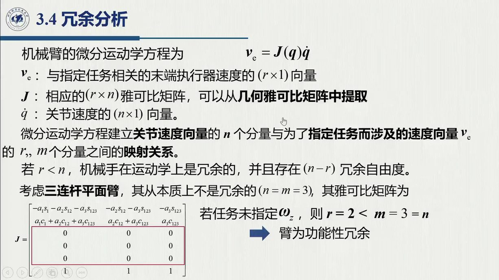
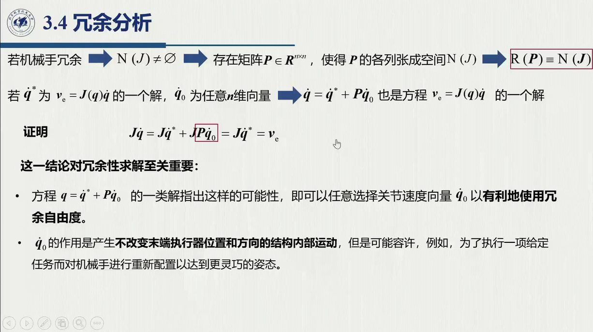

# 3.4 冗余分析

奇异是「列不够」，冗余是「列太多」：关节数一旦超过任务所需维数，同一个末端速度就有无穷多种关节速度实现。这些「多余」的自由度不是浪费——它们是避障、回避奇异、优化姿态的资本。本节先给出任务相关的冗余判据，再说明怎样把这份「多余」用起来。录播 1:47:01–1:56:39。

<aside class="lesson-brief" aria-label="3.4 学习简报">

PREREQUISITE<strong>你需要先会</strong>
关节空间 / 操作空间与 $(n,m,r)$ 的含义；[@def-2.10.1]、[@def-2.10.3] 中的本质 / 功能冗余；值域空间 $\mathcal R(J)$ 与零空间 $\mathcal N(J)$。

TARGET<strong>本节要建立</strong>
任务相关的冗余判据 $n>r$；零空间矩阵 $N$ 与零空间投影 $P=NN^{\mathrm T}$；解族定理 $\dot q^*+P\dot q_0$；以及内部运动的三个用途。

CHECKPOINT<strong>学完的标准</strong>
能判定给定机械手对给定任务是否冗余（含功能冗余）；能证明 $\dot q^*+P\dot q_0$ 仍是解；能说出 $\dot q_0$ 的三种典型设计目标。

</aside>

::: def 定义 3.4.1 · 冗余（任务相关）{#def-3.4.1}
当机械手自由度个数 $n$ **大于**描述给定任务所必需的变量个数 $r$ 时，就称该机械手对给定任务**冗余**。操作空间维度 $m<n$ 时一定冗余（如 7 关节在三维空间操作，$7>6$）；而任务维度恒有 $r\le m\le6$——一个任务可能只用得上其中两个、三个分量。

**冗余是任务相关的概念**：同一台机械手，对某个任务可能冗余、对另一个任务却可能非冗余；甚至 $m=n$ 时，只要特定任务只涉及 $r<m$ 个操作空间分量，机械手也是（功能上）冗余的——[2.10](../ch02/sec2-10.md) 讲过的本质 / 功能冗余，在这里正式落地。一个最小的例子见 [@ex-3.4.A]。
:::

**分析工具**：判断冗余不必展开正运动学方程，而是直接分析雅可比（1:50:17）——它把任务速度与关节速度线性地联系起来：

$$v_e=J(q)\,\dot q,\qquad v_e\in\mathbb R^{r}\ (\text{任务速度}),\quad J\in\mathbb R^{r\times n},\quad \dot q\in\mathbb R^{n}$$

这里的 $v_e$ 是**与任务相关**的速度向量：$J$ 并非完整的几何雅可比，而是从中**提取任务用到的行**得到的。于是当 $r<n$ 时，机械手对该任务冗余，多出 $n-r$ 个**冗余自由度**——它们很快就会以零空间的形式登场。

::: ex 例 3.4.A（新增）· 三连杆平面臂的功能冗余 {#ex-3.4.A}
三连杆平面臂 $n=3$，平面操作空间 $m=3$（$x,y$ 两个平动 + 绕 $z$ 转动），本质不冗余。但若任务只做平面内 $xy$ 定位、不关心末端姿态（如**平面画线 / 搬运**），则 $r=2<3$——这就是**功能冗余**：肘部姿态可以自由摆动，笔尖却保持不动（1:51:25）。反过来，若任务要求位置 + 姿态（$r=3$），同一台臂便立刻非冗余。
:::

谈冗余离不开两个子空间（1:52:35–1:53:50）：

- **值域空间 $\mathcal R(J)$**：回答「哪些末端速度能做到」——不在 $\mathcal R(J)$ 里的末端速度**不可能**用关节速度线性表出（方程无解）；
- **零空间 $\mathcal N(J)$**：回答「哪些关节速度不惊动末端」——它与冗余直接相关：末端速度为零时，关节空间中**仍有**速度（「内部运动」：臂在动、末端不动）。若机械手冗余，$\mathcal N(J)$ 就必定非空：存在 $n\times(n-r)$ 矩阵 $N$，其列张成零空间（$JN=0$，$N$ 列满秩）。

::: thm 定理 3.4.B · 解族与零空间投影 {#thm-3.4.B}
沿用上面的零空间矩阵 $N$，取

$$P=N N^{\mathrm T}\qquad(\text{秩}\ n-r)$$

若 $\dot q^*$ 是微分运动方程 $v_e=J\dot q$ 的一个解（特解），而 $\dot q_0$ 是**任意**向量，则

$$\dot q^*+P\,\dot q_0\quad\text{仍是方程的解}.$$
:::

::: proof 证明（课堂口述，1:54:07–1:56:07）
证明只需一步：验证 $JP\dot q_0=0$；只要这一项为零，解族就自动成立。由 $JN=0$ 得 $JNN^{\mathrm T}\dot q_0=(JN)N^{\mathrm T}\dot q_0=0$。□

直观地说：$P\dot q_0$ 落在 $P$ 的值域里，而 $P=NN^{\mathrm T}$ 的值域正是 $N$ 的列空间 $=\mathcal N(J)$——**零空间里的运动不惊动末端**。
:::

「臂在动、末端不动」长什么样，可以直接画出来（见下图）：三连杆平面臂的笔尖 $P$ 钉在纸上不动，臂的其余部分却还在动——腕心沿一段圆弧滑动，肘部随之摆动。这就是零空间里的**内部运动**：$\dot q^*+P\dot q_0$ 的第二项，正是沿着这条弧滑动的那一份。

<figure>
<svg class="figure-svg" viewBox="0 0 920 428" xmlns="http://www.w3.org/2000/svg" role="img" aria-labelledby="fig-34-title fig-34-desc">
<title id="fig-34-title">零空间自运动：末端不动、臂在动</title>
<desc id="fig-34-desc">三连杆平面臂基座在左下，末端点 P 固定不动；三幅臂形共享同一个 P，腕心 W 沿以 P 为圆心、半径 a3 的虚线圆弧移动，肘部随之摆动。主臂（蓝）对应特解 q′*，两幅浅色臂对应叠加零空间项 P q′0 后的不同位形。</desc>
<defs>
<marker id="f34-m" markerWidth="9" markerHeight="9" refX="7" refY="3" orient="auto"><path d="M0,0 L7,3 L0,6 Z" fill="var(--muted)"/></marker>
<marker id="f34-g" markerWidth="8" markerHeight="8" refX="6" refY="2.5" orient="auto"><path d="M0,0 L6,2.5 L0,5 Z" fill="var(--fig-gold)"/></marker>
</defs>
<text class="diagram-text" x="460" y="36" text-anchor="middle">零空间自运动：末端不动、臂在动（a1 = a2 = a3）</text>
<line x1="120" y1="270" x2="230" y2="270" stroke="var(--line-strong)" stroke-width="1.5"/>
<g stroke="var(--line)" stroke-width="1.2"><line x1="130" y1="270" x2="122" y2="280"/><line x1="150" y1="270" x2="142" y2="280"/><line x1="170" y1="270" x2="162" y2="280"/><line x1="190" y1="270" x2="182" y2="280"/><line x1="210" y1="270" x2="202" y2="280"/></g>
<!-- ghost config psi=118 -->
<g stroke="var(--line-strong)" stroke-width="2" fill="none">
<path d="M170 270 L289 255 L388 322 L332 216"/>
</g>
<circle cx="289" cy="255" r="3.5" fill="var(--line-strong)"/>
<!-- ghost config psi=30 -->
<g stroke="var(--line-strong)" stroke-width="2" fill="none">
<path d="M170 270 L268 200 L272 320 L332 216"/>
</g>
<circle cx="268" cy="200" r="3.5" fill="var(--line-strong)"/>
<!-- W locus arc -->
<path d="M 214 237 A 120 120 0 0 0 401 314" fill="none" stroke="var(--fig-gold)" stroke-width="1.6" stroke-dasharray="6 5" marker-end="url(#f34-g)"/>
<text class="diagram-text" fill="var(--fig-gold)" x="416" y="318">W 的圆轨迹（|PW| = a<tspan class="sb">3</tspan>）</text>
<text class="diagram-note" fill="var(--fig-gold)" x="230" y="382">内部运动 P q′<tspan class="sb">0</tspan>：腕心沿虚线弧滑动</text>
<!-- main config psi=75 -->
<line stroke="var(--fig-blue)" stroke-width="4" x1="170" y1="270" x2="276" y2="214"/>
<line stroke="var(--fig-blue)" stroke-width="4" x1="276" y1="214" x2="301" y2="332"/>
<line stroke="var(--fig-blue)" stroke-width="3" x1="301" y1="332" x2="332" y2="216"/>
<circle class="diagram-node" cx="170" cy="270" r="7"/>
<circle class="diagram-node" cx="276" cy="214" r="6"/>
<circle class="diagram-fill-accent" cx="332" cy="216" r="6"/>
<text class="diagram-note" x="152" y="292">基座</text>
<text class="diagram-text" fill="var(--fig-blue)" x="262" y="240" text-anchor="end">肘</text>
<text class="diagram-text" x="348" y="208">P：末端固定不动</text>
<text class="diagram-text" x="560" y="150">+ P q′<tspan class="sb">0</tspan> 的不同取值 → 一族臂形（浅色）</text>
<text class="diagram-text" x="560" y="176">末端速度恒为 v_e：J(q′* + P q′<tspan class="sb">0</tspan>) = J q′* = v_e</text>
<text class="diagram-note" x="560" y="202">自运动的三个用途：避障 · 回避奇异 · 远离关节极限</text>
<text class="diagram-text" x="460" y="412" text-anchor="middle">「末端执行器没有速度时，机械臂仍可以有位形的改变」（1:48:44）——浅色两支的腕心分别位于 ψ = 30° 与 ψ = 118°</text>
</svg>
<figcaption>零空间内部运动（本教程绘）：笔尖 P 不动，肘与腕沿零空间流动。主臂是 $v_e=J\dot q$ 的一个特解 $\dot q^*$；叠加 $P\dot q_0$ 后臂形改变而末端速度不变（[@thm-3.4.B]），于是可以「顺便」完成避障、回避奇异与姿态优化。</figcaption>
</figure>

**冗余的用途**（1:55:41–1:56:32）：$P\dot q_0$ 描述的是**结构内部运动**，即不改变末端位置与方向的「自运动」；它的价值在于让机械手在执行任务的同时**重新配置**自身。典型用途有三：

1. 提升**灵巧性**：手术机器人用可操作度（[3.5.1](sec3-5.md#sec-3.5.1)）让手腕更灵活；
2. **避障**：「一个姿态到不了，转一下（自运动）就到了」；
3. **回避奇异、远离关节极限**。

这些用途最终都归结为同一个问题：$\dot q_0$ 该怎么设计（[3.5.1](sec3-5.md#sec-3.5.1) 的三种取法）。

::: think 默写点 · 合上书再写（主动回忆）

合上正文与速查卡，先把下面几条默写出来，再展开核对。写不出来，就说明这一节还没真正「拿走」。

1. 冗余的判据是什么（用 $n,m,r$ 说）？
2. 写出零空间投影 $P$ 与解族。
3. 证明 $P\dot{\boldsymbol q}_0$ 不惊动末端。

::: sol 核对

$n>r$（任务相关冗余）——注意是 $r$（任务实际用到的维数），而不是操作空间维数 $m$。

$P=NN^{\mathrm T}$（秩 $n-r$，$N$ 为零空间矩阵）；解族为 $\dot{\boldsymbol q}=\dot{\boldsymbol q}^*+P\dot{\boldsymbol q}_0$。

由 $JN=0$ 得 $JP\dot{\boldsymbol q}_0=JNN^{\mathrm T}\dot{\boldsymbol q}_0=(JN)N^{\mathrm T}\dot{\boldsymbol q}_0=0$——该项落在 $\mathcal N(J)$ 里，故对末端速度的贡献**恒为零**。

:::

:::

## 3.4 小结与常见错误

- **一条主线**：$n>r$（任务相关）⇒ $\mathcal N(J)$ 非空 ⇒ 解 = 特解 + 零空间通解（$P\dot q_0$）⇒ 用零空间做「不惊动末端」的内部运动，从而完成机械手再配置。
- **一句话**：「末端执行器没有速度时，机械臂仍可以有位形的改变」（1:48:44）——这就是零空间运动。

::: think 常见错误清单 · 自查三条
1. 用 $m$ 而不是 $r$ 判冗余——冗余总是相对**任务**而言：$n=m=3$ 的平面臂对定位任务（$r=2$）已经是冗余的；
2. 忘了 $J$ 要先「按任务取行」，再谈零空间——零空间维度是 $n-r$，而不是 $n-m$；
3. 把 $P\dot q_0$ 当作「误差修正项」——它对末端速度的贡献**恒为零**，改变的只是内部姿态。
:::
