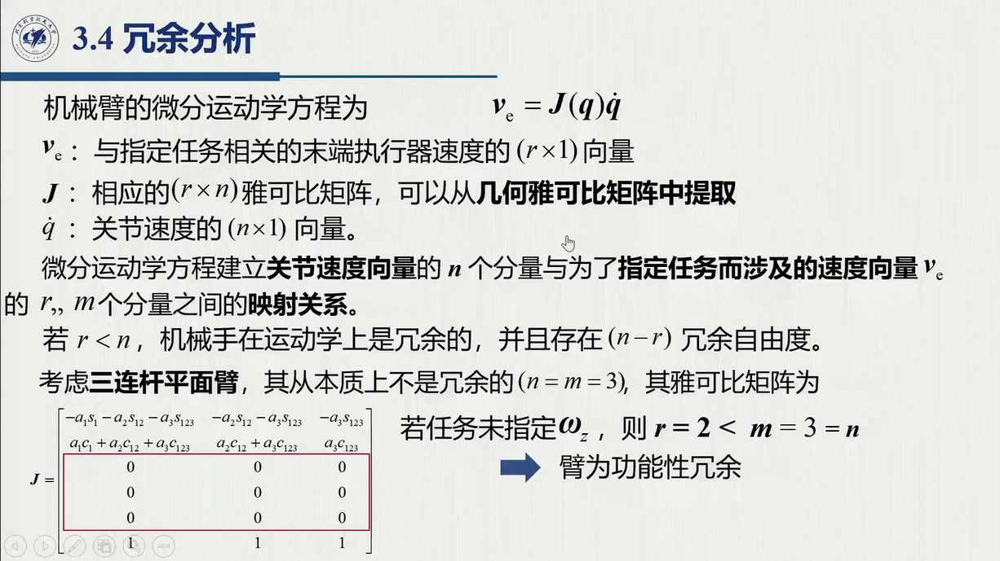
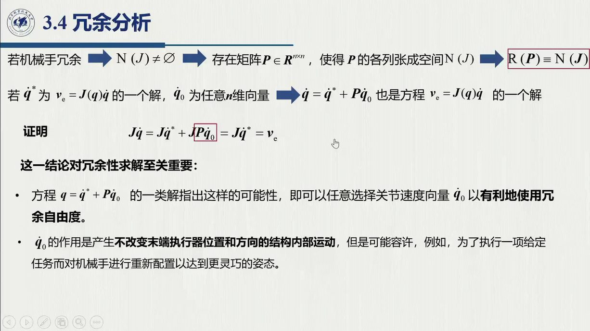

# 3.4 冗余分析

§3.2 的三连杆平面臂有三个关节。若只指定笔尖的平面位置，三个关节速度要满足两个方程，剩下的选择能让肘部怎样运动？本节从这个问题出发，求出全部速度解，再解释零空间投影怎样保留不影响任务的部分。先固定当前位形分析瞬时速度，最后讨论有限时间的自运动。对应录播 1:47:01–1:56:39。

## 3.4.1 先写任务，再判断冗余

::: def 定义 3.4.1 · 冗余（任务相关）{#def-3.4.1}
记 $n$ 为独立关节变量数，$m$ 为结构适配的完整末端位姿维数，$r$ 为给定任务的独立变量数。若 $n>r$，称机械手对该任务冗余。对本章单个末端的任务，$r\le m\le6$；$n>m$ 是本质冗余，$r<m$ 时减少任务要求还可能产生功能冗余，见 [2.10](../ch02/sec2-10.md)。

$r$ 是任务维数，不是当前雅可比的秩。冗余说明任务允许额外的关节选择，奇异则说明某些位形的可实现速度方向减少；两者可以同时存在。
:::

::: ex 例 3.4.A · 三连杆平面臂换了任务会怎样？ {#ex-3.4.A}
对平面臂，$n=m=3$。若要求 $x=[p_x,p_y,\varphi]^{\mathrm T}$，三个关节对应三个任务变量，通常没有冗余；若只要求 $x=[p_x,p_y]^{\mathrm T}$，$r=2<n$，朝向便不再受任务约束。肘部可以重新配置，同时保持笔尖位置，工具朝向仍可变化。

“只要求 $x,y$”与“要求空间机械手沿水平面运动”要区分。后一种若还要求高度不变，就仍有 $\dot p_z=0$ 这条约束，不能删掉它来人为增加冗余。
:::

用光滑函数 $x=f(q)\in\mathbb R^r$ 写任务。沿关节轨迹求导，链式法则给出

$$\dot x=\frac{\partial f}{\partial q}\dot q=J_{\rm task}(q)\dot q,
\qquad J_{\rm task}\in\mathbb R^{r\times n}.$$

若任务直接选择几何速度的某些分量，例如只要求 $p_x,p_y$，那么 $J_{\rm task}=S J_g$，其中 $S$ 是选行矩阵，$J_g$ 是几何雅可比。一般任务还要继续求导。例如只要求笔尖到固定点 $c$ 的距离，取等价的标量任务 $\rho=\tfrac12\|p_e-c\|^2$，则

$$\dot\rho=(p_e-c)^{\mathrm T}\dot p_e
=(p_e-c)^{\mathrm T}J_P\dot q.$$

此时 $J_{\rm task}=(p_e-c)^{\mathrm T}J_P$ 是各行的加权组合，不是简单选行。$\rho$ 单位为 m²，任务速度为 m²/s。用姿态参数规定任务时，还要区分参数导数与角速度，见 §3.6。下文固定任务和位形，将 $J_{\rm task}$ 简写为 $J$、$\dot x$ 写为 $v$。

## 3.4.2 值域、零空间与自由度

对固定的 $J\in\mathbb R^{r\times n}$，两个空间分别回答能实现什么、怎样保持任务不变：

$$\mathcal R(J)=\{J\dot q:\dot q\in\mathbb R^n\}\subseteq\mathbb R^r,
\qquad \mathcal N(J)=\{z\in\mathbb R^n:Jz=0\}\subseteq\mathbb R^n.$$

$J\dot q=v$ 有解，当且仅当 $v\in\mathcal R(J)$。零空间中的向量是对当前任务没有一阶影响的关节速度。零向量永远在零空间中，“零空间非空”并不能说明存在自运动；需要的是 $\mathcal N(J)\ne\{0\}$。

### 零空间为什么有 $n-\operatorname{rank}J$ 维？

记当前秩为 $s=\operatorname{rank}J$。对 $Jz=0$ 作高斯消元，得到 $s$ 个主元变量与 $n-s$ 个自由变量。每个主元变量均由自由变量线性表示；依次令一个自由变量为1、其余为0，就得到 $n-s$ 个线性无关的解。任意齐次解都是它们的线性组合。因此

$$\dim\mathcal R(J)=s,\qquad
\dim\mathcal N(J)=n-s,\qquad
\dim\mathcal R(J)+\dim\mathcal N(J)=n.$$

最后一式是秩–零度定理。在任务行满秩的普通位形，$s=r$，瞬时内部自由度为 $n-r$；在奇异位形，$s<r$，可实现的任务速度方向减少，瞬时零空间增大。不能把所有位形的核维数都写成 $n-r$，也不能把奇异处增加的瞬时方向直接当作有限自运动。

### 跟算：从两个方程求一根零空间基

沿用 §3.2 的三根等长杆 $a_1=a_2=a_3=1$ m，取

$$q_*=[0,\pi/2,-\pi/2]^{\mathrm T},\qquad
p_e=[2,1]^{\mathrm T}\ {\rm m},\qquad
J=J_P=\begin{bmatrix}-1&-1&0\\2&1&1\end{bmatrix}.$$

前两列的 $2\times2$ 子式行列式为1，所以 $s=2$。令 $z=[z_1,z_2,z_3]^{\mathrm T}$，齐次方程是

$$-z_1-z_2=0,\qquad 2z_1+z_2+z_3=0.$$

第一式给 $z_2=-z_1$，代入第二式得 $z_3=-z_1$。选 $z_3=\lambda$，于是

$$z=\lambda b,\qquad b=[-1,1,1]^{\mathrm T},\qquad Jb=0.$$

核维数确实为 $3-2=1$。以 $b$ 为关节速度（rad/s）时，三个关节都在转，笔尖平面速度为零；工具朝向速度为 $-1+1+1=1$ rad/s。位置任务没有约束朝向，这项变化是允许的。

## 3.4.3 全部速度解为什么是“特解 + 零空间”？

::: thm 定理 3.4.B · 速度通解与零空间投影 {#thm-3.4.B}
设 $v\in\mathcal R(J)$，已有特解 $J\dot q^*=v$。令 $B\in\mathbb R^{n\times(n-s)}$ 的列为零空间的一组线性无关基，$JB=0$。全部解为

$$\dot q=\dot q^*+B\eta,\qquad \eta\in\mathbb R^{n-s}.$$

把 $B$ 的列标准正交化得到 $N$，满足 $JN=0,N^{\mathrm T}N=I$。到零空间的欧氏正交投影为

$$P=NN^{\mathrm T}=B(B^{\mathrm T}B)^{-1}B^{\mathrm T}\in\mathbb R^{n\times n}.$$

于是也可将全部解写成

$$\dot q=\dot q^*+P\dot q_0,\qquad \dot q_0\in\mathbb R^n\text{ 任意}.$$

投影的秩为 $n-s$。这里使用选定关节坐标的欧氏度量；混合转动/移动关节比较速度大小时须先约定尺度或权重，§3.5 再讨论加权求解。
:::

::: proof 证明：既没有错误解，也没有漏解
由 $JB=0$，

$$J(\dot q^*+B\eta)=J\dot q^*+(JB)\eta=v,$$

所以加上零空间仍是解。反过来，若 $\dot q$ 也是解，则

$$J(\dot q-\dot q^*)=v-v=0.$$

因此两个解之差在零空间中，必可写成 $B\eta$。这证明上式覆盖全部解。必须先有特解；若指令在值域外，加任何零空间项也不能使方程有解。
:::

### 怎样从一组普通基构造投影？

先不要求 $B$ 标准正交。对任意非零 $\eta$，由于 $B$ 列线性无关，有 $\eta^{\mathrm T}B^{\mathrm T}B\eta=\|B\eta\|^2>0$，所以 $G=B^{\mathrm T}B$ 可逆。$G$ 称 Gram 矩阵，第 $i,j$ 项是基向量的内积 $b_i^{\mathrm T}b_j$，记录其长度和夹角。对任意待投影向量 $u$，设投影为 $Bu_N$，残差与零空间正交意味着

$$B^{\mathrm T}(u-Bu_N)=0
\ \Longrightarrow\ Gu_N=B^{\mathrm T}u
\ \Longrightarrow\ Bu_N=B G^{-1}B^{\mathrm T}u.$$

故 $P=B G^{-1}B^{\mathrm T}$。逐项验证：

$$\begin{aligned}
JP&=(JB)G^{-1}B^{\mathrm T}=0,\\
P^2&=B G^{-1}(B^{\mathrm T}B)G^{-1}B^{\mathrm T}=P,\\
P^{\mathrm T}&=P.
\end{aligned}$$

第一条保证不影响任务；第二条称幂等，投影一次后再投影不会改变结果；第三条结合幂等说明它是正交投影。若 $z=B\eta$ 已在零空间中，$Pz=B G^{-1}G\eta=z$。所以投影恰好覆盖整个零空间，$\dot q^*+P\dot q_0$ 也覆盖全部解。

对标准正交基 $N$，$G=I$，才可简写为 $P=NN^{\mathrm T}$。若直接把普通基写成 $BB^{\mathrm T}$，它仍把向量送进零空间，但通常会缩放结果，并不是投影。原教材式(3.46)只要求 $\mathcal R(P)=\mathcal N(J)$ 来构造解族；本节进一步构造正交投影，以准确说明“保留零空间分量”的含义。

## 3.4.4 用同一组数据完成投影与通解

对 $b=[-1,1,1]^{\mathrm T}$，$b^{\mathrm T}b=3$，单位基 $N=b/\sqrt3$，所以

$$P=\frac{bb^{\mathrm T}}3
=\frac13\begin{bmatrix}1&-1&-1\\-1&1&1\\-1&1&1\end{bmatrix}.$$

取希望加入的关节速度 $\dot q_0=[0,0,1]^{\mathrm T}$ rad/s。只动第三关节会移动笔尖，投影后保留的部分为

$$P\dot q_0=\frac13\begin{bmatrix}-1\\1\\1\end{bmatrix},\qquad J(P\dot q_0)=0.$$

投影配上第一、第二关节的运动，抵消第三关节引起的笔尖速度。其余部分为

$$(I-P)\dot q_0=\frac13[1,-1,2]^{\mathrm T},\qquad
(P\dot q_0)^{\mathrm T}(I-P)\dot q_0=\frac{-1-1+2}{9}=0.$$

两部分正交；投影不是把某几个关节置零。若误用 $bb^{\mathrm T}$，会得到 $b$ 而非 $b/3$；它满足 $Jb=0$，却会把已有零空间向量 $b$ 放大成 $3b$，不具有幂等性。

现在要求笔尖以 $v=[0,1]^{\mathrm T}$ m/s 向上运动。§3.2 已验证特解 $\dot q^*=[1,-1,0]^{\mathrm T}$ rad/s，加上全部零空间速度得到

$$\dot q=\begin{bmatrix}1-\lambda\\-1+\lambda\\\lambda\end{bmatrix},\qquad
J\dot q=\begin{bmatrix}0\\1\end{bmatrix},\qquad \dot\varphi=\lambda.$$

$\lambda=0$ 时前两关节配合；$\lambda=1$ 时只动第三关节。它们实现相同笔尖速度，朝向速度却不同。若再要求 $\dot\varphi=0$，就只能取 $\lambda=0$，冗余被这条新任务约束消耗掉。

::: think 独立练习 · 改变基、任务与位形 {#practice-3.4.project}
1. 改用同一零空间基 $B'=2b$，求正确的 $P'$ 与误用的 $B'B'^{\mathrm T}$。投影是否应随基的长度改变？
2. 若要求 $v=[1,0]^{\mathrm T}$ m/s 且 $\dot\varphi=0$，直接解三个方程，求唯一关节速度。
3. 三杆完全伸直 $q=[0,0,0]^{\mathrm T}$ 时，位置任务仍为 $r=2$。写出 $J_P$、秩和核维数。能否实现沿 $x$ 的非零瞬时速度？

::: sol 核对与解释
1. $B'^{\mathrm T}B'=12$，故 $P'=(2b)(1/12)(2b)^{\mathrm T}=bb^{\mathrm T}/3=P$。误写的 $B'B'^{\mathrm T}=4bb^{\mathrm T}=12P$ 会缩放结果；投影只取决于子空间。
2. 方程为 $-\dot q_1-\dot q_2=1$、$2\dot q_1+\dot q_2+\dot q_3=0$、$\dot q_1+\dot q_2+\dot q_3=0$。后两式相减得 $\dot q_1=0$，于是 $\dot q_2=-1,\dot q_3=1$ rad/s；代回得到 $1,0,0$。
3. $J_P=\begin{bmatrix}0&0&0\\3&2&1\end{bmatrix}$，秩为1，瞬时核维数为 $3-1=2$，不是 $n-r=1$。值域只有 $y$ 方向，沿 $x$ 的非零指令无解。增加核维数没有补回缺失方向。
:::
:::

## 3.4.5 瞬时零速度怎样成为有限自运动？

$J(q_*)z=0$ 是当前位形下的结论。若沿直线更新 $q(h)=q_*+hz$，泰勒展开给出

$$f(q_*+hz)=f(q_*)+hJ(q_*)z+O(h^2)=f(q_*)+O(h^2).$$

它只消去一阶变化，二阶及更高阶仍可能存在。对本节 $z=b$，更新后三根杆的绝对角为 $-h,\pi/2,h$，所以

$$p_e(q_*+hb)=\begin{bmatrix}\cos h+0+\cos h\\-\sin h+1+\sin h\end{bmatrix}
=\begin{bmatrix}2\cos h\\1\end{bmatrix}.$$

笔尖误差为 $2(1-\cos h)$ m，小步时约为 $h^2$ m。$h=0.2$ 时误差约0.03987 m；$h=0.1$ 时约0.00999 m。初始线速度为零，不保证有限更新后的误差为零。

若沿整个光滑轨迹都满足 $J(q(t))\dot q(t)=0$，链式法则给出 $\mathrm df(q(t))/\mathrm dt=0$，任务值才保持常数。实际积分须随位形更新零空间并处理数值误差，§3.7 将讨论任务误差反馈。

### 构造笔尖真正固定的曲线

固定 $p_e=[2,1]^{\mathrm T}$ m，以末杆绝对角 $\varphi$ 为参数。第三杆长1 m，腕点必须为

$$W(\varphi)=\begin{bmatrix}2-\cos\varphi\\1-\sin\varphi\end{bmatrix}.$$

前两杆要到达 $W$，用 §2.12 的二连杆逆解，选与初始位形相连的正肘角分支，记 $W=[W_x,W_y]^{\mathrm T}$：

$$\begin{aligned}
c_2&=\frac{W_x^2+W_y^2-2}{2},\quad q_2=\arccos c_2,\\
q_1&=\operatorname{atan2}(W_y,W_x)-\operatorname{atan2}(\sin q_2,1+\cos q_2),\\
q_3&=\varphi-q_1-q_2.
\end{aligned}$$

第一式来自两杆三角形的余弦定理；第二行将腕点方位角减去两杆合成方向与第一杆的夹角；最后补足末杆绝对角。只在 $|c_2|\le1$ 且分支连续的范围内使用。下方选 $0\le\varphi\le60^\circ$，条件始终满足。

| $\varphi$ | $q_1$ | $q_2$ | $q_3$ | 笔尖位置（m） |
|:--:|--:|--:|--:|:--:|
| $0^\circ$ | $0^\circ$ | $90^\circ$ | $-90^\circ$ | $(2,1)$ |
| $30^\circ$ | $-27.91494^\circ$ | $103.41784^\circ$ | $-45.50290^\circ$ | $(2,1)$ |
| $60^\circ$ | $-36.04643^\circ$ | $82.30067^\circ$ | $13.74576^\circ$ | $(2,1)$ |

表中角度经过舍入，代回会有小的舍入误差。精确逆解构造的三杆长度一直为1 m，笔尖固定，工具朝向改变。把这条曲线对 $\varphi$ 求导，固定笔尖给出 $J(q_*)q'=0$，末杆角定义给出 $q_1'+q_2'+q_3'=1$。前者使 $q'=\lambda b$，后者给出 $\lambda=1$，所以初始切向正是 $b$；随着位形变化，后续切向也会改变。

::: think 操作 · 固定笔尖的曲线与一次切线更新 {#lab-3.4.selfmotion}
先预测：将 $\varphi$ 从0调到30°，精确自运动与 $q_*+\varphi b$ 是否都固定笔尖？操作后比较两种笔尖坐标、误差和关节角，再核对三根杆长度。用0.1和0.2 rad预设检查误差是否约增为四倍。参数控制构形，不代表播放时间或恒定关节速度。

没有脚本时，照逆解计算表中一行，再用 $2(1-\cos h)$ 核算切线更新误差，可完成相同比较。
:::

奇异处还须区分瞬时核与有限自运动。标量例子 $f(q)=q^2$ 在 $q=0$ 的 $J=0$，任何瞬时速度都在核中，但保持 $f=0$ 的有限构形只有 $q=0$，没有非平凡自运动曲线。对本节的位置任务，若附近始终行满秩，隐函数定理保证局部存在维数 $n-r$ 的等任务曲面，零空间是其切空间；奇异点不能直接套用。

## 3.4.6 用零空间帮助再配置

有特解时，零空间项允许关节重新配置，同时不增加所选任务的瞬时速度。位置任务可以保持笔尖位置而改变工具朝向；若任务同时约束位姿，才要求位置与朝向都不变。

记 $\nabla g=[\partial g/\partial q_1,\ldots,\partial g/\partial q_n]^{\mathrm T}$，它与小关节变化的内积给出 $g$ 的一阶变化。若希望增大光滑指标 $g(q)$，可选 $\dot q_0=k\nabla g$，$k>0$。只看零空间贡献，

$$\dot g_{\rm null}=\nabla g^{\mathrm T}P\dot q_0
=k\nabla g^{\mathrm T}P\nabla g=k\|P\nabla g\|^2\ge0.$$

最后一步用 $P^{\mathrm T}P=P$。它沿允许的内部方向增大指标；若梯度没有零空间分量，这项为零。$g$ 可表示远离关节极限、增加障碍距离或改善灵巧性，但投影后不一定存在想要的方向，这条局部关系也不保证整条轨迹避障。主任务在运动时还须计入 $\nabla g^{\mathrm T}\dot q^*$。§3.5 将推导怎样求特解、怎样选择附加速度。

::: think 闭卷检查 · 从方程重建结论
1. 任务维数 $r$、关节数 $n$、当前秩 $s$ 分别怎样决定冗余与核维数？
2. 普通基 $B$ 与标准正交基 $N$ 分别怎样构造投影？为什么投影两次不变？
3. 为什么全部速度解是特解加零空间？指令在值域外时会怎样？
4. 位置任务的零空间是否保持朝向？一次有限更新是否保持笔尖？

::: sol 核对
$n>r$ 判任务冗余，核维数是 $n-s$；只有 $s=r$ 时才为 $n-r$。零空间永远含零向量，非平凡内部运动需要非零向量。

$P=B(B^{\mathrm T}B)^{-1}B^{\mathrm T}$；$N^{\mathrm T}N=I$ 时简化为 $NN^{\mathrm T}$。展开 $P^2$ 时中间的 Gram 矩阵与逆抵消，故 $P^2=P$。

任意两个解之差满足齐次方程；加上核中向量不改变 $J\dot q$。指令在值域外时没有特解，零空间项不能改变这一点。

位置任务不约束朝向；本节 $b$ 使朝向以1 rad/s改变。$J(q_*)b=0$ 只保证一阶位置变化为零，有限更新误差为 $2(1-\cos h)$。保持整个任务值，须沿轨迹持续满足零空间条件。
:::
:::

## 3.4 小结与常见错误

先明确 $x=f(q)$，再求任务雅可比。用秩判断可实现速度，用零空间描述所有解之间的差。构造投影时注明基的条件；讨论自运动时明确保持的是哪个任务、结论是在当前瞬间还是整条轨迹成立。

::: think 常见错误清单
1. 用“列太多/列不够”混判冗余与奇异，或把 $n-r$ 用于奇异位形；须分别核对任务维数与当前秩。
2. 将未归一化的 $BB^{\mathrm T}$ 当投影；它可能不影响任务，却会缩放已有零空间分量。
3. 位置任务中声称“末端位姿不变”，或将某一点的零空间速度当作有限自运动；须检查朝向约束、位形更新与二阶误差。
:::
