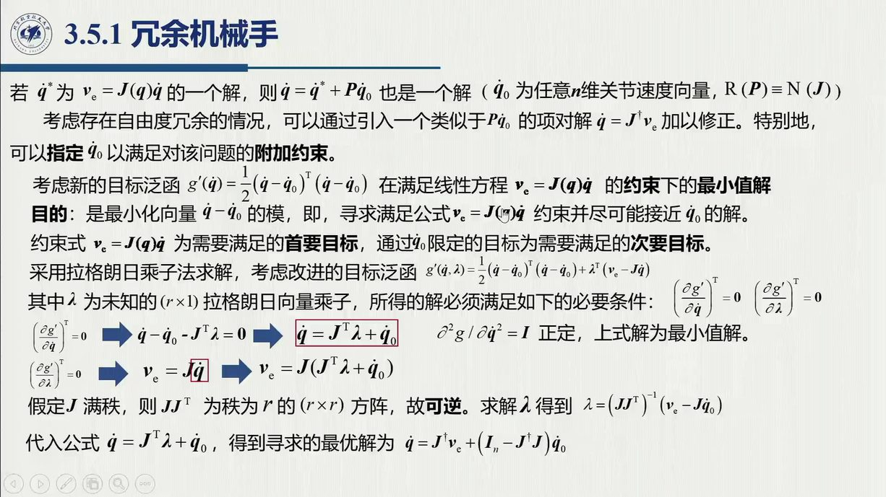
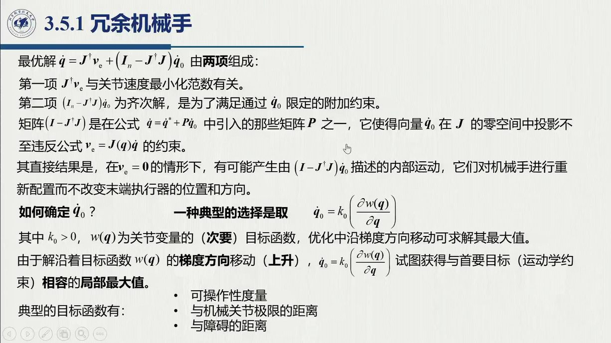
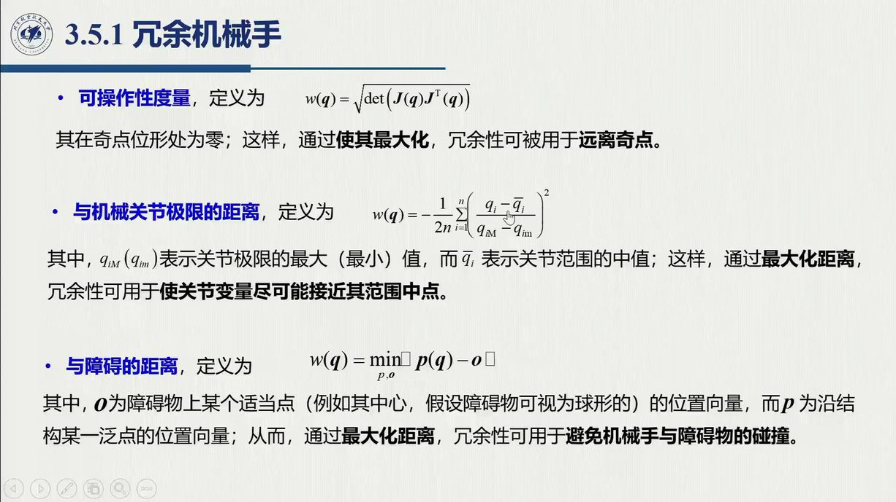
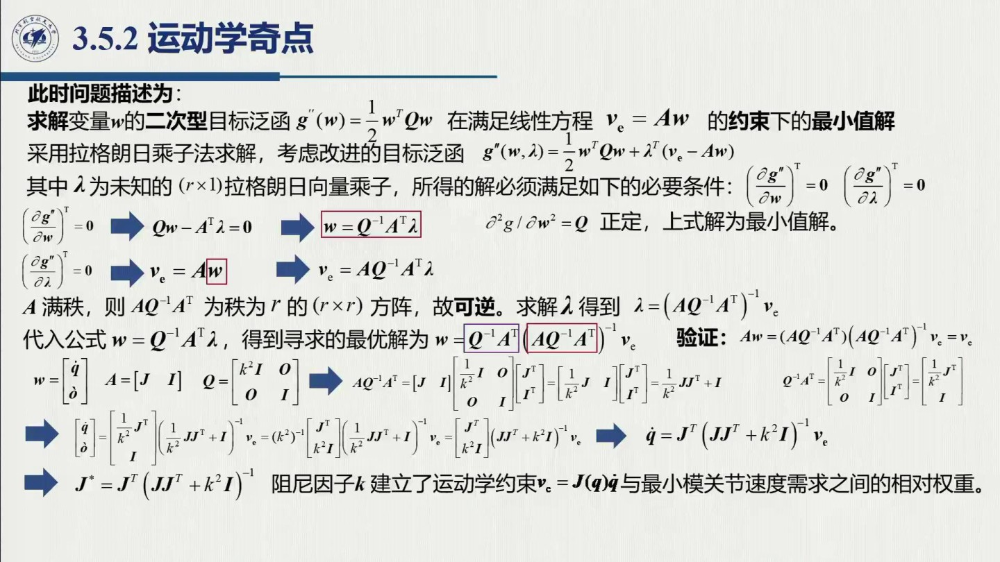

# 3.5 逆微分运动学

§3.4 的三杆平面臂（各杆1 m，$q_*=[0,\pi/2,-\pi/2]^{\mathrm T}$）要求笔尖以 $v=[0,1]^{\mathrm T}$ m/s 向上运动时，满足任务的关节速度有一整族：$(1-\lambda,-1+\lambda,\lambda)$ rad/s，彼此只差一个[零空间](../recall.md#nullspace)分量。控制器每一瞬间只能输出其中一组，本节回答怎样选。方阵满秩时解唯一，只需解方程再积分（§3.5.0）。有冗余且能精确满足任务时，按代价在这一族中挑最优的一组（§3.5.1）。在奇点附近，精确解可能不存在，或存在却要求极大的关节速度，这时改为容许一定任务误差，换取较小的关节速度（§3.5.2），最后用同一组输入比较两种做法。录播对应1:56:39–2:19:53。

下文固定当前位形，记所选任务的速度方程为 $v=J\dot q$，其中 $J\in\mathbb R^{r\times n}$、$v\in\mathbb R^r$、$\dot q\in\mathbb R^n$。任务、参考点与表达坐标系均须先确定；姿态部分若用欧拉角等参数的导数而非角速度，先按 §3.6 换算。

## 3.5.0 方阵情形：求速度，再积分

若 $r=n$ 且 $J$ 满秩，线性方程有唯一解：

$$\dot q=J^{-1}(q)v.$$

已知初始关节位置 $q(0)$，沿时间积分即可得到 $q(t)=q(0)+\int_0^t\dot q(\tau)\,\mathrm d\tau$。计算机只在离散时刻更新，最简单的前向 Euler 法将一个时间步内的速度近似为常数：

$$q_{k+1}=q_k+J^{-1}(q_k)v_k\Delta t.$$

位形一变，$J$ 也跟着变，所以每步都用新的 $q_k$ 重算 $J$。这样每步只解一个线性的速度方程，不必先求出位姿的封闭形式逆解。代价是位置只近似满足：一步之内关节按固定速度转动，而 $J$ 只在步首准确。这与 §3.4.5 沿零空间直线更新时出现 $2(1-\cos h)$ 的二阶误差是同一回事。下面用两连杆把一步的误差算出来。

::: ex 跟算 · 两连杆向上运动一步
两杆各1 m，在 $q_k=[0,\pi/2]^{\mathrm T}$ 时，笔尖位于 $(1,1)$ m。位置雅可比与指令为

$$J=\begin{bmatrix}-1&-1\\1&0\end{bmatrix},\qquad v=\begin{bmatrix}0\\1\end{bmatrix}\ {\rm m/s}.$$

第二行就是 $\dot q_1=1$ rad/s；代入第一行 $-\dot q_1-\dot q_2=0$，得 $\dot q_2=-1$ rad/s。取 $\Delta t=0.1$ s，得到 $q_{k+1}=[0.1,\pi/2-0.1]^{\mathrm T}$。第二杆绝对角 $q_1+q_2$ 仍为 $\pi/2$，所以实际笔尖是

$$p_{k+1}=[\cos0.1,\ 1+\sin0.1]^{\mathrm T}
\approx[0.995004,1.099833]^{\mathrm T}\ {\rm m}.$$

理想直线一步的目标为 $(1,1.1)$ m，实际笔尖偏了约 $(-0.0050,-0.0002)$ m。水平偏差 $1-\cos0.1\approx0.0050$ m 来自第一杆：它在这一步转了0.1 rad，端点走的是圆弧，雅可比只给出圆弧在步首的切线。偏差约为 $a_1(\dot q_1\Delta t)^2/2$；把步长减半为0.05 s，偏差降到约0.00125 m，即原来的四分之一。逆微分运动学只给出当前速度；积分步长与方法，以及怎样用位置误差反馈把漂移拉回来，见 §3.7。
:::

## 3.5.1 冗余情形：在可行速度中选择

### 加权范数：为什么需要一个目标？

设 $r<n$ 且 $J$ 行满秩，任务方程有无穷多解，节首的3R速度族就是一例。要从中挑一组，先得说清“好”指什么。若希望某些关节少动，可以给它们较大的代价。用对称[正定](../recall.md#positive)矩阵 $W\in\mathbb R^{n\times n}$ 表示权重，求

$$\min_{\dot q}\ C(\dot q)=\tfrac12\dot q^{\mathrm T}W\dot q,
\qquad J\dot q=v.$$

正定指任意非零 $z$ 都满足 $z^{\mathrm T}Wz>0$，所以每个非零速度都有正代价。$W=I_n$ 时最小化通常的欧氏范数；对角 $W$ 可以分别惩罚各关节。混合移动/转动关节时先用选定尺度归一化，或由 $W$ 表示尺度与相对代价，不能直接把数值大小当成同一种物理量。

### 拉格朗日乘子怎样求出候选解？

带约束时不能直接令 $\partial C/\partial\dot q=0$：那只会得到 $\dot q=0$，它不满足 $v\ne0$ 的任务。拉格朗日乘子法把约束并入目标：将每条任务方程乘以一个待定系数，组成乘子向量 $\lambda\in\mathbb R^r$，定义

$$\mathcal L(\dot q,\lambda)=\tfrac12\dot q^{\mathrm T}W\dot q
+\lambda^{\mathrm T}(v-J\dot q).$$

对称 $W$ 的二次型导数为 $W\dot q$；线性项对 $\dot q$ 的导数为 $-J^{\mathrm T}\lambda$。分别对两个未知向量求导置零：

$$W\dot q-J^{\mathrm T}\lambda=0,\qquad v-J\dot q=0.$$

第一式说明 $W\dot q$ 落在 $J^{\mathrm T}$ 的值域，即 $J$ 的行空间。行空间与零空间正交，所以对任何满足 $Jz=0$ 的方向 $z$，都有 $z^{\mathrm T}W\dot q=\lambda^{\mathrm T}Jz=0$：沿任务允许的方向，代价没有一阶变化，这正是约束极小点应有的性质。由第一式得 $\dot q=W^{-1}J^{\mathrm T}\lambda$，代入第二式：

$$G\lambda=v,\qquad G=JW^{-1}J^{\mathrm T}\in\mathbb R^{r\times r}.$$

$G$ 是 $r\times r$ 方阵，能否解出 $\lambda$ 取决于它是否可逆。$J$ 与 $J^{\mathrm T}$ 是长方阵，本身没有逆，所以不能用“各因子可逆，乘积就可逆”来论证，要直接看 $G$ 的二次型。$W^{-1}$ 仍对称正定；对任意 $a\ne0$，行满秩保证 $J^{\mathrm T}a\ne0$，故

$$a^{\mathrm T}Ga=(J^{\mathrm T}a)^{\mathrm T}W^{-1}(J^{\mathrm T}a)>0.$$

所以 $G$ 正定，从而可逆。若 $J$ 不行满秩，则存在非零 $a$ 使 $J^{\mathrm T}a=0$，从而 $Ga=0$，$G$ 不可逆。可逆性靠的是行满秩与正定权重这两个条件。

回代得到加权最优候选解，记加权右逆为 $J_W^\#$：

$$\dot q_W=J_W^\#v,\qquad
J_W^\#=W^{-1}J^{\mathrm T}(JW^{-1}J^{\mathrm T})^{-1}\in\mathbb R^{n\times r}.$$

直接乘 $J$：$JJ_W^\#=(JW^{-1}J^{\mathrm T})(JW^{-1}J^{\mathrm T})^{-1}=I_r$，所以候选解满足任务。

### 为什么它是唯一的全局最优解？

驻点条件只说明 $\dot q_W$ 是候选，还要直接比较代价。两组可行速度之差 $z$ 满足 $Jz=v-v=0$，所以任何其他可行速度都可写成 $\dot q_W+z$，其中 $Jz=0$。展开代价差，用到 $W$ 对称（两个交叉项 $z^{\mathrm T}W\dot q_W$ 与 $\dot q_W^{\mathrm T}Wz$ 相等）：

$$C(\dot q_W+z)-C(\dot q_W)
=z^{\mathrm T}W\dot q_W+\tfrac12z^{\mathrm T}Wz.$$

由 $W\dot q_W=J^{\mathrm T}\lambda$，交叉项是 $z^{\mathrm T}J^{\mathrm T}\lambda=(Jz)^{\mathrm T}\lambda=0$，只剩 $\tfrac12z^{\mathrm T}Wz$，它对非零 $z$ 严格为正。因此任何非零可行扰动都会使代价严格增加，$\dot q_W$ 是固定当前 $J,v$ 后的唯一全局最优速度。这个最优只针对当前瞬间：沿它积分得到的整条关节轨迹，不一定总能量最小或路程最短。原教材说“locally minimizes”，“局部”应理解为只对当前位形成立。

::: def 定义 3.5.1 · 行满秩时的右伪逆与最小范数解 {#def-3.5.1}
当 $W=I_n$ 时，

$$J^\dagger=J^{\mathrm T}(JJ^{\mathrm T})^{-1}\in\mathbb R^{n\times r},\qquad
\dot q_{\min}=J^\dagger v.$$

$JJ^\dagger=I_r$；$J^\dagger v$ 是全部满足 $J\dot q=v$ 的速度中唯一的最小范数解。伪逆交换输入与输出的维度：$r$ 维任务速度映回 $n$ 维关节速度。方阵满秩时它等于 $J^{-1}$。这个闭式要用 $(JJ^{\mathrm T})^{-1}$，只在行满秩时成立；降秩时一般的 Moore–Penrose 伪逆仍然存在，构造见 §3.5.2。
:::

### 贯穿跟算：同一个3R任务怎样选速度？

沿用 §3.4 的三杆各1 m、$q_*=[0,\pi/2,-\pi/2]^{\mathrm T}$，只要求笔尖位置速度 $v=[0,1]^{\mathrm T}$ m/s：

$$J=\begin{bmatrix}-1&-1&0\\2&1&1\end{bmatrix},\quad
JJ^{\mathrm T}=\begin{bmatrix}2&-3\\-3&6\end{bmatrix},\quad
(JJ^{\mathrm T})^{-1}=\begin{bmatrix}2&1\\1&2/3\end{bmatrix}.$$

二阶逆矩阵公式给出 $\det(JJ^{\mathrm T})=2\times6-(-3)^2=3$，$(JJ^{\mathrm T})^{-1}=\tfrac13\begin{bmatrix}6&3\\3&2\end{bmatrix}$，即上式。左乘 $J^{\mathrm T}$ 时逐行相乘，例如 $J^{\mathrm T}$ 第一行 $(-1,2)$ 乘两列得 $(-2+2,\,-1+4/3)=(0,1/3)$。其余两行同理：

$$J^\dagger=\begin{bmatrix}0&1/3\\-1&-1/3\\1&2/3\end{bmatrix},\qquad
\dot q_{\min}=\begin{bmatrix}1/3\\-1/3\\2/3\end{bmatrix}\ {\rm rad/s}.$$

指令 $v=(0,1)$ 只取出 $J^\dagger$ 的第二列。独立检查：§3.4 的全部解为 $(1-\lambda,-1+\lambda,\lambda)$，这里的 $\lambda$ 是零空间系数，与上面的乘子无关。其范数平方为 $2(1-\lambda)^2+\lambda^2$，求导得 $-4+6\lambda=0$，所以 $\lambda=2/3$，代回得 $(1/3,-1/3,2/3)$，最小平方范数为 $2/3$，与矩阵求解一致。

若第三关节运动代价更高，取 $W=\operatorname{diag}(1,1,4)$。$W^{-1}$ 把第三列对 $G$ 的贡献乘以 $1/4$，右下元从 $4+1+1=6$ 变为 $4+1+1/4=21/4$：

$$JW^{-1}J^{\mathrm T}=\begin{bmatrix}2&-3\\-3&21/4\end{bmatrix},\qquad
\dot q_W=\begin{bmatrix}2/3\\-2/3\\1/3\end{bmatrix}\ {\rm rad/s}.$$

乘子方程 $G\lambda=v$ 的解为 $(2,4/3)^{\mathrm T}$（$\det G=3/2$）；$J^{\mathrm T}$ 乘它得 $(2/3,-2/3,4/3)^{\mathrm T}$，再乘 $W^{-1}$，第三个分量除以4，就得到上式。仍有 $J\dot q_W=v$；第三关节速度从 $2/3$ 降到 $1/3$ rad/s，前两关节多承担运动。用解族核对：加权代价 $\dot q^{\mathrm T}W\dot q=2(1-\lambda)^2+4\lambda^2$，导数为 $-4+12\lambda$，最优 $\lambda=1/3$，代回解族得到同一速度。权重改变选出的解，不改变任务方程。

### 最小范数不等于满足每个关节限速

上例最小范数解的第三关节速度是 $2/3$ rad/s。若它的上限为0.5 rad/s，而前两关节上限为1 rad/s，这个最小范数解超限；权重4给出的 $(2/3,-2/3,1/3)$ rad/s 在本例可行。但权重只改变各关节分担的比例，解仍与指令成正比。指令加倍为 $v=(0,2)$ m/s 时，同一权重给出 $(4/3,-4/3,2/3)$ rad/s，三个关节全部超限。所以调权重不能严格保证限速。

若必须逐关节满足限速，应把 $\underline{\dot q}\le\dot q\le\overline{\dot q}$ 和 $J\dot q=v$ 一起列为约束，再检查可行性。对 $v=(0,2)$，解族为 $(2-\lambda,-2+\lambda,\lambda)$：前两关节要求 $1\le\lambda\le3$，第三关节要求 $|\lambda|\le0.5$，两者没有交集，这个指令在当前位形根本不可行，只能降低指令。伪逆求解只优化已给定的范数，未列入的速度边界不会自动满足。

### 指定附加速度：最近的可行解怎样推？

若已有期望关节速度 $\dot q_0$，目标是尽量接近它，同时严格满足主任务：

$$\min_{\dot q}\tfrac12(\dot q-\dot q_0)^{\mathrm T}W(\dot q-\dot q_0),\qquad J\dot q=v.$$

令 $d=\dot q-\dot q_0$。代价变成 $\tfrac12d^{\mathrm T}Wd$，约束 $J(\dot q_0+d)=v$ 变成 $Jd=v-J\dot q_0$。这正是上面已解的加权最小范数问题，只是任务速度换成了 $\dot q_0$ 尚未完成的部分 $v-J\dot q_0$。套用 $J_W^\#$，再加回 $\dot q_0$：

$$d=J_W^\#(v-J\dot q_0),\qquad
\dot q=J_W^\#v+(I_n-J_W^\#J)\dot q_0.$$

当 $W=I_n$ 时，得到常用式

$$\dot q=J^\dagger v+P\dot q_0,\qquad P=I_n-J^\dagger J.$$

$JP=J-JJ^\dagger J=0$，所以 $P\dot q_0$ 不改变任务速度。$J^\dagger J=J^{\mathrm T}(JJ^{\mathrm T})^{-1}J$ 对称；它又幂等：$(J^\dagger J)(J^\dagger J)=J^\dagger(JJ^\dagger)J=J^\dagger J$。因此 $J^\dagger J$ 是到 $J$ 行空间的欧氏正交投影，$P$ 是到零空间的欧氏正交投影，与 §3.4 的标准正交基表达 $NN^{\mathrm T}$ 相同。一般 $W$ 下，$I_n-J_W^\#J$ 仍幂等，但不再对称，它是按 $W$ 度量的投影，不能当成欧氏正交投影。

对上面的3R数据，指定 $\dot q_0=e_1=(1,0,0)$ rad/s。§3.4.4 已求得 $P$，其第一列 $Pe_1=(1,-1,-1)/3$，所以最近可行解为

$$\dot q=\begin{bmatrix}1/3\\-1/3\\2/3\end{bmatrix}
+\frac13\begin{bmatrix}1\\-1\\-1\end{bmatrix}
=\begin{bmatrix}2/3\\-2/3\\1/3\end{bmatrix}\ {\rm rad/s}.$$

直接按距离核对：$\dot q-e_1=(-\lambda,-1+\lambda,\lambda)$，距离平方 $2\lambda^2+(1-\lambda)^2$ 的导数为 $6\lambda-2$，最优 $\lambda=1/3$，结果相同。它与上面 $W=\operatorname{diag}(1,1,4)$ 的解恰好相等，这只是这组数据的巧合，两个目标一般给出不同的速度。最近解与 $\dot q_0$ 相差 $(-1/3,-2/3,1/3)$ rad/s：“尽量接近”允许偏离 $\dot q_0$，并未增加 $\dot q=\dot q_0$ 这条硬约束，硬约束只有任务方程。若 $v=0$，结果为 $P\dot q_0$，表示所选任务在当前瞬间的速度为零，这就是 §3.4 的内部运动。

### 次目标怎样给出具体的梯度？

$\dot q_0$ 通常不是随手给的，而来自一个想改善的光滑指标 $g(q)$：取 $\dot q_0=k_0\nabla g(q)$，$k_0>0$。§3.4.6 已证明，欧氏投影后的零空间贡献为 $\dot g_{\rm null}=k_0\|P\nabla g\|^2\ge0$，即内部运动不会让 $g$ 变小；主任务项 $\nabla g^{\mathrm T}J^\dagger v$ 的符号不定，$g$ 的总变化率要两项相加。常用指标有三种：

- **可操作度** $g=w=\sqrt{\det(JJ^{\mathrm T})}$：在固定尺度下等于速度椭球体积的比例，行秩下降时为零。提高体积不等于增大每个方向的能力，也不等于增大到奇异集合的距离，见 §3.3。
- **靠近关节中点**：设上下限为 $q_{iM},q_{im}$，中点 $\bar q_i=(q_{iM}+q_{im})/2$，行程 $\Delta_i=q_{iM}-q_{im}>0$。取负偏离平方

$$g(q)=-\frac1{2n}\sum_i\left(\frac{q_i-\bar q_i}{\Delta_i}\right)^2,\qquad
\frac{\partial g}{\partial q_i}=-\frac{q_i-\bar q_i}{n\Delta_i^2}.$$

关节高于中点时该梯度分量为负，低于中点时为正，所以沿梯度走就是把关节拉回中点。这里最大化的是负偏离平方；若最大化“到中点的距离”，方向就反了。投影会改变原梯度，主任务也在推动关节，所以这一项只给出回中的倾向，不能保证不越限。

- **增加障碍间距**：可取臂上点到障碍表面的最小距离。若用球心距离，应减去球半径，才是表面间距。最近点唯一且距离光滑时可求梯度；最近点切换处可能不可微。这是局部再配置的指标，不能据此保证整条轨迹无碰撞。

::: think 独立练习 · 换权重、换附加速度 {#practice-3.5.redundancy}
仍用本节3R的 $J,v$。
1. 取 $W=\operatorname{diag}(1,1,9)$，从解族直接求最优速度，不先套矩阵公式。
2. $W=I$、$\dot q_0=(0,0,1)$ 时，最近可行解是什么？为什么可以不算伪逆？
3. 若某关节 $q_i=0.8$、上下限为0与1，$n=3$，求中点指标的梯度分量。最大化该指标希望它向哪个方向运动？

::: sol 核对与理由
1. 范数代价为 $2(1-\lambda)^2+9\lambda^2$，导数为 $-4+22\lambda$；$\lambda=2/11$，速度 $(9/11,-9/11,2/11)$ rad/s。
2. $J\dot q_0=(0,1)=v$，它本来可行，与自身距离为零，所以最近解就是 $(0,0,1)$ rad/s。
3. $\bar q_i=0.5,\Delta_i=1$，梯度为 $-(0.8-0.5)/3=-0.1$，原梯度希望减小该关节变量；实际速度还要满足主任务并经过投影。
:::
:::

## 3.5.2 奇异与邻域：先分清能否精确实现

§3.5.1 的闭式都要求 $JW^{-1}J^{\mathrm T}$ 可逆。到了奇异位形，$J$ 降秩，它不可逆；在奇异位形附近它虽可逆，解出的速度却在几乎丢失的方向上被放大。先看一维情形 $J=[\sigma]$、指令 $v=1$：$\sigma=0.1$ 时需要速度10，$\sigma=0.01$ 时需要100，$\sigma=0$ 时方程无解。§3.3 的两连杆在 $\vartheta_2=1^\circ$ 处为0.1 m/s 的水平速度要求约 $-12.89$ rad/s 的关节速度，是同一种放大。多维情形是若干个这样的方向叠加，奇异值分解把它们拆开。

### 一般伪逆为什么在奇异处仍有定义？

降秩时行满秩闭式 $J^{\mathrm T}(JJ^{\mathrm T})^{-1}$ 失效，但 Moore–Penrose 伪逆本身仍然存在。用[奇异值分解](../recall.md#svd)构造它：设当前秩为 $s$，

$$J=\sum_{i=1}^{s}\sigma_i u_i v_i^{\mathrm T},\qquad\sigma_i>0.$$

$u_i\in\mathbb R^r$ 是标准正交的可实现任务方向，$v_i\in\mathbb R^n$ 是对应的标准正交关节方向，$Jv_i=\sigma_i u_i$；这里的 $v_i$ 是 $J$ 的右奇异向量，与任务速度 $v$ 无关。将指令分为 $v=\sum_i b_i u_i+v_\perp$，其中 $b_i=u_i^{\mathrm T}v$，$v_\perp$ 与值域正交，无法实现。关节速度也按同一组方向写成 $\dot q=\sum_i\alpha_i v_i+n_0$，$n_0$ 在零空间。由正交性，

$$\|J\dot q-v\|^2=\sum_{i=1}^{s}(\sigma_i\alpha_i-b_i)^2+\|v_\perp\|^2,\qquad
\|\dot q\|^2=\sum_{i=1}^{s}\alpha_i^2+\|n_0\|^2.$$

残差与 $n_0$ 无关，取 $\alpha_i=b_i/\sigma_i$ 时最小，这时 $b_iu_i$ 全部实现；在残差同样最小的解中，再取 $n_0=0$ 使 $\|\dot q\|$ 最小。合起来就是最小范数的最小二乘解：

$$J^\dagger=\sum_{i=1}^{s}\frac1{\sigma_i}v_i u_i^{\mathrm T},\qquad
\dot q_{\rm MP}=J^\dagger v.$$

这就是先最小化 $\|J\dot q-v\|$，再在同样残差的解中取最小 $\|\dot q\|$。若 $v_\perp=0$，任务精确可行，伪逆给出精确解；否则任何算法都无法在当前位形补回这个方向。

近奇点时，某个正的 $\sigma_i$ 很小，若对应 $b_i\ne0$，$\alpha_i=b_i/\sigma_i$ 就很大，这就是一维例子里的10和100。到了恰好 $\sigma_i=0$ 的位形，该项不再出现在求和中，Moore–Penrose 伪逆按定义把这个方向的逆增益取为0，而不是代入 $1/0$。所以对固定指令，速度在 $\sigma_i\to0^+$ 时无界，在 $\sigma_i=0$ 时却是有限值，两者不连续；§3.3 的速度方程已经展示了这一差别。

### 阻尼最小二乘从哪个目标得到？

即使方程有精确解，近奇点所需的关节速度也可能超出限速。阻尼最小二乘（DLS）不再强求速度完全匹配，而把关节速度的大小也计入代价：

$$\min_{\dot q}\ F(\dot q)
=\tfrac12\|v-J\dot q\|^2+\tfrac12 k^2\|\dot q\|^2,\qquad k>0.$$

在选定尺度的欧氏坐标中，第一项度量任务速度误差，第二项度量关节速度；$k$ 越大，越重视压低关节速度。对 $\dot q$ 求导置零，得到正规方程

$$-J^{\mathrm T}(v-J\dot q)+k^2\dot q=0
\quad\Longrightarrow\quad
(J^{\mathrm T}J+k^2I_n)\dot q=J^{\mathrm T}v.$$

对非零 $z$，$z^{\mathrm T}(J^{\mathrm T}J+k^2I_n)z=\|Jz\|^2+k^2\|z\|^2>0$，故任何秩下都有唯一最优解：$J$ 降秩时 $\|Jz\|^2$ 可以为零，$k^2\|z\|^2$ 仍严格为正。又因

$$(J^{\mathrm T}J+k^2I_n)J^{\mathrm T}=J^{\mathrm T}(JJ^{\mathrm T}+k^2I_r),$$

（两边都等于 $J^{\mathrm T}JJ^{\mathrm T}+k^2J^{\mathrm T}$），左乘 $(J^{\mathrm T}J+k^2I_n)^{-1}$、右乘 $(JJ^{\mathrm T}+k^2I_r)^{-1}$，两种求解写法相等：

$$\dot q=(J^{\mathrm T}J+k^2I_n)^{-1}J^{\mathrm T}v
=J^{\mathrm T}(JJ^{\mathrm T}+k^2I_r)^{-1}v.$$

左边解 $n$ 维方程组，右边解 $r$ 维方程组；冗余时 $r<n$，右边更小。实际计算通常解线性方程组，无须显式形成逆矩阵。

更一般地，可以分别给关节速度与任务误差 $\delta=v-J\dot q\in\mathbb R^r$ 加权：取对称正定的 $W\in\mathbb R^{n\times n}$、$K\in\mathbb R^{r\times r}$，求

$$\min_{\dot q,\delta}\ \tfrac12\dot q^{\mathrm T}W\dot q+\tfrac12\delta^{\mathrm T}K\delta,
\qquad J\dot q+\delta=v.$$

它的唯一最优解给出下面的 $J^*$；推导用到 §3.5.1 的加权解，放在定义后的选读中。

::: def 定义 3.5.2 · 阻尼广义逆 $J^*$ {#def-3.5.2}
$$J^*=W^{-1}J^{\mathrm T}(JW^{-1}J^{\mathrm T}+K^{-1})^{-1}\in\mathbb R^{n\times r}.$$

$W,K$ 对称正定时，$J^*v$ 是上述加权误差目标的唯一最优解。$W=I_n,K=k^{-2}I_r$ 时，

$$J^*=J^{\mathrm T}(JJ^{\mathrm T}+k^2I_r)^{-1}.$$

$K$ 是误差权重，$k$ 是阻尼参数：增大 $k$ 相当于减小 $K$，即更容忍任务误差。这是正则化的速度解。由 $JJ^{\mathrm T}=(JJ^{\mathrm T}+k^2I_r)-k^2I_r$ 得 $JJ^*=I_r-k^2(JJ^{\mathrm T}+k^2I_r)^{-1}$，$k>0$ 时不等于 $I_r$；$J^*$ 也不等于一般 Moore–Penrose 伪逆。
:::

选读：加权误差目标的推导

### 加权误差与增广变量为什么给出同一结果？

把 $\dot q$ 与 $\delta$ 合并为 $w=[\dot q^{\mathrm T},\delta^{\mathrm T}]^{\mathrm T}$，令 $A=[J\ I_r]$、$Q=\operatorname{diag}(W,K)$，问题就变成 $\min\tfrac12w^{\mathrm T}Qw$、$Aw=v$。$A$ 含单位阵，任何 $J$ 下都行满秩，所以可以套用 §3.5.1 已证明的加权解 $w=Q^{-1}A^{\mathrm T}(AQ^{-1}A^{\mathrm T})^{-1}v$。逐块相乘：

$$Q^{-1}A^{\mathrm T}=\begin{bmatrix}W^{-1}J^{\mathrm T}\\K^{-1}\end{bmatrix},\qquad
AQ^{-1}A^{\mathrm T}=JW^{-1}J^{\mathrm T}+K^{-1}=C.$$

$C$ 的二次型是一个非负项加严格正项，所以始终正定；得到

$$\dot q=W^{-1}J^{\mathrm T}C^{-1}v,\qquad\delta=K^{-1}C^{-1}v.$$

核对约束：$J\dot q+\delta=(JW^{-1}J^{\mathrm T}+K^{-1})C^{-1}v=v$。误差始终定义为 $\delta=v-J\dot q$，与课件约束 $v_e-J\dot q=\varepsilon$ 的符号一致。取 $W=I_n$、$K=k^{-2}I_r$，目标变为 $\tfrac12\|\dot q\|^2+\tfrac1{2k^2}\|\delta\|^2$；乘以 $k^2$ 正是上面的 $F(\dot q)$，权重矩阵变为 $\operatorname{diag}(k^2I,I)$，就是课件的写法。

### 每个方向的增益和误差怎样算？

DLS 的两项都能按奇异方向拆开。仍写 $v=\sum_i b_iu_i+v_\perp$、$\dot q=\sum_i\alpha_iv_i+n_0$，则

$$F=\sum_{i=1}^{s}\Bigl[\tfrac12(b_i-\sigma_i\alpha_i)^2+\tfrac12k^2\alpha_i^2\Bigr]+\tfrac12\|v_\perp\|^2+\tfrac12k^2\|n_0\|^2.$$

$n_0$ 只增加代价，取零；各方向互不耦合，可以分别对 $\alpha_i$ 求导：

$$-\sigma_i(b_i-\sigma_i\alpha_i)+k^2\alpha_i=0
\quad\Longrightarrow\quad
\alpha_i=\frac{\sigma_i}{\sigma_i^2+k^2}b_i.$$

因此逆映射增益为 $g_k(\sigma)=\sigma/(\sigma^2+k^2)$，实际任务分量为 $\sigma_i\alpha_i$，误差是 $b_i$ 减去它：

$$\delta_i=b_i-\sigma_i\alpha_i
=\Bigl(1-\frac{\sigma_i^2}{\sigma_i^2+k^2}\Bigr)b_i=\frac{k^2}{\sigma_i^2+k^2}b_i.$$

$\sigma_i\gg k$ 时误差较小；$\sigma_i\ll k$ 时速度被压低，大部分指令留在误差里。对缺失方向 $\sigma_i=0$，增益为0、误差仍为 $b_i$。

为什么增益有界？直接求导：

$$g_k'(\sigma)=\frac{k^2-\sigma^2}{(\sigma^2+k^2)^2}.$$

它在 $\sigma<k$ 时为正、$\sigma>k$ 时为负，所以峰值出现在 $\sigma=k$，大小为 $k/(2k^2)=1/(2k)$。在选定欧氏尺度下，各 $v_i$ 正交，故 $\|\dot q_{\rm DLS}\|^2=\sum_i g_k(\sigma_i)^2b_i^2\le\|v\|^2/(2k)^2$，即 $\|\dot q_{\rm DLS}\|\le\|v\|/(2k)$；指令幅值增大，速度界也同比增大。这个范数界不能直接当成一套不同单位关节的硬限速设置。

### 跟算与演示：限制速度留下多少误差？

用归一化的二维通道 $J=\operatorname{diag}(1,\epsilon)$、指令 $v=(1,1)$。$\epsilon$ 是第二方向的能力，逐渐变小直至丢失；这是说明求解机制的矩阵模型，不对应一幅特定机械臂。固定 $k=0.1$：

| $\epsilon$ | Moore–Penrose 速度 $\dot q_{\rm MP}$ | DLS速度 $\dot q$ | DLS实际任务速度 $J\dot q$ |
|--:|:--:|:--:|:--:|
| 1 | $(1,1)$ | $(0.99010,0.99010)$ | $(0.99010,0.99010)$ |
| 0.1 | $(1,10)$ | $(0.99010,5)$ | $(0.99010,0.5)$ |
| 0.01 | $(1,100)$ | $(0.99010,0.99010)$ | $(0.99010,0.00990)$ |
| 0 | $(1,0)$，最小二乘解 | $(0.99010,0)$ | $(0.99010,0)$ |

第二行可手算 $0.1/(0.1^2+0.1^2)=5$，实现速度为 $0.1\times5=0.5$，残差为0.5。第一方向 $\sigma=1\gg k$，各行只损失约1%。第二方向上，Moore–Penrose 速度随 $\epsilon$ 变小从1涨到100，恰为0时跳回0；DLS 速度在 $\epsilon=k$ 时最大，为5，之后反而回落，代价是实际任务速度只剩0.00990。$\epsilon=1$ 与 $\epsilon=0.01$ 两行的 DLS 速度都是0.99010，因为 $g_k(\sigma)=g_k(k^2/\sigma)$。最后一行没有任何精确解；DLS 与伪逆一样没有补回丢失方向，第二分量残差都是1。

::: think 操作 · 阻尼、关节速度与任务误差 {#lab-3.5.dls}
先预测：固定 $k=0.1$，把 $\epsilon$ 从0.1降到0.01，DLS第二关节速度会增大还是减小？实际任务速度呢？操作后分别核对增益曲线、关节速度和任务残差。再固定 $\epsilon=0.1$ 增大阻尼，观察交换的两种代价；最后比较“接近0”与“恰好为0”的伪逆读数。

没有脚本时，用上表和 $\epsilon/(\epsilon^2+k^2)$ 计算同样的比较。读数均使用同一组归一化坐标。
:::

::: think 独立练习 · 不照抄上表 {#practice-3.5.dls}
1. $J=[0.2]$、$v=2$、$k=0.1$，求伪逆速度、DLS速度、实际任务速度和残差。
2. 当 $J=[0]$、$v=2$ 时，上述四个量怎样变化？能否把 $1/\sigma$ 的正侧极限当作零点的伪逆值？
3. 在统一归一化尺度下，$\|v\|\le2$，希望用增益界保证 $\|\dot q\|\le5$，$k$ 至少取多少？该选择是否保证任务误差很小？

::: sol 核对与解释
1. 伪逆速度为 $2/0.2=10$；DLS速度为 $0.2\times2/(0.04+0.01)=8$；实际任务速度1.6，残差0.4。
2. 零矩阵的伪逆也是零，最小二乘速度为0；DLS速度也为0，实际速度为0，残差仍为2。正侧 $1/\sigma$ 无界，不等于零点处 Moore–Penrose 伪逆的定义。
3. $2/(2k)\le5$，故 $k\ge0.2$ 是该范数界给出的充分选择；不能由此保证误差小，仍需检查各方向的 $k^2/(\sigma_i^2+k^2)b_i$。
:::
:::

## 3.5 小结与闭卷检查

先问任务能否精确实现，再问在可行解中优化什么。方阵满秩时 $\dot q=J^{-1}v$，逐步重算 $J$ 并积分，单步位置误差与步长平方同阶。行满秩时，右伪逆 $J^\dagger=J^{\mathrm T}(JJ^{\mathrm T})^{-1}$ 给唯一最小范数解，加权得 $J_W^\#$；指定附加速度时，$\dot q=J^\dagger v+(I_n-J^\dagger J)\dot q_0$ 是离 $\dot q_0$ 最近的可行解。这些最优只对当前瞬间成立，也不保证逐关节限速。降秩时，一般伪逆仍给最小范数的最小二乘解，零奇异值方向的增益取0。DLS 的 $J^*=J^{\mathrm T}(JJ^{\mathrm T}+k^2I_r)^{-1}$ 用任务残差换取较小的关节速度，增益不超过 $1/(2k)$，但无法恢复不可达方向。本节的 $v$ 是几何雅可比的输出；目标用欧拉角给出时先按 §3.6 换算，§3.7 再把这些解法接上位置误差反馈。

::: think 闭卷检查 · 重建求解方法
1. $J$、$J^\dagger$、$W$、$K$ 的维度是什么？为什么 $JW^{-1}J^{\mathrm T}$ 行满秩时正定？
2. 怎样证明加权候选解是固定当前位形后的唯一全局最优解？最近 $\dot q_0$ 的解怎样通过变量平移得到？
3. 为什么零奇异值不参与一般伪逆的求和？近奇点的大增益与恰好在奇点处有何不同？
4. 从DLS目标怎样推出正规方程、方向增益、任务误差和峰值？

::: sol 核对
$J$ 为 $r\times n$、$J^\dagger$ 为 $n\times r$、$W$ 为 $n\times n$、$K$ 为 $r\times r$。二次型 $(J^{\mathrm T}a)^{\mathrm T}W^{-1}(J^{\mathrm T}a)$ 在 $J$ 行满秩且 $a\ne0$ 时严格为正。

任意可行扰动 $z$ 满足 $Jz=0$；代价差的交叉项消失，剩下 $\tfrac12z^{\mathrm T}Wz>0$。最近解令 $d=\dot q-\dot q_0$，解 $Jd=v-J\dot q_0$，再加回 $\dot q_0$。

一般伪逆只反演正奇异值，零奇异值的逆增益取0。正奇异值趋零且对应指令不消失时速度可无界；在零点改为最小二乘解，可能留有不可消除的任务残差。

DLS正规方程为 $(J^{\mathrm T}J+k^2I)\dot q=J^{\mathrm T}v$；方向增益 $\sigma/(\sigma^2+k^2)$、残差因子 $k^2/(\sigma^2+k^2)$，导数在 $\sigma=k$ 变号，峰值 $1/(2k)$。$k$ 大更惩罚关节速度，同时可能增大误差。
:::
:::
