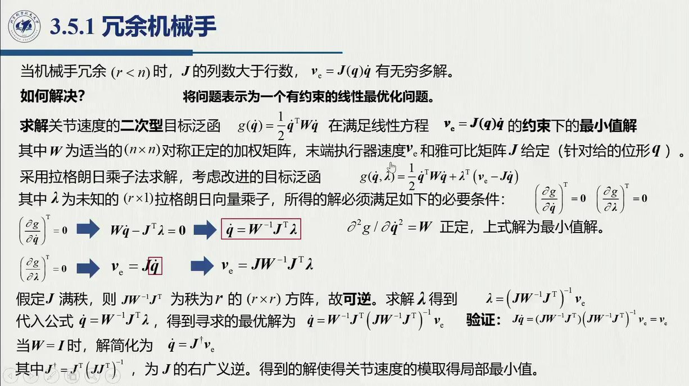
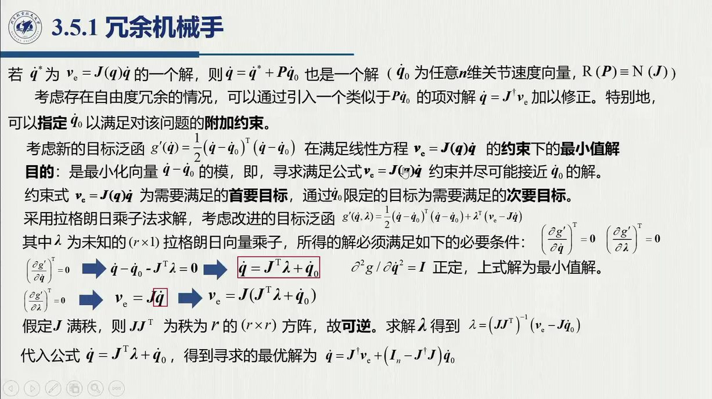
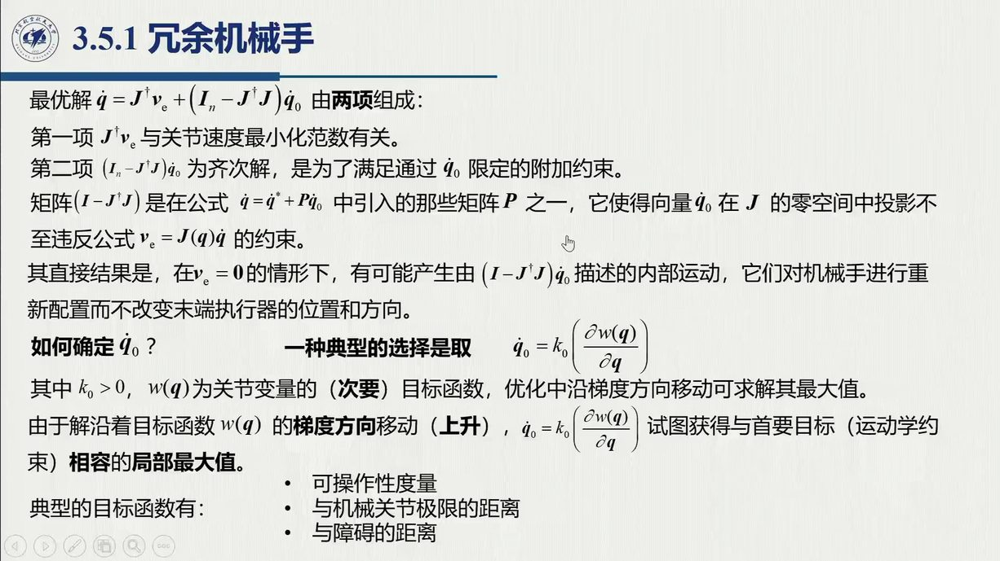
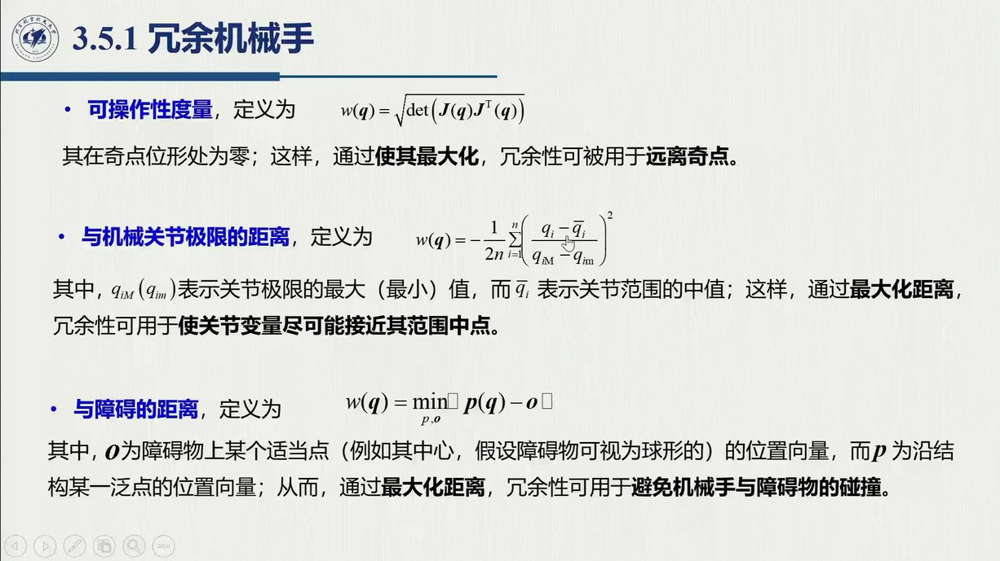
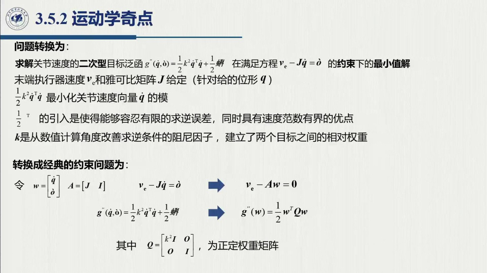
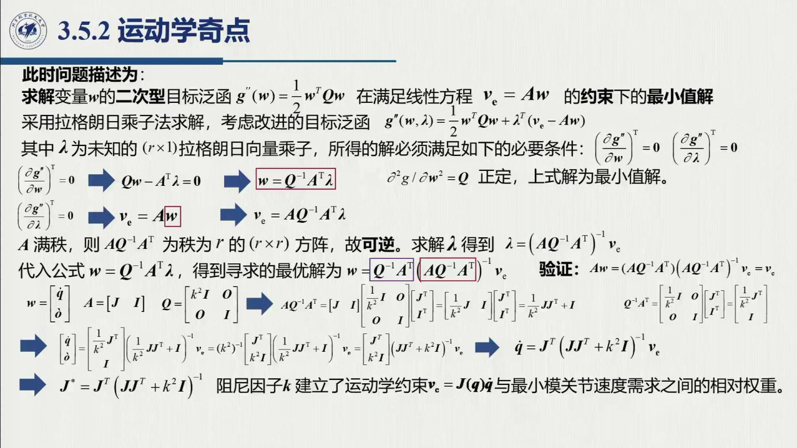

# 3.5 逆微分运动学

§3.4 求出了“一个特解加全部零空间速度”。现在还差两件事：怎样求特解，怎样在多组关节速度中作选择？本节先求严格满足任务的最优速度，再讨论靠近奇点时怎样用任务误差换取较小的关节速度。最后用同一组输入比较求解结果。对应录播 1:56:39–2:19:53。

下文固定当前位形，记所选任务的速度方程为 $v=J\dot q$，其中 $J\in\mathbb R^{r\times n}$、$v\in\mathbb R^r$、$\dot q\in\mathbb R^n$。任务、参考点与表达坐标系均须先确定；几何角速度和姿态参数导数的转换留到 §3.6。

## 3.5.0 方阵情形：求速度，再积分

若 $r=n$ 且 $J$ 满秩，线性方程有唯一解：

$$\dot q=J^{-1}(q)v.$$

已知初始关节位置 $q(0)$，沿时间积分即可得到 $q(t)=q(0)+\int_0^t\dot q(\tau)\,\mathrm d\tau$。计算机只在离散时刻更新，最简单的前向 Euler 法将一个时间步内的速度近似为常数：

$$q_{k+1}=q_k+J^{-1}(q_k)v_k\Delta t.$$

每步都要用新的 $q_k$ 重算 $J$。这利用了速度方程的线性结构，不必先求出封闭形式的位姿逆解；但瞬时速度正确不等于有限步位姿精确，§3.4 已给出二阶漂移的例子。

::: ex 跟算 · 两连杆向上运动一步
两杆各1 m，在 $q_k=[0,\pi/2]^{\mathrm T}$ 时，笔尖位于 $(1,1)$ m。位置雅可比与指令为

$$J=\begin{bmatrix}-1&-1\\1&0\end{bmatrix},\qquad v=\begin{bmatrix}0\\1\end{bmatrix}\ {\rm m/s}.$$

由第二行得 $\dot q_1=1$，第一行得 $\dot q_2=-1$ rad/s。取 $\Delta t=0.1$ s，得到 $q_{k+1}=[0.1,\pi/2-0.1]^{\mathrm T}$。第二杆绝对角仍为 $\pi/2$，所以实际笔尖是

$$p_{k+1}=[\cos0.1,\ 1+\sin0.1]^{\mathrm T}
\approx[0.995004,1.099833]^{\mathrm T}\ {\rm m}.$$

理想直线一步的目标为 $(1,1.1)$ m，两者不同。逆微分运动学求当前速度；数值积分精度和轨迹误差反馈还要另行处理，见 §3.7。
:::

## 3.5.1 冗余情形：在可行速度中选择

### 加权范数：为什么需要一个目标？

设 $r<n$ 且 $J$ 行满秩。任务方程有无穷多解；若希望某些关节少动，可以给它们较大的代价。用对称正定矩阵 $W\in\mathbb R^{n\times n}$ 表示权重，求

$$\min_{\dot q}\ C(\dot q)=\tfrac12\dot q^{\mathrm T}W\dot q,
\qquad J\dot q=v.$$

正定指任意非零 $z$ 都满足 $z^{\mathrm T}Wz>0$，所以每个非零速度都有正代价。$W=I_n$ 时最小化通常的欧氏范数；对角 $W$ 可以分别惩罚各关节。混合移动/转动关节时先用选定尺度归一化，或由 $W$ 表示尺度与相对代价，不能直接把数值大小当成同一种物理量。

### 拉格朗日乘子怎样求出候选解？

将每条任务方程乘以一个待定系数，组成乘子向量 $\lambda\in\mathbb R^r$，定义

$$\mathcal L(\dot q,\lambda)=\tfrac12\dot q^{\mathrm T}W\dot q
+\lambda^{\mathrm T}(v-J\dot q).$$

对称 $W$ 的二次型导数为 $W\dot q$；线性项对 $\dot q$ 的导数为 $-J^{\mathrm T}\lambda$。分别对两个未知向量求导置零：

$$W\dot q-J^{\mathrm T}\lambda=0,\qquad v-J\dot q=0.$$

第一式给出 $\dot q=W^{-1}J^{\mathrm T}\lambda$；代入第二式：

$$G\lambda=v,\qquad G=JW^{-1}J^{\mathrm T}\in\mathbb R^{r\times r}.$$

**为什么 $G$ 可逆？** $W^{-1}$ 仍对称正定。对任意 $a\ne0$，行满秩保证 $J^{\mathrm T}a\ne0$，故

$$a^{\mathrm T}Ga=(J^{\mathrm T}a)^{\mathrm T}W^{-1}(J^{\mathrm T}a)>0.$$

所以 $G$ 正定可逆。反之，若 $J$ 不行满秩，存在非零 $a$ 使 $J^{\mathrm T}a=0$，于是 $Ga=0$，$G$ 不可逆。不能用“矩阵相乘不改秩”代替这个论证；相乘的矩阵并非都可逆。

回代得到加权最优候选解，记加权右逆为 $J_W^\#$：

$$\dot q_W=J_W^\#v,\qquad
J_W^\#=W^{-1}J^{\mathrm T}(JW^{-1}J^{\mathrm T})^{-1}\in\mathbb R^{n\times r}.$$

直接乘 $J$ 得 $JJ_W^\#=I_r$，所以候选解满足任务。

### 为什么它是唯一的全局最优解？

仅有一阶条件还不够。任何其他可行速度都可写成 $\dot q_W+z$，其中 $Jz=0$。展开代价差：

$$C(\dot q_W+z)-C(\dot q_W)
=z^{\mathrm T}W\dot q_W+\tfrac12z^{\mathrm T}Wz.$$

由 $W\dot q_W=J^{\mathrm T}\lambda$，交叉项是 $z^{\mathrm T}J^{\mathrm T}\lambda=(Jz)^{\mathrm T}\lambda=0$。因此任何非零可行扰动都会使代价严格增加。$\dot q_W$ 是固定当前 $J,v$ 后的唯一全局最优速度；这不保证积分后的整条关节轨迹具有最小总能量或最短长度。原教材“locally minimizes”须结合当前位形的语境理解。

::: def 定义 3.5.1 · 行满秩时的右伪逆与最小范数解 {#def-3.5.1}
当 $W=I_n$ 时，

$$J^\dagger=J^{\mathrm T}(JJ^{\mathrm T})^{-1}\in\mathbb R^{n\times r},\qquad
\dot q_{\min}=J^\dagger v.$$

$JJ^\dagger=I_r$；$J^\dagger v$ 是全部满足 $J\dot q=v$ 的速度中唯一的最小范数解。注意伪逆交换输入与输出的维度：$r$ 维任务速度映回 $n$ 维关节速度。方阵满秩时它等于 $J^{-1}$。后文将说明一般秩下的 Moore–Penrose 伪逆，不能将此行满秩闭式的限制误说成“一般伪逆在奇点不存在”。
:::

### 贯穿跟算：同一个3R任务怎样选速度？

沿用 §3.4 的三杆各1 m、$q_*=[0,\pi/2,-\pi/2]^{\mathrm T}$，只要求笔尖位置速度 $v=[0,1]^{\mathrm T}$ m/s：

$$J=\begin{bmatrix}-1&-1&0\\2&1&1\end{bmatrix},\quad
JJ^{\mathrm T}=\begin{bmatrix}2&-3\\-3&6\end{bmatrix},\quad
(JJ^{\mathrm T})^{-1}=\begin{bmatrix}2&1\\1&2/3\end{bmatrix}.$$

用二阶逆矩阵公式可核对行列式为3。左乘 $J^{\mathrm T}$：

$$J^\dagger=\begin{bmatrix}0&1/3\\-1&-1/3\\1&2/3\end{bmatrix},\qquad
\dot q_{\min}=\begin{bmatrix}1/3\\-1/3\\2/3\end{bmatrix}\ {\rm rad/s}.$$

独立检查：§3.4 的全部解为 $(1-\lambda,-1+\lambda,\lambda)$，其范数平方为 $2(1-\lambda)^2+\lambda^2$。求导得 $-4+6\lambda=0$，所以 $\lambda=2/3$，最小平方范数为 $2/3$，与矩阵求解一致。

若第三关节运动代价更高，取 $W=\operatorname{diag}(1,1,4)$，则

$$JW^{-1}J^{\mathrm T}=\begin{bmatrix}2&-3\\-3&21/4\end{bmatrix},\qquad
\dot q_W=\begin{bmatrix}2/3\\-2/3\\1/3\end{bmatrix}\ {\rm rad/s}.$$

仍有 $J\dot q_W=v$，第三关节速度变小，前两关节多承担运动。再用解族检查加权代价：$\dot q^{\mathrm T}W\dot q=2(1-\lambda)^2+4\lambda^2$，导数为 $-4+12\lambda$，最优 $\lambda=1/3$。权重改变选出的解，不改变任务方程。

### 指定附加速度：最近的可行解怎样推？

若已有期望关节速度 $\dot q_0$，目标是尽量接近它，同时严格满足主任务：

$$\min_{\dot q}\tfrac12(\dot q-\dot q_0)^{\mathrm T}W(\dot q-\dot q_0),\qquad J\dot q=v.$$

令 $d=\dot q-\dot q_0$，约束变成 $Jd=v-J\dot q_0$。这与刚证明的问题形式完全相同，因而

$$d=J_W^\#(v-J\dot q_0),\qquad
\dot q=J_W^\#v+(I_n-J_W^\#J)\dot q_0.$$

当 $W=I_n$ 时，得到常用式

$$\dot q=J^\dagger v+P\dot q_0,\qquad P=I_n-J^\dagger J.$$

$JP=J-JJ^\dagger J=0$。$J^\dagger J$ 对称且幂等，其像空间为 $J$ 的行空间；所以 $P$ 是到零空间的欧氏正交投影，与 §3.4 的标准正交基表达 $NN^{\mathrm T}$ 相同。一般 $W$ 对应加权的最近解，不能把加权投影直接当成欧氏正交投影。

对上面的3R数据，指定 $\dot q_0=e_1=(1,0,0)$ rad/s。§3.4 已求得 $Pe_1=(1,-1,-1)/3$，所以最近可行解为

$$\dot q=\begin{bmatrix}1/3\\-1/3\\2/3\end{bmatrix}
+\frac13\begin{bmatrix}1\\-1\\-1\end{bmatrix}
=\begin{bmatrix}2/3\\-2/3\\1/3\end{bmatrix}\ {\rm rad/s}.$$

它通常不会恰好等于 $\dot q_0$；“希望接近”是次目标，并没有新增 $\dot q=\dot q_0$ 这条硬约束。若 $v=0$，解为 $P\dot q_0$，只保持所选任务的瞬时速度为零。

### 次目标怎样给出具体的梯度？

常取 $\dot q_0=k_0\nabla g(q)$，$k_0>0$。§3.4 已证明：欧氏投影的零空间贡献为 $\dot g_{\rm null}=k_0\|P\nabla g\|^2\ge0$。三种常用指标各有不同含义：

- **可操作度** $g=w=\sqrt{\det(JJ^{\mathrm T})}$：在固定尺度下等于速度椭球体积的比例，行秩下降时为零。提高体积不等于增大每个方向的能力，也不等于增大到奇异集合的距离，见 §3.3。
- **靠近关节中点**：设上下限为 $q_{iM},q_{im}$，中点 $\bar q_i=(q_{iM}+q_{im})/2$，行程 $\Delta_i=q_{iM}-q_{im}>0$。取负偏离平方

$$g(q)=-\frac1{2n}\sum_i\left(\frac{q_i-\bar q_i}{\Delta_i}\right)^2,\qquad
\frac{\partial g}{\partial q_i}=-\frac{q_i-\bar q_i}{n\Delta_i^2}.$$

关节高于中点时该梯度分量为负，低于中点时为正。最大化的是负偏离平方；若最大化“到中点的距离”，方向反而错了。投影会改变原梯度，且主任务也在影响关节，不能由此保证不越限。

- **增加障碍间距**：可取臂上点到障碍表面的最小距离。若用球心距离，应减去球半径，才是表面间距。最近点唯一且距离光滑时可求梯度；最近点切换处可能不可微。这是局部再配置的指标，不能据此保证整条轨迹无碰撞。

::: think 独立练习 · 换权重、换附加速度 {#practice-3.5.redundancy}
仍用本节3R的 $J,v$。
1. 取 $W=\operatorname{diag}(1,1,9)$，从解族直接求最优速度，不先套矩阵公式。
2. $W=I$、$\dot q_0=(0,0,1)$ 时，最近可行解是什么？为什么可以不算伪逆？
3. 若某关节 $q_i=0.8$、上下限为0与1，$n=3$，求中点指标的梯度分量。最大化该指标希望它向哪个方向运动？

::: sol 核对与理由
1. 范数代价为 $2(1-\lambda)^2+9\lambda^2$，导数为 $-4+22\lambda$；$\lambda=2/11$，速度 $(9/11,-9/11,2/11)$ rad/s。
2. $J\dot q_0=(0,1)=v$，它本来可行，与自身距离为零，所以最近解就是 $(0,0,1)$ rad/s。
3. $\bar q_i=0.5,\Delta_i=1$，梯度为 $-(0.8-0.5)/3=-0.1$，原梯度希望减小该关节变量；实际速度还要满足主任务并经过投影。
:::
:::

## 3.5.2 奇异与邻域：先分清能否精确实现

### 一般伪逆为什么在奇异处仍有定义？

行满秩闭式 $J^{\mathrm T}(JJ^{\mathrm T})^{-1}$ 在降秩时失效，但 Moore–Penrose 伪逆本身仍存在。用奇异值分解说明这一点：设当前秩为 $s$，

$$J=\sum_{i=1}^{s}\sigma_i u_i v_i^{\mathrm T},\qquad\sigma_i>0.$$

$u_i\in\mathbb R^r$ 是标准正交的可实现任务方向，$v_i\in\mathbb R^n$ 是对应的标准正交关节方向，$Jv_i=\sigma_i u_i$。将指令分为 $v=\sum_i b_i u_i+v_\perp$，其中 $b_i=u_i^{\mathrm T}v$，$v_\perp$ 与值域正交。对每个正奇异值方向，令关节分量为 $b_i/\sigma_i$，就能实现 $b_i u_i$；$v_\perp$ 无法实现。最小范数的最小二乘解为

$$J^\dagger=\sum_{i=1}^{s}\frac1{\sigma_i}v_i u_i^{\mathrm T},\qquad
\dot q_{\rm MP}=J^\dagger v.$$

这是先最小化 $\|J\dot q-v\|$，再在同样残差的解中取最小 $\|\dot q\|$。零空间速度不会改善残差，取零才使范数最小。若 $v_\perp=0$，任务精确可行；否则任何算法都无法在当前位形补回这个方向。

近奇点时，正的 $\sigma_i$ 很小，非零 $b_i$ 会要求很大的关节速度。但在恰好 $\sigma_i=0$ 时，Moore–Penrose 伪逆将该方向的逆增益取为0，并非把 $1/0$ 写进矩阵。固定指令下，这个值可能与从非奇异位形逼近的结果不连续。§3.3 的速度方程已展示这种区别。

### 阻尼最小二乘从哪个目标得到？

即使方程有精确解，近奇点的速度要求也可能过大。阻尼最小二乘（DLS）不再强求速度完全匹配，而求

$$\min_{\dot q}\ F(\dot q)
=\tfrac12\|v-J\dot q\|^2+\tfrac12 k^2\|\dot q\|^2,\qquad k>0.$$

这里采用选定尺度的欧氏坐标。第一项惩罚任务速度误差，第二项惩罚关节速度；增大 $k$ 就更不愿让关节快速运动。求导得正规方程

$$-J^{\mathrm T}(v-J\dot q)+k^2\dot q=0
\quad\Longrightarrow\quad
(J^{\mathrm T}J+k^2I_n)\dot q=J^{\mathrm T}v.$$

对非零 $z$，$z^{\mathrm T}(J^{\mathrm T}J+k^2I_n)z=\|Jz\|^2+k^2\|z\|^2>0$，故任何秩下都有唯一最优解。又因

$$(J^{\mathrm T}J+k^2I_n)J^{\mathrm T}=J^{\mathrm T}(JJ^{\mathrm T}+k^2I_r),$$

左右两种求解写法相等：

$$\dot q=(J^{\mathrm T}J+k^2I_n)^{-1}J^{\mathrm T}v
=J^{\mathrm T}(JJ^{\mathrm T}+k^2I_r)^{-1}v.$$

实际计算通常解线性方程组，无须显式形成逆矩阵。

### 加权误差与增广变量为什么给出同一结果？

若误差和关节速度各有权重，设 $W\succ0,K\succ0$，$\delta=v-J\dot q\in\mathbb R^r$，求

$$\min\ \tfrac12\dot q^{\mathrm T}W\dot q+\tfrac12\delta^{\mathrm T}K\delta,
\qquad J\dot q+\delta=v.$$

将 $w=[\dot q^{\mathrm T},\delta^{\mathrm T}]^{\mathrm T}$、$A=[J\ I_r]$、$Q=\operatorname{diag}(W,K)$ 合并，得到 $\min\tfrac12w^{\mathrm T}Qw$、$Aw=v$。$A$ 含单位阵，任何 $J$ 下都行满秩。套用本节已经证明的加权解，逐块相乘：

$$Q^{-1}A^{\mathrm T}=\begin{bmatrix}W^{-1}J^{\mathrm T}\\K^{-1}\end{bmatrix},\qquad
AQ^{-1}A^{\mathrm T}=JW^{-1}J^{\mathrm T}+K^{-1}=C.$$

$C$ 的二次型是一个非负项加严格正项，所以始终正定；得到

$$\dot q=W^{-1}J^{\mathrm T}C^{-1}v,\qquad\delta=K^{-1}C^{-1}v.$$

核对约束：$J\dot q+\delta=(JW^{-1}J^{\mathrm T}+K^{-1})C^{-1}v=v$。这里始终使用同一误差定义，不需要中途换成相反符号。

::: def 定义 3.5.2 · 阻尼广义逆 $J^*$ {#def-3.5.2}
$$J^*=W^{-1}J^{\mathrm T}(JW^{-1}J^{\mathrm T}+K^{-1})^{-1}\in\mathbb R^{n\times r}.$$

$W,K$ 对称正定时，$J^*v$ 是上述加权误差目标的唯一最优解。$W=I_n,K=k^{-2}I_r$ 时，

$$J^*=J^{\mathrm T}(JJ^{\mathrm T}+k^2I_r)^{-1}.$$

$K$ 是误差权重，$k$ 是阻尼参数：增大 $k$ 相当于减小 $K$。这是正则化的速度解，不保证 $JJ^*=I_r$，也不等于一般 Moore–Penrose 伪逆。
:::

### 每个方向的增益和误差怎样算？

在一对奇异方向上，将关节速度写为 $\alpha_i v_i$、指令分量为 $b_i u_i$。该方向的代价为 $\tfrac12(b_i-\sigma_i\alpha_i)^2+\tfrac12k^2\alpha_i^2$。对 $\alpha_i$ 求导：

$$-\sigma_i(b_i-\sigma_i\alpha_i)+k^2\alpha_i=0
\quad\Longrightarrow\quad
\alpha_i=\frac{\sigma_i}{\sigma_i^2+k^2}b_i.$$

因此逆映射增益为 $g_k(\sigma)=\sigma/(\sigma^2+k^2)$，实际任务分量为 $\sigma_i\alpha_i$，误差为

$$\delta_i=b_i-\sigma_i\alpha_i
=\frac{k^2}{\sigma_i^2+k^2}b_i.$$

$\sigma_i\gg k$ 时误差较小；$\sigma_i\ll k$ 时速度被压低，大部分指令留在误差里。对缺失方向 $\sigma_i=0$，增益为0、误差仍为 $b_i$。

为什么增益有界？直接求导：

$$g_k'(\sigma)=\frac{k^2-\sigma^2}{(\sigma^2+k^2)^2}.$$

它在 $\sigma<k$ 时为正、$\sigma>k$ 时为负，所以峰值出现在 $\sigma=k$，大小为 $1/(2k)$。在选定欧氏尺度下，因奇异方向正交，得到 $\|\dot q_{\rm DLS}\|\le\|v\|/(2k)$；指令幅值增大，速度界也同比增大。这个范数界不能直接当成一套不同单位关节的硬限速设置。

### 跟算与演示：限制速度留下多少误差？

用归一化的二维通道 $J=\operatorname{diag}(1,\epsilon)$、指令 $v=(1,1)$。$\epsilon$ 是第二方向的能力，逐渐变小直至丢失；这是说明求解机制的矩阵模型，不对应一幅特定机械臂。固定 $k=0.1$：

| $\epsilon$ | Moore–Penrose 速度 $\dot q_{\rm MP}$ | DLS速度 $\dot q$ | DLS实际任务速度 $J\dot q$ |
|--:|:--:|:--:|:--:|
| 1 | $(1,1)$ | $(0.99010,0.99010)$ | $(0.99010,0.99010)$ |
| 0.1 | $(1,10)$ | $(0.99010,5)$ | $(0.99010,0.5)$ |
| 0.01 | $(1,100)$ | $(0.99010,0.99010)$ | $(0.99010,0.00990)$ |
| 0 | $(1,0)$，最小二乘解 | $(0.99010,0)$ | $(0.99010,0)$ |

第二行可手算 $0.1/(0.1^2+0.1^2)=5$，实现速度为 $0.1\times5=0.5$，残差为0.5。最后一行没有任何精确解；DLS 没有补回丢失方向。

::: think 操作 · 阻尼、关节速度与任务误差 {#lab-3.5.dls}
先预测：固定 $k=0.1$，把 $\epsilon$ 从0.1降到0.01，DLS第二关节速度会增大还是减小？实际任务速度呢？操作后分别核对增益曲线、关节速度和任务残差。再固定 $\epsilon=0.1$ 增大阻尼，观察交换的两种代价；最后比较“接近0”与“恰好为0”的伪逆读数。

没有脚本时，用上表和 $\epsilon/(\epsilon^2+k^2)$ 计算同样的比较。读数均使用同一组归一化坐标。
:::

::: think 独立练习 · 不照抄上表 {#practice-3.5.dls}
1. $J=[0.2]$、$v=2$、$k=0.1$，求伪逆速度、DLS速度、实际任务速度和残差。
2. 当 $J=[0]$、$v=2$ 时，上述四个量怎样变化？能否把 $1/\sigma$ 的正侧极限当作零点的伪逆值？
3. 在统一归一化尺度下，$\|v\|\le2$，希望用增益界保证 $\|\dot q\|\le5$，$k$ 至少取多少？该选择是否保证任务误差很小？

::: sol 核对与解释
1. 伪逆速度为 $2/0.2=10$；DLS速度为 $0.2\times2/(0.04+0.01)=8$；实际任务速度1.6，残差0.4。
2. 零矩阵的伪逆也是零，最小二乘速度为0；DLS速度也为0，实际速度为0，残差仍为2。正侧 $1/\sigma$ 无界，不等于零点处 Moore–Penrose 伪逆的定义。
3. $2/(2k)\le5$，故 $k\ge0.2$ 是该范数界给出的充分选择；不能由此保证误差小，仍需检查各方向的 $k^2/(\sigma_i^2+k^2)b_i$。
:::
:::

## 3.5 小结与闭卷检查

先问任务是否可行，再问要优化什么。行满秩时，右伪逆给唯一最小范数特解；指定附加速度得到最近可行解。降秩时，一般伪逆仍给最小范数的最小二乘解。DLS 进一步用残差代价与速度代价作权衡，固定正阻尼可限制增益，但无法恢复不可达方向。

::: think 闭卷检查 · 重建求解方法
1. $J$、$J^\dagger$、$W$、$K$ 的维度是什么？为什么 $JW^{-1}J^{\mathrm T}$ 行满秩时正定？
2. 怎样证明加权候选解是固定当前位形后的唯一全局最优解？最近 $\dot q_0$ 的解怎样通过变量平移得到？
3. 为什么零奇异值不参与一般伪逆的求和？近奇点的大增益与恰好在奇点处有何不同？
4. 从DLS目标怎样推出正规方程、方向增益、任务误差和峰值？

::: sol 核对
$J$ 为 $r\times n$、$J^\dagger$ 为 $n\times r$、$W$ 为 $n\times n$、$K$ 为 $r\times r$。二次型 $(J^{\mathrm T}a)^{\mathrm T}W^{-1}(J^{\mathrm T}a)$ 在 $J$ 行满秩且 $a\ne0$ 时严格为正。

任意可行扰动 $z$ 满足 $Jz=0$；代价差的交叉项消失，剩下 $\tfrac12z^{\mathrm T}Wz>0$。最近解令 $d=\dot q-\dot q_0$，解 $Jd=v-J\dot q_0$，再加回 $\dot q_0$。

一般伪逆只反演正奇异值，零奇异值的逆增益取0。正奇异值趋零且对应指令不消失时速度可无界；在零点改为最小二乘解，可能留有不可消除的任务残差。

DLS正规方程为 $(J^{\mathrm T}J+k^2I)\dot q=J^{\mathrm T}v$；方向增益 $\sigma/(\sigma^2+k^2)$、残差因子 $k^2/(\sigma^2+k^2)$，导数在 $\sigma=k$ 变号，峰值 $1/(2k)$。$k$ 大更惩罚关节速度，同时可能增大误差。
:::
:::
