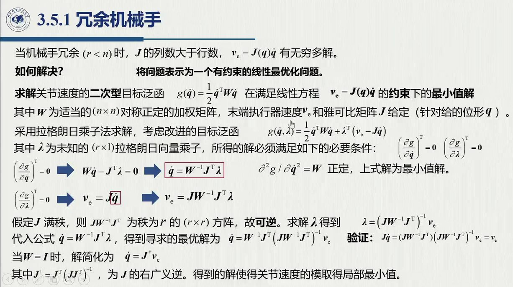
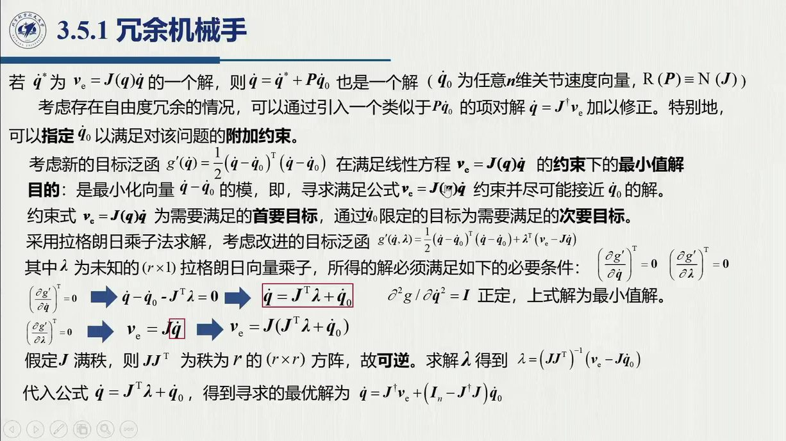
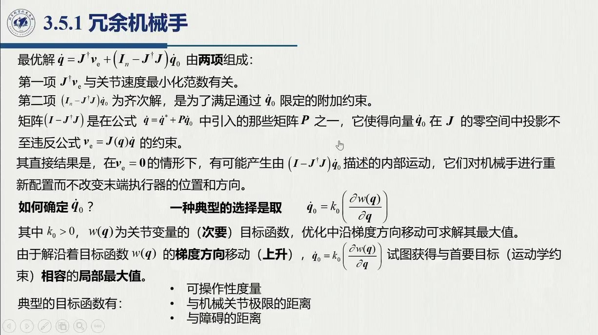
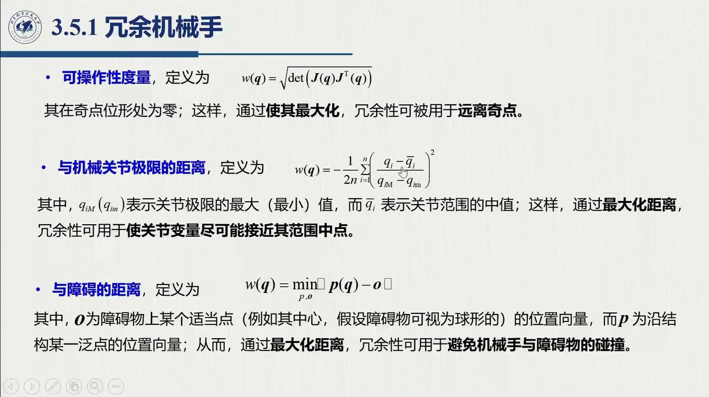
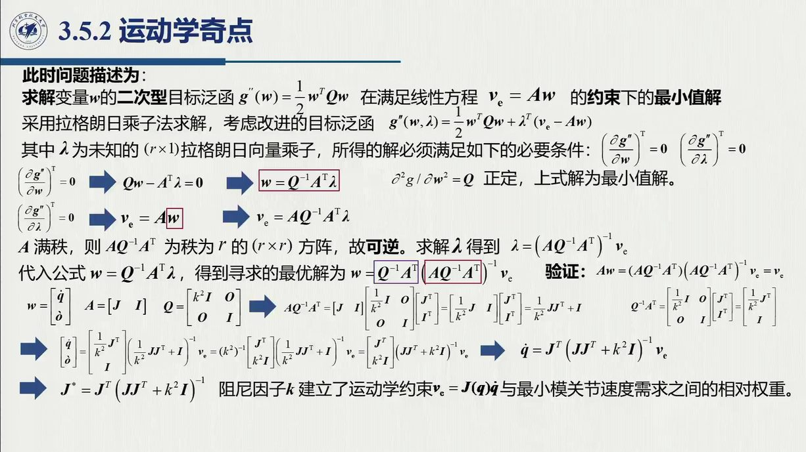
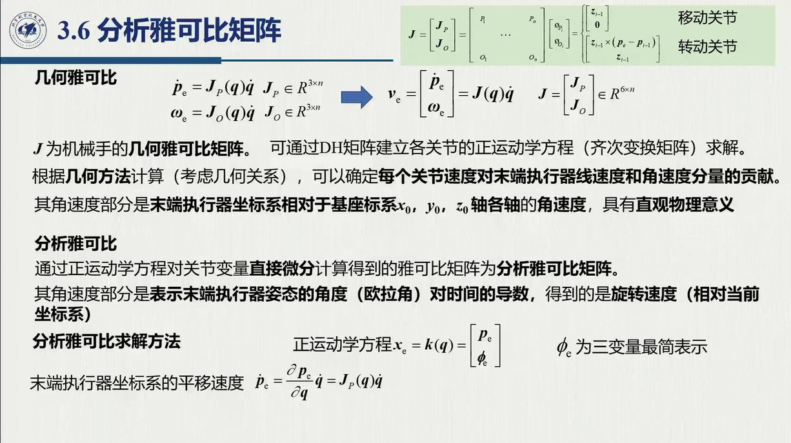

# 3.5 逆微分运动学

正问题「给 $\dot q$ 求 $v_e$」一次矩阵乘法就能解决；逆问题「给 $v_e$ 求 $\dot q$」却要解线性方程组，麻烦全在 $J$ 的形状上：方阵满秩（求逆）、长方矮胖（冗余）、退化（奇异）。本节按这三种情形给出三套答案——直接逆、伪逆 + 零空间、阻尼最小二乘——三套合起来，就是**数值逆运动学的发动机**。录播 1:56:39–2:19:53。

::: preview 先修补 · 拉格朗日乘子法（本节推导只用到这一条）

在进入具体情形之前，先把一件工具补好：「带等式约束的二次型最小化」有一个固定的三步套路，本节 3.5.1 与 3.5.2 会各用一次。

**问题**：$\min_{\boldsymbol x}\frac12\boldsymbol x^{\mathrm T}Q\boldsymbol x$，约束 $A\boldsymbol x=\boldsymbol b$（$Q$ 对称正定）。

1. **构造拉格朗日函数**：$\mathcal L(\boldsymbol x,\boldsymbol\lambda)=\frac12\boldsymbol x^{\mathrm T}Q\boldsymbol x+\boldsymbol\lambda^{\mathrm T}(A\boldsymbol x-\boldsymbol b)$；
2. **对 $\boldsymbol x$ 求偏导置零**：$Q\boldsymbol x+A^{\mathrm T}\boldsymbol\lambda=0\Rightarrow\boldsymbol x=-Q^{-1}A^{\mathrm T}\boldsymbol\lambda$（$Q$ 正定保证这是**极小**而非极大）；
3. **回代约束解出 $\boldsymbol\lambda$**：$A\boldsymbol x=-AQ^{-1}A^{\mathrm T}\boldsymbol\lambda=\boldsymbol b\Rightarrow\boldsymbol\lambda=-(AQ^{-1}A^{\mathrm T})^{-1}\boldsymbol b$，再回代得

$$\boldsymbol x=Q^{-1}A^{\mathrm T}(AQ^{-1}A^{\mathrm T})^{-1}\boldsymbol b .$$

**可逆性前提**：$AQ^{-1}A^{\mathrm T}$ 可逆 ⇔ $A$ **行满秩**。这条前提本节要盯紧，因为它会两次出场：3.5.1 要求 $J$ 行满秩（无奇异），3.5.2 的 $JW^{-1}J^{\mathrm T}+K^{-1}$ 则因 $K^{-1}$ 项而在奇异时仍可逆——这正是 DLS 治奇点的机制。

:::

## 3.5.0 方阵情形：直接求逆 + 数值积分

正运动学 $x_e=k(q)$ 高度非线性，封闭形式的逆解「很可能不存在」。实际操作中，我们用**微分运动的思想 + 数值计算**来求运动学逆解——雅可比正是**数值计算的桥梁**（1:56:40）。最简单的起点是 $n=r$、$J$ 为方阵且满秩的情形：

$$\dot q=J^{-1}(q)\,v_e,\qquad
q(t_{k+1})=q(t_k)+\int_{t_k}^{t_{k+1}}\dot q\,\mathrm dt\approx q(t_k)+J^{-1}(q(t_k))\,v_e(t_k)\,\Delta t$$

「这样不受方程结构是否可解的影响，没有解析解也能解」（1:58:24）。注意这一招的前提是 $J$ 为方阵且满秩：不满秩是**奇异**，长方阵是**冗余**，两者都要另作处理（分别见 3.5.2 与 3.5.1）。

## 3.5.1 冗余机械手（$r<n$）：伪逆与零空间

冗余情形的一般思路，是把它等效为一个**有约束的线性最优化问题**（1:59:00）：在约束 $J\dot q=v_e$ 下最小化关节速度的加权范数

$$\min_{\dot q}\ g(\dot q)=\tfrac12\,\dot q^{\mathrm T}W\dot q\qquad\text{s.t.}\quad J\dot q=v_e$$

其中 $W$ 为 $n\times n$ 对称正定加权矩阵（$W=I$ 时即关节速度范数最小）。下面照 preview 里的三步套路引入拉格朗日乘子：

$$\mathcal L(\dot q,\lambda)=\tfrac12\dot q^{\mathrm T}W\dot q+\lambda^{\mathrm T}(J\dot q-v_e)$$

::: proof 推导（老师全程口述，1:59:30–2:03:30）
**一阶条件**（对 $\dot q$ 求偏导置零）：

$$W\dot q+J^{\mathrm T}\lambda=0\qquad\Longrightarrow\qquad \dot q=-W^{-1}J^{\mathrm T}\lambda$$

（再对 $\dot q$ 求一次导得 $W$，它正定 ⇒ 这是极小值而非极大值——「一阶导为零得极值点，二阶导正定是最小值」，2:01:23。）
**回代约束**：

$$J\dot q=-JW^{-1}J^{\mathrm T}\lambda=v_e\qquad\Longrightarrow\qquad JW^{-1}J^{\mathrm T}\lambda=-v_e$$

**可逆性**（老师特意停下论证，2:02:12）：不考虑奇异时 $J$ 满秩（秩 $r$），$JW^{-1}J^{\mathrm T}$ 是 $r\times r$ 方阵。$J$ 与 $W$ 都满秩，左右相乘相当于做初等变换、不改变秩，故 $JW^{-1}J^{\mathrm T}$ 可逆——「前面这个矩阵不可逆的话，后面的表示就没有意义了」。于是

$$\lambda=-(JW^{-1}J^{\mathrm T})^{-1}v_e,\qquad
\boxed{\ \dot q=W^{-1}J^{\mathrm T}\big(JW^{-1}J^{\mathrm T}\big)^{-1}v_e\ }$$
:::

**$W=I$：右伪逆**（2:03:27）：

::: def 定义 3.5.1 · 右伪逆 $J^\dagger$ 与最小范数解 {#def-3.5.1}
$$\dot q=J^{\mathrm T}(JJ^{\mathrm T})^{-1}v_e=J^\dagger v_e,\qquad J^\dagger\triangleq J^{\mathrm T}(JJ^{\mathrm T})^{-1}\ (r\times n)$$

按现代矩阵论的说法，它就是**右广义逆 / 伪逆**。直接验证 $JJ^\dagger v_e=(JJ^{\mathrm T})(JJ^{\mathrm T})^{-1}v_e=v_e$，可见它确实满足约束；而单权情形得到的解又使关节速度范数**局部最小**，因此称为最小范数解。
:::

**指定 $\dot q_0$ 的通解**（2:04:29）：冗余还有一个好处——可以「顺便」让 $\dot q$ 尽量接近某个期望值 $\dot q_0$（相当于在任务约束之外再附加一条约束）：

$$\min_{\dot q}\ \tfrac12(\dot q-\dot q_0)^{\mathrm T}W(\dot q-\dot q_0)\quad\text{s.t.}\quad J\dot q=v_e
\qquad\xrightarrow{\ \text{同上推导}\ }\qquad
\boxed{\ \dot q=J^\dagger v_e+(I_n-J^\dagger J)\,\dot q_0\ }$$

（$W=I$ 情形。）

::: intuition 两项各是什么
- **第一项 $J^\dagger v_e$**：满足任务的最小范数特解（「干活用的」）；
- **第二项 $(I-J^\dagger J)\dot q_0$：齐次解**。这里 $P=I-J^\dagger J$ 是零空间投影矩阵——$JP\dot q_0=(J-J)\dot q_0=0$，所以该项**不惊动末端**（与 [@thm-3.4.B] 的 $P=NN^{\mathrm T}$ 是同一角色，只是两种写法）。**内部运动**正是由它描述，机械手借此完成再配置（2:06:13）。
:::

**$\dot q_0$ 的三种取法**（2:07:04）：先定义标量函数 $g(q)$，再取

$$\dot q_0=k_0\left(\frac{\partial g(q)}{\partial q}\right)^{\mathrm T}\quad(\text{沿梯度方向})$$

所谓三种取法，其实就是三个不同的 $g$：

1. **可操作度**（最大化）：$g(q)=w(q)=\sqrt{\det\!\big(J(q)J^{\mathrm T}(q)\big)}$。$w$ 在奇点位形处为零；方阵情形直接算 $\det J$，长方阵则算 $\det(JJ^{\mathrm T})$ 再开方——「这个值反映行列式离 0 的远近：离零越远离奇点越远」（2:08:21），最大化 $w$ 就是**远离奇异**；
2. **与关节极限的距离**（最大化）：让各关节角尽量靠近行程中点 $\tfrac12(\vartheta_{i\mathrm M}+\vartheta_{im})$，从而保证不会到达极限位置（2:09:06）；
3. **与障碍物的距离**（最大化）：取机械臂上所有点与障碍物距离的**最小值**作为 $g$，再让它最大化——「使最小距离最大化——最小距离都大了，其他肯定更远」（2:09:31）。

老师一句话点破了这套做法成立的根据：「为什么能优化？因为冗余——不是一个解，有很多个解，可以把我们的目标转化成优化问题」（2:10:06）。

## 3.5.2 运动学奇点情形：阻尼最小二乘

$J^{-1}$ 与 $J^\dagger$ 都只在满秩时才可计算，而奇点位形处 $v_e=J\dot q$ 里含有线性相关的方程（2:10:14），要分两种情况看：

- 若 $v_e\in\mathcal R(J)$：**提取出所有线性无关方程**就能解出 $\dot q$，这条路径仍然可实现；
- 若 $v_e\notin\mathcal R(J)$：$v_e$ 无法用关节速度线性表出，**方程无解**。

**为什么奇点邻域也危险**（不严密但直观，2:11:18）：由 $J^{-1}=\operatorname{adj}J/\det J$（伴随矩阵除以行列式）可见，$\det J\to0$ 时逆矩阵的元素整体趋于无穷——反解出来的**关节速度也趋近无穷大**。「这就是为什么要避开。」

**解决思路：容许小误差，换回可解性**（阻尼最小二乘，DLS，2:12:16）：不再要求微分运动方程严格成立，而是容许 $v_e$ 带一个小的误差 $\delta$：

$$g(\dot q,\delta)=\tfrac12\dot q^{\mathrm T}W\dot q+\tfrac12\,\delta^{\mathrm T}K\,\delta\qquad\text{s.t.}\quad v_e-J\dot q=\delta$$

$K$ 就是这两项之间的权衡系数：$K$ 取得大，更用力压制误差；$K$ 取得小，则更偏向让关节速度小。

**增广变量法**（2:14:24）：把误差也并入未知量，令 $w=\begin{bmatrix}\dot q\\ \epsilon\end{bmatrix}$（课件记 $\epsilon$）、$A=[J\ \ -I]$，则 $Aw=J\dot q-\epsilon=v_e$；目标随之写成单一二次型 $g=\tfrac12w^{\mathrm T}Qw$，$Q=\operatorname{diag}\{W,K\}$。接下来套用拉格朗日乘子法，与 3.5.1 完全同型：先有 $w=-Q^{-1}A^{\mathrm T}\lambda$，再由 $AQ^{-1}A^{\mathrm T}=JW^{-1}J^{\mathrm T}+K^{-1}$（$A$ 满秩、$Q$ 正定 ⇒ 可逆，论证同前）解出 $\lambda$，即得

$$\begin{bmatrix}\dot q\\ \epsilon\end{bmatrix}=\begin{bmatrix}W^{-1}\\ -K^{-1}\end{bmatrix}J^{\mathrm T}\big(JW^{-1}J^{\mathrm T}+K^{-1}\big)^{-1}v_e$$

::: def 定义 3.5.2 · 奇异情形的广义逆 $J^*$ {#def-3.5.2}
$$\dot q=J^{*}v_e,\qquad J^{*}=W^{-1}J^{\mathrm T}\big(JW^{-1}J^{\mathrm T}+K^{-1}\big)^{-1}$$

$W=I$、$K=k^2 I$ 加权时，即经典的阻尼形式 $J^{*}=J^{\mathrm T}(JJ^{\mathrm T}+k^2I)^{-1}$。$K$ 的取法（2:16:33）：**奇点邻域内取足够大**——$K^{-1}$ 项占主导，把 $\det J\to0$ 引起的发散压住，奇异也就变得可以容忍；**远离奇点则取小、甚至趋于 $0$**——此时公式退回 $J^{\mathrm T}(JJ^{\mathrm T})^{-1}$，而远离奇点处 $JJ^{\mathrm T}$ 可逆，问题解决。
:::

下图用一条曲线把「为什么要加阻尼」画了出来。横轴是 $J$ 的奇异值 $\sigma$（$\det J\to0$ 即最小奇异值 $\to0$），纵轴是把任务速度映回关节速度的增益：伪逆的增益 $1/\sigma$ 在奇点处发散；DLS 的增益 $\sigma/(\sigma^2+k^2)$ 则处处有界，峰值只有 $1/(2k)$。

<figure>
<svg class="figure-svg" viewBox="0 0 920 350" xmlns="http://www.w3.org/2000/svg" role="img" aria-labelledby="fig-35-title fig-35-desc">
<title id="fig-35-title">伪逆与阻尼最小二乘的增益曲线</title>
<desc id="fig-35-desc">横轴为奇异值 σ，纵轴为对任务速度的增益。红色虚线为伪逆增益 1/σ，在 σ 趋于 0 时发散；绿色实线为 DLS 增益 σ/(σ²+k²)（k=0.25），处处有界，峰值 1/(2k) 出现在 σ=k；两条曲线在远离奇点处几乎重合。</desc>
<defs>
<marker id="f35-m" markerWidth="9" markerHeight="9" refX="7" refY="3" orient="auto"><path d="M0,0 L7,3 L0,6 Z" fill="var(--muted)"/></marker>
<marker id="f35-r" markerWidth="8" markerHeight="8" refX="6" refY="2.5" orient="auto"><path d="M0,0 L6,2.5 L0,5 Z" fill="var(--fig-red)"/></marker>
</defs>
<text class="diagram-text" x="450" y="30" text-anchor="middle">奇点邻域的两种「逆」：伪逆发散、DLS 有界</text>
<rect x="90" y="44" width="110" height="256" fill="var(--accent)" fill-opacity=".06"/>
<text class="diagram-note" fill="var(--accent-text)" x="148" y="100" text-anchor="middle">奇点邻域</text>
<text class="diagram-note" fill="var(--accent-text)" x="148" y="118" text-anchor="middle">K 取大</text>
<line class="diagram-axis" x1="80" y1="300" x2="820" y2="300" marker-end="url(#f35-m)"/>
<line class="diagram-axis" x1="80" y1="300" x2="80" y2="44" marker-end="url(#f35-m)"/>
<text class="diagram-text" x="762" y="338">奇异值 σ</text>
<text class="diagram-note" x="96" y="76">σ = 0：奇异</text>
<g stroke="var(--line)"><line x1="310" y1="300" x2="310" y2="294"/><line x1="530" y1="300" x2="530" y2="294"/><line x1="750" y1="300" x2="750" y2="294"/>
<line x1="74" y1="236" x2="80" y2="236"/><line x1="74" y1="172" x2="80" y2="172"/><line x1="74" y1="108" x2="80" y2="108"/><line x1="74" y1="44" x2="80" y2="44"/></g>
<text class="diagram-mono" x="310" y="318" text-anchor="middle">0.5</text>
<text class="diagram-mono" x="530" y="318" text-anchor="middle">1.0</text>
<text class="diagram-mono" x="750" y="318" text-anchor="middle">1.5</text>
<text class="diagram-mono" x="68" y="240" text-anchor="end">1</text>
<text class="diagram-mono" x="68" y="176" text-anchor="end">2</text>
<text class="diagram-mono" x="68" y="112" text-anchor="end">3</text>
<text class="diagram-mono" x="68" y="48" text-anchor="end">4</text>
<line x1="80" y1="172" x2="262" y2="172" stroke="var(--line-strong)" stroke-dasharray="5 4"/>
<text class="diagram-mono" x="268" y="176">1/(2k)</text>
<line x1="200" y1="300" x2="200" y2="178" stroke="var(--line)" stroke-dasharray="4 4"/>
<text class="diagram-mono" x="200" y="318" text-anchor="middle">σ = k</text>
<polyline points="191,22 205,55 219,82 233,103 247,121 261,135 275,148 289,158 303,168 317,176 331,183 345,190 359,195 373,200 387,205 401,209 415,213 429,217 443,220 457,223 471,226 485,229 499,231 513,233 526,235 540,237 554,239 568,241 582,243 596,244 610,246 624,247 638,249 652,250 666,251 680,252 694,253 708,254 722,255 736,256 750,257" fill="none" stroke="var(--fig-red)" stroke-width="2" stroke-dasharray="7 5"/>
<line x1="191" y1="46" x2="191" y2="14" stroke="var(--fig-red)" stroke-width="1.8" marker-end="url(#f35-r)"/>
<text class="diagram-text" fill="var(--fig-red)" x="330" y="110">求逆 / 伪逆：增益 1/σ → ∞</text>
<text class="diagram-note" fill="var(--fig-red)" x="330" y="130">det J → 0 时关节速度发散，「这就是为什么要避开」</text>
<polyline points="90,300 101,275 112,251 123,230 134,212 145,198 156,187 167,180 178,175 189,173 200,172 211,173 222,174 233,176 244,179 255,182 266,185 277,188 288,191 299,194 310,198 321,201 332,204 343,206 354,209 365,212 376,214 387,217 398,219 409,221 420,223 431,225 442,227 453,229 464,231 475,232 486,234 497,236 508,237 519,238 530,240 541,241 552,242 563,244 574,245 585,246 596,247 607,248 618,249 629,250 640,251 651,252 662,253 673,253 684,254 695,255 706,256 717,256 728,257 739,258 750,258" fill="none" stroke="var(--fig-green)" stroke-width="2.4"/>
<circle class="diagram-fill-sage" cx="200" cy="172" r="5"/>
<text class="diagram-text" fill="var(--fig-green)" x="420" y="252">DLS J*：σ/(σ² + k²)，峰值 1/(2k)</text>
<text class="diagram-note" fill="var(--fig-green)" x="420" y="272">容许小误差 δ，换来「奇异可容」</text>
<text class="diagram-note" x="450" y="342" text-anchor="middle">示意取 k = 0.25；σ ≫ k 时两线重合 → 远离奇点 DLS 退回伪逆，K 取小甚至趋 0</text>
</svg>
<figcaption>伪逆 vs 阻尼最小二乘（本教程绘）：增益曲线解释了 [@def-3.5.2] 里 $K$ 的取法——奇点邻域 $K^{-1}$ 项占主导，把 $1/\sigma$ 的发散压成不超过 $1/(2k)$ 的有界增益；远离奇点取 $K\to0$，DLS 连续退化为 $J^{\mathrm T}(JJ^{\mathrm T})^{-1}$。</figcaption>
</figure>

::: think 默写点 · 合上书再写（主动回忆）

先别翻正文与速查卡，把下面几条默写出来，再展开核对。写不出来，说明这一节还没「拿走」。

1. $J$ 的三种「不方 / 退化」各对应哪个工具？
2. 写出 $J^\dagger$ 并说明它的解有什么性质。
3. DLS 里的 $K$ 在奇点邻域与远离奇点各怎么取？为什么？

::: sol 核对

方阵满秩 → $J^{-1}$（配数值积分）；长方冗余 → $J^\dagger$（+ 零空间项）；退化 → $J^*$（阻尼）。口诀：方阵求逆、矮胖求伪逆、退化加阻尼。

$J^\dagger=J^{\mathrm T}(JJ^{\mathrm T})^{-1}$，是**右伪逆**；$J^\dagger\boldsymbol v_e$ 是满足任务约束的**最小范数解**（$\|\dot{\boldsymbol q}\|$ 局部最小）。

奇点邻域取**大**——$K^{-1}$ 项占主导，把 $\det J\to0$ 引起的发散压住；远离奇点取**小甚至趋 0**——退回 $J^{\mathrm T}(JJ^{\mathrm T})^{-1}$，而那里 $JJ^{\mathrm T}$ 可逆。

:::

:::

## 3.5 小结与常见错误

- **一条主线**：方阵（求逆 + 数值积分）→ 矮胖（拉格朗日乘子 ⇒ $J^\dagger$ 最小范数解，再加 $P\dot q_0$ 零空间项）→ 退化（DLS：容许 $\delta$、增广同型、$J^*$）。
- **三个矩阵别混**：$J^{-1}$（方阵满秩）、$J^\dagger=J^{\mathrm T}(JJ^{\mathrm T})^{-1}$（冗余、行满秩）、$J^*$（奇异邻域、阻尼）——分别对应三种「不方 / 退化」的处境。

::: think 常见错误清单 · 自查三条
1. 对冗余臂硬求 $J^{-1}$——$r\times n$ 的长方阵根本没有逆；「不存在逆，就要用广义逆（左 / 右广义逆、伪逆），这是线代 / 矩阵论的基础」（0:17:35）；
2. 忘了 $JW^{-1}J^{\mathrm T}$ 可逆的前提是 $J$ 行满秩（无奇异）——一到奇点情形，老配方就失效，必须换用 DLS；
3. 把 $\dot q_0$ 项当成任务误差的修正——它在任务空间的投影恒为零，只能用来调整内部姿态；「干活」永远靠第一项。
:::
