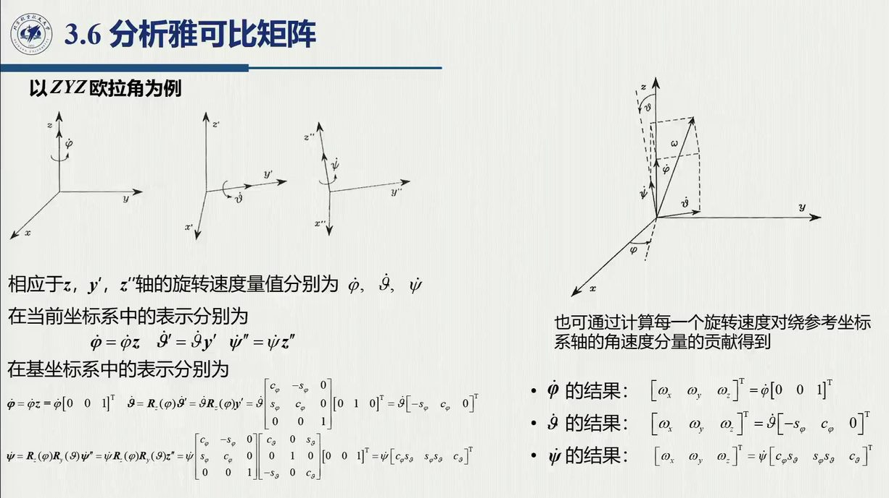
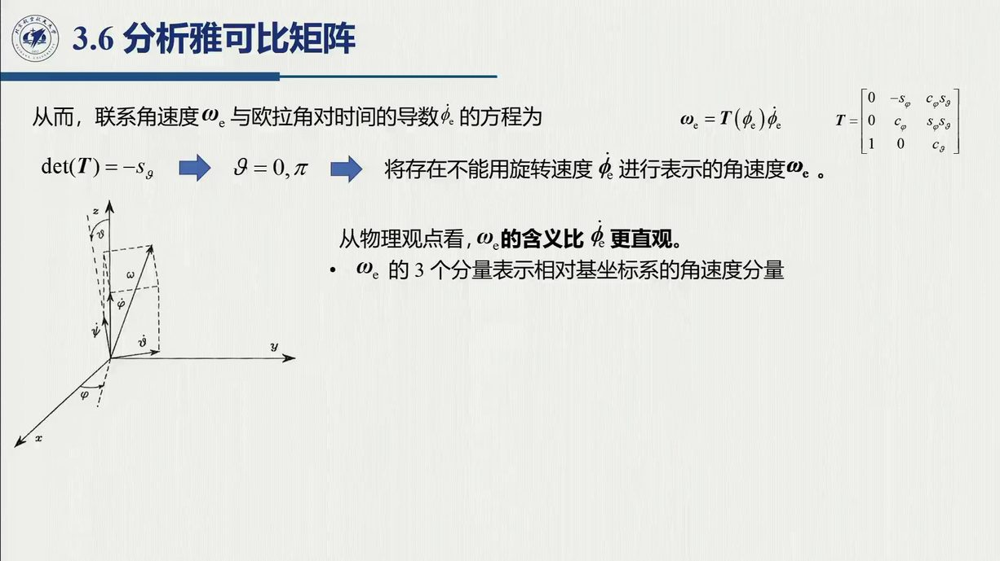

# 3.6 分析雅可比矩阵

上一节用 $J\dot q=v_e$ 求关节速度，其中姿态速度是物理角速度 $\omega_e$。如果控制目标却写成“欧拉角从多少变到多少”，需要的是参数导数 $\dot{\boldsymbol\varphi}_e$。这两个三维量通常不同；本节从转轴和旋转矩阵求导，推导怎样换算，再说明换算何时失效。

本节沿用[§2.4](../ch02/sec2-4.md)的ZYZ约定：$R=R_z(\varphi)R_y(\vartheta)R_z(\psi)$，绕当前轴依次旋转。所有向量都在同一固定基系表示，角度计算用弧度，角速度和角速率用rad/s。录播对应2:17:32–2:24:12；正文可独立跟算。

## 3.6.1 输出不同，雅可比也不同

::: def 定义 3.6.1 · 几何雅可比与分析雅可比 {#def-3.6.1}
固定同一个末端参考点、同一个表达坐标系，令 $q\in\mathbb R^n$。两种映射分别为

$$v_e=\begin{bmatrix}\dot p_e\\\omega_e\end{bmatrix}=J(q)\dot q,
\qquad
\dot x_e=\begin{bmatrix}\dot p_e\\\dot{\boldsymbol\varphi}_e\end{bmatrix}=J_A(q)\dot q,$$

其中 $\boldsymbol\varphi_e=[\varphi,\vartheta,\psi]^{\mathrm T}$。$J,J_A\in\mathbb R^{6\times n}$；$J$ 的后三行输出角速度在基系中的分量，$J_A$ 的后三行输出姿态参数的变化率。

先选定一个光滑的欧拉角坐标分支，即附近姿态能用连续、可微的一组角度表示，且不跨表示奇点或角度跳变。在这个范围内，把位姿坐标写成 $x_e=k(q)$，链式法则给出

$$J_A(q)=\frac{\partial k}{\partial q},\qquad
\dot x_{e,j}=\sum_{i=1}^n\frac{\partial k_j}{\partial q_i}\dot q_i.$$

两者前三行都是 $\partial p_e/\partial q$，所以相同；后三行一般不同。不能把 $v_e$ 和 $\dot x_e$ 当成同一个六维输出。
:::

这里“分析”指对所选位姿坐标求导，并不表示只有 $J_A$ 才能通过求导得到。几何雅可比的角速度部分也能由 $\dot R R^{\mathrm T}=S(\omega_e)$ 求出，见[§3.1](sec3-1.md)。

## 3.6.2 从ZYZ合成推导 $\omega_e=T\dot{\boldsymbol\varphi}_e$

### 第一步：三次转动分别绕哪根轴

第一个角 $\varphi$ 绕基系 $z$ 轴；第二个角 $\vartheta$ 绕转过 $\varphi$ 后的 $y'$ 轴；第三个角 $\psi$ 绕再转过 $\vartheta$ 后的 $z''$ 轴。把三个单位轴都写在基系中：

$$z=\begin{bmatrix}0\\0\\1\end{bmatrix},\qquad
 y'=R_z(\varphi)\begin{bmatrix}0\\1\\0\end{bmatrix}
 =\begin{bmatrix}-s_\varphi\\c_\varphi\\0\end{bmatrix},$$

$$z''=R_z(\varphi)R_y(\vartheta)\begin{bmatrix}0\\0\\1\end{bmatrix}
=R_z(\varphi)\begin{bmatrix}s_\vartheta\\0\\c_\vartheta\end{bmatrix}
=\begin{bmatrix}c_\varphi s_\vartheta\\s_\varphi s_\vartheta\\c_\vartheta\end{bmatrix}.$$

$s_\alpha,c_\alpha$ 分别简写 $\sin\alpha,\cos\alpha$。最后一次绕 $z''$ 自转不会改变 $z''$ 自身，因此这根轴不依赖 $\psi$。

### 第二步：为什么三个贡献可以相加

令 $A=R_z(\varphi),B=R_y(\vartheta),C=R_z(\psi)$，于是 $R=ABC$。乘积求导，再右乘 $R^{\mathrm T}=C^{\mathrm T}B^{\mathrm T}A^{\mathrm T}$：

$$\begin{aligned}
\dot R R^{\mathrm T}
&=(\dot A BC+A\dot B C+AB\dot C)C^{\mathrm T}B^{\mathrm T}A^{\mathrm T}\\
&=\dot A A^{\mathrm T}+A(\dot B B^{\mathrm T})A^{\mathrm T}
 +AB(\dot C C^{\mathrm T})B^{\mathrm T}A^{\mathrm T}.
\end{aligned}$$

[§3.1.2](sec3-1.md#sec-3.1.2)中，$S(a)b=a\times b$，且 $US(a)U^{\mathrm T}=S(Ua)$ 对旋转矩阵 $U$ 成立。例如，对 $A$ 先按角度求导再乘转置，$\frac{\partial R_z}{\partial\varphi}R_z^{\mathrm T}=\begin{bmatrix}0&-1&0\\1&0&0\\0&0&0\end{bmatrix}=S(z)$；对 $R_y$ 同样求导得到 $S(y)$。乘上各自的角速率，三个基本转动满足

$$\dot A A^{\mathrm T}=S(z\dot\varphi),\quad
\dot B B^{\mathrm T}=S(y\dot\vartheta),\quad
\dot C C^{\mathrm T}=S(z\dot\psi).$$

代入上一式，利用 $S$ 的线性性：

$$S(\omega_e)=S(z\dot\varphi)+S(Ay\dot\vartheta)+S(ABz\dot\psi)
 =S(z\dot\varphi+y'\dot\vartheta+z''\dot\psi).$$

$S$ 把一个三维向量唯一对应到叉乘矩阵，因此

$$\boxed{\omega_e=z\dot\varphi+y'\dot\vartheta+z''\dot\psi
=T(\boldsymbol\varphi_e)\dot{\boldsymbol\varphi}_e},\qquad
\boxed{T=\begin{bmatrix}
0&-s_\varphi&c_\varphi s_\vartheta\\
0&c_\varphi&s_\varphi s_\vartheta\\
1&0&c_\vartheta
\end{bmatrix}}.$$

$T\in\mathbb R^{3\times3}$ 的列是三个瞬时转轴的单位方向，矩阵本身无量纲。上面的证明解释了“贡献相加”的来源，不能把三个有限旋转的角度直接当向量相加。

### 第三步：系数为什么不等于向轴投影

$T$ 给出用三根转轴合成 $\omega_e$ 的系数；若三根轴不是正交基，系数不能通过逐轴点积获得。点积实际给出

$$T^{\mathrm T}\omega_e=T^{\mathrm T}T\dot{\boldsymbol\varphi}_e,
\qquad
T^{\mathrm T}T=\begin{bmatrix}1&0&c_\vartheta\\0&1&0\\c_\vartheta&0&1\end{bmatrix}.$$

这里 $z\cdot z''=c_\vartheta$，其余两组点积为0。只有 $\vartheta=\pi/2$ 时三列才恰好正交。一般可逆时，要算的是 $T^{-1}\omega_e$，而非 $T^{\mathrm T}\omega_e$。三根向量能作为三维基，要求**线性无关**；仅说“彼此不平行”并不充分，例如 $e_x,e_y,e_x+e_y$ 就仍共面。

### 跟算：同一个角速度的两套数值

取 $\varphi=0,\vartheta=60^\circ$，任意 $\psi$，并给定 $\dot{\boldsymbol\varphi}_e=(1,2,3)^{\mathrm T}$ rad/s。先写矩阵，再逐行相乘：

$$T=\begin{bmatrix}0&0&\sqrt3/2\\0&1&0\\1&0&1/2\end{bmatrix},\qquad
\omega_e=\begin{bmatrix}3\sqrt3/2\\2\\5/2\end{bmatrix}
\approx\begin{bmatrix}2.59808\\2\\2.5\end{bmatrix}\ \mathrm{rad/s}.$$

沿基系 $z$ 的点积是 $\omega_e\cdot z=2.5$，并不是 $\dot\varphi=1$；沿 $z''$ 的点积是 $3.5$，也不是 $\dot\psi=3$。这是系数与投影的具体区别。

反过来，由第一行得到 $\dot\psi=\omega_x/(\sqrt3/2)=3$，第二行给出 $\dot\vartheta=\omega_y=2$，第三行给出 $\dot\varphi=\omega_z-\dot\psi/2=1$。正向合成与反向求系数能相互核对。

## 3.6.3 反向换算、表示奇点与两种雅可比

### 逐步求 $T^{-1}$，看见分母从哪里来

把 $\omega_e=T\dot{\boldsymbol\varphi}_e$ 展开：

$$\begin{aligned}
\omega_x&=-s_\varphi\dot\vartheta+c_\varphi s_\vartheta\dot\psi,\\
\omega_y&= c_\varphi\dot\vartheta+s_\varphi s_\vartheta\dot\psi,\\
\omega_z&=\dot\varphi+c_\vartheta\dot\psi.
\end{aligned}$$

第一式乘 $-s_\varphi$ 加第二式乘 $c_\varphi$，交叉项抵消，得到 $\dot\vartheta=-s_\varphi\omega_x+c_\varphi\omega_y$。第一式乘 $c_\varphi$ 加第二式乘 $s_\varphi$，则得到 $s_\vartheta\dot\psi=c_\varphi\omega_x+s_\varphi\omega_y$。当 $s_\vartheta\ne0$ 时可以相除，最后用第三式求 $\dot\varphi$：

$$\boxed{T^{-1}=\begin{bmatrix}
-c_\varphi\cot\vartheta&-s_\varphi\cot\vartheta&1\\
-s_\varphi&c_\varphi&0\\
c_\varphi/ s_\vartheta&s_\varphi/s_\vartheta&0
\end{bmatrix}}.$$

沿 $T$ 第一列展开行列式也得到同一条件：

$$\det T=\det\begin{bmatrix}-s_\varphi&c_\varphi s_\vartheta\\c_\varphi&s_\varphi s_\vartheta\end{bmatrix}
=-(s_\varphi^2+c_\varphi^2)s_\vartheta=-s_\vartheta.$$

所以在ZYZ的通常范围 $0\le\vartheta\le\pi$ 内，两个端点是表示奇点。$\vartheta=0$ 时 $z''=z$，$\vartheta=\pi$ 时 $z''=-z$，三个角速率不能唯一、完整地表示三维角速度。

例如 $\varphi=0,\vartheta=0$ 时 $T\dot{\boldsymbol\varphi}_e=(0,\dot\vartheta,\dot\varphi+\dot\psi)^{\mathrm T}$：有限速率无法给出沿 $x$ 的角速度；给定沿 $z$ 的角速度，又只能确定 $\dot\varphi+\dot\psi$。这里固定了这一组欧拉角代表；换一个奇点处的参数代表并不能建立覆盖附近所有姿态的光滑三维坐标。

### 实验：是角速度变大，还是参数速率变大

先预测：保持 $\varphi=0$、固定 $\omega_e=(1,0,0)^{\mathrm T}$ rad/s，让 $\vartheta$ 从 $90^\circ$ 降到 $1^\circ$，哪个量会变大？由上式

$$\dot{\boldsymbol\varphi}_e=(-\cot\vartheta,0,1/\sin\vartheta)^{\mathrm T}.$$

| $\vartheta$ | $\dot\varphi$ | $\dot\vartheta$ | $\dot\psi$ |
|---|---:|---:|---:|
| $90^\circ$ | 0 | 0 | 1 |
| $30^\circ$ | $-\sqrt3$ | 0 | 2 |
| $1^\circ$ | −57.28996 | 0 | 57.29869 |
| $0^\circ$ 或 $180^\circ$ | 无唯一逆换算 | 无唯一逆换算 | 无唯一逆换算 |

角速度一直只有1rad/s；变大的是ZYZ参数速率。操作下面的演示：先在“固定角速率”模式复现上一例，再切到“固定角速度”，比较两个端点附近的读数和实际角速度。图只画真实的 $xz$ 平面分量，$y$ 分量另列，避免把二维投影误当三维夹角。

**读数之后解释**：固定角速率时，即使端点处 $T$ 降秩，正向合成仍有定义；固定角速度时，端点处显示“无唯一逆换算”，不能拿很大的数或零冒充逆解。靠近端点的大速率相互抵消后，仍可能合成很小的物理角速度。

### 两种雅可比怎样连接

::: thm 定理 3.6.A · 两种雅可比的关系 {#thm-3.6.A}
在选定的光滑欧拉角分支内，定义 $T_A\in\mathbb R^{6\times6}$：

$$v_e=\begin{bmatrix}I_3&0\\0&T\end{bmatrix}\dot x_e
=T_A\dot x_e=T_AJ_A\dot q.$$

另一方面 $v_e=J\dot q$。等式对所有 $\dot q\in\mathbb R^n$ 成立，依次取各单位向量便知对应列相同，因此

$$\boxed{J=T_AJ_A},\qquad
\boxed{J_A=T_A^{-1}J\quad(s_\vartheta\ne0)}.$$

块矩阵左上是 $I_3$，保留相同的线速度；右下是 $T$，换算姿态速度。$T_A$ 可逆时左乘不改变秩，所以 $\operatorname{rank}J_A=\operatorname{rank}J$。
:::

**表示奇点不等于机构奇点。** $s_\vartheta=0$ 说明这个ZYZ坐标图失去局部可逆性，不能用 $T_A^{-1}J$ 定义通用的逆换算；几何雅可比是否降秩，要独立看机构及所选任务。不能据此宣布 $J$ 也失效。

一个可计算的反例：三轴转动链的方向取 $R(q)=R_x(q_1)R_y(q_2)R_z(q_3)$，在 $q=0$ 时三根瞬时轴分别为 $e_x,e_y,e_z$，故旋转任务的几何雅可比（角速度块）$J_O=I_3$，可产生任意角速度。同一姿态 $R=I_3$ 用ZYZ表示时却有 $\vartheta=0$。机构的旋转任务没有丢方向，出问题的是所选欧拉角坐标。

## 3.6.4 积分：为什么顺序信息不能丢

若 $\boldsymbol\varphi_e(t)$ 是连续可微、保持在同一光滑分支内的参数，则普通微积分给出

$$\boldsymbol\varphi_e(t)=\boldsymbol\varphi_e(0)+\int_0^t\dot{\boldsymbol\varphi}_e(\tau)\,d\tau.$$

需要初值，也需要正确处理坐标分支；这并不禁止用欧拉角进行局部数值积分。$\omega_e$ 的各分量同样可以积分，错误在于把所得三维积分向量直接当成最终姿态。原教材例3.3给出以下反例。

从 $R(0)=I_3$ 出发，两段各持续1秒。方案A先绕**固定基系** $x$ 转 $90^\circ$，再绕基系 $y$ 转 $90^\circ$；方案B把顺序交换。两者都满足

$$\int_0^2\omega_e\,dt=(\pi/2,\pi/2,0)^{\mathrm T},$$

但按固定轴左乘合成（[§2.3](../ch02/sec2-3.md)）：

$$R_A=R_y(\pi/2)R_x(\pi/2)
=\begin{bmatrix}0&1&0\\0&0&-1\\-1&0&0\end{bmatrix},$$

$$R_B=R_x(\pi/2)R_y(\pi/2)
=\begin{bmatrix}0&0&1\\1&0&0\\0&1&0\end{bmatrix}.$$

检验同一根初始 $z$ 轴：$R_Ae_z=(0,-1,0)^{\mathrm T}$，$R_Be_z=(1,0,0)^{\mathrm T}$，最终方向明显不同。分量积分丢掉了先后顺序，不能仅由该积分恢复姿态；用完整的时间信号和初值解 $\dot R=S(\omega_e)R$ 则可以。数值实现仍需检查步长误差与 $R^{\mathrm T}R=I$，相关旋转更新见[§2.5](../ch02/sec2-5.md)。

### 平面臂为何有一致的特例

对于[§3.2.1](sec3-2.md#sec-3.2.1)的3R平面臂，选任务坐标 $x=(p_x,p_y,\alpha)^{\mathrm T}$，其中 $\alpha=q_1+q_2+q_3$ 是绕固定 $z$ 轴的单个方向角。于是 $\dot\alpha=\dot q_1+\dot q_2+\dot q_3=\omega_z$。这个 $3\times n$ 分析雅可比就等于完整几何雅可比的第1、2、6行。

例如单位杆长、$q=(0,\pi/2,-\pi/2)$ 时，前节位置雅可比补上方向角的一行，得到

$$J_{\rm planar}=\begin{bmatrix}-1&-1&0\\2&1&1\\1&1&1\end{bmatrix},\qquad
J_{\rm planar}\begin{bmatrix}1\\-1\\2\end{bmatrix}
=\begin{bmatrix}0\\3\\2\end{bmatrix}.$$

最后一项既是 $\dot\alpha=2$，也是 $\omega_z=2$ rad/s。这是**一个固定转轴和一个方向角的降维任务**，并不是把一般三维ZYZ的三根轴全部设为同一根。

## 3.6.5 独立练习与闭卷重建

先计算再展开；本节角速度均在基系表示。

1. 取 $\varphi=\pi/2,\vartheta=\pi/2$、$\dot{\boldsymbol\varphi}_e=(2,-1,3)^{\mathrm T}$ rad/s。求 $T$ 和 $\omega_e$，并从角速度反求三项速率。此时逐轴点积为何恰好有效？
2. 取 $\varphi=0,\vartheta=30^\circ$，给定 $\omega_e=(1,2,0)^{\mathrm T}$ rad/s。求三项欧拉角速率并回代；若误把 $\omega_e$ 直接当角速率，会合成什么角速度？
3. 旋转任务的几何雅可比为 $J_O=I_3$，当前ZYZ角为 $(0,\pi/2,0)$。求分析雅可比的旋转部分，并算 $\dot q=e_x$ 时两种输出。能否只由“$R=I$ 的ZYZ表示奇异”断定某个机构奇异？

::: sol 三题核对与错误定位

1. $T=\begin{bmatrix}0&-1&0\\0&0&1\\1&0&0\end{bmatrix}$，故 $\omega_e=(1,3,2)^{\mathrm T}$。反算 $\dot\vartheta=-\omega_x=-1$、$\dot\psi=\omega_y=3$、$\dot\varphi=\omega_z=2$。这里 $\cos\vartheta=0$，三列确为正交单位基，$T^{-1}=T^{\mathrm T}$。
2. $\dot\vartheta=2$，$\dot\psi=1/\sin30^\circ=2$，$\dot\varphi=0-2\cos30^\circ=-\sqrt3$；回代得 $(1,2,0)^{\mathrm T}$。若把 $(1,2,0)$ 误当角速率，乘 $T$ 只得到 $(0,2,1)^{\mathrm T}$，任务已经改变。
3. 此时 $T=T^{-1}=\begin{bmatrix}0&0&1\\0&1&0\\1&0&0\end{bmatrix}$，所以 $J_{A,O}=T^{-1}J_O=T$。$\dot q=e_x$ 时，$\omega_e=e_x$，欧拉角速率为 $(0,0,1)^{\mathrm T}$。两者描述相同瞬时转动，却不是同一组数。不能由ZYZ表示奇异断言机构奇异，必须另外检查几何雅可比的任务秩。

:::

::: think 闭卷重建

1. 从 $R=ABC$ 求导，重建三根轴与矩阵 $T$；指出每个向量的表达坐标系。
2. 用两个线性组合推出 $T^{-1}$，解释为何出现 $1/\sin\vartheta$。
3. 从两种速度方程推出 $J=T_AJ_A$，写明何时能求逆、何时保留秩。
4. 用两次固定轴旋转说明 $\int\omega\,dt$ 为什么不足以确定最终姿态。

::: sol 重建要点

乘积求导的三项分别化成 $S(z\dot\varphi)$、$S(R_zy\dot\vartheta)$、$S(R_zR_yz\dot\psi)$，都在基系中；它们相加后按三根单位轴排成 $T$。前两行按 $(-s_\varphi,c_\varphi)$ 消去 $\dot\psi$，按 $(c_\varphi,s_\varphi)$ 消去 $\dot\vartheta$，后一式须除 $s_\vartheta$，再由第三行求 $\dot\varphi$。$T_A=\operatorname{diag}(I_3,T)$，$J\dot q=T_AJ_A\dot q$ 对任意关节速度成立；在 $s_\vartheta\ne0$ 的光滑分支内才可逆，且两种雅可比秩相等。两段 $x/y$ 基系转动顺序不同，分量积分相同，却将初始 $e_z$ 分别转到 $-e_y$ 和 $e_x$。

:::
:::

## 3.6 小结与下一节

$\omega_e$ 是角速度在基系的分量，$\dot{\boldsymbol\varphi}_e$ 是姿态坐标导数；用 $T$ 合成，不能一般地用逐轴投影取系数。局部光滑且 $\sin\vartheta\ne0$ 时，$J_A=T_A^{-1}J$；ZYZ表示奇点与几何任务降秩须分别判断。角速度可以按时间积分，但只保留三个分量积分会丢掉旋转顺序。

下一节把位姿坐标误差 $e=x_d-x_e$ 引入求解。由于 $\dot x_e=J_A\dot q$，误差导数会自然出现 $J_A$；若改用角速度形式的姿态误差，则需要相应的另一套误差方程，不能把两种速度直接互换。
