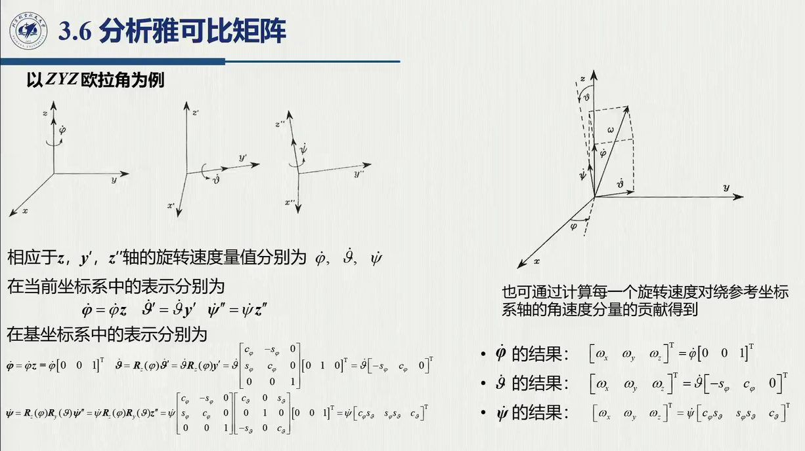
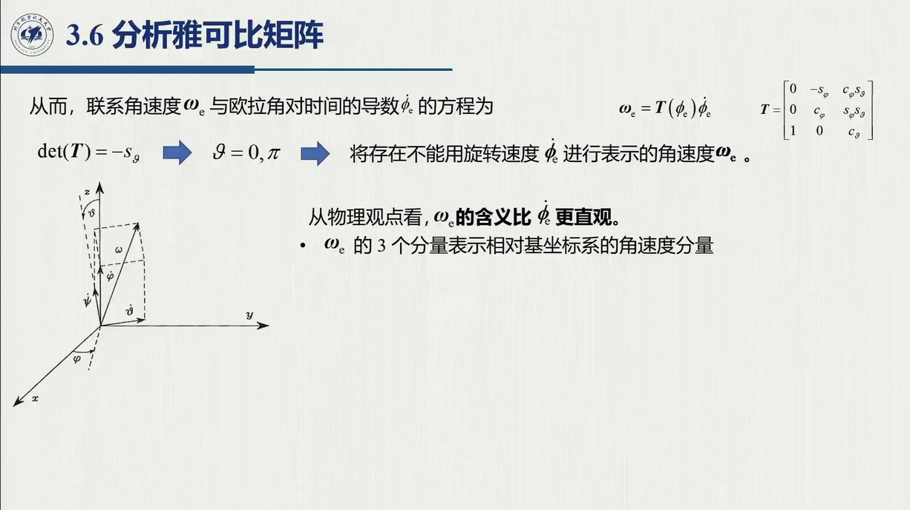

# 3.6 分析雅可比矩阵

同一个角速度，既可以投影到基坐标系的三根正交轴（几何雅可比），也可以「投影」到欧拉角的三根**非正交**瞬时轴（分析雅可比）。两者之间只差一个由欧拉角决定的 $\;6\times6$ 变换矩阵 $T_A$。本节就把这个差别的物理来源讲清楚——它正是上一章 ZYZ 欧拉角（[2.4](../ch02/sec2-4.md)）与本章几何雅可比的接缝。录播 2:17:32–2:24:12。

<aside class="lesson-brief" aria-label="3.6 学习简报">

PREREQUISITE<strong>你需要先会</strong>
ZYZ 欧拉角与奇点（[@thm-2.4.B]）；角速度的物理意义（[@def-3.1.2]）；「数学准备」中的叉积与反对称矩阵。

TARGET<strong>本节要建立</strong>
分析雅可比的定义（把正运动学直接对关节变量求导）；$\omega_e=T(\varphi_e)\dot\varphi_e$ 与 $T(\varphi)$ 的 ZYZ 显式（三根瞬时轴方向的直接推导）；$J_A=T_A^{-1}J$；欧拉角歧义与两种速度的可积分性。

CHECKPOINT<strong>学完的标准</strong>
能说明「前三个分量一致、后三个不一致」；能写出 $T_A$ 的分块结构并解释左上角为何是单位阵；能指出 $J_A$ 在哪里失效及原因。

</aside>

## 3.6.1 定义与对比

::: def 定义 3.6.1 · 几何雅可比 vs 分析雅可比 {#def-3.6.1}
- **几何雅可比**（3.1 的 $J$）：用几何方法（DH + 正运动学）算出，逐列给出每个关节速度对末端**线速度与角速度**的贡献；它的角速度部分 $\omega_e$ 是末端角速度在**基坐标系**三根轴上的分量，物理意义直观（2:17:44–2:18:20）。
- **分析雅可比** $J_A$：把正运动学 $x_e=k(q)$ 对关节变量**直接微分**得到；姿态部分改用欧拉角 $\varphi_e=[\varphi,\vartheta,\psi]^{\mathrm T}$（ZYZ）的时间导数 $\dot\varphi_e$，即**绕欧拉角所定义转轴的旋转速度**，直观性差不少（2:18:26–2:19:08）。

两者都描述 $v=[\dot p_e;\ \dot\varphi_e]$ 与 $\dot q$ 的关系，只是姿态部分选了不同的速度表示：

$$\dot x_e=\begin{bmatrix}\dot p_e\\ \dot\varphi_e\end{bmatrix}=J_A(q)\,\dot q,\qquad
\dot p_e=\sum_{i=1}^{n}\frac{\partial p_e}{\partial q_i}\dot q_i\ (\text{前三个分量与 } J_P \text{ 相同})$$
:::

**差异的关键在后三个分量**（0:14:53–0:15:53，老师在开篇就点明了这一点）：「它俩都是同一个角速度，只是投影到不同的空间：一个投影到基坐标系（正交），一个投影到**非正交的三个欧拉角轴**。」

## 3.6.2 $\omega_e$ 与 $\dot\varphi_e$ 的关系：矩阵 $T$

先搭一座 $\omega_e$ 与 $\dot\varphi_e$ 之间的桥梁。要问的第一个问题是：ZYZ 序列（[2.4.2](../ch02/sec2-4.md#sec-2.4.2)，绕当前轴右乘）合成时，三个角速度各绕哪根轴转？答案分别是三根**瞬时轴**：$\dot\varphi$ 绕基系 $z$ 轴、$\dot\vartheta$ 绕转完 $\varphi$ 之后的 $y'$ 轴、$\dot\psi$ 绕再转完 $\vartheta$ 之后的 $z''$ 轴。角速度可以叠加（牵连转动合成，[3.1.2](sec3-1.md#sec-3.1.2)(d)），故

$$\omega_e=\dot\varphi\,\boldsymbol z+\dot\vartheta\,\boldsymbol y'+\dot\psi\,\boldsymbol z'' .$$

注意，这三个方向必须**先表达在同一坐标系（基系）**才能相加（[3.1.2](sec3-1.md#sec-3.1.2)(a) 的纪律）。于是就逐个用基本旋转把它们算到基系里——依据是「转过去的向量 = 左乘对应矩阵」（[@thm-2.2.B] 旋转算子身份）：

$$\boldsymbol z=\begin{bmatrix}0\\0\\1\end{bmatrix},\qquad
\boldsymbol y'=R_z(\varphi)\,\boldsymbol y=\begin{bmatrix}-s_\varphi\\ c_\varphi\\ 0\end{bmatrix},\qquad
\boldsymbol z''=R_z(\varphi)R_y(\vartheta)\,\boldsymbol z=\begin{bmatrix}s_\vartheta c_\varphi\\ s_\vartheta s_\varphi\\ c_\vartheta\end{bmatrix}.$$

（这里 $R_y(\vartheta)\boldsymbol z=[s_\vartheta,0,c_\vartheta]^{\mathrm T}$，再左乘 $R_z(\varphi)$ 就得到第三式。）把这三个方向按各自的系数排成矩阵的列：

$$\omega_e=T(\varphi_e)\,\dot\varphi_e,\qquad
T(\varphi)=\begin{bmatrix}0&-s_\varphi&s_\vartheta c_\varphi\\ 0&c_\varphi&s_\vartheta s_\varphi\\ 1&0&c_\vartheta\end{bmatrix}\quad(\text{ZYZ})$$

——**$T$ 的三列就是三根瞬时转轴在基系中的方向**；整个推导的本质，就是把斜轴上的角速度贡献投影回基系再合成。

**念法**（2:21:05）：把 $T$ 读作「三根瞬时转轴在基系中的方向排成的矩阵」——这三列**未必正交**；其中 $z$ 与 $z''$ 的夹角恰为 $\vartheta$（$\vartheta\to0$ 时这两列共线，正是 3.6.3 的奇异来源）。

把三根轴与合成出的 $\omega_e$ 画出来，就得到下图：$\dot\varphi$ 的读法是「沿 $z_0,y',z''$ 三根**斜轴**各转多少」，与正交基上的读数相比差一个换基——这个换基矩阵正是 $T(\varphi)$。

<figure>
<svg class="figure-svg" viewBox="0 0 920 330" xmlns="http://www.w3.org/2000/svg" role="img" aria-labelledby="fig-36-t fig-36-d">
<title id="fig-36-t">欧拉角的三根非正交转轴与角速度合成</title>
<desc id="fig-36-d">原点处三根转轴：竖直的 z 轴、转 φ 后的 y′ 轴、再转 ϑ 后的 z″ 轴；三个角速度贡献首尾相接合成总角速度 ω；z 与 z″ 的夹角标为 ϑ，ϑ 趋于零时两轴共线、T 奇异。</desc>
<defs>
<marker id="f36-m" markerWidth="8" markerHeight="8" refX="6" refY="2.5" orient="auto"><path d="M0,0 L6,2.5 L0,5 Z" fill="var(--muted)"/></marker>
<marker id="f36-g" markerWidth="8" markerHeight="8" refX="6" refY="2.5" orient="auto"><path d="M0,0 L6,2.5 L0,5 Z" fill="var(--fig-gold)"/></marker>
<marker id="f36-n" markerWidth="8" markerHeight="8" refX="6" refY="2.5" orient="auto"><path d="M0,0 L6,2.5 L0,5 Z" fill="var(--fig-green)"/></marker>
<marker id="f36-b" markerWidth="8" markerHeight="8" refX="6" refY="2.5" orient="auto"><path d="M0,0 L6,2.5 L0,5 Z" fill="var(--fig-blue)"/></marker>
</defs>
<text class="diagram-text" x="270" y="30" text-anchor="middle">ω 的合成（ZYZ，示例 φ=40° ϑ=55°）</text>
<g stroke="var(--muted)" stroke-width="1.1" stroke-dasharray="3 4" marker-end="url(#f36-m)" opacity=".7">
<line x1="330" y1="250" x2="380.2" y2="263.6"/>
<line x1="330" y1="250" x2="303.8" y2="234.9"/>
</g>
<line stroke="var(--fig-gold)" stroke-width="3" marker-end="url(#f36-g)" x1="330" y1="250" x2="330" y2="145"/>
<line stroke="var(--fig-green)" stroke-width="1.8" stroke-dasharray="5 4" marker-end="url(#f36-m)" x1="330" y1="250" x2="239.3" y2="215.5"/>
<line stroke="var(--fig-blue)" stroke-width="1.8" stroke-dasharray="5 4" marker-end="url(#f36-m)" x1="330" y1="250" x2="368.3" y2="192.5"/>
<line stroke="var(--fig-gold)" stroke-width="2.6" marker-end="url(#f36-g)" x1="330" y1="250" x2="330" y2="145"/>
<line stroke="var(--fig-green)" stroke-width="2.6" marker-end="url(#f36-n)" x1="330" y1="145" x2="259.3" y2="118.1"/>
<line stroke="var(--fig-blue)" stroke-width="2.6" marker-end="url(#f36-b)" x1="259.3" y1="118.1" x2="278.5" y2="89.3"/>
<line stroke="var(--ink)" stroke-width="2" marker-end="url(#f36-m)" x1="330" y1="250" x2="278.5" y2="89.3"/>
<path d="M 330 205 A 45 45 0 0 1 355 212.5" fill="none" stroke="var(--fig-purple)" stroke-width="1.8"/>
<text class="diagram-text" fill="var(--fig-purple)" x="358" y="204">ϑ</text>
<text class="diagram-text" fill="var(--fig-gold)" x="338" y="152">z<tspan class="sb">0</tspan>·φ′</text>
<text class="diagram-text" fill="var(--fig-green)" x="283" y="148" text-anchor="end">y′·ϑ′</text>
<text class="diagram-text" fill="var(--fig-blue)" x="290" y="80">z″·ψ′</text>
<text class="diagram-text" x="262" y="104" text-anchor="end">ω<tspan class="sb">e</tspan></text>
<text class="diagram-note" x="238" y="224" text-anchor="end">y′（第 2 列）</text>
<text class="diagram-note" x="376" y="188">z″（第 3 列）</text>
<text class="diagram-note" x="330" y="286" text-anchor="middle">实线 = 三个贡献首尾相接；黑 = 合成的 ω；虚线 = 三根轴的全长</text>
<text class="diagram-text" x="700" y="100" text-anchor="middle">同一个 ω，两套读数</text>
<circle fill="var(--muted)" cx="580" cy="122" r="4"/><text class="diagram-note" x="592" y="127">正交基 x<tspan class="sb">0</tspan> y<tspan class="sb">0</tspan> z<tspan class="sb">0</tspan> 读数 → 几何雅可比的后三行</text>
<circle fill="var(--muted)" cx="580" cy="146" r="4"/><text class="diagram-note" x="592" y="151">斜轴 z<tspan class="sb">0</tspan> y′ z″ 读数 → 欧拉角速率 φ′（可积分）</text>
<circle fill="var(--muted)" cx="580" cy="170" r="4"/><text class="diagram-note" x="592" y="175">两套读数的换基矩阵 = T(φ)，J<tspan class="sb">A</tspan> = T<tspan class="sb">A</tspan><tspan class="sp">−1</tspan>J</text>
<text class="diagram-note" x="700" y="204" text-anchor="middle">z<tspan class="sb">0</tspan> 与 z″ 的夹角恰为 ϑ：ϑ → 0 时两列共线，</text>
<text class="diagram-note" x="700" y="226" text-anchor="middle">T 奇异、J<tspan class="sb">A</tspan> 失效——与 ZYZ 表示奇点同源</text>
</svg>
<figcaption>$\omega_e=T(\varphi)\dot\varphi_e$ 的几何（本教程绘）：$T$ 的三列就是三根瞬时转轴的方向，三个角速度贡献**首尾相接**合成 $\omega_e$。三根轴一般不构成正交基——这正是「分析雅可比后三行 ≠ 几何雅可比后三行」的来源；退化发生在 $\vartheta=0$：$z_0$ 与 $z''$ 共线，$T$ 不可逆（[@thm-3.6.A]）。</figcaption>
</figure>

::: intuition 一个向量、两组「坐标」
「就是线代里同一个向量可以表示在不同坐标系——空间可以正交也可以不正交，三根轴只要不共线就能表示三维所有的（角速度）向量」（2:21:05）。$\omega_e$ 就是那个向量：在正交基（$x_0,y_0,z_0$）里读数，得到几何雅可比的后三行；在非正交基（$z,y',z''$）里读数，得到 $\dot\varphi$——**连接这两套读数的换基矩阵，就是 $T$**。
:::

换基矩阵一确定，两种雅可比之间的关系就随之确定（2:22:00）：

::: thm 定理 3.6.A · 两种雅可比的关系 {#thm-3.6.A}
$$J_A=T_A^{-1}(\varphi_e)\,J,\qquad
T_A(\varphi_e)=\begin{bmatrix}I_3&0\\ 0&T(\varphi_e)\end{bmatrix}$$

左上角的 $I_3$ 说明线速度部分两式一致；右下角的 $T$ 说明角速度部分需要换算。

（$T$ 奇异时逆不存在——具体见 3.6.3 的欧拉角歧义。）
:::

## 3.6.3 歧义与积分意义

针对这一页，老师给出了两条「使用注意」（2:22:37–2:23:53）：

1. **欧拉角歧义**：$\vartheta=0$ 或 $\pi$ 时（进动轴与自转轴重合），$\varphi$ 与 $\psi$ 之间存在歧义，不能相互表达——此时 $T$ 奇异（$s_\vartheta=0$，第 1、3 列共线），$J_A$ 也随之失效。这正是 [@thm-2.4.B] 的 ZYZ 奇点在雅可比上的表现；
2. **积分意义**：欧拉角速率 $\dot\varphi$ **可以积分**（积出来就是欧拉角本身，有物理意义）；而 $\omega$ 各分量的时间积分，只有在**无穷小旋转**意义下才有意义（角速度不是某个「角度向量」的导数——旋转不可交换，[2.3](../ch02/sec2-3.md)）。

::: note 一致的特例（2:23:53）
某些场合 $J$ 与 $J_A$ 可以完全一致：例如平面臂，姿态角 $\varphi$ 本身就能直接表示为关节变量的函数（$\varphi=\vartheta_1+\dots$），把它对关节变量直接微分，得到的就是相应的雅可比行——**几何与分析在这里重合**。原因在于差异本就只出在「角速度用什么表示」上，而平面情形中欧拉角轴与固定轴重合，根本不存在换基问题。
:::

::: think 默写点 · 合上书再写（主动回忆）

先合上正文与速查卡，把下面几条写出来，再展开核对；写不出来，就说明这一节还没「拿走」。

1. $J$ 与 $J_A$ 哪几行相同、哪几行不同？为什么？
2. 写出 $T_A$ 的分块结构，并说明 $T(\varphi)$ 三列的含义。
3. $J_A$ 在什么条件下失效？为什么与 ZYZ 的表示奇点同源？

::: sol 核对

**前三行（线速度）相同**——$\dot{\boldsymbol p}_e$ 对 $q$ 直接求偏导的结果，与逐列构造的结果一致；**后三行不同**——$\boldsymbol\omega_e$ 用基系正交轴读数，$\dot{\boldsymbol\varphi}_e$ 用欧拉角的三根非正交瞬时轴读数，两者差一个换基。

$T_A=\begin{bmatrix}I_3&0\\ 0&T(\varphi)\end{bmatrix}$。$T$ 的第 1 列是 $z$ 轴、第 2 列是转 $\varphi$ 后的 $y'$ 轴、第 3 列是再转 $\vartheta$ 后的 $z''$ 轴（即 $s_\vartheta c_\varphi,\ s_\vartheta s_\varphi,\ c_\vartheta$）。

$s_\vartheta=0$（$\vartheta=0,\pi$）时 $T$ 第 1、3 列共线、不可逆 ⇒ $J_A$ 失效。这正是 ZYZ 表示奇点（$\varphi$ 与 $\psi$ 有歧义）在雅可比上的表现。

:::

:::

## 3.6 小结与常见错误

- **一条主线**：同一角速度 → 两种表示（正交基 vs 欧拉角轴）→ $\omega_e=T(\varphi)\dot\varphi$ → $J_A=T_A^{-1}J$（左上 $I_3$、右下 $T$）→ 欧拉角歧义处 $T$ 奇异、$J_A$ 失效。
- **一句口诀**：**位置部分同、姿态部分异；几何看得见（$\omega$ 有分量）、分析可积分（$\dot\varphi$ 可积分）**。

::: think 常见错误清单 · 自查三条
1. 把 $J_A$ 与 $J$ 的差别当成「笔误」——两者角速度行不同是本质差异（换基），相同的只有线速度行；
2. 直接用 $\dot\varphi$ 积分做姿态更新却没有配套的数值积分——$\varphi$ 可积但方程非线性，工程上通常仍走旋转矩阵 / 四元数（[2.6](../ch02/sec2-6.md)）；
3. 在 ZYZ 奇点只怪欧拉角「反解跳变」——$J_A$ 本身也在此失效（$T$ 不可逆），二者同源。
:::
